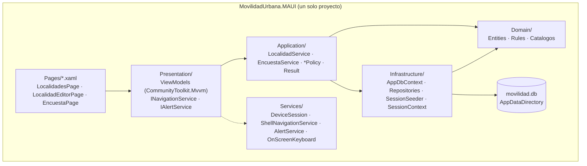
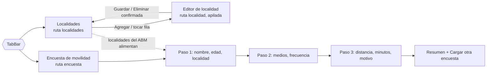
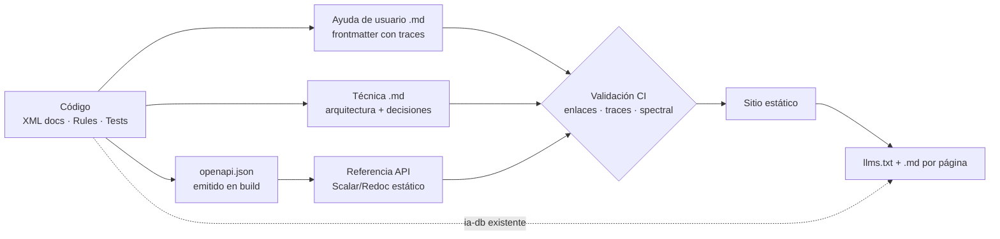

# R05 — MovilidadUrbana.MAUI como referencia inicial de una mini demo DocAsCode

| Campo | Valor |
| --- | --- |
| Id | R05 |
| Título | Relevamiento de MovilidadUrbana (MAUI, ApiWeb, Web) y alcance mínimo de una mini demo DocAsCode |
| Autor (rol) | Investigador de relevamiento — analista de sistemas .NET (despacho R05 de la mesa de *Replanteo y análisis*) |
| Fecha | 2026-10-26 |
| Fase | Solo lectura sobre los repos. Única escritura: esta bitácora |
| Prompt de origen | `/LAB/Lab-Documentos/Lab-Documentos.Documentacion/PROMPTs/DEVs/Enchacement/01-Replanteo-Y-Analisis/Replanteo-Y-Analisis.md` |

**Fuentes leídas** (rutas desde la raíz del workspace; todas existen al 2026-10-26):

- Prompt: `Replanteo-Y-Analisis.md` (completo, 67 líneas).
- Base de conocimiento: `/LAB/Lab-E2E.WebBlazor/Lab-E2E.WebBlazor.Documentacion/ia-db/README.md` (completo) e `indexes/07_Guias.md`, `indexes/12_Api-REST.md`, `indexes/13_App-Android.md` (parcial, por búsqueda).
- README del repo de documentación: `/LAB/Lab-E2E.WebBlazor/Lab-E2E.WebBlazor.Documentacion/README.md` (líneas 1-40).
- Prompt que originó la app: `/LAB/Lab-E2E.WebBlazor/Lab-E2E.WebBlazor.Documentacion/PROMPTs/Features/03-Crear-MAUI-Applications/Crear-MAUI-Applications.md`.
- Código (repo `Lab-E2E.WebBlazor`, rama `main`, commit `8fb4c3a`): `src/MovilidadUrbana.MAUI/` (csproj, `MauiProgram.cs`, `AppShell.xaml(.cs)`, `Domain/`, `Application/`, `Services/DeviceSession.cs`, `Pages/*.xaml`, `Presentation/`), `src/MovilidadUrbana.ApiWeb/` (csproj, `Program.cs`, `Controllers/`), `tests/MovilidadUrbana.MAUI.Tests/`, `tests/MovilidadUrbana.MAUI.UITests/`, `tests/MovilidadUrbana.ApiWeb.Tests/DocumentationTests.cs`, `.github/workflows/android.yml`, `scripts/dotnet.sh`, `README.md`, `evidencia/2026-09-12-maui/`.
- Guía DocAsCode vigente: `/LAB/Lab-Documentos/Lab-Documentos/Guides/Documentacion-Tecnica/Sistema-De-Documentacion-E-Integracion/Sistema-Documentador-Tecnico-Guide.md` (§3, §7.3, §7.4) y `Examples/Prueba-Ayuda-Por-Rol/README.md`.
- Guías mudadas: listado de `/LAB/Lab-Documentos/Lab-Documentos/Guides/Testing/`.
- Ensayo propio: contrato OpenAPI real de la ApiWeb, obtenido el 2026-10-26 levantando una **copia** del proyecto en contenedor (§6.2).

---

## Índice

1. [Definiciones](#1-definiciones)
2. [Qué es MovilidadUrbana y dónde está el proyecto MAUI](#2-qué-es-movilidadurbana-y-dónde-está-el-proyecto-maui)
3. [Capas y composición](#3-capas-y-composición)
4. [Roles de usuario](#4-roles-de-usuario)
5. [Pantallas y casos de uso](#5-pantallas-y-casos-de-uso)
6. [Documentación existente hoy](#6-documentación-existente-hoy)
7. [Fuentes de verdad derivables del código](#7-fuentes-de-verdad-derivables-del-código)
8. [Propuesta de mini demo DocAsCode](#8-propuesta-de-mini-demo-docascode)
9. [Entorno del host](#9-entorno-del-host)
10. [Hallazgos para la mesa](#10-hallazgos-para-la-mesa)
11. [Registro de evidencias](#11-registro-de-evidencias)

---

## 1. Definiciones

| Término | Definición usada en esta bitácora |
| --- | --- |
| **DocAsCode** (*docs as code*) | Tratar la documentación con las herramientas del código: texto plano versionado en git, revisión por PR, validación y publicación automáticas en CI. Definición de trabajo tomada de `Sistema-Documentador-Tecnico-Guide.md` §2.1 |
| **Fuente de verdad** | Artefacto del que otra documentación **deriva** y que, si cambia, obliga a revisar lo derivado (p. ej. el contrato OpenAPI respecto de la referencia de API) |
| **Derivar vs. generar** | *Generar*: salida mecánica (referencia de API desde OpenAPI). *Derivar*: reescritura humana o asistida a partir de una fuente, con traza (ayuda de usuario desde un caso de uso). Distinción de la guía, §7.4 |
| **Traza** | Campo de metadatos que apunta a la fuente que una página explica, con su versión, para detectar desactualización (`traces` en la guía, §7.3) |
| **Mini demo** | Ejemplo ejecutable, mínimo y autocontenido que muestra el ciclo completo fuente → validación → publicación, en el estilo de `Examples/Prueba-Ayuda-Por-Rol/` |
| **ia-db** | Base de conocimiento indexada para agentes: un `README.md` de entrada y `indexes/NN_*.md` que citan el código por `ruta:línea` |

---

## 2. Qué es MovilidadUrbana y dónde está el proyecto MAUI

**MovilidadUrbana** es la temática didáctica del laboratorio público `Lab-E2E.WebBlazor`: un ABM de localidades y una encuesta de transporte en tres pasos. Se repite en **tres aplicaciones independientes** (sin referencias entre proyectos): web Blazor, API REST y app Android (ia-db `README.md:33,41`).

`find -iname '*MAUI*'` sobre el repo da tres proyectos (además de manifiestos del SDK local en `.dotnet/`):

| Proyecto | Ruta | Qué es |
| --- | --- | --- |
| App | `/LAB/Lab-E2E.WebBlazor/Lab-E2E.WebBlazor/src/MovilidadUrbana.MAUI/` | Android, XAML + MVVM, SQLite en el teléfono |
| Pruebas de ViewModels | `…/tests/MovilidadUrbana.MAUI.Tests/` | 18 casos sin teléfono (5 + 6 + 7 `[Test]`) |
| Pruebas de interfaz | `…/tests/MovilidadUrbana.MAUI.UITests/` | 5 casos Appium sobre el dispositivo |

Datos de identidad (`src/MovilidadUrbana.MAUI/MovilidadUrbana.MAUI.csproj`):

- `net10.0-android` únicamente, «el laboratorio se construye en Linux, donde iOS y Mac Catalyst no compilan» (`:7,9`).
- Título «Movilidad Urbana», `ApplicationId ar.lab.movilidadurbana`, `ApplicationDisplayVersion 1.0` (`:17-20`).
- «no referencia a ningún otro proyecto de la solución ni habla con ningún servidor» (`:3-6`).
- Paquetes: `Microsoft.Maui.Controls $(MauiVersion)`, EF Core SQLite 10.0.11, `CommunityToolkit.Mvvm` 8.4.2 (`:34-37`).

Origen: lo pidió el prompt `Features/03-Crear-MAUI-Applications/Crear-MAUI-Applications.md:25` («Crear en base al proyecto `MovilidadUrbana.Web` una versión dada en un MAUI … con dos controllers uno para localidades y otro para la encuesta … totalmente independiente»). Ese prompt es lo más parecido a una especificación que hay; **no existen casos de uso (`CU-`) ni reglas (`RN-`) numerados** para MovilidadUrbana (grep de `CU-|RN-` en `Lab-E2E.WebBlazor.Documentacion`: 0 coincidencias).

---

## 3. Capas y composición

| Capa | Contenido verificado | Evidencia |
| --- | --- | --- |
| Domain | `Localidad`, `RespuestaDeEncuesta`, `Session`; reglas `LocalidadRules` (nombre ≥ 3, CP de 4 dígitos, habitantes ≥ 1, unicidad nombre+provincia) y `EncuestaRules` (3 pasos, edad 16-110, distancia 0-500 km, minutos 1-600); `Catalogos` (7 provincias, 6 medios, 3 frecuencias, 4 motivos) | `Domain/Rules/LocalidadRules.cs:11-35`, `Domain/Rules/EncuestaRules.cs:6-29`, `Domain/Catalogos.cs:6-40` |
| Application | Casos de uso `LocalidadService` (listar, guardar alta/modificación, baja) y `EncuestaService` (contar, validar paso, registrar); `LocalidadPolicy` enuncia requisitos «antes del intento» | `Application/Localidades/LocalidadService.cs:7-95`, `Application/Encuestas/EncuestaService.cs:8-89`, `Application/Localidades/LocalidadPolicy.cs:5-25` |
| Infrastructure | EF Core SQLite, repositorios, siembra por sesión (2 localidades iniciales) | `Infrastructure/Persistence/SessionSeeder.cs:15-16` |
| Presentation | 3 ViewModels con `[RelayCommand]`; la plataforma entra por interfaces para probar sin teléfono | `Presentation/Localidades/LocalidadesViewModel.cs:51-74`, `README.md:138` |
| Composición | `MauiProgram`: cultura `es-AR`, `AddInfrastructure` + `AddApplication`, `DeviceSession` singleton, `EncuestaViewModel` singleton | `MauiProgram.cs:24-26,40-55` |

Nota de arquitectura: las capas son **carpetas y espacios de nombres** dentro de un único proyecto, repetidas a propósito en web y API (ia-db `README.md:41`). Para DocAsCode esto implica que **una regla de negocio está escrita tres veces** y su documentación debe elegir una como fuente o declarar las tres (criterio propio).

---

## 4. Roles de usuario

**No hay roles en MovilidadUrbana.** Búsqueda de `role|Authorize|usuario` en `src/MovilidadUrbana.*` (`.cs`, `.xaml`, `.razor`): las únicas coincidencias son atributos ARIA `role="list"`, `role="alert"`, `role="status"` en componentes de la web (`src/MovilidadUrbana.Web/Components/Shared/Grid.razor:70`, `UnavailableState.razor:4`, `ReconnectionNotice.razor:8`). No hay autenticación ni autorización.

El aislamiento es por **sesión**, no por rol:

| App | Unidad de sesión | Evidencia |
| --- | --- | --- |
| Web | cookie de visitante | ia-db `README.md:14` |
| ApiWeb | encabezado `X-Sesion-Id` | `src/MovilidadUrbana.ApiWeb/Controllers/LocalidadesController.cs:9` |
| MAUI | el dispositivo entero: un GUID en `Preferences` | `src/MovilidadUrbana.MAUI/Services/DeviceSession.cs:6-33` |

Consecuencia para la demo: el eje «ayuda por rol» de la guía (§7, probado en `Examples/Prueba-Ayuda-Por-Rol/`) **no se puede demostrar** con MovilidadUrbana sin inventar roles. Lo que sí se puede demostrar es la separación por **audiencia**: persona usuaria de la app, desarrollador, consumidor de la API y agente IA (criterio propio, alineado con la guía §5 «Audiencias»). El acceso por cookie del laboratorio vive en otra app (`WebBlazor.Login`, ia-db `README.md:21`), no en MovilidadUrbana.

---

## 5. Pantallas y casos de uso

| Pantalla | Textos visibles clave | Casos de uso | Evidencia |
| --- | --- | --- | --- |
| Localidades | «Nombre o código postal», filtro «Provincia», «Todavía no hay localidades», «Ninguna localidad coincide», «Limpiar filtro», «Agregar» | Listar, buscar por nombre/CP, filtrar por provincia, estados vacío y sin coincidencias | `Pages/LocalidadesPage.xaml:7-84` |
| Editor de localidad | Nombre («Ej.: Goya»), Provincia, Código postal, Habitantes, «Eliminar localidad», «Guardar» | Alta, modificación, baja con confirmación; error junto a cada campo | `Pages/LocalidadEditorPage.xaml:8-64`, `Presentation/Localidades/LocalidadEditorViewModel.cs:68-104` |
| Encuesta | «Encuesta de movilidad», «Registradas:», pasos 1-3, «Anterior / Siguiente / Registrar», «La encuesta quedó registrada…», «Cargar otra encuesta» | Asistente con validación por paso, volver conservando datos, registrar, contar | `Pages/EncuestaPage.xaml:10-179`, `Application/Encuestas/EncuestaService.cs:13-63` |

Mensajes de error visibles (fuente única en el servicio de aplicación, iguales en web y API según `README.md:137`): p. ej. «Ya existe una localidad con ese nombre en la provincia.» (`LocalidadService.cs:25`), «Seleccione al menos un medio de transporte.» (`EncuestaService.cs:42`).

Selectores estables para pruebas y capturas: **27 `AutomationId`** (7 editor, 6 lista, 14 encuesta; `grep -c AutomationId Pages/*.xaml`).

Evidencia visual ya existente: **33 capturas** del recorrido completo en un teléfono real (`evidencia/2026-09-12-maui/01-localidades-inicio.png` … `35-resumen-coma-decimal.png`, más `README.md`, `dispositivo.txt`, `toast-logcat.txt`). Son materia prima directa para un manual de usuario.

---

## 6. Documentación existente hoy

### 6.1 Inventario

| Pieza | Ubicación | Audiencia | Estado verificado |
| --- | --- | --- | --- |
| `README.md` del código (696 líneas) | `/LAB/Lab-E2E.WebBlazor/Lab-E2E.WebBlazor/README.md` | Desarrollador / estudiante | Sección «La aplicación Android» completa (`:128-162`). **Enlaces a guías vencidos**: `:103`, `:259`, `:260` apuntan a `Lab-E2E.WebBlazor.Documentacion/…/Guides`, carpeta que no existe (verificado con `ls`; ia-db `07_Guias.md:123-125` registra 404) |
| `CHANGELOG.md` (405 líneas) | mismo repo | Desarrollador | Agrupa por fecha bajo «[Sin publicar]»; sin versión de producto (ia-db `README.md:36`) |
| ia-db v3.1 (README + 14 índices, 3743 líneas) | `/LAB/Lab-E2E.WebBlazor/Lab-E2E.WebBlazor.Documentacion/ia-db/` | Agentes IA | Indexada sobre `8fb4c3a`; índice `13_App-Android.md` dedicado a la app; cita `ruta:línea` |
| README del repo de documentación | `/LAB/Lab-E2E.WebBlazor/Lab-E2E.WebBlazor.Documentacion/README.md` | Lector humano | **Desfasado** respecto de la ia-db: dice «seis suites … catorce índices (versión 2.0)» (`:17`) mientras la ia-db declara 7 suites y versión 3.1 (ia-db `README.md:33,105`) |
| Guías de estudio (27 archivos) | `/LAB/Lab-Documentos/Lab-Documentos/Guides/Testing/Lab-E2E.WebBlazor-Guides/` | Estudiante | Mencionan MAUI: `Test-Guide/Pruebas-Unitarias-Y-Arquitectura.md` (30), `Pruebas-De-Interfaz-Por-Pantalla.md` (27), `Panorama-De-Pruebas-Automatizadas.md` (24), `GitHub-Action-Guide.md` (22). Sus ~50 enlaces relativos al código **no resuelven** tras la mudanza (ia-db `07_Guias.md:133`) |
| Copia vieja de guías | `/LAB/Lab-Documentos/Lab-Documentos/Guides/Testing/E2E-Guide/` | — | Rastro previo al renombre (ia-db `07_Guias.md:113`) |
| Comentarios XML | en el código | Desarrollador / generador | MAUI: 40 de 47 `.cs` con `/// 
`; ApiWeb: 29 de 32; Web: 38 de 43 (conteo `grep -rl`). Solo ApiWeb emite el archivo XML (`GenerateDocumentationFile`, `MovilidadUrbana.ApiWeb.csproj:10`) |
| OpenAPI + Scalar | servidos por la ApiWeb en `Development` | Consumidor de API | `/openapi/v1.json` y `/scalar/v1` (`Program.cs:33-42`); probado por `tests/MovilidadUrbana.ApiWeb.Tests/DocumentationTests.cs:13-33` |
| Manual de usuario de la app | — | Persona usuaria | **No existe.** Lo más cercano son las capturas de `evidencia/` y la tabla del README |

### 6.2 Ensayo: el contrato OpenAPI real

Para no afirmar sobre el contrato sin verlo, se copió `src/MovilidadUrbana.ApiWeb/` (sin `bin/obj`) a `{dir-de-trabajo}/r05/`, se levantó con `mcr.microsoft.com/dotnet/sdk:10.0` (`ASPNETCORE_ENVIRONMENT=Development`), se descargó `/openapi/v1.json` (16 953 bytes, HTTP 200) y se borró todo al terminar. Resultado:

| Aspecto | Observado |
| --- | --- |
| Versión | `openapi: 3.1.1` |
| `info` | `title: "MovilidadUrbana.ApiWeb | v1"`, `version: "1.0.0"` — los valores por defecto; no el título de Scalar «Movilidad Urbana — API» |
| Rutas | 8 operaciones (5 de localidades, 3 de encuestas) |
| `summary` por operación | **Sí**: salen de los `/// 
` (p. ej. «Da de alta una localidad.», `LocalidadesController.cs:36`) |
| Esquemas | `LocalidadDto`, `LocalidadRequest`, `EncuestaRequest`, `ValidacionDePasoDto`, `EncuestaRegistradaDto`, `ContadorDeEncuestasDto`, `CampoDeResumenDto`, `ProblemDetails`, `ValidationProblemDetails` |
| `X-Sesion-Id` | **0 apariciones** en el contrato, aunque el comentario de la clase lo nombra (`LocalidadesController.cs:9`) y `Program.cs:35-37` dice que «se declara ahí mismo». Confirma la sospecha que la ia-db dejó como deducida (`12_Api-REST.md:173`) |
| `securitySchemes` | ninguno |

Conclusión: el contrato es **una fuente de verdad viable y ya alimentada por los XML docs**, pero hoy **incompleta** (falta el encabezado de sesión) y **solo existe en tiempo de ejecución**: no hay `openapi.json` versionado en el repo (búsqueda `find -name 'openapi*.json'`: solo archivos de Playwright en `bin/`).

---

## 7. Fuentes de verdad derivables del código

| Fuente | Qué alimenta | Disponible hoy | Qué falta (criterio propio) |
| --- | --- | --- | --- |
| `/// 
` (XML docs) | Referencia técnica de clases; `summary` de OpenAPI | Sí, cobertura alta (§6.1) | Activar `GenerateDocumentationFile` en MAUI y Web si se quiere referencia de API .NET; MAUI `net10.0-android` exige el workload para compilar (`README.md:148`), por lo que la referencia .NET de la app es la pieza más cara |
| OpenAPI 3.1 de la ApiWeb | Referencia REST navegable; contexto para agentes | Sí, en runtime | Emitirlo en **build** y versionarlo (paquete `Microsoft.Extensions.ApiDescription.Server`, **no verificado** en este repo); declarar `X-Sesion-Id`; fijar `info.title` |
| `Domain/Rules` + `Application/*Policy` + mensajes de los servicios | Sección «Reglas» y «Si algo sale mal» del manual | Sí, con constantes nombradas | Darles identificador estable (p. ej. `RN-LOC-01`) para que la ayuda pueda declarar `traces` como en la guía §7.3 |
| Nombres de pruebas (`[Test]`, en español) | Especificación ejecutable: «AltaInvalidaMuestraErrores», «VolverAtrasConservaLoCargado»… | Sí: 18 + 5 casos MAUI (`tests/MovilidadUrbana.MAUI.Tests/*.cs`, `tests/MovilidadUrbana.MAUI.UITests/*.cs`) | Vincular cada página de ayuda con las pruebas que demuestran su flujo |
| `AutomationId` + suite Appium | Capturas regenerables para el manual | Sí: 27 ids, 5 casos UI | Que la suite guarde capturas con nombre estable para que el manual no envejezca (criterio propio) |
| Prompt `Crear-MAUI-Applications.md` | Requerimiento de origen | Sí (`:25`) | No tiene forma de CU; habría que redactar 4-6 CU mínimos si se quiere la cadena CU → ayuda |
| ia-db | Salida para agentes | Sí (v3.1) | Ya cumple el papel de `llms.txt` ampliado; falta un `llms.txt` publicado junto al sitio |

---

## 8. Propuesta de mini demo DocAsCode

Todo este apartado es **criterio propio** del relevador, para someter a la mesa.

### 8.1 Objetivo

Mostrar, con MovilidadUrbana y en el menor tamaño posible, las cuatro audiencias y el ciclo **fuente → derivación con traza → validación en CI → publicación**, complementando (no repitiendo) la demo existente de ayuda por rol.

### 8.2 Piezas por audiencia y tamaño mínimo

| Audiencia | Piezas mínimas | Tamaño | Fuente |
| --- | --- | --- | --- |
| Persona usuaria de la app | 1 «Empezar», 4 tareas (buscar y filtrar; agregar/editar; eliminar; completar la encuesta), 1 «Si algo sale mal» con los mensajes reales | 6 páginas, con capturas de `evidencia/2026-09-12-maui/` | `Pages/*.xaml`, servicios de aplicación, capturas |
| Desarrollador | Arquitectura (diagrama de capas y sesión por app), 3-5 decisiones tomadas del índice 08 de la ia-db, cómo compilar (devcontainer) | 3 páginas | `MauiProgram.cs`, `README.md:128-162`, ia-db 08 |
| Consumidor de API | Referencia generada de `openapi.json` + 1 guía «primer pedido con X-Sesion-Id» | 1 generada + 1 escrita | ApiWeb |
| Agente IA | `llms.txt` del sitio + enlace a la ia-db | 1 archivo | Generado |
| Validación | Enlaces (incluye los 3 vencidos del README como caso real), `traces` que apuntan a rutas/constantes existentes, lint del OpenAPI | 1 workflow en `runs-on: [self-hosted, i7infra-dev]` (pedido del prompt, `Replanteo-Y-Analisis.md:34`) | — |

Tamaño total estimado: **~12 páginas Markdown + 1 contrato + 1 workflow**. Por debajo de eso se pierde alguna audiencia; por encima ya no es «mini».

### 8.3 Decisión abierta: dónde vive

- **Junto al código** (`Lab-E2E.WebBlazor/docs/`): los `traces` y el OpenAPI se validan en el mismo commit. El laboratorio ya pagó el costo de la alternativa: al mudar las guías a otro repo, ~50 enlaces al código y 3 del README quedaron rotos (§6.1).
- **En Lab-Documentos `Examples/`**, como la demo de ayuda por rol: coherente con el corpus de la guía, pero repite el problema de desfase que el prompt quiere resolver.
- Variante híbrida: fuentes en el repo de código y publicación/agregación en Lab-Documentos.

La evidencia de este relevamiento favorece que **la demo misma pruebe el desfase**: fuente en el repo de código y un validador que falle cuando la traza no resuelve.

### 8.4 Lo que la demo no debe hacer

- Inventar roles para MovilidadUrbana (§4).
- Modificar `Lab-E2E.WebBlazor` sin un expediente: la ia-db prohíbe traducir o renombrar textos, `AutomationId` y contratos (ia-db `README.md:85`).

---

## 9. Entorno del host

Verificado el 2026-10-26 en i7infra:

| Recurso | Resultado | Comando |
| --- | --- | --- |
| `dotnet` en el PATH | **No** («orden no encontrada») | `dotnet --info` |
| SDK local del repo | `10.0.401` en `/LAB/Lab-E2E.WebBlazor/Lab-E2E.WebBlazor/.dotnet/` (ignorado por git) | `.dotnet/dotnet --version` |
| Docker | Sí, servidor 26.1.5; contenedores corriendo | `docker version`, `docker ps` |
| `gf-sdk-docker:local` | **Existe** (1.31 GB, 5 semanas); trae SDK `10.0.400` | `docker run --rm gf-sdk-docker:local dotnet --list-sdks` |
| `mcr.microsoft.com/dotnet/sdk:10.0` | Existe; SDK `10.0.403`. Es la imagen de `scripts/dotnet.sh:9` | `docker run --rm … dotnet --version` |
| Imágenes del laboratorio | `lab-e2e-maui-dev:net10` (6.83 GB, devcontainer Android) y `lab-e2e-base-dev:net10`; `mcr.microsoft.com/playwright:v1.62.1-noble` | `docker images` |

Conclusión: la demo puede construirse y ensayarse **sin instalar nada** en el host, por contenedor. Compilar la app MAUI requiere `lab-e2e-maui-dev:net10`; la parte documental (OpenAPI, sitio estático, validadores) no la necesita.

---

## 10. Hallazgos para la mesa

| # | Hallazgo | Evidencia | Implicancia |
| --- | --- | --- | --- |
| H1 | MovilidadUrbana no tiene roles ni autenticación; aísla por sesión | §4 | La demo MAUI cubre **audiencias**, no roles; complementa la de ayuda por rol |
| H2 | No hay manual de usuario de la app; sí 33 capturas reales del recorrido | `evidencia/2026-09-12-maui/` | Manual de 6 páginas factible sin trabajo de campo |
| H3 | El contrato OpenAPI existe, toma los XML docs, pero omite `X-Sesion-Id` y usa título por defecto | §6.2 | Caso real de «fuente de verdad incompleta» para mostrar el validador |
| H4 | El contrato solo existe en runtime; no está versionado | §6.2 | Emitirlo en build es requisito para que DocAsCode lo trate como fuente |
| H5 | Tres enlaces del README del código y ~50 de las guías mudadas no resuelven | `README.md:103,259,260`; ia-db `07_Guias.md:123-133` | Evidencia propia del costo de separar docs y código |
| H6 | El README del repo de documentación quedó en «versión 2.0, seis suites» frente a la ia-db 3.1 con siete | `Lab-E2E.WebBlazor.Documentacion/README.md:17`; ia-db `README.md:33,105` | Desfase interno aun dentro del mismo repo de docs |
| H7 | No hay CU/RN numerados; las reglas están como constantes con nombre | §2, §7 | Para trazar ayuda → regla hay que asignar identificadores o trazar a `ruta:constante` |
| H8 | Las reglas están triplicadas (Web, ApiWeb, MAUI) por diseño | ia-db `README.md:41` | La documentación debe elegir fuente canónica o declarar las tres |
| H9 | `dotnet` no está en el PATH del host; docker, `gf-sdk-docker:local` y `sdk:10.0` sí | §9 | Todo ensayo va por contenedor |

---

## 11. Registro de evidencias

| Id | Afirmación | Evidencia | Verificado |
| --- | --- | --- | --- |
| E1 | La app es `net10.0-android`, independiente, sin servidor | `src/MovilidadUrbana.MAUI/MovilidadUrbana.MAUI.csproj:3-9` | Sí, lectura |
| E2 | 18 casos de ViewModels, 5 de UI | `grep -c '\[Test'` sobre `tests/MovilidadUrbana.MAUI.Tests/*.cs` (5, 6, 7) y `…UITests/*.cs` (3, 2) | Sí, conteo |
| E3 | 27 `AutomationId` | `grep -c AutomationId src/MovilidadUrbana.MAUI/Pages/*.xaml` (7, 6, 14) | Sí, conteo |
| E4 | Sin roles | grep `role|Authorize|usuario` en `src/MovilidadUrbana.*` | Sí, búsqueda |
| E5 | Contrato OpenAPI 3.1.1, 8 operaciones, sin `X-Sesion-Id` | ensayo §6.2, 2026-10-26, copia en contenedor ya borrada | Sí, ejecución |
| E6 | Enlaces del README vencidos | `ls` de `Lab-E2E.WebBlazor.Documentacion/Guides` → no existe; ia-db `07_Guias.md:123-125` | Sí |
| E7 | Desfase del README de la Documentacion | `Lab-E2E.WebBlazor.Documentacion/README.md:17` | Sí, lectura |
| E8 | Entorno del host | comandos de §9, 2026-10-26 | Sí, ejecución |
| E9 | `Microsoft.Extensions.ApiDescription.Server` permite emitir OpenAPI en build | — | **No verificado** en este repo: no se instaló ni probó el paquete |
| E10 | DocFX u otro generador sobre `net10.0-android` | — | **No verificado**: no se ensayó ningún generador de referencia .NET |
