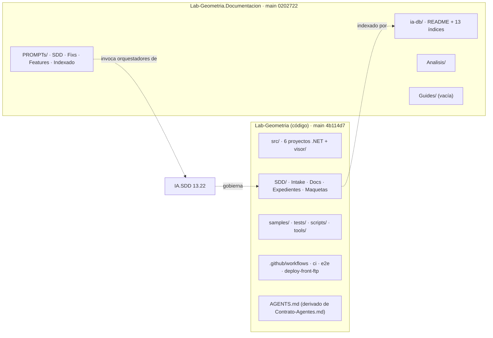
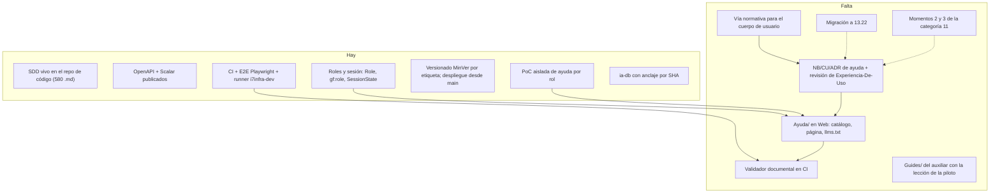

# R06 — Geometría: estado documental y punto de partida de la prueba piloto

## Índice

- [1. Propósito y alcance](#1-propósito-y-alcance)
- [2. Definiciones](#2-definiciones)
- [3. Estructura de los dos repositorios](#3-estructura-de-los-dos-repositorios)
- [4. SDD vigente y expedientes](#4-sdd-vigente-y-expedientes)
- [5. ia-db](#5-ia-db)
- [6. CI y runners](#6-ci-y-runners)
- [7. Versionado de código y de documentación](#7-versionado-de-código-y-de-documentación)
- [8. Despliegue real](#8-despliegue-real)
- [9. «Ayuda por rol» (guía §7): qué existe hoy](#9-ayuda-por-rol-guía-7-qué-existe-hoy)
- [10. Agentes orquestadores y cómo mejorarlos](#10-agentes-orquestadores-y-cómo-mejorarlos)
- [11. Dónde iría cada pieza](#11-dónde-iría-cada-pieza)
- [12. Riesgos](#12-riesgos)
- [13. Qué hay, qué falta: síntesis para la prueba piloto](#13-qué-hay-qué-falta-síntesis-para-la-prueba-piloto)
- [14. Lo que no se verificó](#14-lo-que-no-se-verificó)

---

## 1. Propósito y alcance

Dejar el punto de partida de una **prueba piloto** de la metodología *docs as code* en Lab-Geometria: qué hay, qué falta, riesgos, dónde iría cada pieza (repo de código frente a `.Documentacion`) y qué agentes orquestadores participan. Se relevó en sólo lectura; no se modificó ningún repositorio.

Lab-Geometria y Lab-Geometria.Documentacion son públicos y se nombran. El Product Owner declaró a Lab-Geometria «público de consulta» (memoria `geometria-proyecto-publico-de-consulta.md:8`). Aun así, en esta bitácora no se transcriben credenciales, rutas del anfitrión ni datos de cuentas de prueba.

## 2. Definiciones

| Término | Significado en esta bitácora |
| --- | --- |
| **Repo de código** | `hdcm-dev/Lab-Geometria`: código, `SDD/` (especificación y diseño), `samples/`, CI |
| **Repo auxiliar** | `hdcm-dev/Lab-Geometria.Documentacion`: `ia-db/`, `Analisis/`, `PROMPTs/`, `Guides/` |
| **SDD** | El marco de diseño asistido por IA de IA.SDD, aplicado al destino en `SDD/` |
| **Procedencia** | La versión del framework SDD que declara el destino (manifiesto §1.1) |
| **ia-db** | La base de conocimiento para agentes: un README de entrada y 13 índices numerados |
| **Ayuda por rol** | La propuesta de la guía §7: páginas Markdown dentro del panel, filtradas por `Role`, con `.md` crudo y `llms.txt` |
| **Cuerpo documental** | Conjunto de artefactos de la categoría 11 por rol de intervención (integrador, mantenedor, operador) según `Rules-Documentacion.md` |

## 3. Estructura de los dos repositorios

**Repo de código.**

- Raíz: `README.md` es un puntero que «no replica estado» (`Lab-Geometria/README.md:9`). `AGENTS.md` se declara derivado y no fuente, regenerado desde `SDD/Docs/Producto/11-Documentacion/Contrato-Agentes.md` (`Lab-Geometria/AGENTS.md:3-5`).
- `main` en `4b114d7`, 2026-09-15, igual a `origin/main` (`git log` y `git ls-remote`). Tiene 698 commits en `main` y una rama remota de archivo, `archivo/reanudacion-6-2026-09-12`.
- `SDD/` lleva 1.329 archivos versionados: 650 fuera de `_legacy/` y 580 `.md` vivos (`git ls-files`, 2026-10-26). El conteo coincide con la guía §6.1.
- Hay dos unidades de entrega, `GeometriaFactory-Api` y `GeometriaFactory-Web`, cada una con las categorías 02–03 y 05–11 (`ls SDD/Docs/Unidades-Entrega/*/`).

**Repo auxiliar.**

- `README.md` tiene una sola línea de título (`Lab-Geometria.Documentacion/README.md:1`).
- `main` en `0202722`, 2026-09-13, con 6 commits y 95 archivos versionados.
- `Guides/` está vacía y `PROMPTs/Guides/` sólo tiene `.gitkeep`.
- `PROMPTs/SDD/06-Catalogado/README.md` está vacío. Su changelog lo declara «creado vacío».

## 4. SDD vigente y expedientes

| Hecho | Evidencia |
| --- | --- |
| Procedencia declarada **SDD 13.16** | `SDD/Intake/PRODUCT-MANIFEST-Fabrica-De-Geometria.md:28-40` (§1.1); `SDD/Docs/README.md:176` |
| Framework vigente **13.22** (2026-10-23) | `IA/SDD/IA.SDD/CHANGELOG.md:6`. El desfase es de **seis versiones menores** (13.17 a 13.22) sin migrar |
| README raíz del SDD en 2.9, Aprobado, 2026-09-13 | `SDD/Docs/README.md:6-8` |
| Ocho migraciones normativas cerradas | `SDD/Docs/README.md:176` |
| Etapas `a`–`h` y `k` cerradas; `i` (despliegue real) **abierta** | `SDD/Docs/README.md:180-192`. La puerta `verify-stage-i.sh` mide criterios viejos (deuda `DD-R8-1`, línea 190) |
| `04-Prompts-AI` omitida por *gating*: el producto no usa LLM | `SDD/Docs/README.md:166` |
| Un solo expediente, **EXP-0001** (migración a 13.16), **resuelto**, como «adelanto a una norma que todavía no existe» | `SDD/Expedientes/0001-Migracion-Normativa-A-13.16/README.md:1-20` |
| 121 informes en `SDD/Docs/Audit/` (auditorías, migraciones, mesas, reportes) | `ls SDD/Docs/Audit \| wc -l` |

**La categoría 11 se quedó en el Momento 1.** El plan documental de la Web declara «Nada de lo que se enumera acá está redactado» (`SDD/Docs/Unidades-Entrega/GeometriaFactory-Web/11-Documentacion/README.md:46`). Cinco de sus seis artefactos están `Planificado` (líneas 74-83). El mismo documento tiene inconsistencias internas:

- El *frontmatter* dice `version: "1.1"` y la cabecera dice `**Versión:** 2.0` (líneas 8 y 22).
- Las trazas apuntan a `PRODUCT-MANIFEST-1.3` (línea 12), pero el manifiesto vigente es 7.x (`PRODUCT-MANIFEST…:22`).
- Afirma «Esta unidad no se containeriza: se publica por transferencia de archivos» (línea 98). Eso es falso desde el 2026-09-06, cuando el front pasó a contenedor (`SDD/Docs/README.md:190`; memoria `geometria-despliegue-real-aplicada-stream.md:8-14`).

**Hallazgo central para la piloto: la norma excluye al usuario final.** `Rules-Documentacion.md` de IA.SDD deja fuera del alcance del framework la documentación para el usuario final no técnico:

- La línea 102 lo declara fuera de alcance.
- La línea 723 lo repite.
- El criterio de aceptación de la línea 801 lo exige.
- La línea 1003 lo prohíbe en el despacho.

Los roles de intervención son tres: integrador, mantenedor y operador (línea 457). El propio SDD del destino lo reafirma: «El producto no lleva manual: la ayuda es contextual y mínima» (`SDD/Docs/Unidades-Entrega/GeometriaFactory-Web/03-UX-UI-DX/Experiencia-De-Uso.md:100`). La «ayuda por rol» de la guía §7 **contradice una regla del framework y una decisión de diseño vigente del destino**. No es sólo alcance nuevo.

## 5. ia-db

| Hecho | Evidencia |
| --- | --- |
| La ia-db commiteada es la **3.0**, generada el 2026-09-11 sobre la revisión `89f3ab3` (PR #186, 2026-09-06) | `ia-db/README.md:37`, `ia-db/README.md:121`; commit `9c60957` |
| Es **anterior** al `main` actual (`4b114d7`): ese commit queda unos 47 PR por detrás (#186 frente a #233) | `git log` de ambos repos |
| **Hay una regeneración en curso, sin commitear, el mismo 2026-10-26**: los índices 00–06, 08 y 09 ya declaran «Verificado el 2026-10-26 sobre la revisión `4b114d7`»; el README sigue en 3.0 | `ia-db/indexes/00_MASTER-INDEX.md:10`, `06_…:14`, `08_…:11`; `git status --short` |
| El tool-prompt de indexado se editó para cerrar con changelog, commit, push y PR automático | `git diff PROMPTs/Indexado/Crear-Indexado.md` (sin commitear) |
| Hay una rama remota `entrega/delegacion-y-verificar` (PR #2 abierto, 2026-10-26 10:05) que agrega un CI `Verificar`. El CI revisa enlaces y la forma de la ia-db, corre en `ubuntu-latest` y deja `PROMPTs/` sin verificar | `git show entrega/delegacion-y-verificar:.github/workflows/verificar.yml`; `…:.github/scripts/verificar.py:1-12` |

Otro trabajo está escribiendo en este repositorio **en este momento**. La piloto no debe tocar `ia-db/` hasta que esa corrida cierre.

## 6. CI y runners

| Flujo | Disparo | Runner | Qué hace | Evidencia |
| --- | --- | --- | --- | --- |
| `ci.yml` | push a `main`, PR, manual | `ubuntu-latest` | Árbol de solución, build sin advertencias, tests, cobertura y puertas d/e/h | `.github/workflows/ci.yml:39-47,75-96` |
| `e2e.yml` | push a `main`, PR, manual | **`[self-hosted, i7infra-dev]`** (dos jobs) + `ubuntu-latest` (matriz, resumen) | Banco local Playwright y, sólo a mano, matriz contra el laboratorio desplegado | `.github/workflows/e2e.yml:40-44,69,130,149,209` |
| `deploy-front-ftp.yml` | **sólo `workflow_dispatch`** | `ubuntu-latest` | Publica el front al hosting externo, que es el canal alternativo y no el productivo | `.github/workflows/deploy-front-ftp.yml:24-39,50` |

- El runner propio tiene una guarda contra forks: en un repo público, un PR desde un fork no corre en `self-hosted` (`e2e.yml:70-76`). El resumen trata `skipped` como no-rojo (`e2e.yml:227-241`).
- Corre `concurrency: e2e-laboratorio` sin cancelar, porque comparten un único runner (`e2e.yml:52-61`).
- El runner `i7infra-dev` está vivo: es el contenedor `runner-github-dev`, de alcance organización `hdcm-dev`, con etiquetas `i7infra,i7infra-dev,dotnet,maui-android` y versión 2.338.1 (`docker inspect`, 2026-10-26). En el mismo anfitrión hay otros dos runners de otras organizaciones; no se nombran.
- **No existe ningún chequeo de documentación** en el repo de código: ningún validador de enlaces, de *frontmatter* ni de trazas sobre `SDD/` (los tres flujos listados arriba).
- El pedido del tool-prompt fija `runs-on: [self-hosted, i7infra-dev]` para el workflow de la metodología (`Replanteo-Y-Analisis.md:34`). En Geometría ese runner ya existe y ya se usa, pero es **uno solo** y lo comparte con la E2E serializada.

## 7. Versionado de código y de documentación

| Objeto | Mecanismo | Evidencia |
| --- | --- | --- |
| Código | **MinVer 8.0.0** calcula la versión desde las etiquetas `v*`; no se escribe en archivos. El SHA viaja en `AssemblyInformationalVersion` | `Directory.Build.props:30-59` |
| Etiquetas | `v0.1.0` … `v1.2.0` (2026-09-15) | `git tag` |
| Registro de cambios del código | `changelog.md` en la rama de la etapa, antes de la fusión; si discrepa con el historial, gana el historial | `changelog.md:3-10` |
| SDD | Viaja **con el código**: cada documento declara su versión en la cabecera y su tabla de control de cambios, y los estados anteriores van a `_legacy/` | `SDD/Docs/README.md:6,267-282` |
| Repo auxiliar | **Sin etiquetas**. Su `changelog.md` declara que no registra la construcción. La coherencia con el código se ancla en la «revisión indexada» de la ia-db | `Lab-Geometria.Documentacion/changelog.md:3-8`; `ia-db/README.md:37` |

La guía §6.2-§6.3 recomienda que todo lo que cambia con el código viva en el repo de código, y que el auxiliar guarde lo que habla *del* proyecto. Lo verificado acá confirma que **ese reparto ya existe**. El único punto de desfase medible es la ia-db: se ancla a un SHA y no a una etiqueta, y quedó 47 PR atrás hasta la corrida de hoy.

## 8. Despliegue real

- El front productivo es `https://geometria.aplicada.stream` y la API es `https://api-geometria.aplicada.stream`. Corren en contenedores que se construyen **desde `main`** de GitHub (memoria `geometria-despliegue-real-aplicada-stream.md:8-14`). La composición vive en el anfitrión del PO, fuera de los repos, y su ruta no se transcribe.
- Verificación del 2026-10-26:
  - `GET https://api-geometria.aplicada.stream/salud` → `200`, `"version":"1.2.0+4b114d74f823…"`. Lo desplegado es exactamente `main`/`v1.2.0`.
  - El front responde `/` → `200` y redirige a `/ingreso`, con sello `1.2.0`.
  - `GET /openapi/v1.json` → `200` y `/documentacion` → `302`: la referencia de la API está publicada (ver `src/GeometriaFactory.Api/Composition/ApiDocumentation.cs:37-43`).
  - `docker ps` muestra `lab-geometria-api` y `lab-geometria-web` `healthy` desde hace 2 semanas.
- `AGENTS.md:64` prohíbe `exec`, reinicio y lectura de volúmenes de esos contenedores. Una prueba se levanta aparte: puerto libre y almacén propio.
- El canal de hosting externo quedó como alternativa manual (`deploy-front-ftp.yml:24-34`). La memoria registra que el PO todavía no decidió si retirarlo (`geometria-despliegue-real-aplicada-stream.md:19`).
- El despliegue del backend es del PO. El proyecto entrega los artefactos `deploy/Dockerfile`, `deploy/Dockerfile.web` y `deploy/compose.yaml` (memoria `geometria-alcance-del-proyecto.md:11-19`).

**Consecuencia para la piloto.** Como lo productivo se construye desde `main`, fusionar la ayuda a `main` la deja lista para el próximo redespliegue del PO. El agente no despliega.

## 9. «Ayuda por rol» (guía §7): qué existe hoy

**No existe nada construido en Lab-Geometria.**

- `grep -i 'ayuda|help|HelpCatalog|markdig|/ayuda'` sobre `src/GeometriaFactory.Web` encuentra sólo comentarios y textos `gf-sr-only` de accesibilidad: `WorkSubmission.razor:762` y `WorkView.razor:329-341`.
- `GeometriaFactory.Web.csproj` no tiene ningún `PackageReference`, así que tampoco Markdig.
- `GET https://geometria.aplicada.stream/ayuda` → `404`.
- La guía misma lo declara: «nada se construyó dentro de Lab-Geometria» (`Sistema-Documentador-Tecnico-Guide.md:329`).

**Lo que sí existe y la propuesta reutiliza** (verificado):

| Pieza que la guía da por existente | Estado verificado |
| --- | --- |
| `Role.Student` / `Role.Administrator`, que se serializan por nombre | `src/GeometriaFactory.Domain/Values/Role.cs:7,12-19` ✔ |
| Claim `gf:role` | `src/GeometriaFactory.Web/Services/SessionClaims.cs:24` ✔ |
| `SessionState.IsAdministrator` | `src/GeometriaFactory.Web/Services/SessionState.cs:110` ✔ |
| `NotFoundSurface.razor` | `src/GeometriaFactory.Web/Components/Pages/NotFoundSurface.razor` ✔. En render estático el 404 lo atiende `UseStatusCodePagesWithReExecute`, no `<NotFound>` (`Routes.razor:30-37`) |
| Batería Playwright | `tests/GeometriaFactory.E2ETests/` (8 clases de prueba) ✔ |
| Prueba de concepto aislada | `…/Sistema-De-Documentacion-E-Integracion/Examples/Prueba-Ayuda-Por-Rol/` (`Consola/`, `Web/`, `capturas/`) ✔ |

**Divergencia con la guía (criterio propio, con evidencia).** La guía deriva la ayuda de `CU-00021` a `CU-00029` (`Sistema-Documentador-Tecnico-Guide.md:428,529`). Esos casos de uso son de la unidad **Api** (`SDD/Docs/Unidades-Entrega/GeometriaFactory-Api/02-Especificacion-Funcional/Casos-De-Uso/`), con la Web como «Intermediario» (`CU-00026…md:62-69`). La unidad **Web** tiene sus propios `CU-10001` a `CU-10010`, que describen las pantallas: por ejemplo, «Completa los datos, pega el texto, previsualiza y envía» (`CU-10005…md:34-41`). Para una ayuda de pantallas, la traza natural es `CU-100NN`, y la de reglas es `CU-000NN` y `RN-`. La mesa debería resolver esto antes de fijar el contrato `traces`.

La guía §7.6 también afirma que no hay localización en `src/` (`Sistema-Documentador-Tecnico-Guide.md:459`). No se volvió a medir con `grep` de `AddLocalization`; ver §14.

## 10. Agentes orquestadores y cómo mejorarlos

**Qué hay.** Geometría no tiene orquestadores propios: invoca los de IA.SDD desde tool-prompts del repo auxiliar.

| Tool-prompt del destino | Orquestador que invoca | Evidencia |
| --- | --- | --- |
| `PROMPTs/SDD/03-Ejecutar-Prompt-Orquestador/…md` | `IA.SDD/PROMPTS/PROMPT-Agente-Bootstrap-SDD.md` → `Master-Prompt.md` | línea 7. **Su línea de invocación apunta a una ruta inexistente** (`PROMPTs/04-Ejecutar-Prompt-Orquestador/…`, línea 4) |
| `PROMPTs/SDD/05-Ejecutar-Reanudar-Orquestador/…md` | `PROMPT-Agente-Reanudacion-SDD.md` → `Master-Prompt-Reanudacion.md` | línea 8 |
| (EXP-0001) | `Master-Prompt-Migracion.md` 2.10 | `SDD/Expedientes/0001…/README.md` (fila «Partes») |
| `PROMPTs/Indexado/Crear-Indexado.md` y `Actualizar-Indexado.md` | Tool-prompt `IA.Prompts/…/Indexado-Documentado/Iniciar-Indexado.md` | `Crear-Indexado.md` |
| `PROMPTs/Fixs/01..02-Ajuste-UX` | Mesas UX ad hoc (marco adaptado en `OUTPUTs/00_marco/Mesa-UX-UI.md`) | memoria `geometria-mesa-ux-ui.md:11-14` |

El subagente dueño de la documentación es **AG-00110 «Technical Writer / Documentation Lead»**. Trabaja en tres momentos: plan (fase H), actualización incremental con `AGENTS.md` (fase I) y consolidación con ensayo humano (fase J) (`IA/SDD/IA.SDD/SDD/Devs/Orchestrator/Master-Prompt.md:557-561`). En Geometría sólo corrió el Momento 1 (§4).

La base de conocimiento de IA.SDD (`Conocimiento/Index-Knowledge.md:34-44`, 9 documentos) **no tiene ningún conocimiento de documentación de usuario ni de *docs as code***. Los consumidores van de `03` a `05` o son `transversal`.

**Cómo se mejorarían.** Es criterio propio, para que la mesa lo juzgue:

1. **Una vía para el cuerpo de usuario.** Hay dos caminos. (a) Un **apartamiento declarado** en el destino (`Root-Rules.md` §11, que Geometría ya usa en cuatro ADR) más una NB y un CU de ayuda: es reversible y local. (b) Un cambio de norma en `Rules-Documentacion.md` para sumar un cuarto rol de intervención, «usuario». Este afecta a todos los destinos, y la memoria `conocimiento-no-tocar-el-framework.md` advierte que la norma no se toca para acomodar conocimiento. Para la piloto conviene (a). El conocimiento resultante podría catalogarse en `Conocimiento/` con consumidor `11` y condición de carga «`web-monolith` con roles diferenciados».
2. **AG-00110 con Momento 2 efectivo.** Que la reanudación dispare la actualización incremental de la categoría 11 al cerrar cada etapa. Hoy el plan Web quedó con trazas a manifiesto 1.3 y sigue afirmando que no se containeriza (§4).
3. **Validador documental en CI del repo de código**, sobre `[self-hosted, i7infra-dev]` como pide el prompt: *frontmatter*, enlaces, cruce de rol y frescura de `traces` contra la versión del CU (guía §7.7). Hoy no hay ninguno (§6).
4. **Indexado anclado a etiqueta**, no sólo a SHA, y disparado al etiquetar. Así se evita el desfase de 47 PR de la ia-db 3.0 (§5).
5. **Corregir la invocación rota** de `03-Ejecutar-Prompt-Orquestador` y completar `06-Catalogado/README.md`. Las dos son tarea del PO, porque `PROMPTs/` es suyo (`AGENTS.md:59`).
6. **Migración 13.16 → 13.22** antes o en paralelo a la piloto, para que el trabajo nuevo no nazca sobre una norma vieja (§4).

## 11. Dónde iría cada pieza

Regla de la guía §6.2: «¿tiene que cambiar en el mismo pull request que el código? Si sí, va al repo de código».

| Pieza de la piloto | Repo | Ubicación propuesta | Fundamento |
| --- | --- | --- | --- |
| NB y CU de «ayuda por rol», apartamiento y ADR de catálogo incrustado | Código | `SDD/Docs/01-Necesidades-Negocio/`, `SDD/Docs/Unidades-Entrega/GeometriaFactory-Web/02-…/05-…` | Todo alcance nuevo pasa por el SDD (`Sistema-Documentador-Tecnico-Guide.md:526`) |
| Revisión de `Experiencia-De-Uso.md` §«Ayuda y documentación» | Código | `…/GeometriaFactory-Web/03-UX-UI-DX/Experiencia-De-Uso.md:100` | Hoy afirma lo contrario |
| Páginas `Ayuda/es/**.md`, `HelpCatalog`, `/ayuda`, `.md`, `llms.txt` | Código | `src/GeometriaFactory.Web/Ayuda/…` | Cambian con las pantallas (guía §7.3) |
| Validador documental y su workflow | Código | `tools/` + `.github/workflows/` con `runs-on: [self-hosted, i7infra-dev]` | Corre en cada PR |
| E2E de acceso por rol | Código | `tests/GeometriaFactory.E2ETests/` | La batería ya existe |
| Plan documental 11 actualizado (cuerpo usuario) | Código | `…/GeometriaFactory-Web/11-Documentacion/README.md` | Lo dueña AG-00110 |
| ia-db regenerada con el índice de ayuda | Auxiliar | `Lab-Geometria.Documentacion/ia-db/` | Habla *del* proyecto |
| Expediente de la piloto, análisis y lecciones | Auxiliar (o el de la mesa en Lab-Documentos) | `Lab-Geometria.Documentacion/Analisis/` o `Guides/` (hoy vacía) | No se despliega |
| Conocimiento reutilizable resultante | KB-privada / IA.SDD `Conocimiento/` | `Knowledge-…md` + fila en el índice | Para aplicarlo después al SDD-B |

## 12. Riesgos

| # | Riesgo | Evidencia | Mitigación propuesta (criterio propio) |
| --- | --- | --- | --- |
| R1 | La piloto choca con la norma («usuario final fuera de alcance») y con la decisión de diseño vigente | `Rules-Documentacion.md:102,723,801,1003`; `Experiencia-De-Uso.md:100` | Apartamiento declarado más ADR, decidido por la mesa |
| R2 | El destino está en 13.16 y el framework en 13.22 | manifiesto §1.1; `IA.SDD/CHANGELOG.md:6` | Migrar primero o declarar que la piloto corre sobre 13.16 |
| R3 | Escritura concurrente: re-indexado sin commitear y PR #2 abierto en el repo auxiliar, hoy | `git status`; `ls-remote` refs/pull/2 | Esperar el cierre antes de tocar `ia-db/` |
| R4 | Un solo runner `self-hosted`, compartido con la E2E serializada | `e2e.yml:52-61`; `docker inspect runner-github-dev` | Validador barato y sin estado; evaluar otro grupo de concurrencia |
| R5 | Repo público con runner propio | `e2e.yml:70-76` | Replicar la guarda de forks en el workflow nuevo |
| R6 | Trazas a los CU equivocados (Api frente a Web) | §9 | Decidir el contrato `traces` en mesa |
| R7 | Un 404 vacío en render estático | guía §7.8; `Routes.razor:30-37` | Usar el camino ya probado (`UseStatusCodePagesWithReExecute` o `NavigationManager.NotFound()`) y cubrirlo en la E2E |
| R8 | El despliegue es del PO y se construye desde `main` | memoria `geometria-despliegue-real-aplicada-stream.md:8-14`; `AGENTS.md:64` | Que el agente no despliegue: fusionar con checks en verde (`AGENTS.md:65`) y avisar |
| R9 | `TreatWarningsAsErrors` y AOT/trim: `IL2026`/`IL3050` son errores | `AGENTS.md:22,74` | Verificar que YamlDotNet o Markdig compilen sin advertencias en este árbol antes de comprometer el diseño |
| R10 | `PROMPTs/` y el intake son humanos | `AGENTS.md:59-61` | Las correcciones de tool-prompts se elevan al PO |

## 13. Qué hay, qué falta: síntesis para la prueba piloto

Secuencia sugerida, alineada con la guía §7.9 y con el orden propio que se agrega:

0. La mesa decide R1 (vía normativa) y R6 (trazas), y si migrar antes (R2).
1. SDD: NB, CU, ADR y la revisión de `Experiencia-De-Uso.md`.
2. Catálogo, render y filtro por rol, con el validador en CI sobre `[self-hosted, i7infra-dev]`.
3. Las páginas en `es/` con sus trazas.
4. Ayuda contextual, `.md` y `llms.txt`, más la E2E de acceso.
5. Cobertura y frescura en CI, y regeneración de la ia-db.
6. Conocimiento extraído para aplicarlo al SDD-B.

## 14. Lo que no se verificó

- **El estado del PR #2 del repo auxiliar en GitHub** (checks, mergeabilidad). Sólo se vio la ref `refs/pull/2/head` por `git ls-remote`, sin consultar la API.
- **La ausencia de `AddLocalization`, `IStringLocalizer` y `.resx` en `src/`**, que afirma la guía §7.6. No se volvió a medir.
- **Que el runner `i7infra-dev` esté registrado y en línea en GitHub.** Sólo se vio el contenedor vivo con su etiqueta. No se consultó la API de runners.
- **Que YamlDotNet o Markdig compilen sin advertencias** bajo el `Directory.Build.props` de Lab-Geometria (R9). No se compiló nada, por la restricción de sólo lectura.
- **Qué agente o sesión hace el re-indexado en curso.** Se infiere sólo por las marcas de tiempo (10:09–13:03 del 2026-10-26) y por el diff.
