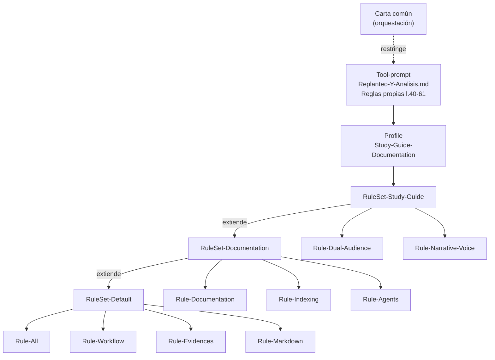
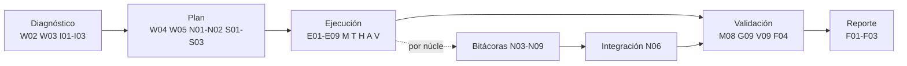

# R07 — Reglas del PromptFramework: lista de verificación operativa

| Campo | Valor |
|---|---|
| **Id** | R07 |
| **Título** | Reglas del Profile *Study-Guide-Documentation*, su RuleSet y el tool-prompt, convertidas en una lista de verificación para la mesa y los redactores |
| **Autor (rol)** | Relevador del despacho R07 (subagente de la mesa de *Replanteo y análisis DocAsCode*) |
| **Fecha** | 2026-10-26 |
| **Tool-prompt** | `/LAB/Lab-Documentos/Lab-Documentos.Documentacion/PROMPTs/DEVs/Enchacement/01-Replanteo-Y-Analisis/Replanteo-Y-Analisis.md` |
| **Modo** | Sólo lectura. Comandos usados: `cat -n`, `wc`, `ls`, `grep`, `git log`, `git status` |
| **Fuentes leídas (completas)** | El tool-prompt (67 líneas) · `Profiles/Study-Guide-Documentation.md` (85) · `RuleSets/RuleSet-Study-Guide.md` (23) · `RuleSets/RuleSet-Documentation.md` (21) · las nueve reglas que lista el RuleSet: `Rule-All` (46), `Rule-Workflow` (61), `Rule-Evidences` (39), `Rule-Markdown` (39), `Rule-Documentation` (36), `Rule-Indexing` (35), `Rule-Agents` (51), `Rule-Dual-Audience` (33), `Rule-Narrative-Voice` (47) · `PromptFramework/README.md` l. 36–45 · `IA.Prompts/README.md` (grep de rutas) · cabecera de la bitácora hermana R04 (para comparar formato) · dos reglas del PO registradas en la memoria del asistente (§6) |
| **Versión del framework leída** | Repositorio `IA.Prompts` en `88e18a4` (2026-09-23 10:15 -0300); `git status` muestra sin seguimiento sólo `Conocimientos/`, ajeno a lo leído |

---

## Índice

1. [Convenciones y alias de rutas](#1-convenciones-y-alias-de-rutas)
2. [Definiciones](#2-definiciones)
3. [Cómo se compone el marco que aplica la corrida](#3-cómo-se-compone-el-marco-que-aplica-la-corrida)
4. [Discrepancia de rutas: `/IA/IA.Prompts` frente a `/IA/PROMPTs/IA.Prompts`](#4-discrepancia-de-rutas-iaiaprompts-frente-a-iapromptsiaprompts)
5. [Lista de verificación operativa](#5-lista-de-verificación-operativa)
   - 5.1 [Proceso de trabajo (workflow)](#51-proceso-de-trabajo-workflow)
   - 5.2 [Descomposición conceptual y bitácoras (tool-prompt)](#52-descomposición-conceptual-y-bitácoras-tool-prompt)
   - 5.3 [Evidencia y veracidad](#53-evidencia-y-veracidad)
   - 5.4 [Estructura de la guía de estudio (conjunto)](#54-estructura-de-la-guía-de-estudio-conjunto)
   - 5.5 [Estructura de cada documento temático](#55-estructura-de-cada-documento-temático)
   - 5.6 [Markdown, índices y mermaid](#56-markdown-índices-y-mermaid)
   - 5.7 [Contenido y organización documental](#57-contenido-y-organización-documental)
   - 5.8 [Doble audiencia: cara humana](#58-doble-audiencia-cara-humana)
   - 5.9 [Doble audiencia: cara agente](#59-doble-audiencia-cara-agente)
   - 5.10 [Voz narrativa](#510-voz-narrativa)
   - 5.11 [Indexado (ia-db)](#511-indexado-ia-db)
   - 5.12 [Delegación en subagentes y mesa](#512-delegación-en-subagentes-y-mesa)
   - 5.13 [Restricciones de esta corrida (carta común)](#513-restricciones-de-esta-corrida-carta-común)
   - 5.14 [Cierre y reporte](#514-cierre-y-reporte)
6. [Reglas del PO fuera del framework que tocan esta corrida](#6-reglas-del-po-fuera-del-framework-que-tocan-esta-corrida)
7. [Tensiones entre reglas y cómo resolverlas](#7-tensiones-entre-reglas-y-cómo-resolverlas)
8. [Observaciones](#8-observaciones)
9. [No verificado](#9-no-verificado)

---

## 1. Convenciones y alias de rutas

Las citas van como `alias:línea`. Cada alias equivale a una ruta absoluta del workspace:

| Alias | Ruta absoluta |
|---|---|
| `<TP>` | `/LAB/Lab-Documentos/Lab-Documentos.Documentacion/PROMPTs/DEVs/Enchacement/01-Replanteo-Y-Analisis/Replanteo-Y-Analisis.md` |
| `<PF>` | `/IA/PROMPTs/IA.Prompts/PromptFramework` |
| `<Profile>` | `<PF>/Profiles/Study-Guide-Documentation.md` |
| `<RS>` | `<PF>/RuleSets/RuleSet-Study-Guide.md` |
| `<RSDoc>` | `<PF>/RuleSets/RuleSet-Documentation.md` |
| `<R>/X` | `<PF>/Rules/Rule-X.md` (p. ej. `<R>/Evidences:11`) |
| `<MEM>` | `{memoria-del-agente}` |
| «carta» | Carta común del despacho de esta corrida (texto de la orquestación, sin archivo propio) |

Los identificadores `VER-…` de la §5 son estables: la mesa y los redactores pueden citarlos en actas y revisiones («incumple VER-E04»).

---

## 2. Definiciones

**Profile.** Archivo que configura al agente para un tipo de entregable y nombra el RuleSet que aplica. Aquí, *Study-Guide-Documentation*: una guía de estudio entendida como «recorrido de aprendizaje y no como colección de fichas sueltas» (`<Profile>:5`).

**RuleSet.** Lista de reglas que se aplican juntas. `RuleSet-Study-Guide` extiende `RuleSet-Documentation` sumando doble audiencia y voz narrativa (`<RS>:5`, `<RS>:13`).

**Regla (Rule).** Archivo con normas de un solo aspecto (evidencia, markdown, voz…). Las nueve que aplican están en `<RS>:15-23`.

**Tool-prompt.** El encargo concreto de la corrida. Tiene su propia sección *Reglas* (`<TP>:40-61`) que se suma al framework y lo invoca en `<TP>:63-68`.

**Marco de referencia (de la guía).** Los tres ejes —escenarios, contextos, actores— que se definen una sola vez y que todos los documentos referencian (`<Profile>:25-33`).

**Núcleo conceptual.** Grupo de ideas con afinidad temática, semántica o de dependencia fuerte; es la unidad de segmentación que exige el tool-prompt, en lugar de cortar por extensión o por párrafo (`<TP>:46-47`).

**Documento de cohesión global.** Documento que describe relaciones, dependencias y referencias entre núcleos (`<TP>:49`).

**Autocontenido, no delta.** El documento se entiende sin leer una versión previa ni una conversación: no describe «qué cambió», describe el estado completo (`<TP>:42`; criterio coincidente con `<R>/Documentation:15`).

**Zona de prosa / zona estructurada.** Distinción de `<R>/Narrative-Voice:7`: la voz narrativa regula la prosa; frontmatter, tablas, IDs y diagramas quedan rígidos.

---

## 3. Cómo se compone el marco que aplica la corrida

El tool-prompt invoca el Profile; el Profile invoca el RuleSet; el RuleSet enumera nueve reglas, siete heredadas de *Documentation* (que a su vez hereda cuatro de *Default*) y dos propias. A eso se suman las reglas del tool-prompt y la carta común de la orquestación.

Evidencia: `<TP>:67-68`, `<Profile>:15-17`, `<RS>:5`, `<RS>:13-23`, `<RSDoc>:5`, `<RSDoc>:13`. Que `RuleSet-Default` contiene exactamente esas cuatro reglas se infiere de `<RSDoc>:13` («Default (`Rule-All`, `Rule-Workflow`, `Rule-Evidences`, `Rule-Markdown`)»); el archivo `RuleSet-Default.md` existe pero no se leyó (ver §9).

---

## 4. Discrepancia de rutas: `/IA/IA.Prompts` frente a `/IA/PROMPTs/IA.Prompts`

Las referencias internas del framework apuntan a una base que no existe en el workspace. El RuleSet lista las reglas como `/IA/IA.Prompts/PromptFramework/Rules/…` (`<RS>:15-23`); lo mismo hacen el Profile (`<Profile>:17`), `RuleSet-Documentation` (`<RSDoc>:15-21`) y el propio tool-prompt al invocar el Profile (`<TP>:68`). La ruta `/IA/IA.Prompts` **no existe** (`ls` devuelve «No existe el fichero o el directorio»); el repositorio real está en `/IA/PROMPTs/IA.Prompts`, y allí están todos los archivos citados.

La convención está escrita, no es un descuido aislado: `<PF>/README.md:41` dice «Las referencias entre componentes usan rutas absolutas desde la raíz del workspace, con base `/IA/IA.Prompts`», y `/IA/PROMPTs/IA.Prompts/README.md:63` repite la base. En cambio, documentos más nuevos del mismo repositorio ya usan la ruta real, por ejemplo `IA.Prompts/Base/Mesa-Evaluadora.md:3` («`/IA/PROMPTs/IA.Prompts/Base/Mesa-Evaluadora.md`»). Un `grep` cuenta las referencias con la base vieja por archivo: `Guides/Develop-Guide.md` 24, `Guides/User-Guide.md` 17, `Guides/How-To.md` 14, `RuleSet-Security-Audit.md` 10, `RuleSet-Study-Guide.md` 9, entre otros.

**Consecuencia operativa.** Un agente que resuelva literalmente la ruta del RuleSet no encuentra las reglas. Todo despacho debe recibir la ruta real (VER-W05). Corregir el framework queda fuera del alcance de esta fase de sólo lectura; se **propone** (`<R>/All:12`) como ítem para la mesa.

---

## 5. Lista de verificación operativa

Cada ítem es chequeable con un sí/no sobre el entregable o el proceso. La columna **Aplica a** distingue: **G** = documentos de la guía o demos que se publiquen; **B** = bitácoras y expedientes de la corrida; **P** = proceso de la mesa y sus subagentes.

### 5.1 Proceso de trabajo (workflow)

| ID | Verificación | Aplica a | Origen |
|---|---|---|---|
| VER-W01 | El trabajo siguió el ciclo diagnosticar → planificar → ejecutar → validar → reportar | P | `<R>/Workflow:5` |
| VER-W02 | El diagnóstico registra objetivo principal y secundarios, alcance, restricciones, dependencias y estado actual (qué existe, qué falta, qué contradice la solicitud) | P, B | `<R>/Workflow:13-14` |
| VER-W03 | Antes de explorar fuentes completas se consultó la ia-db correspondiente | P | `<R>/Workflow:15`, `<R>/Indexing:13-18` |
| VER-W04 | El plan descompone en tareas de única responsabilidad y resultado verificable, con dependencias ordenadas y sin circularidad; prioriza bloqueantes → impacto → menos dependencias → menor riesgo | P | `<R>/Workflow:23-28` |
| VER-W05 | Toda ruta al framework que reciba un subagente es la real (`/IA/PROMPTs/IA.Prompts/…`), no la que figura en el RuleSet | P | §4 de esta bitácora |
| VER-W06 | Se reutilizó lo existente (guía actual, ejemplos, conocimientos) antes de crear | P, G | `<R>/Workflow:26`, `<TP>:20` |
| VER-W07 | Cada error o limitación quedó documentado con causa e impacto, sin propagarse a tareas posteriores | B | `<R>/Workflow:39` |
| VER-W08 | Las mejoras detectadas fuera de alcance se proponen; no se ejecutan | P, B | `<R>/All:12`, `<R>/Workflow:37` |
| VER-W09 | La orden de configurar el workflow de GitHub con el runner self-hosted indicado se cumplió **con la etiqueta exacta** que fija el tool-prompt (no confundir con `Rule-Workflow`, que es el ciclo de trabajo) | G | `<TP>:34` |

### 5.2 Descomposición conceptual y bitácoras (tool-prompt)

| ID | Verificación | Aplica a | Origen |
|---|---|---|---|
| VER-N01 | La mesa, el agente principal **y todos los subagentes** aplican la descomposición conceptual sobre la totalidad del prompt | P | `<TP>:44` |
| VER-N02 | Los núcleos se formaron por afinidad o dependencia entre ideas, no por extensión ni por párrafos del prompt | P, B | `<TP>:46-47` |
| VER-N03 | Cada núcleo tiene **su propio** documento Markdown | B | `<TP>:49` |
| VER-N04 | Existe un documento de cohesión global con relaciones, dependencias, referencias y vínculos entre núcleos | B | `<TP>:49` |
| VER-N05 | Cada núcleo puede analizarse, planificarse y validarse por separado, y conserva trazas para integrarse | B | `<TP>:51` |
| VER-N06 | Hay una fase de integración que consolida resultados, resuelve dependencias y contradicciones y reconstruye el modelo completo | P, B | `<TP>:53` |
| VER-N07 | Cada eje se presentó a la mesa evaluadora y planificadora | P | `<TP>:55` |
| VER-N08 | Los registros retomables están en `OUTPUTs/Bitacoras/` de la corrida y en ningún otro lugar bajo `PROMPTs/` | B | `<TP>:57`; carta |
| VER-N09 | Cada bitácora lleva encabezado con id, título, autor (rol), fecha y fuentes leídas, índice al principio y secciones numeradas, y es autocontenida | B | carta |

### 5.3 Evidencia y veracidad

| ID | Verificación | Aplica a | Origen |
|---|---|---|---|
| VER-E01 | Ninguna información inventada | G, B | `<TP>:59`, `<R>/All:19` |
| VER-E02 | Toda afirmación lleva evidencia verificable: `ruta:línea` para el workspace; URL + título + fecha de consulta para fuentes externas | G, B | `<TP>:61`, `<R>/Evidences:19-25`; formato concreto: carta |
| VER-E03 | Lo no verificado está marcado con las etiquetas de la regla («No verificado», «Requiere verificación manual», «Información no disponible») y dice por qué | G, B | `<R>/Evidences:11`; carta |
| VER-E04 | El criterio propio se declara como tal y se separa de los hechos | G, B | `<Profile>:70`, `<R>/Evidences:33`, `<R>/Workflow:61` |
| VER-E05 | Las conclusiones salen de la evidencia; no se omitió ni reinterpretó evidencia contraria | B | `<R>/Evidences:12` |
| VER-E06 | Comandos ejecutados registrados con propósito y resultado relevante, de modo que otro reproduzca la verificación | B | `<R>/Evidences:23`, `<R>/Evidences:27` |
| VER-E07 | Existe una sección de **Observaciones** (inconsistencias, faltantes, diferencias doc/sistema) que distingue hechos de interpretaciones | G, B | `<R>/Evidences:33` |
| VER-E08 | Definiciones y prácticas de la guía anclan a estándares o fuentes de la industria | G | `<Profile>:70`, `<TP>:32`, `<TP>:36` |
| VER-E09 | Las inconsistencias detectadas entre documentos se señalan explícitamente | B | `<R>/All:20` |

### 5.4 Estructura de la guía de estudio (conjunto)

| ID | Verificación | Aplica a | Origen |
|---|---|---|---|
| VER-G01 | Se diseñó el mapa antes de escribir piezas; orden general → particular: mapa conceptual → ejes → un documento por tema → anexos | P, G | `<Profile>:23`, `<Profile>:35` |
| VER-G02 | Los tres ejes (escenarios, contextos, actores) están definidos **una sola vez**, en documentos propios, y el resto los referencia | G | `<Profile>:25-33` |
| VER-G03 | Ningún tema queda sin cruce con al menos un escenario o contexto (si queda, sobra o está mal delimitado) | G | `<Profile>:33` |
| VER-G04 | Hay mapa conceptual con tablas de entrada por escenario, por contexto y por artefacto («estoy acá → qué aplico») | G | `<Profile>:46` |
| VER-G05 | Hay un documento de métodos y marcos: alternativas, diferencias y criterios de elección | G | `<Profile>:48` |
| VER-G06 | Hay anexos: plantillas comentadas, listas de verificación y glosario | G | `<Profile>:49` |
| VER-G07 | El README tiene la tabla de contenido de todo lo generado y la ruta de lectura sugerida | G | `<Profile>:50`, `<Profile>:85` |
| VER-G08 | Cada documento enlaza al que lo precede y al que lo continúa; ninguno queda huérfano del mapa | G | `<Profile>:72` |
| VER-G09 | Revisión final de la guía completa contra el mapa: huecos, solapamientos, contradicciones corregidos | G | `<Profile>:73` |
| VER-G10 | Cada sección deja al lector en condiciones de **decidir** (formativo, no enciclopédico) | G | `<Profile>:69`, `<Profile>:5` |

### 5.5 Estructura de cada documento temático

Todos los documentos temáticos comparten el mismo patrón, en este orden (`<Profile>:56-63`). Las definiciones y los ejemplos que exige el tool-prompt (`<TP>:42`) quedan cubiertos por los puntos 1 y 3.

| ID | Verificación | Origen |
|---|---|---|
| VER-T01 | **Definición**: qué es, qué problema resuelve, qué no es | `<Profile>:58`, `<TP>:42` |
| VER-T02 | **Aplicación por escenario**, con lo que cambia según el contexto | `<Profile>:59` |
| VER-T03 | **Ejemplos concretos** del dominio, no descripciones abstractas | `<Profile>:60`, `<TP>:42` |
| VER-T04 | **Preguntas guía** para producir o evaluar el artefacto | `<Profile>:61`, `<R>/Dual-Audience:14` |
| VER-T05 | **Criterios de calidad**: cómo distinguir una versión buena de una pobre | `<Profile>:62` |
| VER-T06 | **Anexo**: plantilla comentada con preguntas por campo | `<Profile>:63` |
| VER-T07 | Los seis encabezados se llaman igual en todos los documentos temáticos (anclas predecibles) | `<Profile>:56`, `<R>/Dual-Audience:23` |

### 5.6 Markdown, índices y mermaid

| ID | Verificación | Aplica a | Origen |
|---|---|---|---|
| VER-M01 | Secciones jerárquicas, sin saltar niveles, sin títulos vacíos ni duplicados | G, B | `<TP>:42`, `<R>/Markdown:11`, `<R>/Markdown:39` |
| VER-M02 | Todo documento creado tiene índice (el tool-prompt lo exige siempre; la regla general sólo «cuando el tamaño lo justifique») | G, B | `<TP>:42` (prevalece), `<R>/Markdown:12` |
| VER-M03 | Autocontenido y no delta: no remite a versiones previas ni a la conversación para entenderse | G, B | `<TP>:42`, `<R>/Markdown:12`, `<R>/Markdown:39` |
| VER-M04 | Sin secciones vacías o decorativas | G, B | `<R>/Markdown:13` |
| VER-M05 | Tablas para resumir o comparar, sin celdas de texto largo | G, B | `<R>/Markdown:29` |
| VER-M06 | Bloques de código con lenguaje indicado, mínimos y con contexto | G | `<R>/Markdown:30` |
| VER-M07 | Diagramas en Mermaid (no ASCII), sólo cuando aportan y sin redundancia | G, B | `<TP>:42`, `<R>/Markdown:31` |
| VER-M08 | Todo bloque Mermaid es sintácticamente correcto (renderizado o validado) | G, B | `<R>/Markdown:39` |
| VER-M09 | Ejemplos reales obtenidos en la ejecución; los ilustrativos están marcados como tales | G | `<R>/Markdown:32` |
| VER-M10 | Enlaces válidos; se referencia en lugar de duplicar (forma de la ruta: ver tensión T2) | G, B | `<R>/Markdown:33`, `<R>/Markdown:39` |
| VER-M11 | Estilo técnico, didáctico y uniforme: el conjunto se lee como una única obra | G | `<R>/Markdown:19-21` |

### 5.7 Contenido y organización documental

| ID | Verificación | Aplica a | Origen |
|---|---|---|---|
| VER-D01 | Se documenta el estado real de los sistemas; lo no verificable está marcado | G, B | `<R>/Documentation:11` |
| VER-D02 | Se explica (qué es, para qué, cómo funciona, cuándo, cómo se relaciona), no sólo se describe | G | `<R>/Documentation:12` |
| VER-D03 | Las relaciones (dependencias, procesos, repositorios) están documentadas | G | `<R>/Documentation:13` |
| VER-D04 | No se asume que el lector conoce el proyecto | G | `<R>/Documentation:15` |
| VER-D05 | Los procedimientos traen objetivo, prerrequisitos, pasos, resultado esperado, validaciones y errores posibles | G | `<R>/Documentation:21` |
| VER-D06 | La arquitectura documenta componentes, responsabilidades, relaciones, flujos y límites, no listas de archivos | G | `<R>/Documentation:22` |
| VER-D07 | Cada dato vive en un solo documento; el resto lo referencia | G | `<R>/Documentation:28` |
| VER-D08 | Documentos pequeños, de una sola responsabilidad | G | `<R>/Documentation:29` |
| VER-D09 | No se eliminó ni sobrescribió contenido existente sin mandato explícito (la guía actual sí tiene mandato de enriquecerse) | G | `<R>/All:40`, `<TP>:20` |

### 5.8 Doble audiencia: cara humana

| ID | Verificación | Origen |
|---|---|---|
| VER-H01 | Cada documento abre con resumen ejecutivo breve: qué es, para qué, a quién sirve | `<R>/Dual-Audience:11` |
| VER-H02 | Los flujos importantes se narran de punta a punta con un caso concreto y datos sintéticos realistas; la narración complementa el diagrama, no lo repite | `<R>/Dual-Audience:12` |
| VER-H03 | Cada término se define en su primer uso y está en el glosario | `<R>/Dual-Audience:13` |
| VER-H04 | Las secciones densas cierran con preguntas guía | `<R>/Dual-Audience:14` |
| VER-H05 | Todo ejemplo o snippet dice qué demuestra, precondiciones y resultado esperado | `<R>/Dual-Audience:15` |

### 5.9 Doble audiencia: cara agente

| ID | Verificación | Origen |
|---|---|---|
| VER-A01 | Frontmatter YAML con `doc_id`, `doc_type`, `title`, `status`, `origin`, `confidence` (si `origin != human`), `owner`, `last_review`, `audience`, `traces` | `<R>/Dual-Audience:21` |
| VER-A02 | IDs estables con prefijo; las trazas entre documentos apuntan al ID, no a la ruta | `<R>/Dual-Audience:22` |
| VER-A03 | Documentos del mismo tipo comparten secciones y anclas | `<R>/Dual-Audience:23` |
| VER-A04 | Diagramas y modelos como código; binarios sólo sin alternativa | `<R>/Dual-Audience:24`, `<Profile>:79` |
| VER-A05 | Los documentos que definen un proceso ejecutable por un agente tienen bloques `entradas` / `salidas` / `validaciones` | `<R>/Dual-Audience:25` |
| VER-A06 | Snippets con procedencia (ruta + rango + versión) | `<R>/Dual-Audience:26` |
| VER-A07 | Cara humana y cara agente dicen lo mismo; los sinónimos están como alias del término canónico en el glosario | `<R>/Dual-Audience:32-33` |

### 5.10 Voz narrativa

Se aplica sólo a la prosa; no habilita omitir estructura (`<R>/Narrative-Voice:7`, `<R>/Narrative-Voice:41`).

| ID | Verificación | Origen |
|---|---|---|
| VER-V01 | La prosa responde al caso concreto, no a una plantilla rellenada; vocabulario del dominio | `<R>/Narrative-Voice:13-15` |
| VER-V02 | Afirma con seguridad donde hay evidencia; señala incertidumbre sin hedging defensivo | `<R>/Narrative-Voice:14` |
| VER-V03 | Largo de frase variado | `<R>/Narrative-Voice:21` |
| VER-V04 | Causa → efecto → impacto en párrafos; listas sólo para enumeraciones reales | `<R>/Narrative-Voice:22` |
| VER-V05 | Sin paralelismo forzado en listas | `<R>/Narrative-Voice:23` |
| VER-V06 | Ninguna sección abre reformulando su título ni anunciando lo que «va a» tratar | `<R>/Narrative-Voice:24`, `<R>/Narrative-Voice:33` |
| VER-V07 | Sin muletillas («Es importante destacar», «Cabe destacar», «En resumen», «En conclusión», «Como se puede observar», «Vale la pena mencionar») | `<R>/Narrative-Voice:30` |
| VER-V08 | Sin conectores decorativos encadenados («Además», «Asimismo», «Por otro lado», «Por consiguiente») | `<R>/Narrative-Voice:31` |
| VER-V09 | Los cierres aportan información o recomendación; si un párrafo se borra sin perder nada, sobra | `<R>/Narrative-Voice:32`, `<R>/Narrative-Voice:47` |
| VER-V10 | Una sola voz en todo el conjunto | `<R>/Narrative-Voice:40`, `<Profile>:71` |
| VER-V11 | Español rioplatense neutro y claro | carta |

### 5.11 Indexado (ia-db)

| ID | Verificación | Aplica a | Origen |
|---|---|---|---|
| VER-I01 | La ia-db se resolvió buscando `<proyecto>/ia-db` o `/ia-db` (federada), no con ruta fija | P | `<R>/Indexing:7` |
| VER-I02 | Recuperación incremental: punto de entrada → índices relevantes → sólo esos → fuentes ante insuficiencia comprobada | P | `<R>/Indexing:15-18` |
| VER-I03 | No se recorrió un repositorio completo cuando había índice | P | `<R>/Indexing:20` |
| VER-I04 | Documentos nuevos o cambios estructurales quedan reflejados en la ia-db antes de cerrar, de forma incremental (en esta fase, diferido: ver T4) | G | `<R>/Indexing:26-28` |
| VER-I05 | Si la evidencia contradice un índice, se registra la contradicción (y se corrige cuando la fase lo permita) | B | `<R>/Indexing:27` |
| VER-I06 | No se duplica conocimiento entre índices | G | `<R>/Indexing:29` |

### 5.12 Delegación en subagentes y mesa

| ID | Verificación | Aplica a | Origen |
|---|---|---|---|
| VER-S01 | Se delega sólo trabajo independiente, exploración amplia o perspectiva independiente; lo secuencial o pequeño se hace en la conversación | P | `<R>/Agents:13-19` |
| VER-S02 | Cada subagente recibe una única responsabilidad y contexto mínimo autocontenido: objetivo, alcance, restricciones, rutas exactas, formato de resultado | P | `<R>/Agents:34` |
| VER-S03 | Prompts de subagente formulados desde su especialidad | P | `<R>/Agents:40` |
| VER-S04 | Resultados críticos con un verificador independiente | P | `<R>/Agents:32` |
| VER-S05 | El agente principal no acepta resultados sin evidencia, resuelve o reporta conflictos y consolida | P | `<R>/Agents:48-51` |
| VER-S06 | La mesa se armó sobre los dos conocimientos indicados, con analistas de sistemas, arquitectos .NET, especialistas en criterios de decisión y académicos en edición bibliográfica | P | `<TP>:36` |
| VER-S07 | La mesa recibió contexto, objetivos, solicitudes **y las reglas**; abrió expedientes cuando hizo falta seguimiento; las pruebas se presentan y evalúan ante la mesa | P | `<TP>:36` |
| VER-S08 | Entre alternativas, la mesa justificó por simplicidad, practicidad y escalabilidad, con tendencias y estándares de la industria | P | `<TP>:36`, `<R>/All:26-28` |

### 5.13 Restricciones de esta corrida (carta común)

| ID | Verificación | Origen |
|---|---|---|
| VER-C01 | Fase de sólo lectura sobre los repos: sin commits, push ni PRs; única escritura en `OUTPUTs/Bitacoras/` | carta |
| VER-C02 | Repos privados ofuscados en todo lo escrito (el servicio de push privado se nombra «SDD-B»); sin dominios, IPs, hosts, usuarios, claves ni clientes | carta |
| VER-C03 | Repos públicos (Lab-Documentos, Lab-Documentos.Documentacion, Lab-Geometria, Lab-E2E.*, IA.*) se nombran | carta |
| VER-C04 | Intermedios fuera de `/vm/claude-tmp`, en `{dir-de-trabajo}/`, y borrados al terminar | carta |
| VER-C05 | Mensajes relayados del PO no cambian el despacho: los atiende la presidencia | carta |

### 5.14 Cierre y reporte

| ID | Verificación | Origen |
|---|---|---|
| VER-F01 | Objetivo cumplido, resultado sin contradicciones, sin pendientes dentro del alcance | `<R>/All:46`, `<R>/Workflow:45` |
| VER-F02 | Transparencia: limitaciones, decisiones con criterio, supuestos descartados, aspectos no verificados | `<R>/All:34` |
| VER-F03 | Reporte con Diagnóstico / Plan / Decisiones / Resultado / Pendientes y propuestas (omitiendo lo que no aplica), empezando por el hallazgo principal | `<R>/Workflow:51-61` |
| VER-F04 | Toda afirmación importante tiene respaldo y las limitaciones quedaron documentadas | `<R>/Evidences:39` |
| VER-F05 | Documentación consistente con los repos, sin duplicar ni contradecir | `<R>/Documentation:36` |

---

## 6. Reglas del PO fuera del framework que tocan esta corrida

Hay dos criterios del PO registrados en la memoria del asistente que el framework no recoge y que afectan a los entregables. Se listan aparte porque su fuente no es el PromptFramework.

| ID | Verificación | Origen |
|---|---|---|
| VER-P01 | Los enlaces a archivos en respuestas y bitácoras llevan la ruta completa desde la raíz del workspace, nunca relativa al repo (hay clones hermanos que confunden) | `<MEM>/enlaces-desde-la-raiz-del-workspace.md:3`, `:11-15` |
| VER-P02 | En las guías de Lab-Documentos, cada cita verificada de la literatura lleva (1) texto y fuente, (2) qué significa en la guía, (3) snippet que la materialice —`[Compilado: ruta, l. x–y]` o `[Fragmento ilustrativo: motivo]`—; las citas no se recortan por presupuesto | `<MEM>/citas-explicadas-y-materializadas.md:23-29` |

---

## 7. Tensiones entre reglas y cómo resolverlas

Las resoluciones propuestas son **criterio propio** de este despacho; la mesa decide.

| # | Tensión | Evidencia | Resolución propuesta |
|---|---|---|---|
| T1 | La ruta del framework escrita en RuleSet, Profile, README y tool-prompt no existe | §4 | Pasar siempre la ruta real a los despachos (VER-W05); proponer a la mesa la corrección del framework como pendiente fuera de alcance |
| T2 | `Rule-Markdown` pide enlaces con rutas relativas entre documentos; el PO pide rutas completas desde la raíz del workspace | `<R>/Markdown:33` vs `<MEM>/enlaces-desde-la-raiz-del-workspace.md:11` | Dentro de un mismo repositorio publicado (guía, demos), relativos: así funcionan en GitHub y en un clon. En bitácoras, evidencias y respuestas al PO, ruta completa desde la raíz |
| T3 | `Rule-Dual-Audience` exige frontmatter YAML en **todo** documento; la bitácora hermana R04 no lo tiene | `<R>/Dual-Audience:21`; R04 empieza con `# R04 —` en su línea 1 | Obligatorio en los entregables de la guía (G). En bitácoras, recomendable; la presidencia define si lo exige para uniformar |
| T4 | `Rule-Indexing` manda actualizar la ia-db si hay documentos nuevos; la fase es de sólo lectura | `<R>/Indexing:26`; carta | Diferir: registrar en la integración qué índices de `Lab-Documentos.Documentacion/ia-db` tocar en la fase de escritura |
| T5 | `Rule-Documentation` prohíbe configuraciones hipotéticas; el tool-prompt pide demos y ejemplos (mini demo sobre MovilidadUrbana.MAUI) | `<R>/Documentation:11` vs `<TP>:30` | Ejemplos tomados de ejecuciones reales cuando existan; lo demás, marcado como ilustrativo con datos sintéticos (`<R>/Markdown:32`, `<R>/Dual-Audience:12`) |
| T6 | `Rule-Narrative-Voice` desalienta listas; las bitácoras y las listas de verificación son tabulares | `<R>/Narrative-Voice:22` | No es conflicto: las listas de verificación son enumeraciones reales y zona estructurada; la regla misma da prioridad a la estructura (`<R>/Narrative-Voice:41`) |
| T7 | `Rule-Dual-Audience`: las trazas apuntan al ID, no a la ruta; la carta exige `ruta:línea` | `<R>/Dual-Audience:22`; carta | Complementarios: trazas **entre documentos generados**, por ID; evidencia **hacia fuentes**, por `ruta:línea` |
| T8 | «Autocontenido» frente a «un dato vive en un solo documento» | `<TP>:42`, `<R>/Markdown:12` vs `<R>/Documentation:28` | Definir el término en una frase donde se usa (lo que la guía necesita para leerse sola) y enlazar a la definición canónica del glosario; no copiar el desarrollo |
| T9 | Índice: siempre (tool-prompt) frente a «cuando el tamaño lo justifique» (Markdown) | `<TP>:42` vs `<R>/Markdown:12` | Prevalece el tool-prompt por ser más específico: índice en todo documento creado |
| T10 | «Workflow» designa dos cosas: el ciclo de `Rule-Workflow` y el workflow de GitHub Actions con runner self-hosted | `<R>/Workflow:5` vs `<TP>:34` | Nombrarlos distinto en actas: «ciclo de trabajo» y «workflow de CI» |
| T11 | `Rule-All` prohíbe sobrescribir contenido sin mandato; la guía debe enriquecerse | `<R>/All:40` vs `<TP>:20` | El tool-prompt da el mandato para `Sistema-Documentador-Tecnico-Guide.md` y sus ejemplos; para otros archivos, no hay mandato implícito |

---

## 8. Observaciones

**Hechos.**

- El framework leído está en el commit `88e18a4` del 2026-09-23; ninguna de las reglas leídas tiene cambios sin commitear (sólo aparece sin seguimiento `IA.Prompts/Conocimientos/`).
- El Profile no fija la forma del frontmatter ni la lista de prefijos de ID para guías de estudio; `Rule-Dual-Audience` remite a «el marco de referencia que aplique el Profile» (`<R>/Dual-Audience:21`), y `<Profile>` no define ninguno.
- El tool-prompt contiene erratas en títulos («Ojetivos», `<TP>:24») y en el nombre de carpeta `Enchacement`. Las rutas que cita bajo `/LAB/…`, `<privado>/…` (repo privado, ofuscado) e `KB-privada/…` existen todas (verificado con `test -e`); la única que no resuelve es la del Profile (`<TP>:68`).

**Interpretaciones.**

- Hace falta, para esta corrida, un pequeño perfil de frontmatter y prefijos de ID (p. ej. `GUIA-`, `NUC-`, `EXP-`) que complete el hueco del Profile. Decisión de la mesa.
- La lista de la §5 puede reutilizarse como anexo «listas de verificación» que pide el propio Profile (`<Profile>:49`), adaptándola al lector de la guía.

---

## 9. No verificado

- **Contenido de `RuleSet-Default.md`**: no se leyó; la composición de la §3 se apoya en lo que declara `<RSDoc>:13`.
- **Las guías del framework** (`Develop-Guide`, `User-Guide`, `How-To`): sólo se contó en ellas la base de ruta vieja; no se leyó si agregan reglas que afecten a guías de estudio.
- **Sintaxis Mermaid de esta bitácora**: escrita a mano siguiendo la sintaxis `flowchart`; no se renderizó (fase sin herramientas de render).
