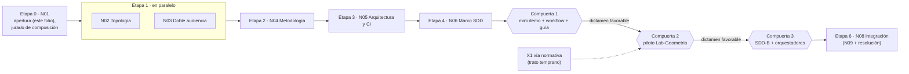

| Campo | Valor |
| --- | --- |
| Tipo | providencia |
| Fecha | 2026-10-26 |
| Autor | Presidencia de la mesa (despacho P00) |
| Corrige | — |

# Providencia de apertura — expediente 0002

Norma y secciones leídas: `Mesa-De-Expertos-A-Pedido` 3.1 por su protocolo derivado (`R01`, que la cita por línea),
y directamente §5.1 (contrato de entrada, `MEP:336-374`) y la tabla de lectura (`MEP:250`); `Expediente` 1.0 §2,
§3.1–§3.8 y §6 (E-1 a E-12); `Mesa-Consulta-A-Un-Tercero` 2.0 por `R01` §11.

## Índice

1. [Definiciones y alias](#1-definiciones-y-alias)
2. [Objeto y radicación](#2-objeto-y-radicación)
3. [Clasificación del objeto](#3-clasificación-del-objeto)
4. [Decisiones cerradas de la presidencia](#4-decisiones-cerradas-de-la-presidencia)
5. [ENUNCIADO](#5-enunciado)
6. [Contrato de entrada](#6-contrato-de-entrada)
7. [Lectura P0–P3 del caso](#7-lectura-p0p3-del-caso)
8. [Núcleos N01–N08 como ejes a presentar](#8-núcleos-n01n08-como-ejes-a-presentar)
9. [Contradicciones X1–X13 y quién las resuelve](#9-contradicciones-x1x13-y-quién-las-resuelve)
10. [Pendientes P1–P7 de la crítica de completitud y su tratamiento](#10-pendientes-p1p7-de-la-crítica-de-completitud-y-su-tratamiento)
11. [Despacho verificado](#11-despacho-verificado)
12. [Cláusulas operativas del expediente](#12-cláusulas-operativas-del-expediente)
13. [Excepciones a conocimientos](#13-excepciones-a-conocimientos)
14. [Lo no verificado](#14-lo-no-verificado)

---

## 1. Definiciones y alias

**Expediente.** Carpeta que registra un caso que atraviesa más de una corrida o repositorio, o en el que entra
material externo que funda una decisión (`KB-privada/Rules/Rule-Expediente.md` §1). Su índice es el
listado de `actuaciones/`. Su estado se deriva de la secuencia de folios. El pase del último folio es el punto de
continuación (`Rule-Expediente.md` §2).

**Providencia.** Folio de impulso del trámite: convoca, despacha u ordena (`Rule-Expediente.md` §3.4). Este folio
es el contrato de entrada y la verificación del despacho (`MEP:201`).

**ENUNCIADO.** Cada frase del pedido clasificada como incógnita, dato, requisito, deseable o exclusión, con su
sujeto y origen (`MEP:340`). Ejemplo: «Configura el wofklow con este runner…» (`TP:34`) es un **requisito** con
restricción dura de medio. «Se hace neceario investigar…» (`TP:18`) es una **incógnita**.

**Núcleo conceptual.** Unidad de análisis que agrupa ideas del pedido por afinidad y dependencia (`TP:46-47`). Los
ocho núcleos están en `N01`–`N08`, y su cohesión en `N00`.

**Escalón.** Tramo del alcance de esta corrida con su propia compuerta de dictamen (decisión D1, §4).

| Alias | Ruta desde la raíz del workspace |
| --- | --- |
| `TP` | `/LAB/Lab-Documentos/Lab-Documentos.Documentacion/PROMPTs/DEVs/Enchacement/01-Replanteo-Y-Analisis/Replanteo-Y-Analisis.md` (copia redactada en la evidencia 001) |
| `B/` | `/LAB/Lab-Documentos/Lab-Documentos.Documentacion/PROMPTs/DEVs/Enchacement/01-Replanteo-Y-Analisis/OUTPUTs/Bitacoras/` |
| `R0n`, `I0n`, `N0n`, `C00`, `B00` | Bitácoras de fase 1 en `B/`, listadas con huella en la evidencia 002. `R01:172` = línea 172 de `B/R01-Protocolo-De-Mesa.md` |
| `MEP` | `KB-privada/Knowledges/Knowledge-Mesa-De-Expertos-A-Pedido.md` 3.1 |
| `MCT` | `KB-privada/Knowledges/Knowledge-Mesa-Consulta-A-Un-Tercero.md` 2.0 |
| `RE` | `KB-privada/Rules/Rule-Expediente.md` 1.0 |
| `RM` | `KB-privada/Rules/Rule-Mesa.md` 1.0 |
| `PROFILE` | `/IA/PROMPTs/IA.Prompts/PromptFramework/Profiles/Study-Guide-Documentation.md` (ruta real; la de `TP:68` no existe, §11) |
| `SDD-B` | El marco SDD del servicio de notificaciones push (privado). En este expediente no se escribe su nombre, su repositorio, su dominio ni su infraestructura (`RE` §3.8, S2) |

## 2. Objeto y radicación

**Objeto.** Una mesa de expertos a pedido define una metodología común de evaluación de requerimientos, análisis,
diseño, implementación e integración de documentación técnica con DocAsCode (`TP:20`, `TP:26`). Además traza la
arquitectura del sistema documentador entero (`TP:36`, decisión D2). El trabajo avanza en tres escalones, cada uno
con compuerta de dictamen (`TP:30`, decisión D1).

**Radicación.** Lab-Documentos.Documentacion, porque ahí vive el tool-prompt y ahí corre la corrida
(`RE` §3.1; `R01:427-428`).

**Carpeta padre declarada (`P`).** Para este expediente:

```text
P = PROMPTs/DEVs/Enchacement/01-Replanteo-Y-Analisis/OUTPUTs/Expedientes/
    (relativa a la raíz de Lab-Documentos.Documentacion)
```

Ningún documento del repositorio declaraba una `P` (`R01` §13.1, H-05). `RE` §3.1 pide declararla y no deducirla.
Esta providencia la declara (opción A de `R01:418-431`). Dos motivos: queda junto al tool-prompt y dentro de
`OUTPUTs/`, que es la única zona de `PROMPTs/` donde se escribe. Además repite el patrón del único antecedente.
**Condición para revisarla:** que aparezca un tercer expediente en el repositorio o que la ia-db empiece a indexar
expedientes (`R01:426-427`).

**Número 0002.** El número es local al repositorio, correlativo y nunca reciclado (`RE` §3.1). El repositorio ya
tiene un expediente 0001 en **otra** `P`:
`PROMPTs/Concepts/01-Framework-Concept/OUTPUTs/Expedientes/0001-Framework-Concept-Maui-Autoactualizable/`. Una
`find` del 2026-10-26 lo confirma y no encuentra ninguna otra carpeta `NNNN-*` (§11). El 0001 **no está
versionado** (`R01` §13.1, H-01). Este expediente no lo toca: no es de esta corrida.

**Uno solo.** Se abre un expediente para esta corrida. Si los escalones 2 (Lab-Geometria) y 3 (`SDD-B`) abren
expediente en sus repositorios, este se los cita con **cita calificada** (`<repositorio>/<P>/<NNNN>-<Titulo>/`,
`RE` §3.1). El del `SDD-B` se nombra «un destino privado» (`RE` §3.8).

**Por qué se abre** (`RE` §1). Se cumplen las dos ramas. El caso atraviesa repositorios y corridas: guía y demo,
después Lab-Geometria y por último el `SDD-B` (`TP:30`). Y entra material externo que funda decisiones, porque las
comisiones traen estándares e industria (`TP:32`, `TP:36`; `R01:333-338`).

## 3. Clasificación del objeto

| Clase | Señal | Decisión |
| --- | --- | --- |
| **Diseño de una norma o decisión** | «Definir una metodlogía clara…» (`TP:26`); «si tener un repositorio dedicado… o bien estar integrado» (`TP:20`) | **Tomada** (`R01:190`). E1 se mide sobre el árbol que la norma alcanza. Las comisiones citan fuentes externas y no inventan cláusulas. El refutador ataca el costo de aplicar la norma. El cierre es un dictamen **pregunta por pregunta, sin «depende»** (`MEP:161`) |
| Corpus documental existente | «se debe enriquecer la guía `Sistema-Documentador-Tecnico-Guide.md`» (`TP:20`) | **Descartada como clase** (`R01:191`). La guía entra como objeto de los escalones y como **hipótesis a refutar**, no como objeto auditado. De esta clase sólo se suman los roles que pida una señal (`MEP:168-170`) |

**`Mesa` §3.1 no se cumple.** El objeto es una norma que todavía no existe, no un corpus de especificación. Por eso
`Mesa` se usa **como forma** (`R01` §6, H-10). Los campos `estado`, `diff_normativo` y `pendientes_declarados`
llevan «no aplica» porque no hay registro de mesa previo (`MEP:363-365`).

## 4. Decisiones cerradas de la presidencia

Estas decisiones entran en `DECISIONES CERRADAS` (`MEP:346`). No se reabren, salvo contradicción con ancla E1 o E2.
Las comisiones no las rediscuten: deciden **cómo** cumplirlas.

| Id | Decisión | Qué corrige o fija | Consecuencia operativa |
| --- | --- | --- | --- |
| D1 | `TP:30` es **alcance escalonado de esta corrida**. Escalón 1: mini demo MovilidadUrbana.MAUI, workflow de CI en `runs-on: [self-hosted, i7infra-dev]` y enriquecimiento de la guía. Escalón 2: piloto en Lab-Geometria (conocimiento y aplicación). Escalón 3: aplicación al `SDD-B`, con mejora de los orquestadores de ambos SDD. Cada escalón tiene compuerta de dictamen | Reemplaza la lectura «plan de corridas posteriores» del borrador (`R01:172`). Cierra X8 y la pregunta N01-3 / N07-1 | La mesa decide **cómo**, no **si**. Un escalón no empieza sin el dictamen favorable de la compuerta anterior. Por `MEP:258` y `R01` §15, la fila de alcance va igual en el lote de cierre, para que conste: una fila de alcance no se asienta por silencio |
| D2 | «Arquitectura clara» (`TP:36`) es la del **sistema documentador entero**: contenido, fuentes de verdad, topología, versionado, audiencias, publicación, CI y agentes. No es sólo el toolchain | Resuelve el pendiente P3 de `C00` (H9, `C00:160`) | La fila `TP:36` (g) lleva ● compartido N02/N04/N05. N05 la realiza; no la reduce a una lista de herramientas |
| D3 | Los cuatro perfiles de `TP:36` son **obligatorios**: analista de sistemas, arquitecto de software .NET, especialista en análisis y criterios de decisión (**con cupo propio**) y académico en edición de material bibliográfico | Resuelve el pendiente P5 de `C00` (H10): no se fusiona el especialista en decisiones con el analista, como hizo el antecedente (`R01:246-249`) | El jurado de composición no vota esos cuatro. Vota el quinto cupo y los postergados (Q01). El especialista en criterios de decisión **no es** el rol 6 bis, que sólo entra con ficha admitida (`MEP:149`) |
| D4 | La **consulta a un tercero** queda **en reserva**: no hay destinatario ni canal | Lectura de `R01` §11 (`MCT:7`, `MCT:36`, `MCT:90`) | Se declara en el cierre. Los «académicos» de `TP:36` son comisiones (agentes), no terceros (`R01` H-09) |
| D5 | **X2 corregido.** La ia-db de Lab-Documentos.Documentacion es un **índice**. El marco SDD es de workspace | Corrige el dato de `TP:18` con `R03:141-156` | En el ENUNCIADO, `TP:18` (b) entra como dato corregido. N06 trabaja sobre el marco de workspace, no sobre la ia-db |
| D6 | Dentro del expediente y en todo lo versionable, **rutas desde la raíz del workspace** (`/LAB/...`, `/IA/...`, `/PROG2/...`), nunca la ruta del host ni su usuario. En las bitácoras se tolera la ruta completa | Resuelve X10 y la tensión T1 de `N01` | Corre la compuerta S2 al asentar cada pieza (§12). Antes de versionar cualquier bitácora, barrido S2 (pendiente P7) |

**Una decisión de esta providencia, dentro de su competencia** (pendiente P6 de `C00`, `C00:161`). En `TP:30` (e),
**N06 decide qué se mejora** de los orquestadores y del conocimiento compartido. **N07 decide dónde, cuándo y con
qué evidencia se prueba**, y es dueño de la compuerta del escalón 3.

## 5. ENUNCIADO

Base: el borrador de `R01:157-179` y la matriz `N00` §7 (`N00:156-212`), con las decisiones D1–D6 aplicadas. Cada
frase lleva su línea de `TP`. Las citas que nombrarían el servicio privado van con la redacción de la evidencia 001.
«●» marca el núcleo principal (de `N00` §7). **Sujeto y origen** de todas las frases: el PO, por el tool-prompt.

### 5.1 Frases del pedido

| Línea | Frase (resumida; literal en la evidencia 001) | Clasificación | Núcleo ● | Nota |
| --- | --- | --- | --- | --- |
| `TP:4` | «ultracode leer y ejecutar `…/Replanteo-Y-Analisis.md`» | Dato (vía del pedido) | N01 | Invocación declarada en el propio prompt |
| `TP:6` | «Replanteo y analisis sistema de documentación DocAsCode» | Dato (título del objeto) | N04 | — |
| `TP:12` | Leer la ia-db de Lab-E2E.WebBlazor: «son ejemplos, referido al proyecto `MovilidadUrbana.MAUI`» | Dato | N07 | Fuente de la mini demo (`R05`) |
| `TP:14` | «Partiendo del desarrollo actual sobre lo que es materia de documentación a usuario de sistema, su diseño, desarrollo e implementación» | Dato (corpus previo) | N04 | Origen del choque X1 (`C00:154`) |
| `TP:15` | La guía `Sistema-Documentador-Tecnico-Guide.md` | Dato | N08 | Entra como hipótesis a refutar (`MEP:144`) |
| `TP:16` | Ejemplos y demostración en `Examples` | Dato | N07 | Prueba de concepto relevada (`R02`) |
| `TP:18` (a) | «Se hace neceario investigar y establecer métodlogias de diseño, implementación e integración en los sistemas» | **Incógnita** | N04 | — |
| `TP:18` (b) | La ia-db de Lab-Documentos.Documentacion «tiene su propio marco SDD» | **Dato corregido** (D5) | N06 | Es un índice; el marco es de workspace (`R03:141-156`) |
| `TP:18` (c) | `<destino privado: SDD-B>/ia-db/README.md` «con su propio SDD» | Dato | N06 | `R04`, con alias |
| `TP:18` (d) | «ambos se basan en agentes orquestadores y en conocimientos que pueden compartir» | Dato | N06 | Tres versiones vivas de un mismo conocimiento (X4) |
| `TP:20` (a) | «crear una metodología común de como analizar requerimientos documentales, diseño, implementación e integración usando DocAsCode» | **Requisito** | N04 | — |
| `TP:20` (b) | «si tener un repositorio dedicado a la documentación con su propio ciclo evolutivo o bien estar integrado en el mismo repositorio de codigo» | **Incógnita principal** | N02 | `R01:167` |
| `TP:20` (c) | «problemas de desfase de versionado, y coordinación» | **Incógnita** | N02 | — |
| `TP:20` (d) | «Seguramente la industria ya tiene resuelto el abordaje metodologico» | **Incógnita** (hipótesis a contrastar) | N02 | Lo contestan I01–I05 y las comisiones con fuente |
| `TP:20` (e) | «no solo son agentes humanos que accederan a esta documentación» | **Requisito** | N03 | — |
| `TP:20` (f) | «hace falta un estudio profundo» | **Requisito** | N08 | — |
| `TP:20` (g) | «se debe enriquecer la guía `Sistema-Documentador-Tecnico-Guide.md` y los ejemplos/demos anexados» | **Requisito** | N08 | Escalón 1 (D1) |
| `TP:26` | «Definir una metodlogía clara en evaluarción de requerimientos, analisis, diseño, implementación e integración de documetnación técnica de sistemas» | **Requisito** (objetivo) | N04 | Cinco fases literales; el mantenimiento sería un agregado (Q21) |
| `TP:30` (a) | «Analizar los temas planteados… las diferentes estrategias en base a los sistemas que venimos cubriendo» | **Requisito** | N04 | — |
| `TP:30` (b) | «Se puede enriqueser la guía actual, crear demostraciones y ejemplos» | **Requisito, escalón 1** (D1) | N07, N08 | Era deseable en `N00` |
| `TP:30` (c) | «podes montar una mini demo basado en `MovilidadUrbana.MAUI` para usarlo de referencia inicial» | **Requisito, escalón 1** (D1) | N07 | Era deseable en `R01:171` |
| `TP:30` (d) | «se puede empezar una prueba piloto en con `Geometria` establecer un conocimeinto» | **Requisito, escalón 2**, con compuerta del 1 (D1) | N07 | — |
| `TP:30` (e) | «finalmente aplicarlo a `<SDD-B>` mejorando los agentes orquestadores de ambos» | **Requisito, escalón 3**, con compuerta del 2 (D1) | N06, N07 | N06 decide qué; N07 decide dónde y cuándo (§4) |
| `TP:30` (f) | «para ser aplicado luego en el diseño de nuevos sitemas» | **Requisito** | N06 | Conocimiento reutilizable |
| `TP:32` (a) | «Es necesaario primero entender como se resuelve en la industria los problemas planteados» | **Requisito** | N02, N03, N04 | Precede al diseño («primero») |
| `TP:32` (b) | «puedan intervenir de forma automática la IA o bien que los agentes humanos entiendan el flujo de trabajo» | **Requisito** | N03 | — |
| `TP:34` | «Configura el wofklow con este runner de github: `runs-on: [self-hosted, i7infra-dev]`» | **Requisito** (restricción dura de medio) | N05 | Escalón 1 (D1). Repo y alcance del workflow: Q22 |
| `TP:36` (a) | «Crea una mesa basada en los conocimientos» `Knowledge-Mesa-De-Expertos-A-Pedido.md` y `Knowledge-Mesa-Consulta-A-Un-Tercero.md` | **Requisito** | N01 | La consulta a un tercero queda en reserva (D4) |
| `TP:36` (b) | «inclui analistas en sistemas y arquitectos en software .NET, especialistas en analisis el cúal se le pida criterios de decisión y analisis de las decisiones» | **Requisito de composición, obligatorio** (D3) | N01 | Criterios de decisión con cupo propio |
| `TP:36` (c) | «cita tambien academicos en edición de material bibliografico para consultar y crear ejemplos y material de consulta» | **Requisito de composición, obligatorio** (D3) | N01, N08 | Son comisión, no tercero (D4) |
| `TP:36` (d) | «A la mesa presentale el contexto, objetivos y las soliticitudes junto con las reglas dadas» | **Requisito** | N01 | Lo cumple el folio 002 |
| `TP:36` (e) | «La mesa debería abrir los expedientes si se requiere tal seguimiento» | **Requisito condicional** | N01 | Se cumple la condición (§2); lo cumple este folio |
| `TP:36` (f) | «Que se debata la mejor forma, que consulten los estandares» | **Requisito** | N01, N04 | — |
| `TP:36` (g) | «los especialistas deben trazar una arquitectura clara, puede alternativas, pero se deben buscar las ventajas de simplicidad y practicidad, escalibilidad» | **Requisito** (criterios del dictamen) | N02, N04, N05 (D2) | Arquitectura del sistema documentador entero (D2) |
| `TP:36` (h) | «Los investigadores especializados pueden ensayar y realizar todas las pruebas que sean necesarias, que se armen expedientes, se presenten y evaluen los resultados» | **Deseable** (habilitación de ensayos y peritaje) | N01, N07 | Ensayos en directorio de trabajo o contenedor efímero (§12) |
| `TP:36` (i) | «Es importante basarse en las tendencias del mercado y los estandares de la industria» | **Requisito** | N02, N03, N04 | Huecos de fuentes en P1 y P2 (§10) |
| `TP:42` | Markdown jerárquico, definiciones, explicaciones, ejemplos claros, mermaid cuando haga falta, autocontenido y no delta, con índices | **Requisito** (restricción dura de forma) | N01, N08 | Rige también para los folios |
| `TP:44` | «Vos y toda la mesa y sus subagentes debe seguir el concepto… de descomposición conceptual sobre la totalidad del prompt» | **Requisito** | N01 | — |
| `TP:46-47` | Núcleos por afinidad y dependencia, «No fragmentes el contenido únicamente por extensión o por párrafos» | **Requisito** | N01 | Cumplido en `N00` §3 |
| `TP:49` | Un markdown por núcleo y un documento de cohesión global | **Requisito** | N01 | Cumplido: `N01`–`N08`, `N00` |
| `TP:51` | Cada núcleo analizable, planificable y validable por separado, con trazabilidad | **Requisito** | N01 | Criterios de validación en cada `N0n` |
| `TP:53` | Fase de integración que consolida, resuelve dependencias o contradicciones y reconstruye el modelo completo | **Requisito** | N01, N08 | Punto de integración en N08 (`N00` §9) |
| `TP:55` | Presentar cada eje a la mesa evaluadora y planificadora | **Requisito** | N01 | Lo cumple el folio 002 |
| `TP:57` | Registros retomables en `OUTPUTs/Bitacoras` | **Requisito** | N01 | Cumplido (evidencia 002) |
| `TP:59` | «No inventar información» | **Requisito** (restricción dura) | N01 | Transversal |
| `TP:61` | «Toda afirmación debe estar respaldada por evidencia verificable» | **Requisito** (restricción dura) | N01 | Transversal |
| `TP:65-68` | Aplicar `/IA/IA.Prompts/PromptFramework/Profiles/Study-Guide-Documentation.md` | **Requisito** | N08 | La ruta citada no existe. Se aplica `PROFILE` (§11; prueba de una variable, no es bloqueo) |

**Cobertura.** Las 47 filas de `N00` §7 están acá con su clasificación (`C00:153` comprobó que ninguna frase con
contenido queda sin núcleo). Las líneas sin fila son títulos o separadores (`TP:1-3`, `TP:10`, `TP:24`, `TP:28`,
`TP:40`, `TP:63-65`).

### 5.2 Exclusiones

El pedido no trae exclusiones literales. Las que rigen son **agregadas**, con su origen:

| Id | Exclusión | Origen |
| --- | --- | --- |
| EX1 | No se escribe en `PROMPTs/` fuera de las `OUTPUTs/` de este caso, ni en otros repositorios | Carta común de la presidencia; convención del PO sobre `PROMPTs/` |
| EX2 | No se nombra el `SDD-B` ni su repositorio, dominio, hosts, IP, usuarios, clientes o claves | `RE` §3.8 (S2, «dato de un repositorio privado») |
| EX3 | No hay commits, push ni PR en esta fase | Carta común de la presidencia |
| EX4 | No se toca la ia-db de Lab-Geometria.Documentacion mientras siga abierta la otra corrida | `R06:131`; pendiente B00-P3 |
| EX5 | No se toca el expediente 0001 | `R01` H-01 |

**Caso que funciona** (`MEP:291`). No aplica como tabla diferencial. El expediente 0001 sirve como **ejemplar de la
forma**, no del contenido (`R01:181-182`).

## 6. Contrato de entrada

Campos de `MEP:338-360`, con lo que ya está en las secciones anteriores citado por remisión.

```text
PEDIDO (literal): el tool-prompt, copia redactada en la evidencia 001 (original en evidencia/local/, con huella);
                  invocación del folio 002. Lo hizo el PO; archivo modificado por última vez el 2026-10-26 10:20 -03:00.
ENUNCIADO: §5.
CLASE DE OBJETO: diseño de norma (descartada: corpus documental existente, §3).
OBJETO: metodología DocAsCode y arquitectura del sistema documentador. Corpus de partida: la guía
        /LAB/Lab-Documentos/Lab-Documentos/Guides/Documentacion-Tecnica/Sistema-De-Documentacion-E-Integracion/
        Sistema-Documentador-Tecnico-Guide.md y sus Examples (Lab-Documentos 5d5c2b4).
OBJETIVO: definir una metodología común y clara de evaluación de requerimientos, análisis, diseño, implementación e
          integración de documentación técnica con DocAsCode [TP:20 (a), TP:26], que sirva a personas y agentes
          [TP:20 (e), TP:32 (b)], resuelva la topología de repositorios y el desfase de versionado y coordinación
          [TP:20 (b)(c)], con una arquitectura del sistema documentador entero que privilegie simplicidad,
          practicidad y escalabilidad [TP:36 (g), D2], fundada en estándares y tendencias de industria
          [TP:32 (a), TP:36 (i)], y probada en tres escalones con compuerta [TP:30, D1].
PREGUNTAS DEL CASO: Q01–Q46, en el folio 002 §7. El dictamen responde cada una.
LECTURA P0–P3: §7.
RESTRICCIONES DURAS: TP:34 (runner); TP:42 (forma); TP:44-57 (descomposición y bitácoras); TP:59 y TP:61
                     (no inventar, evidencia verificable); EX1–EX5; S2.
DECISIONES CERRADAS: D1–D6 (§4); la decisión sobre TP:30 (e) (§4); P = §2; CONVENCIONES QUE RIGEN, abajo.
CONVENCIONES QUE RIGEN (barrido sobre KB-privada/Knowledges/Index-Knowledge.md, 42 filas, todas Vigente;
                        versión por grep -m1 '^\*\*Versión'):
    Mesa-De-Expertos-A-Pedido 3.1 · Mesa-Consulta-A-Un-Tercero 2.0 (en reserva, D4) · Mesa 1.0 (como forma) ·
    Expediente 1.0 · Escalas-De-Juicio 1.0 · Detencion-Y-Lote 1.0 · Cadena-De-Consecuencias 2.0 ·
    Excepcion-A-Un-Conocimiento 2.0 · Conformacion-Pull-Request-Automatico 2.0 y -Manual 2.0 (fase de escritura) ·
    Indexing 2.1 (ia-db; diferido, X12) · Versionado-Producto-Integral 2.0 y Release-Y-Despliegue-Versionado 2.0
    (N02, modelo de versión) · Forma-De-Conocimiento 1.3 (si el resultado se vuelve conocimiento, N06) ·
    Icono-Y-Ancla 2.0 (definiciones de la guía, N08).
    Descartes: Bundle-JS, Clean-Architecture-DataManager, DataTier-*, Media-File-Service-*, Migraciones-SQL-*,
    Parametros-De-Sistema*, Template-*, Versionado-Esquema-Base-De-Datos-EF-Layer, Versionado-Paquetes-NuGet,
    Red-Movil-Problematica, WhatsApp-Web-MCP, Deduccion-De-Reglas-De-Negocio, Entorno-De-Ejecucion-Del-Agente,
    Perfiles-Y-Extension: su Tema es de construcción de código, datos, interfaz, red, canal o identificación de
    origen, y no toca la metodología documental. Si una comisión encuentra que alguno sí la toca, emite una
    solicitud de convocatoria.
    Además, fuera de la base: PROFILE (Study-Guide-Documentation) y la norma del marco SDD de workspace (R03).
FUERA DE ALCANCE: EX1–EX5; producción; el contenido funcional de los sistemas de los escalones.
MEDIOS: lectura de repositorios, comandos locales, contenedores Docker efímeros (--rm) y directorio de ensayos
        fuera del workspace. Sin observar en la fase de mesa: la ejecución en el runner self-hosted (sin workflow
        versionado; R01 §16).
EXPEDIENTE: /LAB/Lab-Documentos/Lab-Documentos.Documentacion/PROMPTs/DEVs/Enchacement/01-Replanteo-Y-Analisis/
            OUTPUTs/Expedientes/0002-Replanteo-Metodologia-DocAsCode/
QUIÉN APLICA: quien convoca (la presidencia), escalón por escalón, después de cada compuerta.
PRESUPUESTO: [criterio propio] tope de 10 hallazgos por comisión. Hasta dos rondas por escalón; cerrar «por
             criterio» exige dos rondas seguidas sin hallazgos interpretativos (MEP:328). Con cuatro rondas sin
             criterio, el caso va al PO (R01 §14).
estado / diff_normativo / pendientes_declarados: no aplica. Mesa §3.1 no se cumple (§3).
DESPACHO VERIFICADO: §11.
```

## 7. Lectura P0–P3 del caso

Se adopta la propuesta de `R01:221-225`, con forma de `MEP:370-373`, y se le agregan dos precisiones por D1 y S2.
Esta lectura va en cada carta.

| Nivel | Qué es para este caso |
| --- | --- |
| **P0** | Lo que viola una restricción dura del pedido (reglas de `TP:42-61`, runner de `TP:34`), lo que hace imposible definir la metodología, lo que habilita un escalón sin dictamen favorable de la compuerta anterior (D1), o lo que asienta en el expediente un dato que no se publica (S2) |
| **P1** | Lo que haría salir la guía o la metodología con retrabajo, o con lecturas divergentes entre una persona y un agente que la apliquen |
| **P2** | Una pérdida acotada: un ejemplo o una fuente que falta sin romper el método |
| **P3** | Claridad |

## 8. Núcleos N01–N08 como ejes a presentar

El orden sigue `N00` §8 (`N00:214-243`). Las preguntas de cada eje están consolidadas en el folio 002 §7.

| Eje | Núcleo | Documento | Etapa | Qué decide | Preguntas |
| --- | --- | --- | --- | --- | --- |
| N01 | Gobierno de la corrida: mesa, expediente, evidencia | `B/N01-Gobierno-De-La-Mesa-Y-Evidencia.md` | 0 | Composición restante, delegación del merge, control `Verificar` | Q01–Q02 |
| N02 | Topología de repositorios, versionado y coordinación | `B/N02-Topologia-Versionado-Y-Coordinacion.md` | 1 | Repo dedicado, integrado o híbrido **por pieza**; anclas de versión; citas entre repos | Q03–Q09 |
| N03 | Doble audiencia: personas y agentes | `B/N03-Doble-Audiencia-Humanos-Y-Agentes.md` | 1 | Canales para agentes, intervención automática, aprobación, frontmatter, seguridad | Q10–Q16 |
| N04 | Metodología del ciclo documental | `B/N04-Metodologia-Del-Ciclo-Documental.md` | 2 | Fases, artefactos y respaldo normativo | Q17–Q21 |
| N05 | Arquitectura de referencia y CI | `B/N05-Arquitectura-De-Referencia-Y-CI.md` | 3 | Realización de la arquitectura (D2), workflow en el runner, compuertas, generador | Q22–Q29 |
| N06 | Marco SDD compartido y orquestadores | `B/N06-Marco-SDD-Compartido-Y-Orquestadores.md` | 4 | Fuente del conocimiento, mejora de orquestadores, vía normativa | Q30–Q35 |
| N07 | Demostraciones, piloto y aplicación | `B/N07-Demostraciones-Piloto-Y-Aplicacion.md` | 5 | Escalones 1–3 y sus compuertas (D1) | Q36–Q41 |
| N08 | Guía y material formativo | `B/N08-Guia-Y-Material-Formativo.md` | 6 (integración) | Estructura del cuerpo documental, citación y calidad | Q42–Q46 |



*Criterio de la presidencia.* El jurado trata temprano X1, el choque normativo de la piloto, aunque N06 esté en la
etapa 4. Es el riesgo más alto para la compuerta 2 (`N00:292`).

## 9. Contradicciones X1–X13 y quién las resuelve

Fuente: `N00` §6 (`N00:138-154`), con D1–D6 aplicadas.

| # | Contradicción (resumida) | Núcleos | Evidencia | Quién la resuelve | Estado al abrir |
| --- | --- | --- | --- | --- | --- |
| X1 | La ayuda por rol de la guía §7 choca con `Rules-Documentacion` de IA.SDD (usuario final fuera de alcance) y con «El producto no lleva manual» de Geometría | N06, N07, N08 | `R06:112-119` | Jurado sobre la vía normativa (N06). N07 y N08 la acatan | Abierta → Q32 (trato temprano) |
| X2 | La ia-db de Lab-Documentos, ¿marco SDD propio o índice? | N06, N01 | `TP:18`; `R03:141-156` | Presidencia | **Resuelta por D5** |
| X3 | `TP:34` exige el runner self-hosted; el CI que se agrega en el repo auxiliar de Geometría usa `ubuntu-latest`; el runner es único y lo comparte la E2E | N05, N07 | `R06:129`, `R06:143-145`, `R06:246` | N05 | Abierta → Q24, Q25 |
| X4 | Un mismo conocimiento en tres versiones vivas (3.1, 1.2, 1.15) | N02, N06 | `R03:256-267` | N06, con el modelo de N02 | Abierta → Q08, Q30 |
| X5 | La guía llama «adoptada» a `llms.txt`, que es una propuesta; la prueba de concepto lo filtra por cookie | N03, N08, N07 | `I03:340`; `R02:241-245` | N03 fija madurez y regla de acceso; N08 corrige el texto | Abierta → Q10, Q11 |
| X6 | Demo MAUI sin roles frente a un modelo de privilegios que depende del render en servidor | N07, N03 | `R05:110-120`; `R02:346` | N07 (la demo muestra audiencias, no roles) | Abierta → Q37 |
| X7 | Trazas de la guía a `CU-000NN` (unidad Api) cuando las pantallas están en `CU-100NN` (unidad Web) | N07, N04, N08 | `R06:193` | N04 fija el contrato `traces`; N07 lo aplica | Abierta → Q38 |
| X8 | `TP:30`, ¿alcance o plan? | N01, N07 | `R01:172` | Presidencia | **Resuelta por D1**: alcance escalonado |
| X9 | «Aprobador ≠ solicitante» con un equipo de una persona con dos identidades | N03, N01 | `I03:196`; `R03:212-214` | Jurado (riesgo e irreversibilidad) | Abierta → Q13 |
| X10 | Ruta del host en la carta frente a la compuerta S2 en lo versionado | N01, N08 | `R01:15-24`, `R01:639` | Presidencia | **Resuelta por D6**; queda el barrido de P7 |
| X11 | Enlaces relativos (`Rule-Markdown`) frente a ruta completa desde la raíz (regla del PO) | N08, N01 | `R07:348` | N08: relativos en el repo publicado, completos en bitácoras y expediente | Abierta → Q42–Q43 (forma del cuerpo) |
| X12 | `Rule-Indexing` pide actualizar la ia-db; la fase es de sólo lectura y otra corrida escribe la ia-db de Geometría | N01, N07 | `R07:350`; `R06:131` | Presidencia | **Diferida** a la escritura del escalón que toque cada ia-db (EX4; B00-P2) |
| X13 | La documentación en el mismo repo no evitó la deriva en el `SDD-B`; la separada rompió enlaces en Lab-E2E.WebBlazor | N02, N05 | `R04:315-316`; `R05:270` | N02 + N05 (topología con compuerta) | Abierta → Q03, Q06 |

## 10. Pendientes P1–P7 de la crítica de completitud y su tratamiento

Fuente: `C00` §8 (`C00:214-224`).

| # | Pendiente | Núcleo | Tratamiento que ordena esta providencia |
| --- | --- | --- | --- |
| P1 | Investigar los marcos SDD de mercado (Spec Kit, Kiro, Tessl) frente a los dos SDD propios, con URL y fecha | N06 | **Se ordena el despacho I06** (investigación) antes de las comisiones de la etapa 4. Su carta se archiva en `evidencia/` antes de despachar (`RE` §3.7). Su bitácora va a `B/` |
| P2 | Relevar DORA, documentación viva/BDD en .NET, guías de estilo, WCAG 2.2, IEC/IEEE 82079-1, i18n y mecanismos multi-repo de actualización de anclas (más The Good Docs Project, `C00:182`) | N02, N04, N05, N08 | **Se ordena el despacho I07** (investigación), en paralelo con I06 y antes de las comisiones de la etapa 1, porque N02 lo necesita. Mismo régimen de carta |
| P3 | «Arquitectura clara»: ¿la del sistema documentador entero o la del toolchain? | N05, N00 | **Resuelto por D2** |
| P4 | En qué repo y con qué alcance se configura el workflow de `TP:34` (único o plantilla) | N05 | Es **Q22**. La mesa lo **cierra** en el dictamen del escalón 1, no lo deja abierto (`C00:155`) |
| P5 | ¿«Análisis de decisiones» con cupo propio o fusionado con el analista? | N01 | **Resuelto por D3**: cupo propio |
| P6 | ¿Qué núcleo decide `TP:30` (e)? | N06, N07 | **Resuelto en §4**: N06 decide qué se mejora; N07 decide dónde, cuándo y con qué evidencia |
| P7 | Barrido S2 de rutas del host antes de versionar | N01 | Para el expediente rige D6, y S2 corre al asentar cada pieza (§12). Para las bitácoras, el barrido corre **antes de versionarlas**, con el comando E-12 y su resultado declarado en el cierre (`R01` §14) |

**Pendientes de la bitácora maestra** (`B00:127-137`, otra numeración). B00-P1 es la ruta del Profile (§11; es del
PO, porque `PROMPTs/` es suyo; va en el lote). B00-P2 es la ia-db (X12). B00-P3 es EX4. B00-P4 coincide con P7.
B00-P5 (`.gitignore` sin `.apk`/`.wasm`), B00-P6 (delegación y `Verificar`, Q02) y B00-P7 (deuda inmediata de la
guía, Q40) quedan para la fase de escritura.

## 11. Despacho verificado

| Dato | Comando | Salida (2026-10-26) |
| --- | --- | --- |
| Base de Lab-Documentos.Documentacion | `git -C <workspace>/LAB/Lab-Documentos/Lab-Documentos.Documentacion log -1 --format='%h %cs'` | `8da0cd9 2026-10-11` |
| Base de Lab-Documentos | `git -C <workspace>/LAB/Lab-Documentos/Lab-Documentos log -1 --format='%h %cs'` | `5d5c2b4 2026-10-11` |
| Base de KB-privada | `git -C KB-privada log -1 --format='%h %cs'` | `1585af9 2026-10-25` |
| Ruta del Profile de `TP:68` | `ls <workspace>/IA/IA.Prompts/PromptFramework/Profiles/Study-Guide-Documentation.md` | `No existe el fichero o el directorio` |
| Ruta real del Profile (prueba de una variable: agregar `PROMPTs/`) | `ls <workspace>/IA/PROMPTs/IA.Prompts/PromptFramework/Profiles/Study-Guide-Documentation.md` | existe → no es bloqueo (`R01` H-11) |
| Expedientes previos en el repositorio | `find <workspace>/LAB/Lab-Documentos/Lab-Documentos.Documentacion -maxdepth 6 -type d -name '[0-9][0-9][0-9][0-9]-*'` | una sola carpeta: `…/01-Framework-Concept/OUTPUTs/Expedientes/0001-Framework-Concept-Maui-Autoactualizable` |
| Carpeta `OUTPUTs/Expedientes/` de este caso antes de abrir | `find …/01-Replanteo-Y-Analisis/OUTPUTs/Expedientes -type f` | `No existe el fichero o el directorio` (no había un despacho anterior del mismo rol, `RE` §3.7) |
| Tool-prompt | `wc -lc` y `sha256sum` | `67` saltos de línea (68 líneas: la última no termina en salto), `6992` bytes; `101e1bc4f8c933bb64d77a88e37f13d50ee49539b488b18bf6bd0bb256e826aa` |
| Tool-prompt: tramos privados | `grep -n -i` con el patrón `PRIV` (§12) | líneas 18 y 30 → redactadas en la evidencia 001 |
| Índice de la base | `grep '^| \[' Index-Knowledge.md \| wc -l`; `grep -m1 Generado` | `42`; «Generado: fecha `2026-10-24` · commit `081082a`» frente a la base `1585af9` (ver §14) |
| Versiones de las convenciones que rigen | `grep -m1 '^\*\*Versión'` sobre cada documento enlazado | las de §6 |
| Bitácoras de fase 1 | `wc -l` y `sha256sum` | 23 archivos, en la evidencia 002 |

## 12. Cláusulas operativas del expediente

1. **Folios.** Cabecera de cuatro filas y pase al final (`RE` §3.3). Un frontmatter YAML **precede** a la
   cabecera porque la carta común lo pide para todo documento. No altera ninguna comprobación E-2 a E-6, que buscan
   las filas por patrón. El README es sólo la carátula, sin frontmatter (`RE` §3.2; `R01` H-03).
2. **Rutas.** D6. En las piezas del expediente, la ruta del host se escribe `<workspace>`.
3. **S2.** Corre al asentar cada pieza. Para este repositorio, `PRIV` es la alternancia que nombra el servicio
   privado y su repositorio: la declara la presidencia al correr E-12, y no se escribe acá porque escribirla sería
   asentarla. Barrido de este folio: el patrón de E-12 (ruta y usuario del host) más `PRIV`, sobre la carpeta del
   expediente salvo `evidencia/local/` → vacío (se registra en el folio 002 §10).
4. **Cartas.** Toda carta se archiva verbatim en `evidencia/` **antes** de despachar. Lleva la ruta y versión de
   `MEP`, la lectura en dos pasos, la línea «Secciones… leídas» y la lectura P0–P3 de §7 (`MEP:144`). Sale de la
   plantilla de `R01` §17.1. Antes de despachar se comprueba que no quede vivo un despacho anterior del mismo rol
   (`RE` §3.7).
5. **Informes.** Cada comisión escribe el suyo en `despacho/<rol>.md`. La presidencia lo incorpora como folio
   `informe` sin editar (`MEP:207`). El jurado vota con `PROCEDE` / `NO_PROCEDE` / `INSUFICIENTE`, sin `ARCHIVA`
   (`R01` H-04).
6. **Ensayos.** Los intermedios van en un directorio de trabajo fuera del workspace, nunca en el temporal de los
   agentes, o en contenedores Docker efímeros (`--rm`). Se borran al terminar y el folio de quien ensaya anota qué
   creó y qué borró. Lo crudo va a `evidencia/local/`.
7. **Terminología** (`N01` T5). «Ciclo de trabajo» para el flujo humano y de agentes; «workflow de CI» para el
   archivo de GitHub Actions.
8. **Mensajes del PO** durante la corrida: los atiende la presidencia en una `providencia` con su testimonio
   (`MEP:205`). No cambian los despachos en curso salvo relanzamiento (`MEP:144`).

## 13. Excepciones a conocimientos

| Conocimiento y § | Qué dice | Qué se hace en su lugar | Impacto operativo |
| --- | --- | --- | --- |
| `Mesa-De-Expertos-A-Pedido` 3.1, tabla de lectura (`MEP:250`) | «la presentación literal del pedido es la primera pieza del expediente» | La presentación entra como **folio 002**, después de esta providencia de apertura, por el orden que fija el despacho P00 de la presidencia. La copia literal (redactada S2) es la **evidencia 001**, y el expediente la recibe antes que cualquier carta. Alternativa de cumplir: numerar la presentación como 001 y la providencia como 002, como hizo el antecedente | Ninguno sobre el estado derivado: la `presentacion` 002 deja el expediente «abierto» y no reabre nada (`RE` §3.4). Las comisiones reciben el pedido textual igual. Va en el lote de cierre con su default: queda como está |
| `Expediente` 1.0 §3.5 (testimonio literal byte a byte) frente a §3.8 (S2) | Literal sin recortar; y no asentar datos de un repositorio privado | Mandan las dos a la vez: el testimonio del folio 002 es la **línea de invocación** (`TP:4`), que no trae datos privados, y el texto completo va como copia redactada y marcada, con el original local y su huella (`RE` §3.6) | Ninguno: es la vía que la propia regla prevé. No es excepción en sentido estricto; se declara porque elige entre dos lecturas |

## 14. Lo no verificado

- **El mensaje de chat con que el PO invocó el tool-prompt.** Este despacho no lo tiene. El testimonio del folio
  002 es la invocación que el prompt declara en `TP:4`. Motivo: la corrida se reanudó tras un corte de sesión y el
  texto del chat no viaja al despacho.
- **Si `Index-Knowledge.md` está al día con `1585af9`.** Fue generado sobre `081082a` (`R01` H-12). No se regeneró
  porque esta fase no escribe en KB-privada.
- **Si la piloto y el `SDD-B` abrirán expediente propio.** Se decide en sus compuertas (Q41).

Sigue: presentación del caso a la mesa, con las preguntas Q01–Q46 · presidencia · Cierra con: folio 002 (presentacion)
