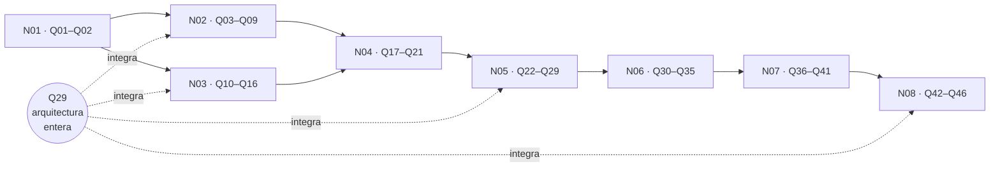

| Campo | Valor |
| --- | --- |
| Tipo | presentacion |
| Fecha | 2026-10-26 |
| Autor | Product Owner (asentado por la presidencia) |
| Corrige | — |

# Presentación del caso a la mesa — expediente 0002

## Índice

1. [El pedido y su testimonio](#1-el-pedido-y-su-testimonio)
2. [Cómo leer esta presentación](#2-cómo-leer-esta-presentación)
3. [Contexto (literal)](#3-contexto-literal)
4. [Objetivos (literal)](#4-objetivos-literal)
5. [Solicitudes (literal)](#5-solicitudes-literal)
6. [Reglas y framework (literal)](#6-reglas-y-framework-literal)
7. [Índice de insumos](#7-índice-de-insumos)
8. [Preguntas abiertas Q01–Q46](#8-preguntas-abiertas-q01q46)
9. [Preguntas de fase 1 cerradas en la apertura](#9-preguntas-de-fase-1-cerradas-en-la-apertura)
10. [Barrido S2 de lo asentado](#10-barrido-s2-de-lo-asentado)

---

## 1. El pedido y su testimonio

El PO pidió ejecutar el tool-prompt `Replanteo-Y-Analisis.md`. La invocación es la que declara el propio prompt en
su línea 4:

```testimonio
> - ultracode leer y ejecutar `/LAB/Lab-Documentos/Lab-Documentos.Documentacion/PROMPTs/DEVs/Enchacement/01-Replanteo-Y-Analisis/Replanteo-Y-Analisis.md`
```

| Campo | Valor |
| --- | --- |
| Canal | Tool-prompt del PO en Lab-Documentos.Documentacion, línea 4 (la invocación que el prompt declara; el mensaje de chat no llegó a este despacho, folio 001 §14) |
| Fecha-hora | 2026-10-26T10:20-03:00 (última modificación del archivo del tool-prompt) |
| Huella | `97cdcc718fb22ee760454363e96ad3cde14dddaf569e4979ef84984fe5f2da4a` |

Es un **pedido**, fuente de intención. Pasa a ancla E4 con el contrato de entrada del folio 001 (`RE` §3.5). El
pedido diseña lo que el producto no prometía: una metodología y una arquitectura del sistema documentador. Es un
**cambio de alcance pedido por quien decide**, y este folio es su arbitraje (`MEP:258`). El texto completo es la
evidencia 001, copia redactada S2 con el original local y su huella. Las secciones 3 a 6 lo transcriben **literal**,
línea por línea, con esa misma redacción.

## 2. Cómo leer esta presentación

**Qué es.** Lo que la mesa recibe textual, según `TP:36` («A la mesa presentale el contexto, objetivos y las
soliticitudes junto con las reglas dadas») y `TP:55` («presentar cada eje a la mesa»).

**Qué no es.** No es una lectura previa con opiniones de quien convoca. La guía actual, los núcleos `N01`–`N08` y la
cohesión `N00` viajan como **hipótesis a refutar** (`MEP:144`).

**Convenciones.**

- Cada pasaje literal va precedido de su línea en el tool-prompt (`TP:N`). La ortografía no se corrige.
- Dos tramos llevan redacción S2, marcada como `<destino privado: SDD-B>` (`TP:18`) y `<SDD-B>` (`TP:30`).
- La clasificación de cada frase (incógnita, dato, requisito, deseable o exclusión) y las decisiones D1–D6 están en
  el folio 001 §4–§5. Las comisiones las leen allí.
- Las bitácoras se citan `<Id>:<línea>` y están en
  `/LAB/Lab-Documentos/Lab-Documentos.Documentacion/PROMPTs/DEVs/Enchacement/01-Replanteo-Y-Analisis/OUTPUTs/Bitacoras/`.

**Ejemplo de lectura.** La pregunta Q22 («¿El workflow de `TP:34` es uno o una plantilla…?») cita su origen
`N05:144`. Eso quiere decir que nació en la bitácora `N05`, línea 144. Remite a la frase literal `TP:34` de §5, y su
fila «Por qué importa» dice qué se pierde si queda sin respuesta.

## 3. Contexto (literal)

**`TP:12`**

>   Leer `/LAB/Lab-E2E.WebBlazor/Lab-E2E.WebBlazor.Documentacion/ia-db/README.md` son ejemplos, referido al proyecto `MovilidadUrbana.MAUI`

**`TP:14`**

>   Partiendo del desarrollo actual sobre lo que es materia de documentación a usuario de sistema, su diseño, desarrollo e implementación contamos con esto: 

**`TP:15`**

>    `/LAB/Lab-Documentos/Lab-Documentos/Guides/Documentacion-Tecnica/Sistema-De-Documentacion-E-Integracion/Sistema-Documentador-Tecnico-Guide.md`

**`TP:16`**

>   acompañado de ejemplos y/o demostración en `/LAB/Lab-Documentos/Lab-Documentos/Guides/Documentacion-Tecnica/Sistema-De-Documentacion-E-Integracion/Examples`.

**`TP:18`**

>   Se hace neceario investigar y establecer métodlogias de diseño, implementación e integración en  los sistemas. Actualmente se cuentan `/LAB/Lab-Documentos/Lab-Documentos.Documentacion/ia-db/README.md`, el cual tiene su propio marco SDD de diseño asistido por IA y por otro lado tenemos `<destino privado: SDD-B>/ia-db/README.md` con su propio SDD; pero ambos se basan en agentes orquestadores y en conocimientos que pueden compartir.

**`TP:20`**

>   Para crear una metodología común de como analizar requerimientos documentales, diseño, implementación e integración usando DocAsCode queda entender que conviene hacer, si tener un repositorio dedicado a la documentación con su propio ciclo evolutivo o bien estar integrado en el mismo repositorio de codigo. Y aquí surgen problemas de desfase de versionado, y coordinación. Seguramente la industria ya tiene resuelto el abordaje metodologico de esta cuestión. Con la aparición de los agentes IA, integración con sistema multiagenticos, no solo son agentes humanos que accederan a esta documentación, así que hace falta un estudio profundo y se debe enriquecer la guía `Sistema-Documentador-Tecnico-Guide.md` y los ejemplos/demos anexados.


## 4. Objetivos (literal)

**`TP:26`**

>   Definir una metodlogía clara en evaluarción de requerimientos, analisis, diseño, implementación e integración de documetnación técnica de sistemas.


## 5. Solicitudes (literal)

**`TP:30`**

>   - Analizar los temas planteados en el contexto y objetivos, las diferentes estrategias en base  a los sistemas que venimos cubriendo. Se puede enriqueser la guía actual, crear demostraciones y ejemplos (podes montar una mini demo basado en `MovilidadUrbana.MAUI` para usarlo de referencia inicial) y luego, se puede empezar una prueba piloto en con `Geometria` establecer un conocimeinto y  finalmente aplicarlo a `<SDD-B>` mejorando los agentes orquestadores de ambos para ser aplicado luego en el diseño de nuevos sitemas.

**`TP:32`**

>   - Es necesaario primero entender como se resuelve en la industria los problemas planteados en el contexto, y tener en cuenta que en esta tarea documental puedan intervenir de forma automática la IA o bien que los agentes humanos entiendan el flujo de trabajo para poder intervenir o realizar sus aportes.

**`TP:34`**

>   - Configura el wofklow con este runner de github :  `runs-on: [self-hosted, i7infra-dev]`

**`TP:36`**

>   - Crea una mesa basada en los conocimientos: `KB-privada/Knowledges/Knowledge-Mesa-De-Expertos-A-Pedido.md` y `KB-privada/Knowledges/Knowledge-Mesa-Consulta-A-Un-Tercero.md` , en esta mesa determinar que especialistas en el tema necesitas reclutar  y convocalos inclui analistas en sistemas y arquitectos en software .NET, especialistas en analisis el cúal se le pida criterios de decisión y analisis de las decisiones, cita tambien academicos en edición de material bibliografico para consultar y crear ejemplos y material de consulta. A la mesa presentale el contexto, objetivos y las soliticitudes junto con las reglas dadas. La mesa debería abrir los expedientes si se requiere tal seguimiento. Que se debata la mejor forma, que consulten los estandares, los especialistas deben trazar una arquitectura clara, puede alternativas, pero se deben buscar las ventajas de simplicidad y practicidad, escalibilidad. Los investigadores especializados pueden ensayar y realizar todas las pruebas que sean necesarias, que se armen expedientes, se presenten y evaluen los resultados ante la mesa y los especialistas. Es importante basarse en las tendencias del mercado y los estandares de la industria.


## 6. Reglas y framework (literal)

Los títulos de sección del prompt se dan acá entre comillas y no como encabezados, para no alterar la estructura de este folio: `TP:10` «## Contexto», `TP:24` «## Ojetivos», `TP:28` «## Solicitudes», `TP:40` «## Reglas», `TP:63` «## Framework», `TP:65` «### Profile».

**`TP:42`**

>   - Los documentos markdown de documentación deben estar organizados en secciones jerárquicas. Deben incluir definiciones, explicaciones, ejemplos claros y en cuando sea necesario gráficos mermaid. Debe ser autocontenida y no delta. Los documentos creados deben tener índices.

**`TP:44`**

>   - Vos y toda la mesa y sus subagentes debe seguir el concepto a apliciar como estrategia de descomposición conceptual sobre la totalidad del prompt. 

**`TP:46`**

>     Identifica y agrupa las ideas que presenten una relación temática, semántica o de  dependencia fuerte, formando núcleos conceptuales coherentes. No fragmentes el  contenido únicamente por extensión o por párrafos: la unidad de segmentación debe

**`TP:47`**

>     estar determinada por la afinidad y dependencia entre las ideas.

**`TP:49`**

>     Aborda el análisis y la planificación por estos núcleos conceptuales o ejes  temáticos, documentando cada uno en un documento Markdown independiente. Mantén además un documento de cohesión global que describa las relaciones, dependencias, referencias y vínculos existentes entre los distintos núcleos.

**`TP:51`**

>     La segmentación debe permitir trabajar cada eje con mayor precisión sin perder  contexto ni relaciones con los demás. Cada núcleo debe poder analizarse, planificarse y validarse de manera relativamente independiente, pero debe conservarse la trazabilidad necesaria para integrarlo posteriormente en una solución global.

**`TP:53`**

>     Una vez abordados los distintos núcleos conceptuales, realiza una fase de integración en la que se consoliden sus resultados, se resuelvan dependencias o contradicciones entre ellos y se reconstruya el modelo completo.

**`TP:55`**

>     El objetivo de esta estrategia es transformar un prompt de gran volumen y alta  complejidad en un conjunto de unidades conceptuales manejables, manteniendo entre ellas una estructura de cohesión, dependencia y trazabilidad que permita presentar cada eje a la mesa evaluadora y planificadora y, finalmente, integrarlos en un todo coherente.

**`TP:57`**

>     Para poder cumplir con esta regla aproyate en ir generando registros que puedas retomar y evaluar markdowns en `/LAB/Lab-Documentos/Lab-Documentos.Documentacion/PROMPTs/DEVs/Enchacement/01-Replanteo-Y-Analisis/OUTPUTs/Bitacoras`

**`TP:59`**

>   - No inventar información. 

**`TP:61`**

>   - Toda afirmación debe estar respaldada por evidencia verificable.

**`TP:67`**

>   Aplicar:

**`TP:68`**

>   - `/IA/IA.Prompts/PromptFramework/Profiles/Study-Guide-Documentation.md`


**Nota de la presidencia sobre `TP:68`.** La ruta citada no existe. Se aplica
`/IA/PROMPTs/IA.Prompts/PromptFramework/Profiles/Study-Guide-Documentation.md` (folio 001 §11).

## 7. Índice de insumos

El inventario completo, con líneas y huellas, es la **evidencia 002**. La tabla dice qué lee cada comisión además
del pedido y de los folios 001 y 002.

| Insumo | Qué aporta | Lo lee |
| --- | --- | --- |
| `B00` — bitácora maestra | Estado de la corrida, fases y pendientes B00-P1…P7 | Presidencia |
| `R01` — protocolo de mesa | ENUNCIADO de partida, clasificación, composición, jurado, consulta a un tercero, expediente, plantillas de carta y acta (§17) | Presidencia, jurados |
| `R02` — guía actual y ejemplos | Guía y prueba de concepto reproducidas; huecos y deuda inmediata | N07, N08, refutador |
| `R03` — Lab-Documentos | La ia-db es un índice; marco SDD de workspace; workflows y runner | N02, N05, N06 |
| `R04` — `SDD-B` (con alias) | Marco SDD del servicio privado, deriva medida | N02, N06, N07 |
| `R05` — MovilidadUrbana.MAUI | Base de la mini demo; ensayo OpenAPI | N05, N07 |
| `R06` — Lab-Geometria | Estado documental; punto de partida de la piloto; runner compartido | N05, N06, N07 |
| `R07` — reglas del PromptFramework | Lista de verificación VER-* (104 ítems) y tensiones entre reglas | Verificación, N08 |
| `I01` — topología de repositorios | Mismo repo, dedicado o híbrido; matriz D1–D8 | N02, N05, N07 |
| `I02` — versionado y deriva | Versionado de documentación; cadena `docs-guard` | N02, N05 |
| `I03` — documentación para agentes | Canales, escritura por agentes, riesgos; R1–R20 | N03, N05, N08 |
| `I04` — estándares y metodologías | 2651x, 15289, 12207, Diátaxis, DITA, arc42, C4, MADR | N04, N08 |
| `I05` — edición académica | Calidad documental, APA 7, CQ-01…14, PE-01…12 | N08, académico |
| `N00` — cohesión global | Núcleos, grafo, X1–X13, matriz de trazabilidad, orden, integración | Todas |
| `N01`…`N08` — núcleos | Un documento por eje, con hallazgos, preguntas, criterios de validación y especialistas sugeridos | La comisión del eje |
| `C00` — crítica de completitud | Muestreo de evidencia (37 citas), huecos de fuentes, pendientes P1–P7 | Presidencia, refutador |

## 8. Preguntas abiertas Q01–Q46

Consolidan las secciones «Preguntas abiertas» de `N01`–`N08` (57 preguntas). Se fusionaron seis duplicadas. Las
seis que la apertura ya cerró están en §9. Se agregó una pregunta integradora (Q29), por D2 y `N00` §9. El dictamen
responde **cada una, sin «depende»** (`MEP:161`). Si una no se puede cerrar, va con su motivo y su default.

### 8.1 N01 — Gobierno de la corrida

| Id | Pregunta | Origen | Por qué importa | Fusiona |
| --- | --- | --- | --- | --- |
| Q01 | Los cuatro perfiles obligatorios de D3 ocupan cuatro lugares del techo (núcleo permanente + cinco). ¿Qué perfil ocupa el quinto cupo? `N00` §10 señala el de documentación para agentes y seguridad LLM. ¿Cuáles quedan postergados o como ad hoc para un ciclo posterior (DevOps y runners, gestión de configuración, marcos SDD, normas 2651x, diseño instruccional)? | `N01:127`; `N00:279`; `C00:222` | Sin panel no sale ninguna comisión (`R01:122`). Si el quinto cupo va a otro perfil, N03 queda sin comisión propia | — |
| Q02 | ¿La fase de escritura del escalón 1 empieza por una unidad que asiente la delegación del merge y un control `Verificar` sobre `[self-hosted, i7infra-dev]`? | `N01:131`; `R01:643` | Sin delegación ni controles, un PR queda en reserva por G3 y rige el ciclo manual (`R01` §16) | — |

### 8.2 N02 — Topología, versionado y coordinación

| Id | Pregunta | Origen | Por qué importa | Fusiona |
| --- | --- | --- | --- | --- |
| Q03 | ¿Se adopta la decisión de topología **por pieza documental** (matriz D1–D8) en lugar de una topología única por proyecto? | `N02:125`; `I01:200-213` | Es la incógnita principal (`TP:20` b). X13 muestra que ninguna topología sola evitó la deriva | — |
| Q04 | Para cada par repositorio de código ↔ `.Documentacion`, ¿cuál es el ancla de versión de la documentación? Opciones: tag del código, SHA indexado, o ninguna (la doc «follows» el software y no «is bound to» él) | `N02:126`; `I02:123-125` | Fija cómo se detecta el desfase de versionado (`TP:20` c) | — |
| Q05 | ¿Se versiona el sitio publicado, o se documenta sólo la versión desplegada? | `N02:127`; `I02:127-129`; `I02:327` | Condiciona el generador (Q26) y el costo de build | — |
| Q06 | ¿Qué mecanismo detecta enlaces rotos **entre repositorios**: una compuerta en cada PR o un aviso programado? | `N02:128` | La doc separada rompió enlaces en Lab-E2E.WebBlazor (`R05:270`, X13) | — |
| Q07 | ¿Cómo se cita entre repositorios para que una reorganización no rompa referencias? ¿Por identificador estable (expediente, commit) en lugar de ruta? | `N02:129`; `R04:317-319` | Coordinación entre repositorios (`TP:20` c); afecta las citas de la guía | — |
| Q08 | Los conocimientos que comparten los orquestadores, ¿tienen una sola fuente referenciada con versión, o copias con un mecanismo de sincronización? ¿Con qué mecanismo? | `N02:130`; `N06:128`; `R04:270` | X4: el mismo conocimiento vive en tres versiones (`R03:256-267`). Sin un modelo no se puede «compartir» (`TP:18` d) | N02-6 + N06-4 |
| Q09 | ¿Lab-Documentos y Lab-Documentos.Documentacion adoptan tags y changelog por versión, o se declaran repos de ritmo propio (D4 de `I01`)? | `N02:131` | Hoy Lab-Documentos no tiene tags (`C00:133`), y es donde vive la guía que se enriquece | — |

### 8.3 N03 — Doble audiencia: personas y agentes

| Id | Pregunta | Origen | Por qué importa | Fusiona |
| --- | --- | --- | --- | --- |
| Q10 | ¿Qué canales de lectura para agentes son obligatorios y cuáles opcionales (`AGENTS.md`, `.md` por página, `llms.txt`, MCP propio, índice tipo ia-db)? ¿Con qué madurez se presenta cada uno? | `N03:118`; `I03:257-265`; `I03:340` | Requisito de `TP:20` (e). X5: la guía llama «adoptada» a una propuesta | — |
| Q11 | ¿Qué relación hay entre la ia-db y `llms.txt`? ¿Uno reemplaza al otro, o la ia-db es el índice interno y `llms.txt` el público? | `N03:119`; `R05:194` | Evita dos índices divergentes para el mismo lector agente | — |
| Q12 | ¿Qué intervenciones automáticas de IA se permiten (proponer un PR, regenerar la referencia, traducir) y en qué fases del ciclo? ¿Cuáles exigen siempre una persona? | `N03:120`; `N04:127`; `TP:32`; `I03:181` | Es literal de `TP:32` (b) y define el ciclo de trabajo de N04 | N03-3 + N04-5 |
| Q13 | ¿Quién aprueba un PR de documentación hecho por un agente, si el equipo es de una sola persona con dos identidades? | `N03:121`; `I03:196`; `R03:212-214` | X9. Riesgo de aprobar por silencio | — |
| Q14 | ¿Qué frontmatter y qué prefijos de ID fija la mesa para el cuerpo documental? El Profile no los define | `N03:122`; `N08:143`; `R07:366`; `R07:371` | Es el contrato de lectura para agentes y para las trazas; cubre un hueco del Profile | N03-5 + N08-6 |
| Q15 | ¿Cómo se entera una persona del ciclo de trabajo para intervenir? ¿Basta la guía, o hace falta un documento de proceso con entradas, salidas y validaciones? | `N03:123`; `TP:32`; `R07:251` | Literal de `TP:32` (b), para la audiencia humana | — |
| Q16 | ¿Qué controles contra inyección indirecta se exigen al publicar documentos que leen agentes (filtrado de comentarios HTML, lista de fuentes MCP permitidas)? | `N03:124`; `I03:289-291` | OWASP LLM01:2025 (`C00:144`). Un agente que ejecuta instrucciones plantadas en la documentación es un P0 | — |

### 8.4 N04 — Metodología del ciclo documental

| Id | Pregunta | Origen | Por qué importa | Fusiona |
| --- | --- | --- | --- | --- |
| Q17 | ¿Se adopta como columna vertebral el esqueleto de ISO/IEC/IEEE 26514 y 26515 en versión liviana, completado con marcos abiertos (Diátaxis, arc42, C4, MADR)? | `N04:123`; `I04:348` | Respaldo normativo de la metodología (`TP:36` f, i) | — |
| Q18 | ¿Qué artefacto concreto registra los requerimientos documentales en cada tipo de proyecto: una sección del SDD, `docs/_requisitos.md`, NB/CU? | `N04:124`; `I04:354` | Sin artefacto, la «evaluación de requerimientos» de `TP:26` no tiene salida verificable | — |
| Q19 | ¿Hay una sola metodología para los cuatro tipos de sistema relevados (corpus de guías, app MAUI sin roles, panel con roles, servicio con paquetes NuGet), o un tronco común con variantes? | `N04:125`; `TP:30` | «Metodología común» (`TP:20` a) frente a sistemas distintos; escalabilidad (`TP:36` g) | — |
| Q20 | ¿Cómo se integra el expediente como unidad de cambio documental, y cómo reintegra a la norma? | `N04:126`; `R04:322-323` | Une el ciclo documental con el gobierno de la mesa | — |
| Q21 | ¿Se agrega la fase de mantenimiento al objetivo literal, que nombra cinco fases, como cambio de alcance declarado? | `N04:128`; `TP:26`; `R01:460` | Una fila de alcance no se asienta por silencio: si se agrega, va al lote del PO | — |

### 8.5 N05 — Arquitectura de referencia y CI

| Id | Pregunta | Origen | Por qué importa | Fusiona |
| --- | --- | --- | --- | --- |
| Q22 | ¿El workflow de `TP:34` es **uno** (en Lab-Documentos, para la guía y sus demos) o una **plantilla** que cada repositorio instancia? ¿En qué repositorio vive el primero? | `N05:144`; `C00:221`; `R03:318-340`; `R06:217` | `TP:34` no dice en qué repositorio. La mesa lo cierra en el escalón 1 (`C00:155`) | Absorbe `C00`-P4 |
| Q23 | ¿Qué compuertas de CI bloquean y cuáles avisan? ¿Se adoptan CQ-01…14 y PE-01…12 como anexos de la guía, y como compuertas donde sean automatizables (CQ-03, 05, 11, 13, 14)? | `N05:145`; `N08:142`; `I05:231`; `I05:359` | Define el `docs-guard` y la calidad editorial medible | N05-2 + N08-5 |
| Q24 | ¿Cómo se resuelve la concurrencia con la E2E en el único runner self-hosted? Opciones: grupo de concurrencia propio, validaciones en `ubuntu-latest` salvo lo que pida `TP:34`, o todo en el runner | `N05:146`; `R06:246` | X3. El runner es único y compartido (`R06:143-145`) | — |
| Q25 | ¿Qué pasa con el PR abierto del repositorio auxiliar de Geometría, que usa `ubuntu-latest`, frente a la restricción de `TP:34`? | `N05:147`; `R06:129` | X3. Afecta la compuerta 2 | — |
| Q26 | ¿Qué generador de sitio se usa? Opciones: DocFX (nativo .NET, versionado incompleto en v3), un generador estático simple, o el render embebido de la prueba de concepto para la ayuda en el panel | `N05:148`; `I02:116`; `R02:338` | Simplicidad y practicidad (`TP:36` g). Depende de Q05 | — |
| Q27 | ¿Se generan OpenAPI y la documentación XML en el build de los proyectos de los escalones? | `N05:149`; `R05:189`; `I02:333-334` | La fuente generada reduce la deriva entre el código y la referencia | — |
| Q28 | ¿Se versiona el workflow de Concepts (hoy sin seguimiento) como base del nuevo, o se escribe uno documental independiente? | `N05:150`; `R03:418` | Es el único workflow existente con el runner de `TP:34` (`R01` §16) | — |
| Q29 | ¿Cuál es la arquitectura del sistema documentador entero (D2)? Para cada pieza documental: topología, fuente de verdad, ancla de versión, compuerta, audiencia, canal de publicación y tema de la guía | `N00:255`; `TP:36` (g); folio 001 D2 | Es el producto que pide `TP:36` (g) y la tabla única de la integración (`N00` §9). Integra Q03, Q04, Q10, Q23 y Q43 | Nueva |

### 8.6 N06 — Marco SDD compartido y orquestadores

| Id | Pregunta | Origen | Por qué importa | Fusiona |
| --- | --- | --- | --- | --- |
| Q30 | ¿Dónde vive el conocimiento DocAsCode que resulte: en KB-privada, en `IA.SDD/Conocimiento/`, o en ambos con uno como fuente? | `N06:125`; `R06:236`; `R04:324-325` | «para ser aplicado luego en el diseño de nuevos sitemas» (`TP:30` f); X4 | — |
| Q31 | ¿Qué significa «mejorar los orquestadores» en cada marco: agregar una fase o subagente documental, cargar un conocimiento nuevo, o activar el Momento 2 de AG-00110? | `N06:126`; `R06:213-220` | Es el contenido del escalón 3 (`TP:30` e). Lo decide N06 (folio 001 §4) | — |
| Q32 | En la piloto, ¿el choque con `Rules-Documentacion` (usuario final fuera de alcance) se resuelve por apartamiento declarado con ADR o por un cambio de norma que agregue un rol «usuario»? | `N06:127`; `N07:140`; `R06:215`; `R06:286` | X1, el riesgo más alto de la compuerta 2 (`N00:292`). Se trata temprano | N06-3 + N07-4 (a) |
| Q33 | ¿Se migra Lab-Geometria de SDD 13.16 a 13.22 antes de la piloto, o se declara que la piloto corre sobre 13.16? | `N06:129`; `N07:140`; `R06:97-98`; `R06:243` | Precondición de la compuerta 2 | N06-5 + N07-4 (b) |
| Q34 | ¿Qué parte de la norma del `SDD-B` (prioridad de fuentes, reincorporación, delegación del merge) entra al marco común? | `N06:130`; `R04:180-188` | Define qué comparte el marco (`TP:18` d) | — |
| Q35 | ¿Cómo se trae al repositorio del `SDD-B` la dependencia no vendorizada de IA.SDD? | `N06:131`; `R04:195-198` | Precondición del escalón 3 | — |

### 8.7 N07 — Demostraciones, piloto y aplicación

| Id | Pregunta | Origen | Por qué importa | Fusiona |
| --- | --- | --- | --- | --- |
| Q36 | ¿Dónde vive la mini demo: junto al código de Lab-E2E.WebBlazor, en `Examples/` de Lab-Documentos, o en forma híbrida? | `N07:138`; `R05:230-236` | Es una instancia de Q03 y condiciona el workflow (Q22) | — |
| Q37 | ¿Qué demuestra cada escalón que el anterior no demostró? Propuesta de `N07` (criterio propio): E0, roles y confidencialidad en servidor; E1, audiencias, fuente generada y cliente sin servidor; E2, integración con un SDD real y su CI; E3, dos repositorios y versionado de varias piezas | `N07:139` | Sin esto la compuerta no tiene criterio. X6: la demo muestra audiencias, no roles | — |
| Q38 | ¿Qué contrato usa `traces`: `CU-100NN` para pantallas, y `CU-000NN` o `RN-` para reglas? | `N07:141`; `R06:193` | X7: las trazas de la guía apuntan a la unidad equivocada | — |
| Q39 | ¿Cómo se trazan las reglas sin identificador en MovilidadUrbana: asignando un identificador (`RN-LOC-01`) o trazando a `ruta:constante`? | `N07:142`; `R05:190`; `R05:272` | Trazabilidad de la mini demo (escalón 1) | — |
| Q40 | ¿Se corrige primero, como unidad separada, la deuda inmediata de la guía y del escalón 0 (enlaces, frontmatter, recuento, `translation_of`, cita de ACT-10, `$P`, devcontainer huérfano, `302`/`401`), antes de construir encima? | `N07:143`; `N08:140`; `R02:339-343` | No depende de decisiones de la mesa y puede adelantarse (`N00:243`) | N07-7 + N08-3 |
| Q41 | En cada compuerta (D1), ¿qué evidencia y qué ensayos se presentan, con qué criterio de aceptación, y en qué expediente quedan: en éste o en uno propio del repositorio del escalón? | `N07:144`; `TP:36` (h); `R01:277-279` | D1 exige un dictamen por escalón. Sin criterio fijado de antemano, el dictamen sale «depende» | — |

### 8.8 N08 — Guía y material formativo

| Id | Pregunta | Origen | Por qué importa | Fusiona |
| --- | --- | --- | --- | --- |
| Q42 | ¿Se reestructura la guía en un cuerpo documental (README, marco, un documento por tema, anexos) o se enriquece el archivo único? | `N08:138`; `R02:319` | Según `R02`, el Profile exige lo primero. X11 decide los enlaces dentro de ese cuerpo | — |
| Q43 | ¿Qué temas tiene el cuerpo y cuál es la ruta de lectura? ¿Coinciden con los núcleos N02–N06 más la ayuda por rol actual? | `N08:139` | Es el punto de integración (`TP:53`; `N00` §9) | — |
| Q44 | ¿Se adopta APA 7 en castellano, siempre con fecha de consulta, y la guía del documentador como piloto de citación? | `N08:141`; `I05:360` | `TP:61`. Hoy hay 0 DOI, y 45 de 295 documentos de `Guides/` dicen «consultad…» (`C00:134`) | — |
| Q45 | ¿Se eleva al dueño del Profile la propuesta de objetivos de aprendizaje y ejercicios de transferencia, junto con la corrección de la ruta del framework? | `N08:144`; `I05:361`; `R07:124` | El Profile es del PO (`PROMPTs/`). Va al lote y no se asienta por silencio | — |
| Q46 | ¿Se compra una sola norma, ISO/IEC/IEEE 26514:2022, para leer el cuerpo normativo que hoy sólo se conoce por su índice? | `N08:145`; `I04:365`; `I04:426` | Las cláusulas finas de 2651x se apoyan sólo en el índice (`C00:165`). Comprar es una decisión con costo | — |

### 8.9 Reparto de las preguntas en el grafo



## 9. Preguntas de fase 1 cerradas en la apertura

No van a la mesa. Están cerradas por el folio 001 y no se reabren, salvo contradicción con ancla E1 o E2.

| Pregunta original | Origen | Cerrada por |
| --- | --- | --- |
| ¿Dónde se abre el expediente 0002? ¿Uno solo? | `N01:126` | Folio 001 §2: `P` declarada, uno solo, cita calificada a los demás |
| ¿`TP:30` es plan o alcance? | `N01:128`; `N07:137` | D1: alcance escalonado con compuertas |
| ¿Se activa la consulta a un tercero? | `N01:129` | D4: en reserva, se declara en el cierre |
| ¿Cómo se resuelve la ruta del host en lo versionado? ¿Barrido S2? | `N01:130` | D6 y pendiente P7 (folio 001 §10) |
| ¿Qué lectura P0–P3 rige? | `N01:132` | Folio 001 §7 |

**Cuenta.** Las secciones de preguntas de `N01`–`N08` suman 57 (7 + 7 + 7 + 6 + 7 + 7 + 8 + 8). Seis se cerraron
(la de `N07:137` junto con `N01:128`). Seis se fusionaron en otras: `N06:128`, `N04:127`, `N08:143`, `N08:142`,
`N08:140`, y `N07:140`, repartida en Q32 y Q33. Quedan 45 de origen, más Q29: **46**.

## 10. Barrido S2 de lo asentado

| Campo | Valor |
| --- | --- |
| Comando | `grep -rnIiE "(/\|-)home[/-][a-z0-9_]+\|/Users/[A-Za-z]\|C:\\\\Users\|<usuario del host>\|<PRIV>" --exclude-dir=local .` desde la carpeta del expediente (el patrón de E-12 de `RE` §6, sobre archivos porque nada está versionado todavía) |
| Fecha-hora | 2026-10-26T14:55-03:00 |
| Alcance | `README.md`, `.gitignore`, `actuaciones/001`, `actuaciones/002`, `evidencia/001`, `evidencia/002`; excluida `evidencia/local/`, que no se versiona |
| Resultado | **vacío** (código de salida 1 de `grep`) |

`PRIV` y el usuario del host no se escriben acá: escribirlos sería asentarlos. Este barrido no cubre las bitácoras de
`B/`, que sí traen la ruta del host. Su barrido es el pendiente P7 (folio 001 §10).

Sigue: regularizar los informes de I06 e I07, que llegaron a actuaciones/ como `0060-…` y `0070-…` (fuera de la forma de folio de tres dígitos contiguos, `RE` §3.1 y E-3) y sin carta archivada en evidencia/ (`RE` §3.7): asentar sus cartas y renumerarlos como folios 003 y 004, o declarar la desviación con una constancia; después, carta y despacho del jurado de composición (Q01) · presidencia · Cierra con: folio informe del jurado de composición
