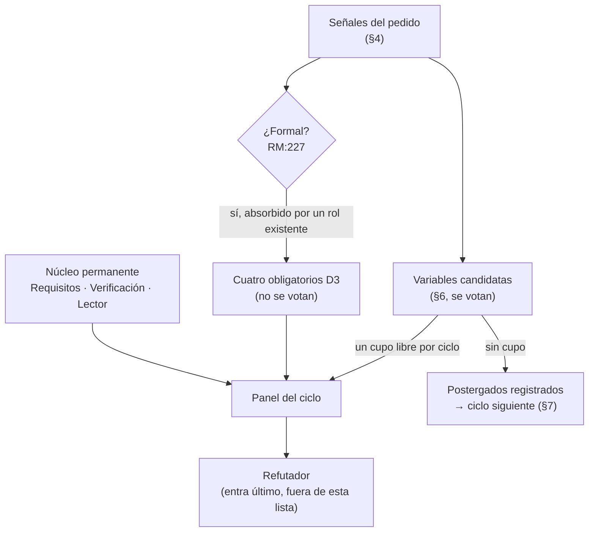

| Campo | Valor |
| --- | --- |
| Tipo | informe |
| Fecha | 2026-10-26 |
| Autor | Presidencia de la mesa (despacho P01), como quien coordina; no vota |
| Corrige | — |

# Propuesta de panel para el jurado de composición — expediente 0002

## Índice

1. [Qué es este folio y qué no es](#1-qué-es-este-folio-y-qué-no-es)
2. [Definiciones](#2-definiciones)
3. [Reglas de composición que se aplican](#3-reglas-de-composición-que-se-aplican)
4. [Barrido de señales del pedido](#4-barrido-de-señales-del-pedido)
5. [El rol formal y la regla de no duplicar](#5-el-rol-formal-y-la-regla-de-no-duplicar)
6. [Los doce candidatos](#6-los-doce-candidatos)
7. [El techo y el reparto por ciclo](#7-el-techo-y-el-reparto-por-ciclo)
8. [Cobertura de las preguntas Q01–Q46](#8-cobertura-de-las-preguntas-q01q46)
9. [Ensayos sugeridos por candidato](#9-ensayos-sugeridos-por-candidato)
10. [Cartas de mandato ad hoc preparadas](#10-cartas-de-mandato-ad-hoc-preparadas)
11. [Descartes con motivo](#11-descartes-con-motivo)
12. [Excepciones a conocimientos](#12-excepciones-a-conocimientos)
13. [Lo no verificado](#13-lo-no-verificado)
14. [Barrido S2 de este folio](#14-barrido-s2-de-este-folio)

---

## 1. Qué es este folio y qué no es

**Qué es.** La lista de candidatos que la presidencia propone al **jurado de composición**, con la señal de cada
uno, su mandato y su no-competencia, las preguntas que le tocan y los ensayos que podría correr. Responde al paso 4
del ciclo («Componer el panel», `R01:125`).

**Qué no es.** No es la composición. La composición la vota el jurado, con `CONVOCAR`, `NO_CONVOCAR` con motivo o
`INSTANCIAR_AD_HOC`, por mayoría simple, y nunca se escala (`RM:295-300`, citado en `R01:238`). La presidencia no
vota (`R01:64`, `MEP:118`). Las recomendaciones de este folio van rotuladas **[criterio propio]**.

**Lo que no se vota.** Por la decisión D3 del folio 001 §4, los cuatro perfiles de `TP:36` son obligatorios y el
jurado no los vota. El núcleo permanente se convoca siempre (`RM:192-201`). El jurado vota el resto: el quinto cupo,
los postergados y las cartas ad hoc (`Q01`).

**Cómo se lee una fila.** El candidato `C-DEVOPS` dice: señal `TP:34` («Configura el wofklow con este runner…»),
núcleo `N05`, preguntas `Q22`–`Q28`. Eso quiere decir que el pedido trae una restricción de entrega en la línea 34,
que el núcleo N05 la desarrolla y que esas siete preguntas quedan, sin ese perfil, con menos lectores.

## 2. Definiciones

| Término | Qué designa en este folio | Fuente |
| --- | --- | --- |
| Núcleo permanente | Requisitos, Verificación, Lector sin contexto y Refutador; se convoca siempre | `RM:192-201` |
| Variable | Especialidad del catálogo que entra por una señal citada con ubicación | `RM:208-212` |
| Ad hoc | Agente con carta de mandato: señal, pregunta única, competencia, no-competencia, tope y disolución | `RM:250-255` |
| Techo | Núcleo más **cinco** variables o ad hoc **por ciclo**; las postergadas se registran y entran en el ciclo siguiente | `RM:259-260` |
| Ciclo | Una pasada completa: composición, comisiones a ciegas, refutación y veredicto (`R01` §4) | `MEP:141-153` |
| Escalón | Cada tramo del alcance escalonado de D1: E1 mini demo + workflow + guía; E2 piloto Geometría; E3 `SDD-B` + orquestadores | folio 001 §4, D1 |
| Compuerta | Dictamen que habilita el escalón siguiente | folio 001 §4, D1 |
| Obligatorio | En este folio, `true` para el núcleo (por protocolo) y para los cuatro de D3 (por decisión de la presidencia) | `RM:194`; D3 |

## 3. Reglas de composición que se aplican

Leídas en la fuente primaria, `KB-privada/Rules/Rule-Mesa.md` 1.0:

| Regla | Línea | Consecuencia para este caso |
| --- | --- | --- |
| Núcleo permanente, siempre | `RM:192-201` | Tres candidatos del núcleo en esta lista. El refutador no va: entra último y ya está previsto (carta del despacho) |
| Variable sólo con señal ubicada | `RM:210-211` | Cada candidato de §6 trae su línea de `TP` o de bitácora |
| El rol formal entra sin votación | `RM:227-228` | Su señal está en el pedido. Ver §5 |
| No se duplican roles | `RM:229-231` | Base para fundir perfiles parecidos (§6) y para absorber el formal (§5) |
| Convocatoria en caliente: una sola ronda por ciclo | `RM:246-249` | Una solicitud de convocatoria en el ciclo 1 sólo se atiende si queda cupo; si no, pasa al ciclo siguiente |
| Techo de cinco | `RM:259-260` | Con D3, los cuatro obligatorios ya ocupan cuatro de cinco (§7) |
| Empate convoca | `RM:261-262` | Se aplica a la votación del quinto cupo |
| No reconvocatoria | `RM:263-265` | Un variable sin ningún `PROCEDE` en dos ciclos seguidos no vuelve: relevante para el reparto de §7 |



## 4. Barrido de señales del pedido

Inventario, no juicio (`RM:292-294`). Las líneas `TP:N` son las de la evidencia 001 (línea N de la copia = `TP:N`).

| Rol del catálogo (`RM:215-225`) | Señal en el pedido | Ubicación |
| --- | --- | --- |
| Arquitectura | «si tener un repositorio dedicado… o bien estar integrado»; «trazar una arquitectura clara» | `TP:20`; `TP:36` |
| **Formal** | «Toda afirmación debe estar respaldada…»; «Vos y toda la mesa…»; criterios de decisión con pesos | `TP:61`; `TP:44`; `TP:36`; `N02:161` |
| Seguridad | Documentación que leen agentes («no solo son agentes humanos»); repos públicos con runner propio | `TP:20`; `R06:247` (R5) |
| Operación y entrega | «desfase de versionado»; «Configura el wofklow con este runner» | `TP:20`; `TP:34` |
| Concurrencia y tiempo | Un solo runner self-hosted compartido con la E2E | `R06:246` (R4) |
| Uso y accesibilidad | «que los agentes humanos entiendan el flujo de trabajo para poder intervenir» | `TP:32` |
| Trazabilidad documental | Reglas de documentos con índices y citas; «No inventar»; trazas `traces` | `TP:42`; `TP:59-61`; `N07` (Q38) |
| Perfiles nombrados | Analistas, arquitectos .NET, especialistas en análisis con criterios de decisión, académicos en edición | `TP:36` |

## 5. El rol formal y la regla de no duplicar

**Hecho.** `RM:216` define la señal del rol formal: «Umbrales numéricos, pesos, prioridades calculadas,
cuantificadores («todos», «siempre», «ninguno»)». `RM:227` dice que «si su señal aparece, entra sin votación». El
pedido trae cuantificadores (`TP:61`, «Toda afirmación») y pide criterios de decisión, que la mesa va a resolver con
pesos (`R01:275-276`; `N02:161`).

**Problema.** Si el formal entra como sexto especialista, el techo se llena con D3 + formal y **no queda cupo** para
ningún variable del ciclo 1. N03 (doble audiencia) quedaría sin comisión propia, que es lo que `Q01` quiere evitar.

**Propuesta [criterio propio].** Aplicar `RM:229-231` («Si el espacio de trabajo ya tiene un rol con esa
competencia…, el especialista es ese rol»). La competencia formal —leer umbrales, pesos, cuantificadores y
prioridades calculadas— la cubre el **especialista en análisis y criterios de decisión** (`C-DECISIONES`), obligatorio
por D3. Su mandato incluye explícitamente la función formal. Así el formal **entra sin votación**, como manda la
regla, pero sin sumar una sexta silla.

**Lo que tiene que votar el jurado.** Que `C-DECISIONES` absorbe la función formal. Si el jurado lo rechaza, el
formal entra igual (no se vota) y el quinto cupo desaparece en el ciclo 1. En ese caso, `C-AGENTES-IA` pasa a ad hoc
del ciclo 2 y N03 queda leído por `C-ANALISTA` y el núcleo.

## 6. Los doce candidatos

Fusiones por `RM:229-231`, rotuladas **[criterio propio]**:

- «Calidad documental automatizada» (`N05:179`) se funde en `C-DEVOPS`.
- «Gobierno documental y gestión de expedientes» (`N01:163`) se funde en `C-SDD-CONOCIMIENTO`, porque el expediente
  es una pieza del marco.
- «Redactor técnico / arquitecto de información» (`N04:158`, `N08:175`) se funde en `C-NORMAS-IA`.
- «Seguridad de sistemas con LLM» (`N03:153`) se funde en `C-AGENTES-IA`.
- El perfil «MAUI y Blazor» (`N07:172`) es el mismo `C-ARQ-NET`.

| Id | Perfil | Oblig. | Núcleos | Señal | Mandato | No-competencia |
| --- | --- | --- | --- | --- | --- | --- |
| C-REQUISITOS | Requisitos (núcleo) | sí | todos | `RM:197` | Que cada cláusula de la metodología y de la arquitectura sea unívoca, atómica y verificable; qué falta del objetivo literal (`TP:26`) | No elige herramientas ni topologías; no redacta la guía |
| C-VERIFICACION | Verificación (núcleo) | sí | todos | `RM:198` | Cómo se prueba cada cláusula; criterio de aceptación por compuerta; qué compuertas son automatizables y con qué prueba negativa (`N07` V3) | No decide qué bloquea y qué avisa: lo mide y lo propone |
| C-LECTOR | Lector sin contexto (núcleo) | sí | todos; foco N03, N08 | `RM:199` | Trabajar con la guía, la demo y el ciclo sin preguntar; cada pregunta que necesita es un hallazgo | No opina sobre normas, toolchain ni versionado |
| C-ANALISTA | Analista de sistemas | sí (D3) | N02, N03, N04, N07 | `TP:36` | Requerimientos documentales, audiencias y tareas, inventario por pieza y por proyecto, contrato `traces` (CU/RN), modos de intervención humano/automático como flujo con roles | No elige generador ni workflow; no decide pesos |
| C-ARQ-NET | Arquitecto de software .NET (incluye MAUI y Blazor) | sí (D3) | N02, N05, N06, N07 | `TP:36` | La arquitectura del sistema documentador entero (D2, `Q29`): fuente de verdad, ancla, topología por pieza; DocFX, OpenAPI y XML en build; `TreatWarningsAsErrors`; dónde vive la mini demo | No decide la cadena de release ni la norma de citas; la seguridad de agentes la pide por solicitud |
| C-DECISIONES | Especialista en análisis y criterios de decisión, **con la función formal** (§5) | sí (D3) | N01, N02, N04, N05 | `TP:36`; `RM:216` | Criterios con fuente y pesos **antes** de puntuar (simplicidad, practicidad, escalabilidad, `TP:36`); matriz por alternativa; lectura de umbrales y cuantificadores del pedido y de las compuertas | **No es** el rol 6 bis (`MEP:149`, D3): no escribe el camino de compromiso de una ficha. No juzga el contenido técnico de las alternativas |
| C-ACADEMICO | Académico en edición de material bibliográfico | sí (D3) | N08 (y citación en N02, N03) | `TP:36` | Citación (APA 7 en castellano, fecha de consulta), referencias, material de consulta, ejemplos, estructura de la guía como cuerpo, objetivos y ejercicios | No decide toolchain ni topología; la tipografía del sitio no es suya |
| C-AGENTES-IA | Documentación para agentes de IA y seguridad de sistemas con LLM | no | N03 (y N05) | `TP:20`, `TP:32`; `RM:218` | Canales (AGENTS.md, `.md` por página, `llms.txt`, MCP, ia-db) con su madurez; relación ia-db/`llms.txt`; intervenciones automáticas; controles contra inyección indirecta al publicar | No decide la metodología general ni el generador; no opina sobre citación |
| C-DEVOPS | DevOps / GitHub Actions con runners self-hosted y calidad documental automatizada | no | N05 (y N01, N07) | `TP:34`; `RM:219-220` | El workflow con `runs-on: [self-hosted, i7infra-dev]`; concurrencia con la E2E; guarda de forks en repo público; linters y verificadores (markdownlint, lychee, Vale, esquema de frontmatter); control `Verificar` | No decide ancla ni política de versiones; no decide qué bloquea (lo implementa) |
| C-CONFIG-RELEASE | Gestión de configuración y release engineering | no | N02 (y N06) | `TP:20`; `RM:219` | Ancla de versión por par código ↔ `.Documentacion`, tags, changelog, SemVer, versionado del sitio, dependencia no vendorizada | No decide la topología por pieza (la consume); no escribe workflows |
| C-SDD-CONOCIMIENTO | Marcos SDD, orquestación multiagente y gestión del conocimiento (incluye gobierno de expedientes) | no | N06 (y N01, N04) | `TP:18`, `TP:30` | Dónde vive el conocimiento DocAsCode; qué es «mejorar los orquestadores»; choque con `Rules-Documentacion` (X1); migración 13.16 → 13.22; qué entra al marco común | No decide toolchain ni generador; no decide dónde vive la demo |
| C-NORMAS-IA | Normas de información para usuarios (serie 2651x, 15289, 12207) y arquitectura de información (Diátaxis, arc42, C4, MADR) | no | N04, N08 | `TP:36` («que consulten los estandares») | Respaldo normativo por fase; esqueleto 26514/26515 con marcos abiertos; temas y ruta de lectura del cuerpo; si hace falta comprar 26514 | No decide citación (es de `C-ACADEMICO`); no decide CI |

## 7. El techo y el reparto por ciclo

**Cuenta.** Techo: núcleo + 5 (`RM:259`). D3 ocupa cuatro. Queda **un** cupo por ciclo, y cinco variables candidatas
(`C-AGENTES-IA`, `C-DEVOPS`, `C-CONFIG-RELEASE`, `C-SDD-CONOCIMIENTO`, `C-NORMAS-IA`). Un ad hoc también cuenta en el
techo («cinco variables o ad hoc», `RM:259`). No se pueden convocar todos en un ciclo.

**Lo que la carta no fija.** D3 dice que los cuatro son obligatorios y que el jurado no los vota. No dice si son
obligatorios en **cada** ciclo o en la mesa de `TP:36`. Esa lectura es de la presidencia, no del jurado. Hay dos
opciones.

| | Opción A — D3 en todo ciclo | Opción B — D3 en el ciclo 1; en las compuertas, por objeto |
| --- | --- | --- |
| Ciclo 1 (metodología, arquitectura entera, diseño de E1; Q01–Q46) | Núcleo + D3 + `C-AGENTES-IA` | Núcleo + D3 + `C-AGENTES-IA` |
| Ciclo 2 (compuerta E1: mini demo, workflow, guía enriquecida) | Núcleo + D3 + `C-DEVOPS` | Núcleo + `C-ARQ-NET`, `C-ANALISTA`, `C-ACADEMICO` + `C-DEVOPS`, `C-CONFIG-RELEASE` |
| Ciclo 3 (compuerta E2: piloto Geometría) | Núcleo + D3 + `C-SDD-CONOCIMIENTO` | Núcleo + `C-ARQ-NET`, `C-ANALISTA`, `C-DECISIONES` + `C-SDD-CONOCIMIENTO`, `C-NORMAS-IA` |
| Ciclo 4 (compuerta E3: `SDD-B` y orquestadores) | Núcleo + D3 + `C-CONFIG-RELEASE` o `C-SDD-CONOCIMIENTO` (no ambos) | Núcleo + `C-ARQ-NET`, `C-DECISIONES` + `C-SDD-CONOCIMIENTO`, `C-CONFIG-RELEASE`, `C-AGENTES-IA` |
| Quién queda sin silla | `C-NORMAS-IA` nunca; `C-CONFIG-RELEASE` o `C-SDD-CONOCIMIENTO` en el ciclo 4 | Ninguno |
| Costo | Q17, Q46 y la mitad de N02 sin especialista propio en ningún ciclo | Una lectura de D3 que la presidencia tiene que asentar en una providencia |
| Reversibilidad | Alta: el ciclo siguiente puede corregir | Alta: la providencia se corrige con una constancia |

**Recomendación [criterio propio]: opción B.** Dónde cae: en las compuertas, que juzgan artefactos de un escalón y no
la metodología entera. Cuánto pesa: con la opción A, `C-NORMAS-IA` no entra nunca, y `TP:36` pide «que consulten los
estandares». Qué pierde la opción A: cobertura de N04 y N08 por normas. Qué pierde la B: en las compuertas falta algún
obligatorio sin preguntas de ese escalón, por ejemplo `C-ACADEMICO` en la compuerta E3. Mitigación: el obligatorio
ausente recibe el dictamen como lector y puede emitir **solicitud de convocatoria** (`RM:242-244`) para el ciclo
siguiente.

**En el ciclo 1, en las dos opciones.** El panel es núcleo + D3 + `C-AGENTES-IA`. Es la lectura de `N00:279` y la
única variable cuya incógnita (N03) no cubre ninguno de los cuatro obligatorios. `C-DEVOPS`, `C-CONFIG-RELEASE`,
`C-SDD-CONOCIMIENTO` y `C-NORMAS-IA` quedan **postergados registrados** (`RM:259-260`). Sus preguntas tienen igual dos
lectores en el ciclo 1 (§8). Para que la postergación no deje huecos sin preguntar, cada postergado tiene su carta
ad hoc preparada (§10). El jurado la puede usar si vota otro reparto.

```mermaid
gantt
  title Reparto propuesto (opción B) — un ciclo por compuerta
  dateFormat X
  axisFormat %s
  section Ciclo 1 · metodología
  Núcleo + D3 + C-AGENTES-IA           :c1, 0, 1
  section Ciclo 2 · compuerta E1
  Núcleo + ARQ, ANALISTA, ACAD + DEVOPS, CONFIG :c2, 1, 2
  section Ciclo 3 · compuerta E2
  Núcleo + ARQ, ANALISTA, DEC + SDD, NORMAS     :c3, 2, 3
  section Ciclo 4 · compuerta E3
  Núcleo + ARQ, DEC + SDD, CONFIG, AGENTES      :c4, 3, 4
```



**Riesgo de no reconvocatoria.** Con la opción B, `C-AGENTES-IA` está en los ciclos 1 y 4 y no en dos seguidos, así
que `RM:263-265` no lo alcanza. Con la opción A, ningún variable repite ciclo seguido.

## 8. Cobertura de las preguntas Q01–Q46

Regla del despacho: toda pregunta, con dos candidatos o más. La columna «Ciclo 1» cuenta sólo a los del panel del
ciclo 1 (núcleo + D3 + `C-AGENTES-IA`). **Toda pregunta tiene dos o más lectores en el ciclo 1.**

| Q | Tema corto | Candidatos | Ciclo 1 |
| --- | --- | --- | --- |
| Q01 | Quinto cupo y postergados | C-DECISIONES, C-REQUISITOS (la resuelve el jurado con este folio; ellos la verifican después) | 2 |
| Q02 | Delegación del merge y control `Verificar` | C-ARQ-NET, C-VERIFICACION, C-DEVOPS | 2 |
| Q03 | Topología por pieza (D1–D8) | C-ANALISTA, C-ARQ-NET, C-DECISIONES, C-CONFIG-RELEASE | 3 |
| Q04 | Ancla de versión por par | C-ARQ-NET, C-ANALISTA, C-VERIFICACION, C-CONFIG-RELEASE | 3 |
| Q05 | Versionar el sitio publicado | C-ARQ-NET, C-LECTOR, C-CONFIG-RELEASE | 2 |
| Q06 | Enlaces rotos entre repos | C-VERIFICACION, C-DECISIONES, C-DEVOPS | 2 |
| Q07 | Cita por identificador estable | C-ACADEMICO, C-ANALISTA, C-AGENTES-IA, C-NORMAS-IA | 3 |
| Q08 | Conocimientos compartidos: fuente única o copias | C-ARQ-NET, C-DECISIONES, C-SDD-CONOCIMIENTO | 2 |
| Q09 | Tags y changelog en Lab-Documentos | C-ANALISTA, C-DECISIONES, C-CONFIG-RELEASE | 2 |
| Q10 | Canales para agentes y su madurez | C-AGENTES-IA, C-ANALISTA, C-LECTOR | 3 |
| Q11 | ia-db frente a `llms.txt` | C-AGENTES-IA, C-ANALISTA, C-SDD-CONOCIMIENTO | 2 |
| Q12 | Intervenciones automáticas de IA | C-AGENTES-IA, C-ANALISTA, C-REQUISITOS | 3 |
| Q13 | Aprobación con una persona y dos identidades | C-AGENTES-IA, C-REQUISITOS, C-DECISIONES, C-DEVOPS | 3 |
| Q14 | Frontmatter y prefijos de ID | C-ANALISTA, C-ACADEMICO, C-AGENTES-IA, C-VERIFICACION | 4 |
| Q15 | Documento de proceso para personas | C-LECTOR, C-ANALISTA, C-NORMAS-IA | 2 |
| Q16 | Controles contra inyección indirecta | C-AGENTES-IA, C-VERIFICACION, C-DEVOPS | 2 |
| Q17 | 26514/26515 + Diátaxis, arc42, C4, MADR | C-ANALISTA, C-ACADEMICO, C-DECISIONES, C-NORMAS-IA | 3 |
| Q18 | Artefacto de requerimientos documentales | C-ANALISTA, C-REQUISITOS, C-NORMAS-IA | 2 |
| Q19 | Una metodología o tronco con variantes | C-ANALISTA, C-DECISIONES, C-ARQ-NET | 3 |
| Q20 | Expediente como unidad de cambio | C-REQUISITOS, C-ANALISTA, C-SDD-CONOCIMIENTO | 2 |
| Q21 | Fase de mantenimiento como cambio de alcance | C-REQUISITOS, C-ANALISTA, C-NORMAS-IA | 2 |
| Q22 | Workflow único o plantilla | C-ARQ-NET, C-DECISIONES, C-DEVOPS | 2 |
| Q23 | Qué bloquea y qué avisa; CQ/PE | C-VERIFICACION, C-ACADEMICO, C-DECISIONES, C-DEVOPS | 3 |
| Q24 | Concurrencia con la E2E en el runner | C-ARQ-NET, C-VERIFICACION, C-DEVOPS | 2 |
| Q25 | PR auxiliar de Geometría con `ubuntu-latest` | C-REQUISITOS, C-ARQ-NET, C-DEVOPS | 2 |
| Q26 | Generador de sitio | C-ARQ-NET, C-DECISIONES, C-LECTOR, C-DEVOPS | 3 |
| Q27 | OpenAPI y XML en build | C-ARQ-NET, C-VERIFICACION, C-AGENTES-IA | 3 |
| Q28 | Workflow de Concepts como base | C-ARQ-NET, C-REQUISITOS, C-DEVOPS | 2 |
| Q29 | Arquitectura del sistema documentador entero | C-ARQ-NET, C-ANALISTA, C-DECISIONES, C-AGENTES-IA, C-CONFIG-RELEASE | 4 |
| Q30 | Dónde vive el conocimiento DocAsCode | C-DECISIONES, C-REQUISITOS, C-SDD-CONOCIMIENTO | 2 |
| Q31 | Qué es «mejorar los orquestadores» | C-ARQ-NET, C-AGENTES-IA, C-SDD-CONOCIMIENTO | 2 |
| Q32 | Choque con `Rules-Documentacion` (X1) | C-REQUISITOS, C-DECISIONES, C-SDD-CONOCIMIENTO | 2 |
| Q33 | Migrar Geometría 13.16 → 13.22 | C-ARQ-NET, C-DECISIONES, C-SDD-CONOCIMIENTO, C-CONFIG-RELEASE | 2 |
| Q34 | Norma del `SDD-B` al marco común | C-ARQ-NET, C-ANALISTA, C-SDD-CONOCIMIENTO | 2 |
| Q35 | Dependencia no vendorizada de IA.SDD | C-ARQ-NET, C-VERIFICACION, C-SDD-CONOCIMIENTO, C-CONFIG-RELEASE | 2 |
| Q36 | Dónde vive la mini demo | C-ARQ-NET, C-ANALISTA, C-CONFIG-RELEASE | 2 |
| Q37 | Qué demuestra cada escalón | C-ANALISTA, C-VERIFICACION, C-DECISIONES | 3 |
| Q38 | Contrato `traces` (CU/RN) | C-ANALISTA, C-REQUISITOS, C-VERIFICACION | 3 |
| Q39 | Reglas sin identificador en MovilidadUrbana | C-ANALISTA, C-ARQ-NET, C-REQUISITOS | 3 |
| Q40 | Deuda inmediata de la guía y del escalón 0 | C-ACADEMICO, C-LECTOR, C-VERIFICACION | 3 |
| Q41 | Evidencia y aceptación por compuerta | C-VERIFICACION, C-DECISIONES, C-REQUISITOS | 3 |
| Q42 | Cuerpo documental o archivo único | C-ACADEMICO, C-LECTOR, C-AGENTES-IA, C-NORMAS-IA | 3 |
| Q43 | Temas y ruta de lectura | C-ACADEMICO, C-LECTOR, C-NORMAS-IA | 2 |
| Q44 | APA 7 en castellano | C-ACADEMICO, C-VERIFICACION | 2 |
| Q45 | Objetivos de aprendizaje al dueño del Profile | C-ACADEMICO, C-LECTOR, C-NORMAS-IA | 2 |
| Q46 | Comprar ISO/IEC/IEEE 26514:2022 | C-DECISIONES, C-ACADEMICO, C-NORMAS-IA | 2 |

**Las más finas** (sólo dos lectores en el ciclo 1 y su especialista postergado): Q08, Q11, Q20, Q30–Q35 (N06) y Q22,
Q24, Q25, Q28 (N05). Si el jurado vota la opción A, conviene que la carta del ciclo 1 diga que esas preguntas pueden
salir `INSUFICIENTE` y pasar al ciclo de la compuerta (`RM:332`, citado en `R01:296`).

## 9. Ensayos sugeridos por candidato

Todos en contenedores Docker efímeros (`docker run --rm`) o en el directorio de trabajo de ensayos que fija la carta
común (fuera del árbol versionado y fuera del temporal de sesión), sin escribir en repos de código. Cada ensayo cambia
**una** variable (`MEP:289`, citado en `R01:277-279`). Las imágenes y versiones se fijan al correrlo (§13).

| Candidato | Ensayo | Qué decide | Criterio de aceptación sugerido |
| --- | --- | --- | --- |
| C-REQUISITOS | Contar las cláusulas de la metodología sin criterio de aceptación (plantilla «Dado/Cuando/Entonces» sobre una muestra) | Q18, Q21, Q41 | Cero cláusulas sin criterio en la muestra |
| C-VERIFICACION | Prueba negativa por compuerta: plantar un enlace roto, un frontmatter sin `doc_id` y una cita sin línea, y comprobar que cada validador falla | Q23, Q41, `N07` V3 | Rojo con el defecto, verde sin él |
| C-VERIFICACION | `lychee --offline` sobre la guía y `Examples/` (enlaces relativos) frente a `lychee` con externos | Q06 | Separar lo que puede bloquear (relativos) de lo que avisa (externos), como en `I02:226-228` |
| C-LECTOR | *Play testing*: seguir la guía para documentar una pantalla de la mini demo sin preguntar; cada duda se anota | Q15, Q40, Q43 | Lista de preguntas con respuesta en el corpus = hallazgos (`RM:202-204`) |
| C-ANALISTA | Inventario por pieza de MovilidadUrbana (MAUI, ApiWeb, Web) con fuente de verdad y ancla; trazar dos CU y una regla sin ID | Q03, Q38, Q39 | Toda pieza con fila completa; las trazas resuelven a ruta:línea |
| C-ARQ-NET | DocFX sobre MovilidadUrbana.ApiWeb en `mcr.microsoft.com/dotnet/sdk:10.0`, con OpenAPI y XML en build | Q26, Q27 | Sitio generado sin advertencias con `TreatWarningsAsErrors`; marcar si `net10.0-android` no lo admite (`R05:290-291`) |
| C-ARQ-NET | Mismo contenido en MkDocs (imagen de Material for MkDocs) y en Docusaurus (imagen de Node): tiempo de build, salida `.md` por página | Q26 | Tabla de tres generadores con los mismos criterios de `C-DECISIONES` |
| C-DECISIONES | Matriz de decisión con pesos fijados **antes** de ver los resultados de los ensayos del generador y de la topología | Q03, Q19, Q22, Q26 | Pesos asentados con fecha previa a los resultados; sensibilidad: ¿cambia el ganador con ±10 % de peso? |
| C-ACADEMICO | Rehacer veinte referencias de la guía en APA 7 en castellano con fecha de consulta; medir cuántas quedan sin autor o sin fecha | Q44, Q40 | Porcentaje de referencias completas; lista de las que no lo son |
| C-ACADEMICO | Esquema de una ruta de lectura del cuerpo (tutorial → guía → referencia → explicación) sobre el índice actual | Q42, Q43 | Cada sección actual cae en un solo tipo |
| C-AGENTES-IA | Generar `llms.txt` y `.md` por página desde el sitio del ensayo de `C-ARQ-NET`; pedir a un agente que responda tres preguntas con y sin esos canales | Q10, Q11 | Respuestas citadas a la página correcta; diferencia con y sin canal |
| C-AGENTES-IA | Inyección indirecta plantada: una instrucción oculta en un `.md` de prueba; ver si el pipeline de publicación la detecta o la neutraliza | Q16 | Detección en CI, o control documentado que la bloquee |
| C-AGENTES-IA | AGENTS.md mínimo para la mini demo; comprobar que un agente de código lo carga y respeta una regla | Q10, Q12 | La regla se cumple en una tarea de prueba |
| C-DEVOPS | `actionlint` (imagen oficial) sobre un borrador de workflow con `runs-on: [self-hosted, i7infra-dev]`, `concurrency` y `timeout-minutes` | Q22, Q24 | Cero errores de actionlint; `concurrency` declarada; `timeout-minutes` presente (`R03:373-375`) |
| C-DEVOPS | markdownlint-cli2 y Vale (imágenes oficiales) sobre la guía, con un vocabulario mínimo | Q23 | Cantidad de errores por regla; cuáles podrían bloquear |
| C-DEVOPS | Esquema JSON del frontmatter (`check-jsonschema` o equivalente) sobre las bitácoras y los folios | Q14, Q23 | Prueba negativa en rojo |
| C-CONFIG-RELEASE | Simular el desfase: tag de código `v1.1` y doc anclada a `v1.0`; ver qué compuerta lo detecta según el ancla (tag, SHA indexado, ninguna) | Q04, Q05 | Matriz ancla → detección |
| C-CONFIG-RELEASE | Clonar en limpio IA.SDD y un árbol de prueba con la dependencia no vendorizada (submódulo frente a copia con huella) | Q35, Q08 | El clon limpio resuelve sin apuntar afuera |
| C-SDD-CONOCIMIENTO | Diff de las tres versiones de un mismo conocimiento (`R03:256-267`, `R04:263-270`) con `diff -u` | Q08, Q30 | Lista de divergencias con su origen |
| C-SDD-CONOCIMIENTO | Recorrido de la piloto contra `Rules-Documentacion` en 13.16 y 13.22: qué cláusulas choca cada versión | Q32, Q33 | Choques enumerados por versión |
| C-NORMAS-IA | Mapear el índice de 26514/26515 (lo único disponible, `C00:165`) a las fases de la metodología | Q17, Q46 | Qué fases quedan sin cláusula y si hace falta el texto completo |

## 10. Cartas de mandato ad hoc preparadas

Para el caso en que el jurado vote otro reparto (§7) e instancie un postergado como ad hoc en un ciclo con cupo.
Forma de `RM:457-466`. Cada carta cuenta en el techo.

```text
CARTA DE MANDATO — AH-1 (C-DEVOPS)
  Señal:              «Configura el wofklow con este runner de github : runs-on: [self-hosted, i7infra-dev]» — TP:34
  Pregunta única:     ¿Qué forma mínima tiene el workflow documental en el runner compartido sin bloquear la E2E? (Q22 + Q24)
  Competencia:        workflow, concurrencia, guarda de forks, linters documentales
  No-competencia:     ancla de versión, topología, qué bloquea por política → solicitud de convocatoria
  Tope de hallazgos:  6
  Disolución:         al foliarse su informe del ciclo en que se instancia
```

```text
CARTA DE MANDATO — AH-2 (C-CONFIG-RELEASE)
  Señal:              «Y aquí surgen problemas de desfase de versionado, y coordinación» — TP:20
  Pregunta única:     ¿Cuál es el ancla de versión de la doc para cada par código ↔ .Documentacion? (Q04)
  Competencia:        tags, SHA indexado, changelog, SemVer, versionado del sitio
  No-competencia:     topología por pieza, workflows, generador → solicitud de convocatoria
  Tope de hallazgos:  6
  Disolución:         al foliarse su informe del ciclo en que se instancia
```

```text
CARTA DE MANDATO — AH-3 (C-SDD-CONOCIMIENTO)
  Señal:              «aplicarlo a <SDD-B> mejorando los agentes orquestadores de ambos» — TP:30
  Pregunta única:     ¿Qué significa «mejorar los orquestadores» en cada marco y dónde vive el conocimiento resultante? (Q31 + Q30)
  Competencia:        marcos SDD, orquestación, catálogo de conocimientos, expedientes
  No-competencia:     toolchain, generador, CI → solicitud de convocatoria
  Tope de hallazgos:  6
  Disolución:         al foliarse su informe del ciclo en que se instancia
```

```text
CARTA DE MANDATO — AH-4 (C-NORMAS-IA)
  Señal:              «que consulten los estandares» — TP:36
  Pregunta única:     ¿Se adopta el esqueleto 26514/26515 con Diátaxis, arc42, C4 y MADR como columna vertebral? (Q17)
  Competencia:        serie 2651x, 15289, 12207; arquitectura de información
  No-competencia:     citación, CI, versionado → solicitud de convocatoria
  Tope de hallazgos:  6
  Disolución:         al foliarse su informe del ciclo en que se instancia
```

El tope de seis es **[criterio propio]**. El contrato de entrada (folio 001 §6) manda si fija otro.

## 11. Descartes con motivo

| Perfil señalado | Dónde | Motivo del descarte o la fusión |
| --- | --- | --- |
| Refutador | `RM:200` | No va en esta lista: entra último y ya está previsto (carta del despacho) |
| Análisis de decisiones del paso 6 bis | `MEP:149` | Sólo entra con ficha de excepción admitida; no es `C-DECISIONES` (D3) |
| Investigador ensayista (perito) | `N07:174` | Es una función del ciclo (peritaje, `R01` §9), no una comisión: lo designa la mesa ante una contradicción |
| Especialista en pruebas E2E (Playwright, Appium) | `N07:173` | Su objeto, las capturas regenerables, cae en la compuerta E1. Se cubre con `C-VERIFICACION` y `C-ARQ-NET`; si la compuerta lo pide, entra como ad hoc |
| Diseñador instruccional | `N08:174` | **Postergado**, sin silla propia en la lista de doce. Objetivos, ejemplos trabajados y ejercicios (Q45) los leen `C-ACADEMICO` y `C-LECTOR`. Si el ciclo 1 deja Q45 `INSUFICIENTE`, entra como ad hoc en la compuerta E1 |
| Gobierno documental y expedientes | `N01:163` | Fundido en `C-SDD-CONOCIMIENTO` (`RM:229-231`) |
| Calidad documental automatizada | `N05:179` | Fundido en `C-DEVOPS` |
| Redactor técnico / arquitecto de información | `N04:158`, `N08:175` | Fundido en `C-NORMAS-IA` |
| Seguridad de sistemas con LLM | `N03:153` | Fundido en `C-AGENTES-IA` |
| Académicos como terceros consultados | `TP:36` | D4: los académicos son comisiones (agentes); la consulta a un tercero queda en reserva (`R01` H-09) |

## 12. Excepciones a conocimientos

| Conocimiento y § | Qué dice | Qué se hace en su lugar | Impacto operativo |
| --- | --- | --- | --- |
| `Rule-Expediente` 1.0 §3.1 y §3.4, criterios E-3 y E-4 (`RE:149`, `RE:171-181`, `RE:354`, `RE:414`) | El folio se llama `NNN-<tipo>-<slug>.md` con un tipo del conjunto cerrado de seis, y el tipo de la cabecera es igual al del nombre | El despacho P01 fijó el nombre `003-propuesta-de-panel.md`; «propuesta» no es uno de los seis tipos. Este folio respeta el nombre del despacho y declara `Tipo: informe` (quien coordina, `RE:177`). **Alternativa de cumplir**: renombrar a `003-informe-propuesta-de-panel.md` | E-3 y E-4 fallan sobre este folio hasta que se renombre. No toca el estado derivado: un `informe` deja el expediente «en trámite» |
| `Rule-Expediente` 1.0, foliatura contigua (E-3) frente al pase del folio 002 | El pase del 002 ordena renumerar los informes I06 e I07 (`0060-…`, `0070-…`) como folios 003 y 004 | Este folio ocupa el número 003, como fijó el despacho. **Alternativa de cumplir**: regularizar I06 e I07 como 004 y 005, o declarar su desviación con una `constancia`, antes de foliar el acta del jurado | Mientras `0060` y `0070` sigan con cuatro dígitos, el expediente falla E-3 y queda «SIN PASE» (E-6), igual que antes de este folio |
| `Rule-Mesa` 1.0 §3.4.2, rol formal de convocatoria automática (`RM:227-228`) | Si su señal aparece, entra sin votación | Se propone que lo absorba `C-DECISIONES` por la regla de no duplicar (`RM:229-231`). No es apartamiento si el jurado lo acepta: es la misma regla. Se declara porque elige entre dos lecturas (§5) | Si se rechaza, el ciclo 1 se queda sin quinto cupo |

## 13. Lo no verificado

- **Imágenes y versiones de los ensayos de §9** (actionlint, lychee, Vale, markdownlint-cli2, Material for MkDocs,
  Docusaurus, check-jsonschema). Motivo: este despacho propone, no ensaya. En el host está la imagen
  `mcr.microsoft.com/dotnet/sdk:10.0` (`docker images`, 2026-10-26); las demás no se descargaron.
- **Que DocFX corra sobre `net10.0-android`.** Ya figura como no verificado en `R05:290-291`.
- **Nada de `Rule-Mesa` fuera de `RM:192-300` y `RM:455-468`.** Esos tramos se leyeron en la fuente primaria en este
  despacho; el resto de la regla se toma de `R01`.
- **Que `C-DECISIONES` pueda cubrir en la práctica la competencia formal.** Es la propuesta de §5; la prueba es el
  primer ciclo: si el refutador encuentra un umbral o cuantificador sin lectura, la fusión falló.
- **El número 003.** Se respetó el del despacho, aunque choca con el pase del folio 002 (§12).

## 14. Barrido S2 de este folio

| Campo | Valor |
| --- | --- |
| Comando | `grep -nIiE "(/\|-)home[/-][a-z0-9_]+\|/Users/[A-Za-z]\|C:\\\\Users" actuaciones/003-propuesta-de-panel.md` desde la carpeta del expediente |
| Fecha | 2026-10-26 |
| Resultado | **vacío** (código de salida 1 de `grep`); también vacío para el nombre del servicio privado y el usuario del host, que no se escriben acá |

No se nombran el servicio privado, sus hosts, sus usuarios ni sus clientes: se usa `SDD-B`. No se crearon archivos
intermedios: el despacho no corrió ensayos.

Sigue: carta y despacho del jurado de composición, con este folio como insumo, después de regularizar I06 e I07 (§12) · presidencia · Cierra con: folio informe del jurado de composición
