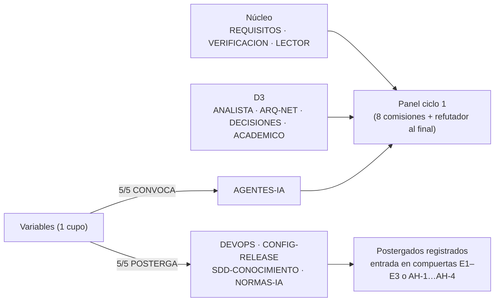

| Campo | Valor |
| --- | --- |
| Tipo | informe |
| Fecha | 2026-10-26 |
| Autor | Jurado de composición (cinco votos); redacta el acta la presidencia de la mesa (despacho P02), que no vota |
| Corrige | — |

Norma y secciones leídas por quien redacta: `R01` §8.1 (composición, `R01:227-262`) y §17.3 (plantilla de esta acta,
`R01:564-595`), que derivan de `KB-privada/Knowledges/Knowledge-Mesa-De-Expertos-A-Pedido.md` 3.x y de
`KB-privada/Rules/Rule-Mesa.md` 1.0; folio 003 completo (propuesta de panel). Las secciones de la norma que
cargó cada jurado no constan en el despacho que trajo los votos (ver §9).
Carta: no archivada en `evidencia/` (ver §8, excepción 3).

# Acta del jurado de composición — expediente 0002

## Índice

1. [Qué se vota y con qué insumos](#1-qué-se-vota-y-con-qué-insumos)
2. [Lectura de las frases del pedido que nombran perfiles](#2-lectura-de-las-frases-del-pedido-que-nombran-perfiles)
3. [Votación por candidato](#3-votación-por-candidato)
4. [Recuento y panel resultante](#4-recuento-y-panel-resultante)
5. [Cobertura de las preguntas del caso en el ciclo 1](#5-cobertura-de-las-preguntas-del-caso-en-el-ciclo-1)
6. [Descartes y postergados por cupo, con motivo y entrada](#6-descartes-y-postergados-por-cupo-con-motivo-y-entrada)
7. [Mandatos comunes y condiciones que el jurado deja a la carta del ciclo 1](#7-mandatos-comunes-y-condiciones-que-el-jurado-deja-a-la-carta-del-ciclo-1)
8. [Excepciones a conocimientos](#8-excepciones-a-conocimientos)
9. [Lo no verificado](#9-lo-no-verificado)
10. [Barrido S2 de este folio](#10-barrido-s2-de-este-folio)

---

## 1. Qué se vota y con qué insumos

**Definiciones.**

| Término | Qué designa en esta acta | Fuente |
| --- | --- | --- |
| Jurado de composición | Cinco jurados que votan, cada uno con una lente, qué comisiones forman el panel del ciclo | `R01:238`; `RM:295-300` |
| Lente | El criterio que el jurado aplica a cada candidato: evidencia, impacto, costo-beneficio, coherencia con el antecedente, riesgo. Coinciden con las columnas de la plantilla | `R01:585` |
| `CONVOCA` / `POSTERGA` | Las palabras del voto, tal como llegaron. `CONVOCA` = `CONVOCAR`; `POSTERGA` = `NO_CONVOCAR` con motivo «techo», con postergación registrada (`RM:259-260`) | `R01:238`; `R01:588` |
| Mayoría | Simple: tres de cinco. Empate convoca. Un voto sin fundamento no cuenta | `R01:238`, `R01:237`; `R01:588` |
| Techo | Núcleo + cinco variables o ad hoc por ciclo | `RM:259`, citado en `R01:236` |
| Ciclo 1 | El ciclo de la metodología, la arquitectura entera y el diseño del escalón E1 (`Q01`–`Q46`) | folio 003 §7 |

**Qué se vota.** Doce candidatos del folio 003 §6. No todos se votan de verdad:

- **Núcleo permanente** (`C-REQUISITOS`, `C-VERIFICACION`, `C-LECTOR`): se convoca siempre (`RM:192-201`). El
  refutador no está en la lista: entra último y no lo compone este jurado (folio 003 §11).
- **Los cuatro de `TP:36`** (`C-ANALISTA`, `C-ARQ-NET`, `C-DECISIONES`, `C-ACADEMICO`): obligatorios por la decisión
  D3 de la presidencia (folio 001 §4). El jurado no los vota.
- **Cinco variables** (`C-AGENTES-IA`, `C-DEVOPS`, `C-CONFIG-RELEASE`, `C-SDD-CONOCIMIENTO`, `C-NORMAS-IA`): se votan,
  y queda **un** cupo (folio 003 §7).

Sobre los siete que no se votan, los jurados igual dejaron voto con motivo. El acta los asienta verbatim como
**constancia de conformidad**: ningún jurado alega imposibilidad, que sería lo único que podría postergar a un
obligatorio. Esos votos no deciden nada.

**Cuestión accesoria.** Si `C-DECISIONES` absorbe la función formal (folio 003 §5). De eso depende que exista el
quinto cupo.

**Insumos.** Folio 003 (propuesta de panel, doce candidatos, reparto por ciclo, cobertura `Q01`–`Q46`, cartas ad hoc
AH-1 a AH-4); folio 001 (decisiones D1–D4); bitácoras `N00`–`N08` y `R01`; el antecedente `EXP1` que cita J4.

## 2. Lectura de las frases del pedido que nombran perfiles

Línea del pedido (`TP:N`) y su ubicación en la copia archivada (`evidencia/001-tool-prompt-copia-redactada.md`,
línea N + 26). Columna derecha: la lectura **que menos agrega**, para no convocar más de lo que el pedido dice.

| Ubicación | Frase literal | Lectura mínima |
| --- | --- | --- |
| `TP:36` (`evidencia/001:62`) | «inclui analistas en sistemas y arquitectos en software .NET» | Dos comisiones: `C-ANALISTA` y `C-ARQ-NET` |
| `TP:36` (`evidencia/001:62`) | «especialistas en analisis el cúal se le pida criterios de decisión y analisis de las decisiones» | Una comisión, `C-DECISIONES`. No es el rol 6 bis, que sólo entra con ficha (`R01:128`, `R01:246-247`) |
| `TP:36` (`evidencia/001:62`) | «cita tambien academicos en edición de material bibliografico para consultar y crear ejemplos y material de consulta» | Una comisión, `C-ACADEMICO`. Por D4 es comisión y no tercero |
| `TP:36` (`evidencia/001:62`) | «que consulten los estandares» | No nombra un perfil: es una tarea de toda la mesa. Basta como señal de `C-NORMAS-IA`, pero no lo obliga |
| `TP:36` (`evidencia/001:62`) | «trazar una arquitectura clara» | La carga `C-ARQ-NET` (D2: el sistema documentador entero) |
| `TP:20` (`evidencia/001:46`) | «no solo son agentes humanos que accederan a esta documentación… hace falta un estudio profundo» | Señal de `C-AGENTES-IA` (N03) |
| `TP:20` (`evidencia/001:46`) | «surgen problemas de desfase de versionado, y coordinación» | Señal de `C-CONFIG-RELEASE` |
| `TP:34` (`evidencia/001:60`) | «Configura el wofklow con este runner de github» | Señal de `C-DEVOPS` |
| `TP:30` (`evidencia/001:56`) | «mejorando los agentes orquestadores de ambos» | Señal de `C-SDD-CONOCIMIENTO` |
| `TP:32` (`evidencia/001:58`) | «intervenir de forma automática la IA o bien que los agentes humanos entiendan el flujo de trabajo» | Lo leen `C-LECTOR` (humanos) y `C-AGENTES-IA` (IA) |

## 3. Votación por candidato

Cada jurado votó los doce candidatos. El orden J1–J5 es el orden en que llegaron los votos en el despacho P02. La
lente de cada uno es **[criterio de la presidencia]**: se infiere del contenido de sus motivos (J1 cita la frase
literal del pedido; J2 mide el «impacto si falta»; J3 pesa el aporte que ningún otro cubre frente al costo de la silla;
J4 compara con el antecedente `EXP1`; J5 nombra riesgos y mitigaciones). Ningún voto carece de fundamento, así que los
cinco cuentan en todos los candidatos.

Las citas dentro de los motivos usan las abreviaturas de los jurados: «folio 003», `F003` y `003` son el folio 003;
`RM` es `Rule-Mesa` 1.0; `EXP1` y los números `008` y `024` son folios del antecedente (expediente 0001). Se
transcriben sin corregir, incluidas las erratas de las frases literales del pedido.

### 3.1 C-REQUISITOS — núcleo permanente

| Jurado | Lente | Voto | Motivo (verbatim) |
| --- | --- | --- | --- |
| J1 | Evidencia | `CONVOCA` | Núcleo permanente (RM:192-201, R01:233). El objetivo literal TP:26 («Definir una metodlogía clara…») requiere cláusulas verificables; no hay imposibilidad que habilite postergar. |
| J2 | Impacto | `CONVOCA` | Núcleo permanente, se convoca siempre (RM:192-201, folio 003:63). Impacto alto si falta: Q18, Q21 y Q41 (folio 003:235-258) perderían al único perfil que exige cláusulas verificables contra TP:26. |
| J3 | Costo-beneficio | `CONVOCA` | Obligatorio: es núcleo permanente y se convoca siempre (RM:192-201, RM:197). Su aporte no lo cubre otro: es el único que exige cláusulas atómicas y verificables y lo que falta de TP:26. No hay motivo de imposibilidad. |
| J4 | Coherencia | `CONVOCA` | Núcleo permanente: se convoca siempre (RM:192-201; R01:233). En el antecedente se convocó en las dos rondas (EXP1/actuaciones/008-informe-jurado-composicion.md:97). No hay motivo de imposibilidad. |
| J5 | Riesgo | `CONVOCA` | Es núcleo permanente (RM:192-201, R01:232) y no hay motivo de imposibilidad. Si faltara, quedarían sin verificar las cláusulas de un pedido con cuantificadores («Toda afirmación», TP:61), y Q01, Q20, Q30 y Q32 perderían uno de sus dos lectores del ciclo 1 (F003:218, 237, 247, 249). |

**Recuento:** CONVOCA 5 · POSTERGA 0.

### 3.2 C-VERIFICACION — núcleo permanente

| Jurado | Lente | Voto | Motivo (verbatim) |
| --- | --- | --- | --- |
| J1 | Evidencia | `CONVOCA` | Núcleo permanente (RM:198). Lo sostienen TP:61 («Toda afirmación debe estar respaldada») y las compuertas por escalón de D1 (folio 003 §2), que necesitan criterios de aceptación medibles. |
| J2 | Impacto | `CONVOCA` | Núcleo permanente (RM:198). Impacto alto si falta: es el único lector propio de Q44 junto a C-ACADEMICO y de la prueba negativa por compuerta (N07 V3, folio 003:278); sin él ninguna compuerta de D1 tendría criterio de aceptación. |
| J3 | Costo-beneficio | `CONVOCA` | Obligatorio: núcleo (RM:198). Es el único dueño de las pruebas negativas por compuerta (N07 V3) y del criterio de aceptación. Las compuertas E1, E2 y E3 de D1 no se pueden juzgar sin él. |
| J4 | Coherencia | `CONVOCA` | Núcleo permanente (RM:192-201). En el 0001 se sentó en las dos rondas (008:98; 024:92, «Núcleo (3, sin el refutador)»). Es la única silla que mide las compuertas E1-E3 del alcance escalonado de D1. |
| J5 | Riesgo | `CONVOCA` | Es núcleo permanente (RM:192-201) y no hay motivo de imposibilidad. En el ciclo 1 es el único lector de verificación de Q06, Q16, Q24 y Q35 (F003:223, 233, 241, 252). Sin él, las compuertas E1 a E3 de D1 se quedan sin criterio de aceptación ni prueba negativa (N07 V3). |

**Recuento:** CONVOCA 5 · POSTERGA 0.

### 3.3 C-LECTOR — núcleo permanente

| Jurado | Lente | Voto | Motivo (verbatim) |
| --- | --- | --- | --- |
| J1 | Evidencia | `CONVOCA` | Núcleo permanente (RM:199). TP:32 pide «que los agentes humanos entiendan el flujo de trabajo para poder intervenir», y eso sólo se prueba con un lector sin contexto (foco N03 y N08). |
| J2 | Impacto | `CONVOCA` | Núcleo permanente (RM:199). Impacto alto si falta: Q15, Q43 y Q45 quedarían con un solo lector en el ciclo 1 (folio 003:232, 260, 262), y no habría play testing de la guía (TP:32). |
| J3 | Costo-beneficio | `CONVOCA` | Obligatorio: núcleo (RM:199). El play testing es el único ensayo que mide si los agentes humanos entienden el flujo (TP:32) en N03 y N08, y no lo duplica ningún otro perfil. |
| J4 | Coherencia | `CONVOCA` | Núcleo permanente (RM:192-201). En el 0001 cubrió la guía mientras el académico estaba postergado (024:125, 024:165), así que acá sostiene N03 y N08. No hay motivo de imposibilidad. |
| J5 | Riesgo | `CONVOCA` | Es núcleo permanente (RM:192-201) y no hay motivo de imposibilidad. Es el único contrapeso al sesgo de un panel lleno de expertos: sus preguntas son los hallazgos de N03 y N08 (RM:202-204, F003:280). Además sostiene el segundo lector de Q43 y Q45 mientras C-NORMAS-IA está postergado (F003:260-262). |

**Recuento:** CONVOCA 5 · POSTERGA 0.

### 3.4 C-ANALISTA — obligatorio D3

| Jurado | Lente | Voto | Motivo (verbatim) |
| --- | --- | --- | --- |
| J1 | Evidencia | `CONVOCA` | Obligatorio por D3 y nombrado literalmente en TP:36 («analistas en sistemas»; N00:190). Cubre N02, N03, N04 y N07 y es lector de 20 preguntas. No hay imposibilidad. |
| J2 | Impacto | `CONVOCA` | Obligatorio por D3; no hay motivo de imposibilidad. Impacto alto si falta: es lector de 20 preguntas, entre ellas Q03, Q38 y Q39, las de inventario por pieza y del contrato traces (folio 003:150, 220, 255-256). |
| J3 | Costo-beneficio | `CONVOCA` | Obligatorio por D3 (TP:36): no se vota y no hay imposibilidad. Además cubre audiencias, inventario y traces en N02, N03, N04 y N07. Es uno de los lectores de N03 si el quinto cupo se pierde (003:131-132). |
| J4 | Coherencia | `CONVOCA` | Obligatorio por D3 (TP:36). Coincide con el antecedente, que lo convocó en r1 y en r2 (008:81; 024:81). No hay imposibilidad. Una diferencia con el 0001: allí el analista absorbía los criterios de decisión (008:56, 008:86). Acá esos criterios tienen cupo propio en C-DECISIONES, y su mandato debe excluirlos (003:150 ya lo hace: «no decide pesos»). |
| J5 | Riesgo | `CONVOCA` | Es obligatorio por D3 (F003:150) y no hay motivo de imposibilidad. El riesgo es de solapamiento: el antecedente fundió en esta comisión los criterios de decisión (R01:247-249), y con D3 eso no se repite. La frontera es su no-competencia: no decide pesos. El refutador debe vigilar que C-ANALISTA y C-DECISIONES no se dupliquen en Q03, Q09, Q17 y Q19. |

**Recuento:** CONVOCA 5 · POSTERGA 0.

### 3.5 C-ARQ-NET — obligatorio D3

| Jurado | Lente | Voto | Motivo (verbatim) |
| --- | --- | --- | --- |
| J1 | Evidencia | `CONVOCA` | Obligatorio por D3; TP:36 pide «arquitectos .NET» y una «arquitectura clara» (D2). Lo refuerzan TP:20 (repo dedicado o integrado) y la mini demo MAUI de TP:30 (N00:182). |
| J2 | Impacto | `CONVOCA` | Obligatorio por D3; no hay imposibilidad. Impacto máximo si falta: D2/Q29 (la arquitectura del sistema documentador entero) y Q26, Q27, Q36 quedarían sin dueño técnico (folio 003:151, 243-253). |
| J3 | Costo-beneficio | `CONVOCA` | Obligatorio por D3 (TP:36). Lleva la arquitectura del sistema documentador entero (D2, Q29) y aparece como lector en las preguntas más finas de N05 y N06 (003:239-248, 003:265-266). Ningún otro lo cubre. |
| J4 | Coherencia | `CONVOCA` | Obligatorio por D3. El arquitecto .NET MAUI se convocó en las dos rondas del 0001 (008:80; 024:80), con la misma señal: tecnología dura y más de una unidad de entrega. D2 (Q29) le amplía el objeto al sistema documentador entero. No hay imposibilidad. |
| J5 | Riesgo | `CONVOCA` | Es obligatorio por D3 y no hay motivo de imposibilidad. Corre riesgo de sobrecarga: es lector de 19 preguntas y, en el ciclo 1, el único especialista de N05 y N06 con DevOps, Config y SDD postergados (Q22, Q24, Q25, Q28, Q31 a Q36; F003:265-266). Eso es un sesgo de una sola mirada; conviene que la carta prevea que esas preguntas puedan salir INSUFICIENTE (RM:332). |

**Recuento:** CONVOCA 5 · POSTERGA 0.

### 3.6 C-DECISIONES — obligatorio D3 (con la cuestión de la función formal)

| Jurado | Lente | Voto | Motivo (verbatim) |
| --- | --- | --- | --- |
| J1 | Evidencia | `CONVOCA` | Obligatorio por D3 y con cupo propio (TP:36, N00:190). Que absorba la función formal tiene apoyo: la señal de RM:216 está en TP:61 («Toda afirmación») y RM:229-231 prohíbe duplicar el rol. El folio 003 §13 la deja como no verificada hasta el refutador. |
| J2 | Impacto | `CONVOCA` | Obligatorio por D3 (TP:36). Voto a favor de que absorba la función formal (RM:229-231, folio 003:124-128): si no la absorbe, se pierde el quinto cupo y N03 queda sin comisión (folio 003:130-132), lo que cambia el dictamen más que la fusión. |
| J3 | Costo-beneficio | `CONVOCA` | Obligatorio por D3. Que absorba la función formal (RM:229-231; 003:124-129) tiene un costo-beneficio favorable: evita una sexta silla y libera el quinto cupo. Si no la absorbe, el formal entra igual y el ciclo 1 pierde ese cupo (003:121-122). |
| J4 | Coherencia | `CONVOCA` | Obligatorio por D3, con cupo propio; no hay imposibilidad. Que absorba la función formal se aparta de lo que hizo el 0001 en r2: allí Formal entró aparte y ocupó un cupo propio, aunque el analista ya tenía la matriz (024:52-63, 024:84). Lo sostiene la regla de no duplicar (RM:229-231) y la fusión de r1 (008:56). Propongo dejar escrita una condición de revisión como la de 008:72-74: si el refutador deja PROCEDE sobre un umbral o cuantificador sin lectura, Formal entra con silla propia en el ciclo siguiente. |
| J5 | Riesgo | `CONVOCA` | Es obligatorio por D3. Acepto que absorba la función formal (RM:229-231, F003:124-128): si no, el quinto cupo desaparece y N03 queda sin comisión (F003:121-132). El riesgo es que la fusión falle en la práctica (F003:377-378). Mitigación: el refutador verifica que cada umbral y cada cuantificador del pedido tenga su lectura, y si alguno queda sin leer, el formal entra en el ciclo siguiente. |

**Recuento:** CONVOCA 5 · POSTERGA 0.

**Cuestión accesoria: absorción de la función formal.** Los cinco jurados la aprueban, cada uno con su fundamento:

| Jurado | Posición | Fundamento que agrega |
| --- | --- | --- |
| J1 | A favor | La señal formal (`RM:216`) está en `TP:61` («Toda afirmación») y `RM:229-231` prohíbe duplicar el rol; el folio 003 §13 la deja no verificada hasta el refutador |
| J2 | A favor | Sin absorción se pierde el quinto cupo y N03 queda sin comisión, lo que «cambia el dictamen más que la fusión» |
| J3 | A favor | Costo-beneficio: evita una sexta silla y libera el quinto cupo (003:121-122) |
| J4 | A favor, con condición | Se aparta del antecedente (en r2 del 0001 el formal ocupó cupo propio, 024:52-63, 024:84), pero la sostienen `RM:229-231` y la fusión de r1 (008:56). Propone una condición de revisión escrita, como la de 008:72-74 |
| J5 | A favor, con mitigación | Riesgo de que la fusión falle en la práctica (F003:377-378); el refutador verifica que cada umbral y cada cuantificador tenga su lectura |

**Resultado: la absorción queda aprobada por 5/5.** Queda el quinto cupo para la variable (§3.8).

**Condición de revisión que se asienta** (J4 y J5, coincidentes; J1 deja la prueba al refutador): la carta del
refutador incluye buscar umbrales y cuantificadores del pedido sin lectura. Si el refutador deja `PROCEDE` sobre
alguno, la fusión falló y el formal entra **con silla propia en el ciclo siguiente** (§7, K2).

### 3.7 C-ACADEMICO — obligatorio D3

| Jurado | Lente | Voto | Motivo (verbatim) |
| --- | --- | --- | --- |
| J1 | Evidencia | `CONVOCA` | Obligatorio por D3; TP:36 pide «academicos en edición de material bibliografico» (N00:191). El entregable de TP:20 es una guía (N08) y sin este perfil queda sin especialista. |
| J2 | Impacto | `CONVOCA` | Obligatorio por D3; no hay imposibilidad. Impacto alto si falta: Q44 (APA 7) y Q42/Q43 quedarían sin especialista. Además absorbe al diseñador instruccional postergado (folio 003:153, 354). |
| J3 | Costo-beneficio | `CONVOCA` | Obligatorio por D3 (TP:36). Es el único que lleva citación APA 7, el material de consulta y la estructura de la guía (N08). Al absorber al diseñador instruccional se ahorra un despacho (003:153). |
| J4 | Coherencia | `CONVOCA` | Obligatorio por D3; no hay imposibilidad. En el 0001 entró como ad hoc en r1 porque ningún rol del catálogo cubría la didáctica (008:82). En r2 quedó postergado por techo, como el de menor severidad (024:85, 024:134). D3 cierra ahora esa vía de postergación. |
| J5 | Riesgo | `CONVOCA` | Es obligatorio por D3 y no hay motivo de imposibilidad. Corre riesgo de hueco porque absorbe al diseñador instruccional (F003:354) y sostiene Q42 a Q46 con C-NORMAS-IA postergado (F003:259-263). Si Q45 sale INSUFICIENTE, debe aplicarse la ad hoc prevista para E1. |

**Recuento:** CONVOCA 5 · POSTERGA 0.

### 3.8 C-AGENTES-IA — variable, quinto cupo

| Jurado | Lente | Voto | Motivo (verbatim) |
| --- | --- | --- | --- |
| J1 | Evidencia | `CONVOCA` | Tiene señal literal: TP:32 dice «puedan intervenir de forma automática la IA» y TP:20 la doble audiencia. N03 no lo cubre ninguno de los cuatro obligatorios (N00:279; folio 003 §7). Es el candidato mejor sostenido para el quinto cupo del ciclo 1. |
| J2 | Impacto | `CONVOCA` | Es el candidato de mayor impacto para el quinto cupo: N03 (TP:20, «no solo son agentes humanos») no lo cubre ningún obligatorio (folio 003:187-188, N00:279). Si falta, Q10, Q11 y Q16 (inyección indirecta, señal de seguridad R06:247) se quedan sin especialista en todo el ciclo 1. |
| J3 | Costo-beneficio | `CONVOCA` | Es la única variable cuya incógnita, N03 (doble audiencia, TP:20 y TP:32), no la cubre ninguno de los cuatro obligatorios (003:187-188; N00:279). Su aporte justifica el quinto y último cupo del techo (RM:259-260). |
| J4 | Coherencia | `CONVOCA` | El antecedente prioriza el cupo por severidad esperada (RM §3.4.5; 024:63-75) y sentó Seguridad en las dos rondas como la señal de mayor severidad (008:85; 024:82). Acá la señal de Seguridad (003:107; TP:20; R06:247) y N03 sólo las cubre este candidato (N00:279; 003:187-188). Por eso le corresponde el quinto cupo. |
| J5 | Riesgo | `CONVOCA` | Es la única variable cuya incógnita (N03, doble audiencia, TP:20 y TP:32) no cubre ninguno de los obligatorios (N00:279, F003:187-189). No convocarla deja sin especialista el riesgo de inyección indirecta en repos públicos con runner propio (R06:247, Q16). Es un hueco de seguridad, no de preferencia, y pesa más que los huecos de los postergados. |

**Recuento:** CONVOCA 5 · POSTERGA 0.

**Síntesis.** Los cinco jurados le asignan el quinto cupo por el mismo hecho: N03 (doble audiencia, `TP:20` y
`TP:32`) no lo cubre ninguno de los cuatro obligatorios (`N00:279`). J2, J4 y J5 suman la señal de seguridad
(inyección indirecta en repos públicos con runner propio, `R06:247`, Q16); J5 la llama «hueco de seguridad, no de
preferencia».

### 3.9 C-DEVOPS — variable

| Jurado | Lente | Voto | Motivo (verbatim) |
| --- | --- | --- | --- |
| J1 | Evidencia | `POSTERGA` | La señal es fuerte (TP:34, runs-on [self-hosted, i7infra-dev]), pero no queda cupo en el ciclo 1 (RM:259-260). Q22, Q24, Q25 y Q28 tienen dos lectores en el ciclo 1 (folio 003 §8). Su objeto se juzga en la compuerta E1, o antes con la carta AH-1. |
| J2 | Impacto | `POSTERGA` | El techo lo impide: núcleo + 5, con D3 + C-AGENTES-IA ya completo (RM:259-260, folio 003:162-164). Impacto medio en el ciclo 1: Q22, Q24, Q25 y Q28 conservan dos lectores (folio 003:239-245), y el workflow de TP:34 se juzga en la compuerta E1, donde entra, o como AH-1. |
| J3 | Costo-beneficio | `POSTERGA` | No queda cupo: el techo es núcleo + 5 y ya lo ocupan D3 + C-AGENTES-IA (RM:259-260). Q22 y Q24 tienen dos lectores en el ciclo 1 (C-ARQ-NET con C-DECISIONES o C-VERIFICACION, 003:239-241). Entra en la compuerta E1, donde el workflow es objeto de juicio, o por la carta AH-1. |
| J4 | Coherencia | `POSTERGA` | En el 0001 se convocó en las dos rondas porque el PR y la compuerta eran el problema declarado (008:83; 024:83). Acá el workflow de TP:34 es un artefacto de E1 y el ciclo 1 diseña la norma (R01:190). Con un solo cupo, se posterga y se registra (RM:259-260). Entra en la compuerta E1, o antes con la carta AH-1 si Q22, Q24 o Q25 salen INSUFICIENTE. |
| J5 | Riesgo | `POSTERGA` | No cabe por el techo: los cuatro de D3 más C-AGENTES-IA llenan los cinco cupos (RM:259-260). Corre riesgo de hueco: Q22, Q24, Q25 y Q28 quedan con dos lectores (F003:265-266), y la guarda de forks del runner self-hosted (TP:34) la cubre en parte C-AGENTES-IA. Se mitiga con su entrada en la compuerta E1 o con la ad hoc AH-1 (F003:304-312) si queda cupo. |

**Recuento:** CONVOCA 0 · POSTERGA 5.

### 3.10 C-CONFIG-RELEASE — variable

| Jurado | Lente | Voto | Motivo (verbatim) |
| --- | --- | --- | --- |
| J1 | Evidencia | `POSTERGA` | La señal está sostenida (TP:20, «desfase de versionado, y coordinación»), pero el techo de RM:259 deja un solo cupo y N03 tiene menos cobertura. Q04 tiene tres lectores en el ciclo 1. Entra en E1 y E3, o con la carta AH-2. |
| J2 | Impacto | `POSTERGA` | Sin cupo (RM:259-260). Impacto medio-bajo en el ciclo 1: Q04 y Q03 tienen tres lectores y Q05, Q09, Q33, Q35 y Q36 tienen dos (folio 003:220-253). El desfase de TP:20 se prueba con artefactos de E1/E3, y para Q04 está la carta AH-2. |
| J3 | Costo-beneficio | `POSTERGA` | Sin cupo (RM:259-260). Q04 ya tiene tres lectores en el ciclo 1: C-ARQ-NET, C-ANALISTA y C-VERIFICACION (003:221). Su aporte rinde más en E1 y E3, sobre artefactos versionados, o con la carta AH-2. |
| J4 | Coherencia | `POSTERGA` | No queda cupo después de C-AGENTES-IA (RM:259-260). En el 0001 el versionado se fundió en la comisión de integración (008:107) y nunca tuvo silla propia, así que el antecedente no pide convocarlo en el ciclo 1. Se registra; entra en E1 o E3, o con la carta AH-2 (Q04). |
| J5 | Riesgo | `POSTERGA` | No cabe por el techo (RM:259-260). El riesgo de hueco en el desfase de versionado (TP:20) es bajo en el ciclo 1: Q04 y Q03 tienen tres lectores (C-ARQ-NET, C-ANALISTA, C-VERIFICACION y C-DECISIONES; F003:220-221). Que vuelva en E1 y E3 con la opción B, o con la ad hoc AH-2 para Q04. |

**Recuento:** CONVOCA 0 · POSTERGA 5.

### 3.11 C-SDD-CONOCIMIENTO — variable

| Jurado | Lente | Voto | Motivo (verbatim) |
| --- | --- | --- | --- |
| J1 | Evidencia | `POSTERGA` | La señal está sostenida (TP:18, marco SDD; TP:30(e), «mejorando los agentes orquestadores»; N00:184), pero pertenece a los escalones E2 y E3 de D1 y no a la metodología del ciclo 1. Faltan cupos (RM:259). Queda la carta AH-3 si Q30-Q35 salen INSUFICIENTE. |
| J2 | Impacto | `POSTERGA` | Sin cupo (RM:259-260). Impacto real pero diferible: Q30-Q35 (N06) son las preguntas más finas, con sólo dos lectores (folio 003:265). Su objeto (TP:30, los orquestadores y el SDD-B) es de E2/E3. Recomiendo que la carta del ciclo 1 permita que salgan INSUFICIENTE (RM:332), y queda AH-3 si hace falta. |
| J3 | Costo-beneficio | `POSTERGA` | Sin cupo. N06 tiene dos lectores en el ciclo 1; Q31, por ejemplo, la leen C-ARQ-NET y C-AGENTES-IA (003:248). Mejorar los orquestadores es objeto de E2 y E3 (D1), donde aporta más. Se recomienda la carta AH-3 si Q30 o Q31 salen INSUFICIENTE. |
| J4 | Coherencia | `POSTERGA` | Sin cupo en el ciclo 1 (RM:259-260). TP:30 lo ubica en el escalón E3, y el antecedente no tuvo comisión de marco ni de gobierno de expedientes (008 §4; 024 §4). Se posterga registrado, con la carta AH-3 lista. Va con una salvedad: Q30-Q35 son las preguntas con menos cobertura (003:265). |
| J5 | Riesgo | `POSTERGA` | No cabe por el techo (RM:259-260). Es el hueco más fino: Q30 a Q35 (N06) y la contradicción X1 quedan con dos lectores, y C-ARQ-NET se repite como único especialista (F003:265). Hay riesgo de que el ciclo 1 cierre decisiones de marco sin especialista. Mitigación: la carta del ciclo 1 rotula esas preguntas como posibles INSUFICIENTE, y AH-3 o la compuerta E2 las retoman (F003:324-332). |

**Recuento:** CONVOCA 0 · POSTERGA 5.

### 3.12 C-NORMAS-IA — variable

| Jurado | Lente | Voto | Motivo (verbatim) |
| --- | --- | --- | --- |
| J1 | Evidencia | `POSTERGA` | Su señal es la más débil del lote: «que consulten los estandares» (TP:36) no nombra la serie 2651x, y C00:165 dice que sólo hay índices disponibles. Además faltan cupos (RM:259). Entra en la compuerta E2 con la opción B, o con la carta AH-4 por Q17. |
| J2 | Impacto | `POSTERGA` | Sin cupo (RM:259-260). Impacto bajo en el ciclo 1: Q17 tiene tres lectores y Q42 también (folio 003:234, 259), y lo único disponible de 26514/26515 es el índice (C00:165). Condición: que la presidencia asiente la opción B, porque con la A no entra nunca y se incumple «que consulten los estandares» (TP:36, folio 003:176-182). |
| J3 | Costo-beneficio | `POSTERGA` | Sin cupo en el ciclo 1. Q17 ya tiene tres lectores: C-ANALISTA, C-ACADEMICO y C-DECISIONES (003:234). Se condiciona a que la presidencia asiente la opción B: con la A no entraría nunca y TP:36 pide «que consulten los estandares» (003:177, 003:181-183). |
| J4 | Coherencia | `POSTERGA` | Sin cupo (RM:259-260). Sigue el precedente de 024:134: el de menor severidad esperada se posterga y queda habilitado por convocatoria en caliente si Requisitos o el Lector emiten una solicitud con un P1 sobre Q17 o Q43. Advierto que con la opción A no entraría nunca (003:176), y eso choca con «que consulten los estandares» (TP:36). |
| J5 | Riesgo | `POSTERGA` | No cabe por el techo (RM:259-260). Corre riesgo de sesgo estructural: con la opción A no entra nunca, aunque TP:36 pide «que consulten los estandares» (F003:176-182). Postergo sólo si la presidencia asienta la opción B o garantiza la ad hoc AH-4 para Q17. Mientras tanto, C-ACADEMICO cubre Q42 a Q46 y comparte frontera con este perfil en la ruta de lectura (Q43). |

**Recuento:** CONVOCA 0 · POSTERGA 5.

## 4. Recuento y panel resultante

Regla: mayoría simple, 3/5 (`R01:238`). Los siete de la clase «no se vota» quedan convocados por protocolo o por D3,
con independencia del recuento. Sus votos son la constancia de conformidad de §1.

| Candidato | Clase | CONVOCA | POSTERGA | Resultado |
| --- | --- | --- | --- | --- |
| `C-REQUISITOS` | Núcleo permanente (no se vota, RM:192-201) | 5/5 | 0/5 | CONVOCAR |
| `C-VERIFICACION` | Núcleo permanente (no se vota, RM:192-201) | 5/5 | 0/5 | CONVOCAR |
| `C-LECTOR` | Núcleo permanente (no se vota, RM:192-201) | 5/5 | 0/5 | CONVOCAR |
| `C-ANALISTA` | Obligatorio D3 (no se vota) | 5/5 | 0/5 | CONVOCAR |
| `C-ARQ-NET` | Obligatorio D3 (no se vota) | 5/5 | 0/5 | CONVOCAR |
| `C-DECISIONES` | Obligatorio D3 (no se vota) | 5/5 | 0/5 | CONVOCAR |
| `C-ACADEMICO` | Obligatorio D3 (no se vota) | 5/5 | 0/5 | CONVOCAR |
| `C-AGENTES-IA` | Variable (se vota) | 5/5 | 0/5 | CONVOCAR |
| `C-DEVOPS` | Variable (se vota) | 0/5 | 5/5 | NO_CONVOCAR (motivo: techo `RM:259`) — postergado registrado |
| `C-CONFIG-RELEASE` | Variable (se vota) | 0/5 | 5/5 | NO_CONVOCAR (motivo: techo `RM:259`) — postergado registrado |
| `C-SDD-CONOCIMIENTO` | Variable (se vota) | 0/5 | 5/5 | NO_CONVOCAR (motivo: techo `RM:259`) — postergado registrado |
| `C-NORMAS-IA` | Variable (se vota) | 0/5 | 5/5 | NO_CONVOCAR (motivo: techo `RM:259`) — postergado registrado |

**Las doce decisiones son unánimes (5/5).** No hubo empate.

**Panel del ciclo 1** (núcleo + cinco, dentro del techo de `RM:259`):

| # | Comisión | Por qué está | Cuenta en el techo |
| --- | --- | --- | --- |
| 1 | `C-REQUISITOS` | Núcleo permanente | no (núcleo) |
| 2 | `C-VERIFICACION` | Núcleo permanente | no (núcleo) |
| 3 | `C-LECTOR` | Núcleo permanente | no (núcleo) |
| 4 | `C-ANALISTA` | D3 | 1 de 5 |
| 5 | `C-ARQ-NET` | D3; carga la arquitectura del sistema documentador entero (D2, `Q29`) | 2 de 5 |
| 6 | `C-DECISIONES` | D3; con la función formal absorbida (§3.6) | 3 de 5 |
| 7 | `C-ACADEMICO` | D3; comisión, no tercero (D4) | 4 de 5 |
| 8 | `C-AGENTES-IA` | Variable, 5/5; único cupo; cubre N03, que ningún obligatorio cubre (`N00:279`) | 5 de 5 |
| — | Refutador | Núcleo; entra último, sobre los informes de las ocho comisiones | no (núcleo) |

**Postergados registrados:** `C-DEVOPS`, `C-CONFIG-RELEASE`, `C-SDD-CONOCIMIENTO`, `C-NORMAS-IA` (§6).

## 5. Cobertura de las preguntas del caso en el ciclo 1

Se derivó del folio 003 §8, quitando a los postergados. **Toda pregunta conserva dos lectores o más en el ciclo 1.**
Comprobado con un script sobre la tabla del folio 003; mínimo = 2.

| Q | Tema | Lectores del ciclo 1 | N.º | Postergados que la leerían |
| --- | --- | --- | --- | --- |
| Q01 | Quinto cupo y postergados | C-DECISIONES, C-REQUISITOS | 2 | — |
| Q02 | Delegación del merge y control `Verificar` | C-ARQ-NET, C-VERIFICACION | 2 | C-DEVOPS |
| Q03 | Topología por pieza (D1–D8) | C-ANALISTA, C-ARQ-NET, C-DECISIONES | 3 | C-CONFIG-RELEASE |
| Q04 | Ancla de versión por par | C-ARQ-NET, C-ANALISTA, C-VERIFICACION | 3 | C-CONFIG-RELEASE |
| Q05 | Versionar el sitio publicado | C-ARQ-NET, C-LECTOR | 2 | C-CONFIG-RELEASE |
| Q06 | Enlaces rotos entre repos | C-VERIFICACION, C-DECISIONES | 2 | C-DEVOPS |
| Q07 | Cita por identificador estable | C-ACADEMICO, C-ANALISTA, C-AGENTES-IA | 3 | C-NORMAS-IA |
| Q08 | Conocimientos compartidos: fuente única o copias | C-ARQ-NET, C-DECISIONES | 2 | C-SDD-CONOCIMIENTO |
| Q09 | Tags y changelog en Lab-Documentos | C-ANALISTA, C-DECISIONES | 2 | C-CONFIG-RELEASE |
| Q10 | Canales para agentes y su madurez | C-AGENTES-IA, C-ANALISTA, C-LECTOR | 3 | — |
| Q11 | ia-db frente a `llms.txt` | C-AGENTES-IA, C-ANALISTA | 2 | C-SDD-CONOCIMIENTO |
| Q12 | Intervenciones automáticas de IA | C-AGENTES-IA, C-ANALISTA, C-REQUISITOS | 3 | — |
| Q13 | Aprobación con una persona y dos identidades | C-AGENTES-IA, C-REQUISITOS, C-DECISIONES | 3 | C-DEVOPS |
| Q14 | Frontmatter y prefijos de ID | C-ANALISTA, C-ACADEMICO, C-AGENTES-IA, C-VERIFICACION | 4 | — |
| Q15 | Documento de proceso para personas | C-LECTOR, C-ANALISTA | 2 | C-NORMAS-IA |
| Q16 | Controles contra inyección indirecta | C-AGENTES-IA, C-VERIFICACION | 2 | C-DEVOPS |
| Q17 | 26514/26515 + Diátaxis, arc42, C4, MADR | C-ANALISTA, C-ACADEMICO, C-DECISIONES | 3 | C-NORMAS-IA |
| Q18 | Artefacto de requerimientos documentales | C-ANALISTA, C-REQUISITOS | 2 | C-NORMAS-IA |
| Q19 | Una metodología o tronco con variantes | C-ANALISTA, C-DECISIONES, C-ARQ-NET | 3 | — |
| Q20 | Expediente como unidad de cambio | C-REQUISITOS, C-ANALISTA | 2 | C-SDD-CONOCIMIENTO |
| Q21 | Fase de mantenimiento como cambio de alcance | C-REQUISITOS, C-ANALISTA | 2 | C-NORMAS-IA |
| Q22 | Workflow único o plantilla | C-ARQ-NET, C-DECISIONES | 2 | C-DEVOPS |
| Q23 | Qué bloquea y qué avisa; CQ/PE | C-VERIFICACION, C-ACADEMICO, C-DECISIONES | 3 | C-DEVOPS |
| Q24 | Concurrencia con la E2E en el runner | C-ARQ-NET, C-VERIFICACION | 2 | C-DEVOPS |
| Q25 | PR auxiliar de Geometría con `ubuntu-latest` | C-REQUISITOS, C-ARQ-NET | 2 | C-DEVOPS |
| Q26 | Generador de sitio | C-ARQ-NET, C-DECISIONES, C-LECTOR | 3 | C-DEVOPS |
| Q27 | OpenAPI y XML en build | C-ARQ-NET, C-VERIFICACION, C-AGENTES-IA | 3 | — |
| Q28 | Workflow de Concepts como base | C-ARQ-NET, C-REQUISITOS | 2 | C-DEVOPS |
| Q29 | Arquitectura del sistema documentador entero | C-ARQ-NET, C-ANALISTA, C-DECISIONES, C-AGENTES-IA | 4 | C-CONFIG-RELEASE |
| Q30 | Dónde vive el conocimiento DocAsCode | C-DECISIONES, C-REQUISITOS | 2 | C-SDD-CONOCIMIENTO |
| Q31 | Qué es «mejorar los orquestadores» | C-ARQ-NET, C-AGENTES-IA | 2 | C-SDD-CONOCIMIENTO |
| Q32 | Choque con `Rules-Documentacion` (X1) | C-REQUISITOS, C-DECISIONES | 2 | C-SDD-CONOCIMIENTO |
| Q33 | Migrar Geometría 13.16 → 13.22 | C-ARQ-NET, C-DECISIONES | 2 | C-SDD-CONOCIMIENTO, C-CONFIG-RELEASE |
| Q34 | Norma del `SDD-B` al marco común | C-ARQ-NET, C-ANALISTA | 2 | C-SDD-CONOCIMIENTO |
| Q35 | Dependencia no vendorizada de IA.SDD | C-ARQ-NET, C-VERIFICACION | 2 | C-SDD-CONOCIMIENTO, C-CONFIG-RELEASE |
| Q36 | Dónde vive la mini demo | C-ARQ-NET, C-ANALISTA | 2 | C-CONFIG-RELEASE |
| Q37 | Qué demuestra cada escalón | C-ANALISTA, C-VERIFICACION, C-DECISIONES | 3 | — |
| Q38 | Contrato `traces` (CU/RN) | C-ANALISTA, C-REQUISITOS, C-VERIFICACION | 3 | — |
| Q39 | Reglas sin identificador en MovilidadUrbana | C-ANALISTA, C-ARQ-NET, C-REQUISITOS | 3 | — |
| Q40 | Deuda inmediata de la guía y del escalón 0 | C-ACADEMICO, C-LECTOR, C-VERIFICACION | 3 | — |
| Q41 | Evidencia y aceptación por compuerta | C-VERIFICACION, C-DECISIONES, C-REQUISITOS | 3 | — |
| Q42 | Cuerpo documental o archivo único | C-ACADEMICO, C-LECTOR, C-AGENTES-IA | 3 | C-NORMAS-IA |
| Q43 | Temas y ruta de lectura | C-ACADEMICO, C-LECTOR | 2 | C-NORMAS-IA |
| Q44 | APA 7 en castellano | C-ACADEMICO, C-VERIFICACION | 2 | — |
| Q45 | Objetivos de aprendizaje al dueño del Profile | C-ACADEMICO, C-LECTOR | 2 | C-NORMAS-IA |
| Q46 | Comprar ISO/IEC/IEEE 26514:2022 | C-DECISIONES, C-ACADEMICO | 2 | C-NORMAS-IA |

**Las más finas.** Con sólo dos lectores en el ciclo 1 y su especialista postergado quedan Q08, Q11, Q20 y Q30–Q35
(N06), y Q22, Q24, Q25 y Q28 (N05). J2, J3 y J5 piden que la carta del ciclo 1 admita `INSUFICIENTE` en esas
preguntas, o prevén la carta ad hoc si salen así; J4 lo deja como salvedad (§6.1, §7, K1).

## 6. Descartes y postergados por cupo, con motivo y entrada

### 6.1 Postergados por cupo

El motivo es el mismo para los cuatro y lo dan los cinco jurados: techo lleno con D3 + `C-AGENTES-IA` (`RM:259-260`).
La entrada siguiente y el disparador son los que los votos señalan.

| Postergado | Motivo (síntesis de los cinco votos) | Entrada prevista | Disparador del ad hoc | Carta preparada |
| --- | --- | --- | --- | --- |
| `C-DEVOPS` | Señal fuerte (`TP:34`), pero su objeto, el workflow, es un artefacto de E1 y el ciclo 1 diseña la norma (J4). Q22, Q24, Q25 y Q28 conservan dos lectores (J1, J2, J3, J5). La guarda de forks del runner la cubre en parte `C-AGENTES-IA` (J5) | Compuerta E1 (J1–J5) | Q22, Q24 o Q25 salen `INSUFICIENTE` (J4); «si queda cupo» (J5) | AH-1 (folio 003 §10) |
| `C-CONFIG-RELEASE` | Señal sostenida (`TP:20`, desfase de versionado), pero N03 tiene menos cobertura (J1). Q03 y Q04 tienen tres lectores (J1, J2, J3, J5). El desfase se prueba sobre artefactos de E1/E3 (J2, J3). En el 0001 nunca tuvo silla propia (J4, 008:107) | Compuertas E1 y E3 (J1–J5); con la opción B (J5) | Q04 (J2, J4, J5) | AH-2 |
| `C-SDD-CONOCIMIENTO` | Su objeto (orquestadores, marco, `TP:30`) es de E2/E3 (J1–J4). Es el hueco más fino: Q30–Q35 y X1 con dos lectores y `C-ARQ-NET` como único especialista (J2, J4, J5) | Compuertas E2 y E3 | Q30–Q35 salen `INSUFICIENTE` (J1, J2, J5); Q30 o Q31 (J3) | AH-3 |
| `C-NORMAS-IA` | Señal más débil del lote: `TP:36` no nombra la serie 2651x y de 26514/26515 sólo hay índices (J1, J2; `C00:165`). Q17 tiene tres lectores (J2, J3). Menor severidad esperada (J4, por 024:134) | Compuerta E2, **sólo con la opción B** (J1, J2, J3, J5) | AH-4 por Q17 (J1, J5); convocatoria en caliente si `C-REQUISITOS` o `C-LECTOR` emiten solicitud con P1 sobre Q17 o Q43 (J4) | AH-4 |

**Condición sobre `C-NORMAS-IA`.** J2, J3 y J5 condicionan expresamente su voto: postergan sólo si la presidencia
asienta la opción B del folio 003 §7 (J5 acepta también que garantice la AH-4 para Q17). J4 advierte que con la
opción A no entraría nunca y que eso choca con «que consulten los estandares» (`TP:36`). J1 prevé su entrada en E2
con la opción B o con la AH-4. **Ningún jurado defiende la opción A.**

**Sobre la opción B.** Elegir entre A y B es una lectura de D3 que corresponde a la presidencia, no al jurado
(folio 003 §7). El jurado no la decide; deja asentado que la postergación de `C-NORMAS-IA` sólo es coherente con
`TP:36` si la presidencia asienta B o deja la AH-4 con disparador (§7, K6).

**Nota de J4 sobre el antecedente.** `C-DEVOPS` sí se sentó en las dos rondas del 0001 (008:83; 024:83), porque allí
el PR y la compuerta eran el problema declarado. Acá no lo son en el ciclo 1. `C-CONFIG-RELEASE` no tuvo silla propia
en el 0001: el versionado se fundió en la comisión de integración (008:107). Queda como insumo del jurado del ciclo 2.

### 6.2 Descartes heredados del folio 003

El jurado no los discutió. Siguen como los dejó el folio 003 §11:

| Perfil | Estado | Motivo |
| --- | --- | --- |
| Refutador | Fuera de la lista | Entra último, por protocolo |
| Análisis de decisiones del paso 6 bis | Descartado | Sólo entra con ficha de excepción admitida; no es `C-DECISIONES` |
| Investigador ensayista (perito) | Descartado como comisión | Es una función del ciclo (peritaje): lo designa la mesa ante una contradicción |
| Especialista en pruebas E2E | Descartado en el ciclo 1 | Su objeto es de la compuerta E1; entra como ad hoc si se lo pide |
| Diseñador instruccional | Postergado sin silla | Q45 la leen `C-ACADEMICO` y `C-LECTOR`; entra como ad hoc en E1 si Q45 sale `INSUFICIENTE` |
| Gobierno documental, calidad automatizada, redactor técnico, seguridad LLM | Fundidos | En `C-SDD-CONOCIMIENTO`, `C-DEVOPS`, `C-NORMAS-IA` y `C-AGENTES-IA` |
| Académicos como terceros | Reserva | D4: la consulta a un tercero queda en reserva y se declara en el cierre |

## 7. Mandatos comunes y condiciones que el jurado deja a la carta del ciclo 1

**Mandatos comunes** (de `R01` §8.2 y la plantilla `R01` §17.1):

- **Ceguera.** Las ocho comisiones trabajan a ciegas y en paralelo. El refutador va último.
- **Encargo.** Refutar, no verificar.
- **Tope.** El de cada carta. Hasta tres ítems de «lo que revisé y está bien».
- **Fuera de mandato.** Se emite una solicitud de convocatoria, no un hallazgo. Una sola ronda por ciclo, y sólo si
  queda cupo. En el ciclo 1 no queda, así que pasa al ciclo siguiente (salvo la convocatoria en caliente de K5).
- **Hallazgos.** Nivel P0–P3, ancla E1–E4 o C con su cita, impacto y dirección de la corrección.
- **Fuentes.** Fuente externa con número o autor, y URL, título y fecha de consulta. Lo no verificado se rotula.
- **Elección entre opciones.** Se corre `Cadena-De-Consecuencias` §2 antes de recomendar.
- **Privacidad.** No se nombran el `SDD-B` ni nada de él más allá de ese rótulo. Las rutas van desde la raíz del
  workspace.

**Condiciones del jurado para la carta del ciclo 1** (cada una con quien la pide):

| # | Condición | Pedida por |
| --- | --- | --- |
| K1 | La carta admite `INSUFICIENTE` en las preguntas finas de N06 (Q30–Q35) y en las de N05 donde `C-ARQ-NET` es el único especialista (Q22, Q24, Q25, Q28, Q31–Q36), con la carta ad hoc o la compuerta como retoma | J2, J5 (expresa); J1, J3 (vía AH-3); J4 (salvedad) |
| K2 | La carta del refutador incluye buscar umbrales y cuantificadores sin lectura; si deja `PROCEDE` sobre alguno, el formal entra con silla propia en el ciclo siguiente | J4, J5; J1 (prueba al refutador) |
| K3 | El mandato de `C-ANALISTA` excluye los criterios de decisión («no decide pesos», folio 003:150), y el refutador vigila que `C-ANALISTA` y `C-DECISIONES` no se dupliquen en Q03, Q09, Q17 y Q19 | J4 (mandato); J5 (vigilancia) |
| K4 | Si Q45 sale `INSUFICIENTE`, se aplica en E1 la ad hoc del diseñador instruccional prevista en el folio 003 | J5 |
| K5 | `C-NORMAS-IA` queda habilitado por convocatoria en caliente si `C-REQUISITOS` o `C-LECTOR` emiten una solicitud con P1 sobre Q17 o Q43 | J4 |
| K6 | La presidencia asienta la opción B, o en su defecto el disparador de la AH-4 (§6.1) | J2, J3, J5 (condición); J1, J4 |

## 8. Excepciones a conocimientos

| Conocimiento y § | Qué dice | Qué se hace en su lugar | Impacto operativo |
| --- | --- | --- | --- |
| `Rule-Expediente` 1.0 §3.1 y §3.4, criterios E-3 y E-4 (según el folio 003 §12) | El folio se llama `NNN-<tipo>-<slug>.md`, con un tipo del conjunto cerrado de seis, y el tipo de la cabecera es igual al del nombre | El despacho P02 fijó el nombre `004-acta-jurado-composicion.md`, y «acta» no es uno de los seis tipos. Se respeta el nombre y se declara `Tipo: informe`, como manda la plantilla (`R01:569`). **Alternativa de cumplir:** renombrar a `004-informe-jurado-composicion.md` | E-3 y E-4 fallan sobre este folio hasta que se renombre |
| `Rule-Expediente` 1.0, foliatura contigua (E-3), frente al pase del folio 002 | El pase del 002 ordena renumerar los informes I06 e I07 (`0060-…`, `0070-…`) como folios 003 y 004 | El 003 ya lo ocupó la propuesta de panel, y este folio ocupa el 004 por orden del despacho. `0060` y `0070` siguen sin regularizar. **Alternativa de cumplir:** regularizarlos como 005 y 006 con su carta, o declarar la desviación con una `constancia` | Mientras sigan con cuatro dígitos, el expediente falla E-3 y queda «SIN PASE» (E-6) |
| `Rule-Expediente` 1.0 §3.7 (carta archivada en `evidencia/`, según el pase del folio 002) y plantilla `R01:576` («Carta: evidencia/NNN-carta-jurado-composicion.md») | Toda actuación por despacho tiene su carta en `evidencia/` | Los votos llegaron en el despacho P02 sin carta archivada. `evidencia/` contiene sólo `001-…`, `002-…` y `local/` (`ls`, 2026-10-26). **Alternativa de cumplir:** archivar la carta del jurado como `evidencia/003-carta-jurado-composicion.md`, con método, fecha y hora, y autor | Hasta que se archive, la trazabilidad de los votos descansa en esta acta y en el despacho |
| `Rule-Mesa` 1.0, rol formal de convocatoria automática (`RM:227-228`) | Si su señal aparece, entra sin votación | Lo absorbe `C-DECISIONES` (§3.6, 5/5), por `RM:229-231`. No es un apartamiento si se acepta la regla de no duplicar; se declara porque J4 señala que se aparta del antecedente (024:52-63, 024:84) | Condición de revisión K2: si el refutador deja un umbral o cuantificador sin lectura, el formal entra con silla propia en el ciclo siguiente |

## 9. Lo no verificado

- **Las citas internas de los votos** (`EXP1/actuaciones/008-…`, `024-…`; `N00:182`, `N00:184`, `N00:190-191`,
  `C00:165`, `R06:247`, `RM:*` y las líneas del folio 003): se transcriben verbatim y la presidencia no las volvió a
  comprobar una por una. Motivo: el acta asienta votos, no los juzga. Las líneas del folio 003 se cotejaron por
  muestreo (124, 150, 153, 176, 187, 234, 248, 265, 354, 377) y coinciden con lo que los jurados les atribuyen.
- **Qué secciones de la norma cargó cada jurado.** El despacho trajo votos y motivos, sin la cabecera de lecturas
  que pide la plantilla.
- **Severidad esperada por comisión.** J4 la usa como criterio de prioridad (024:63-75) y ningún voto la fija con
  número. Queda para la carta del ciclo 1.
- **Lente de cada jurado.** Es una inferencia de la presidencia (§3), no un dato del despacho.
- **Reemplazo de una versión anterior de este folio.** El archivo existía con votos de un despacho P02 previo de la
  misma fecha, interrumpido. Esta versión asienta los votos del despacho reanudado; el recuento y el panel no
  cambian (12 decisiones 5/5). Lo verificado de la versión anterior que se conserva: §2, §4, §5 y §6.2.

## 10. Barrido S2 de este folio

| Campo | Valor |
| --- | --- |
| Comando | `grep -nIiE "(/\|-)home[/-][a-z0-9_]+\|/Users/[A-Za-z]\|C:\\\\Users" actuaciones/004-acta-jurado-composicion.md`, desde la carpeta del expediente |
| Fecha | 2026-10-26 |
| Resultado | **vacío** (código de salida 1 de `grep`) |

No se nombran el servicio privado, sus hosts, sus usuarios ni sus clientes: se usa `SDD-B`. Archivos intermedios: la
presidencia generó las tablas con un script en un directorio de ensayos fuera del árbol versionado y lo borró al
terminar.

Sigue: despacho de comisiones · presidencia
