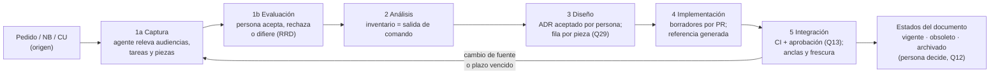
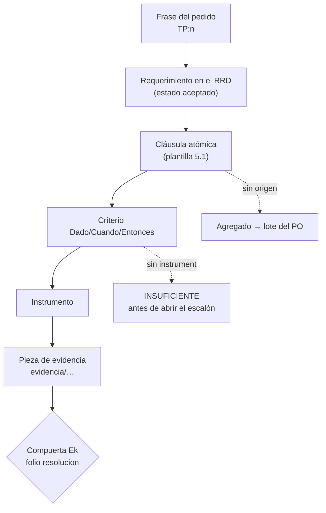

| Campo | Valor |
| --- | --- |
| Tipo | informe |
| Fecha | 2026-10-26 |
| Autor | Comisión C-REQUISITOS (núcleo permanente, `RM:197`), a ciegas |
| Corrige | — |

| Cabecera de comisión | Valor |
| --- | --- |
| Rol | Requisitos: ¿cada cláusula es unívoca, atómica y verificable? ¿Qué falta? (`RM:198`) |
| Carta | Despacho C-REQUISITOS de la presidencia, recibido en la sesión. **No está archivado en `evidencia/`** (`ls evidencia/` → `001-…`, `002-…`, `local/`, y la carpeta de ensayos de esta comisión). Ver §1.3 |
| Norma | `KB-privada/Knowledges/Knowledge-Mesa-De-Expertos-A-Pedido.md` 3.1 |
| Secciones de Mesa-De-Expertos-A-Pedido 3.1 leídas | Líneas 1–111 (cabecera y §0, con el Mapa de carga); §2.2; §3.2; §3.3; §4; §5.2 (fila «Sos una comisión») |
| Otros documentos cargados | `Cadena-De-Consecuencias` 2.0 §2 (`KB-privada/Knowledges/Knowledge-Cadena-De-Consecuencias.md`); `Rule-Mesa` 1.0, líneas 185–265 (`RM`); `Rule-Expediente` 1.0 §0 y §1 y la lista de tipos de §3.4 (`RE`); `Conformacion-Pull-Request-Automatico` 2.0 §3.1–§3.3 (`CPA`); de `/IA/SDD/IA.SDD/SDD/Devs/Rules/`: `Rules-Documentacion.md` (líneas 102, 457, 723, 801, 1003), `Root-Rules.md` §9 y §11, `Expediente-Rules.md` 1.1 (líneas 262–275 y 418–445), `Rules-Base-Conocimiento.md` (líneas 36, 159–172, 285, 540) |
| Insumos leídos | Pedido (`TP`, completo); folios 001, 002, 003 y 004; bitácoras `N00` (§4–§10), `N03`, `N04`, `N05` §8–§9, `N06`, `N07`, `R01` (§8.2, §9, §14–§17.1), `R03` §6 y §9–§10, `R05` §6–§10, `R06` §4–§12, `R07` §5, `I03` §8–§12, `I04` §4.1 y §9.2. No se leyeron informes de otras comisiones |
| Medios propios | Lectura de repositorios con `git` y `grep`; seis ensayos con guiones propios en un directorio de ensayos fuera del workspace (§7); dos consultas web (§8) |

## Índice

1. [Definiciones y forma de este informe](#1-definiciones-y-forma-de-este-informe)
2. [Lectura del objetivo literal: qué falta (`TP:26`)](#2-lectura-del-objetivo-literal-qué-falta-tp26)
3. [Hallazgos](#3-hallazgos)
4. [Dictamen por pregunta](#4-dictamen-por-pregunta)
5. [Propuesta de método desde Requisitos](#5-propuesta-de-método-desde-requisitos)
6. [Criterios de aceptación propuestos por compuerta](#6-criterios-de-aceptación-propuestos-por-compuerta)
7. [Ensayos corridos](#7-ensayos-corridos)
8. [Fuentes externas](#8-fuentes-externas)
9. [Lo que revisé y está bien](#9-lo-que-revisé-y-está-bien)
10. [Solicitudes de convocatoria](#10-solicitudes-de-convocatoria)
11. [Excepciones a conocimientos](#11-excepciones-a-conocimientos)
12. [Lo no verificado](#12-lo-no-verificado)
13. [Inventario de lo creado y lo borrado](#13-inventario-de-lo-creado-y-lo-borrado)
14. [Barrido S2 de este folio](#14-barrido-s2-de-este-folio)

---

## 1. Definiciones y forma de este informe

### 1.1 Definiciones

| Término | Definición en este informe | Fuente |
| --- | --- | --- |
| **Cláusula** | Una oración de la metodología o de la arquitectura que obliga, prohíbe o permite algo a un sujeto (persona, agente o CI) | Criterio propio |
| **Unívoca** | Admite una sola lectura: ningún término queda sin definir ni con dos sentidos en el corpus | `RM:198`; ISO/IEC/IEEE 29148:2018, característica «unambiguous» (§8, fuente 1) |
| **Atómica** | Obliga una sola cosa. Una cláusula con dos salidas se parte en dos | `RM:198`; 29148:2018, «singular» |
| **Verificable** | Existe un instrumento (comando, validador, folio, lectura de una comisión) que decide si se cumple, sin juicio de quien la escribió | `RM:198-199`; 29148:2018, «verifiable» |
| **Criterio de aceptación** | La forma **Dado** (estado previo) / **Cuando** (evento) / **Entonces** (resultado observable), más el **instrumento** que lo observa | Palabras clave en español de Gherkin (§8, fuente 2); el campo «instrumento» es criterio propio, tomado del moderador de objetivos (`MEP` §2.2, «cada uno con su instrumento») |
| **Agregado** | Lo que entra al objetivo sin una frase del pedido que lo origine | `MEP:61-63` (§0, punto 2) |
| **Fase de la metodología** | Tramo del **proceso** del sistema documentador: lo que hace el equipo para un sistema | Criterio propio, para separar de la fila siguiente (H05) |
| **Estado del documento** | Situación de **una pieza** en su ciclo de vida (Planificado … Archivado) | Guía §8.2 (`/LAB/Lab-Documentos/Lab-Documentos/Guides/Documentacion-Tecnica/Sistema-De-Documentacion-E-Integracion/Sistema-Documentador-Tecnico-Guide.md:546-570`, alias `GUIA`) |
| **RRD** | Registro de requerimientos documentales de un sistema (propuesta de Q18) | Criterio propio |

**Ejemplo.** «Revisar: otra persona lo lee con criterio» (`GUIA:566`) no es unívoca («con criterio»), no es atómica (lectura + chequeos de CI) y no es verificable en un equipo de una persona con dos identidades (`R03:212-214`). Reescrita: «**Dado** un PR de documentación abierto por un agente, **Cuando** se decide su merge, **Entonces** consta la aprobación de la persona responsable en el PR o una delegación asentada y vigente con la guarda G1–G4 en verde. **Instrumento:** registro del PR y del informe de conformación».

### 1.2 Lectura P0–P3 aplicada

La del folio 001 §7. P1 en este informe es una cláusula que dos lectores (persona y agente) aplican distinto, o que deja una compuerta sin criterio.

### 1.3 Observaciones de forma

- El informe va en `actuaciones/010-informe-c-requisitos.md` porque así lo fija el despacho. El folio 001 §12.5 decía `despacho/<rol>.md`. Manda el despacho, que es posterior.
- La carta de este despacho no está en `evidencia/`, y el folio 001 §12.4 lo exige antes de despachar. Esta comisión no puede corregirlo. Lo registra para la presidencia.

## 2. Lectura del objetivo literal: qué falta (`TP:26`)

Literal: «Definir una metodlogía clara en evaluarción de requerimientos, analisis, diseño, implementación e
integración de documetnación técnica de sistemas» (`TP:26`). Por término:

| Término de `TP:26` | Qué tiene hoy la hipótesis (`N04` §6, guía §8) | Qué falta para que sea unívoco y verificable | Hallazgo |
| --- | --- | --- | --- |
| «metodología **clara**» | Ningún criterio de claridad | Un instrumento: el lector sin contexto aplica la metodología a un sistema que no relevó y no hace **ninguna** pregunta cuya respuesta exija salir del cuerpo de la metodología (`RM:200`) | H02 |
| «**evaluación** de requerimientos» | La fase 1 de `N04` **releva** audiencias y requisitos (`N04:104`, `N04:114`). Nadie **evalúa**: no hay aceptar/rechazar/diferir, prioridad ni decisor | Separar *captura* y *evaluación*. La evaluación termina con cada requerimiento en un estado de un conjunto cerrado, con motivo y con la persona que decide | H01 |
| «análisis» | Inventario con conservar/actualizar/quitar (`N04:115`) | Completitud: el inventario tiene que coincidir con la salida de un comando que lista las piezas | H06 (M02) |
| «diseño», «implementación» | Salidas compuestas de varias cosas (`N04:116-117`) | Partirlas en cláusulas atómicas (E1: M03a, M03b, M04) | H06 |
| «**integración**» | Tres sentidos en el corpus: fase de CI y PR (`N04:118`), integración «en los sistemas» (`TP:18`, ayuda embebida en el producto) y fase de integración de núcleos (`TP:53`) | Definir el término en el glosario de la metodología con sus dos sentidos de proceso (en el ciclo del código; en el producto). La de `TP:53` es de la mesa y no entra | H04 |
| «documentación **técnica de sistemas**» | La guía y la piloto tratan ayuda al **usuario final** (`GUIA` §7). `TP:14` habla de «documentación a usuario de sistema» | Declarar el alcance: incluye la información para usuarios. Origen: `TP:14` y `TP:20` (g), que mandan enriquecer una guía cuyo contenido es esa ayuda. No es un agregado, pero tiene que estar escrito | H03 |
| (sin término) mantenimiento | `N04` agrega una sexta fase (`N04:51`) | No está en el pedido (E2: 0 apariciones de «mantenim»). Su contenido sí tiene origen: el «desfase de versionado» de `TP:20` (c). Ver Q21 | — |

**Agregados de las hipótesis frente al pedido** (E2). Las fases literales son cinco en `TP:26`, cuatro en
`TP:20` (a) y tres en `TP:18` (a). Ninguna de las tres líneas nombra mantenimiento, publicación, revisión,
redacción, deprecación ni archivo. Así quedan las fases de `N04` §6 y de la guía §8.2:

| Fase propuesta | Origen en el pedido | Clasificación |
| --- | --- | --- |
| Requerimientos (`N04`) | `TP:20` (a), `TP:26` | Del pedido, pero sin la «evaluación» (H01) |
| Análisis, Diseño, Implementación, Integración (`N04`) | `TP:26` | Del pedido |
| Mantenimiento (`N04`) | Ninguna línea; contenido trazable a `TP:20` (c) | Agregado de forma (Q21) |
| Planificar, Derivar y redactar, Revisar, Publicar, Mantener, Deprecar, Archivar (`GUIA:564-570`) | Ninguna línea de `TP:18/20/26` | Son **estados del documento**, no fases del pedido (H05). No son agregados al objetivo si se rotulan así |

## 3. Hallazgos

Tope: 10 (folio 001 §6, presupuesto). Ancla según `Escalas-De-Juicio` §3.3, tal como la cita `R01` §8.2.

| Id | Nivel | Ancla con cita | Hallazgo | Impacto si no se corrige | Dirección de la corrección |
| --- | --- | --- | --- | --- | --- |
| H01 | P1 | E1: E2-salida (fase «evaluación de requerimientos» presente en `TP:26`); `N04:114` (salida de la fase 1 sin estados de evaluación) | La «evaluación de requerimientos» del objetivo no tiene fase, salida ni decisor en la hipótesis | Se publica una metodología que no cumple una de sus cinco fases literales | Partir la fase 1 en captura y evaluación. La salida es el RRD con estado cerrado por requerimiento y la persona que decide (Q18) |
| H02 | P1 | E2: `TP:26` «clara»; ningún criterio en `N04` §8 (V1–V5 no miden claridad) | «Clara» no tiene instrumento | Nadie puede decir que la metodología cumple el objetivo | Fijar como instrumento el lector sin contexto con cero preguntas (M29 de E1) |
| H03 | P1 | E2: `TP:14` frente a `TP:26`; `GUIA` §7 | «Documentación técnica de sistemas» admite dos lecturas: sólo técnica, o técnica más información para usuarios | Persona y agente delimitan distinto el alcance, y X1 (Q32) se lee como agregado | Definir en el glosario la lectura que el pedido funda (`TP:14`, `TP:20` g): incluye información para usuarios |
| H04 | P1 | E2: `TP:18`, `TP:53`, `N04:118` | «Integración» tiene tres sentidos en el corpus | Las compuertas de la fase 5 se escriben para un sentido y se auditan con otro | Dos acepciones definidas: integración en el ciclo del código (PR + CI) e integración en el producto (ayuda embebida, canal para agentes) |
| H05 | P1 | E1: `GUIA:564-570` («Mantener», «Archivar» como **fases**) frente a `N04:119` («6 Mantenimiento») | Dos modelos que se llaman igual: fases del proceso y estados del documento | Un agente que busca «fase de mantenimiento» encuentra dos definiciones distintas | Nombrar uno «estados del documento» y otro «fases de la metodología», con una sola definición cada uno |
| H06 | P1 | E1: E1-salida (20 de 29 cláusulas sin criterio completo; 15 de 29 no atómicas; 15 de 29 no unívocas) | La muestra no pasa el criterio del ensayo (cero cláusulas sin criterio) | Las compuertas salen «depende»: lo que pretendía evitar `N07` V1 | Plantilla obligatoria de cláusula (§5.1). E1 muestra que las 20 se pueden reescribir: 24 cláusulas DCE, 0 incompletas, 0 términos vagos |
| H07 | P1 | E1: M22 = folio 001:131 («Un escalón no empieza sin el dictamen favorable…») | «Empieza» y «favorable» no están definidos | La compuerta D1 no se puede comprobar con un comando | No reabrir D1: definir **cómo** se comprueba (M22 de E1: fecha del folio `resolucion` anterior a la primera rama o despacho, y veredicto `PROCEDE` en cada criterio) |
| H08 | P2 | E1: E5-salida (no hay folio posterior al 004); folio 004 §6.1 y §7, K6 | La postergación de `C-NORMAS-IA` vale «sólo si» la presidencia asienta la opción B o el disparador de AH-4, y no está asentado | Si nadie lo asienta, `TP:36` («que consulten los estandares») queda sin especialista en todos los ciclos | Una providencia que asiente la opción B o el disparador, antes de la carta del ciclo 2 |
| H09 | P1 | E1: E4-salida (9 de 9 copias de `IA.SDD/Conocimiento/` con versión distinta de la base; `Hereda-de: —` y `Sustituye: —` en las copias; 396 líneas difieren en Mesa-De-Expertos) | «Conocimientos que pueden compartir» (`TP:18` d) no se puede verificar hoy: las copias no declaran de qué versión del origen vienen | La deriva del conocimiento DocAsCode que resulte va a ser invisible, igual que hoy (X4) | Q30: fuente única y copia con origen declarado (alias y versión) en su control de cambios |
| H10 | P2 | E1: E3-salida (`946d023`, 2026-09-18: `Dominio/Reglas/ReglasDeLocalidad.cs` → `Domain/Rules/LocalidadRules.cs` y clase `ReglasDeLocalidad` → `LocalidadRules`; la constante `LargoMinimoDelNombre` sobrevivió) | Una traza a `ruta:constante` en MovilidadUrbana se habría roto 6 días después de crearse la app MAUI (`10ce735`, 2026-09-12) | Las trazas de la mini demo envejecen con cada renombre | Q39: trazar al identificador; el catálogo resuelve el ID a `ruta#Clase.Símbolo`, con un chequeo que lo resuelve |

## 4. Dictamen por pregunta

Cada respuesta sale de `Cadena-De-Consecuencias` §2: dónde cae, cuánto pesa, qué pierde la alternativa y si es reversible.

### Q01 — Quinto cupo y postergados (verificación del folio 004)

**Respuesta.** El panel del folio 004 **cumple** las reglas de composición, con **una condición abierta**: falta asentar K6 (H08).

| Regla | Comprobación | Resultado |
| --- | --- | --- |
| Núcleo permanente siempre (`RM:194`) | Folio 004 §4: REQUISITOS, VERIFICACION, LECTOR y refutador al final | Cumple |
| Techo: núcleo + 5 (`RM:259`) | E5: 5 filas «N de 5» en el panel | Cumple |
| Postergados registrados con entrada (`RM:259-260`) | Folio 004 §6.1: los cuatro, con entrada y disparador | Cumple |
| Toda pregunta con dos o más lectores en el ciclo 1 (folio 003 §8) | E5: 46 preguntas; 27 con 2, 17 con 3 y 2 con 4; 0 postergados contados | Cumple |
| Condición del jurado K6 (folio 004 §7) | E5: no hay folio posterior al 004 | **Abierta** (H08) |
| Absorción de la función formal (folio 004 §3.6, 4/5) | El control lo hace el refutador (K3) | No verificable por esta comisión antes del refutador. **Una observación desde Requisitos:** las cláusulas con cuantificadores de este informe («cada», «ninguna», «cero») tienen instrumento en §6 y en E1, para que el refutador pueda leerlas |

**Alternativas consideradas.** Declarar el panel no conforme hasta K6. Se descarta: K6 condiciona una postergación, no la composición del ciclo 1.
**Ventajas.** Ninguna recomposición; basta una providencia.
**Riesgo.** Que el ciclo 2 se despache sin K6 y `C-NORMAS-IA` no entre nunca.

### Q12 — Intervenciones automáticas de IA

**Respuesta.** Rige una matriz cerrada. El agente puede hacer, **sin persona en el bucle**, sólo lo que deja un PR o una salida regenerable. Cinco actos exigen **siempre** una persona.

| Fase | El agente puede (automático) | Exige siempre persona | Criterio de aceptación (instrumento) |
| --- | --- | --- | --- |
| 1 Captura y evaluación de requerimientos | Relevar audiencias, tareas y piezas; proponer requerimientos en el RRD | **Aceptar, rechazar o diferir** cada requerimiento | Dado un RRD, Cuando se cierra la evaluación, Entonces cada fila tiene estado y firma de persona (conteo) |
| 2 Análisis | Generar el inventario desde un comando; proponer estados | — (la propuesta se decide en 1 o 3) | Diff entre comando e inventario: vacío |
| 3 Diseño | Proponer ADR en estado «Propuesto» | **Aceptar un ADR** (topología, vía normativa, contrato `traces`) | Ningún ADR `Aceptado` sin aprobación de persona registrada (grep de estado contra el folio o PR) |
| 4 Implementación | Redactar borradores; regenerar la referencia (OpenAPI, XML) y los índices (`llms.txt`, ia-db) en el build; traducir como borrador | — | Todo cambio de agente entra por PR en rama propia, con `origin: agent` (validador de frontmatter) |
| 5 Integración | Correr validadores; verificar con un rol distinto del redactor | **Merge**, salvo delegación asentada (`CPA` §3.1) con guarda G1–G4 | Q13 |
| Estados del documento | Proponer `obsoleto` | **Deprecar, archivar, etiquetar, publicar** (fases irreversibles, `R01` §15, `RDL:203-228`) | Ninguna etiqueta ni publicación sin testimonio de la persona |

**Alternativas consideradas.** (a) Traducción automática que se fusiona directo, como hacen algunas
automatizaciones de Mintlify (`I03:173`). Se descarta, porque quien lee la traducción no tiene otro control. (b) Un
agente que fusiona sin delegación. Se descarta: contradice `I03:181` y `I03:196`.
**Fundamento.** «agente propone, PR dispone» (`I03:181`). Copilot: el agente «cannot approve or merge» (`I03:196`, fuente F06). El actor `ACT-10` tiene «autoridad: ninguna; produce borradores trazables» (`/LAB/Lab-Documentos/Lab-Documentos.Documentacion/ia-db/indexes/01_Documentacion-Tecnica.md:90`; `GUIA:638`).
**Ventajas.** *Simplicidad*: cinco actos humanos, el resto automático. *Practicidad*: coincide con el ciclo de PR que el workspace ya usa. *Escalabilidad*: la matriz no depende del tamaño del equipo.
**Riesgos.** Que la regeneración automática de índices tape una deriva. Mitigación: los índices declaran su commit base (`N06-H15`, `R04:320-325`).

### Q13 — Quién aprueba con una persona y dos identidades

**Respuesta.** Aprueba la **persona responsable del producto**, no una identidad de git. Las dos identidades son una sola persona y no cuentan como dos aprobadores. «Aprobador ≠ solicitante» (`I03:196`) se lee **agente redactor ≠ quien aprueba**: el agente nunca aprueba. La aprobación vale de una de dos formas, y sólo de esas dos:

1. Aprobación expresa de la persona en el PR.
2. **Delegación del merge asentada** en el repositorio destino, con fecha y responsable (`CPA` §3.1). Esa delegación es la aprobación anticipada, por escrito y revocable por unidad. Además: guarda G1–G4 en verde (`CPA` §3.3), informe con enlace antes del merge, y un verificador distinto del redactor (`I03` R15, una comisión o subagente).

**No vale:** el silencio; que una identidad apruebe el PR de la otra; el primer merge del repositorio que asienta la propia delegación. Ese primer merge vuelve a la persona: es el antecedente de Lab-E2E.WebBlazor.Documentacion, en la memoria del espacio de trabajo `delegacion-merge-arranque-en-repo-nuevo`, 2026-10-25.
**Criterio de aceptación.** Dado un PR fusionado con `origin: agent`, Cuando se audita, Entonces existe la aprobación de la persona en el PR, o la ruta de la delegación con fecha y responsable citada en el informe de conformación, más una corrida de controles en éxito para el SHA fusionado.
**Alternativas.** (a) Que la segunda identidad apruebe. Se descarta: es autoaprobación con otro nombre. (b) Prohibir el merge por agentes. Se descarta: contradice la regla vigente del PO, que manda conformar todo PR con `CPA` (memoria `pr-siempre-conformacion-automatica`, 2026-10-25).
**Ventajas.** Reusa `CPA` sin inventar un rol.
**Riesgo.** La delegación cubre unidades que nadie lee. Mitigación: la lista de excepciones de la delegación (`CPA` §3.4) y la revocación por unidad.

### Q18 — Artefacto de requerimientos documentales

**Respuesta.** Un **Registro de requerimientos documentales (RRD)** por sistema documentado. Vive en el mismo árbol que versiona la especificación del sistema que documenta, para que su versión ancle con ella. La ruta exacta por sistema es de N02 y de C-ARQ-NET (Q03). Esta comisión fija la forma y la regla de ubicación, no la ruta. Campos obligatorios:

| Campo | Contenido | Por qué |
| --- | --- | --- |
| `id` | Identificador estable (prefijo por Q14) | Trazable desde `traces` y desde el RRD de otro sistema |
| `audiencia` | Una sola: persona usuaria, integrador, mantenedor, operador o agente | Atomicidad |
| `tarea` | La tarea de esa audiencia que el documento sostiene | 26514 6.2, análisis de audiencia y tareas (`I04:154`) |
| `pieza` | El doc_id o la familia de piezas que lo satisface | Cobertura verificable |
| `origen` | Cita `ruta:línea` del pedido, NB o CU | Sin origen es un agregado (`MEP` §0) |
| `prioridad` | D / C / O | Igual que `I03` §11 |
| `criterio` | Dado / Cuando / Entonces + instrumento | Verificable |
| `estado` | propuesto / aceptado / rechazado / diferido, con motivo | Es la **evaluación** de `TP:26` (H01) |
| `decide` y `fecha` | La persona que decidió | Q12, fila 1 |

**Regla con NB/CU.** Si la documentación es una **función del producto** (la ayuda dentro del panel de Lab-Geometria), el requerimiento de producto va en NB/CU, por la norma del destino (`R06:226-236`). El RRD lo referencia por su ID. Si es una **propiedad de la documentación** (audiencia, forma, calidad, canal), va sólo en el RRD.
**Alternativas.** (a) Una sección del SDD. No sirve para Lab-Documentos ni para MovilidadUrbana, que no tienen SDD (`R03:141-156`, `R05` §7). (b) `docs/_requisitos.md` en todo sistema (`I04:354`). En un destino SDD duplica la categoría 11, cuyo plan existe y está sin redactar (`R06:106`). (c) Sólo NB/CU. Mezcla requisitos de producto con requisitos de documentación, y en IA.SDD choca con la exclusión del usuario final (Q32).
**Fundamento.** 26512, «especificar los requisitos de la documentación antes de producirla» (`I04:137`); 26514:2022 6.1.3 «Requirements on information for users» (índice, `I04:154`).
**Ventajas.** *Simplicidad*: un archivo con nueve campos. *Escalabilidad*: la misma forma en los cuatro tipos de sistema (Q19).
**Riesgo.** Ceremonia que nadie completa (`R01` §9). Mitigación: el RRD se valida por esquema, y una fila sin `criterio` pone el CI en rojo.

### Q20 — El expediente como unidad de cambio y cómo reintegra

**Respuesta.** La unidad de cambio documental es **el PR**. El expediente lo es sólo cuando se cumple una rama de `RE` §1: el caso atraviesa corridas o repositorios, o entra material externo que funda una decisión. Si el caso entero cabe en un PR, en una mesa con registro o en un comando, no se abre (exclusiones de `RE` §1). Reintegra así:

1. El folio `resolucion` lleva la fila `Reintegra` con los documentos o categorías que cambian (`MEP:153`).
2. No se asienta `archivo` con motivo «aplicado y verificado» hasta que **cada** documento nombrado tenga una fila de control de cambios que cite el expediente.
3. La comprobación es la que IA.SDD ya tiene, A13 y A15 de `Expediente-Rules.md` 1.1 (`/IA/SDD/IA.SDD/SDD/Devs/Rules/Expediente-Rules.md:268-271`, `:420-436`). En destinos SDD se usa tal cual. En repositorios sin SDD (Lab-Documentos), la declaración `SPEC` nombra la guía y el conocimiento.

**Por qué esto y no una regla nueva.** `RE` deja fuera de su alcance «la reintegración de lo resuelto», que va al perfil de cada framework (`KB-privada/Rules/Rule-Expediente.md:31-34`). IA.SDD ya la resolvió y la mide.
**Criterio.** Dado un expediente con `resolucion` que nombra N documentos en `Reintegra`, Cuando se asienta el `archivo`, Entonces A13 sale vacío.
**Alternativas.** Reintegrar «a criterio». Se descarta: es lo que el `SDD-B` tiene en el texto y no ejerció (`R04:322-323`).
**Ventajas.** Cero mecanismo nuevo. Comando existente.
**Riesgo.** Repositorios sin `SPEC` declarada: A13 sale `NO EVALUABLE`, que es rojo para quien lee (`Expediente-Rules.md:440-442`). Es deseado.

### Q21 — ¿Se agrega la fase de mantenimiento?

**Respuesta. No se agrega una sexta fase.** Lo que `N04` llama mantenimiento entra de dos formas, las dos con origen en el pedido:

- Como **cláusulas de control de deriva dentro de la fase 5, integración**: anclas de versión y compuertas de frescura por cambio de fuente (E1: M06, M11), con origen en «desfase de versionado» (`TP:20` c).
- Como **disparador de reentrada** al ciclo. Un cambio de fuente o un plazo vencido reabre la fase 1 (captura y evaluación) para esa pieza.

Deprecar y archivar son **estados del documento** (H05), no fases.
**Consecuencia.** La metodología conserva las cinco fases literales. No hay fila de alcance que llevar al lote. Si la mesa prefiere la sexta fase, es un agregado de forma: va al lote del PO con `SI NO RESPONDÉS` y no se asienta por silencio (`R01:460`).
**Fundamento.** E2: «mantenim» tiene 0 apariciones en el pedido; «desfase» está en `TP:20`. 26514:2022 trata la actualización y el mantenimiento como subcláusula de desarrollo (6.11, índice, `I04:154`), no como fase de otro nivel.
**Ventajas.** *Simplicidad*: cinco fases y un bucle. *Practicidad*: el control de deriva corre en el PR, donde hay un evento (`GUIA` §8.5).
**Riesgo.** La deriva por **tiempo** no tiene evento (`GUIA` §8.5). Se cubre con la tarea programada de M06, que pertenece a la fase 5.

### Q25 — El PR del repositorio auxiliar de Geometría con `ubuntu-latest`

**Respuesta.** **No se toca y no contradice `TP:34`.** «Configura el wofklow» (`TP:34`) nombra el workflow que **esta corrida** configura. Es la lectura que menos agrega (`MEP` §0, punto 1). El PR #2 de Lab-Geometria.Documentacion es de otra corrida, que sigue activa: hay un PR #3 sobre `ia-db/4.0`, por E6. Por EX4 queda fuera.

El workflow documental de la piloto se crea en el **repositorio de código** de Lab-Geometria (`R06:231`) con `runs-on: [self-hosted, i7infra-dev]`. X3 se reduce a la concurrencia en el runner, que es Q24.
**Criterio.** Dado cada workflow que esta corrida crea o modifica, Cuando corre `grep -n runs-on`, Entonces todas las ocurrencias dicen exactamente `[self-hosted, i7infra-dev]` (`VER-W09`, `R07:144`). Los workflows ajenos no entran en la medición.
**Alternativas.** (a) Pedir que el PR #2 migre al runner. Escribe en una corrida ajena, compite con la E2E por el único runner (`R06` §6) y no lo pide el pedido. (b) Absorber su chequeo en el workflow de la piloto. Duplica un chequeo de otra corrida.
**Ventajas.** Ningún choque con la otra corrida. El runner queda sólo para lo que `TP:34` pide.
**Riesgo.** Dos verificadores de enlaces en Geometría, uno por repositorio. En la compuerta E2 se comprueba que no validen lo mismo.

### Q28 — El workflow de Concepts como base

**Respuesta.** Se escribe un **workflow documental independiente**. El de Concepts no se versiona como base: es un artefacto que implanta decisiones del expediente 0001 (`R03:322`, origen `:3-10` del YAML) y está sin seguimiento (E6: `?? .github/`). Versionarlo es asunto de ese expediente (EX5). Lo que sí se toma son sus **siete patrones** (`R03:391-398`), como requisitos verificables del workflow nuevo: etiqueta exacta, guarda de mismo repositorio, `contents: read`, `timeout-minutes`, sin `container:`, agregador estricto y equivalente local. Es reutilizar antes de crear (`VER-W06`).
**Criterio.** Dado el workflow documental nuevo, Cuando se lo contrasta con la lista `R03:391-398`, Entonces cumple los siete puntos (grep por punto).
**Alternativas.** Versionar `framework-concept-demo.yml` y extenderlo. Mezcla una compuerta de MAUI con la documental. Hoy un PR que toca `Guides/` pasa en verde «por omisión declarada» (`R03:337`).
**Ventajas.** Un workflow por responsabilidad. El documental no carga el SDK de MAUI.
**Riesgo.** Dos workflows sobre el mismo runner en Lab-Documentos. Es materia de Q24.

### Q30 — Dónde vive el conocimiento DocAsCode

**Respuesta.** **Fuente única en KB-privada**, como `Knowledge-<…>.md` con su fila en `Index-Knowledge.md`. `IA.SDD/Conocimiento/` y el `SDD-B` reciben una **copia** sólo cuando un orquestador suyo tiene que cargarla (escalón 3). La copia trae su cierre (`Rules-Base-Conocimiento.md`, versión 2.3, `:540`) y **declara su origen sin apuntar**: alias y versión del origen en su fila de control de cambios (`Rules-Base-Conocimiento.md:169-170`).
**Por qué no una referencia sola.** IA.SDD exige que todo lo citado resuelva dentro de su árbol, porque se descarga en un workspace limpio (`:540`; memoria `conocimiento-importado-trae-dependencias`).
**Criterio.** Dada una copia del conocimiento DocAsCode en otro repositorio, Cuando un guion compara la versión de origen declarada con la cabecera de la fuente, Entonces la diferencia se informa. Hoy ese guion no puede correr: E4 da 9 de 9 copias sin origen declarado (H09).
**Alternativas.** (a) Sólo en `IA.SDD/Conocimiento/`. Lab-Documentos y MovilidadUrbana no cargan IA.SDD (`R03:141-156`). (b) Dos fuentes vivas. Es exactamente X4.
**Ventajas.** *Escalabilidad*: un sistema nuevo carga una sola fuente (`TP:30` f).
**Riesgo.** La copia envejece igual que hoy. Mitigación: el criterio de arriba como chequeo programado.
**Límite de mandato.** Cómo se nombra el conocimiento y qué contiene es de N06. Ver la solicitud SC-1.

### Q32 — El choque con `Rules-Documentacion` (X1)

**Respuesta.** **Apartamiento declarado en el destino, con ADR**, por `Root-Rules.md` §11, más NB y CU de la ayuda. **No se cambia la norma.** La decisión de diseño vigente del destino («El producto no lleva manual», `Experiencia-De-Uso.md:100`) es una **decisión** y no una descripción (`MEP` §3.3, filtro «Descripción, control o decisión»). Se supera con un ADR nuevo con aprobación del PO, que va en el lote de cierre y no se asienta por silencio.
**Verificado hoy.** La norma excluye al usuario final en las líneas 102, 723, 801 y 1003, y fija tres roles en la 457 (`/IA/SDD/IA.SDD/SDD/Devs/Rules/Rules-Documentacion.md`). `Experiencia-De-Uso.md:100` en Lab-Geometria `4b114d7`. El apartamiento con estado y contador existe en `Root-Rules.md:621-657`.
**Cadena de consecuencias.** *Dónde cae* el cambio de norma: en todos los destinos de IA.SDD y en sus forks. *Cuánto pesa*: cuatro líneas normativas y un criterio de aceptación (801) que hoy rechaza. *Qué pierde* el apartamiento: la ayuda al usuario no queda en el marco común. *Reversible*: el apartamiento sí, y además tiene un disparador medible hacia el cambio de norma. Un apartamiento que sobrevive dos saltos de versión «ya demostró que no es de un producto» (`Root-Rules.md:646`).
**Criterio.** Dada la piloto, Cuando se abre su primera rama de código, Entonces existen con fecha anterior el ADR de apartamiento en estado vigente y el ADR que supera `Experiencia-De-Uso.md:100` con testimonio del PO (M26 de E1).
**Ventajas.** Local y reversible. Respeta «no tocar la norma» (memoria `conocimiento-no-tocar-el-framework`).
**Riesgo.** El PO no aprueba el ADR de diseño. Entonces la piloto no tiene objeto: escalada de alcance en el lote.

### Q38 — Contrato `traces`

**Respuesta.** `traces` es una lista. Cada entrada lleva **un** identificador con **versión obligatoria**: `ID@x.y`.

- **Página que explica una pantalla:** `CU-100NN@x.y` (unidad Web).
- **Explicación de una regla:** `RN-02NNN@x.y`.
- **Página para consumidores de la API:** `CU-000NN@x.y`.

Los identificadores siguen `Root-Rules.md` §9 (prefijo y cinco dígitos, `:430`).
**Medido.** Los 35 destinos de traza de Lab-Geometria tienen cabecera `**Versión:**`: 10 CU Web, 9 CU Api y 16 RN (ensayo de §7.3). La guía usa la forma `CU-00026@1.1` (`GUIA` §8.4) con el CU equivocado para pantallas (`R06:193`, X7).
**Criterio.** Dada una página con `traces`, Cuando corre el validador, Entonces cada ID resuelve a un archivo, su versión es igual a la cabecera del destino y su familia corresponde al tipo de página.
**Alternativas.** Trazar a la ruta. Se rompe al mover un archivo (H10).
**Ventajas.** Un contrato único para personas y agentes (`VER-A02`).
**Riesgo.** Una página que explica pantalla y regla a la vez. Se resuelve con dos entradas, no con una compuesta.

### Q39 — Reglas sin identificador en MovilidadUrbana

**Respuesta.** **Se asignan identificadores** en un **catálogo de reglas de la mini demo**, dentro del árbol de la demo y sin tocar el código de Lab-E2E.WebBlazor (`R05:238-241`). Cada fila mapea `RN-NNNNN` (forma de cinco dígitos, coherente con Q38; el prefijo final es de Q14) a `ruta#Clase.Símbolo` de la copia canónica (MAUI). Las dos copias espejo (Web y ApiWeb) van declaradas en la misma fila (`R05:104`). Las páginas trazan al ID. Un chequeo resuelve el símbolo con `grep`, nunca la línea.
**Medido (E3).** El 2026-09-18 el commit `946d023` renombró ruta y clase. La constante `LargoMinimoDelNombre` sobrevivió. Una traza `ruta:constante` creada con la app (`10ce735`) dejó de resolver a los 6 días. Con el catálogo, el arreglo es una fila.
**Criterio.** Dado el catálogo, Cuando corre el chequeo, Entonces cada símbolo existe en la ruta declarada de las tres copias, o el chequeo falla y nombra la fila.
**Alternativas.** (a) `ruta:constante`. Falla por E3. (b) `RN-LOC-01` (`R05:190`). Es una segunda forma de identificador frente a Q38.
**Ventajas.** Un solo lugar se edita cuando el código se renombra.
**Riesgo.** Que el catálogo se vuelva una cuarta copia de las reglas. Por eso guarda **sólo** el mapeo, no el valor de la regla.

### Q41 — Evidencia y aceptación por compuerta

**Respuesta.**

1. **Antes** de que empiece cada escalón, la presidencia asienta en **este expediente** un folio con los criterios de aceptación de su compuerta. Cada criterio va en forma Dado/Cuando/Entonces, con instrumento y con la pieza de evidencia esperada en `evidencia/`.
2. El dictamen de cada compuerta es un folio `resolucion` en **este expediente**, porque D1 es de esta mesa.
3. El rastro de implementación queda en el repositorio de cada escalón, por **su** norma. Lab-Geometria ya lleva `SDD/Expedientes/` (hay un `0001-Migracion-Normativa-A-13.16`); el `SDD-B` lleva la suya. Este expediente los cita con cita calificada (folio 001 §2). Se abre expediente en el destino sólo si su norma o `RE` §1 lo piden.
4. Un criterio sin instrumento no entra al folio. Sale «INSUFICIENTE» antes de abrir el escalón, no después.

La propuesta de criterios mínimos está en §6.
**Alternativas.** (a) Fijar los criterios en la compuerta, con los resultados a la vista. Es el sesgo que K2 prohíbe para los pesos (folio 004 §7). (b) Llevar el dictamen al expediente del destino. Parte D1 en repositorios distintos y el `SDD-B` no se puede citar por nombre.
**Ventajas.** Criterios fijados de antemano y una sola cuenta de compuertas.
**Riesgo.** Un criterio que resulta imposible de medir en el escalón. Se corrige con una `constancia` que lo reemplaza **antes** de correrlo, nunca después.

## 5. Propuesta de método desde Requisitos

### 5.1 Plantilla obligatoria de cláusula

Toda cláusula de la metodología y de la arquitectura (D2) se escribe con estos campos. Ninguno queda vacío:

| Campo | Contenido | Ejemplo (M05 de E1) |
| --- | --- | --- |
| `id` | Estable | `MET-INT-01` (prefijo según Q14) |
| `fase` | Una de las cinco, o «estado del documento» | 5 Integración |
| `sujeto` | Persona, agente o CI | CI |
| `obliga` | Un solo verbo y un solo objeto | Correr el workflow documental en cada PR que toca documentación |
| `origen` | `TP:n`, fuente con número o «criterio propio» | `TP:34`; `TP:26` |
| `dado` / `cuando` / `entonces` | Estado, evento, resultado observable | Dado un PR que toca documentación · Cuando corre el workflow en `[self-hosted, i7infra-dev]` · Entonces el agregador termina en éxito y cada compuerta bloqueante figura en la lista declarada |
| `instrumento` | Comando, validador, folio o comisión | Estado del check y `grep` de la lista |
| `nivel` | Bloquea o avisa (lo decide Q23, no esta comisión) | — |

### 5.2 Las cinco fases con el bucle de reentrada



### 5.3 De la cláusula a la compuerta



## 6. Criterios de aceptación propuestos por compuerta

[Criterio propio.] Son el mínimo que el folio de criterios de Q41 debería traer. Cómo se prueba cada uno es de C-VERIFICACION.

| Id | Compuerta | Dado | Cuando | Entonces | Instrumento |
| --- | --- | --- | --- | --- | --- |
| CA-E1-1 | E1 | El workflow documental nuevo | Corre `grep -n runs-on` | Toda ocurrencia es `[self-hosted, i7infra-dev]`, y hay al menos una corrida en éxito en el runner | `grep` + enlace a la corrida |
| CA-E1-2 | E1 | La mini demo con un enlace roto, un frontmatter sin `doc_id` y una traza a un ID inexistente plantados | Corre el workflow | Termina en rojo con los tres defectos y en verde sin ellos | Dos corridas que difieren en una variable |
| CA-E1-3 | E1 | Cada página de usuario de la mini demo | Corre el chequeo de trazas | Cada `traces` resuelve a un `RN`/`CU` del catálogo con versión (Q38, Q39) | Validador |
| CA-E1-4 | E1 | La guía enriquecida | La comisión de lector sin contexto documenta una pantalla de la mini demo | Registra cero preguntas con respuesta en el corpus (`RM:200`) | Informe del lector |
| CA-E1-5 | E1 | El RRD de la mini demo | Se cierra la evaluación | Cada fila tiene estado, decisor y criterio | Validador de esquema |
| CA-E2-1 | E2 | La piloto | Se abre su primera rama de código | Existen, con fecha anterior, el ADR de apartamiento y el ADR de diseño aprobado (Q32) | Fechas de los ADR frente a la rama |
| CA-E2-2 | E2 | El repositorio de código de Lab-Geometria | Corre el workflow documental con un defecto plantado | Rojo con el defecto, verde sin él | Dos corridas |
| CA-E2-3 | E2 | Una sesión de alumno | Pide una página o una línea de `llms.txt` de administrador | No la obtiene | E2E de acceso (`GUIA:472`) |
| CA-E2-4 | E2 | El conocimiento extraído | Se lo clona en limpio en KB-privada | Toda referencia resuelve dentro del árbol | Ítem enumerable de `Rules-Base-Conocimiento` §6.1, adaptado |
| CA-E2-5 | E2 | Un PR abierto de otra corrida en el repositorio auxiliar | Esta corrida escribe | No toca `ia-db/` (EX4) | `git ls-remote refs/pull` y `git status` |
| CA-E3-1 | E3 | La copia del conocimiento en el `SDD-B` | Corre la comparación de origen (Q30) | Declara alias y versión de origen, iguales a la fuente o con diferencia informada | Guion |
| CA-E3-2 | E3 | Cada mejora de orquestador | Se presenta a la compuerta | Nombra archivo, sección y dueño (`N06` V2) | Lista con rutas |
| CA-E3-3 | E3 | Un tag de código `vN` y la documentación anclada a `vN-1` | Corre la compuerta de deriva | Falla y nombra las piezas | Ensayo de desfase (folio 003 §9) |
| CA-E3-4 | E3 | El conocimiento de la piloto | Lo lee la comisión de lector sin contexto para aplicarlo al `SDD-B` | Cero preguntas que exijan abrir archivos de la piloto (`N07` V5) | Informe del lector |

## 7. Ensayos corridos

Directorio de ensayos fuera del workspace (`<ensayos>/C-REQUISITOS/`). Las salidas recortadas están en
`evidencia/C-REQUISITOS/`. Cada ensayo cambia una variable.

### 7.1 E1 — Muestra de cláusulas con plantilla Dado/Cuando/Entonces (Q18, Q21, Q41)

- **Hipótesis.** La metodología hipotética no tiene criterio de aceptación en todas sus cláusulas.
- **Muestra.** 29 cláusulas: 6 de `N04:114-119`, 7 de `GUIA:564-570`, 8 de `GUIA:465-472`, D1 (folio 001:131), `N07` V1–V6 y `TP:26`. La clasificación de cada una es juicio de esta comisión y está en `evidencia/C-REQUISITOS/E1-muestra-actual.tsv`. El guion detecta términos vagos con un léxico por palabra completa (`E1-lexico-vago.txt`) y cuenta los campos de la reescritura.
- **Comando.** `E1-check.sh <dir>` (copia en `evidencia/C-REQUISITOS/E1-check.sh`).
- **Resultado** (`E1-salida.txt`):

```text
== Muestra actual (29 cláusulas)
atomica si=14 no=15 | univoca si=14 no=15 | verificable si=16 parcial=10 no=3 | criterio si=9 parcial=8 no=12
-- sin criterio completo (parcial o no):
M01 M02 M03 M04 M05 M06 M08 M09 M10 M11 M12 M13 M17 M20 M22 M23 M26 M27 M28 M29
== Reescritura DCE (24 cláusulas que reemplazan a las sin criterio)
incompletas: 0
-- términos vagos en la reescritura:
0
-- cobertura: ids sin criterio que la reescritura cubre
cubiertos: 20
```

- **Lectura.** Con la muestra actual, el criterio del ensayo («cero cláusulas sin criterio») sale en **rojo**: 20 de 29. Con la reescritura sale en **verde**: 24 de 24 completas, cero términos vagos y las 20 cubiertas. La primera corrida del léxico dio falsos positivos («clara» dentro de «declarada»), y se corrigió buscando por palabra completa. Las 8 cláusulas de `GUIA` §7.7 son las mejores de la muestra: 6 de 8 tienen criterio completo, porque ya están escritas como condición de falla.

### 7.2 E2 — Objetivo literal frente a las fases propuestas (Q21)

- **Comando.** `grep -c -i -E` por fase sobre las líneas 18, 20 y 26 del pedido. Huella del pedido `101e1bc4f8c933bb…`, igual a la del folio 001 §11.
- **Resultado** (`E2-salida.txt`). Evaluación de requerimientos, requerimientos, análisis, diseño, implementación e integración aparecen en el pedido. Mantenimiento, publicación, deprecación, archivo, planificación, revisión y redacción **no** aparecen en `TP:18/20/26`. «Mantenim», «publica», «deprec», «archiv», «revis» y «redact/deriv» tienen 0 apariciones en todo el pedido. «Planific» aparece 3 veces fuera de esas líneas, en las reglas de la mesa.

### 7.3 E3 — Trazas a `ruta:símbolo` frente al historial (Q38, Q39)

- **Comando.** `git cat-file -e <commit>:<ruta>` y `grep` del símbolo en `10ce735`, `946d023` y `8fb4c3a` de Lab-E2E.WebBlazor.
- **Resultado** (`E3-salida.txt`). La ruta vieja resuelve sólo en `10ce735`. La nueva resuelve desde `946d023`. La clase cambia de `ReglasDeLocalidad` a `LocalidadRules` y la constante sigue en la línea 11.
- **Complemento.** Los 35 destinos de traza de Lab-Geometria (`4b114d7`) tienen cabecera `**Versión:**`: 10 de 10, 9 de 9 y 16 de 16 (conteo con `grep -l`).

### 7.4 E4 — Versiones de un mismo conocimiento (Q30)

- **Comando.** Comparar `grep -m1 '^\*\*Versión'` de cada `IA.SDD/Conocimiento/Knowledge-*.md` (`d4035aa`) con su homónimo en KB-privada (`1585af9`), y correr `diff` de contenido en dos de ellos.
- **Resultado** (`E4-salida.txt`). 9 de 9 con versión distinta. En `Mesa-De-Expertos-A-Pedido` (2.0 frente a 3.1) difieren 396 líneas; en `Cadena-De-Consecuencias` (1.0 frente a 2.0), 139. Las copias declaran `Hereda-de: —` y `Sustituye: —`.

### 7.5 E5 — Verificación de Q01 sobre el folio 004

- **Comando.** `awk` sobre la tabla §5 del folio 004 (huella `9bedbdf9fba78b4b…`) y `ls actuaciones/`.
- **Resultado** (`E5-salida.txt`). 46 preguntas: 27 con 2 lectores, 17 con 3 y 2 con 4. 0 postergados contados. 5 filas en el techo. Ningún folio posterior al 004.

### 7.6 E6 — PR auxiliar de Geometría y workflow de Concepts (Q25, Q28)

- **Comando.** `git ls-remote origin` en Lab-Geometria.Documentacion; `git show …:verificar.yml | grep runs-on`; `git status --short .github` en Lab-Documentos.
- **Resultado** (`E6-salida.txt`). Existen `refs/pull/2/merge` y `refs/pull/3/merge`, y `main` está en `0202722`. `verificar.yml:14` dice `runs-on: ubuntu-latest`. En Lab-Documentos, `.github/` figura `??` (sin seguimiento), con `runs-on: [self-hosted, i7infra-dev]` en las líneas 42, 87, 148 y 168.

## 8. Fuentes externas

| # | Fuente | URL | Fecha de consulta | Uso |
| --- | --- | --- | --- | --- |
| 1 | ISO/IEC/IEEE 29148:2018, *Systems and software engineering — Life cycle processes — Requirements engineering*. Citada **sin apartado**: la ficha de ISO devolvió 403 y no se leyó el texto | https://www.iso.org/standard/72089.html (403); descripción secundaria: Lubos et al., *Leveraging LLMs for the Quality Assurance of Software Requirements*, arXiv 2408.10886 | 2026-10-26 | Las características «unambiguous», «singular» y «verifiable», que esta comisión traduce como unívoca, atómica y verificable |
| 2 | Cucumber, *Gherkin — Localisation* (palabras clave `es`: «Dado/Dada/Dados/Dadas», «Cuando», «Entonces», «Y/E», «Pero») | https://cucumber.io/docs/gherkin/languages/ | 2026-10-26 | Forma Dado/Cuando/Entonces |
| 3 | GitHub Docs, *Risks and mitigations for Copilot cloud agent* (vía `I03` F06) | https://docs.github.com/en/copilot/concepts/agents/coding-agent/risks-and-mitigations | 2026-10-26 (consulta de `I03`; no se reabrió) | Q12, Q13 |
| 4 | ISO/IEC/IEEE 26512:2018 (muestra) y 26514:2022 (índice), vía `I04` | https://cdn.standards.iteh.ai/samples/72088/1f639d08881540638bf997dce87dc29d/ISO-IEC-IEEE-26512-2018.pdf ; https://webstore.iec.ch/en/publication/73614 | 2026-10-26 (consulta de `I04`; no se reabrió) | Q18, Q21 |

## 9. Lo que revisé y está bien

1. **Las ocho validaciones de `GUIA` §7.7** están escritas como condición de falla y son las más verificables de la muestra: 6 de 8 tienen criterio completo (E1). Sirven de modelo para la plantilla §5.1.
2. **La cobertura del panel del ciclo 1** (folio 004 §5) es exacta. El recuento de E5 coincide con el que declara el folio.
3. **Los destinos de traza de Lab-Geometria** son versionables tal como están: 35 de 35 con cabecera de versión. El contrato `ID@versión` no exige tocar el SDD del destino.

## 10. Solicitudes de convocatoria

| # | Señal y ubicación | Qué no puedo afirmar sin esa especialidad |
| --- | --- | --- |
| SC-1 | «para ser aplicado luego en el diseño de nuevos sitemas» (`TP:30` f); X4 (`R03:256-267`) | El contenido y el nombre del conocimiento DocAsCode y su condición de carga. Lo leería `C-SDD-CONOCIMIENTO`, postergado a E2 (folio 004 §6.1). Por `RM:246-249` pasa al ciclo siguiente |
| SC-2 | «que consulten los estandares» (`TP:36`) frente a la cita sin apartado de 29148 y 26514 (§8) | Si las cláusulas de 29148 que uso como definición son las del texto normativo. Lo leería `C-NORMAS-IA`, cuya entrada depende de K6 (H08) |

## 11. Excepciones a conocimientos

**Ninguna** propuesta por esta comisión. Tres decisiones podrían parecer apartamientos y no lo son:

- **Q30** sigue `Rules-Base-Conocimiento.md` 2.3 (copia con cierre y origen descripto sin apuntar).
- **Q32** usa el mecanismo propio de la norma del destino (`Root-Rules.md` §11), sin cambiar `Rules-Documentacion.md`.
- **Q20** reusa `Expediente-Rules.md` 1.1.

La plantilla Dado/Cuando/Entonces (§5.1) no contradice ningún conocimiento catalogado. Su adopción como regla del cuerpo documental es una propuesta, no un apartamiento.

## 12. Lo no verificado

- **El texto normativo de ISO/IEC/IEEE 29148:2018.** La ficha devolvió 403 el 2026-10-26. Las tres características se tomaron de una fuente secundaria (§8) y se citan sin apartado.
- **Que el PR #2 de Lab-Geometria.Documentacion siga abierto.** Se infiere de que `refs/pull/2/merge` existe y de que `main` no contiene su cabeza (E6). No se consultó la API de GitHub.
- **Si la numeración de versión de las copias de `IA.SDD/Conocimiento/` es propia o la del origen.** E4 mide versión declarada y diferencia de contenido, no cuál deriva de cuál.
- **Si la protección de rama de los repositorios públicos (Lab-*) permite exigir revisión.** La memoria `github-plan-free-sin-proteccion-de-rama` mide un repositorio privado. Para Q13 no cambia la respuesta: la aprobación no descansa en la protección de rama.
- **La clasificación de las 29 cláusulas de E1.** Es juicio de esta comisión, archivado fila por fila para que el refutador lo ataque. Sólo el léxico y los conteos son mecánicos.

## 13. Inventario de lo creado y lo borrado

| Qué | Dónde | Estado al cerrar |
| --- | --- | --- |
| Directorio de ensayos `C-REQUISITOS/` (`e1/` con dos TSV y el léxico, `e1-check.sh`, `e1-salida.txt` a `e6-salida.txt`, `ensayo-trazas.txt`) | `<ensayos>/C-REQUISITOS/`, fuera del workspace | **Borrado** al terminar (`rm -rf`) |
| Copias recortadas de las salidas y los insumos de E1 (10 archivos) | `evidencia/C-REQUISITOS/` de este expediente | Quedan como evidencia |
| Este folio | `actuaciones/010-informe-c-requisitos.md` | Queda |
| Contenedores Docker | — | Ninguno: no hizo falta |

No se escribió en ningún repositorio fuera de esta carpeta del expediente, ni en `PROMPTs/` fuera de `OUTPUTs/`. Sin commits.

## 14. Barrido S2 de este folio

| Campo | Valor |
| --- | --- |
| Comando | `grep -rnIiE "(/\|-)home[/-][a-z0-9_]+\|/Users/[A-Za-z]\|C:\\\\Users" actuaciones/010-informe-c-requisitos.md evidencia/C-REQUISITOS/`, más el usuario del host, desde la carpeta del expediente |
| Fecha | 2026-10-26 |
| Resultado | **vacío** (código de salida 1 de `grep`), también para el usuario del host y para el nombre del servicio privado |

No se nombran el servicio privado, sus hosts, sus usuarios ni sus clientes: se usa `SDD-B`.

Sigue: análisis de decisiones · presidencia
