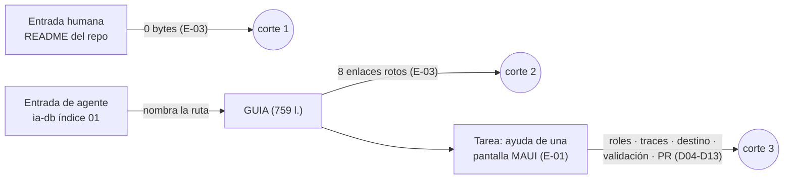
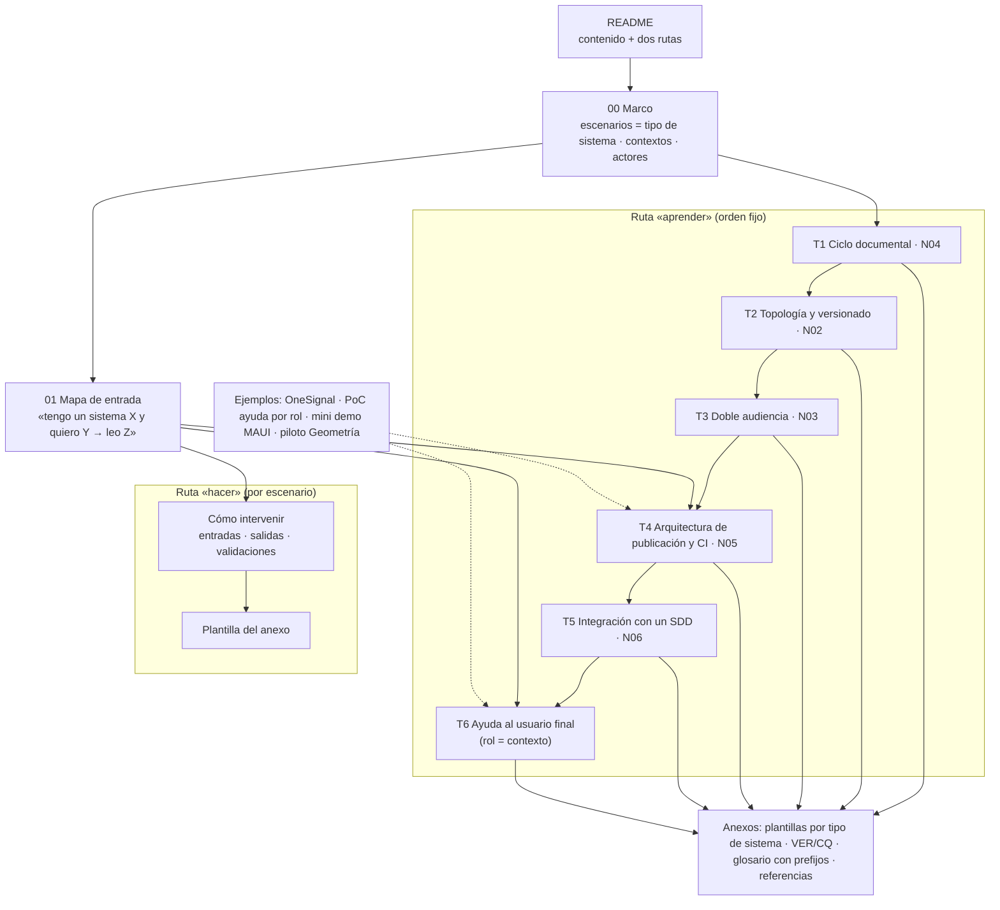
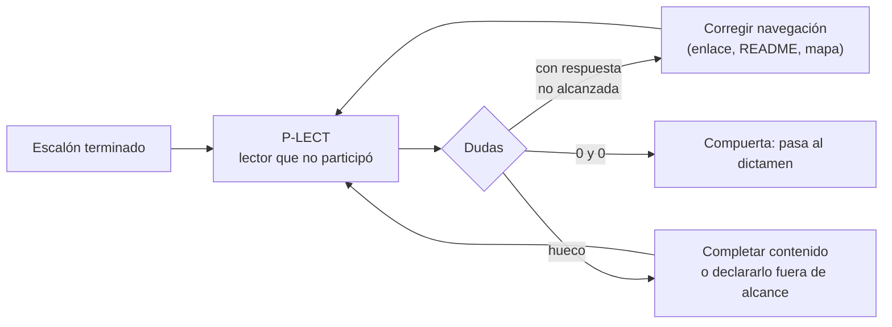

| Campo | Valor |
| --- | --- |
| Tipo | informe |
| Fecha | 2026-10-26 |
| Autor | Comisión C-LECTOR (lector sin contexto, núcleo permanente, `RM:199`) |
| Corrige | — |
| Modo | A ciegas: de `actuaciones/` se leyeron sólo 001, 002, 003, 004, 0060 y 0070 (no se abrieron; ver §11) |

Norma y fuentes leídas: el tool-prompt completo (`TP`); `KB-privada/Rules/Rule-Mesa.md:190-212`;
`KB-privada/Rules/Rule-Escalas-De-Juicio.md` §3.1-3.3; `KB-privada/Knowledges/Knowledge-Cadena-De-Consecuencias.md` §2;
el Profile en su ruta real (`/IA/PROMPTs/IA.Prompts/PromptFramework/Profiles/Study-Guide-Documentation.md`, completo);
la guía `GUIA` completa (759 líneas); bitácoras N03, N08 (completas), N04 y N07 (preguntas), R02 §6 y §9-11, R05 §1-8,
R07 §4 y §5.9, I02 §4, I03 §11, I05 §10 y §12; folios 002 (preguntas), 003 (panel) y 004 (§3.3 y §7).

# Informe de la comisión C-LECTOR — expediente 0002

## Índice

1. [Alias de rutas](#1-alias-de-rutas)
2. [Definiciones](#2-definiciones)
3. [Qué se hizo y con qué límite](#3-qué-se-hizo-y-con-qué-límite)
4. [Hallazgos](#4-hallazgos)
5. [Dictámenes por pregunta](#5-dictámenes-por-pregunta)
6. [Propuesta de método: la prueba de lectura como compuerta](#6-propuesta-de-método-la-prueba-de-lectura-como-compuerta)
7. [Ensayos corridos](#7-ensayos-corridos)
8. [Lo que revisé y está bien](#8-lo-que-revisé-y-está-bien)
9. [Excepciones a conocimientos](#9-excepciones-a-conocimientos)
10. [No verificado](#10-no-verificado)
11. [Inventario de lo creado y lo borrado](#11-inventario-de-lo-creado-y-lo-borrado)
12. [Barrido S2 de este folio](#12-barrido-s2-de-este-folio)
13. [Pase](#13-pase)

---

## 1. Alias de rutas

Todas las rutas van desde la raíz del workspace.

| Alias | Ruta |
| --- | --- |
| `TP` | `/LAB/Lab-Documentos/Lab-Documentos.Documentacion/PROMPTs/DEVs/Enchacement/01-Replanteo-Y-Analisis/Replanteo-Y-Analisis.md` |
| `GUIA` | `/LAB/Lab-Documentos/Lab-Documentos/Guides/Documentacion-Tecnica/Sistema-De-Documentacion-E-Integracion/Sistema-Documentador-Tecnico-Guide.md` (Lab-Documentos `5d5c2b4`) |
| `CGT` | `/LAB/Lab-Documentos/Lab-Documentos/Guides/Documentacion-Tecnica/Creacion-Guias-Tecnicas/` |
| `MU` | `/LAB/Lab-E2E.WebBlazor/Lab-E2E.WebBlazor/src/MovilidadUrbana.MAUI/` (commit `8fb4c3a`) |
| `PERFIL` | `/IA/PROMPTs/IA.Prompts/PromptFramework/Profiles/Study-Guide-Documentation.md` |
| `RM` | `KB-privada/Rules/Rule-Mesa.md` 1.0 |
| `B/` | `/LAB/Lab-Documentos/Lab-Documentos.Documentacion/PROMPTs/DEVs/Enchacement/01-Replanteo-Y-Analisis/OUTPUTs/Bitacoras/` (`N0n`, `R0n`, `I0n` = archivos de esa carpeta) |
| `EV/` | `evidencia/C-LECTOR/` de este expediente |

## 2. Definiciones

| Término | Definición en este informe | Fuente |
| --- | --- | --- |
| Lector sin contexto | Quien no participó en la producción del material y debe trabajar con él sin preguntar. Cada pregunta que necesita y que **tiene respuesta en el corpus** es un hallazgo | `RM:199-204` |
| *Play testing* | Dar a ese lector una tarea real y registrar cada duda en el momento en que aparece | `I05:286` (PE-09) |
| Hallazgo de navegación | Duda con respuesta en el corpus que el lector no alcanzó desde el material | Criterio propio, sobre `RM:202-204` |
| Hueco de contenido | Duda sin respuesta en el material para lectores (las bitácoras de la mesa no cuentan como material para lectores) | Criterio propio |
| Ruta de lectura | Secuencia de documentos, unidos por enlaces, que lleva desde una entrada (README) hasta la tarea | `PERFIL:50`, `:85` |
| Punto de corte | Primer paso de la ruta en el que el lector no puede seguir sin ayuda externa | Criterio propio |
| Entrada humana / entrada de agente | Primer documento que abre una persona (README que muestra el repositorio) o un agente (índice que le indican, como la ia-db) | Criterio propio, sobre `N03:99-102` |
| Prueba de lectura (P-LECT) | Protocolo propuesto en §6: *play testing* con criterio de paso medible, usado como compuerta de cada escalón | Criterio propio |

## 3. Qué se hizo y con qué límite

- **Mandato.** Trabajar con la guía, la demo y el ciclo de trabajo sin preguntar. Cada pregunta necesaria es un hallazgo (`RM:199-204`; folio 003:149).
- **No-competencia.** No opino sobre normas, toolchain ni versionado (folio 003:149). En Q05 y Q26, que son de esos temas, dictamino **sólo el requisito del lector** que cualquier opción debe cumplir, y lo digo en cada caso.
- **Condición K4 del jurado** (folio 004 §7). El ciclo 1 se centra en la ruta de lectura (Q43) y en la guía. La mini demo no existe todavía. Por eso el *play testing* se hizo sobre una pantalla real de MovilidadUrbana.MAUI siguiendo la guía: se prueba **la guía**, no la demo.

*Diagrama: los tres puntos de corte medidos (§7).*

## 4. Hallazgos

Lectura P0–P3 del caso: la de `R01` §8 (`B/R01-Protocolo-De-Mesa.md:221-225`). Anclas según `Rule-Escalas-De-Juicio` §3.3.

| Id | Nivel | Ancla | Hallazgo | Impacto | Dirección de la corrección |
| --- | --- | --- | --- | --- | --- |
| H-L01 | P1 | E1: `wc -c README.md Guides/README.md` → `0`, `0`; BFS de enlaces desde `README.md` → 1 alcanzable, `llega_a_la_guia=False` (`EV/03`) | Las dos entradas humanas del repo están vacías y la guía no tiene enlaces entrantes desde el corpus de lectura: sólo `CHANGELOG.md` y sus dos ejemplos la nombran. Tampoco `CGT/README.md` llega a ella (59 alcanzables, `False`) | Una persona no encuentra la guía; un agente, sí, porque la ia-db la nombra por ruta (`ia-db/indexes/01_Documentacion-Tecnica.md:9`, `:19`). Es lectura divergente humano/agente: P1 por la lectura del caso | README de repo y de `Guides/` con ruta de lectura, **antes** de enriquecer (Q40) |
| H-L02 | P1 | E1: 8 enlaces relativos de la guía `ROTO` (`EV/03`; `GUIA:189`, `:203` ×3, `:432`, `:590`, `:625`, `:633`) | Re-medición de `R02` §6.1: siguen rotos | El marco que la guía delega (familias, actores, ADR, SAD, changelog) no se alcanza: origina D03, D14 y D16 | Apuntar a `CGT/…` (destinos reales en `R02:199`) y sumar el validador de enlaces a la CI del escalón 1 |
| H-L03 | P1 | E3: recorrido reproducible `EV/01` (D02, D05, D06, D07, D10) | La guía modela un solo escenario: panel con render en servidor, roles y CU versionados. Ante una app cliente sin servidor, sin roles y sin CU, el lector no puede completar `roles` ni `traces`, que son obligatorios (`GUIA:405`, `:407`), y no sabe cómo llega la ayuda al usuario | La metodología saldría con retrabajo en el escalón 1, que es justamente MAUI (decisión 1 de la presidencia) | El marco de referencia del cuerpo declara el **tipo de sistema** como escenario y el contrato de frontmatter dice qué hacer con cada campo en cada uno (Q42, Q43) |
| H-L04 | P1 | E3: `EV/01` D12, D13; E1: `find -maxdepth 3 \( -iname 'CONTRIBUTING*' -o -iname AGENTS.md -o -iname CODEOWNERS \)` → vacío en Lab-Documentos y Lab-E2E.WebBlazor | No hay procedimiento para intervenir: ni qué comando valida una página, ni cómo se propone, ni quién aprueba. La guía dice que su asignación de actores «no [es] una matriz que la guía declare» (`GUIA:644`) | `TP:32` (b), que las personas «entiendan el flujo de trabajo para poder intervenir», queda sin cubrir | Documento de proceso aparte (Q15) |
| H-L05 | P2 | E2: `GUIA:401-409` frente a `GUIA:609`; `GUIA:5` frente a `GUIA:599` | Contradicciones internas: el contrato del frontmatter omite `owner` y `last_review`, y dos secciones después propone agregarlos. La guía declara `status: draft` y cita la convención `vigente \| borrador \| obsoleto` | El lector no sabe qué frontmatter escribir (D14, D15) | Una sola tabla de contrato, con todos los campos, en el anexo de plantillas |
| H-L06 | P2 | E1: `EV/04`: `/ayuda/llms.txt` sin sesión → `302` a HTML; con sesión → `200` con H1 y sin H2; E2: `GUIA:161` «(adoptada por varios generadores)» | Reproduce `R02` §6.8-6.9 y X5: el único canal para agentes de la demo no lo puede leer un agente anónimo, y la guía le asigna una madurez que no tiene | Entra en Q10 | Declarar la madurez de cada canal y la regla de acceso anónimo/autenticado (Q10) |
| H-L07 | P2 | E1: `EV/02` → `NombreValido(70 chars) = True`; `SQLite guardó largo = 70 con HasMaxLength(60)`; E2: `MU/Application/Localidades/LocalidadPolicy.cs:15-16`, `MU/Pages/LocalidadEditorPage.xaml:22` | Al derivar la ayuda desde el código apareció un defecto de producto: la pantalla promete «Entre 3 y 60 caracteres», el campo admite 80 y la app guarda más de 60. La guía no dice qué se escribe cuando la pantalla y el comportamiento divergen (D08) | Para el método, es un caso real de que **documentar es probar**. Sirve de ejemplo trabajado para la guía y para la mini demo. El defecto de MovilidadUrbana no es objeto de este expediente | La guía fija la regla «lo que la ayuda afirma se verifica contra el comportamiento; si diverge, se documenta lo que hace y se abre un aviso» (criterio propio). El defecto va a la presidencia como insumo, no como corrección de este expediente |
| H-L08 | P3 | E2: `GUIA:696-713` | El glosario no define `ACT-nn`, `FAM-…`, `CU-`, `RN-`, que la guía usa | Duda D16 | Glosario del cuerpo con todos los prefijos, o enlace al marco de `CGT` |

## 5. Dictámenes por pregunta

Cada opción se pasó por los cuatro pasos de `Knowledge-Cadena-De-Consecuencias` §2 (dónde cae, cuánto pesa, qué pierde la alternativa, si es reversible).

### 5.1 Q05 — ¿Se versiona el sitio publicado, o se documenta sólo la versión desplegada?

**Dictamen (requisito del lector; la elección del mecanismo de versionado no es de mi competencia).** Para el lector, se documenta **una sola versión por sistema: la vigente**. Cada página muestra, sin abrir nada más, **a qué versión del sistema aplica y cuándo se verificó**. No hace falta selector de versiones mientras no convivan consumidores de versiones distintas. Si conviven (el caso de un servicio que publica paquetes, como el SDD-B), el requisito del lector es el mismo: en la primera pantalla tiene que ver qué versión está leyendo. El mecanismo lo decide la comisión de versionado.

| Alternativa | Dónde cae el costo | Qué pierde |
| --- | --- | --- |
| A. Versión vigente con sello visible de versión y fecha (**elegida**) | Un campo por página, que se valida en CI | Quien use una versión vieja la consulta en el tag del repositorio, no en el sitio |
| B. Sitio versionado con selector | Tiempo de build y duplicación: la propia herramienta lo desaconseja por defecto (`I02:123-127`, Docusaurus [F1]) | Más superficie para que el lector caiga en una versión que no es la suya |
| C. Sin sello de versión | El lector no sabe a qué versión aplica lo que lee | La verificabilidad |

**Fundamento.** La guía ya lo concluye para un despliegue único (`GUIA:292`, `GUIA:667`). Coincide la investigación (`I02:127-129`). La madurez para agentes pide «exponer versión» en el índice (`I03:263`, R7). En el *play testing*, la app declara `ApplicationDisplayVersion 1.0` (`MU/MovilidadUrbana.MAUI.csproj:17-20`, según `R05` §2) y su `CHANGELOG` agrupa todo bajo «[Sin publicar]» (`R05` §6.1). Un lector no puede saber a qué versión corresponden las 33 capturas (`EV/01` D09). El sello es lo que falta, no el versionado.

**Ventajas.** Simplicidad: un campo. Practicidad: el validador lo exige igual que `last_review`. Escalabilidad: si mañana conviven versiones, el sello ya está y sólo se agrega el selector.
**Riesgos.** Que el sello quede viejo: se mitiga con la frescura por tiempo que la guía ya describe (`GUIA:618`). Reversible: pasar a B no invalida A.

### 5.2 Q10 — ¿Qué canales de lectura para agentes son obligatorios y cuáles opcionales?

**Dictamen.** La condición que pongo desde mi especialidad es la **paridad de entradas**: la persona y el agente entran por **la misma puerta** y llegan al mismo material.

- **Obligatorios en esta corrida:**
  1. El README del cuerpo con su ruta de lectura. Es la entrada común para personas y agentes.
  2. El Markdown fuente legible en el repositorio.
  3. Un `AGENTS.md` corto que apunte al README y a la ia-db (madurez A, convención adoptada, `I03:96-99`).
  4. La ia-db como índice interno para agentes, que ya existe.
- **Opcionales:**
  - `llms.txt` (madurez P, propuesta, `I03:128`), sólo cuando haya sitio publicado, generado del **mismo índice** que la navegación humana y legible sin sesión para lo público.
  - MCP propio, fuera de esta corrida.
- **Madurez a la vista.** Cada canal declara la suya con fuente. La guía corrige «adoptada» (`GUIA:161`).

La madurez fina de cada canal la dictamina la comisión de agentes. Mi aporte es la paridad y la medición.

| Alternativa | Qué pierde |
| --- | --- |
| A. Paridad: README común + `AGENTS.md` puntero + ia-db (**elegida**) | Nada que hoy funcione: la ia-db sigue |
| B. Seguir con la ia-db sola como entrada | La persona: hoy no llega a la guía y el agente sí (H-L01). Es la divergencia que la lectura P1 del caso castiga |
| C. `llms.txt` como canal principal | Madurez de propuesta; en la demo exige sesión y responde `302` a HTML (`EV/04`) |

**Fundamento.** E1 de H-L01 (entrada humana vacía, agente con índice) y E1 de H-L06 (`302`). Funciona «poco texto, específico, … con punteros a la fuente» (`I03:115-120`, N03-H03). Eso es un `AGENTS.md` puntero, no un resumen.
**Ventajas.** Simplicidad: dos archivos chicos. Practicidad: el lector sin contexto prueba la misma ruta para los dos públicos. Escalabilidad: `llms.txt` y MCP se suman sin cambiar la entrada.
**Riesgos.** Que README y ia-db digan cosas distintas. Se mitiga con que el README se genere o se valide contra el índice (criterio propio; la herramienta, a otra comisión).

### 5.3 Q15 — ¿Cómo se entera una persona del ciclo de trabajo para intervenir?

**Dictamen.** **No basta la guía.** Hace falta un documento de proceso aparte: corto, del tipo «Cómo intervenir». Tiene bloques `entradas` / `salidas` / `validaciones` por paso (VER-A05, `R07:251`), enlazado desde el README y desde la plantilla de PR. La guía explica **por qué**; el procedimiento dice **qué hacer, con qué comando y quién aprueba**. El mismo documento sirve al agente, que es lo que pide VER-A05.

Contenido mínimo (criterio propio, derivado de D04, D12 y D13):

| Paso | Entradas | Salidas | Validaciones |
| --- | --- | --- | --- |
| 1. Ubicar | Tipo de sistema y lector | Carpeta destino y plantilla | La pregunta «¿cambia en el mismo PR que el código?» (`GUIA:284`) |
| 2. Derivar | Fuente (CU, contrato o código) | Página con frontmatter completo | Tabla del contrato del anexo, por tipo de sistema |
| 3. Validar local | Página | Salida del validador | Un comando único, el mismo que corre la CI |
| 4. Proponer | Rama y PR | PR con plantilla completa | CI en verde; aprobador distinto de quien lo pidió (`I03:279`, R13) |
| 5. Mantener | Aviso de frescura | PR de corrección | Traza con versión, `last_review` |

| Alternativa | Qué pierde |
| --- | --- |
| A. Procedimiento aparte, enlazado (**elegida**) | Un documento más que mantener |
| B. Agregar una sección a la guía | Mezcla explicación y procedimiento, que Diátaxis separa (`GUIA:165`). El lector tendría que encontrarla dentro de 759 líneas: la sección 7 sola tiene 211 (medición `awk` sobre `GUIA`, §7) |
| C. Sólo plantilla de PR | No cubre lo que pasa antes del PR (pasos 1-3). La única que existe está sin versionar y es de otra unidad (`.github/pull_request_template.md`, `git status` → `?? .github/`) |

**Fundamento.** Medido: H-L04. El *play testing* se cortó justamente en los pasos 3 y 4 (`EV/01` §2).
**Ventajas.** Simplicidad: una página. Practicidad: la persona y el agente siguen el mismo procedimiento. Escalabilidad: cada SDD lo referencia sin copiarlo.
**Riesgos.** Que procedimiento y CI diverjan. Se mitiga con que el paso 3 nombre el mismo comando que la CI, y con que la prueba de lectura de §6 lo ejecute.

### 5.4 Q26 — ¿Qué generador de sitio se usa?

**Dictamen (requisito del lector; la marca del generador no es de mi competencia).** Para que el lector complete la ruta **no hace falta ningún generador** en esta corrida. Hace falta que el **Markdown fuente sea navegable tal cual en el repositorio**: enlaces relativos que resuelven y mermaid estándar. Se acepta cualquier generador que cumpla tres condiciones:

1. No exige sintaxis propia en la fuente: nada de MDX ni de directivas que se lean rotas en crudo (`GUIA:661`).
2. Mantiene la ruta de lectura del README.
3. Pasa la prueba de lectura de §6.

Elegir la marca corresponde a las comisiones de arquitectura .NET y de decisiones.

| Alternativa | Qué pierde |
| --- | --- |
| A. Fuente navegable en crudo + generador opcional que no la altere (**elegida como requisito**) | Búsqueda y estética del sitio, mientras no haya generador |
| B. Generador con componentes propios en la fuente | La lectura cruda en el repositorio y por agentes, y la portabilidad entre generadores (`GUIA:661`) |
| C. El render embebido de la prueba de concepto como sitio general | Sólo existe para ayuda con sesión; anónimo responde `302` (`EV/04`) |

**Fundamento.** La ruta se corta hoy **antes** de cualquier generador: README vacío y enlaces rotos (H-L01, H-L02). Un generador no arregla eso. Los enlaces relativos dentro de un repositorio publicado son la dirección que la mesa ya tomó en X11 (`N00:152`). La regla de rutas desde la raíz del workspace rige para respuestas y bitácoras (VER-P01, `R07:336`).
**Ventajas.** Simplicidad: cero piezas nuevas para leer. Practicidad: GitHub muestra el Markdown. Escalabilidad: cualquier generador se suma después sin migrar la fuente.
**Riesgos.** Que el sitio, cuando exista, rompa enlaces que en crudo resuelven. Se mitiga con que la prueba de lectura corra sobre las dos vistas.

### 5.5 Q40 — ¿Se corrige primero, como unidad separada, la deuda inmediata?

**Dictamen.** **Sí, como unidad separada y previa**, y **ampliada** con lo que midió este ensayo. Sigue la lista de `R02:339-343`:

- enlaces;
- `$P` en `Lanzar-Example.md`;
- recuento de páginas;
- `translation_of`;
- `status` y traza duplicada;
- cita de ACT-10;
- devcontainer huérfano;
- `302`/`401`.

A esa lista se suman:

1. Los dos README vacíos con una ruta de lectura mínima (H-L01). Es el corte 1, y ninguna reestructura posterior lo vuelve inútil.
2. Una sola tabla de contrato de frontmatter (H-L05).
3. Una línea en la guía que remita al procedimiento de Q15 cuando exista.

La unidad toca sólo lo que **sobrevive** a la reestructura de Q42: destinos de enlaces, entradas, metadatos. No reescribe secciones.

| Alternativa | Qué pierde |
| --- | --- |
| A. Unidad previa y acotada (**elegida**) | Algún enlace corregido se mueve otra vez si Q42 reubica el archivo: costo de minutos, reversible |
| B. Corregir dentro de la reestructura | Mientras dure la reestructura, la guía vigente sigue cortada en el paso 0 para todo lector. Y la reestructura heredaría 8 enlaces rotos que habría que separar de los nuevos |
| C. No corregir | Lo que la guía predica (validador de enlaces, `GUIA:466`) no se cumple en ella misma (`R02:199`) |

**Fundamento.** E1 de H-L01 y H-L02. No depende de decisiones de la mesa (`N00:243`, según folio 002:295).
**Ventajas.** Simplicidad: ediciones mecánicas. Practicidad: el lector actual deja de cortarse. Escalabilidad: el validador de enlaces que se sume ahí ya es la compuerta del escalón 1.
**Riesgos.** Retrabajo menor si cambian rutas; reversible por definición.

### 5.6 Q42 — ¿Cuerpo documental o archivo único enriquecido?

**Dictamen.** **Cuerpo documental**:

- un README con ruta de lectura;
- un marco de referencia con escenarios, contextos y actores;
- un mapa de entrada;
- un documento por tema, con la estructura fija del Profile;
- anexos: plantillas, listas de verificación, glosario y referencias.

La guía actual no se descarta. Su contenido se redistribuye, y el caso OneSignal y el caso Geometría pasan a ser **ejemplos** dentro de los temas.

| Alternativa | Qué pierde |
| --- | --- |
| A. Cuerpo documental (**elegida**) | Más archivos y más enlaces que validar |
| B. Archivo único con índice agregado | Sigue sin marco de escenarios: el *play testing* falló en 5 de sus 10 huecos (D02, D05, D06, D07, D10) por un escenario que la guía no modela. Además, el Profile exige un documento por tema (`PERFIL:47`, `:54-63`) y R02 lo marca «No cumple» (`R02:302-319`) |
| C. Archivo único + documentos satélite por escenario | Duplica el marco en cada satélite, contra el Profile (`PERFIL:33`, «los ejes se definen una sola vez») |

**Fundamento.**
- E4: el Profile pide un cuerpo navegable desde el README, que permita «a un lector sin conocimiento previo recorrer la temática» (`PERFIL:85`).
- E3: el recorrido `EV/01`.
- E1: hoy, para encontrar «cómo documento una pantalla», el lector tiene que reunir piezas de las secciones 5, 6, 7 y 8: 475 de las 759 líneas (medición `awk` por sección: 71 + 73 + 211 + 120).

**Ventajas.** Simplicidad para el lector: entra por su escenario y lee un tema. Practicidad: cada tema se valida por separado (es la regla de núcleos de `TP:44-55`). Escalabilidad: un tipo de sistema nuevo es una fila del marco, no una reescritura.
**Riesgos.** Fragmentación y enlaces rotos entre piezas. Se mitiga con el validador de enlaces (Q40) y con la prueba de lectura de §6 sobre la ruta completa.

### 5.7 Q43 — ¿Qué temas tiene el cuerpo y cuál es la ruta de lectura?

**Dictamen.** Los temas **coinciden con N02–N06 más la ayuda al usuario, con tres ajustes** que salen del *play testing*.

1. **El marco de referencia nombra el tipo de sistema como escenario.** Son los cuatro relevados:
   - corpus de guías (Lab-Documentos);
   - app cliente sin servidor ni roles (MovilidadUrbana.MAUI);
   - panel con roles y SDD (Geometría);
   - servicio con paquetes publicados (SDD-B).

   Los contextos son: con o sin CU, mismo repo o repo hermano, con o sin sesión. Sin esto se repiten D02, D05-D07 y D10.
2. **«Ayuda por rol» pasa a «Ayuda al usuario final»**, con el rol como **contexto** y no como tema: MovilidadUrbana no tiene roles (`R05` §4).
3. **El procedimiento de intervención (Q15) no es un tema**: es un documento de tipo guía práctica, enlazado desde el README y desde cada tema.

Ruta de lectura propuesta. Son dos rutas sobre el mismo cuerpo, porque el Profile pide un recorrido de aprendizaje (`PERFIL:5`) y la tarea pide intervenir (`TP:32`):

*Diagrama: criterio propio, sobre la estructura del Profile (`PERFIL:41-50`) y los núcleos (`N08` §6).*

Por qué el ciclo (T1) va primero en la ruta «aprender»: las fases definen el vocabulario (borrador, vigente, derivar, traza) que los demás temas usan. La guía actual lo presenta en la sección 8 y lo usa desde la sección 7. Eso obliga a leer hacia atrás (`GUIA:407` usa `traces` con versión; `GUIA:617` explica para qué).

**Medición de dónde se corta hoy** (`EV/03`):

| Paso de la ruta | Estado | Corte |
| --- | --- | --- |
| README del repo / de `Guides/` | 0 bytes | **Sí: paso 0** |
| Marco (`CGT/00-Marco-de-Referencia/`) | Existe, pero la guía lo enlaza roto | Sí |
| Mapa de entrada | No existe para el sistema documentador (`R02` §9) | Sí |
| Temas | Un solo archivo | Parcial |
| Anexos | Glosario sí; plantillas y listas no (`R02` §9) | Parcial |

**Ventajas.** Simplicidad: el lector elige una de dos rutas. Practicidad: la ruta «hacer» lleva a una plantilla en tres saltos. Escalabilidad: un sistema nuevo es una fila del marco y del mapa.
**Riesgos.** Que el mapa envejezca respecto de los temas. Se mitiga con que la prueba de lectura use el mapa como entrada obligatoria.

### 5.8 Q45 — ¿Se eleva al dueño del Profile la propuesta de objetivos de aprendizaje y ejercicios de transferencia?

**Dictamen.** **Sí, se eleva como propuesta en el lote y no se asienta por silencio** (folio 002:305). El lector suma dos ítems a la elevación:

1. Objetivos de aprendizaje observables (`I05:361`).
2. Ejercicio de transferencia (`I05:361`).
3. La corrección de la ruta del framework (`R07:120-124`).
4. *(Nuevo)* Una **verificación de cierre con lector sin contexto**. El Profile promete que «un lector sin conocimiento previo» recorra la temática (`PERFIL:85`), pero ningún paso lo verifica (`PERFIL:67-73` revisa «contra el mapa», no contra un lector).
5. *(Nuevo)* El frontmatter y los prefijos de ID para guías, que el Profile no fija (`R07:366`; el lector lo sufrió en D14 y D15).

**Mientras el PO no responda, nada se bloquea.** La guía puede **incluir** objetivos y ejercicios como contenido propio sin cambiar el Profile, porque agrega y no contradice. El cuerpo los rotula «propuesta pendiente del dueño del Profile».

| Alternativa | Qué pierde |
| --- | --- |
| A. Elevar y aplicar como contenido rotulado (**elegida**) | Nada irreversible |
| B. Elevar y esperar | El escalón 1 sale sin ejercicios: una pérdida acotada (P2) y evitable |
| C. Modificar el Profile | Viola la regla de que `PROMPTs/` es del PO (memoria del proyecto) y `Rule-All` (`R07:357`, T11) |

**Fundamento.** E4: el Profile es del PO. E2: `PERFIL:85` frente a `PERFIL:67-73`. E3: `EV/01` muestra que la verificación por lector encuentra lo que la verificación contra el mapa no ve (D01: el mapa puede estar completo y la entrada vacía).
**Ventajas.** Simplicidad: un ítem de lote. Practicidad: no detiene el escalón. Escalabilidad: si el PO acepta, sirve a toda guía de estudio.
**Riesgos.** Que el PO rechace un ítem: el contenido rotulado se retira sin tocar nada más.

## 6. Propuesta de método: la prueba de lectura como compuerta

Criterio propio, desde la especialidad del lector. Es el control que mide el objetivo del Profile (`PERFIL:85`) y la mitad humana de `TP:32`.

**Prueba de lectura (P-LECT).** En cada compuerta de escalón (decisión 1 de la presidencia), un agente o una persona que no participó recibe tres cosas: la entrada (README), una consigna real del escalón y la prohibición de preguntar. Registra cada duda con la forma de `EV/01` y la clasifica en «con respuesta no alcanzada», «hueco» o «respondida».

| Escalón | Consigna de la prueba | Criterio de paso |
| --- | --- | --- |
| E0 (deuda, Q40) | Desde el README del repo, llegar a la guía y a su marco | 0 cortes de navegación; 0 enlaces rotos |
| E1 (mini demo MAUI + CI) | Documentar una pantalla nueva de la mini demo y proponerla por PR simulado | 0 dudas con respuesta no alcanzada; huecos = 0 o declarados fuera de alcance en el cuerpo; página en su carpeta, validada con el comando del procedimiento, CI verde en `runs-on: [self-hosted, i7infra-dev]` |
| E2 (piloto Geometría) | Lo mismo sobre una pantalla con rol y CU, más un agente que lea por `AGENTS.md` | Lo anterior, más paridad: la persona y el agente llegan al mismo documento |
| E3 (SDD-B) | Un agente orquestador ejecuta el procedimiento sin intervención y una persona lo revisa | Lo anterior, más el PR revisado por alguien distinto de quien lo pidió |

Por qué así: es barato (una corrida por escalón), y su resultado es un número (dudas por clase) que el dictamen puede comparar entre escalones. Además, ya mostró que encuentra cosas que la revisión contra el mapa no ve (H-L01, H-L07).

## 7. Ensayos corridos

| Id | Qué | Comando (resumido; completo en la evidencia) | Resultado | Evidencia |
| --- | --- | --- | --- | --- |
| E-01 | *Play testing*: ayuda del Editor de localidad siguiendo sólo la guía | Lectura de `GUIA` y de `MU/Pages/LocalidadEditorPage.xaml`, `MU/Application/Localidades/*.cs`, `MU/Presentation/Localidades/LocalidadEditorViewModel.cs` | 16 dudas: 5 con respuesta no alcanzada, 10 huecos, 1 respondida. Borrador escrito sin `roles` ni `traces`, sin destino ni circuito | `EV/01-play-testing-editor-de-localidad.md` |
| E-02 | Regla del largo del nombre frente a persistencia | `docker run --rm … mcr.microsoft.com/dotnet/sdk:10.0 dotnet run` sobre una copia de `LocalidadRules.cs` y EF Core SQLite 10.0.11 | `NombreValido(70 chars) = True`; SQLite guardó 70 con `HasMaxLength(60)` | `EV/02-ensayo-largo-del-nombre.md` |
| E-03 | Ruta de lectura: alcance de enlaces desde cada entrada | `python3 -I ruta.py <raíz> README.md Guides/README.md …`; `grep` de enlaces entrantes | README 0 bytes ×2; desde CGT, 59 alcanzables y no llega a la guía; la guía tiene 8 rotos y 3 menciones entrantes | `EV/03-ruta-de-lectura.md` |
| E-04 | Canales para agentes de la prueba de concepto | `docker run -d --name clector-poc …`; `curl` sin y con sesión; `docker rm -f` | Sin sesión: `302` a `/ingresar`; `/llms.txt` → `404`; con sesión: `200`, H1 sin H2 | `EV/04-canal-agente-prueba-de-concepto.md` |
| E-05 | Tamaño de las secciones de la guía y términos ausentes | `awk '/^## /…' GUIA`; `grep -ciE "maui\|android\|m[oó]vil" GUIA` | §7 211 l., §8 120 l., §6 73 l., §5 71 l.; 0 menciones de MAUI/móvil | Este informe (§5.6, §5.3) |

## 8. Lo que revisé y está bien

1. La regla de ubicación «¿tiene que cambiar en el mismo pull request que el código?» (`GUIA:284`). El lector la aplicó sin dudas a una app distinta de la del ejemplo.
2. La tabla de derivación CU → ayuda (`GUIA:417-426`). Se adaptó a derivar desde el código: el borrador de `EV/01` §3 sale de ella.
3. La recomendación sobre idiomas (`GUIA:459`). Fue la única duda que la guía respondió sola (D11).

## 9. Excepciones a conocimientos

**Ninguna.** Las propuestas de este informe no se apartan de un conocimiento catalogado de KB-privada, de IA.SDD/Conocimiento ni de los conocimientos del SDD-B.

Dos tensiones, que no son excepciones:

1. **Q26, enlaces relativos dentro del cuerpo.** Sigue `Rule-Markdown` y la dirección de X11 (`N00:152`). La regla del PO de rutas desde la raíz del workspace rige para respuestas y bitácoras (VER-P01, `R07:336`), no para guías publicadas.
2. **Q45, contenido no previsto por el Profile.** Objetivos y ejercicios se agregan como contenido rotulado, sin modificar el Profile (dueño: el PO).

## 10. No verificado

- Que el defecto de H-L07 se vea igual **en el dispositivo**: el ensayo reprodujo la regla y la persistencia en contenedor, no la pantalla en Android. La afirmación «el campo admite 80» sale de `MaxLength="80"` (`MU/Pages/LocalidadEditorPage.xaml:22`), sin corrida en teléfono.
- Cómo muestra GitHub un enlace con ruta desde la raíz del workspace (`/LAB/…`) dentro de un repositorio publicado: no se probó en GitHub. Sólo se midió que en un checkout no resuelve (E-03 lo cuenta como roto).
- La causa del `302` en lugar de `401` (E-04): se reprodujo el síntoma. La inferencia de `R02` §6.8 sigue sin verificar.
- Los folios `0060-informe-marcos-sdd-de-mercado.md` y `0070-informe-complementos-de-industria.md` de `actuaciones/` no se abrieron. La carta los autoriza como I06/I07, pero el mandato del lector no los necesitaba.
- Las afirmaciones sobre `ApplicationDisplayVersion` y el `CHANGELOG` de MovilidadUrbana (Q05) se toman de `R05` §2 y §6.1, sin releer esos archivos.

## 11. Inventario de lo creado y lo borrado

| Qué | Dónde | Estado final |
| --- | --- | --- |
| Directorio de intermedios (copia de `LocalidadRules.cs`, proyecto de ensayo con `bin/obj`, copia de la PoC Web con `bin/obj`, script `ruta.py`, `cj.txt`), 41 MB | `$WORK` = directorio de la comisión bajo los intermedios de la mesa, fuera del workspace | **Borrado** (`rm -rf`; `ls` posterior no lo lista) |
| Contenedor `clector-poc` | Docker local | **Borrado** (`docker rm -f`; `docker ps -a --filter name=clector` → vacío) |
| Contenedor de E-02 | Docker local, `--rm` | Se eliminó solo al terminar |
| `EV/01-play-testing-editor-de-localidad.md`, `EV/02-ensayo-largo-del-nombre.md`, `EV/03-ruta-de-lectura.md`, `EV/04-canal-agente-prueba-de-concepto.md` | `evidencia/C-LECTOR/` de este expediente | Creados, se conservan |
| Este informe | `actuaciones/012-informe-c-lector.md` | Creado |

No se escribió en ningún repositorio fuera de `OUTPUTs/`. No hubo commits, push ni PR. No se modificó MovilidadUrbana ni la guía.

## 12. Barrido S2 de este folio

Se buscó en este folio y en `EV/` el prefijo de directorio personal del host y el nombre de usuario (un `grep -rn` con los dos patrones; los patrones no se transcriben acá para que el folio no los contenga). Resultado: **0 coincidencias**. Los directorios de intermedios se nombran `$WORK`. El SDD-B se nombra sólo con ese rótulo, sin dominios, hosts, IP, usuarios ni clientes.

## 13. Pase

Sigue: análisis de decisiones · presidencia.
