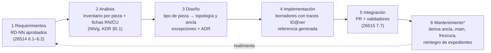
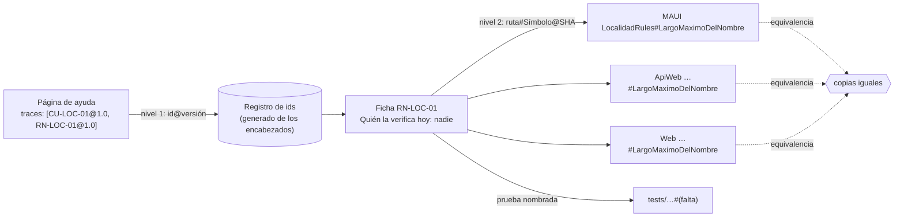

| Campo | Valor |
| --- | --- |
| Tipo | informe |
| Fecha | 2026-10-26 |
| Autor | Comisión `C-ANALISTA`: analista de sistemas, obligatoria por D3. Trabajó a ciegas |
| Corrige | — |
| Mandato | Requerimientos documentales, audiencias y tareas, inventario por pieza y por proyecto, contrato `traces` (CU/RN), modos de intervención humano/automático como flujo con roles (`TP:32`) |
| No-competencia | No elige generador ni workflow. No fija pesos (son de `C-DECISIONES`) |

# Informe de la comisión C-ANALISTA

## Índice

1. [Alias y forma de las citas](#1-alias-y-forma-de-las-citas)
2. [Definiciones](#2-definiciones)
3. [Qué leí y qué no leí](#3-qué-leí-y-qué-no-leí)
4. [Ensayos corridos](#4-ensayos-corridos)
5. [Inventario por pieza de MovilidadUrbana](#5-inventario-por-pieza-de-movilidadurbana)
6. [Dictámenes por pregunta](#6-dictámenes-por-pregunta)
7. [Propuesta de método desde el análisis de sistemas](#7-propuesta-de-método-desde-el-análisis-de-sistemas)
8. [Excepciones a conocimientos](#8-excepciones-a-conocimientos)
9. [No verificado](#9-no-verificado)
10. [Lo que creé y lo que borré](#10-lo-que-creé-y-lo-que-borré)
11. [Pase](#11-pase)

---

## 1. Alias y forma de las citas

Todas las rutas parten de la raíz del workspace (D6).

| Alias | Ruta |
| --- | --- |
| `TP` | `/LAB/Lab-Documentos/Lab-Documentos.Documentacion/PROMPTs/DEVs/Enchacement/01-Replanteo-Y-Analisis/Replanteo-Y-Analisis.md` |
| `B/` | `/LAB/Lab-Documentos/Lab-Documentos.Documentacion/PROMPTs/DEVs/Enchacement/01-Replanteo-Y-Analisis/OUTPUTs/Bitacoras/` |
| `R0n`, `I0n`, `N0n` | `B/<Id>-<Slug>.md` |
| `EXP/` | `/LAB/Lab-Documentos/Lab-Documentos.Documentacion/PROMPTs/DEVs/Enchacement/01-Replanteo-Y-Analisis/OUTPUTs/Expedientes/0002-Replanteo-Metodologia-DocAsCode/` |
| `EV/` | `EXP/evidencia/C-ANALISTA/` |
| `LE` | `/LAB/Lab-E2E.WebBlazor/Lab-E2E.WebBlazor/` (código, `main` en `8fb4c3a`) |
| `LED` | `/LAB/Lab-E2E.WebBlazor/Lab-E2E.WebBlazor.Documentacion/` (`main` en `c63b571`) |
| `GEO` | `/PROG2/Geometria/Lab-Geometria/` (`main` en `4b114d7`, etiqueta más alta `v1.2.0`) |
| `GUIA` | `/LAB/Lab-Documentos/Lab-Documentos/Guides/Documentacion-Tecnica/Sistema-De-Documentacion-E-Integracion/Sistema-Documentador-Tecnico-Guide.md` |
| `IKB` | `KB-privada/Knowledges/` |
| `KDR` | `IKB/Knowledge-Deduccion-De-Reglas-De-Negocio.md` (versión 2.0, `:11`) |

Las rutas `src/…` y `tests/…` sin prefijo son de `LE`. Lo que no es medición ni cita va rotulado **[criterio propio]**.

## 2. Definiciones

| Término | Definición en este informe | Fuente |
| --- | --- | --- |
| Pieza documental | La unidad que se decide por separado: tiene una fuente, una audiencia y un ancla propias. Ejemplos: el manual de la app, la referencia REST, el `AGENTS.md`, un ADR | [criterio propio], sobre `I01:200` («la decisión se toma por pieza») |
| Tipo de pieza | Clase de piezas que comparten la decisión de la matriz D1–D8. Por ejemplo, «ayuda de pantalla» o «referencia generada» | [criterio propio] |
| Requerimiento documental (RD) | Requisito sobre la documentación (audiencia, tarea, pieza, fuente, criterio de aceptación) que se formula **antes** de producirla | `N04` §4, sobre `I04:137` (26512) y 26514 6.1 |
| Fuente de verdad | El lugar donde una pieza se edita. Las demás copias se derivan de ella | `I01:48` |
| Ancla de versión | Lo que fija qué edición de la documentación describe qué versión del código: etiqueta, SHA o versión del documento | `N02` §4 |
| Registro de identificadores | La lista de los NB, CU, RN y ADR que existen en un producto, con su versión y su dueño. Contra ella se valida cada traza | [criterio propio]. La necesidad la mide E-A04 |
| Traza de nivel 1 | `traces` de una página: apunta a **identificadores con versión** (`CU-10005@1.2`, `RN-02003@1.0`) | `GUIA:407`, `GUIA:430` |
| Traza de nivel 2 | El ancla de un identificador en el código: `ruta#Símbolo@SHA`. Vive en la ficha de la regla o del CU, no en la página | [criterio propio], medido en E-A02 |
| Ancla por línea / por símbolo | `ruta:línea` frente a `ruta#Símbolo`. El símbolo se resuelve buscando el identificador con límite de palabra | E-A02 |
| Modo de intervención | Quién actúa en un paso del ciclo: un **agente** de forma automática, o una **persona** que entiende el flujo y decide o aporta | `TP:32` |
| Perfil de sistema | Variante de la metodología según el sistema: corpus de guías, app sin roles, panel con roles, servicio con paquetes | `N04` §7 (pregunta 3) |

## 3. Qué leí y qué no leí

**Leí**: `TP` completo (67 líneas); `EXP/actuaciones/001`–`004` y los informes 0060/0070 (I06, I07) sólo en lo necesario
para el panel y el reparto; `N02`, `N03`, `N04` y `N07` completos; `R05` completo; tramos citados de `R01`, `R04`, `R06`,
`R07`, `I01`–`I04`; `GUIA` (frontmatter y §7.3, §8.2, §8.7); `KDR` §0 y §5.1; y las fuentes de `LE`, `LED` y `GEO` que
cita §4.

**No leí** (comisión a ciegas): ningún informe de otra comisión en `EXP/actuaciones/` fuera de 001–004, 0060 y 0070.

## 4. Ensayos corridos

Los intermedios estuvieron en un directorio de trabajo fuera de los repos (§10). Las salidas, recortadas, están en `EV/`.

### 4.1 E-A01: regla del largo del nombre, lo que se declara frente a lo que se aplica

| Campo | Valor |
| --- | --- |
| Hipótesis | Una regla que se traza a `ruta:constante` puede resolver bien y aun así ser falsa como documentación |
| Método | Copia de 7 archivos de `src/MovilidadUrbana.MAUI/` (`Domain/`, `Application/`) en una consola `net10.0` con un repositorio en memoria. Se agrega EF Core SQLite 10.0.11 con `HasMaxLength(60)`, réplica de `src/MovilidadUrbana.MAUI/Infrastructure/Persistence/AppDbContext.cs:28` |
| Comando | `docker run --rm -v <trabajo>:/w -w /w mcr.microsoft.com/dotnet/sdk:10.0 sh -c 'dotnet run -c Release'` |
| Evidencia | `EV/E-A01-regla-largo-declarado-vs-aplicado.md` |

Resultado (recorte literal):

```text
Requisito mostrado a la persona: «Entre 3 y 60 caracteres, único por provincia.»
largo=  2 -> IsSuccess=False El nombre debe tener al menos 3 caracteres.
largo= 60 -> IsSuccess=True ...
largo= 61 -> IsSuccess=True ...
largo= 80 -> IsSuccess=True ...
SQLite guardó nombre de 80 caracteres con HasMaxLength(60)
```

**Lectura.** La app le muestra a la persona «Entre 3 y 60 caracteres» (`src/MovilidadUrbana.MAUI/Application/Localidades/LocalidadPolicy.cs:15-16`,
expuesto en `Presentation/Localidades/LocalidadEditorViewModel.cs:43`). Pero `LocalidadRules.NombreValido` controla sólo el
mínimo (`Domain/Rules/LocalidadRules.cs:18-19`), el campo MAUI acepta 80 (`Pages/LocalidadEditorPage.xaml:22`,
`MaxLength="80"`) y SQLite no impone el largo. Ninguna prueba verifica el máximo: `grep` de `Largo|60|Maximo` en
`tests/MovilidadUrbana.UnitTests/LocalidadRulesTests.cs`, `tests/MovilidadUrbana.MAUI.Tests/LocalidadEditorViewModelTests.cs`
y `tests/MovilidadUrbana.ApiWeb.Tests/*.cs` da 0. En la web, el máximo sí lo corta el navegador
(`src/MovilidadUrbana.Web/Components/Pages/Localidades.razor:49`). Una página de ayuda derivada de la política sería
**falsa para la app Android**. En la ficha de la regla, el campo «Quién la verifica hoy» (`KDR:402-418`) diría **nadie**.

### 4.2 E-A02: el contrato `traces`, ancla por línea frente a ancla por símbolo

| Campo | Valor |
| --- | --- |
| Hipótesis | Un ancla `ruta:línea` da falsos positivos ante refactores inocuos. Un ancla por símbolo sobrevive a ellos y detecta los cambios reales |
| Método | Manifiesto plano de 15 trazas para dos CU y dos reglas sin identificador. Los identificadores son **provisionales y los asigna el ensayo** (`CU-LOC-01` alta de localidad, `CU-ENC-01` registrar encuesta, `RN-LOC-01` largo del nombre, `RN-LOC-02` unicidad nombre+provincia). Lo corre un validador Python de unas 40 líneas (`python3 -I`), que acepta tres modos: `linea`, `simbolo` y `uso` |
| Variable única por corrida | A: árbol real. B: copia (`git archive 8fb4c3a`) con 2 líneas insertadas arriba de dos archivos. C: además, `MismaLocalidad` renombrado en la copia MAUI. D: el mismo árbol de C con el validador v2 (límite de palabra). E: v2 sobre el árbol real |
| Evidencia | `EV/E-A02-contrato-traces-linea-vs-simbolo.md`, con el manifiesto, las cinco salidas y la fuente del v2 |

| Corrida | Anclas `linea` | Anclas `simbolo` | Ancla `uso` (RN-LOC-01) | Lectura |
| --- | --- | --- | --- | --- |
| A, real | 3/3 OK | 11/11 OK | FALLA: `NombreValido` no usa `LargoMaximoDelNombre` | El validador encuentra por su cuenta el defecto de E-A01 |
| B, +2 líneas | **2/3 FALLA** (`EncuestaService.cs:70`, `LocalidadRules.cs:30`) | 11/11 OK; la línea resuelta pasa de 30 a 32 y de 70 a 72, **con la misma huella** | FALLA (igual) | El ancla por línea da 2 falsos positivos. El símbolo sobrevive |
| C, renombrado, v1 | 2 FALLA | **0 FALLA**: «EsLaMismaLocalidad» contiene «MismaLocalidad» | FALLA | Falso negativo por comparar subcadenas |
| D, renombrado, v2 | 2 FALLA | **1 FALLA**: `LocalidadRules.cs#MismaLocalidad`, sin resolver | FALLA | Con límite de palabra, el renombre se detecta |
| E, real, v2 | — | — | 1 falla, la misma que en A | Sin regresión |

**Lectura [criterio propio].** (1) Para el código, el ancla por símbolo con límite de palabra es estrictamente mejor
que el ancla por línea. (2) La huella del bloque separa el movimiento (misma huella) del cambio de contenido. (3) Ningún
ancla resuelta prueba que la regla se cumpla: lo prueba el modo `uso` o una prueba nombrada en la ficha.

### 4.3 E-A03: mediciones para el inventario

`EV/E-A03-mediciones-inventario-movilidad.md`. Resultados que usa §5:

- `LE` y `LED` no tienen etiquetas (`git tag | wc -l` → 0 y 0).
- La ia-db de `LED` está anclada a `8fb4c3a` (`LED/ia-db/README.md:35`) y `git log 8fb4c3a..HEAD` en `LE` da **0**: hoy no
  hay deriva.
- **Todo `Domain/` y `Application/` es byte a byte igual en las tres apps** una vez normalizado el espacio de nombres.
  Lo cumplen 7 de 7 archivos comparados: `LocalidadRules`, `EncuestaRules`, `Catalogos`, `LocalidadPolicy`, `EncuestaPolicy`,
  `LocalidadService`, `EncuestaService`.
- Sólo `src/MovilidadUrbana.ApiWeb/MovilidadUrbana.ApiWeb.csproj` emite documentación XML. No existe `LE/docs/`.
- Hay 25 pruebas E2E web (5 + 10 + 10).
- Sólo un job usa `runs-on: [self-hosted, i7infra-dev]` (`.github/workflows/e2e.yml:89`). Los otros diez usan `ubuntu-latest`.
- En `LED` no hay ningún archivo con `CU-`/`RN-`.

### 4.4 E-A04: registro de identificadores en Lab-Geometria

`EV/E-A04-registro-ids-geometria.md` (sólo lectura sobre `GEO`):

- Existen 48 CU vigentes (prefijos 00, 06, 08, 10, 12) y 16 RN, todas `RN-020NN`, en la unidad Api.
- La unidad Web cita `RN-10001`…`RN-10016` **380 veces**. No hay documento ni definición para ninguna (`RN-10003 documentos=0`).
  El intake vigente tiene 0 coincidencias de `RN-100`, y `src/` y `tests/` también 0. Los `RN-020NN` sí se citan en 10
  archivos `.cs`.
- Por título, `RN-1000n` corresponde a `RN-0200n`: lo verifiqué en 6 de 16 (p. ej. `RN-10003` «trabajo ajeno
  indistinguible de inexistente» ↔ `RN-02003-Trabajo-Ajeno-Indistinguible-De-Inexistente.md`). **Es la misma regla con
  dos identificadores.** `RN-10003` entra al historial en `841cd5b` («pasada de renumeración de identificadores»).
- `CU-10005` está en versión 1.2 (`:5`) y `CU-00026` en 1.1 (`:6`). La guía usa `CU-00026@1.1` (`GUIA:407`), una traza
  a la unidad Api para una ayuda de pantalla (ya lo señalaba `R06:193`).
- El frontmatter de la propia guía dice `traces: [DOC-ADR, DOC-ADR, DOC-SAD, DOC-SRS, DOC-MANUAL, DOC-SDD]` (`GUIA:11`):
  son **tipos y no instancias**, y uno está repetido. Ningún validador lo detectó.

## 5. Inventario por pieza de MovilidadUrbana

Una fila por pieza, con su fuente de verdad, su ancla y la fila de la matriz D1–D8 (`I01:202-213`) que la justifica.
«Hoy» es lo medido; «Propuesta» es **[criterio propio]**.

| # | Pieza | App | Audiencia | Fuente de verdad (hoy) | Ancla (hoy) | D | Topología propuesta | Ancla propuesta | Evidencia |
| --- | --- | --- | --- | --- | --- | --- | --- | --- | --- |
| P01 | Reglas del dominio y del ABM (RN) | las 3 (copias idénticas) | desarrollador, persona usuaria (indirecta) | `src/MovilidadUrbana.*/Domain/Rules/*.cs`, triplicado | ninguna | D1 | Mismo repo de código. Un **registro de RN** con la MAUI como canónica y una compuerta de equivalencia entre las tres copias | `RN-LOC-nn@ver` → `ruta#Símbolo@SHA` | E-A03; `R05:104` |
| P02 | Requisitos mostrados «antes del intento» | las 3 | persona usuaria | `Application/*/…Policy.cs` | ninguna | D1 | Igual que P01: la política **es** texto de ayuda generado del dominio | igual que P01 | `LocalidadPolicy.cs:5-12` |
| P03 | Mensajes de error | las 3 | persona usuaria | `Application/*/…Service.cs` (`LocalidadService.cs:25`) | ninguna | D1 | Mismo repo. «Si algo sale mal» se **deriva** con traza | símbolo/literal + SHA | `R05:142` |
| P04 | Manual de la app Android (6 páginas) | MAUI | persona usuaria | **no existe** | — | D1 (deriva de P01–P03) / D4 (escalón 1) | Demo en `Examples/` de Lab-Documentos, derivada del código **fijado por SHA** (Q36) | `traces: [CU-LOC-nn@ver, RN-LOC-nn@ver]` + `source.sha` de la demo | `R05:164`; Q36 |
| P05 | Capturas del recorrido | MAUI | persona usuaria | `LE/evidencia/2026-09-12-maui/` (33 capturas) | fecha de la carpeta | D2 (regenerables con Appium y 27 `AutomationId`) | En el código; la demo las referencia por SHA | SHA | `R05:144-146` |
| P06 | Referencia REST (OpenAPI 3.1.1) | ApiWeb | consumidor de la API, agente | runtime `/openapi/v1.json`, alimentado por `///` | ninguna (sólo existe en ejecución) | D2 | Fuente en el código. La demo **captura** el contrato del SHA fijado, sin tocar `LE` | SHA del código | `R05:166-180` |
| P07 | Guía «primer pedido con `X-Sesion-Id`» | ApiWeb | consumidor de la API | no existe; el encabezado falta en el contrato | — | D1 | Demo (escalón 1); la corrección del contrato va a un expediente de `LE` | traza a `LocalidadesController.cs#X-Sesion-Id@SHA` | `R05:177` |
| P08 | Comentarios XML (`///`) | las 3 | desarrollador, generador | el código (40/47, 29/32, 38/43) | SHA | D2 | En el código | SHA | `R05:162` |
| P09 | Arquitectura y decisiones | las 3 | desarrollador | `LE/README.md:169-250` y `LED/ia-db/indexes/08_Decisiones-Y-Trampas.md` | `8fb4c3a` (ia-db) | D1 para ADR / D4 para la explicación didáctica | ADR en el código; la explicación, en la demo | ADR por id; SHA | `R05:223` |
| P10 | README del código (696 líneas) | las 3 | desarrollador, estudiante | `LE/README.md` | SHA | D1 | Mismo repo; los enlaces a las guías por **identificador** (Q07) | — | `R05:156` (3 enlaces vencidos) |
| P11 | CHANGELOG | las 3 | desarrollador | `LE/CHANGELOG.md` por fecha, «[Sin publicar]» | ninguna (sin etiquetas) | D5′ | Mismo repo, con su lugar actual | etiqueta cuando exista | `LED/ia-db/README.md:36` |
| P12 | ia-db (README + 14 índices) | las 3 | agente que trabaja en el repo | `LED/ia-db/` | `8fb4c3a`, verificable; deriva medida 0 | D4 | Repo hermano `.Documentacion` (como hoy) | SHA (ya lo hace) | E-A03 |
| P13 | `llms.txt` / `.md` por página | demo | agente que consulta | no existe | — | — (cara del sitio) | Generado del frontmatter de P04/P06/P07 en el build de la demo | el mismo de la demo | `I03` R5–R6 |
| P14 | `AGENTS.md` | `LE` | agente que cambia código | no existe (dato de `R05` para la app; para `LE` raíz, [no verificado]) | — | D1 | Mismo repo de código, escrito por personas | SHA | `I03` R10–R12 |
| P15 | Pruebas como especificación ejecutable | MAUI y Web | desarrollador, verificador | `tests/…` (18 + 5 MAUI; 25 E2E web) | SHA | D2 | En el código; la ficha RN/CU nombra la prueba | `ruta#NombreDePrueba@SHA` | E-A02 (`GuardarNuevaAvisaYVuelve`, `RecorreYRegistra`, `MismaLocalidadCompara`) |
| P16 | Guías de estudio (27) | las 3 | estudiante | `/LAB/Lab-Documentos/Lab-Documentos/Guides/Testing/Lab-E2E.WebBlazor-Guides/` | ninguna (unos 50 enlaces que no resuelven) | D4 | Repo dedicado (como hoy). Citan por id + SHA | `doc_id@version` | `R05:160` |
| P17 | Requerimiento de origen | las 3 | analista | `LED/PROMPTs/Features/03-Crear-MAUI-Applications/Crear-MAUI-Applications.md:25` | ninguna | D4 | Repo de documentación (como hoy); fuente de los CU provisionales | ruta del prompt + SHA de `LED` | `R05:73` |

**Cuenta.** 17 piezas: 9 caen en D1 o D2 (código), 3 en D4 (dedicado), 3 son de la demo y 2 son mixtas. **Ninguna
topología única cubre las 17**. Con esto queda medido, para un sistema real del workspace, el hallazgo `I01:200`.

## 6. Dictámenes por pregunta

Cada dictamen sigue la misma forma: respuesta (sin «depende»), alternativas, fundamento con evidencia, ventajas
(simplicidad, practicidad, escalabilidad) y riesgos. Los pesos entre criterios son de `C-DECISIONES`, y aquí no se
fijan.

### Q03: ¿decisión de topología por pieza documental (D1–D8)?

- **Respuesta.** **Sí, por pieza, pero se aplica por tipo de pieza.** La metodología trae un catálogo de unos 12 tipos
  de pieza, con su fila D ya resuelta (la columna «D» de §5 y la tabla de Q29). Un proyecto hereda esa decisión y sólo
  registra **excepciones** por pieza.
- **Alternativas.** (a) Topología única por proyecto: la descarto. (b) Matriz D1–D8 recorrida pieza por pieza en cada
  proyecto: la descarto por costo.
- **Fundamento.** En §5, 17 piezas de un solo sistema caen en tres topologías. X13 y `R04:148-151` muestran que el
  repositorio único no evitó la deriva en el SDD-B, y `R05:270` que el repositorio separado rompió unos 50 enlaces.
  Ninguna referencia de industria elige una sola topología (`I01:200`).
- **Ventajas.** Simplicidad: un catálogo que se aprende una vez. Practicidad: un proyecto nuevo decide sólo sus
  excepciones. Escalabilidad: un tipo nuevo se agrega como una fila.
- **Riesgos.** Que el catálogo se vuelva ceremonia (`N04` V4). Lo mitiga que el registro sea sólo de excepciones.

### Q04: ancla de versión por par código ↔ `.Documentacion`

- **Respuesta.** **El SHA del commit del código es obligatorio**, declarado en el manifiesto del repo de documentación
  (como hace `LED/ia-db/README.md:35`). Se suma **la etiqueta** cuando el repo de código la tiene (Geometria: `v1.2.0`).
  La deriva se mide con `git rev-list --count <ancla>..origin/main`: **avisa y no bloquea** en el repo de documentación,
  y sí bloquea en el repo de código cuando la pieza es D1.
- **Alternativas.** (a) Sólo etiqueta: inaplicable, porque `LE`, `LED` y los dos de Lab-Documentos tienen 0 etiquetas
  (E-A03, §4.3). (b) Ninguna ancla, con la doc que «follows» el software (`I02:123-125`): la descarto, porque sin ancla
  la deriva no se puede medir, que es el problema de `TP:20`.
- **Fundamento.** Con el ancla SHA, la deriva fue medible en los dos casos: 0 commits en `LE` (E-A03) y unos 47 PR de
  atraso en Geometria (`R06:125-127`). Sin ancla no hay número. `R04:320` (lección 3) llega a lo mismo en el SDD-B.
- **Ventajas.** Simplicidad: un campo y un comando. Practicidad: no exige etiquetar repos que no etiquetan.
  Escalabilidad: vale igual para N pares.
- **Riesgos.** Un SHA de una rama que se reescribe deja de existir. Por eso se ancla sólo a commits de `main`.

### Q07: cómo citar entre repositorios sin que una reorganización rompa referencias

- **Respuesta.** **Se cita por identificador estable**: `doc_id`, `CU-`/`RN-`/`ADR-`/`EXP-`. Si la cita va al código,
  se usa `ruta#Símbolo@SHA`. La ruta se escribe como ayuda secundaria, nunca como única referencia. Cada producto lleva
  un **registro de identificadores con alias** (`reemplaza:` / `alias:`), y un validador comprueba que todo id citado
  exista en él.
- **Alternativas.** (a) Rutas relativas, como hoy: la descarto. (b) URL publicadas: no existen para la mayoría de las
  piezas. (c) Identificador sin registro: la descarto por E-A04.
- **Fundamento.** Hay rutas rotas medidas: 32 archivos en el SDD-B (`R04:288`) y unos 50 enlaces en Lab-E2E (`R05:160`).
  E-A04 muestra que sin registro el identificador también se rompe: hay 380 citas a `RN-100NN`, que no existen, mientras
  la misma regla vive como `RN-020NN`. Geometria ya practica el alias con el campo «Consolida a» (`GEO/SDD/Docs/Unidades-Entrega/GeometriaFactory-Api/02-Especificacion-Funcional/Casos-De-Uso/CU-00026-Enviar-Un-Trabajo-Y-Ver-Sus-Observaciones.md:12`).
  E-A02 muestra que el ancla por símbolo sobrevive a cambios de línea.
- **Ventajas.** Simplicidad: un solo formato de cita. Practicidad: el validador es un `grep` contra el registro.
  Escalabilidad: mover carpetas no rompe nada.
- **Riesgos.** El registro es una pieza más que mantener. Mitigación [criterio propio]: generarlo de los
  encabezados de los propios CU y RN, no escribirlo a mano.

### Q09: ¿Lab-Documentos y su `.Documentacion` adoptan etiquetas y changelog por versión?

- **Respuesta.** **No adoptan etiquetas de repositorio: se declaran repos de ritmo propio (D4).** Pero **cada
  documento lleva su `version` SemVer en el frontmatter**, y el changelog por fecha nombra esa versión. Las demos, la
  piloto y otras guías citan `doc_id@version`, y agregan el SHA cuando necesitan exactitud.
- **Alternativas.** (a) Etiquetas del corpus por publicación: la descarto. (b) Changelog sólo por fecha, sin versión
  por documento, como hoy: la descarto, porque no deja anclar una guía citada.
- **Fundamento.** `/LAB/Lab-Documentos/Lab-Documentos.Documentacion/CHANGELOG.md:6-9` ya justifica la fecha: «un cuerpo
  documental que se lee entero, no un artefacto que alguien instala». Hoy hay una incoherencia medida: el changelog de
  Lab-Documentos anuncia la guía como «v1.0.0» (`/LAB/Lab-Documentos/Lab-Documentos/CHANGELOG.md:13`), pero el
  frontmatter de la guía no tiene campo de versión (`GUIA:1-11`).
- **Ventajas.** Simplicidad: no hay proceso de release para un corpus. Practicidad: se usa el changelog que ya existe.
  Escalabilidad: la versión es por documento, no por repo.
- **Riesgos.** La versión por documento depende de que el autor la suba. Mitigación: una compuerta que exija subirla
  cuando cambia el cuerpo (eso lo decide N05).

### Q10: canales de lectura para agentes, obligatorios y opcionales

- **Respuesta (requisitos por audiencia y tarea).**

| Canal | Lector y tarea | Carácter | Madurez (`I03:45-51`) |
| --- | --- | --- | --- |
| Fuente Markdown con frontmatter validado | todos | **obligatorio** | A |
| `AGENTS.md` como puntero, escrito por personas | agente que **cambia código** en el repo | **obligatorio** en todo repo de código | A |
| ia-db (índice interno con `ruta:línea` y commit base) | agente que trabaja **sobre el repo** | **obligatorio** en todo repo `.Documentacion` | práctica del workspace |
| `.md` por página | agente que **consulta** un sitio publicado | obligatorio **si hay sitio** | V/P |
| `llms.txt` generado | agente que consulta un sitio publicado | opcional; se genera, no se escribe a mano | P |
| MCP de documentación | agente con consumidor real | opcional; no entra en E1 | E (protocolo) / V (servidores) |

- **Alternativas.** (a) Todos obligatorios: la descarto por costo. (b) Sólo `llms.txt`: la descarto, porque es una
  propuesta (`I03:128-138`) y no sirve al agente que cambia código.
- **Fundamento.** `I03` R1, R5, R6, R8 y R10 (`I03:248-291`). Cada canal se asigna a una tarea distinta del agente
  (`I01:193-194`).
- **Ventajas.** Simplicidad: lo obligatorio son tres canales, todos Markdown. Practicidad: dos de ellos ya existen en
  el workspace. Escalabilidad: lo opcional se suma sólo cuando aparece un consumidor real.
- **Riesgos.** `AGENTS.md` como resumen largo sube el costo sin elevar el éxito (`I03:115-120`). Por eso se exige que
  sea un puntero.

### Q11: relación entre la ia-db y `llms.txt`

- **Respuesta.** **Ninguno reemplaza al otro.** La ia-db es el **índice interno**: se escribe con agente y revisión,
  cita `ruta:línea` y declara su SHA base, para quien trabaja en el repo. `llms.txt` es el **índice público del sitio**:
  se genera del mismo frontmatter, sin redacción propia, para quien consulta lo publicado. `llms.txt` no enlaza a la
  ia-db si el sitio es externo.
- **Alternativas.** (a) `llms.txt` reemplaza a la ia-db: pierde las citas `ruta:línea` y el SHA. (b) La ia-db publicada
  como `llms.txt`: expone el taller (prompts, rutas) y viola R9 (`I03`).
- **Fundamento.** `R05:194` («ya cumple el papel de `llms.txt` ampliado»); `LED/ia-db/README.md:35,82`; `I03` R6, R9.
- **Ventajas.** Simplicidad: un índice escrito y otro generado, no dos escritos. Practicidad: la ia-db ya existe.
  Escalabilidad: `llms.txt` sale gratis en cada build.
- **Riesgos.** Que diverjan en lo que afirman. No pasa si `llms.txt` es 100 % generado.

### Q12: intervenciones automáticas permitidas y las que exigen una persona

- **Respuesta.** Se fija por fase (el flujo está en §7.2):

| Fase | Automático, el agente puede | Siempre una persona (actor de `GUIA:635-643`) |
| --- | --- | --- |
| 1 Requerimientos | relevar audiencias candidatas, contar piezas, proponer RD | **aprobar** la lista de RD y de audiencias (ACT-01) |
| 2 Análisis | inventario, auditoría (conservar/actualizar/quitar), fichas RN con rótulo de certeza | decidir **divergencias letra/intención**: «nunca se decide acá: se eleva» (`KDR:38`) |
| 3 Diseño | proponer el tipo de pieza y su topología según el catálogo | **decidir excepciones**, ADR y clasificación de confidencialidad |
| 4 Implementación | redactar o derivar borradores con `origin: agent`, regenerar la referencia (OpenAPI, XML), traducir como borrador | — (todo pasa por PR) |
| 5 Integración | correr los validadores, regenerar `llms.txt` e ia-db, **abrir** el PR | **aprobar el PR**; quien lo aprueba no es quien lo pidió (`I03:196`) |
| 6 Mantenimiento | detectar deriva (SHA, versión de `traces`), proponer el PR de corrección | aceptar el retiro o el deprecado (ACT-01) |

- **Alternativas.** (a) Un agente que publica directo a `main`: la descarto, porque ningún producto lo recomienda
  (`I03:181`). (b) Ninguna automatización: contradice `TP:32`.
- **Fundamento.** Patrón «agente propone, PR dispone» (`I03:181-184`), controles de Copilot (`I03:192-199`), `I03`
  R13–R17. E-A01 muestra que la intención de una regla (¿60 u 80?) no la puede decidir el agente.
- **Ventajas.** Simplicidad: una sola regla, «decide o aprueba una persona; el resto, el agente». Practicidad: se apoya
  en los PR que ya existen. Escalabilidad: más agentes no cambian los puntos de decisión.
- **Riesgos.** Aprobación por silencio con un equipo de una persona (Q13, que no es mía). Lo señalo como dependencia.

### Q14: frontmatter y prefijos de ID

- **Respuesta.**
  - **Frontmatter**: los 10 campos de VER-A01 (`R07:247`), más `version` (SemVer del documento, Q09). `traces` lleva
    **instancias con versión** (`ID@versión`), nunca tipos. `audience` usa un vocabulario cerrado: `persona-usuaria`,
    `desarrollador`, `consumidor-api`, `agente`, `estudiante`, `docente`, `mesa`. Se valida con JSON Schema en CI.
  - **Prefijos** en dos familias:
    - Ids **de producto**, que asigna el SDD de cada producto: `NB-`, `CU-`, `RN-`, `ADR-`, `TC-`. Cada id tiene **un
      solo dueño**, la unidad que define la regla, y las demás unidades citan ese id sin renumerarlo.
    - Ids **documentales**: `DOC-<ÁREA>-NNNN` para el corpus (como `DOC-SDT-0001`, `GUIA:2`), `EXP-NNNN` para
      expedientes y `RD-NN` para requerimientos documentales (Q18).
- **Alternativas.** (a) Dejar el hueco del Profile (`R07:366`): la descarto, porque sin contrato el agente no valida.
  (b) Un id único global para todo: la descarto, porque choca con la numeración por unidad que ya usan los SDD.
- **Fundamento.** Las dos fallas medidas en E-A04 las hubiera atrapado este contrato: `GUIA:11` (tipos repetidos en
  `traces`) y las 380 citas a ids sin dueño. `I03` R3; VER-A02 («las trazas apuntan al ID, no a la ruta»).
- **Ventajas.** Simplicidad: once campos. Practicidad: lo valida un esquema. Escalabilidad: los prefijos de producto no
  chocan entre productos, porque se califican con el producto.
- **Riesgos.** Migrar el frontmatter de lo existente. Lo hace un PR mecánico en la unidad de deuda (Q40).

### Q15: ¿basta la guía para que una persona entienda el flujo, o hace falta un documento de proceso?

- **Respuesta.** **No basta la guía.** Cada proyecto que aplique la metodología lleva **un documento de proceso** de una
  página, instanciado de una plantilla. Tiene las seis fases con bloques `entradas` / `salidas` / `validaciones` y el
  actor de cada paso (VER-A05, `R07:251`). La guía **enseña** el método; el documento de proceso **opera** el proyecto.
- **Alternativas.** (a) Sólo la guía: la descarto, porque la guía se dirige al estudiante y es genérica. (b) Proceso
  sólo en los prompts de los orquestadores: la descarto, porque la persona no los lee.
- **Fundamento.** `TP:32` pide que las personas «entiendan el flujo de trabajo para poder intervenir». La guía misma
  dice que su tabla de actores es «criterio de este apunte… y no una matriz que la guía declare» (`GUIA:645`). Falta,
  entonces, un artefacto normativo por proyecto.
- **Ventajas.** Simplicidad: una página. Practicidad: la misma plantilla sirve a personas y a agentes (bloques
  E/S/V). Escalabilidad: una por proyecto, a partir de una sola plantilla.
- **Riesgos.** Que la página se desactualice respecto de la plantilla. Lo cubre la versión de la plantilla en `traces`.

### Q17: ¿26514/26515 en versión liviana + Diátaxis, arc42, C4, MADR?

- **Respuesta.** **Sí.** El esqueleto de fases es el de 26514:2022 (6.1 requisitos, 6.2 audiencia y tareas, 6.11
  mantenimiento, 6.12 control de versiones) y 26515:2018 7.7 para la entrega continua. Se llena con Diátaxis (producto),
  arc42 + C4 (arquitectura), MADR (decisiones) e inventario/HTA de NN/g (análisis). Se cita **por título de cláusula**,
  nunca por contenido, mientras no se lea el cuerpo normativo.
- **Alternativas.** (a) Sólo marcos abiertos: pierde el respaldo normativo que pide `TP:36`. (b) DITA o el proceso
  completo de 26512: los descarto por costo (`I04:363-365`).
- **Fundamento.** `I04:348` (principio rector), `I04:352-359` (receta por fase), `N04-H01`, `N04-H02`. Límite: sólo se
  leyeron índices (`I04:426`).
- **Ventajas.** Simplicidad: todo es Markdown. Practicidad: la receta ya existe. Escalabilidad: los marcos son
  estándares de facto.
- **Riesgos.** Atribuirle a la norma lo que no dice. Por eso se cita sólo el título de la cláusula (Q46 es de otra
  comisión).

### Q18: artefacto que registra los requerimientos documentales

- **Respuesta.** **Un solo esquema de tabla, `RD-NN`, en dos lugares según el perfil.** En los proyectos con SDD
  (Geometria, SDD-B) va como documento de la unidad de entrega: `02-Especificacion-Funcional/Requerimientos-Documentales.md`.
  En los proyectos sin SDD (la demo MovilidadUrbana, el corpus de guías) va en `docs/_requisitos.md`. Las columnas son
  `RD-NN | audiencia | tarea | pieza (tipo) | fuente (ID@ver) | canal | criterio de aceptación verificable | dueño`.
- **Alternativas.** (a) Sólo los NB/CU del SDD: no sirve donde no hay SDD (MovilidadUrbana, `R05:73`). (b) Una sección
  suelta en el README: no es validable.
- **Fundamento.** `I04:354` propone las dos ubicaciones, y 26514 6.1 y 26512 piden especificar antes de producir
  (`I04:137`). Ejemplo derivado de E-A01:
  `RD-03 | persona-usuaria | cargar una localidad | ayuda de pantalla | RN-LOC-01@1.0, CU-LOC-01@1.0 | app | la página dice el mismo límite que aplica la app (prueba nombrada) | ACT-02`.
- **Ventajas.** Simplicidad: un esquema. Practicidad: es una tabla Markdown. Escalabilidad: el mismo validador sirve
  para los dos lugares.
- **Riesgos.** Que se llene después de escribir, como trámite. La compuerta exige que todo documento de usuario trace
  a un `RD-`.

### Q19: ¿una metodología para los cuatro tipos de sistema, o tronco con variantes?

- **Respuesta.** **Un tronco común con cuatro variantes declaradas.** El tronco es igual para todos: las seis fases,
  los artefactos (RD, inventario, catálogo de tipos de pieza, documento de proceso), el frontmatter y el contrato
  `traces`. Las variantes cambian sólo cinco parámetros:

| Parámetro | Corpus de guías | App sin roles (MovilidadUrbana) | Panel con roles (Geometria) | Servicio con paquetes (SDD-B) |
| --- | --- | --- | --- | --- |
| Audiencias | estudiante, docente, agente | persona usuaria, desarrollador, consumidor de la API, agente | más papeles (`Role`, `gf:role`, `R06:185-187`) | integrador, operador, agente |
| Confidencialidad | no aplica | visibilidad (la ayuda viaja en el paquete, `R02:346`) | en el build y en el servidor | en el build, más los secretos |
| Fuente generada | — | OpenAPI, `///` | OpenAPI, `///` | API pública de los paquetes |
| Ancla | `doc_id@version` | SHA | etiqueta + SHA | etiqueta por línea de versión |
| Registro de ids | `DOC-` | CU/RN provisionales de la demo | el SDD (CU/RN por unidad) | el SDD |

- **Alternativas.** (a) Una metodología idéntica para todos: obliga a inventar roles donde no hay (`R05:120`). (b) Una
  metodología por tipo: cuatro métodos que mantener, que es lo que hoy produce X4.
- **Fundamento.** `TP:20` pide una «metodología común». `TP:30` pide aplicarla «al diseño de nuevos sistemas».
- **Ventajas.** Simplicidad: se aprende un tronco. Practicidad: la variante es una fila de parámetros. Escalabilidad:
  un perfil nuevo es una columna.
- **Riesgos.** Que aparezca un quinto perfil. Se agrega como columna.

### Q20: el expediente como unidad de cambio documental y su reintegro a la norma

- **Respuesta.** **El expediente no es la unidad de todo cambio documental: el PR lo es.** El expediente se abre sólo
  cuando el cambio (a) cruza piezas de más de un repo, (b) altera la norma o un conocimiento, o (c) pide decidir entre
  alternativas. Reintegra con una regla: **el cierre produce un `diff normativo` que se aplica por PR al documento
  normativo**, y ese PR cita `EXP-NNNN` en `traces` y en su changelog. Un expediente cerrado sin ese PR queda
  «cerrado sin reintegrar», y eso se lista.
- **Alternativas.** (a) Un expediente por cada cambio documental: ceremonia. (b) Sin reintegro explícito: es lo que pasó
  en el SDD-B, con una cuarta vía escrita y no ejercida (`R04:322-323`: «5 cartas, 0 nuevas»).
- **Fundamento.** `R04:322-323`; `N04-H12`; esta corrida (expediente 0002, que cruza cuatro repositorios).
- **Ventajas.** Simplicidad: la mayoría de los cambios son sólo un PR. Practicidad: el reintegro es un PR más.
  Escalabilidad: «cerrado sin reintegrar» se puede contar.
- **Riesgos.** Decidir mal si algo «cruza» o no. El criterio son las tres condiciones de arriba, no el juicio.

### Q21: ¿se agrega la fase de mantenimiento como cambio de alcance declarado?

- **Respuesta.** **Sí. Se agrega como sexta fase y va al lote del PO como fila de alcance.** Si el PO no responde, la
  metodología se publica con las cinco fases literales de `TP:26`, y el mantenimiento queda como **anexo propuesto**,
  no como fase. Así no se asienta por silencio (`R01:460`).
- **Alternativas.** (a) No agregarla: deja sin dueño la deriva, el re-indexado y el reintegro (Q20). (b) Agregarla sin
  declararla: viola `R01:460`.
- **Fundamento.** Las normas la tratan como parte del ciclo (26514 6.11, `I04:76-94`). En el workspace, el paso que se
  atrasa es justamente commit + re-indexado (`R03:220-222`). La ia-db de Geometria quedó unos 47 PR atrás (`R06:125-127`).
- **Ventajas.** Simplicidad: una fase más con una salida (deriva medida). Practicidad: Q04 da la medición.
  Escalabilidad: es la fase que crece con la cantidad de repositorios.
- **Riesgos.** Ninguno de alcance si el lote la declara.

### Q29: arquitectura del sistema documentador entero (aporte del analista)

- **Respuesta.** Aporto la **tabla de tipos de pieza**, que es la columna vertebral de la arquitectura. El generador y
  el workflow no son de mi competencia, así que la columna «compuerta» dice **qué** se verifica, no con qué herramienta.

| Tipo de pieza | Topología | Fuente de verdad | Ancla | Compuerta (qué verifica) | Audiencia | Canal | Tema de la guía |
| --- | --- | --- | --- | --- | --- | --- | --- |
| Requerimientos documentales `RD-` | con la especificación | SDD o `docs/_requisitos.md` | versión del documento | todo documento de usuario traza a un `RD-` | analista, mesa | repo | Requerimientos |
| Especificación (NB/CU/RN) | mismo repo del código (D1) | el SDD | versión del CU/RN + SHA | id existe en el registro; versión en `traces` ≥ la leída | analista, agente | repo, ia-db | Fuentes de verdad |
| Ayuda de pantalla / manual | mismo repo (D1); en E1, la demo | derivada de CU/RN | `ID@ver` + SHA | `traces` resuelve; frescura; prueba nombrada en la ficha | persona usuaria | app, sitio, `.md` | Derivación con traza |
| Referencia de API | fuente en el código (D2) | `///` + OpenAPI | SHA o etiqueta | el contrato existe en el build; lint | consumidor de la API, agente | sitio, `.md` | Fuente generada |
| ADR | mismo repo (D1) | `docs/decisions/` | id + estado | estado válido; *superseded* enlazado | desarrollador | repo | Decisiones |
| `AGENTS.md` | mismo repo (D1) | escrito por personas | SHA | lo cambia una persona (CODEOWNERS) | agente que cambia código | repo | Doble audiencia |
| ia-db | repo `.Documentacion` (D4) | agente + revisión | SHA base | deriva `ancla..main` (aviso) | agente que trabaja en el repo | repo | Índices para agentes |
| `llms.txt` / `.md` por página | con el sitio | generado del frontmatter | el del build | se generó; nada confidencial | agente que consulta | sitio | Doble audiencia |
| Guía de estudio | repo dedicado (D4) | Lab-Documentos | `doc_id@version` | frontmatter; enlaces por id | estudiante | repo, sitio | Material formativo |
| Documento de proceso | por proyecto | plantilla de la metodología | versión de la plantilla | bloques E/S/V presentes | persona del equipo, agente orquestador | repo | Ciclo y roles |
| Expediente | repo de la norma afectada | actuaciones | `EXP-NNNN` | cerrado ⇒ PR de reintegro citado | mesa, PO | repo | Gobierno |
| CHANGELOG | mismo repo | el repo | fecha o etiqueta | entrada en el PR | desarrollador | repo | Versionado |

- **Alternativas.** Una arquitectura por proyecto: la descarto por Q03 y Q19.
- **Fundamento.** §5 (17 piezas reales), E-A02 y E-A04 (contrato de trazas), `I01:202-213`, `I03` R1–R20.
- **Ventajas.** Simplicidad: 12 filas. Practicidad: cada fila ya tiene ejemplo real en §5. Escalabilidad: un tipo nuevo
  es una fila.
- **Riesgos.** Que la tabla se tome como la arquitectura completa. Falta la topología de publicación y CI, que es de
  `C-ARQ-NET` y `C-DEVOPS`.

### Q34: ¿qué parte de la norma del SDD-B entra al marco común?

- **Respuesta.** Entran tres cosas, **por referencia y no por copia**:
  1. **La prioridad de fuentes**, generalizada a cuatro niveles: pedido del PO > especificación del producto > conocimiento
     catalogado > criterio general. Los niveles propios del SDD-B (`Context/`, DevProject) quedan como variante.
  2. **La reincorporación por expediente**, como el mecanismo de reintegro de Q20.
  3. **La delegación del merge**, que ya está catalogada en `IKB/Knowledge-Conformacion-Pull-Request-Automatico.md`: se
     referencia, no se trae.

  **No entran** la numeración `AG-FF_NN` ni el traspaso de 8 turnos, que son operativos del SDD-B.
- **Alternativas.** (a) Traer la norma entera: arrastra la dependencia no vendorizada (`R04` hallazgo 5.4). (b) No
  traer nada: pierde las dos piezas vivas del SDD-B.
- **Fundamento.** `R04:180-188` (tabla de ejes); `R04` hallazgo 5.3: los agentes no se usan en la práctica cotidiana, lo
  vivo es la mesa dentro de los expedientes; `R04:324` (lección 5: una sola fuente referenciada con versión).
- **Ventajas.** Simplicidad: tres piezas. Practicidad: una ya está en IKB. Escalabilidad: por referencia no hay X4.
- **Riesgos.** La generalización de la prioridad de fuentes la tiene que validar `C-SDD-CONOCIMIENTO` (ciclo 3).

### Q36: ¿dónde vive la mini demo?

- **Respuesta.** **Vive en `Examples/` de Lab-Documentos**, como hermana de `Prueba-Ayuda-Por-Rol/`, con **el código de
  MovilidadUrbana fijado por SHA** en un archivo `source.lock` (`8fb4c3a`). En CI se valida contra ese SHA, y eso
  **bloquea**. Se valida además contra `main` de `LE`, y eso sólo **avisa**. Lo que por D1 tiene que cambiar en el código
  (declarar `X-Sesion-Id` en el contrato, aplicar el máximo de 60, ver E-A01) **no lo hace la demo**: va como
  propuesta a un expediente de `LE`.
- **Alternativas.**
  - (a) Junto al código (`LE/docs/`): modifica un repo cuya ia-db prohíbe cambios sin expediente (`LED/ia-db/README.md:85`;
    `R05:238-241`) y no demuestra la coordinación entre repositorios.
  - (b) En `Examples/` sin fijar el código: repite el desfase (`R05:233`).
- **Fundamento.** E-A02 muestra que el validador corre sobre un `git archive <SHA>` de otro repo, sin tocarlo. La demo
  muestra así justo el problema de `TP:20` (desfase entre repositorios) **y** su mecanismo (ancla SHA + aviso de
  deriva). `TP:30` dice «basado en», no «dentro de».
- **Ventajas.** Simplicidad: no abre un expediente en otro repo para el escalón 1. Practicidad: sigue el patrón del
  ejemplo existente. Escalabilidad: el mismo `source.lock` sirve para la piloto.
- **Riesgos.** La demo se vuelve «doc separada», que es lo que se critica. Se acepta a propósito: el aviso contra `main`
  la vuelve una medición. Si `C-ARQ-NET` elige otra cosa, esta comisión lo resolvería con un `source.lock` en cualquier
  ubicación.

### Q37: ¿qué demuestra cada escalón que el anterior no demostró?

- **Respuesta.** Adopto la propuesta de `N07:139` y le agrego un **criterio de éxito medible por escalón**:

| Escalón | Demuestra lo nuevo | Criterio de éxito (medible) |
| --- | --- | --- |
| E0, prueba de concepto | roles y confidencialidad en servidor | ya demostrado (`R02:120-144`) |
| E1, mini demo | (1) cuatro audiencias **sin roles**; (2) **fuente generada** (OpenAPI capturado del SHA); (3) **ancla SHA entre repositorios**; (4) contrato `traces` de dos niveles; (5) runner de `TP:34` | Las 17 piezas de §5 con su fila completa. El validador **en rojo** con un defecto plantado y con el real `RN-LOC-01` (E-A01). En verde al corregir la traza. Aviso de deriva contra `main`. Corre en `[self-hosted, i7infra-dev]` |
| E2, piloto Geometria | (1) **registro de ids real** con dueño por unidad; (2) roles; (3) ancla por **etiqueta** (`v1.2.0`); (4) el validador **en el CI del repo de código** | El validador detecta las 380 citas `RN-100NN` (E-A04) antes de corregirlas. La ayuda de pantalla traza a `CU-100NN`. Vía normativa declarada antes de construir (`N07` V4) |
| E3, SDD-B | (1) **varias líneas de versión** independientes; (2) norma en el repo de código y doc sin versión propia; (3) **orquestador** que ejecuta el ciclo | Un cambio de código que rompe una traza se detecta en el mismo PR. El conocimiento de E2 se aplica sin leer la piloto (`N07` V5) |

- **Alternativas.** Escalones sin criterio: el dictamen saldría «depende» (Q41).
- **Fundamento.** `N07:139`. E-A01, E-A02 y E-A04 dan los defectos reales de E1 y E2.
- **Ventajas.** Simplicidad: cada escalón prueba como máximo cinco cosas. Practicidad: cada criterio es una salida de CI.
  Escalabilidad: E3 reutiliza el validador de E1.
- **Riesgos.** Los criterios de E3 son los menos medidos, porque no leí el SDD-B más allá de `R04`.

### Q38: contrato `traces`

- **Respuesta.** **El contrato tiene dos niveles.**
  1. **Página → `ID@versión`.** Una ayuda de pantalla traza al **CU de la unidad que tiene la pantalla** (en Geometria,
     `CU-100NN`). Una regla se traza **con el id de su unidad dueña** (en Geometria, `RN-020NN` de la Api). Nunca con un
     alias sin documento.
  2. **ID → código.** La ficha del CU o de la RN lleva sus anclas `ruta#Símbolo@SHA`: dónde se declara, dónde se
     verifica (la prueba nombrada) y dónde se aplica.

  El validador comprueba que el id exista en el registro, que la versión en `traces` sea ≥ la vigente, que cada ancla
  de símbolo resuelva **con límite de palabra** y que la huella no haya cambiado sin que subiera la versión.
- **Alternativas.**
  - (a) `CU-000NN` (Api) para las pantallas, como hace la guía: la descarto, porque traza a la unidad equivocada
    (`R06:193`).
  - (b) Página → `ruta:línea` directo: la descarto, porque dio 2 falsos positivos en E-A02.
  - (c) Página → id sin registro: la descarto, porque produce las 380 citas colgadas de E-A04.
- **Fundamento.** E-A02 (corridas B y D), E-A04, `GUIA:407` y `GUIA:430` (versión en la traza), VER-A02 (`R07:248`).
- **Ventajas.** Simplicidad: la página sólo conoce ids. Practicidad: el ancla de código se mantiene en un solo lugar,
  la ficha. Escalabilidad: un refactor toca fichas, no páginas.
- **Riesgos.** El validador de símbolos es heurístico (texto, no compilador). Si un símbolo aparece dos veces, el v2
  exige una sola coincidencia y falla. Es aceptable y avisa.

### Q39: reglas sin identificador en MovilidadUrbana

- **Respuesta.** **Se asigna un identificador.** Se descarta trazar a `ruta:constante`. Cada regla recibe una ficha con
  la forma de `KDR` §5.1 (`KDR:397-418`), con el id `RN-LOC-nn` / `RN-ENC-nn`. El campo «Ancla» de la ficha se llena con
  `ruta#Símbolo@SHA` **por cada una de las tres apps**, y una compuerta de equivalencia compara las tres copias (hoy son
  idénticas, E-A03). Para la demo la canónica es la MAUI, porque `TP:30` la nombra.
- **Alternativas.** (a) Trazar a `ruta:constante`, como proponía `R05:190`: en E-A02 el ancla a `LargoMaximoDelNombre`
  **resolvió OK** (corrida A) mientras la regla no se cumple (E-A01). El ancla sola da una falsa seguridad. (b) Redactar
  CU completos para todo: fuera de proporción para una mini demo.
- **Fundamento.** E-A01: sólo la ficha, con su campo «Quién la verifica hoy: **nadie**», hace visible que el máximo de
  60 no se aplica. E-A02: los ids provisionales se trazaron hasta `ruta:línea` en 15 de 15 anclas. `KDR:402` pide un
  «identificador estable, nunca reusado».
- **Ventajas.** Simplicidad: unas 12 fichas, contando las constantes de `LocalidadRules` y `EncuestaRules`. Practicidad:
  la ficha ya tiene plantilla catalogada. Escalabilidad: es el mismo contrato de Q38 que usará la piloto.
- **Riesgos.** Los ids los asigna la demo, no un SDD. Se declaran **provisionales** y la demo no modifica `LE`
  (`R05:241`).

## 7. Propuesta de método desde el análisis de sistemas

### 7.1 El ciclo, con artefactos y actores



\* La fase 6 queda condicionada a Q21.

### 7.2 Modos de intervención como flujo con roles (TP:32)

```mermaid
sequenceDiagram
  autonumber
  participant PO as ACT-01 PO (persona)
  participant AN as ACT-02 Analista (persona)
  participant AG as ACT-10 Agente redactor
  participant VE as Verificador (agente o mesa)
  participant CI as CI (validadores)
  participant RV as Revisor ≠ solicitante (persona)
  AG->>AN: propone RD, inventario y fichas RN/CU (rótulo de certeza)
  AN->>PO: eleva divergencias letra/intención (p. ej. ¿60 u 80?)
  PO-->>AN: decide (o queda en el lote)
  AN->>AG: RD aprobados + fichas cerradas
  AG->>VE: borrador con origin: agent y traces ID@ver
  VE->>AG: contrasta contra la fuente; observa
  AG->>CI: abre el PR
  CI-->>AG: rojo (id inexistente, ancla sin resolver, versión vieja) / verde
  CI->>RV: verde
  RV-->>CI: aprueba o pide cambios
  Note over CI,RV: nada llega a main sin PR aprobado por una persona
```

### 7.3 El contrato de trazas de dos niveles



### 7.4 Plantilla de requerimiento documental (ejemplo completo)

| RD | Audiencia | Tarea | Pieza (tipo) | Fuente | Canal | Criterio de aceptación | Dueño |
| --- | --- | --- | --- | --- | --- | --- | --- |
| RD-01 | persona-usuaria | encontrar una localidad por nombre o CP | ayuda de pantalla | `CU-LOC-02@1.0` | app / sitio | la página nombra los textos reales de `Pages/LocalidadesPage.xaml:7-84` | ACT-02 |
| RD-03 | persona-usuaria | cargar una localidad sin errores | ayuda de pantalla | `CU-LOC-01@1.0`, `RN-LOC-01@1.0` | app / sitio | el límite que dice la página es el que aplica la app (prueba nombrada en la ficha) | ACT-02 |
| RD-07 | consumidor-api | primer pedido con sesión | guía + referencia | OpenAPI capturado en `8fb4c3a` | sitio, `.md` | el ejemplo corre contra la API levantada en un contenedor | ACT-09 |
| RD-09 | agente | ubicar la regla y su verificación | ficha RN + ia-db | `RN-*` | repo | cada ficha tiene «Quién la verifica hoy» lleno | ACT-10 + revisor |

## 8. Excepciones a conocimientos

| Conocimiento + § | Qué dice | Qué propongo | Impacto operativo |
| --- | --- | --- | --- |
| `KDR` §5.1, campo «Ancla» (`KDR:404`) | `‹§ de la fuente / CU-n paso / archivo:línea›` | Para el código, `ruta#Símbolo@SHA` en lugar de `archivo:línea`. Para las fuentes en prosa, igual que hoy | Las fichas existentes con `archivo:línea` siguen valiendo. El validador de E-A02 acepta los dos modos, y `linea` sólo avisa. Fundamento: E-A02, corrida B (2 falsos positivos). **Es un apartamiento: se declara para el lote del PO** |
| `KDR` §5.1, campo «Id» (`KDR:402`) | `RN-nn` | `RN-<DOMINIO>-nn` (`RN-LOC-01`) **sólo** en proyectos sin SDD, donde un solo espacio de nombres mezclaría el ABM y la encuesta | Ninguno en los SDD, que mantienen su numeración por unidad. Es menor y se declara por transparencia |
| Rule-Dual-Audience (VER-A01, `R07:247`) | 10 campos de frontmatter | Agrega `version` (SemVer del documento) | Es una adición, no una contradicción. Hay que sumar el campo al esquema de N05 |

## 9. No verificado

- **Que SQLite en el dispositivo Android se comporte igual que en el contenedor** (E-A01 usó `Microsoft.EntityFrameworkCore.Sqlite`
  10.0.11 en Linux, no la app compilada). Motivo: compilar la MAUI exige la imagen de 6,83 GB y un dispositivo (`R05:256`).
  Lo que sí está verificado sin el dispositivo: el campo acepta 80 (`LocalidadEditorPage.xaml:22`) y la validación no
  controla el máximo.
- **Si existe un `AGENTS.md` en la raíz de `LE`.** No lo busqué; `R05` no lo registra.
- **La correspondencia `RN-100NN` ↔ `RN-020NN` en 10 de los 16 pares.** Verifiqué 6 por título. Tampoco sé si
  `RN-100NN` se definió en algún momento y luego se consolidó: sólo ubiqué el commit que lo introduce (`841cd5b`).
- **Los criterios de E3**: no leí el SDD-B fuera de `R04`.
- **La cláusula 6.11 y las demás de 26514**: sólo por título, a partir de los índices (`I04:426`).

## 10. Lo que creé y lo que borré

| Qué | Dónde | Estado final |
| --- | --- | --- |
| Este informe | `EXP/actuaciones/013-informe-c-analista.md` | queda |
| Evidencias E-A01 a E-A04 | `EV/` (4 archivos `.md`) | quedan |
| Directorio de trabajo: proyecto de sonda (`Probe.csproj`, `Program.cs`, 7 copias de `.cs`, `bin/`, `obj/`), manifiesto, validadores v1 y v2, copia `git archive 8fb4c3a` | directorio de trabajo de la comisión (fuera de los repos, ruta del host omitida por D6) | **borrado** al terminar. `bin/` y `obj/` quedaron con dueño root por el contenedor y se borraron con `docker run --rm -v <trabajo>:/d mcr.microsoft.com/dotnet/sdk:10.0 rm -rf /d/C-ANALISTA`. Comprobado con `test -e` → no existe |
| Contenedores | `mcr.microsoft.com/dotnet/sdk:10.0` con `--rm` (imagen ya presente, `R05:255`) | ninguno queda; no bajé imágenes nuevas |
| Repos `LE`, `LED`, `GEO`, Lab-Documentos | — | **sin cambios**: sólo lectura, `git archive` a un directorio externo, sin commits |

## 11. Pase

Sigue: análisis de decisiones · presidencia
