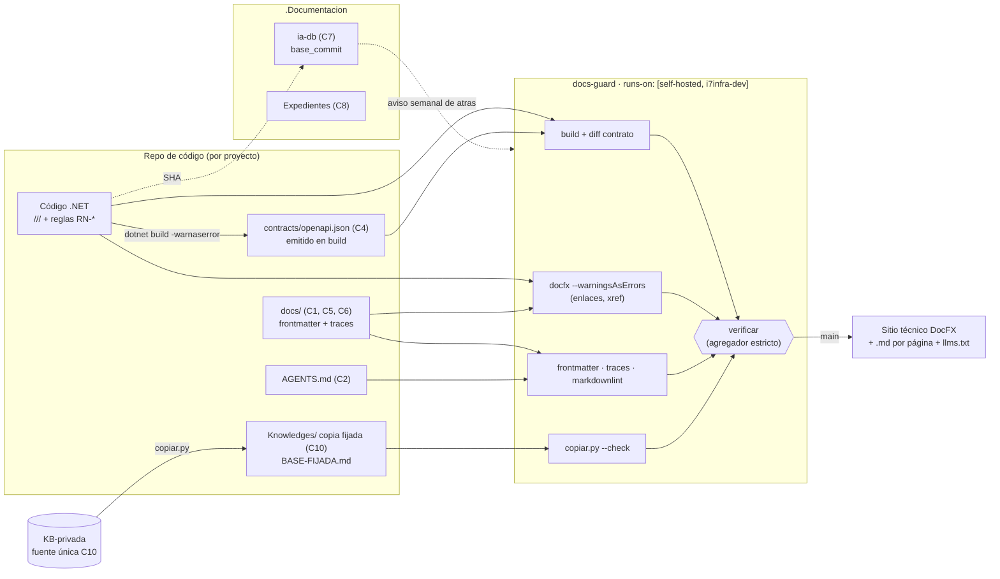

| Campo | Valor |
| --- | --- |
| Tipo | informe |
| Fecha | 2026-10-26 |
| Autor | Comisión `C-ARQ-NET`, obligatoria por D3 (folio 004 §3.5). Trabajó **a ciegas**: leyó sólo los folios 001–004, los informes de I06/I07, las bitácoras de fase 1 y fuentes originales |
| Corrige | — |

Norma y secciones leídas: el tool-prompt (`TP`) completo vía folio 002 §3–§6; folio 002 §8 (texto de las preguntas);
folio 003:151 y 282-283 (mandato y ensayos); folio 004 §3.5; `R01` §16 y §18; `N02`, `N05`, `N06`, `N07`
completos; `R03` §4, §7, §9–§12; `R04` §5, §7.3, §9; `R05` completo; `R06` §4–§7, §10–§12; `I01` §7–§9;
`I02` §4, §6, §11–§14. Conocimientos contrastados: `Versionado-Producto-Integral` 2.0 §2.2–§2.6 y §4,
`Conformacion-Pull-Request-Automatico` 2.0 §3.1 y §6, el README de KB-privada (adopción y copiador) y
`Rules-Base-Conocimiento.md` 2.3 §2.2 y §6.1 de IA.SDD.

**Convención de citas.** `Xnn:L` = bitácora `Xnn`, línea `L`, en
`/LAB/Lab-Documentos/Lab-Documentos.Documentacion/PROMPTs/DEVs/Enchacement/01-Replanteo-Y-Analisis/OUTPUTs/Bitacoras/`.
`ev/…` = `evidencia/C-ARQ-NET/…` de este expediente. Toda otra ruta se da desde la raíz del workspace. Lo que es
opinión de esta comisión lleva el rótulo **[criterio propio]**.

## Índice

1. [Definiciones](#1-definiciones)
2. [Síntesis de los dictámenes](#2-síntesis-de-los-dictámenes)
3. [Ensayos corridos](#3-ensayos-corridos)
4. [Propuesta de arquitectura del sistema documentador entero (Q29)](#4-propuesta-de-arquitectura-del-sistema-documentador-entero-q29)
5. [Dictámenes por pregunta](#5-dictámenes-por-pregunta)
6. [Excepciones a conocimientos](#6-excepciones-a-conocimientos)
7. [Solicitudes a otras comisiones](#7-solicitudes-a-otras-comisiones)
8. [No verificado](#8-no-verificado)
9. [Inventario de lo creado y lo borrado](#9-inventario-de-lo-creado-y-lo-borrado)

---

## 1. Definiciones

| Término | Definición en este informe | Fuente |
| --- | --- | --- |
| **Pieza documental** | Unidad de documentación con una sola fuente de verdad y un solo dueño. Ejemplos: la referencia de API, la ayuda de una pantalla, un índice de ia-db | Criterio propio sobre `I01:200` |
| **Clase de pieza** | Familia de piezas que comparten topología, ancla, compuerta y canal. La arquitectura se decide **por clase**, y cada pieza nueva se clasifica en una | Criterio propio |
| **Fuente de verdad** | El lugar donde la pieza se edita. Todo lo demás se deriva de ahí | `N02:75`; `I01:48` |
| **Ancla de versión** | Lo que fija qué edición de la pieza describe qué versión del código: el propio commit, un SHA declarado o una etiqueta | `N02:74` |
| **Compuerta** | Control de CI que bloquea la fusión. Su opuesto es el **aviso** | `N05:239`; `I02:67` |
| **Contrato emitido en build** | `openapi.json` que escribe `dotnet build` (paquete `Microsoft.Extensions.ApiDescription.Server`), versionado en el repositorio y vigilado con `git diff --exit-code` | `I02:188`; ensayos E2–E4 |
| **Sitio técnico** | Salida HTML estática del generador (prosa técnica y referencia), para desarrolladores y consumidores de API | Criterio propio |
| **Ayuda en producto** | Páginas Markdown que la propia aplicación renderiza (la prueba de concepto de `Examples/`). No pasa por un generador de sitio | `N07:86`; `R02:338` |
| **Plantilla de workflow** | YAML canónico versionado en la guía, que cada repositorio **copia** e instancia con una cabecera `plantilla: docs-guard@<versión>` | Criterio propio |
| **Copia fijada** | Copia de un conocimiento o regla externa con su huella SHA-256, versión y commit de origen, verificable sin red | README de KB-privada, líneas 101-108 |

**Ejemplo de lectura.** La ayuda «Agregar y editar» de la mini demo es una pieza de la clase **C5 (ayuda de
usuario)**. Su fuente vive en `Lab-E2E.WebBlazor/docs/usuario/agregar-y-editar.md`. Su ancla es el commit que la
toca. Su compuerta es «enlaces y `traces` resuelven». Su canal es el sitio técnico de la demo. La regla que traza,
`RN-LOC-02`, aparece en el XML doc de la constante de la regla en `src/MovilidadUrbana.MAUI/Domain/Rules/`.

## 2. Síntesis de los dictámenes

| Q | Dictamen (sin «depende») |
| --- | --- |
| Q02 | **Sí.** La unidad U0 va en cada repositorio que reciba PR del escalón 1 (Lab-Documentos, Lab-Documentos.Documentacion y Lab-E2E.WebBlazor). Asienta la delegación, decidida por el PO, y agrega `verificar` sobre `[self-hosted, i7infra-dev]`. Esa primera fusión la hace el PO |
| Q03 | **Sí, por pieza**, pero por medio de un **catálogo cerrado de 11 clases** ya decididas (§4), no con una decisión libre para cada archivo |
| Q04 | Mismo repositorio: el commit es el ancla. Repositorio hermano: **SHA indexado** (`base_commit`) más la etiqueta cuando exista. Guías de ritmo propio: sin ancla al código, y cada cita al código va por enlace permanente con SHA |
| Q05 | **No se versiona el sitio.** Se publica `main`. Una versión vieja se documenta con el README que viaja dentro del paquete |
| Q08 | **Fuente única en KB-privada.** Cada repositorio trae **copias fijadas** con `tools/copiar.py` y `BASE-FIJADA.md`. La compuerta es `copiar.py --check`. Una mejora vuelve por PR a la base |
| Q19 | **Un tronco común con cuatro variantes por perfil de sistema.** La variante sólo activa clases de pieza y compuertas; no cambia el ciclo |
| Q22 | **Una plantilla** canónica en Lab-Documentos que cada repositorio copia. La primera instancia corre en Lab-Documentos y la segunda en Lab-E2E.WebBlazor. No se usa un workflow reutilizable entre repositorios |
| Q24 | **Todo en el runner** (`TP:34`), con dos jobs cortos (medido < 1 min de trabajo útil), `timeout-minutes: 10`, grupo de concurrencia **propio** por PR con cancelación, y sin compartir el grupo de la E2E |
| Q25 | **No se toca** el PR #2 del repositorio auxiliar, que es de otra corrida. Cuando cierre, el escalón 2 pasa su `verificar` al runner en un PR propio |
| Q26 | **DocFX 2.81** para el sitio técnico de los proyectos .NET. Las guías no se publican como sitio: las renderiza GitHub y la compuerta las valida. La ayuda en producto la renderiza la aplicación. **MkDocs y Docusaurus se descartan** |
| Q27 | **Sí.** `GenerateDocumentationFile` y `TreatWarningsAsErrors` en todos los proyectos. `CS1591` queda silenciado en aplicaciones y es obligatorio en paquetes publicados. OpenAPI se emite en build, se versiona y lo vigila `git diff --exit-code` |
| Q28 | **Workflow documental independiente.** Del workflow de Concepts se copian los patrones, no el archivo |
| Q29 | La tabla de §4: 11 clases, cada una con topología, fuente, ancla, compuerta, audiencia, canal y tema de guía, más el diagrama de flujo del sistema |
| Q31 | «Mejorar los orquestadores» = **un conocimiento nuevo cargado + un disparo de compuerta**. En IA.SDD, además, el Momento 2 efectivo de AG-00110. **No** se agregan fases ni subagentes |
| Q33 | **Se migra a 13.22 antes de la piloto**, en una unidad propia. Las seis versiones son menores y ninguna obliga a los destinos |
| Q34 | **No entra nada nuevo** de la norma del `SDD-B` al marco común. La delegación ya es común (IKB) y la cuarta vía ya es de IA.SDD. La prioridad de fuentes queda local |
| Q35 | Se trae como **copia fijada** con huella, más una compuerta `sha256sum -c`. Se descartan el submódulo y la cita por URL |
| Q36 | **Junto al código**, en `Lab-E2E.WebBlazor/docs/`, con su `docfx.json` y su workflow. `Examples/` de Lab-Documentos sólo remite por enlace permanente |
| Q39 | **Se asigna identificador** `RN-<ÁREA>-NN`, declarado en el XML doc de la regla en el código. `traces` apunta al identificador, no a `ruta:constante` |

## 3. Ensayos corridos

Todo corrió en contenedores `--rm` sobre i7infra el 2026-10-26. Los intermedios estuvieron en
`<intermedios>` (carpeta de trabajo propia de la comisión, fuera de `/vm/claude-tmp`), con una copia de
`src/MovilidadUrbana.ApiWeb` y `src/MovilidadUrbana.MAUI` de Lab-E2E.WebBlazor (commit `8fb4c3a`) en un repositorio
git local de ensayo. Los guiones exactos están en `ev/config/rerun-dotnet.sh` y `ev/config/rerun-generadores.sh`.
El contenido de prueba son 10 páginas Markdown con frontmatter, un bloque mermaid y un enlace interno
(`ev/config/pagina-de-ensayo-ejemplo.md`). Es igual en los tres generadores (`diff -r`: sin diferencias).

### 3.1 Cambios mínimos aplicados a la copia de la ApiWeb

Son tres, y están en `ev/config/cambios-apiweb.diff` y `ev/config/ContratoOpenApi.cs`:

1. `csproj`: paquete `Microsoft.Extensions.ApiDescription.Server 10.0.11` (con `PrivateAssets=all`),
   `OpenApiDocumentsDirectory=contracts` y `OpenApiGenerateDocumentsOptions=--file-name openapi`.
2. Un transformador `ContratoOpenApi.Configurar`, que fija `info.title` y declara `X-Sesion-Id` en cada operación.
   Así corrige las dos carencias que midió `R05:170-180`.
3. Una guarda en `Program.cs`: cuando el entrypoint lo levanta `GetDocument.Insider` (la generación en build), no
   inicializa la base.

### 3.2 Resultados

| # | Ensayo | Comando (resumen; exacto en `ev/config/`) | Resultado | Evidencia |
| --- | --- | --- | --- | --- |
| E1 | Build de la ApiWeb con `TreatWarningsAsErrors` y OpenAPI en build | `dotnet build -c Release -p:TreatWarningsAsErrors=true` en `mcr.microsoft.com/dotnet/sdk:10.0` (SDK 10.0.403) | 0 advertencias, 0 errores; 10,9 s. El contrato regenerado es idéntico al versionado (`git diff --exit-code` → 0) | `ev/e1.txt` |
| E1b | Lo mismo, sin `NoWarn CS1591` | `… "-p:NoWarn="` | **114 errores CS1591 distintos** (228 líneas): miembros públicos sin `///` | `ev/e1b.txt` |
| E2 | Primera emisión del contrato en build | build con el paquete | «Writing document named 'v1' to '…/contracts/openapi.json'»; 0/0 | `ev/e2-openapi-build-primera-corrida.txt` |
| E3 | Contrato corregido con el transformador | build + `grep` | `title: "Movilidad Urbana — API"`; `X-Sesion-Id` en las 8 operaciones | `ev/openapi-antes-vs-despues-recorte.diff` |
| E3b | **Trampa medida**: pasar el transformador como *grupo de método* `AddOpenApi(ContratoOpenApi.Configurar)` en lugar de lambda | build ×2 | Con grupo de método: **`summary`=0**, sin advertencias. Con lambda: `summary`=8. Los resúmenes salen de los `///` y se pierden **en silencio** | `ev/e3b.txt` |
| E4 | Deriva plantada: cambia el `/// <summary>` del DELETE y no se regenera el contrato | build + `git diff --exit-code -- "*openapi*.json"` | **exit 1**, con el diff de la línea 397. Al restaurar, exit 0 | `ev/e4.txt` |
| E5 | DocFX `metadata` + `build` con `--warningsAsErrors` sobre la ApiWeb y las 10 páginas | `docfx 2.81.0` (herramienta .NET) en `sdk:10.0` | exit 0 / 0; 0 advertencias. 52 YAML de API y 64 HTML. metadata 19,7 s (con restauración), build 5,8 s. `_site` 32 MB | `ev/e5.txt`, `ev/config/docfx.json` |
| E6 | Enlace roto plantado en DocFX | `docfx build --warningsAsErrors` | **exit 255**: `warning InvalidFileLink: Invalid file link:(~/docs/usuario/no-existe.md)` | `ev/e6.txt` |
| E7 | Referencia de API en Markdown (para agentes) | `docfx metadata --outputFormat markdown` | exit 0; **52 `.md`**, uno por tipo y espacio de nombres | `ev/e7.txt` |
| E8a | DocFX sobre `MovilidadUrbana.MAUI` (`net10.0-android`) en `sdk:10.0` | `docfx metadata` | **exit 255**: `NETSDK1147: … the following workloads must be installed: maui-android`. 0 YAML | `ev/e8a.txt` |
| E8b | Lo mismo en la imagen del runner `runner-github-dev/dotnet-maui:2.338.1` (SDK 10.0.402 + `maui-android`) | `docfx metadata` | exit 0; 0 advertencias; **71 YAML**; 39,8 s | `ev/e8b.txt` |
| E9 | MkDocs 1.6.1 + Material 9.6.23, `--strict` | `python -m mkdocs build --strict` en `python:3.12-slim` | exit 0; 1,7 s; 11 HTML; **0 `.md`** en la salida; 2,7 MB | `ev/e9.txt`, `ev/config/mkdocs.yml` |
| E10 | Enlace roto plantado en MkDocs | `--strict` y `--strict -q` | Con `--strict`: exit 1 («Aborted with 1 warnings in strict mode!»). **Con `-q`: exit 0**, el defecto pasa | `ev/e10.txt` |
| E11 | Docusaurus 3.10.2 (preset classic + mermaid) | `npx docusaurus build` en `node:24-bookworm-slim` | exit 0; 11,9 s en caliente (**77,6 s la primera vez**); 11 HTML; **0 `.md`**; `build` 5,8 MB; **`node_modules` 803 MB** | `ev/e11.txt`, `ev/e11-docusaurus-primera-corrida-en-frio.txt` |
| E12 | Enlace roto plantado en Docusaurus | build con `onBrokenMarkdownLinks: 'throw'` | exit 1. El aviso llega como «MDX compilation failed… Markdown link … couldn't be resolved» | `ev/e12.txt` |
| E13 | Herramientas presentes en la imagen del runner | `command -v …` | dotnet (SDK 8.0.426 y 10.0.402, `maui-android` 10.0.110), python 3.12.3 con venv, node 24.19.0, java 21, git. Trae el cliente `docker`, pero no el socket (`R03:369`) | `ev/e13-runner-herramientas.txt` |

### 3.3 Lectura de los ensayos

- **La fuente generada funciona y la deriva se puede bloquear** (E1–E4). La compuerta de contrato atrapa tanto un
  cambio de prosa sin regenerar (E4) como la pérdida silenciosa de resúmenes por grupo de método (E3b), porque
  las dos cosas aparecen en el diff.
- **DocFX trata el enlace roto como error** (E6), igual que MkDocs `--strict` y Docusaurus con `throw`. La
  diferencia está en lo demás: MkDocs tiene una trampa operativa (`-q` la anula, E10), y Docusaurus compila MDX,
  así que un `<` o una llave sueltos en Markdown común se vuelven error de compilación. **[criterio propio]**: lo
  segundo se infiere del mensaje de E12. No se plantó un `<` para comprobarlo.
- **Ningún generador emite `.md` por página por sí mismo** (E5, E9, E11). El canal «`.md` por página» es copiar las
  fuentes a la salida, un paso trivial. DocFX además da la referencia de API en `.md` (E7). El diseño de ese canal
  es de `C-AGENTES-IA` (folio 003:287).
- **`net10.0-android`**: DocFX **no** lo admite sin el workload `maui-android` (E8a). En la imagen del runner sí (E8b).
  Consecuencia: la referencia de la app MAUI sólo se puede generar en el runner o en el devcontainer Android.

| Criterio (pesos los fija C-DECISIONES) | DocFX 2.81 | MkDocs + Material 9.6 | Docusaurus 3.10 |
| --- | --- | --- | --- |
| Build medido (10 páginas) | 5,8 s, más 19,7 s de metadata | **1,7 s** | 11,9 s (77,6 s en frío) |
| Peso de dependencias | herramienta .NET; el SDK ya está | paquetes Python | **803 MB** de `node_modules` |
| Referencia de API .NET | **nativa** (E5, E7) | no | no |
| Enlace roto → rojo | sí (exit 255) | sí, salvo con `-q` | sí (exit 1) |
| `.md` por página nativo | sólo de la API (E7) | no | no |
| Toolchain que ya tienen todos los repos .NET | **sí** | no | no |
| Mantenimiento del proyecto | proyecto vivo (2.81.0 usado) [vigencia no medida] | **en modo mantenimiento**: sin funciones nuevas; arreglos críticos hasta el 2027-05-05 (fuente abajo) | vivo [no medido] |

Fuente del estado de Material for MkDocs: «Zensical – A modern static site generator built by the Material for
MkDocs team», https://squidfunk.github.io/mkdocs-material/blog/2025/11/05/zensical/ (2025-11-05; consultado el
2026-10-26): «Feature development has ended … We will continue fixing critical bugs and security vulnerabilities
through May 5, 2027».

## 4. Propuesta de arquitectura del sistema documentador entero (Q29)

Rótulo general: **[criterio propio]**, sostenido por los ensayos de §3 y por las bitácoras que cita cada fila.

### 4.1 Principios

1. **La decisión es por clase de pieza**, no por proyecto (`I01:200`), y se toma una sola vez. Un proyecto
   **activa** clases y no inventa topologías.
2. **Lo generable se genera en build** (`I01:205`; E1–E4). Lo que no se puede generar vive junto a lo que describe
   cuando cambia en el mismo PR (`I01:204`).
3. **Cada clase tiene una sola compuerta barata y probada con un defecto plantado** (`N05:326`; E4, E6).
4. **Un generador para todo .NET** (DocFX). Lo que no es .NET no publica sitio: GitHub ya renderiza el Markdown.
5. **Ninguna pieza documental lleva número de versión propio**: toma su identidad del commit o del artefacto con
   el que viaja (`Versionado-Producto-Integral` §2.2, fila «Ejemplos, demos y herramientas auxiliares», y §2.6:
   «la versión editorial del documento que describe el contrato no es una versión de producto»).

### 4.2 Catálogo de clases

| Clase | Pieza (ejemplo) | Topología | Fuente de verdad | Ancla | Compuerta (bloquea) | Audiencia | Canal | Tema de la guía |
| --- | --- | --- | --- | --- | --- | --- | --- | --- |
| C1 | Especificación SDD, NB/CU, ADR | Mismo repo de código (`SDD/`, `docs/adr/`) | El `.md` | El commit | Esquema de frontmatter + enlaces | Dev, agente | Repo (render de GitHub) | Ciclo documental (N04) |
| C2 | `AGENTS.md` | Mismo repo, en la raíz | El `.md` | El commit | Existe + enlaces | Agente | Repo | Doble audiencia (N03) |
| C3 | Referencia .NET | Fuente en el código | `///` + `GenerateDocumentationFile` | El commit (build) | `dotnet build -warnaserror` + `docfx --warningsAsErrors` | Dev, agente | Sitio técnico (HTML) + `.md` de API (E7) | Fuente generada (N05) |
| C4 | Contrato REST | Fuente en el código, emitido en build | Controladores + transformador → `contracts/openapi.json` | El commit | `git diff --exit-code -- '**/openapi*.json'` (E4). En E3, `oasdiff breaking` (`I02:189`) | Consumidor de API, agente | El JSON en el sitio + Scalar en runtime | Fuente generada (N05) |
| C5 | Ayuda de usuario | Mismo repo de la interfaz (`docs/usuario/` o `Ayuda/`) | El `.md` con `traces: [RN-…, CU-…@v]` | El commit + versión del CU trazado | Enlaces + `traces` que resuelven (Q39) | Persona usuaria | Ayuda en producto (servidor) o sitio técnico (cliente sin servidor, `N07:101`) | Ayuda por audiencia/rol |
| C6 | Técnica escrita (arquitectura, compilar, primer pedido) | Mismo repo (`docs/tecnica/`) | El `.md` | El commit | Enlaces + frontmatter + mermaid que parsea | Dev | Sitio técnico | Arquitectura (N05) |
| C7 | ia-db e índices para agentes | Repo hermano `.Documentacion` | Los índices | **`base_commit` (SHA)** y `base_tag` del código | **Aviso** programado: commits de atraso (`R06:126`); estructura | Agente | Repo | Doble audiencia (N03) |
| C8 | Expedientes, análisis, prompts, bitácoras | Repo hermano `.Documentacion` | El `.md` | El propio commit; citas al código por permalink con SHA | Enlaces + barrido S2 | Mesa, PO, agente | Repo | Gobierno (N01) |
| C9 | Guías de estudio | Repo dedicado (Lab-Documentos, D4) | El `.md` | El propio commit; citas al código por permalink con SHA | docs-guard (markdownlint, enlaces, frontmatter) | Estudiante | Repo (render de GitHub), sin sitio | Material formativo (N08) |
| C10 | Conocimientos compartidos | KB-privada (fuente única) | `Knowledge-*.md` | `Versión` + SHA-256 en `BASE-FIJADA.md` | `copiar.py --check` en el consumidor | Orquestadores, agentes | Copia fijada en cada repositorio | Marco compartido (N06) |
| C11 | README y CHANGELOG de paquete | Mismo repo del paquete | El `.md` empaquetado | La versión del paquete (viaja dentro) | Lo fija `C-CONFIG-RELEASE` | Consumidor del paquete | nuget.org / feed | Versionado (N02) |

Los canales `llms.txt` y `.md` por página son **salidas derivadas del sitio técnico** en el mismo build. El
contenido de esos canales lo dictamina `C-AGENTES-IA`.

### 4.3 Flujo del sistema



### 4.4 Esqueleto de la plantilla `docs-guard` (no corrida en el runner real)

```yaml
# plantilla: docs-guard@0.1 — copiar y ajustar `paths`; no editar la lógica sin subir la versión
name: docs-guard
on:
  pull_request:
  push: { branches: [main] }        # sin paths-ignore: la doc es justo lo que se valida
  workflow_dispatch:
permissions: { contents: read }
concurrency: { group: docs-${{ github.ref }}, cancel-in-progress: ${{ github.event_name == 'pull_request' }} }
jobs:
  docs:
    if: github.event_name != 'pull_request' || github.event.pull_request.head.repo.full_name == github.repository
    runs-on: [self-hosted, i7infra-dev]
    timeout-minutes: 10
    steps:
      - uses: actions/checkout@v4
      - run: dotnet build <proyecto o slnf sin MAUI> -c Release -warnaserror
      - run: git diff --exit-code -- '**/openapi*.json'
      - run: dotnet tool restore && dotnet docfx docs/docfx.json --warningsAsErrors
      - run: python3 tools/docs/verificar.py   # frontmatter, traces → RN/CU, permalinks
  verificar:
    if: always()
    needs: [docs]
    runs-on: [self-hosted, i7infra-dev]
    timeout-minutes: 2
    steps:
      - run: test "${{ needs.docs.result }}" = success
```

Reglas que hereda del workspace: etiqueta exacta, guarda de forks, `contents: read`, `timeout-minutes`, sin
`container:`, agregador estricto y guion local equivalente (`R03:391-398`). DocFX se fija como herramienta local
(`.config/dotnet-tools.json`) para que el runner y la máquina del desarrollador usen la misma versión.

## 5. Dictámenes por pregunta

Cada dictamen trae respuesta, alternativas consideradas, fundamento, ventajas (simplicidad, practicidad,
escalabilidad) y riesgos.

### Q02 — Unidad inicial con delegación del merge y control `Verificar`

- **Respuesta.** Sí. La fase de escritura del escalón 1 empieza con una unidad **U0 por repositorio destino**:
  Lab-Documentos (la guía y su plantilla), Lab-Documentos.Documentacion (este expediente) y Lab-E2E.WebBlazor
  (la mini demo, Q36). U0 hace dos cosas: (a) asienta la delegación del merge, **decidida y fechada por el PO**, en
  el README o el CHANGELOG del repositorio; (b) agrega un workflow con el job agregador `verificar` sobre
  `[self-hosted, i7infra-dev]`. **El merge de U0 lo hace el PO** por ciclo manual. Las unidades siguientes ya pueden
  ir por el ciclo automático.
- **Alternativas.** (1) Trabajar todo en ciclo manual: se descarta porque deja cada PR esperando al PO. (2) Que el
  agente asiente la delegación por su cuenta: se descarta porque el conocimiento exige que «el humano **decidió** la
  delegación y quedó escrita» (`Conformacion-Pull-Request-Automatico` §1, supuestos; §3.5).
- **Fundamento.** Hoy no hay delegación asentada en ninguno de los dos repositorios de Lab-Documentos, y
  .Documentacion no tiene `.github/`, así que G3 dejaría el PR en reserva (`R01:484-490`, H-06 en `R01:643`). El
  conocimiento sólo vale con la delegación asentada en el destino (`Conformacion-Pull-Request-Automatico` §0 y §6:
  «La delegación está asentada en el repositorio destino, con fecha y responsable»).
- **Ventajas.** *Simplicidad*: la misma U0 en los tres repositorios. *Practicidad*: desbloquea el ciclo automático
  desde la segunda unidad. *Escalabilidad*: E2 y E3 repiten U0 en Lab-Geometria y en el `SDD-B`.
- **Riesgos.** Que el PO no asiente la delegación: rige el ciclo manual y el plan sigue, más lento. Que la
  protección de rama no se pueda exigir en el plan free (`I02:418-419`): el `verificar` igual corre, pero es un
  control informativo.

### Q03 — Topología por pieza

- **Respuesta.** Sí, por pieza, **por medio de un catálogo cerrado de 11 clases** (§4.2) que fija la matriz D1–D8 una
  sola vez. Cada pieza nueva se clasifica en una clase. Si no encaja en ninguna, se abre una clase nueva por
  expediente.
- **Alternativas.** (1) Una topología única por proyecto: se descarta porque ninguna topología sola evitó la deriva
  (X13; `N02:99-102`). (2) Aplicar D1–D8 archivo por archivo: se descarta porque es caro y da resultados distintos
  según quién decida.
- **Fundamento.** «Ninguna referencia elige una sola topología» (`N02:81`; `I01:200`). El workspace ya reparte así:
  lo que cambia con el código, en el código (`R06:157`; `I01:220-222`).
- **Ventajas.** *Simplicidad*: once filas en lugar de cientos de decisiones. *Practicidad*: el workflow sabe qué
  validar por la carpeta. *Escalabilidad*: un proyecto nuevo activa clases.
- **Riesgos.** Que una clase demasiado ancha esconda un caso. Mitigación: la clase nueva por expediente.

### Q04 — Ancla de versión por par código ↔ `.Documentacion`

- **Respuesta.** Hay tres reglas:
  1. **Mismo repositorio** (C1–C6): el ancla es el commit. No se agrega nada.
  2. **Repositorio hermano** (C7, y C8 cuando describe el código): **SHA indexado** en el frontmatter o en el
     manifiesto (`base_commit: <sha>`), más `base_tag` cuando el código tenga etiquetas (Lab-Geometria sí, `R06:152`).
     Un aviso semanal calcula cuántos commits atrasa.
  3. **Guías de ritmo propio** (C9): la guía «follows» el software y no «is bound to» él (`I02:123-125`), así que no
     lleva ancla al código. **Cada cita al código va por enlace permanente con SHA**
     (`github.com/<org>/<repo>/blob/<sha>/<ruta>#Lnn`).
- **Alternativas.** «Sólo etiqueta»: se descarta porque Lab-Documentos y Lab-E2E no tienen etiquetas (`I02:331`;
  `git tag` vacío en Lab-E2E.WebBlazor el 2026-10-26). «Ninguna» para todo: se descarta porque la ia-db de Geometría
  quedó 47 PR atrás sin que nada lo detectara (`R06:126`).
- **Fundamento.** El `SDD-B` declara el commit base de sus índices y eso funciona (`R04:320`). Los enlaces relativos
  entre repositorios se rompieron al mudar (`R05:156`, `R05:160`); un enlace permanente no se rompe con una mudanza.
- **Ventajas.** *Simplicidad*: un campo. *Practicidad*: el SHA existe siempre y la etiqueta no. *Escalabilidad*: la
  misma regla sirve para N repositorios.
- **Riesgos.** El enlace permanente envejece a propósito: muestra el código de entonces. Por eso C9 enseña conceptos
  y no promete reflejar `main`.

### Q05 — ¿Versionar el sitio publicado?

- **Respuesta.** **No.** Se publica sólo la versión de `main`, que es la desplegada. Quien consume una versión
  vieja de un paquete la lee en el README que viaja dentro del paquete (C11).
- **Alternativas.** Instantáneas por versión (Docusaurus, mike) o grupos de DocFX: se descartan. Duplican archivos,
  hacen crecer el build y DocFX v3 tiene el soporte incompleto (`I02:112-116`).
- **Fundamento.** «Most of the time, you don't need versioning» (D5′, `I01:209`). La guía ya llega a lo mismo
  (`I02:327`). Los cuatro sistemas tienen un solo despliegue vivo por proyecto [criterio propio sobre `R05`, `R06`
  y `R04`].
- **Ventajas.** *Simplicidad*: un solo build. *Practicidad*: DocFX alcanza tal como está. *Escalabilidad*: si
  aparecen consumidores de versiones distintas (D5), la clase C11 ya lleva la doc dentro del artefacto.
- **Riesgos.** Un consumidor de un paquete viejo encuentra el sitio en `main`. Mitigación: el README empaquetado.

### Q08 — Conocimientos compartidos: ¿fuente única o copias?

- **Respuesta.** **Fuente única en KB-privada**, y en cada repositorio **copias fijadas**, nunca editadas:
  1. Se traen con `python3 -I tools/copiar.py <Alias> … --destino <carpeta>`, que copia el cierre de dependencias y
     escribe `BASE-FIJADA.md` (alias, versión, SHA-256, commit de la base).
  2. Compuerta en el workflow del consumidor: `python3 -I tools/copiar.py --check --destino <carpeta>` (rc=1 si una
     copia cambió).
  3. Una adaptación local no se hace editando la copia: va por `Excepcion-A-Un-Conocimiento` (ficha `XC`) o por
     `Hereda-de`/`Sustituye`. Una mejora vuelve a la base por PR (README de IKB, líneas 123-127).
- **Alternativas.** (1) Referenciar sin copiar: se descarta porque la regla exige que toda referencia resuelva en una
  copia sin historia (`Rules-Base-Conocimiento.md` 2.3 §2.2, línea 167, y §6.1, línea 364). (2) Copias libres con
  sincronización a mano: es lo que produjo tres versiones del mismo conocimiento (`R03:256-267`; `R04:263-270`).
- **Fundamento.** El mecanismo ya existe y está documentado (README de
  `KB-privada/README.md:70-108`). No hay que construir nada.
- **Ventajas.** *Simplicidad*: un comando y un archivo. *Practicidad*: la compuerta corre sin red. *Escalabilidad*:
  cada repositorio nuevo repite el mismo paso.
- **Riesgos.** Que una copia quede vieja y nadie lo note: `--check` no mira la base (README, línea 107). Mitigación:
  un aviso programado que compare la versión fijada con el índice de la base.

### Q19 — ¿Una metodología o un tronco con variantes?

- **Respuesta.** **Un tronco común con cuatro variantes.**
  - **Tronco**: el ciclo, el frontmatter, la topología por clase, `docs-guard` y `verificar`.
  - **Variantes**: (V1) corpus de guías, con C8, C9 y C10, sin sitio; (V2) app cliente sin servidor (MovilidadUrbana),
    con C3, C4, C5 en el sitio y C6; (V3) app con roles en servidor (Geometría), con C5 como ayuda en producto y
    cruce de rol; (V4) servicio con paquetes (`SDD-B`), con C11, `oasdiff` y `CS1591` obligatorio en la superficie
    pública.
- **Alternativas.** (1) Una sola metodología sin variantes: obliga a V1 a cargar un sitio y una referencia de API que
  no tiene. (2) Cuatro metodologías: rompe la «metodología común» de `TP:20`.
- **Fundamento.** Los cuatro perfiles relevados difieren justo en las fuentes generables (`R05:184-194`;
  `R06:226-236`; `I02:335`).
- **Ventajas.** *Simplicidad*: la variante es una lista de clases activas. *Practicidad*: la plantilla se ajusta con
  `paths` y pasos opcionales. *Escalabilidad*: un sistema nuevo elige una variante.
- **Riesgos.** Que aparezca un quinto perfil. Se agrega como variante, sin tocar el tronco.

### Q22 — ¿Un workflow o una plantilla? ¿Dónde vive el primero?

- **Respuesta.** **Una plantilla** canónica (`docs-guard@<versión>`, §4.4), versionada en la guía de Lab-Documentos.
  Cada repositorio la **copia** con su cabecera de versión. **La primera instancia corre en Lab-Documentos**, que
  valida `Guides/` y `Examples/`. La segunda corre en Lab-E2E.WebBlazor (la mini demo).
- **Alternativas.** (1) Un workflow reutilizable (`workflow_call`) en Lab-Documentos: se descarta. La página oficial
  «Reuse workflows» (docs.github.com, consultada el 2026-10-26) no dice qué runners self-hosted usa el workflow
  llamado, y además ata todos los repositorios a uno solo. (2) Un único workflow en Lab-Documentos que valide a los
  demás: viola D1, porque la validación tiene que correr en el PR del código.
- **Fundamento.** El único workflow actual sólo cubre Concepts, y un PR de `Guides/` pasa en verde por omisión
  (`R03:337-338`). Lab-Geometria no tiene ningún chequeo documental (`R06:144`).
- **Ventajas.** *Simplicidad*: un YAML legible en cada repositorio. *Practicidad*: no depende de otro repositorio.
  *Escalabilidad*: la cabecera de versión deja ver qué copia está atrasada.
- **Riesgos.** Que las copias diverjan. Mitigación: la cabecera `plantilla:` más un aviso que compare versiones.

### Q24 — Concurrencia con la E2E en el único runner

- **Respuesta.** **Todo en el runner**, como manda `TP:34`, con cuatro medidas: (a) dos jobs cortos, `docs` y
  `verificar`; (b) `timeout-minutes: 10` y `2`; (c) un grupo de concurrencia **propio**
  (`docs-${{ github.ref }}`) con cancelación en los PR; (d) **sin** compartir el grupo `e2e-laboratorio`, que
  serializa sin cancelar (`R06:142`).
- **Alternativas.** (1) Validar en `ubuntu-latest`: incumple `TP:34`. (2) Compartir el grupo de la E2E: los docs
  quedarían esperando tras corridas largas. (3) Un solo job sin agregador: la guarda de forks deja el check en
  `skipped`, que se lee como verde (`R03:333`).
- **Fundamento.** El trabajo útil medido entra en menos de un minuto: build de 10,9 s, DocFX de 5,8 s más 19,7 s de
  metadata con restauración en frío, MkDocs de 1,7 s (E1, E5, E9). El runner es efímero y único (`N05:249-251`).
- **Ventajas.** *Simplicidad*: un grupo propio. *Practicidad*: en el peor caso, la cola espera a una E2E. *Escalabilidad*:
  si la cola crece, se registra un segundo runner con la misma etiqueta sin tocar los YAML.
- **Riesgos.** Una E2E larga retrasa el `verificar`. Es aceptable: no lo invalida.

### Q25 — El PR abierto del repositorio auxiliar de Geometría (`ubuntu-latest`)

- **Respuesta.** **No se toca.** El PR #2 (`entrega/delegacion-y-verificar`) es trabajo de otra corrida, y seguía
  abierto el 2026-10-26: `refs/pull/2/head` y `refs/pull/2/merge` existen, con cabeza `27291b1` (`git ls-remote`).
  `TP:34` rige el workflow de esta metodología. En el escalón 2, una vez cerrado ese PR, una unidad propia pasa
  `verificar.yml` a `[self-hosted, i7infra-dev]` y le suma la plantilla. La compuerta E2 sólo exige que los
  workflows de la metodología corran en el runner.
- **Alternativas.** (1) Pedir cambios en ese PR: interfiere con una corrida viva (`R06:244`, R3). (2) Aceptar
  `ubuntu-latest` como excepción permanente: contradice `TP:34`.
- **Fundamento.** `R06:129`, `R06:131` y el riesgo R3 en `R06:244`.
- **Ventajas.** *Simplicidad*: no hay conflicto de ramas. *Practicidad*: el escalón 2 lo hace igual. *Escalabilidad*:
  sigue el mismo patrón que Q22.
- **Riesgos.** Que el PR se fusione con `ubuntu-latest` y quede así hasta E2. Mientras tanto, el repositorio auxiliar
  no está bajo la metodología.

### Q26 — Generador de sitio

- **Respuesta.** Hay tres canales y sólo uno lleva generador:
  1. **Sitio técnico de proyectos .NET** (C3, C4, C6, y C5 en clientes sin servidor): **DocFX 2.81**, fijado como
     herramienta local y corrido con `--warningsAsErrors`.
  2. **Guías y corpus** (C8, C9): **sin generador**. GitHub renderiza el Markdown y la compuerta lo valida.
  3. **Ayuda en producto** (C5 con servidor, Geometría): la **renderiza la aplicación**, con el motor de la prueba de
     concepto (`N07:86`).
- **Alternativas.** MkDocs + Material: fue el más rápido (E9), pero no genera referencia .NET, `-q` anula `--strict`
  (E10) y el proyecto está en mantenimiento desde el 2025-11-05, con arreglos críticos sólo hasta el 2027-05-05
  (fuente en §3.3). Docusaurus: arrastra 803 MB de dependencias, 77,6 s en frío, compila MDX y tampoco genera
  referencia .NET (E11, E12).
- **Fundamento.** E5 a E8. DocFX es la única opción que cubre la referencia de API, que es la fuente generada que más
  reduce la deriva (`I01:205`), con un solo toolchain que todos los repositorios .NET ya tienen (E13).
- **Ventajas.** *Simplicidad*: un generador, y sólo donde hace falta. *Practicidad*: corre en el runner sin Python ni
  Node. *Escalabilidad*: sirve igual para una app, una API o un paquete.
- **Riesgos.** El tema y la experiencia de DocFX están por debajo de Material, y su versionado es incompleto. No pesa,
  porque Q05 decide no versionar. La referencia MAUI exige el workload (E8a). En V2 se publica la referencia de la
  ApiWeb y no la de la app, que no tiene superficie pública útil [criterio propio].

### Q27 — OpenAPI y documentación XML en el build

- **Respuesta.** Sí, para los proyectos de los tres escalones:
  1. En `Directory.Build.props`: `GenerateDocumentationFile=true` y `TreatWarningsAsErrors=true`.
  2. `NoWarn CS1591` se **mantiene en las aplicaciones** (E1b: 114 miembros públicos sin `///` en la ApiWeb, sin
     valor para un consumidor externo) y se **quita en los paquetes publicados**, donde la superficie pública es el
     contrato.
  3. En toda API REST: `Microsoft.Extensions.ApiDescription.Server` con `OpenApiDocumentsDirectory=contracts`, el
     contrato versionado y la compuerta `git diff --exit-code` (E2, E4). El transformador se registra **siempre con
     lambda**, porque con grupo de método los resúmenes se pierden en silencio (E3b). La guarda de `GetDocument.Insider`
     evita tocar la base al generar.
- **Alternativas.** (1) OpenAPI sólo en runtime, como hoy: el contrato no existe en el repositorio y no hay diff
  posible (`R05:180`). (2) `CS1591` obligatorio en todos lados: 114 errores sólo en la ApiWeb, con costo sin
  lector.
- **Fundamento.** E1–E4. Lab-Geometria tiene hoy `GenerateDocumentationFile=false` y OpenAPI sólo en runtime
  (`I02:333-334`). Lab-E2E ya compila la solución sin MAUI con `-warnaserror` (`/LAB/Lab-E2E.WebBlazor/Lab-E2E.WebBlazor/.github/workflows/ci.yml:59`).
- **Ventajas.** *Simplicidad*: tres propiedades y un paquete. *Practicidad*: el desarrollador ve el diff del contrato
  en su PR. *Escalabilidad*: en E3 se suma `oasdiff breaking` sin cambiar nada.
- **Riesgos.** Con `TreatWarningsAsErrors`, un analizador nuevo puede romper el build en Geometría
  (`IL2026`/`IL3050`, `R06:250`). Mitigación: probar YamlDotNet/Markdig antes (Q de `R06:299`, no verificado).

### Q28 — ¿El workflow de Concepts como base?

- **Respuesta.** **No.** Se escribe `docs-guard` independiente (§4.4). Del workflow de Concepts se copian los
  patrones (guarda, alcance, agregador estricto `fw-ok`, guion local), no el archivo. `framework-concept-demo.yml`
  sigue cubriendo su demo y se versiona en su propio expediente (0001).
- **Alternativas.** Extenderlo para los docs: ataría cada PR de guías a compilar MAUI, o lo dejaría verde «por
  omisión declarada» (`R03:337`).
- **Fundamento.** `R03:321-340` (rasgos). Su objeto es otro: compilar la demo, los tests y el APK.
- **Ventajas.** *Simplicidad*: un archivo por responsabilidad. *Practicidad*: no depende de que se versione el 0001.
  *Escalabilidad*: la plantilla viaja a otros repositorios y el de Concepts no.
- **Riesgos.** Hay dos agregadores en Lab-Documentos (`fw-ok` y `verificar`), y la protección de rama tiene que
  exigir los dos.

### Q29 — Arquitectura del sistema documentador entero

- **Respuesta.** La de §4: once clases con topología, fuente, ancla, compuerta, audiencia, canal y tema; el flujo de
  §4.3 y la plantilla de §4.4. Integra Q03 (clases), Q04 (anclas), Q23 (compuertas por clase, en la columna; el
  dictamen de bloqueo o aviso es de `C-VERIFICACION`), Q10 (los canales para agentes como salidas derivadas, con el
  contenido a cargo de `C-AGENTES-IA`) y Q43 (columna de tema de la guía).
- **Alternativas.** (1) Arquitectura sólo del toolchain: no cumple D2. (2) Un portal agregador multi-repositorio
  (Backstage, Antora; `I01:125-143`): se descarta por costo. No hay requisito de un sitio único multi-producto en
  `TP` [criterio propio].
- **Fundamento.** D2 del folio 001; `N00:255`; ensayos de §3.
- **Ventajas.** *Simplicidad*: once filas y un generador. *Practicidad*: todo lo medido corre en el runner que ya existe
  (E13). *Escalabilidad*: un sistema nuevo elige variante y activa clases.
- **Riesgos.** La arquitectura nunca corrió en el runner real (§8). La primera corrida de U0 es su prueba.

### Q31 — Qué significa «mejorar los orquestadores»

- **Respuesta.** En los dos marcos es lo mismo: **cargar un conocimiento nuevo** (DocAsCode, el resultado de la
  piloto) y **disparar la compuerta `docs-guard`** como insumo de cierre. En IA.SDD, además, el **Momento 2
  efectivo de AG-00110**: la reanudación actualiza la categoría 11 al cerrar cada etapa (`R06:209`, `R06:216`). El
  conocimiento se suma a `Conocimiento/` sin tocar `Rules-Documentacion` (X1 va por apartamiento, Q32, que no es
  de esta comisión). En el `SDD-B` entra por `copiar.py` a su catálogo y se aplica en la mesa a pedido de sus
  expedientes, que es lo vivo (`R04:190-193`). **No se agregan fases ni subagentes.**
- **Alternativas.** (1) Un subagente documental nuevo: en el `SDD-B` los 26 agentes no se usan desde el 2026-08-29
  (`R04:190-192`), así que sería mejorar lo muerto (`N06:121`). (2) Una fase nueva en el Master-Prompt: es un cambio
  mayor de norma para un problema que resuelve un conocimiento.
- **Fundamento.** `N06:90-93`; `R06:211` (`Conocimiento/` no tiene nada de docs as code).
- **Ventajas.** *Simplicidad*: un archivo y un paso. *Practicidad*: es reversible. *Escalabilidad*: lo carga cualquier
  marco nuevo.
- **Riesgos.** Fuera del núcleo .NET de esta comisión: se recomienda contrastarlo con `C-SDD-CONOCIMIENTO` en la
  compuerta E2 (folio 004:264).

### Q33 — ¿Migrar Lab-Geometria de 13.16 a 13.22 antes de la piloto?

- **Respuesta.** **Sí**, como **primera unidad del escalón 2**, separada de la piloto.
- **Alternativas.** Declarar que la piloto corre sobre 13.16: el trabajo nuevo (apartamiento, ADR, plan 11) nacería
  sobre una norma seis versiones atrás y quedaría con deriva desde el primer día.
- **Fundamento.** Las versiones 13.17 a 13.22 son todas **minor**, y la mayoría declara «Ninguno obligatorio» como
  impacto sobre destinos. La 13.18 dice «Nada retroactivo» y deja el EXP-0001 de Geometría como forma histórica
  (`/IA/SDD/IA.SDD/CHANGELOG.md:52-54`, `:104-106`, `:138-140`, `:183-185`, `:271-277`, `:320-322`). La 13.21 trae
  `Conformacion-Pull-Request-Automatico`, que U0 necesita (Q02), y la 13.22 trae `Excepcion-A-Un-Conocimiento`, el
  instrumento del apartamiento de X1 (`CHANGELOG.md:6-15`).
- **Ventajas.** *Simplicidad*: es una unidad acotada. *Practicidad*: el costo es bajo porque todo es minor.
  *Escalabilidad*: la piloto produce un conocimiento contra la norma vigente.
- **Riesgos.** La otra corrida del repositorio auxiliar (`R06:131`). La migración toca `SDD/` del repositorio de
  código, no `ia-db/`. Contraste recomendado con `C-SDD-CONOCIMIENTO`.

### Q34 — ¿Qué de la norma del `SDD-B` entra al marco común?

- **Respuesta.** **Nada nuevo.** De las tres piezas: la **delegación del merge** ya es común
  (`Conformacion-Pull-Request-Automatico` 2.0 en KB-privada); la **reincorporación y la cuarta vía** ya son de
  IA.SDD (`Root-Rules.md` §14 y `Expediente-Rules`, que el `SDD-B` cita, `R04:195-198`); la **prioridad de fuentes
  en seis niveles** queda local. Para la documentación, la reemplaza la columna «fuente de verdad» del catálogo §4.2.
- **Alternativas.** Importar la prioridad de fuentes al marco común: impondría a todos los destinos una jerarquía
  pensada para un pipeline de 26 agentes que no se usa (`R04:190-193`).
- **Fundamento.** `R04:180-188`.
- **Ventajas.** *Simplicidad*: el marco común no crece. *Practicidad*: no hay migración. *Escalabilidad*: la fuente de
  verdad por clase sirve a cualquier destino.
- **Riesgos.** Que se pierda algún matiz de la prioridad de fuentes del `SDD-B`. No es de esta comisión: no se leyó su
  texto completo.

### Q35 — Dependencia no vendorizada de IA.SDD en el `SDD-B`

- **Respuesta.** Se trae como **copia fijada**: los archivos de IA.SDD que cita la cuarta vía (`Root-Rules.md` y
  `Expediente-Rules.md`), con su cierre, en una carpeta propia de la norma del `SDD-B`, más un `BASE-FIJADA.md`
  (archivo, versión, SHA-256, commit de IA.SDD). La compuerta es `sha256sum -c` en su CI. Para actualizar se vuelve a
  copiar.
- **Alternativas.** (1) Submódulo git: una copia sin historia (`git archive`) no lo trae, lo que viola
  `Rules-Base-Conocimiento.md` §6.1 (línea 364), y cada actualización cuesta dos PR (D7, `I01:211`). (2) Citar por
  URL: no es autocontenido.
- **Fundamento.** `Rules-Base-Conocimiento.md` 2.3 §2.2 (línea 167): «Un documento que se suma desde otro
  repositorio llega con su cierre». Hoy 116 archivos del `SDD-B` declaran trabajar con copias sin regla
  (`R04:197-198`).
- **Ventajas.** *Simplicidad*: el mismo patrón que Q08. *Practicidad*: corre sin red. *Escalabilidad*: sirve para
  cualquier repositorio privado que dependa del marco.
- **Riesgos.** Las copias quedan atrás de IA.SDD. Mitigación: aviso programado. Es una precondición del escalón 3, y
  la contrasta `C-SDD-CONOCIMIENTO`.

### Q36 — ¿Dónde vive la mini demo?

- **Respuesta.** **Junto al código**, en `/LAB/Lab-E2E.WebBlazor/Lab-E2E.WebBlazor/docs/`:
  - `docs/usuario/` (6 páginas), `docs/tecnica/` (3), `docs/docfx.json` y `docs/toc.yml`.
  - El contrato en `src/MovilidadUrbana.ApiWeb/contracts/openapi.json`.
  - Su propio `.github/workflows/docs-guard.yml`.

  `Examples/` de Lab-Documentos sólo lleva un README que la presenta y remite por enlace permanente con SHA. El
  workflow va **separado** de `ci.yml`, porque `ci.yml` ignora `docs/**` y `**/*.md` en los push a `main`
  (`/LAB/Lab-E2E.WebBlazor/Lab-E2E.WebBlazor/.github/workflows/ci.yml:13-18`). Tocar ese repositorio exige un
  expediente o una carta que lo autorice (`R05:238-241`).
- **Alternativas.** (1) En `Examples/`: repite el desfase que se quiere resolver, porque los `traces` y el contrato
  quedarían en otro repositorio (`R05:233`). (2) Híbrido con un agregador en Lab-Documentos: agrega un pipeline sin
  necesidad (D3 no aplica, porque hay un solo producto).
- **Fundamento.** El laboratorio ya pagó el costo de separar: 3 enlaces del README y unos 50 de las guías rotos
  (`R05:156`, `R05:160`, `R05:232`). E1–E7 corren sobre ese código sin el workload MAUI.
- **Ventajas.** *Simplicidad*: un solo repositorio por demo. *Practicidad*: los `traces` y el contrato se validan en el
  mismo commit. *Escalabilidad*: la piloto de Geometría (`R06:226-231`) sigue el mismo patrón.
- **Riesgos.** El repositorio público recibe cambios de código: el paquete, el transformador y la guarda (§3.1).
  Agregar `X-Sesion-Id` al contrato documenta un comportamiento que ya existe, pero cambia el contrato publicado y
  hay que asentarlo.

### Q39 — Reglas sin identificador en MovilidadUrbana

- **Respuesta.** **Se asigna un identificador** `RN-<ÁREA>-NN` (por ejemplo, `RN-LOC-01` para «nombre ≥ 3») y se
  declara en el **XML doc** de la constante o del método de la regla (`/// <remarks>RN-LOC-01</remarks>`), **en las
  tres apps**, porque la regla está triplicada por diseño (`R05:104`). `traces` apunta al identificador. Una
  compuerta (`tools/docs/verificar.py`) exige que cada `RN-*` trazado aparezca **exactamente una vez** en el código
  de la app que documenta la página (MAUI para la ayuda de usuario). En el sitio técnico, el identificador queda
  visible en la página de referencia de la regla (C3).
- **Alternativas.** (1) Trazar a `ruta:constante`: se rompe al renombrar o mover, que es la deriva que se combate
  (`R04:317-319`, cita por identificador estable). (2) Un catálogo de reglas sólo en `docs/`: el identificador no
  estaría en el código y la compuerta no podría asegurar que la regla existe.
- **Fundamento.** No hay `CU-` ni `RN-` en el repositorio (`R05:73`, `R05:272`). Las reglas son constantes con nombre
  (`R05:98`). E5 muestra que DocFX publica los comentarios de cada constante (`LocalidadRules`, campo
  `DigitosDelCodigoPostal`).
- **Ventajas.** *Simplicidad*: un `grep`. *Practicidad*: sobrevive a un refactor. *Escalabilidad*: el mismo contrato
  sirve para los `CU-` de Geometría (Q38, de otra comisión).
- **Riesgos.** Agrega comentarios al código de un repositorio que prohíbe renombrar textos y contratos (`R05:241`).
  Un comentario no es un renombre, pero se asienta en el expediente de la unidad. La compuerta todavía no está
  escrita ni ensayada.

## 6. Excepciones a conocimientos

| Conocimiento y § | Qué se propone en su lugar | Impacto operativo |
| --- | --- | --- |
| `Versionado-Producto-Integral` 2.0 §4 («¿El número se declara o se deriva de la etiqueta?» → «Se declara en un archivo del árbol») | **No es una excepción, es una precisión.** Esta comisión no propone derivar números de etiquetas: Q04 usa la etiqueta del código sólo como **ancla documental** (`base_tag`), no como número de versión. Se deja constancia porque Lab-Geometria usa MinVer, que sí deriva el número de la etiqueta (`R06:151`), y este informe **no** lo recomienda como patrón | Ninguno |
| `Versionado-Producto-Integral` 2.0 (condición de carga) | No se aplica a los escalones 1 y 2: la condición exige un producto que «publica o despliega **más de un** artefacto» y que necesita atribuir errores de producción. Aplica en el escalón 3 (`SDD-B`), clase C11 | La cadena de release de E3 la decide `C-CONFIG-RELEASE` |

No hay más apartamientos. Q08 y Q35 aplican tal cual el README de KB-privada y `Rules-Base-Conocimiento.md`
§2.2, y Q02 aplica `Conformacion-Pull-Request-Automatico` §3.1 sin desvío.

## 7. Solicitudes a otras comisiones

| A | Pide | Por qué |
| --- | --- | --- |
| `C-AGENTES-IA` | (1) Diseñar `llms.txt` y `.md` por página como salida del build DocFX (§4.3). (2) Controles contra inyección indirecta en el contenido publicado (Q16) | Seguridad de agentes, fuera del mandato (folio 003:151) |
| `C-VERIFICACION` | Clasificar en bloqueo o aviso las compuertas de §4.2 y escribir la prueba negativa de `verificar.py` (traces) | Q23 no es de esta comisión |
| `C-CONFIG-RELEASE` (ciclo 2) | La publicación del sitio desde `main` (por ejemplo, GitHub Pages) y C11 | No decide la cadena de release |
| `C-SDD-CONOCIMIENTO` (E2) | Contrastar Q31, Q33, Q34 y Q35 | Riesgo J5 del folio 004:264 |

## 8. No verificado

| Afirmación o supuesto | Motivo |
| --- | --- |
| La plantilla `docs-guard` (§4.4) corre en el runner real | No hay repositorio de ensayo registrado en el runner, y esta fase no hace push. Se probaron los pasos en la imagen del runner (E8b, E13), no el workflow |
| `dotnet tool restore` + DocFX como herramienta local en el runner | Se usó DocFX instalado con `--tool-path` |
| Qué runners usa un workflow reutilizable llamado desde otro repositorio | La página oficial «Reuse workflows» (docs.github.com, consultada el 2026-10-26) no lo dice |
| Que sin la guarda `GetDocument.Insider` la generación en build falle o toque la base | No se ensayó sin la guarda |
| La causa del comportamiento E3b (grupo de método frente a lambda) | Sólo se midió el efecto. No se leyó el código del generador de comentarios XML de .NET 10 |
| Que Docusaurus falle con `<` o `{` en Markdown común | Inferido del mensaje MDX de E12; no se plantó |
| Vigencia y mantenimiento de DocFX y Docusaurus | No se consultaron sus repositorios |
| Que la protección de rama pueda exigir `verificar` en el plan free | `I02:418-419`; no se consultó la API |
| El script `tools/docs/verificar.py` (frontmatter, `traces` → `RN-`) | Es una propuesta; no se escribió |

## 9. Inventario de lo creado y lo borrado

| Qué | Dónde | Estado |
| --- | --- | --- |
| Copia de `MovilidadUrbana.ApiWeb` y `MovilidadUrbana.MAUI` en un git local, con los tres cambios de §3.1 | `<intermedios>/src` | **Borrada** al cerrar |
| Proyectos de DocFX, MkDocs y Docusaurus, contenido de prueba, `_site`, `site`, `build` | `<intermedios>/{docfx,docfx-maui,mkdocs,docusaurus,contenido}` | **Borrados** |
| Cachés: NuGet (`nuget/`), paquetes Python (`pylib/`), npm (`npmcache/`), `node_modules` (803 MB), DocFX (`tools/`) | `<intermedios>` | **Borradas** |
| Guiones `rerun.sh` y `rerun2.sh`, y salidas `out/` y `out2/` | `<intermedios>` | **Borrados**; copia redactada en `ev/config/` y `ev/*.txt` |
| Contenedores | `mcr.microsoft.com/dotnet/sdk:10.0`, `runner-github-dev/dotnet-maui:2.338.1`, `python:3.12-slim`, `node:24-bookworm-slim` | Todos `--rm`. No quedó ninguno |
| Imágenes | — | No se descargó ni se creó ninguna: todas existían en el host |
| Evidencia versionable | `evidencia/C-ARQ-NET/` (16 salidas + `config/`, 10 archivos) | **Queda**. Barrido S2 (patrón de E-12 de `RE` §6, el mismo del folio 002 §10): vacío |
| Escritura fuera del expediente | — | Ninguna. Sin commits, push ni PR |

Sigue: análisis de decisiones · presidencia
