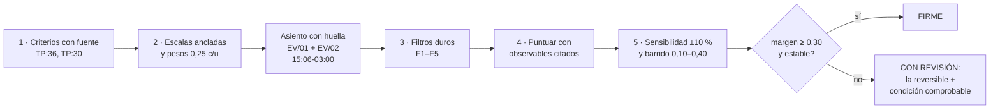
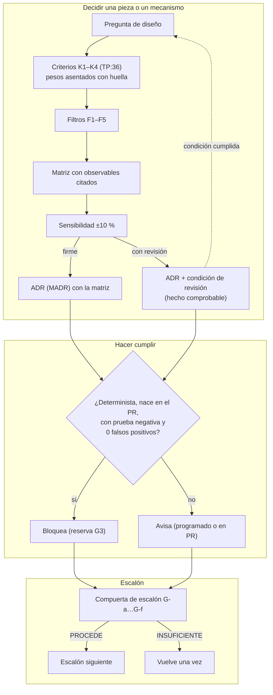

| Campo | Valor |
| --- | --- |
| Tipo | informe |
| Fecha | 2026-10-26 |
| Autor | Comisión C-DECISIONES, a ciegas (no leyó informes de otras comisiones; sólo los folios 001–004 y los informes I06 e I07) |
| Corrige | — |

Norma y secciones leídas por quien redacta: `Rule-Mesa` §3.4 (`RM:192-262`); `Rule-Escalas-De-Juicio` §3;
`Knowledge-Cadena-De-Consecuencias` §2; `R01` §8–§10; folios 002 (§8, preguntas), 003 (§5 y §9) y 004 (§3.6 y §4).
Carta: la carta común y el despacho C-DECISIONES que relayó la presidencia; no se archivó copia en `evidencia/` desde
esta comisión.

# Informe C-DECISIONES — expediente 0002

## Índice

1. [Mandato, alcance y no-competencia](#1-mandato-alcance-y-no-competencia)
2. [Alias de rutas](#2-alias-de-rutas)
3. [Definiciones](#3-definiciones)
4. [Método: criterios y pesos asentados antes de puntuar](#4-método-criterios-y-pesos-asentados-antes-de-puntuar)
5. [Dictámenes por pregunta](#5-dictámenes-por-pregunta)
6. [Función formal: cuantificadores y umbrales](#6-función-formal-cuantificadores-y-umbrales)
7. [Propuesta de método de decisión y de compuertas](#7-propuesta-de-método-de-decisión-y-de-compuertas)
8. [Ensayos corridos](#8-ensayos-corridos)
9. [Excepciones a conocimientos](#9-excepciones-a-conocimientos)
10. [Lo que revisé y está bien](#10-lo-que-revisé-y-está-bien)
11. [No verificado](#11-no-verificado)
12. [Inventario de lo creado y borrado](#12-inventario-de-lo-creado-y-borrado)

---

## 1. Mandato, alcance y no-competencia

**Mandato** (folio 003:152; folio 004 §3.6). Fijar criterios con fuente y pesos **antes** de puntuar (simplicidad,
practicidad, escalabilidad, `TP:36`), armar la matriz por alternativa y ejercer la **función formal** de `RM:216`
(umbrales, pesos, prioridades calculadas, cuantificadores), absorbida por `RM:229-231` y aprobada 5/5 (folio
004:187-197).

**Preguntas asignadas** (18): Q01, Q03, Q06, Q08, Q09, Q13, Q17, Q19, Q22, Q23, Q26, Q29, Q30, Q32, Q33, Q37, Q41,
Q46. Q29 figura en el despacho; en el folio 004 su lector es C-ARQ-NET. Aquí se responde **sólo su parte de
decisión**: con qué regla se elige cada fila (§5.11).

**No-competencia.** No juzgo el contenido técnico de las alternativas: no digo si DocFX compila sobre `net10.0`, ni
cómo se escribe un workflow reutilizable. Puntúo con **observables ya relevados** y con mis propios ensayos de
decisión. Cuando una celda depende de un ensayo técnico de otra comisión, doy su **punto de inversión**: cuánto
tendría que cambiar para que gane otra alternativa. Tampoco escribo caminos de compromiso de fichas (eso es el rol
6 bis, `R01:246-249`).

**Condición K2 que este informe atiende.** El folio 004 asienta (004:199-201 y 004:438, K2) que la carta del
refutador busca umbrales y cuantificadores **del pedido** sin lectura; si deja `PROCEDE` sobre alguno, la absorción
falló y el formal entra con silla propia en el ciclo siguiente. Para facilitar esa prueba, §6.1 lee cada
cuantificador del pedido con su línea. Además, este informe fija umbrales **del objeto** (§6.3: frescura,
compuertas, cortes de dictamen), que K2 no cubre expresamente. **Lo declaro para que la presidencia y el refutador
lo revisen.**

## 2. Alias de rutas

Todas las rutas son desde la raíz del workspace (decisión D6).

| Alias | Ruta |
| --- | --- |
| `TP` | `/LAB/Lab-Documentos/Lab-Documentos.Documentacion/PROMPTs/DEVs/Enchacement/01-Replanteo-Y-Analisis/Replanteo-Y-Analisis.md` |
| `B/` | `/LAB/Lab-Documentos/Lab-Documentos.Documentacion/PROMPTs/DEVs/Enchacement/01-Replanteo-Y-Analisis/OUTPUTs/Bitacoras/` |
| `R0n`, `I0n`, `N0n`, `C00` | `B/<Id>-<Slug>.md` |
| `EXP` | `/LAB/Lab-Documentos/Lab-Documentos.Documentacion/PROMPTs/DEVs/Enchacement/01-Replanteo-Y-Analisis/OUTPUTs/Expedientes/0002-Replanteo-Metodologia-DocAsCode/` |
| `EV/` | `EXP/evidencia/C-DECISIONES/` |
| `RM` | `KB-privada/Rules/Rule-Mesa.md` |
| `REJ` | `KB-privada/Rules/Rule-Escalas-De-Juicio.md` |
| `CDC` | `KB-privada/Knowledges/Knowledge-Cadena-De-Consecuencias.md` |
| `CPA` | `KB-privada/Knowledges/Knowledge-Conformacion-Pull-Request-Automatico.md` |
| `IKB-P` | `KB-privada/Profiles/README.md` |
| `SDD` | `/IA/SDD/IA.SDD/` |

## 3. Definiciones

| Término | Definición | Fuente |
| --- | --- | --- |
| Criterio (K) | Dimensión por la que se compara toda alternativa de una pregunta. Aquí: K1 simplicidad, K2 practicidad, K3 escalabilidad, K4 respaldo de industria y estándares | `TP:36`; `EV/01-pesos-asentados.md` §1 |
| Peso | Fracción de importancia de un criterio; suman 1 | `EV/01` §3 |
| Escala anclada | Escala 1–5 en la que cada punto tiene un observable; sin observable, la celda queda «s/d» | `EV/01` §2 |
| Filtro duro | Restricción que excluye una alternativa antes de puntuar; no se pondera | `EV/01` §4 |
| Margen | Diferencia de puntaje entre la primera y la segunda alternativa | `EV/01` §5 (U2) |
| Decisión firme | Margen ≥ 0,30 y el ganador no cambia con ±10 % en ningún peso | `EV/01` U2 |
| Decisión con revisión | Margen < 0,30 o el ganador cambia: se toma la alternativa reversible y se asienta una condición de revisión comprobable | `EV/01` U3; `CDC` §2 paso 4 |
| Punto de inversión | Cuántos puntos de una celda tendrían que moverse para que cambie el ganador (margen ÷ 0,25) | `EV/01` U5 |
| Cuantificador | Palabra que fija alcance universal o exclusivo («todo», «cada», «sólo», «ninguno») | `RM:216` |
| Umbral | Número que separa aprobar de no aprobar, o avisar de bloquear | `RM:216` |
| Bloquear | En este workspace, poner un control en rojo. No impide un merge humano (plan sin protección de rama), pero sí el del agente: un control en rojo es reserva G3 | `CPA:128`; `R04:283` (8.4) |

**Ejemplo de lectura de una fila de matriz.** Q03, alternativa A4 = (4, 5, 4, 4): agrega 1 pieza nueva (K1 = 4),
funciona hoy sin paso humano extra (K2 = 5), se aplica a un sistema nuevo con una configuración (K3 = 4) y la
respaldan tres referentes primarios (K4 = 4). Puntaje: 0,25 × (4 + 5 + 4 + 4) = 4,25.

## 4. Método: criterios y pesos asentados antes de puntuar

- **Cuándo se asentaron los pesos.** El archivo `EV/01-pesos-asentados.md` se escribió a las 15:06:40-03:00 y su
  huella SHA-256 quedó en `EV/02-huella-pesos.txt` a las 15:06:46 (`627d7e61…de5a3`). En ese minuto, en
  `actuaciones/` sólo existían los folios 001–004, 0060 y 0070 (`EV/03-actuaciones-al-asentar-pesos.txt`), así
  que **ningún resultado de ensayo de generador o de topología de otra comisión existía todavía**. Así se cumple el
  control de J3 y J5 (folio 003:284).
- **Por qué pesos iguales.** `TP:36` enumera las tres ventajas sin orden («simplicidad y practicidad,
  escalibilidad») y agrega, con la misma fuerza, «Es importante basarse en las tendencias del mercado y los
  estandares». No hay fuente que las ordene. Por eso el reparto es igual (razón insuficiente). Es **criterio
  propio**. El barrido de §8 mide cuánto depende cada dictamen de esa elección.
- **Filtros duros** (`EV/01` §4): F1 runner de `TP:34`; F2 sin ruta del host; F3 servicio privado sin nombre; F4 sin
  escribir en `PROMPTs/`; F5 apartarse de un conocimiento exige ficha.

## 5. Dictámenes por pregunta

Las observables de cada celda se citan en la tabla de cada pregunta. Puntajes y sensibilidad:
`EV/05-matriz-salida.txt`.

### 5.1 Q01 — Quinto cupo y postergados

**Dictamen.** Se **ratifica** el panel del folio 004: el quinto cupo es para **C-AGENTES-IA**, y C-DEVOPS,
C-CONFIG-RELEASE, C-SDD-CONOCIMIENTO y C-NORMAS-IA quedan **postergados registrados**, con entrada por la opción B y
las cartas AH-1 a AH-4.

| Alternativa | Fundamento |
| --- | --- |
| Quinto cupo a C-AGENTES-IA (ganadora) | Votado 5/5 (folio 004:215-230, 280-317). Es la única que cubre un núcleo que no cubre ningún obligatorio (`N00:279`) |
| Quinto cupo al formal como sexta silla | Lo evita la absorción aprobada 5/5 (folio 004:197) |
| Quinto cupo a C-DEVOPS | Sus preguntas (Q22, Q24, Q25, Q28) conservan dos lectores (folio 004:234-242) |

**Criterio de decisión aplicado.** Se prioriza por **preguntas que quedarían con un solo lector o sin ninguno**. Es la
severidad esperada que pide `RM:259` cuando hay más señales que cupo. Con ese criterio C-AGENTES-IA es la única
candidata que deja **cero** preguntas sin lector en N03 (folio 004:219, 227-230).

- **Simplicidad**: no reabre una votación unánime.
- **Practicidad**: las cartas AH ya están preparadas (folio 003 §10).
- **Escalabilidad**: la opción B da entrada a los postergados en E1–E3.
- **Riesgo**: que la fusión con la función formal falle en la práctica (J5, folio 004:183, 195).
  **Mitigación**: pesos con huella previa (§4) y este informe sometido al refutador.

### 5.2 Q03 — Topología por pieza

**Dictamen.** **Sí.** La topología se decide **por pieza documental** con la matriz D1–D8 (`I01:202-213`), no una
por proyecto. La salida es una tabla pieza → repo → ancla → fila D. Decisión **FIRME**: margen 1,00, sin
inversión en ningún barrido.

| Alternativa | K1 | K2 | K3 | K4 | Total | Observables |
| --- | --- | --- | --- | --- | --- | --- |
| **A4 Por pieza D1–D8** | 4 | 5 | 4 | 4 | **4,25** | Una pieza nueva: la declaración por pieza. El workspace ya opera así: código + `.Documentacion` (`I01:220`) y Geometría ya aplica el reparto (`R06:151-157`). .NET, GitLab y Kubernetes deciden por pieza (`I01:200`) |
| A3 Híbrido agregado único | 3 | 2 | 4 | 4 | 3,25 | Agregador y playbook nuevos. `GITHUB_TOKEN` no cruza repos (I07-H8). Antora, Backstage y GitLab lo usan (`I01:125-143`) |
| A1 Única: mismo repo | 3 | 2 | 4 | 2 | 2,75 | Mudar pedidos, expedientes e ia-db al código exige decisión del PO sobre `PROMPTs/` (`R06:251`). «Ninguna referencia elige una sola topología» (`I01:200`) |
| A2 Única: dedicado | 3 | 3 | 2 | 1 | 2,25 | Dos PR por cambio (`I01` §6). El repo *orthogonal* es «estado de transición» (`I01:74`) |

- **Ventajas.** Simplicidad: formaliza lo que ya existe. Practicidad: no mueve nada. Escalabilidad: un sistema
  nuevo recorre D1–D8 y llena su tabla.
- **Riesgos.** Que la tabla no se llene. **Mitigación**: criterio V1 de N02 (`N02:137`), con una fila por pieza.

### 5.3 Q06 — Enlaces rotos entre repositorios

**Dictamen.** Los enlaces **entre repositorios** se detectan con un **aviso programado** (semanal, `fail: false`,
abre issue), no con una compuerta de PR. Los enlaces **dentro** del repo sí bloquean (ver Q23). Decisión **CON
REVISIÓN**: margen 0,25.

| Alternativa | K1 | K2 | K3 | K4 | Total | Observables |
| --- | --- | --- | --- | --- | --- | --- |
| **B2 Aviso programado** | 4 | 4 | 4 | 3 | **3,75** | Un job; el ejemplo oficial de lychee corre por `schedule` y abre issue (`I02:226-228`). GitLab omite los externos en el MR (`I02` §7.4) |
| B3 Aviso no bloqueante en PR + programado | 3 | 4 | 4 | 3 | 3,50 | Dos jobs |
| B1 Compuerta cross-repo en cada PR | 3 | 2 | 2 | 2 | 2,25 | Rompe PR ajenos por cambios de otro repo. Necesita leer otros repos (I07-H8). Pares N×M |

- **Condición de revisión** (comprobable). Se pasa a B3 si en el informe semanal aparece un enlace cross-repo roto
  **introducido por un PR fusionado en esa semana**: el aviso en el PR lo habría mostrado antes. Las dos
  alternativas son reversibles.
- **Riesgo.** Una semana de enlace roto visible. **Mitigación**: la referencia por identificador estable, que es
  Q07 (de otra comisión).

### 5.4 Q08 — Conocimientos compartidos

**Dictamen.** **Copia fiel con versión y huella, y una compuerta de deriva.** Cada repo consumidor guarda la copia
**byte a byte**. Un manifiesto generado registra alias, versión, commit de origen y SHA-256. La compuerta de CI
compara las huellas:

- copia editada sin regenerar el manifiesto: **bloquea**;
- fuente con versión más nueva: **aviso**.

Decisión **FIRME**: margen 0,75.

| Alternativa | K1 | K2 | K3 | K4 | Total | Observables |
| --- | --- | --- | --- | --- | --- | --- |
| **C3 Copia fiel + manifiesto con huella + compuerta** | 4 | 4 | 4 | 4 | **4,00** | El mecanismo ya existe en el workspace: copias byte a byte con commit y SHA-256 en un manifiesto que genera `tools/cierre.py` y verifica la compuerta (`IKB-P` «Dónde están las copias fieles»; `KB-privada/Profiles/IA.SDD/MANIFIESTO.md:1-12`). En el mercado: Tessl con versión fija y bundles de Spec Kit con SHA-256 (I06-H4) |
| C1 Fuente única referenciada por ruta | 4 | 1 | 5 | 3 | 3,25 | Un clon limpio no resuelve: IA.SDD exige que «Un documento que se suma desde otro repositorio llega con su cierre» (`SDD/Conocimiento/Index-Knowledge.md:22-24`) |
| C2 Submódulo | 4 | 2 | 2 | 3 | 2,75 | Dos PR y un *bump* por cambio (`I01` D7). Renovate no corre en el runner (I07-H8) |
| C4 Copias libres (hoy) | 5 | 4 | 1 | 1 | 2,75 | Tres versiones vivas del mismo conocimiento (`R03` §7.3); fork divergente sin sincronización (`R04` §7.3) |

- **Ventajas.** Simplicidad: reutiliza una herramienta existente. Practicidad: no pide credenciales entre repos.
  Escalabilidad: un consumidor nuevo es un manifiesto más.
- **Riesgos.** El fork del `SDD-B` ya «dejó de ser copia verbatim» (`R04` §7.3). Pasarlo a copia fiel es un apartamiento de
  su regla local (§9, XC-a).

### 5.5 Q09 — Tags y changelog en Lab-Documentos

**Dictamen.** Lab-Documentos y Lab-Documentos.Documentacion se declaran **repos de ritmo propio** (D4 de I01). Se
conserva el changelog por fecha. Se crea un **tag anotado al cerrar cada compuerta de escalón** (E1, E2, E3), que es
lo que citan la piloto y el `SDD-B`. Decisión **CON REVISIÓN**: margen 0,25.

| Alternativa | K1 | K2 | K3 | K4 | Total | Observables |
| --- | --- | --- | --- | --- | --- | --- |
| **D4 Ritmo propio + tag por compuerta** | 4 | 5 | 4 | 3 | **4,00** | Hoy hay 0 tags (`C00` fila 28). El changelog por fecha es decisión explícita (`I02` §11). Se agrega un acto por compuerta, no por cambio |
| D1 SemVer + changelog por versión | 3 | 4 | 4 | 4 | 3,75 | SemVer y Keep a Changelog (`I02` H9); suma política, tags y reescritura del changelog |
| D2 Ritmo propio, ancla por SHA | 4 | 5 | 3 | 3 | 3,75 | El ancla por SHA dejó la ia-db de Geometría unos 47 PR atrás (`R06:125-127`) |
| D3 CalVer por merge | 4 | 4 | 4 | 3 | 3,75 | Un tag por merge; sin referente relevado en fase 1 |

- **Condición de revisión.** Se pasa a D3 si un consumidor necesita citar una edición **entre** dos compuertas y no
  puede hacerlo con el tag de la compuerta anterior. La elección es reversible: un tag se agrega sin tocar historia.

### 5.6 Q13 — Quién aprueba un PR de documentación hecho por un agente

**Dictamen.** **La segunda identidad de git no cuenta como segundo revisor.** Todos los commits son de una persona
con dos identidades (`R03:212-214`). La aprobación es:

- la **delegación asentada** en el repo (literal, fecha y huella);
- la **guarda G1–G4**;
- las **reservas** de `CPA` (§3.3-§3.4).

Un PR con `origin: agent` que lleve una **decisión de contenido** es reserva y vuelve al PO (`CPA:149`). En un repo sin
delegación, la primera unidad la asienta y ese merge vuelve al PO. Decisión **FIRME**: margen 0,75.

| Alternativa | K1 | K2 | K3 | K4 | Total | Observables |
| --- | --- | --- | --- | --- | --- | --- |
| **E2 Delegación + G1–G4 + reservas** | 4 | 4 | 4 | 4 | **4,00** | Conocimiento catalogado (`CPA`). Revisión posterior al merge como válvula en GitLab (`I01:95-101`). «Agente propone, PR dispone» (`I03:181`) |
| E1 Aprobación humana obligatoria por PR | 4 | 2 | 2 | 5 | 3,25 | No se puede exigir: el plan no tiene protección de rama (`R04` 8.4). Cuello lineal en una sola persona. Copilot: quien pidió no aprueba (`I03` §9.1) |
| E3 Merge del agente sin guarda | — | — | — | — | excluida | Filtro F5: se aparta de `CPA` sin ficha |

- **Riesgo.** Aprobar por silencio (X9). **Mitigación**: con cero corridas de control, G3 da reserva (`CPA:128`). Una
  aprobación sin asiento no es aprobación (`KB-privada/Rules/Rule-Expediente.md:209`).

### 5.7 Q17 — Columna vertebral normativa

**Dictamen.** **Sí.** Se adopta el esqueleto de **ISO/IEC/IEEE 26514:2022 y 26515:2018 en versión liviana, al nivel
de su índice público**, completado con Diátaxis, arc42, C4 y MADR (receta de `I04` §9.2). Toda cita normativa
fina se rotula «según índice». Decisión **CON REVISIÓN**: margen 0,25.

| Alternativa | K1 | K2 | K3 | K4 | Total | Observables |
| --- | --- | --- | --- | --- | --- | --- |
| **P1 2651x liviana + marcos abiertos** | 4 | 5 | 4 | 5 | **4,50** | El índice ya da el esqueleto (`I04:363-365`). 12207 «does not prescribe a specific software life cycle model» (`I04` §9.1). Normas + ≥ 3 marcos |
| P2 Sólo marcos abiertos | 4 | 5 | 4 | 4 | 4,25 | Pierde el pedido de «consulten los estandares» (`TP:36`) y las fases de requisitos e integración que la guía no tiene (`I04:386`) |
| P3 2651x completa + DITA + 26512 contractual | 1 | 2 | 3 | 4 | 2,50 | «Lo que no conviene en un equipo chico» (`I04:363-365`) |

Q17 y Q46 entraron en la segunda corrida de `EV/05`, con los mismos pesos asentados.

- **Condición de revisión.** Se revisa si la mesa necesita una **cláusula de contenido** de 2651x (no sólo su
  título) como ancla E4 de una compuerta bloqueante. En ese caso rige Q46.

### 5.8 Q19 — Una metodología o tronco común con variantes

**Dictamen.** **Tronco común con variantes declaradas.** Las seis fases de N04 §6 tienen la misma entrada, salida y
responsable para todo sistema. Una **tabla de aplicabilidad** por tipo de sistema dice qué artefacto de cada fase
aplica: corpus de guías, app sin roles, panel con roles, servicio con paquetes. Un sistema nuevo elige su fila; no
se escribe una metodología nueva. Decisión **FIRME**: margen 1,00.

| Alternativa | K1 | K2 | K3 | K4 | Total | Observables |
| --- | --- | --- | --- | --- | --- | --- |
| **G2 Tronco común + variantes** | 4 | 4 | 5 | 4 | **4,25** | Una pieza: la tabla. Las normas permiten adaptar (`I04` §9.1). Caminos por tamaño del cambio en BMad (I06-H7) |
| G1 Una sola, idéntica | 5 | 3 | 3 | 2 | 3,25 | Obliga fases que no aplican: MovilidadUrbana no tiene roles (`R05` H1) |
| G3 Una por tipo de sistema | 2 | 3 | 2 | 2 | 2,25 | Cuatro metodologías que mantener; contradice «metodología común» (`TP:20`) |

- **Riesgo.** Que las variantes crezcan hasta ser metodologías aparte. **Mitigación**: una variante sólo **quita** o
  **sustituye** artefactos de una fase; nunca agrega fases. **Criterio propio.**

### 5.9 Q22 — Un workflow o una plantilla

**Dictamen.** **Una plantilla versionada que cada repositorio instancia.** La primera instancia vive en
**Lab-Documentos**, sobre la guía y `Examples/`: ahí está el único workflow con el runner, hoy sin seguimiento y sin
cubrir `Guides/` (`R03:318-340`). Todos los jobs llevan `runs-on: [self-hosted, i7infra-dev]` (F1). Cómo se
instancia (reutilizable o copia con huella, como en Q08) lo decide C-ARQ-NET. Decisión **FIRME**: margen 0,50.

| Alternativa | K1 | K2 | K3 | K4 | Total | Observables |
| --- | --- | --- | --- | --- | --- | --- |
| **H2 Plantilla instanciada por repo** | 3 | 4 | 5 | 4 | **4,00** | Build en el CI de cada repo (Backstage, `I01:125-143`); `docs-lint` por MR en GitLab (`I02` §7.4) |
| H3 Uno escrito a mano por repo | 4 | 4 | 3 | 3 | 3,50 | El patrón se repite a mano (`R03:391-398`) |
| H1 Un workflow central que valida todos los repos | 4 | 1 | 2 | 2 | 2,25 | `GITHUB_TOKEN` no cruza repos (I07-H8). La etiqueta del runner sólo sirve a repos de su dueño (`R03:373-375`) |

- **Riesgo.** Competir con la E2E de Geometría en el único runner (X3). Es Q24, de otra comisión.

### 5.10 Q23 — Qué bloquea y qué avisa

**Dictamen.** Rige **una regla de clasificación**. Un control **bloquea** (rojo, que es reserva G3) si cumple las
cuatro condiciones:

- es **determinista**, con ancla E1 (`REJ` §3.3);
- el defecto lo introduce **el mismo PR**;
- tiene **prueba negativa**: un defecto plantado lo pone en rojo (`N05:162`);
- su corrida de alta sobre el árbol actual tiene **cero falsos positivos** una vez fijada la línea base.

Si falla alguna, **avisa**. Resultado:

- **Bloquean**: Markdown estructural, enlaces relativos, esquema de frontmatter, `traces` que resuelven, y CQ-03,
  CQ-05, CQ-11, CQ-13 y CQ-14 (`I05` §12, 1).
- **Avisan**: enlaces externos y entre repos (Q06), prosa de Vale fuera del nivel `error`, y frescura.
- **CQ-01…14 y PE-01…12** entran como **anexos** de la guía. Los no automatizables se cubren con revisión y *play
  testing*.

Decisión **FIRME**: margen 0,75.

| Alternativa | K1 | K2 | K3 | K4 | Total | Observables |
| --- | --- | --- | --- | --- | --- | --- |
| **J3 Regla de clasificación** | 3 | 5 | 4 | 5 | **4,25** | GitLab bloquea lo interno y omite lo externo (`I02` §7.4); lychee separa (`I02:226-228`); Vale bloquea sólo `error` (`I02` §7.3) |
| J2 Todo avisa | 5 | 4 | 4 | 1 | 3,50 | Una regla que nada pone en rojo no rige; contraindicado por GitLab, «deriva como compuerta» (`I02` H6) |
| J1 Todo bloquea | 4 | 2 | 3 | 2 | 2,75 | Los externos fallan por causas ajenas; el runner es único (`N05-H03`) |

- **Riesgo.** «Bloquear» no impide un merge humano en este plan (`R04` 8.4). **Mitigación**: lo declara la guía; no
  se escribe que «toda falla bloquea el merge».

### 5.11 Q29 — Arquitectura entera: sólo la regla de decisión por fila

Q29 la carga C-ARQ-NET con C-ANALISTA, C-DECISIONES y C-AGENTES-IA (folio 004:354). Desde esta especialidad dictamino **cómo se llena cada fila**:

1. La **topología** de la fila sale de D1–D8 (Q03).
2. El **ancla** y el **canal** que no estén fijados por otra pregunta se eligen con esta matriz y estos pesos.
3. Toda fila con **margen < 0,30** queda «con revisión», con su condición.

No dictamino el contenido de las filas.

### 5.12 Q26 — Generador de sitio

**Dictamen.** **DocFX** para el sitio de guías y para la referencia .NET. El **render embebido** de la prueba de
concepto queda para la **ayuda dentro del panel**, porque es otra pieza: allí la confidencialidad por rol exige
servidor (`R02` §11, 5). Decisión **CON REVISIÓN**: margen 0,25.

| Alternativa | K1 | K2 | K3 | K4 | Total | Observables |
| --- | --- | --- | --- | --- | --- | --- |
| **DocFX** | 4 | 4 | 4 | 3 | **3,75** | Herramienta .NET; el runner usa `dotnet` directo (`N05-H04`). El versionado incompleto en v3 (`I02` §4.2) no pesa si no se versiona el sitio (`I01` D5′). DocFX 2.81.0, actualizado el 25/09/2026, es proyecto .NET Foundation y «Microsoft Learn no longer uses docfx» (NuGet, consultado el 2026-10-26) |
| Render embebido (PoC) | 5 | 5 | 2 | 2 | 3,50 | Demostrado y reproducido el 2026-10-26 (`R02` §11, 1). No genera referencia de API: es una app por sistema |
| Docusaurus | 2 | 3 | 5 | 3 | 3,25 | Node + React en el runner; versiones e i18n nativos (`I02` §4.2; I07 (f)) |
| MkDocs + Material | 3 | 3 | 4 | 2 | 3,00 | «Material for MkDocs is in maintenance mode… Feature development has ended»; correcciones críticas hasta el 2027-05-05 (blog del proyecto, consultado el 2026-10-26) |
| Estático simple | 4 | 3 | 2 | 2 | 2,75 | Sin referente relevado |

- **Punto de inversión.** Basta **un punto** de cualquier celda de DocFX para empatar con el render embebido. En el
  barrido, el ganador cambia con K1 = 0,40, K2 = 0,40 o K3 = 0,10 (`EV/05`).
- **Condición de revisión.** El ensayo de C-ARQ-NET (folio 003 §9) decide. Si DocFX no genera sin advertencias con
  `TreatWarningsAsErrors` sobre el proyecto del escalón, K2 baja a 3 y se recalcula con estos mismos pesos.
- **Por qué es reversible.** Las fuentes son Markdown con frontmatter, así que cambiar de generador no toca el
  contenido.

### 5.13 Q30 — Dónde vive el conocimiento DocAsCode

**Dictamen.** La **fuente** es KB-privada (`Knowledges/`, base neutral). IA.SDD lo recibe como **copia con
su cierre** en `SDD/Conocimiento/`, con la huella de Q08. Lo obliga la regla del framework: un documento que llega
de otro repositorio llega con su cierre (`SDD/Conocimiento/Index-Knowledge.md:22-24`). El `SDD-B` lo recibe por su
perfil, que vive en su destino (`IKB-P`, fila SDD-B). Decisión **FIRME**: margen 0,50.

| Alternativa | K1 | K2 | K3 | K4 | Total | Observables |
| --- | --- | --- | --- | --- | --- | --- |
| **L3 Fuente IKB + copia con cierre y huella** | 3 | 4 | 5 | 4 | **4,00** | La base es neutral; el vocabulario de cada marco sólo vive en su perfil (`IKB-P` párrafo inicial); mecanismo de copias con huella (`IKB-P`) |
| L4 Fuente IA.SDD + copia en IKB | 3 | 4 | 3 | 4 | 3,50 | Mete vocabulario de un marco en la base neutral |
| L1 Sólo KB-privada | 5 | 2 | 3 | 3 | 3,25 | Un destino de IA.SDD clonado solo no lo ve (`Index-Knowledge.md:22-24`) |
| L2 Sólo IA.SDD | 5 | 3 | 2 | 3 | 3,25 | No alcanza a quien no usa IA.SDD |

- **Riesgo.** El alta en IA.SDD es una intervención sobre el framework: lleva CHANGELOG, `_legacy/` y verificación de
  ofuscación (`Index-Knowledge.md:24-27`). No se toca su norma.

### 5.14 Q32 — Choque con `Rules-Documentacion` en la piloto

**Dictamen.** Dos pasos:

1. **Apartamiento declarado con ADR en el destino** (`Root-Rules` §11, que Geometría ya usa en cuatro ADR,
   `R06` §10, 1a).
2. **En el mismo acto**, una **propuesta de cambio de norma** al lote del PO para sumar el rol «usuario», con el ADR
   y la piloto como evidencia. Se decide en la compuerta E3.

Decisión **CON REVISIÓN**: margen 0,25.

| Alternativa | K1 | K2 | K3 | K4 | Total | Observables |
| --- | --- | --- | --- | --- | --- | --- |
| **M3 ADR + propuesta al lote** | 3 | 4 | 4 | 4 | **3,75** | Es local y reversible, y no deja que el apartamiento se repita en cada sistema |
| M2 Cambio de norma ya | 3 | 2 | 5 | 4 | 3,50 | Pide una decisión del PO sobre la norma de todos los destinos; la memoria del proyecto lo restringe (`R06` §10, 1b). 26514 trata justamente la información para usuarios (`I04`) |
| M1 Sólo apartamiento | 4 | 4 | 2 | 3 | 3,25 | Cada sistema nuevo repite el apartamiento |

- **Condición de revisión.** Si al cerrar E2 la piloto **no** necesitó el rol «usuario» para nada que el ADR no
  cubra, la propuesta se retira y queda M1.
- **Medido** (`EV/04`). `Rules-Documentacion.md` no cambió desde el 2026-08-22, así que el choque X1 es **el mismo
  en 13.16 y en 13.22**: la migración de Q33 no lo resuelve.

### 5.15 Q33 — Migrar Geometría de 13.16 a 13.22

**Dictamen.** **Migrar antes de la piloto**, como unidad propia y previa a E2. Decisión **CON REVISIÓN**: margen 0,25.

| Alternativa | K1 | K2 | K3 | K4 | Total | Observables |
| --- | --- | --- | --- | --- | --- | --- |
| **N1 Migrar antes** | 4 | 3 | 4 | 4 | **3,75** | Los seis saltos son menores (13.17 → 13.22). Entre 13.16 y 13.22, `Master-Prompt.md` agrega en la **Fase I** la «Reintegración a la especificación» (paso 1 bis) y las comprobaciones 9 y 10 de la compuerta, y crea `SDD/Expedientes/` (`EV/04`). La piloto corre justamente la Fase I, Momento 2 |
| N2 Correr sobre 13.16 | 5 | 5 | 2 | 2 | 3,50 | El conocimiento resultante nacería sin el paso de reintegración que 13.22 vuelve obligatorio, y habría que migrarlo igual (`R06` §10, 6) |
| N3 Migración selectiva | 4 | 3 | 3 | 1 | 2,75 | La migración apunta al **estado objetivo** del conjunto vigente, no a recetas por salto (`SDD/SDD/Devs/Rules/Migracion-Rules.md:100-108`) |

- **Condición de revisión.** Si el plan de migración (`Migracion-Rules` §3) clasifica algún documento de Geometría
  como invalidado por un salto **mayor**, la migración se separa en su propio expediente y la piloto espera su
  cierre.

### 5.16 Q37 — Qué demuestra cada escalón

**Dictamen.** Se adopta la propuesta de `N07:139`, pero cada escalón se escribe como **una hipótesis falsable con su
observable**. La compuerta del escalón responde si el observable se produjo, y nada más.

| Escalón | Hipótesis que demuestra (y el anterior no) | Observable de aceptación |
| --- | --- | --- |
| E0 (hecho) | Ayuda por rol con confidencialidad en servidor | Reproducido el 2026-10-26 (`R02` §11, 1) |
| E1 | Una app **sin roles** sirve a dos audiencias (persona y agente) desde **fuente generada**, con el workflow de `TP:34` | OpenAPI emitido en build y versionado; `llms.txt` o `.md` por página generados; corrida verde en `[self-hosted, i7infra-dev]` con enlace; una prueba negativa por compuerta en rojo |
| E2 | El método entra en un **SDD real** (IA.SDD 13.22) con su CI, roles y reintegración | Fase I con Momento 2 y paso 1 bis ejecutados; ADR de Q32 asentado; validador documental en el CI del repo de código; E2E de acceso por rol en verde |
| E3 | **Dos repos** y versionado de varias piezas con orquestadores mejorados | Tabla pieza → ancla resuelta en los dos repos; compuerta de Q08 en verde sobre las copias; un cambio de código que dispara el aviso documental en el otro repo |

- **Ventaja.** Sin observable no hay compuerta, así que esta forma evita el dictamen «depende» que advierte Q41.

### 5.17 Q41 — Evidencia, criterio de aceptación y expediente de cada compuerta

**Dictamen.** Cada compuerta (D1) se juzga con **seis pruebas fijadas de antemano**, de alcance universal porque
`TP:61` dice «Toda afirmación». El **dictamen** de cada compuerta es un folio de **este** expediente 0002 (folio 001
§2: uno solo, con cita calificada). El **trabajo y la evidencia** del escalón quedan en el expediente del repo del
escalón cuando ese repo ya tiene la forma: Geometría con `SDD/Expedientes/` desde 13.22 (`EV/04`), y el `SDD-B` con
la suya. Se citan por identificador.

| # | Prueba | Umbral para `PROCEDE` | Fuente del umbral |
| --- | --- | --- | --- |
| G-a | Corrida real del workflow en el runner, con enlace | 1 corrida verde sobre la cabeza del escalón | `N05:163` (V5) |
| G-b | Prueba negativa por cada compuerta bloqueante | 100 % de las bloqueantes en rojo con su defecto plantado | `N05:162` (V3) |
| G-c | Trazas | 100 % de las `traces` del escalón resuelven a `ruta:línea` o a un identificador | `TP:61`; `N02:137` |
| G-d | Lector sin contexto (*play testing*) | 0 preguntas de nivel P0 o P1 con respuesta en el corpus | `RM:202-204`; `REJ` §3.1 |
| G-e | Barrido S2 | Vacío | folio 001 D6 |
| G-f | Lista VER-* aplicable | 100 % de los ítems obligatorios | `R07:128-315` |

**Corte del dictamen.**

- `PROCEDE`: las seis pruebas cumplen.
- `NO_PROCEDE`: hay algún hallazgo P0.
- `INSUFICIENTE`: falta la medida de alguna prueba. Vuelve una vez (`RM:332`, citado en `R01` §10.2).

### 5.18 Q46 — Comprar ISO/IEC/IEEE 26514:2022

**Dictamen.** **No se compra en el ciclo 1.** La guía usa el índice público y rotula «según índice» las cláusulas
finas. Decisión **CON REVISIÓN**: margen 0,25.

| Alternativa | K1 | K2 | K3 | K4 | Total | Observables |
| --- | --- | --- | --- | --- | --- | --- |
| **No comprar; índice rotulado** | 5 | 5 | 4 | 3 | **4,25** | El índice da el esqueleto (`I04:365`); las cláusulas finas sólo se apoyan en el índice (`C00:165`) |
| Comprar ahora (CHF 204, `I04:365`) | 4 | 3 | 4 | 5 | 4,00 | Es una decisión de gasto: va al lote del PO y no se asienta por silencio (`R01:473-476`) |
| Comprar cuando ocurra el evento | 4 | 4 | 4 | 4 | 4,00 | Igual a la anterior, diferida |

- **Condición de revisión.** Cuando una compuerta bloqueante necesite como ancla E4 el **texto** de una cláusula de
  26514 (no su título), la compra va al lote del PO con esa cláusula como motivo.
- **Sensibilidad.** Es la decisión más sensible al peso de K4: con K4 = 0,34 gana «comprar ahora» (`EV/05`). Si el
  PO declara que el respaldo normativo pesa más que los otros criterios, la compra procede.

## 6. Función formal: cuantificadores y umbrales

### 6.1 Cuantificadores del pedido y su lectura

Barrido: `EV/06-barrido-formal.txt`. **El pedido no trae ningún umbral numérico.** Todos los números de este
expediente los pone la mesa, y cada uno lleva su fuente (§6.3).

| Línea | Término | Lectura (criterio propio, salvo cita) |
| --- | --- | --- |
| `TP:20` | «no solo son agentes humanos» | Las audiencias incluyen personas **y** agentes; las dos son obligatorias en toda pieza que se publique |
| `TP:30` | «luego… y finalmente» | Orden estricto E1 → E2 → E3, con compuerta entre escalones (D1) |
| `TP:32` | «primero entender como se resuelve en la industria» | Toda decisión de esta mesa sale después de la investigación de industria (I01–I07, fechadas antes del folio 001) |
| `TP:36` | «deben trazar», «se deben buscar» | Obligación: cada dictamen declara sus ventajas de simplicidad, practicidad y escalabilidad |
| `TP:36` | «todas las pruebas que sean necesarias» | Universal acotado por necesidad: con hipótesis nombrada y prueba al alcance, se corre antes de rotular «no verificado» (`R01` §9) |
| `TP:42` | «Deben incluir… Debe ser autocontenida… deben tener índices» | 100 % de los documentos creados: índice, definiciones y forma no delta |
| `TP:44` | «toda la mesa… sobre la totalidad del prompt» | Universal sobre agentes y sobre el texto: ningún despacho se exime de la descomposición en núcleos |
| `TP:46` | «únicamente por extensión» | Prohibición: un corte que sólo se justifica por tamaño es hallazgo |
| `TP:51` | «Cada núcleo… relativamente independiente» | «Relativamente» es vago. Lectura: cada núcleo se valida con sus V-n sin abrir otro núcleo, salvo las dependencias que declara `N00` |
| `TP:55` | «todo coherente» | La integración resuelve **todas** las contradicciones X1–X13 o las declara abiertas con motivo |
| `TP:61` | «Toda afirmación» | 100 % de las afirmaciones **de hecho**, con ancla E1–E4. El criterio propio rotulado no es afirmación de hecho. Si el refutador encuentra una sin ancla en su muestreo, es hallazgo |

### 6.2 Umbrales del método de esta comisión

U1–U5 de `EV/01` §5. El 0,30 equivale a algo más de un punto en un criterio con peso 0,25: hace falta más que una
celda discutible para declarar firme una decisión. El ±10 % sale del folio 003 §9. Ambos son **criterio propio**.

### 6.3 Umbrales que este informe propone para el objeto

| Id | Umbral | Valor | Fuente |
| --- | --- | --- | --- |
| UO-1 | Enlaces relativos rotos en un PR | 0 (bloquea) | `I02:226-228`; Q23 |
| UO-2 | Enlaces externos y entre repos | Aviso semanal | `I02:355` (cron semanal); Q06 |
| UO-3 | Frescura: `last_review` | Aviso a los 365 días | Microsoft Learn `ms.update-cycle: 365-days`; Google, recordatorio a los tres meses como ejemplo (`I02` §9.2). Se toma el más largo de los primarios para no inundar a un mantenedor único. **Criterio propio** |
| UO-4 | Frontmatter obligatorio | 100 % de los documentos de la guía | `TP:42`; `I02` §8 |
| UO-5 | Versiones publicadas del sitio | 1 (la desplegada) mientras haya una sola versión viva; si se versiona, menos de 10 | `I01` D5/D5′; Docusaurus (`I02` §4.3) |
| UO-6 | Compuerta de escalón | G-a…G-f de §5.17 | §5.17 |

## 7. Propuesta de método de decisión y de compuertas

Desde mi especialidad, la arquitectura del sistema documentador necesita **una regla de decisión estable** que
viaje con la guía, para que un sistema nuevo no reabra el debate. Propuesta:

- **Dónde va en la guía.** Un anexo «Cómo decidir», con la escala anclada de `EV/01` §2 y esta tabla de dictámenes
  como ejemplo trabajado. **Criterio propio.**
- **El ADR lleva la matriz.** MADR ya pide alternativas y consecuencias (`I04` §9.2). La matriz de §5 cabe en la
  sección de opciones.

## 8. Ensayos corridos

| # | Ensayo | Comando | Resultado | Evidencia |
| --- | --- | --- | --- | --- |
| 1 | Asiento previo de pesos | `sha256sum 01-pesos-asentados.md`; `ls -la actuaciones/` | Huella `627d7e61…de5a3` a las 15:06:46-03:00; en `actuaciones/` sólo había 001–004, 0060 y 0070 | `EV/01`, `EV/02`, `EV/03` |
| 2 | Matriz, sensibilidad ±10 % y barrido 0,10–0,40 | `docker run --rm -u <uid>:<gid> -v <dir>:/w:ro -w /w python:3.12-slim python3 -I matriz.py` (imagen `ec7d6c95cd36`) | 14 preguntas puntuadas. **Ninguna** cambia de ganador con ±10 % en un peso. Firmes: Q03, Q08, Q13, Q19, Q22, Q23, Q30. Con revisión, por margen 0,25: Q06, Q09, Q17, Q26, Q32, Q33, Q46. En el barrido amplio sólo se invierten Q26 (K1 = 0,40, K2 = 0,40 o K3 = 0,10), Q32 (K2 = 0,10), Q33 (K1 = 0,40, K2 = 0,34, K3 = 0,10 o K4 = 0,10) y Q46 (K2 = 0,10 o K4 = 0,34, hacia «comprar ahora»). Q17 y Q46 se sumaron en una segunda corrida con los mismos pesos; las otras doce filas no cambiaron | `EV/05-matriz-salida.txt`; guion en `EV/05b-matriz.py.txt` |
| 3 | Qué cambió en IA.SDD entre 13.16 y 13.22 | `git log -1 -- SDD/Devs/Rules/Rules-Documentacion.md`; `git log --since=2026-09-13 --name-only`; `git diff 8c55a1e HEAD -- SDD/Devs/Orchestrator/Master-Prompt.md` | `Rules-Documentacion.md`: último cambio `66db293` del 2026-08-22, sin cambios en el tramo. Cambian `Expediente-Rules`, `Root-Rules`, `Mesa-Rules`, `Rules-Base-Conocimiento` y otras cinco. `Master-Prompt` 8.19 → 8.21 agrega reintegración en la Fase I y las comprobaciones 9 y 10 | `EV/04-ia-sdd-13.16-a-13.22.txt` |
| 4 | Barrido de cuantificadores del pedido | `grep -n -o -iwE '<lista>' Replanteo-Y-Analisis.md` | 26 apariciones en 12 líneas; ningún umbral numérico | `EV/06-barrido-formal.txt` |
| 5 | Estado de los generadores (fuentes web) | Consulta del 2026-10-26 | DocFX 2.81.0 (25/09/2026), proyecto .NET Foundation, «Microsoft Learn no longer uses docfx». Material for MkDocs en mantenimiento, con correcciones críticas hasta el 2027-05-05 | URL en §11 |

**Nota sobre `EV/04`.** Ese archivo trae, en su comando 3, un primer cálculo contra `5489cc7`, que no es el commit de
13.16. El cálculo correcto está en la sección «corrección» del mismo archivo (comandos 5–7): padre del primer commit
con la entrada 13.17, `8c55a1e`. La corrida descartada se conserva y no cambia la conclusión: en los dos cálculos,
`Rules-Documentacion.md` no cambia.

**Fuentes web consultadas el 2026-10-26.**

- NuGet, «docfx», https://www.nuget.org/packages/docfx
- squidfunk, «Zensical – A modern static site generator built by the Material for MkDocs team», 2025-11-05, con
  actualización de octubre de 2026, https://squidfunk.github.io/mkdocs-material/blog/2025/11/05/zensical/

## 9. Excepciones a conocimientos

| Id | Conocimiento (§) | Qué se propone en su lugar | Impacto operativo |
| --- | --- | --- | --- |
| XC-a | Catálogo de conocimientos del `SDD-B`, `Prompts/Conocimientos/README.md:25-35` y `:54-62` (extensión por fork y copia que «dejó de ser copia verbatim»), según `R04` §7.3 e I06 §4 | Q08: copia fiel con huella y manifiesto; lo propio del proyecto va aparte, como especialización declarada (`Hereda-de`), no editando la copia | Hay que reconciliar 14 homónimos (`R04` §7.3) en el escalón 3; la compuerta de huellas los marca hasta reconciliarlos |
| XC-b | IA.SDD `SDD/Devs/Rules/Rules-Documentacion.md:102` (usuario final fuera de alcance) | Q32: apartamiento declarado con ADR por `Root-Rules` §11, más una propuesta de cambio al lote del PO | La piloto agrega NB, CU y ADR en el destino; la norma no se toca sin el PO |
| — | `Knowledge-Conformacion-Pull-Request-Automatico`, `Knowledge-Cadena-De-Consecuencias`, `Rule-Escalas-De-Juicio` | Se siguen sin apartamiento | — |

## 10. Lo que revisé y está bien

1. **La aprobación 5/5 de la absorción** (folio 004:187-197) es coherente con `RM:227-231`: el formal entró sin
   votación y sin silla propia.
2. **La receta liviana de I04 §9.2** es compatible con las seis fases de N04 §6. No hay fase sin marco.
3. **El ejemplo de cálculo de §3** coincide con la salida de la matriz (`EV/05`, Q03: 4,25).

## 11. No verificado

- **Celdas que dependen de ensayos técnicos de otras comisiones.** K2 de DocFX (compilación sin advertencias), K2 de
  H2 (instanciación de plantillas en el runner) y K2 de C3 (que la herramienta de huellas corra en el runner). Lo
  que tendría que cambiar para invertir cada una está en §5.
- **Que el runner sirva a todos los repos del escalón** (`R03:373-375`). No se consultó la API de runners.
- **Precio vigente de 26514:2022.** Se toma CHF 204 de `I04:365`, sin reconsulta.
- **Que `Root-Rules` §11 admita el apartamiento de Q32 con la forma propuesta.** Se toma de `R06` §10, sin leer la
  norma.
- **CalVer.** No hay referente primario relevado en la fase 1; por eso D3 tiene K4 = 3 sin cita externa.

## 12. Inventario de lo creado y borrado

| Qué | Dónde | Estado |
| --- | --- | --- |
| Este folio | `EXP/actuaciones/015-informe-c-decisiones.md` | Creado |
| Pesos, huella, listado previo, ensayo de IA.SDD, salida de la matriz, guion (texto, sin permiso de ejecución) y barrido formal | `EV/01`…`EV/06`, `EV/05b-matriz.py.txt` | Creados |
| Directorio de ensayos con `matriz.py`, `salida.json`, `err.txt` y `cl-13.17-13.22.txt` | `fc-work/docascode/C-DECISIONES/` del anfitrión | Borrado al cerrar |
| Contenedor `python:3.12-slim` | `--rm`, efímero | Sin restos; la imagen ya estaba en el host |

Sin commits, push ni PR. Nada se escribió fuera de `EXP/` y `B/`. No se leyeron los directorios de ensayo de otras
comisiones.

**Barrido S2 y de privacidad** sobre este folio y `EV/*`: patrón de E-12 (rutas de host y de usuario) más el nombre
del servicio privado, su dominio y la organización, con `grep -nIiE`, el 2026-10-26. Resultado **vacío** (salida 1).
`docker ps -a` sin contenedores remanentes de la imagen usada.

**Revisión al reanudar (2026-10-26).** El folio 004 se reeditó después de la primera redacción: cambió su
numeración y el recuento de la absorción quedó en 5/5 con la condición K2. Se actualizaron las citas a ese folio
(§1, §4, §5.1, §5.11, §10). No cambia ningún dictamen ni ningún puntaje. No se creó ningún archivo nuevo para esta
revisión.

Sigue: análisis de decisiones · presidencia
