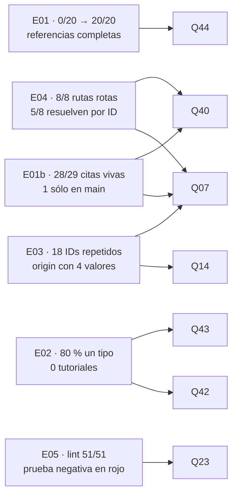
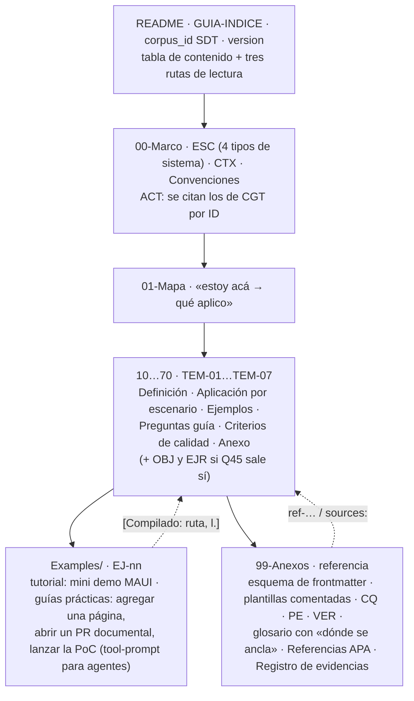

| Campo | Valor |
| --- | --- |
| Tipo | informe |
| Fecha | 2026-10-26 |
| Autor | Comisión C-ACADEMICO — académico en edición de material bibliográfico (agente de IA, obligatorio por D3). Absorbe la lectura del diseñador instruccional, postergado (folio 004:414) |
| Corrige | — |

| Cabecera | Valor |
| --- | --- |
| Rol | C-ACADEMICO. Competencia: citación (APA 7 en castellano con fecha de consulta), referencias, material de consulta, ejemplos, la guía como cuerpo documental, objetivos y ejercicios. No-competencia: toolchain, topología, tipografía del sitio |
| Carta | Despacho C-ACADEMICO de la presidencia, recibido el 2026-10-26 (no archivado en `evidencia/` por esta comisión). Trabajo **a ciegas**: de `actuaciones/` leí sólo 001, 002, 003, 004, 0060 y 0070 |
| Norma | `KB-privada/Knowledges/Knowledge-Mesa-De-Expertos-A-Pedido.md` 3.1 |
| Secciones de Mesa-De-Expertos-A-Pedido 3.1 leídas | Líneas 1-111 (cabecera y §0 con su Mapa de carga); fila «comisión»: §2.2, §3.2, §3.3, §4 y §5.2 |
| Otros documentos cargados | `Cadena-De-Consecuencias` 2.0, §2 (`KB-privada/Knowledges/Knowledge-Cadena-De-Consecuencias.md:61-83`); `Icono-Y-Ancla` 2.0, §1, §3.1, §3.4 y §5 (convención que rige para las definiciones de la guía, folio 001:250). `Excepcion-A-Un-Conocimiento` **no** se cargó: no propongo dejar de seguir ninguna convención que rige (§11) |
| Insumos leídos | Tool-prompt completo (67 líneas); Profile real `/IA/PROMPTs/IA.Prompts/PromptFramework/Profiles/Study-Guide-Documentation.md` (85 líneas); `RuleSet-Study-Guide`, `Rule-Dual-Audience`, `Rule-Evidences`, `Rule-Markdown`; la guía completa (759 líneas) y sus `Examples/`; `Creacion-Guias-Tecnicas/00-Marco-de-Referencia/Convenciones.md`, `Actores.md:37,57` y `README.md`; `Dot-NET-Arquitectura-Guide.md` (frontmatter, §0.5, Anexo E); bitácoras N08, N02 (§4-§11), N03 (§4-§11), I05 completas, R01 (§8.2, §10.2, §17.1), R02 (§6-§11), R03 (§5-§6), R04 (grep); folios 001 (§6-§7), 002 (§8), 003 y 004 (grep de esta comisión) |
| Medios propios | Descargas con `curl` a un directorio de ensayos **fuera del workspace** (`$W`), guiones propios de Python ejecutados con `python3 -I` sobre rutas pasadas como argumento, API pública de GitHub. Sin Docker: ningún ensayo lo necesitó. Salidas recortadas en `evidencia/C-ACADEMICO/` |

Alias de este folio: `GUIA` = `/LAB/Lab-Documentos/Lab-Documentos/Guides/Documentacion-Tecnica/Sistema-De-Documentacion-E-Integracion/Sistema-Documentador-Tecnico-Guide.md` (Lab-Documentos `5d5c2b4`); `CGT` = `/LAB/Lab-Documentos/Lab-Documentos/Guides/Documentacion-Tecnica/Creacion-Guias-Tecnicas/`; `NET` = `/LAB/Lab-Documentos/Lab-Documentos/Guides/Dot-NET-Arquitectura-Guide/Dot-NET-Arquitectura-Guide.md`; `PERFIL` = el Profile real; `EV/` = `evidencia/C-ACADEMICO/` de este expediente; `B/` = `/LAB/Lab-Documentos/Lab-Documentos.Documentacion/PROMPTs/DEVs/Enchacement/01-Replanteo-Y-Analisis/OUTPUTs/Bitacoras/`.

# Informe de la comisión C-ACADEMICO — expediente 0002

## Índice

1. [Lectura del objetivo](#1-lectura-del-objetivo)
2. [Definiciones](#2-definiciones)
3. [Ensayos corridos](#3-ensayos-corridos)
4. [Hallazgos](#4-hallazgos)
5. [Dictamen pregunta por pregunta](#5-dictamen-pregunta-por-pregunta)
6. [Propuesta de método: la guía como cuerpo documental](#6-propuesta-de-método-la-guía-como-cuerpo-documental)
7. [Fuentes externas](#7-fuentes-externas)
8. [Lo que revisé y está bien](#8-lo-que-revisé-y-está-bien)
9. [Solicitudes de convocatoria](#9-solicitudes-de-convocatoria)
10. [Fichas](#10-fichas)
11. [Excepciones a conocimientos](#11-excepciones-a-conocimientos)
12. [No verificado](#12-no-verificado)
13. [Inventario de lo creado y lo borrado](#13-inventario-de-lo-creado-y-lo-borrado)

---

## 1. Lectura del objetivo

El objetivo del contrato (folio 001:231-236) tiene una cláusula que es de esta comisión sin intermediarios: la
metodología se **expone** como guía enriquecida (`TP:20` «se debe enriquecer la guía `Sistema-Documentador-Tecnico-Guide.md`
y los ejemplos/demos anexados») con el Profile `Study-Guide-Documentation` (`TP:65-68`), y la mesa cita
«academicos en edición de material bibliografico para consultar y crear ejemplos y material de consulta» (`TP:36`).
Las reglas de forma son literales: secciones jerárquicas, definiciones, ejemplos claros, mermaid, autocontenida, no
delta, con índices (`TP:42`); y «Toda afirmación debe estar respaldada por evidencia verificable» (`TP:61`).

**Lo que el objetivo da por fijo sin origen** (primer hallazgo, exigido por la carta): ninguna cláusula del objetivo
nombra **un formato de citación**. «APA 7 en castellano con fecha de consulta» aparece en mi mandato (folio 003:153) y
en la propuesta de `I05:247-270`, no en el pedido. El pedido sólo exige que la evidencia sea **verificable**
(`TP:61`). Por eso, en Q44 la elección de APA se funda en la práctica ya vigente en el workspace (`NET`, Anexo E) y en
`Rule-Evidences.md:25`, no en el pedido; si el PO quisiera otro estilo, la decisión es reversible (§5, Q44).

---

## 2. Definiciones

Cada definición sigue el esqueleto de `Icono-Y-Ancla` §5 (concepto · cómo se aplica · un caso), porque esta guía la
leerá quien no participó de la discusión.

**Referencia completa.** Entrada del anexo de referencias que trae los cinco elementos que APA 7 pide a un recurso
web —autor (persona u organización), fecha o «s. f.», título, URL— más la fecha de consulta que exige
`Rule-Evidences.md:25`.
**Cómo se aplica.** Tachá en la entrada cada uno de los cinco; si falta uno y no se puede escribir en una forma válida
(«s. f.», título descriptivo entre corchetes), la referencia está incompleta.
**Un caso.** «`writethedocs.org/guide/docs-as-code/`, consultada el 2026-09-16» (`GUIA:102`) tiene URL y consulta;
le faltan título y fecha. La página firma «author: Eric Holscher & the Write the Docs community» (`EV/E01`, R05):
la referencia completa es «Holscher, E., y comunidad Write the Docs. (s. f.). *Docs as code*…».

**Identificador estable de cita (clave de cita).** Nombre de un documento que no cambia cuando el archivo se mueve:
un `doc_id` calificado por su cuerpo documental y, si se cita desde otro repositorio, anclado a una versión.
**Cómo se aplica.** Mové mentalmente el archivo a otra carpeta: si la cita sigue señalando un solo documento, es
estable; si deja de resolver o resuelve a dos, no lo es.
**Un caso.** `../Documentacion-Tecnica/30-Arquitectura/SAD.md` (`GUIA:203`) dejó de resolver con la reorganización
`9162e07`; `DOC-SAD` sigue resolviendo a un solo archivo (`EV/E04`). `MARCO-ACTORES` resuelve a cuatro (`EV/E03`): sin
calificar por cuerpo, no es estable entre guías.

**Cuerpo documental.** Conjunto de documentos navegable desde un README con ruta de lectura, marco de referencia, un
documento por tema con la misma estructura interna, anexos y glosario (`PERFIL:41-50`, `:56-63`, `:83-85`).
**Cómo se aplica.** Abrí el README y contá cuántos documentos alcanzás siguiendo sólo sus enlaces y los de cada
documento: si queda alguno huérfano, o si un tema no tiene las seis secciones del Profile, no es todavía un cuerpo.
**Un caso.** `CGT` lo es (59 documentos, `README.md` con `doc_id: GUIA-INDICE`); la guía del documentador no: es un
archivo de 759 líneas sin README en su carpeta (`R02:300-318`).

**Tipo Diátaxis de una sección.** Una de cuatro formas según lo que el contenido informa (acción o cognición) y lo que
el lector busca (adquirir o aplicar una habilidad): tutorial, guía práctica, referencia, explicación
(Procida, s. f.-b, «The compass»).
**Cómo se aplica.** Hacele a la sección las dos preguntas de la brújula; si la respuesta cambia entre párrafos, la
sección mezcla tipos y conviene partirla.
**Un caso.** `GUIA` §7.9 (`GUIA:524-532`) informa acción para aplicar → guía práctica. §5.1 (`GUIA:185-203`) argumenta
(cognición, adquisición) y además trae una tabla para consultar (cognición, aplicación) → mezcla explicación y
referencia.

**Ejemplo trabajado.** Problema resuelto paso a paso que el lector estudia antes de resolver uno equivalente
(Sweller y Cooper, 1985, en `I05:64`).
**Cómo se aplica.** Buscá, antes de cada ejercicio, un caso resuelto con la misma estructura; si el ejercicio llega
primero o solo, falta el ejemplo trabajado.
**Un caso.** `NET` §9.5 resuelve el problema conductor y §9.7 (`NET:2612`) propone «Ejercicios de transferencia»;
`GUIA` tiene 0 ocurrencias de «ejercicio» (`EV/E03`, última línea).

**Criterio propio.** Juicio de esta comisión sin fuente externa; se rotula *[criterio propio]* (`Rule-Evidences.md:11`).

---

## 3. Ensayos corridos

`$WS` = raíz del workspace; `$W` = directorio de ensayos fuera del workspace (borrado al cerrar, §13). Los guiones están
copiados en `EV/scripts/` y se ejecutan con `python3 -I`.

| Id | Qué prueba | Comando | Resultado | Evidencia |
| --- | --- | --- | --- | --- |
| E01 | Rehacer veinte referencias de `GUIA` en APA 7 en castellano y medir cuántas quedan incompletas | `while read id url; do curl -sL -A "Mozilla/5.0" -o $W/dl/$id.html "$url"; done < EV/scripts/urls.tsv`; `python3 -I EV/scripts/meta.py $W/dl`; API de GitHub para autor y versión de docfx y markdig | **Antes: 0/20 completas** (falta título en 15, autor en 4, fecha en 19; consulta en el lugar de la cita sólo en 3). **Después: 20/20 completas**, 12 con «s. f.», 1 con título descriptivo entre corchetes. 20/20 URL responden `200` (18:37 -03:00) | `EV/E01-veinte-referencias-apa.md`, `EV/E01b-citas-y-estado-http.txt` |
| E01b | ¿Las citas textuales de `GUIA` siguen en la página publicada? | `python3 -I EV/scripts/quotes.py $W/dl` | El guion informa 26/29; R05 y R06 son falsos negativos del marcado (contexto extraído con `txt.py`): **28/29**. La que falta, «linking to immutable standalone deployment» (`GUIA:627`), está en `website/docs/guides/docs/versioning.mdx:330` de la rama `main` de Docusaurus y no en la página publicada. Además, 4 páginas citadas cambiaron después de la consulta de la guía (`dateModified` 2026-09-28 a 2026-10-24) | `EV/E01b-…`, `EV/E01` §4 |
| E02 | Ruta Diátaxis sobre el índice actual: ¿cada sección cae en un solo tipo? | Clasificación de los 45 encabezados con contenido (`grep -n '^##' GUIA`) con la brújula de Diátaxis; recuento con un guion sobre `EV/E02-diataxis-clasificacion.tsv` | **36/45 (80 %) en un solo tipo; 6 (13 %) mezclan; 3 fuera de los cuatro tipos** (preguntas guía, observaciones, registro de evidencias). Por tipo: explicación 27, referencia 8, guía práctica 1 (§7.9), **tutorial 0** *[la clasificación es criterio propio; el recuento es mecánico]* | `EV/E02-diataxis-clasificacion.tsv`, `EV/E02-diataxis-recuento.txt` |
| E03 | ¿Hay ya un contrato de frontmatter de facto en `Guides/`? ¿Los `doc_id` son únicos? | `python3 -I EV/scripts/fm.py $WS/LAB/Lab-Documentos/Lab-Documentos/Guides`; detección de `doc_id` repetidos | 294 `.md`, 219 con frontmatter; los diez campos de `Rule-Dual-Audience.md:21` presentes en 207. **`origin` con 4 valores para dos conceptos** (`ia-assisted` 184, `agente` 19, `ai-assisted` 3, `agent` 1); `confidence` 6; **`doc_type` 19**. **18 `doc_id` repetidos entre guías** (`MARCO-ACTORES` en 4). `status: draft`, `origin: agent` y `confidence: high` aparecen una sola vez cada uno: **en `GUIA`** | `EV/E03-frontmatter-e-ids.txt` |
| E04 | ¿Qué sobrevive a una reorganización: la ruta o el ID? | `python3 -I EV/scripts/links.py GUIA $WS/LAB/Lab-Documentos/Lab-Documentos/Guides` | 9 enlaces internos a `.md`, **8 rotos** (5 destinos) por `9162e07`. **5 de los 8 se resuelven por `doc_id` a un único archivo** (`DOC-ADR`, `DOC-SAD`, `DOC-SDD`, `DOC-CHANGELOG` ×2); los 3 que apuntan al README necesitan `GUIA-INDICE`, que existe en 3 guías | `EV/E04-enlaces-e-ids.txt` |
| E05 | ¿Es automatizable el control de formato de referencias (CQ-11)? | `python3 -I EV/scripts/reflint.py NET` · `… GUIA` · prueba negativa sobre un archivo sintético de 3 líneas | `NET`: **51 referencias, 0 con defecto, 51 citadas, 0 huérfanas**. `GUIA`: 0 referencias (no tiene anexo). La prueba negativa **falló como debía**: detecta entrada sin año, sin título y sin fecha de consulta, cita sin entrada y entrada nunca citada | `EV/E05-lint-de-referencias.txt` |



*Diagrama: qué ensayo sostiene cada dictamen.*

---

## 4. Hallazgos

Lectura P0–P3 del folio 001 §7. Tope del contrato: 10 (folio 001:264). Nivel y ancla según `Escalas-De-Juicio`.

| Id | Nivel | Ancla con cita | Hallazgo | Impacto si no se corrige | Dirección de la corrección |
| --- | --- | --- | --- | --- | --- |
| ACA-01 | P1 | E1: `EV/E01` §2 | Ninguna de las veinte referencias web de `GUIA` está completa: faltan título (15), autor (4) y fecha (19); la fecha de consulta sólo está en el lugar de la cita en 3 | La guía que enseña a documentar no cumple `TP:61` en su propia citación; un agente que recorra sus fuentes no tiene título ni autor que buscar | Anexo de referencias en APA 7 con anclas `ref-…` y citas autor-año en el texto (Q44) |
| ACA-02 | P1 | E1: `EV/E03` | 18 `doc_id` se repiten entre guías de `Guides/` (`MARCO-ACTORES`, `MARCO-ESCENARIOS`, `MARCO-CONTEXTOS`, `MARCO-CONVENCIONES` en 4 cada uno) | Una cita por `doc_id` sin calificar resuelve a varios documentos: la «cita por ID» de `Rule-Dual-Audience.md:22` deja de ser inequívoca fuera de su guía | Calificar el ID por cuerpo documental (`corpus_id`) en toda cita que cruce de guía o de repositorio (Q07, Q14) |
| ACA-03 | P1 | E1: `EV/E03` | El frontmatter de `Guides/` usa cuatro valores de `origin` para dos conceptos, seis de `confidence` y diecinueve de `doc_type` | Un validador o un agente que filtre por `origin != human` (CQ-14, `I05:213`) no puede escribir la regla sin una tabla de sinónimos; lecturas divergentes persona/agente (P1 de la lectura del caso) | Vocabulario cerrado en las Convenciones del cuerpo, validado por esquema (Q14) |
| ACA-04 | P1 | E1: `EV/E03`; E2: `CGT/00-Marco-de-Referencia/Convenciones.md:47-50`; `GUIA:599` | `GUIA` es el único documento de `Guides/` con `status: draft`, `origin: agent` y `confidence: high`; contradice la convención que ella misma cita en 8.4 | La guía que enseña el ciclo de vida escrito en metadatos no lo cumple; mal ejemplo para el lector y ruido para el validador | Corregir en la unidad de deuda (Q40) |
| ACA-05 | P1 | E1: `EV/E04` | 8 de 9 enlaces internos de `GUIA` están rotos desde `9162e07`; 5 de ellos se resolverían por `doc_id` | La guía predica un validador de enlaces (`GUIA:466`) que no se aplica; el lector cae en 404 desde hace un mes | Corregir en Q40; desde el cuerpo nuevo, citar con ID visible y enlace relativo validado (Q07) |
| ACA-06 | P2 | E1: `EV/E01b`; `versioning.mdx:330` en `main` de Docusaurus | La cita «linking to immutable standalone deployment» (`GUIA:627`) no está en la página publicada de Docusaurus: sólo en la fuente de `main` | Una cita textual que el lector no puede encontrar en la URL que se le da; es el problema de anclaje de versión de Q07 aplicado a una fuente externa | Citar la página publicada con su texto actual, o la fuente con commit (permalink), nunca `main` |
| ACA-07 | P2 | E1: `EV/E01` R12 | `GUIA:234` atribuye a la página de OASIS los atributos «`@audience`, `@platform` o `@product`»; la página citada enumera `@audience`, `@deliveryTarget`, `@otherprops`, `@platform` y `@props` | Pérdida acotada de exactitud en una cita normativa | Ajustar la enumeración a la página citada, o citar el apartado donde se define `@product` |
| ACA-08 | P1 | E2: `PERFIL:56-63`; E1: `EV/E02`, `EV/E03` («ejercicio»: 0) | `GUIA` no tiene ejemplos trabajados seguidos de ejercicio ni objetivos; ninguna sección es tutorial y una sola es guía práctica | La guía sale como *study-note* explicativa y no como recorrido que deje al lector «en condiciones de decidir» (`PERFIL:69`); retrabajo al aplicar el Profile | Cuerpo documental con ejemplo trabajado por tema y ejercicios (Q42, Q43, Q45) |
| ACA-09 | P2 | E1: `EV/E01` §2, columna C; `GUIA:719` | 17 de las 20 fuentes sólo tienen fecha de consulta por encabezado de sección del registro, que mezcla «secciones 1 a 4: 2026-09-16» con fechas por fila | Ambigüedad al reverificar: no se sabe contra qué fecha comparar una página que cambió (4 cambiaron, ACA-06) | Fecha de consulta en cada entrada del anexo (Q44) |
| ACA-10 | P2 | E1: `CGT/00-Marco-de-Referencia/Actores.md:37`, `:57`; `GUIA:432`, `:638` | La frase «produce borradores, no decide» va entre comillas como cita de `ACT-10`, pero el texto fuente dice «Ninguna; produce borradores trazables» y «el agente de IA no decide nada» (re-medido; ya en `R02:229-231`) | Cita no literal presentada como literal: falla la regla «citas explicadas y materializadas» | Citar el texto literal o pasar a paráfrasis sin comillas (Q40) |

---

## 5. Dictamen pregunta por pregunta

Cada dictamen corre `Cadena-De-Consecuencias` §2 (dónde cae · cuánto pesa · qué pierde la alternativa · reversibilidad)
antes de recomendar.

### Q07 — Cómo se cita entre repositorios para que una reorganización no rompa referencias

**Respuesta.** Sí: se cita por **identificador estable**, nunca por ruta sola. La forma depende de qué se cita, y queda
fijada así:

| Qué se cita | Clave de cita (lo que se escribe) | Medio de resolución | Ejemplo |
| --- | --- | --- | --- |
| Un documento del **mismo cuerpo** | `doc_id` visible en el texto | Enlace relativo, validado en CI | «la guía de SAD (`DOC-SAD`)» → `../30-Arquitectura/SAD.md` |
| Un documento de **otro cuerpo o repositorio público** | `Repo@ancla · corpus_id/doc_id` | Permalink con SHA o tag | `Lab-Documentos@5d5c2b4 · CGT/DOC-SAD` → `https://github.com/hdcm-dev/Lab-Documentos/blob/5d5c2b4/Guides/Documentacion-Tecnica/Creacion-Guias-Tecnicas/30-Arquitectura/SAD.md` |
| Una **línea de código o de un archivo** | `Repo@SHA:ruta#Lx-Ly` | Permalink de GitHub | ya usado en la guía como `4b114d7` para Lab-Geometria (`GUIA:260`) |
| Un **folio o decisión** de expediente | `EXP<nnnn>-F<nnn>` | Ruta desde la raíz del workspace (D6) | `EXP0002-F016` |
| Un **repositorio privado** | Descriptor + commit, sin ruta ni host | — | «SDD-B, commit `<sha>`» |
| Una **fuente externa** | Ancla `ref-<autor>-<año>` del anexo | URL + fecha de consulta; para fuentes en Git, la versión publicada o el commit | `ref-docusaurus-2026-versioning` |

`ancla` es un **tag** si el repositorio los tiene; si no, el **SHA corto**. Un ID retirado no se recicla (la práctica de
`A-04` «retirado y no reciclado» que la guía ya describe, `GUIA:629`).

**Alternativas consideradas.** (a) Ruta absoluta desde la raíz del workspace en todo documento publicado: es la regla
de D6 para el expediente, pero en una guía publicada no resuelve para quien clona un solo repositorio y se rompe igual
al mover. (b) Ruta relativa sola (`Rule-Markdown.md:33`): es la que se rompió 8 de 9 veces. (c) ID sin calificar: falla
entre guías (18 repetidos). (d) Identificadores persistentes externos (DOI, Zenodo): desproporcionados para documentos
internos que cambian por PR.

**Fundamento.** E04: la ruta se rompió y el ID sobrevivió en 5 de 8 casos. E03: el ID sin calificar es ambiguo en 18
casos. E01b/ACA-06: una cita a `main` no es verificable en la versión publicada. Industria: DocFX permite «links to
another resource identified by ID… path-independent references or share resources between projects using IDs», con
`uid` en el frontmatter y `<xref:uid>` (.NET Platform, s. f.); Antora define el *resource ID* como «a unique and
reliable set of identifying coordinates, organized in a standard sequence» (Antora, s. f.); GitHub: un permalink con
SHA hace que «anyone you share it with will see exactly what you saw» (GitHub, s. f.). En la academia el análogo es el
principio de ISO 690:2021 de un sistema determinista de citas (`I05:250`, verificación parcial).

**Cadena de consecuencias.** Cae en quien escribe (agregar `corpus_id` y ancla) y en el validador (resolver ID y
ancla). Pesa poco: 207 documentos ya tienen `doc_id` (`EV/E03`); hay que agregar un `corpus_id` por guía (~12 README),
no renombrar IDs. La alternativa «ruta» pierde la cita en cada reorganización (8/9 medido). Reversible: el ID convive
con el enlace; quitarlo no rompe nada.

**Ventajas.** Simplicidad: una sola regla («ID visible, ruta como medio»). Practicidad: no exige herramienta nueva; un
`grep` resuelve el ID. Escalabilidad: el `corpus_id` es el espacio de nombres que permite un agregador multirrepo
(DocFX `xref`, Antora) sin reescribir citas.

**Riesgos.** Que el `corpus_id` se invente distinto en cada guía (mitigación: lista en las Convenciones, Q14); que el
ancla quede vieja (la cita es correcta para esa versión: es el comportamiento buscado, y el aviso de ancla atrasada es
de N02/N05, no de esta comisión).

### Q14 — Qué frontmatter y qué prefijos de ID fija la mesa para el cuerpo documental

**Respuesta.** Se adopta como contrato el de `CGT/00-Marco-de-Referencia/Convenciones.md:40-57`, que ya siguen 207 de
219 documentos con frontmatter (`EV/E03`), con **vocabulario cerrado** y **tres campos nuevos**:

```yaml
---
doc_id: TEM-04                 # prefijo de tipo + número; único dentro del cuerpo
corpus_id: SDT                 # NUEVO, obligatorio sólo en el README del cuerpo; espacio de nombres de Q07
doc_type: indice | marco-de-referencia | familia | mapa | tema | ejemplo | anexo | guia-de-estudio   # lista cerrada (hoy hay 19 valores)
title: …
version: 2.0.0                 # NUEVO, obligatorio sólo en el README del cuerpo (SemVer de la guía)
status: vigente | borrador | obsoleto
origin: human | ia-assisted | ia-generated
confidence: alta | media | baja           # obligatorio si origin != human
confidence_note: …             # opcional; texto libre que hoy se mete en confidence (3 casos)
owner: <rol responsable, no un usuario>
last_review: AAAA-MM-DD
audience: [humano, agente]
traces: [IDs]                  # sin repetidos
sources: [ref-…]               # NUEVO, opcional (I05:270): anclas del anexo de referencias
---
```

Correspondencias para migrar: `agente`/`agent` → `ia-generated`; `ai-assisted` → `ia-assisted`; `high` → `alta`;
`draft`/`en construcción` → `borrador`; `study-guide`, `guia-estudio`, `study-note`, `study-guide-activity` → `guia-de-estudio` (tipo de una guía de un solo archivo, como `NET`). Prefijos: los de `CGT/…/Convenciones.md:26-34` (`ESC-`, `CTX-`, `ACT-`, `DOC-`,
`FAM-`, `MET-`, `ARQ-`) más los ya usados por tipo (`TEM-`, `MARCO-`, `MAPA-`, `ANEXO-`, `GUIA-`, `EJ-` para
ejemplos); para material de calidad y formativo, `CQ-nn`, `PE-nn`, `VER-…`, `OBJ-nn` (objetivo) y `EJR-nn`
(ejercicio); anclas de referencias `ref-<apellido|organización>-<año|sf>[-<tema>]`. Los `ACT-` **no se redefinen**:
se citan los de `CGT` con su `corpus_id`.

**Alternativas.** (a) Diseñar un frontmatter nuevo: tira la convención de facto de 207 documentos. (b) No fijar nada y
dejarlo al Profile: el Profile no lo define (`R07:366`) y así nacieron 19 `doc_type`. (c) Esquema de Microsoft Learn
(`ms.date`, `ms.author`): útil como referencia (`GUIA:607`), ajeno al corpus.

**Fundamento.** `Rule-Dual-Audience.md:21-22` exige el frontmatter de diez campos e IDs con prefijo «según el marco de
referencia que aplique el Profile», y el Profile no lo trae (`R07:366`, `R07:371`). `CGT` ya lo trae y lo justifica
(`Convenciones.md:59`: `origin` y `confidence` «son el mecanismo por el cual un lector distingue lo verificado de lo
inferido»). E03 mide la dispersión que un vocabulario cerrado elimina; ACA-02 justifica `corpus_id`; `R03:206` registra
que la versión SemVer en frontmatter sólo existe en dos guías: `version` la generaliza a nivel de cuerpo.

**Cadena de consecuencias.** Cae en el validador de esquema (de N05) y en la migración: con la lista propuesta, 26 de
219 documentos de `Guides/` tienen algún valor fuera de lista (23 por `origin`, 4 por `confidence`, 2 por `status`; por
`doc_type`, 9 sinónimos de `guia-de-estudio` y 15 sin equivalente directo, como `guia-practica` o `analisis`, que se
mapean a `tema` o `ejemplo`; `EV/E03`, últimas líneas). Pesa una edición mecánica por archivo. La alternativa
«no fijar» pierde CQ-13 y CQ-14 como compuertas. Reversible: un campo nuevo opcional se retira sin romper.

**Ventajas.** Simplicidad: generaliza lo que ya existe. Practicidad: un esquema JSON de 15 claves. Escalabilidad:
`corpus_id` + `doc_id` sirve a varias guías y repositorios.

**Riesgos.** Que la migración toque guías fuera del alcance de esta corrida: el contrato rige para el cuerpo nuevo; la
migración del resto es una propuesta que va al lote, no un cambio.

### Q17 — Columna vertebral: 26514 y 26515 en versión liviana, más Diátaxis, arc42, C4 y MADR

**Respuesta (lectura de edición académica; el dictamen de proceso es de C-ANALISTA y C-DECISIONES).** Sí, con el
ámbito de cada pieza fijado: ISO/IEC/IEEE 26514:2022 respalda la **documentación del sistema para usuarios**
(`FAM-USR`, ayuda por rol) y 26515:2018 el **proceso ágil** de esa documentación, ambas **citadas sin apartado**;
Diátaxis tipa **las páginas** de la documentación del producto; arc42 y C4 estructuran las familias de arquitectura;
MADR 4.0.0 fija la plantilla de decisiones. Para **la guía de estudio misma**, la columna vertebral es el Profile más
el marco instruccional (objetivos, ejemplo trabajado, ejercicio), **no** 26514.

**Alternativas.** (a) 26514 como columna de todo, incluida la guía: su alcance excluye «los materiales de cursos
formales» (`I05:125`, verificado en `committee.iso.org/standard/77451.html`). (b) Sólo marcos abiertos, sin norma:
pierde el respaldo normativo que pide `TP:36` («que consulten los estandares»). (c) DITA: ya está en la guía como
antecedente de *profiling* (`GUIA:234`), pero su modelo XML contradice el Markdown del corpus.

**Fundamento.** C4: «A set of hierarchical abstractions - software systems, containers, components, and code»
(Brown, s. f.). MADR publicó la versión 4.0.0 el 2024-09-17 (ADR GitHub Organization, s. f.). Diátaxis: la brújula
reduce la clasificación a dos preguntas (Procida, s. f.-b). arc42: doce secciones (`GUIA:203`; Hruschka y Starke,
s. f.). E02: el 80 % de las secciones de la guía cae en un solo tipo Diátaxis, pero 3 secciones quedan fuera de los
cuatro tipos (preguntas guía, observaciones, evidencias): Diátaxis solo no estructura una guía de estudio.

**Cadena de consecuencias.** Cae en la redacción: cada documento del cuerpo declara qué marco lo respalda. Pesa una fila
por tema. La alternativa (a) obliga a justificar contra una norma que excluye el objeto. Reversible.

**Ventajas.** Simplicidad: un marco por tipo de pieza. Practicidad: todos abiertos salvo 2651x. Escalabilidad: el mismo
reparto sirve a los cuatro tipos de sistema de Q19.

**Riesgos.** Atribuir a 26514/26515 cláusulas que nadie leyó (`C00:165`): mitigación, citarlas sin apartado hasta Q46.

### Q23 — Qué compuertas bloquean y cuáles avisan; CQ y PE como anexos

**Respuesta.** Sí: CQ-01…CQ-14 y PE-01…PE-12 (`I05:198-213`, `:276-289`) entran como **anexos** del cuerpo con sus IDs
estables. En CI, desde el criterio editorial (dónde corren y con qué runner no es de esta comisión, §9):

| Criterio | Bloquea | Avisa | Por qué |
| --- | --- | --- | --- |
| CQ-05 índice y anclas internas | sí | — | Determinista; sin índice no hay `TP:42` |
| CQ-11 formato de referencia (los cinco elementos, cita ↔ entrada) | sí | — | E05: 51/51 en `NET`, prueba negativa en rojo |
| CQ-13 frontmatter contra el esquema de Q14 | sí | — | Determinista; condición de CQ-14 |
| CQ-03 enlaces y rutas **internos** del repositorio | sí | — | E04: 8 rotos un mes sin que nada avisara |
| CQ-03 URL **externas** y anclas entre repositorios | — | sí | Dependen de la red y de terceros (E01b: 4 páginas cambiaron); bloquear haría el PR no reproducible |
| CQ-14 revisión según origen | sí, en el PR (aprobación humana registrada cuando `origin != human`) | — | `I05:189`; la regla del aprobador es de N03 |
| Frescura por tiempo (`last_review` vencido) | — | sí, tarea programada | No tiene evento en el PR (`GUIA:618-621`) |
| CQ-01, 02, 04, 06-10, 12 | — | lista de verificación en la plantilla del PR y *play testing* antes de cada versión de la guía | No automatizables (`I05:231`) |

**Alternativas.** (a) Todo aviso: es el estado actual y produjo ACA-05. (b) Todo bloqueo, externas incluidas: un 403
de un sitio ajeno frena una corrección de ortografía.

**Fundamento.** E05 y E04 (arriba); la distinción evento/tiempo de la propia guía (`GUIA:621`).

**Cadena de consecuencias.** Cae en el autor de cada PR (cuatro bloqueos) y en quien mantiene el validador. Pesa:
`reflint.py` tiene 15 líneas y corre en milisegundos sobre las 2944 líneas de `NET`. La alternativa (a) pierde la detección del
caso real ACA-05. Reversible: un bloqueo se baja a aviso cambiando un parámetro.

**Ventajas.** Simplicidad: bloquea sólo lo determinista. Practicidad: guiones chicos ya probados. Escalabilidad: los
anexos con ID sirven a todas las guías.

**Riesgos.** Falsos positivos del lint en formatos legítimos no previstos (p. ej. normas sin URL): el guion sólo exige
fecha de consulta **si hay URL** (`EV/scripts/reflint.py`).

### Q40 — Corregir primero la deuda inmediata como unidad separada

**Respuesta.** Sí, como **primera unidad del escalón 1**, separada del enriquecimiento, con este alcance cerrado (todo
re-medido el 2026-10-26 salvo lo indicado):

| Ítem | Estado medido | Fuente |
| --- | --- | --- |
| 8 enlaces rotos | 8/9 rotos | `EV/E04` |
| `status: draft`, `origin: agent`, `confidence: high` | únicos en `Guides/` | `EV/E03` |
| `DOC-ADR` repetido en `traces` | sigue | `GUIA:11` |
| Cita no literal de `ACT-10` | sigue | ACA-10 |
| Cita de Docusaurus sólo en `main`; atributo `@product` | nuevos de este ensayo | ACA-06, ACA-07 |
| Recuento de páginas, `translation_of`, `$P`, devcontainer huérfano, `302`/`401` | no re-medidos por esta comisión | `R02:205-243` |

La conversión de las citas a APA **no** entra en esta unidad: depende de Q44 y es el primer acto del enriquecimiento.

**Alternativas.** (a) Corregir dentro del enriquecimiento: la guía sigue publicada con 404 mientras dura el escalón 1.
(b) No corregir el archivo viejo porque se reestructura (Q42): el filtro «la unidad de aplicación es el documento»
(`MEP` §3.3) pide no dejar un documento mitad corregido; la unidad corrige **todo el archivo** de una vez, y la
reestructuración posterior lo reemplaza entero.

**Cadena de consecuencias.** Cae en una persona y un PR de pocas líneas. Pesa ~15 líneas de `GUIA`. La alternativa (a)
pierde un mes más de lectores en 404. Reversible por `git revert`.

**Ventajas.** Simplicidad: no depende de ninguna decisión de la mesa (`N00:243`). Practicidad: es también la primera
prueba real del validador de CQ-03 y CQ-13. Escalabilidad: deja el corpus sin atípicos antes de fijar el esquema.

**Riesgos.** Que se cuele contenido nuevo en la unidad de deuda: el alcance es la tabla de arriba y nada más.

### Q42 — Cuerpo documental o archivo único

**Respuesta.** **Cuerpo documental**: README con ruta de lectura, marco, mapa, un documento por tema con las seis
secciones del Profile, `Examples/` y anexos (estructura en §6). El archivo actual queda como **obsoleto** con una tabla
«sección vieja → `doc_id` nuevo» y se archiva en la versión siguiente, no se borra (`GUIA:625`).

**Alternativas.** (a) Enriquecer el archivo único con índice y anexos, como `NET` (2944 líneas, `vigente`): funciona en
casa, pero `NET` es una guía de un solo recorrido constructivo; ésta tiene seis temas que el pedido pide tratar «de
manera relativamente independiente» (`TP:51`). (b) Cuerpo sin Profile (una página por sección vieja): conserva las 6
secciones mezcladas que mide E02.

**Fundamento.** `PERFIL:48-50` (un documento por tema, README con ruta) y `:56-63` (estructura fija). Precedente en
casa: `CGT`, 59 documentos con ese patrón. E02: 6 secciones mezclan tipos y 0 son tutorial; partir por tipo las separa.
Para el agente, cada documento con su frontmatter es una unidad recuperable con IDs estables (`Rule-Dual-Audience.md:21-23`).

**Cadena de consecuencias.** Cae en la reestructuración (una vez) y en el lector que tenía enlaces al archivo viejo
(mitigado por la tabla de correspondencia). Pesa: 759 líneas a repartir en unos 18 documentos (README, 3 de marco, mapa, 7 temas, ~6 anexos), la mayoría con texto ya
escrito. La alternativa (a) pierde la independencia por tema que pide `TP:51` y el cumplimiento del Profile. Reversible
mientras no se borre el viejo; por eso se archiva.

**Ventajas.** Simplicidad: un documento, una pregunta. Practicidad: PR chicos por tema. Escalabilidad: el escalón 2
(Geometría) y el 3 (SDD-B) agregan ejemplos a temas existentes en lugar de crecer un archivo.

**Riesgos.** Duplicar definiciones entre documentos (`R07:354`, contradicción C4 de N08): una definición vive en un
documento; los demás enlazan por `doc_id` (`CGT/…/Convenciones.md:105-107`).

### Q43 — Temas y ruta de lectura

**Respuesta.** Siete temas, que **sí coinciden** con N02–N06 más la ayuda por rol, en este orden de lectura (de lo
general a lo particular, `PERFIL:35`) *[el orden es criterio propio]*:

| Orden | `doc_id` | Tema | Núcleo | Qué hereda de `GUIA` |
| --- | --- | --- | --- | --- |
| 1 | `TEM-01` | Qué es un sistema documentador: piezas y caso de industria | N05 (conceptual) | §1-§4 (OneSignal como ejemplo trabajado) |
| 2 | `TEM-02` | El ciclo documental: de los requisitos a la integración y el mantenimiento | N04 | §8 |
| 3 | `TEM-03` | Topología de repositorios y versionado | N02 | §6.2-§6.3 |
| 4 | `TEM-04` | Doble audiencia: personas y agentes | N03 | §1.4, §5.3, parte de §7 |
| 5 | `TEM-05` | Ayuda al usuario por rol | caso de la guía | §5, §6.4, §7 |
| 6 | `TEM-06` | Compuertas de calidad y CI | N05 (operativo) | §7.7 |
| 7 | `TEM-07` | Integración con un marco SDD y sus orquestadores | N06 | — (nuevo) |

**Ruta de lectura**, tres entradas desde el README:

1. **Recorrido completo** (persona que se inicia): Marco → Mapa → `TEM-01`…`TEM-07` → tutorial de la mini demo.
2. **Por escenario** («estoy acá → qué aplico», `PERFIL:46`): la fila del mapa lleva al tema y al ejemplo.
3. **Agente**: frontmatter del README → Convenciones → anexos de referencia (esquema, plantillas, CQ, glosario). El
   agente lee primero la referencia; la persona, la explicación.

Problema conductor (PE-01): la **mini demo de MovilidadUrbana.MAUI** del escalón 1; Lab-Geometria (ayuda por rol, ya
compilada) y el SDD-B entran como variantes que cambian lo superficial y conservan la estructura (PE-10). Escenarios del
marco: los cuatro tipos de sistema de Q19 (corpus de guías, app MAUI sin roles, panel con roles, servicio con paquetes).

**Alternativas.** (a) Ruta Diátaxis lineal tutorial → guía → referencia → explicación: E02 la descarta, la guía tiene 0
tutoriales y 27 de 45 secciones explicativas; obligaría a escribir desde cero lo que hoy es el centro. (b) Orden de los
núcleos N01→N08: N01 es gobierno de la mesa, no tema de la guía.

**Fundamento.** E02; `PERFIL:35`, `:46`; Merrill (2002) en `I05:145` (problema real y demostración antes de la
aplicación); `R02:286-294` (los huecos que `TEM-02`, `TEM-03`, `TEM-04` y `TEM-07` cubren).

**Cadena de consecuencias.** Cae en el orden de escritura del escalón 1. `TEM-07` es nuevo y depende de N06: se publica
`borrador` hasta su compuerta (D1). La alternativa (a) pierde lo ya escrito. Reversible: el orden vive en el README.

**Ventajas.** Simplicidad: un tema por núcleo. Practicidad: casi todo el texto existe. Escalabilidad: cada escalón
agrega un ejemplo a un tema existente.

**Riesgos.** Que `TEM-01` y `TEM-06` se pisen (los dos son N05): `TEM-01` explica piezas, `TEM-06` define compuertas;
el límite queda en el mapa.

### Q44 — APA 7 en castellano con fecha de consulta y la guía del documentador como piloto

**Respuesta.** Sí. Estilo APA 7 autor-año en castellano, con **fecha de consulta siempre**, anexo de referencias con
anclas `ref-…`, cita en el texto enlazada («(Procida, s. f.-b)»), campo opcional `sources:` en el frontmatter, y la
guía del documentador como **piloto**. Reglas que agrega el ensayo: el software se cita **con la versión usada**
(Markdig 0.45.0 en la prueba de concepto, aunque la vigente sea 1.5.0); una fuente en Git se cita por la versión
publicada o por commit, nunca por `main` (ACA-06); al reverificar una cita textual, si la página cambió, se actualiza la
fecha de consulta o se cita el archivo de esa fecha.

**Alternativas.** (a) Seguir citando por dominio (`GUIA:84`): E01, 0/20 completas. (b) ISO 690 sin estilo concreto:
es un marco de principios, no un estilo (`I05:250`). (c) IEEE numérico: rompe la práctica de `NET` y obliga a renumerar
al mover referencias entre documentos de un cuerpo.

**Fundamento.** E01 (0/20 → 20/20 con un pase de descarga y metadatos); E05 (`NET` cumple 51/51: la práctica ya
existe en casa); `Rule-Evidences.md:25` («Referencia y fecha de obtención»). APA pide la fecha de consulta sólo para
contenido que cambia y no está archivado (`I05:251`, verificación parcial por guías de bibliotecas): siempre ponerla es
un **apartamiento declarado de APA** (§11).

**Cadena de consecuencias.** Cae en quien escribe cada referencia: ~1 minuto por entrada con el método de E01. La
alternativa (a) pierde la verificabilidad de `TP:61`. Reversible: cambiar de estilo es reescribir un anexo.

**Ventajas.** Simplicidad: un estilo para todo el corpus. Practicidad: lint de 15 líneas (E05). Escalabilidad: las anclas
`ref-…` sirven a `sources:` y a un agente que recorre fuentes sin parsear prosa.

**Riesgos.** Que «s. f.» se use para no buscar la fecha (12/20 en E01): la regla es usar la fecha visible cuando existe
y declarar en nota los metadatos no visibles.

### Q45 — Elevar al dueño del Profile objetivos, ejercicios y la corrección de la ruta

**Respuesta.** Sí, al **lote del PO**, como **propuesta y no como cambio** (el Profile vive en `PROMPTs/` y es del PO):
(1) sección «Objetivos de aprendizaje» al abrir cada documento temático (`OBJ-nn`, verbos observables); (2) «Ejercicio de
transferencia con respuesta diferida» antes de los criterios de calidad (`EJR-nn`); (3) corregir la ruta del framework
en Profile, RuleSet y tool-prompt (`/IA/IA.Prompts/…` → `/IA/PROMPTs/IA.Prompts/…`, `R07:120-124`); (4) fijar en el
Profile, o remitir a las Convenciones del cuerpo, el contrato de frontmatter y prefijos de Q14 (`R07:371`).
**Default si el PO no responde**: el Profile no se toca; los objetivos van en la ruta de lectura del README y los
ejercicios en un anexo «Ejercicios» con `EJR-nn`, sin agregar secciones a los temas.

**Alternativas.** (a) Agregar las secciones sin preguntar: modifica una norma del PO por silencio. (b) No proponer: la
guía queda sin ejercicios (ACA-08).

**Fundamento.** Merrill (2002), principios de aplicación e integración (`I05:145`, verificado en ERIC); Krathwohl
(2002), objetivos observables (`I05:144`, verificación parcial); precedente en casa `NET:2612` («9.7 Ejercicios de
transferencia»); `PERFIL:56-63` no los pide.

**Cadena de consecuencias.** Cae en el PO (una decisión) y, si dice que sí, en cada documento temático (dos secciones).
El default no pierde contenido: lo ubica en README y anexo. Reversible.

**Ventajas.** Simplicidad: dos secciones con plantilla. Practicidad: el default permite avanzar sin esperar.
Escalabilidad: vale para todas las guías del Profile.

**Riesgos.** Que el default se vuelva permanente sin decisión: la propuesta lleva un evento de cierre (la compuerta del
escalón 1).

### Q46 — Comprar ISO/IEC/IEEE 26514:2022

**Respuesta.** **No en esta corrida.** Se compra si y sólo si la compuerta del escalón 2 (piloto Lab-Geometria, que es el
único escalón con ayuda al usuario por rol, `FAM-USR`) necesita afirmar **conformidad por cláusula**; hasta entonces se
cita sin apartado (`MEP` §2.2: «si no se está seguro del apartado, se cita la norma sin apartado»).

**Alternativas.** (a) Comprarla ya: paga por un texto cuyo alcance excluye el objeto principal del escalón 1 (la guía de
estudio, `I05:125`). (b) No comprarla nunca: el escalón 2 no podría declarar cumplimiento por cláusula.

**Fundamento.** Alcance verificado en el comité ISO (`I05:125`); `C00:165` (las cláusulas finas se apoyan sólo en el
índice). El precio **no se pudo verificar**: `iso.org/standard/77451.html` respondió `403` y el catálogo de iTeh exige
JavaScript (2026-10-26).

**Cadena de consecuencias.** Cae en el presupuesto del PO. Pesa: desconocido (sin precio verificado, §12). La alternativa
(a) paga sin uso en el escalón 1. **Reversible**: comprar después cuesta lo mismo; la decisión barata y reversible se
toma, con la condición de revisión anotada (evento: dictamen de la compuerta del escalón 2).

**Ventajas.** Simplicidad: no bloquea nada del escalón 1. Practicidad: la muestra pública (portada, índice, alcance)
alcanza para citar sin apartado, como se hizo con 15289 (`GUIA:683`). Escalabilidad: una compra, cuando sirva.

**Riesgos.** Que alguien redacte cláusulas de memoria: queda prohibido por la clase del objeto (`MEP` §2.2).

---

## 6. Propuesta de método: la guía como cuerpo documental



*Diagrama: estructura del Profile (`PERFIL:41-63`) con los temas de Q43. Los tipos Diátaxis se reparten así: temas =
explicación con ejemplo trabajado; `Examples/` = tutorial y guías prácticas; anexos = referencia.*

Reglas de edición del cuerpo (desde la especialidad):

1. **Definiciones como ancla** (`Icono-Y-Ancla` §5): concepto · cómo se aplica · un caso. El glosario puede ser
   icónico (§3.4) si cada entrada lleva la columna «dónde se ancla», como el Anexo D de `NET`.
2. **Ejemplos** con las marcas de procedencia de `NET` §0.5 (`[Compilado: …]`, `[Fragmento ilustrativo: motivo]`,
   «Criterio de esta guía»); en un ejemplo, primero el caso resuelto y después el ejercicio (PE-02).
3. **Citas** en APA 7 (Q44): toda cita de un mecanismo con su texto, qué implica y el código que lo materializa
   (`NET:89`).
4. **Play testing** (PE-09) antes de la versión de la guía que cierra cada escalón, con registro en `Examples/capturas/`.
5. **Revisión de consistencia** al cerrar: hueco, solapamiento y contradicción contra el mapa (`PERFIL:73`), en un anexo
   con ID (precedente: `CGT/99-Anexos/Revision-de-Consistencia.md`).

---

## 7. Fuentes externas

Todas consultadas el 2026-10-26. Las veinte fuentes que ya cita la guía están rehechas en `EV/E01` §3; aquí, sólo las
que este informe cita por su cuenta.

- ADR GitHub Organization. (s. f.). *About MADR*. https://adr.github.io/madr/ (consultado el 2026-10-26). Noticia «2024-09-17: Release of MADR 4.0.0».
- Antora. (s. f.). *Resources and resource IDs*. https://docs.antora.org/antora/latest/page/resource-id/ (consultado el 2026-10-26).
- Brown, S. (s. f.). *The C4 model for visualising software architecture*. https://c4model.com/ (consultado el 2026-10-26).
- GitHub. (s. f.). *Getting permanent links to files*. GitHub Docs. https://docs.github.com/en/repositories/working-with-files/using-files/getting-permanent-links-to-files (consultado el 2026-10-26).
- Hruschka, P., y Starke, G. (s. f.). *arc42 template overview*. arc42. https://arc42.org/overview (consultado el 2026-10-26).
- .NET Platform. (s. f.). *Links and cross references*. docfx. https://dotnet.github.io/docfx/docs/links-and-cross-references.html (consultado el 2026-10-26).
- Procida, D. (s. f.-a). *Diátaxis*. https://diataxis.fr/ (consultado el 2026-10-26).
- Procida, D. (s. f.-b). *The compass*. Diátaxis. https://diataxis.fr/compass/ (consultado el 2026-10-26).
- Docusaurus. (s. f.). *versioning.mdx* (rama `main`, línea 330) [Archivo fuente]. GitHub. https://raw.githubusercontent.com/facebook/docusaurus/main/website/docs/guides/docs/versioning.mdx (consultado el 2026-10-26). Se cita sólo para mostrar ACA-06.
- ISO/IEC/IEEE. (2022). *ISO/IEC/IEEE 26514:2022 Systems and software engineering — Design and development of information for users*. Ficha `https://www.iso.org/standard/77451.html`: `403` el 2026-10-26; alcance tomado de `I05:125`.
- Merrill, M. D. (2002), Krathwohl, D. R. (2002), Sweller, J., y Cooper, G. A. (1985): referencias completas y estado de verificación en `I05:328-331`; no se reconsultaron.

---

## 8. Lo que revisé y está bien

1. El **registro de evidencias y el rotulado** de `GUIA` (`GUIA:676-690`, `:717-759`): separa hecho de interpretación y
   declara lo no verificado; 28 de 29 citas textuales siguen en la página publicada (`EV/E01b`).
2. El **Anexo E de `NET`**: 51 referencias autor-año con fecha de consulta, todas citadas y ninguna huérfana (`EV/E05`).
   Es el modelo que Q44 generaliza.
3. Las **Convenciones de `CGT`** (`Convenciones.md:22-57`): prefijos y frontmatter ya pensados para doble audiencia;
   Q14 las adopta en lugar de inventar.

---

## 9. Solicitudes de convocatoria

| Señal | Ubicación | A quién |
| --- | --- | --- |
| Dónde corren el lint de referencias, el esquema de frontmatter y el control de enlaces (runner `[self-hosted, i7infra-dev]` o `ubuntu-latest`, concurrencia con la E2E) | Q23, `EV/scripts/reflint.py`, `links.py` | C-DEVOPS / C-VERIFICACION |
| Si `corpus_id`, `sources:` y la ruta «agente» del README se exponen en `llms.txt` o en la ia-db | Q07, Q14, Q43 | C-AGENTES-IA |
| Mapeo por cláusula de 26514/26515 si el escalón 2 lo necesita | Q46, Q17 | C-NORMAS-IA (postergado, folio 004:274-276) |

---

## 10. Fichas

Ninguna. No propongo dejar de seguir una convención que rige (§11).

---

## 11. Excepciones a conocimientos

**Conocimientos catalogados.** Ninguna propuesta de este informe se aparta de un conocimiento de KB-privada
(barrido de `Index-Knowledge.md` en el folio 001:241-249), de `/IA/SDD/IA.SDD/Conocimiento/` (`ls`: diez archivos,
ninguno trata citación ni frontmatter; `grep -il "frontmatter|APA 7|citaci"` sin resultados) ni de los conocimientos
del SDD-B según su relevamiento (`R04`, sin conocimiento de citación registrado; no leí esos archivos directamente).
`Icono-Y-Ancla` 2.0 se **sigue** (§2, §6 regla 1).

**Apartamientos de reglas que no son conocimientos catalogados**, declarados para el análisis de decisiones:

| Regla | Qué propongo | Impacto operativo |
| --- | --- | --- |
| APA 7 (norma externa): fecha de consulta sólo para contenido cambiante y no archivado | Fecha de consulta **siempre**, por `Rule-Evidences.md:25` | Una línea más por entrada; se declara en las Convenciones del cuerpo |
| `Rule-Markdown.md:33` («Rutas relativas entre documentos») | Se sigue dentro del cuerpo; entre repositorios se agrega la clave `Repo@ancla · corpus_id/doc_id` con permalink (Q07) | Ninguno dentro del cuerpo; las citas entre repositorios pasan a ser absolutas y versionadas |
| Profile `Study-Guide-Documentation` (del PO) | **Ningún cambio**: objetivos y ejercicios van como propuesta (Q45) con default sin tocar el Profile | Nulo hasta que el PO decida |

---

## 12. No verificado

- **Precio** de ISO/IEC/IEEE 26514:2022: `iso.org` respondió `403`; iTeh exige JavaScript (2026-10-26).
- **Texto de APA 7** sobre la fecha de consulta y de ISO 690:2021: tomados de `I05:250-251` (verificación parcial,
  `apastyle.apa.org` e `iso.org` bloquearon la consulta automática); no reconsultados.
- **Fechas de las páginas de Mintlify**: el `dateModified` es metadato no visible; se usó «s. f.» y la fecha va en nota.
- La **clasificación Diátaxis** de E02 es juicio sobre cada sección *[criterio propio]*; otra persona con la misma
  brújula podría mover alguna de las 6 mixtas.
- Recuento de páginas de la ayuda, formato de `translation_of`, `$P`, devcontainer huérfano y `302`/`401`: tomados de
  `R02:205-243`, no re-medidos.
- Los conocimientos del SDD-B no se leyeron directamente (privado; sólo el relevamiento `R04`).
- Si `@product` se define en otro apartado de DITA 1.3: no se buscó; ACA-07 se limita a la página citada.

---

## 13. Inventario de lo creado y lo borrado

| Qué | Dónde | Estado |
| --- | --- | --- |
| Este folio | `actuaciones/016-informe-c-academico.md` | Creado |
| `E01-veinte-referencias-apa.md`, `E01b-citas-y-estado-http.txt`, `E02-diataxis-clasificacion.tsv`, `E02-diataxis-recuento.txt`, `E03-frontmatter-e-ids.txt`, `E04-enlaces-e-ids.txt`, `E05-lint-de-referencias.txt`, `scripts/` (`meta.py`, `quotes.py`, `fm.py`, `links.py`, `reflint.py`, `txt.py`, `urls.tsv`) | `evidencia/C-ACADEMICO/` | Creados; barrido S2 sin rutas de usuario ni host |
| Directorio de ensayos `$W` con `dl/` (20 HTML, descargados por un primer tramo de esta misma comisión a las 15:15 y reutilizados), `dl2/` (9 páginas), `scripts/`, salidas `.txt`, `diataxis.tsv`, `neg.md` | Fuera del workspace | **Borrado** al cerrar (`rm -rf $W`) |
| Contenedores Docker | — | Ninguno creado |
| Commits, push, PR | — | Ninguno |

Sigue: análisis de decisiones · presidencia
