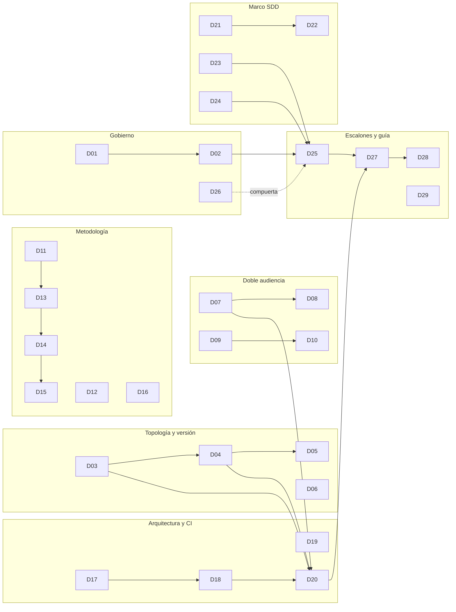
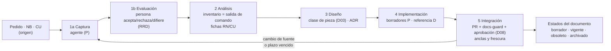
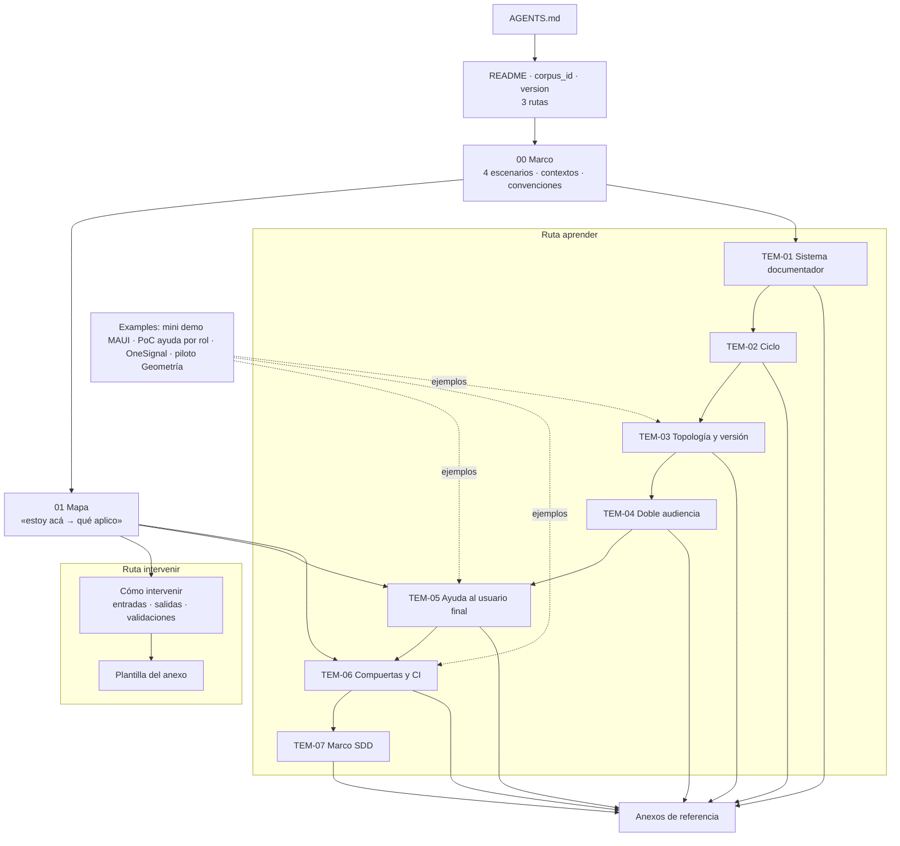
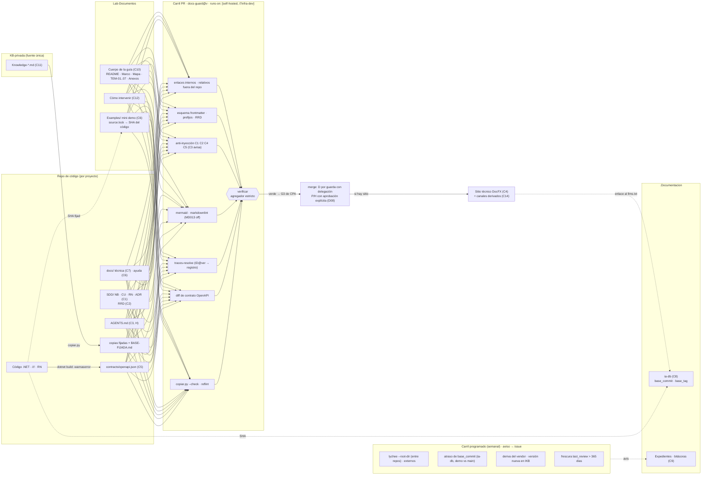

| Campo | Valor |
| --- | --- |
| Tipo | informe |
| Fecha | 2026-10-26 |
| Autor | Despacho A01 de la presidencia: análisis de decisiones. **Consolida, no es comisión**: no aporta hallazgos propios sobre el objeto ni ensayos técnicos; sólo corre la matriz de §4 |
| Corrige | — |

# Análisis de decisiones — expediente 0002

## Índice

1. [Mandato, alcance y forma](#1-mandato-alcance-y-forma)
2. [Alias y definiciones](#2-alias-y-definiciones)
3. [Insumos leídos](#3-insumos-leídos)
4. [Método: criterios, pesos, escala, filtros y regla de firmeza](#4-método-criterios-pesos-escala-filtros-y-regla-de-firmeza)
5. [Tablero de las 29 decisiones](#5-tablero-de-las-29-decisiones)
6. [Decisiones, una por una](#6-decisiones-una-por-una)
7. [Las trece contradicciones X1–X13, resueltas](#7-las-trece-contradicciones-x1x13-resueltas)
8. [Arquitectura de referencia resultante](#8-arquitectura-de-referencia-resultante)
9. [Excepciones a conocimientos (consolidado)](#9-excepciones-a-conocimientos-consolidado)
10. [Ensayos que faltan](#10-ensayos-que-faltan)
11. [Filas para el lote del PO](#11-filas-para-el-lote-del-po)
12. [Pendientes de forma para la presidencia](#12-pendientes-de-forma-para-la-presidencia)
13. [Lo no verificado](#13-lo-no-verificado)
14. [Inventario de lo creado y lo borrado](#14-inventario-de-lo-creado-y-lo-borrado)
15. [Barrido S2 de este folio](#15-barrido-s2-de-este-folio)

---

## 1. Mandato, alcance y forma

**Mandato.** Leer todos los informes de comisión (folios 010 a 017), la presentación 002, las bitácoras I06 e I07
(y sus informes 0060 y 0070) y los núcleos N01–N08. Para cada pregunta Q01–Q46, agrupada en decisiones Dnn cuando
se resuelven juntas, dar: (a) las alternativas que aparecieron; (b) criterios ponderados con fuente de industria;
(c) puntuación explícita; (d) decisión propuesta y segunda alternativa fundamentada; (e) disidencias entre
comisiones y cómo se resuelven; (f) excepciones a conocimientos. Resolver además X1–X13 de `N00` §6.

**Lo que este folio no hace.** No reabre las decisiones de la presidencia del ENUNCIADO (folio 001, D1–D6): la mesa
decide **cómo**, no **si**. No dictamina como jurado: propone. No reemplaza al refutador, que entra último. Donde la
evidencia de los informes no alcanza, lo dice y nombra el ensayo que falta (§10).

**Forma de cada decisión (§6).** Preguntas que agrupa · alternativas con la comisión que las propuso · matriz ·
decisión · segunda alternativa · disidencias y resolución · excepciones. Lo que es juicio de este despacho va
rotulado **[criterio propio]**.

## 2. Alias y definiciones

### 2.1 Alias

Todas las rutas parten de la raíz del workspace (D6).

| Alias | Ruta o referencia |
| --- | --- |
| `TP` | `/LAB/Lab-Documentos/Lab-Documentos.Documentacion/PROMPTs/DEVs/Enchacement/01-Replanteo-Y-Analisis/Replanteo-Y-Analisis.md` |
| `B/` | `/LAB/Lab-Documentos/Lab-Documentos.Documentacion/PROMPTs/DEVs/Enchacement/01-Replanteo-Y-Analisis/OUTPUTs/Bitacoras/` (`N0n`, `R0n`, `I0n`, `C00`) |
| `EXP/` | `/LAB/Lab-Documentos/Lab-Documentos.Documentacion/PROMPTs/DEVs/Enchacement/01-Replanteo-Y-Analisis/OUTPUTs/Expedientes/0002-Replanteo-Metodologia-DocAsCode/` |
| `F0nn` | folio `EXP/actuaciones/0nn-…md` (F010 C-REQUISITOS, F011 C-VERIFICACION, F012 C-LECTOR, F013 C-ANALISTA, F014 C-ARQ-NET, F015 C-DECISIONES, F016 C-ACADEMICO, F017 C-AGENTES-IA; F0060 = I06, F0070 = I07) |
| `EV/` | `EXP/evidencia/A01/` (guion y salida de la matriz de este folio) |
| `GUIA` | `/LAB/Lab-Documentos/Lab-Documentos/Guides/Documentacion-Tecnica/Sistema-De-Documentacion-E-Integracion/Sistema-Documentador-Tecnico-Guide.md` |
| `EXAMPLES` | `/LAB/Lab-Documentos/Lab-Documentos/Guides/Documentacion-Tecnica/Sistema-De-Documentacion-E-Integracion/Examples/` |
| `CGT` | `/LAB/Lab-Documentos/Lab-Documentos/Guides/Documentacion-Tecnica/Creacion-Guias-Tecnicas/` |
| `LE` | `/LAB/Lab-E2E.WebBlazor/Lab-E2E.WebBlazor/` (código de MovilidadUrbana, `main` en `8fb4c3a` según F013) |
| `GEO` | `/PROG2/Geometria/Lab-Geometria/` (`main` en `4b114d7` según F013) |
| `IKB` | `KB-privada/` (commit `1585af9`) |
| `CPA` | `IKB/Knowledges/Knowledge-Conformacion-Pull-Request-Automatico.md` |
| `KDR` | `IKB/Knowledges/Knowledge-Deduccion-De-Reglas-De-Negocio.md` |
| `RDA` | regla `Rule-Dual-Audience` del PromptFramework, tal como la citan F016 y F017 |
| `SDD-B` | el SDD del servicio de notificaciones push (privado); no se nombra de otro modo |

### 2.2 Definiciones

| Término | Definición en este folio | Fuente |
| --- | --- | --- |
| Decisión (Dnn) | Grupo de preguntas Qnn que se responden con una sola elección, porque una condiciona a la otra | Criterio propio |
| Criterio (K1–K7) | Dimensión por la que se compara toda alternativa; las siete del despacho | Despacho A01; §4.1 |
| Escala anclada | 1 a 5 por criterio, cada punto con un observable (§4.3) | F015 §3 (método); criterio propio en las anclas nuevas |
| Filtro duro | Restricción que excluye una alternativa antes de ponderar; no se compensa con puntaje | F015 §4 (F1–F5); F6–F8 de este folio |
| Margen | Diferencia de puntaje ponderado entre la primera y la segunda alternativa admitidas | F015 §3 |
| FIRME | Margen ≥ 0,30 y el ganador no cambia con ±10 % en ningún peso | F015 §3 (U2) |
| CON REVISIÓN | No cumple FIRME; se elige la reversible y se asienta una condición de revisión comprobable | F015 §3 (U3) |
| Disidencia | Dos o más comisiones dictaminan cosas incompatibles sobre la misma pregunta | Criterio propio |
| Clase de intervención D/P/H | D: la produce un generador determinista; P: la propone un agente LLM; H: sólo una persona | F017 Q12 |

**Ejemplo de lectura.** D03, alternativa A = (4, 5, 5, 4, 4, 4, 4): agrega un catálogo (K1 = 4), ya opera así el
workspace (K2 = 5), un sistema nuevo activa clases (K3 = 5), costo de una tabla (K4 = 4), sirve a los dos públicos
porque cada clase declara su canal (K5 = 4), es coherente con IA.SDD sin forzarlo (K6 = 4) y cada clase lleva su
compuerta (K7 = 4). Puntaje: 0,15 × (4+5+5+4+4+4) + 0,10 × 4 = 4,30.

## 3. Insumos leídos

| Insumo | Lectura |
| --- | --- |
| `TP` | Líneas 1–40 (contexto, objetivo, solicitudes) y, por F002 §3–§6, las reglas |
| F001 | Decisiones D1–D6 (líneas 131–136) |
| F002 | Completo: preguntas Q01–Q46 (§8) y cuenta (§9) |
| F003 | §7 (opciones A y B del reparto por ciclo) |
| F004 | §4 (panel), §6.1 (postergados), §7 (condiciones K1–K6) |
| F010–F017 | Completos en sus dictámenes, hallazgos, excepciones, no verificado e inventario |
| F0060, F0070 | Completos (informes de I06 e I07) |
| `I01`, `I02`, `I03`, `I04`, `I05`, `I06`, `I07` | Tablas de fuentes (URL y título) y la matriz D1–D8 (`I01:202-213`) |
| `N00` | Completo: §6 (X1–X13) y §9 (punto de integración) |
| `N01`–`N08` | Por su consolidación en F002 §8, que fusiona sus 57 preguntas en 46 (F002 §9); no se releyeron enteros |
| `IKB/README.md:60-130` y `IKB/tools/` | Para verificar que `copiar.py`, `cierre.py` y `BASE-FIJADA.md` existen (D21) |

## 4. Método: criterios, pesos, escala, filtros y regla de firmeza

### 4.1 Los siete criterios, con su origen y su fuente de industria

Cada criterio tiene un origen en el pedido (o se rotula «criterio propio» si no lo tiene) y una fuente de industria
que muestra por qué la industria lo usa para decidir. Las fuentes las consultaron las bitácoras de investigación el
2026-10-26; **este despacho no las reconsultó** (§13).

| K | Criterio | Qué mide | Origen en el pedido | Fuente de industria (URL · título · consulta) |
| --- | --- | --- | --- | --- |
| K1 | Simplicidad | Cuántas piezas, herramientas o reglas nuevas agrega | `TP:36` («simplicidad») | Böckeler, B. (2025-10-15). *Understanding Spec-Driven-Development: Kiro, spec-kit, and Tessl*. martinfowler.com. https://martinfowler.com/articles/exploring-gen-ai/sdd-3-tools.html (consulta de I06, 2026-10-26; F12 de `I06`): la crítica al exceso de ceremonia y de Markdown difícil de revisar. BMad Method, *Choose a Planning Path*, https://docs.bmad-method.org/plan/choose-a-planning-path/ (I06 F16): caminos por tamaño del cambio |
| K2 | Practicidad | Si funciona hoy con lo que hay, sin pasos humanos ni permisos extra, y si está medido | `TP:36` («practicidad») | GitLab. *Documentation workflow*. https://docs.gitlab.com/development/documentation/workflow/ (consulta de I01, 2026-10-26; fuente 6 de `I01`): la doc en el mismo MR, como parte de la definición de hecho. Write the Docs. *Docs as Code*. https://www.writethedocs.org/guide/docs-as-code/ (I01 fuente 1): mismas herramientas que el código |
| K3 | Escalabilidad | Cuánto cuesta aplicarlo a un sistema nuevo | `TP:36` («escalibilidad»); `TP:30` («aplicado luego en el diseño de nuevos sitemas») | Backstage. *TechDocs Architecture*. https://backstage.io/docs/features/techdocs/architecture (I01 fuente 24): build en el CI de cada repo. Antora. *What's a Component Version?* https://docs.antora.org/antora/latest/component-version/ (I01 fuente 21) |
| K4 | Costo de adopción | Esfuerzo de migración, dependencias y operación para un equipo de una persona con dos identidades (`R03:212-214`) | **Criterio propio**: el pedido no lo nombra | Docusaurus. *Versioning*. https://docusaurus.io/docs/versioning (I01 fuente 25; I02 F1): «Most of the time, you don't need versioning» y menos de 10 versiones, por costo de build y mantenimiento |
| K5 | Ajuste a doble audiencia | Si la misma fuente sirve a personas y a agentes, con verificación | `TP:20` (e) «no solo son agentes humanos»; `TP:32` | AGENTS.md. https://agents.md/ (I03 F02). Howard, J. *The /llms.txt file*. https://llmstxt.org/ (I03 F01; reconsultada por F017 el 2026-10-26). OWASP GenAI. *LLM01:2025 Prompt Injection*. https://genai.owasp.org/llmrisk/llm01-prompt-injection/ (I03 F17; reconsultada por F017) |
| K6 | Coherencia con los SDD existentes | Si reutiliza un mecanismo ya catalogado (IKB, IA.SDD, SDD-B) o lo contradice | `TP:18` (d) «conocimientos que pueden compartir»; `TP:30` (e) | GitHub Spec Kit, *Spec Persistence Models* (documentación del repositorio). https://github.com/github/spec-kit/tree/main/docs (I06 F03): declarar el modelo de persistencia de la spec. Thoughtworks. *Spec-driven development*, Technology Radar, anillo Assess, 2025-11-05. https://www.thoughtworks.com/radar/techniques/spec-driven-development (I06 F19) |
| K7 | Riesgo de deriva (puntaje alto = riesgo bajo) | Si la deriva doc↔código se detecta, cuándo y cómo | `TP:20` (c) «desfase de versionado, y coordinación» | Winters, Manshreck y Wright (eds.). *Software Engineering at Google*, cap. 10 «Documentation». https://abseil.io/resources/swe-book/html/ch10.html (I01 fuente 19): dueños y fechas de frescura. Tan, W. S., Wagner, M., y Treude, C. (2024). Detecting outdated code element references in software repository documentation. *Empirical Software Engineering*, 29, 5. https://doi.org/10.1007/s10664-023-10397-6 (I05 fuente 3). DORA. *Documentation quality*. https://dora.dev/capabilities/documentation-quality/ (I07 F1) |

### 4.2 Pesos

| K | Peso | Por qué |
| --- | --- | --- |
| K1, K2, K3, K5, K6, K7 | 0,15 cada uno | Los seis tienen origen literal en el pedido. `TP:36` enumera simplicidad, practicidad y escalabilidad sin orden, y `TP:20` y `TP:18` nombran con la misma fuerza audiencia, desfase y conocimiento compartido. No hay fuente que los ordene: reparto igual (razón insuficiente, como F015 §4) |
| K4 | 0,10 | No tiene origen literal. Entra porque el despacho lo pide y porque el equipo es una persona (`R03:212-214`); pesa menos para no imponer un criterio que el pedido no trae |
| Suma | 1,00 | — |

**Sesgo declarado.** Estos pesos se fijaron **después** de leer los informes, a diferencia de los de F015, que se
asentaron con huella antes de que existieran resultados (F015 §4). Para acotar ese sesgo: (1) el reparto es el más
neutro posible (igual, salvo K4); (2) cada decisión se recalcula con ±10 % en cada peso, con pesos iguales (1/7) y con
la proyección «sólo `TP:36`» (K1–K3 a 1/3); (3) se contrasta con la matriz con huella de F015 en las 14 preguntas que
ella puntuó (§4.6).

### 4.3 Escala anclada

| Punto | K1 Simplicidad | K2 Practicidad | K3 Escalabilidad | K4 Costo | K5 Doble audiencia | K6 Coherencia SDD | K7 Deriva |
| --- | --- | --- | --- | --- | --- | --- | --- |
| 5 | Ninguna pieza nueva | Funciona hoy y está medido | Un sistema nuevo = una fila o un parámetro | Menos de una hora, sin migración | Una sola fuente sirve a los dos, con verificación | Reusa un mecanismo catalogado tal cual | Se detecta de forma determinista en el PR |
| 4 | Una pieza nueva (archivo, campo) | Medido en copia o con un acto humano | Una configuración por sistema | Un PR mecánico | Sirve a los dos con un paso extra | Compatible sin cambiar norma | Se detecta en un aviso programado |
| 3 | Dos o tres piezas | Paso sin medir | Adaptación por sistema | Migración de muchos archivos | Sirve bien a una audiencia | Neutral | Se detecta a mano |
| 2 | Herramienta o servicio nuevo | Exige otro repo, otro expediente o decisión del PO | Rehacer parte por sistema | Toolchain nuevo, cientos de MB | Una audiencia queda mal servida | Choca con una regla local | Se detecta tarde |
| 1 | Infraestructura nueva | Bloqueado | Rehacer todo por sistema | Compra u operación permanente | Perjudica a una audiencia | Contradice una norma (exige apartamiento) | Invisible |

### 4.4 Filtros duros

F1–F5 son los de F015 §4 (runner de `TP:34`; sin ruta del host; servicio privado sin nombre; sin escribir en
`PROMPTs/`; apartarse de un conocimiento exige ficha). Este folio agrega tres, todos con origen literal:

| Filtro | Excluye la alternativa que… | Origen |
| --- | --- | --- |
| F6 | ignora un estándar de industria aplicable que la mesa relevó | `TP:36` «que consulten los estandares», «basarse en … los estandares de la industria» |
| F7 | reduce la arquitectura al toolchain | Decisión 2 de la presidencia (F001 D2) |
| F8 | no aplica el Profile del pedido | `TP:67-68` («Aplicar: … Study-Guide-Documentation») |

### 4.5 Cálculo

Guion propio, sin red ni dependencias: `EV/01-matriz-a01.py.txt` (sha256 `0113d75b…c4906f`). Salida completa:
`EV/02-matriz-salida.txt` (sha256 `ae401003…461af0`). Corrió el 2026-10-26 en un contenedor
`python:3.12-slim` (imagen `ec7d6c95cd36`, ya presente en el host) con `--rm`.

**Resultado global.** De 29 decisiones, 28 salen FIRME y 1 CON REVISIÓN (D25). Ninguna cambia de ganador con ±10 %
en un peso ni con pesos iguales. Con la proyección «sólo `TP:36`» se invierten dos: D08 y D24. D23 queda FIRME
justo en el umbral (margen 0,30) y por eso conserva igual su condición de revisión.

### 4.6 Contraste con la matriz con huella de C-DECISIONES (F015)

| Pregunta | Ganador F015 | Ganador A01 | ¿Coincide? |
| --- | --- | --- | --- |
| Q03 | A4 por pieza D1–D8 | D03 A (catálogo de clases, que aplica D1–D8 una vez) | Sí, en el principio; A01 lo concreta como catálogo |
| Q06 | B2 aviso programado; internos bloquean | D06 A (dos carriles) | Sí |
| Q08 | C3 copia fiel + manifiesto + compuerta | D21 A | Sí |
| Q09 | D4 ritmo propio + tag por compuerta | D04 A (incluye D4) | Sí |
| Q13 | E2 delegación + G1–G4 + reservas | D08 A | Sí (§6, D08: la reserva de contenido de `CPA` lleva lo P a la persona) |
| Q17 | P1 2651x liviana | D11 A | Sí |
| Q19 | G2 tronco + variantes | D13 A | Sí |
| Q22 | H2 plantilla por repo | D17 A | Sí |
| Q23 | J3 regla de clasificación | D18 A | Sí |
| Q26 | **DocFX para guías y referencia** | **D05 A: guías sin generador; DocFX sólo en el sitio técnico .NET** | **No** (resuelto en D05) |
| Q30 | L3 fuente IKB + copia con cierre | D21 A | Sí |
| Q32 | M3 ADR + propuesta al lote | D23 A | Sí |
| Q33 | N1 migrar antes | D24 A | Sí |
| Q46 | No comprar; índice rotulado | D12 A | Sí |

13 de 14 coinciden. La única diferencia (Q26) la explica el propio F015: declaró la decisión CON REVISIÓN con punto
de inversión de un punto, y condicionada al ensayo de C-ARQ-NET (F015 §5.12). Ese ensayo ya corrió (F014 E5–E12) y,
junto con F012 §5.4, mueve el balance (ver D05).

## 5. Tablero de las 29 decisiones

| D | Preguntas y contradicciones | Decisión propuesta (una línea) | Puntaje · margen | Estado |
| --- | --- | --- | --- | --- |
| D01 | Q01, X8, X10 | Ratificar el panel; la presidencia asienta la opción B (K6) antes de la carta del ciclo 2; la etiqueta del runner no es materia de S2 | 4,25 · 0,60 | FIRME |
| D02 | Q02, Q40, X12 | U0 (delegación + `verificar`) en cada repo que reciba PR, después U1 (deuda ampliada), antes del enriquecimiento; la ia-db se reindexa al cierre de cada escalón | 4,60 · 1,35 | FIRME |
| D03 | Q03, X13 | Topología por pieza mediante un catálogo cerrado de clases; un proyecto activa clases; clase nueva por expediente | 4,30 · 0,70 | FIRME |
| D04 | Q04, Q09 | Ancla: commit en el mismo repo; `base_commit` (SHA) + `base_tag` entre repos; guías con versión de cuerpo en el README y tag anotado por compuerta | 4,30 · 0,70 | FIRME |
| D05 | Q05, Q26 | Una sola versión publicada con sello visible; guías sin generador (render de GitHub + compuerta); DocFX sólo para el sitio técnico .NET de un escalón | 4,40 · 0,65 | FIRME |
| D06 | Q06, Q07, X11 | Dos carriles de enlaces (PR determinista; programado semanal entre repos); cita por ID calificado `Repo@ancla:corpus_id/doc_id` con permalink; relativos dentro del cuerpo | 4,45 · 0,80 | FIRME |
| D07 | Q10, Q11, X5 | Obligatorios: Markdown con frontmatter, `AGENTS.md` puntero, ia-db, OpenAPI; condicionales al sitio: `.md` por página, `llms.txt` generado y rotulado «propuesta»; MCP fuera; la ia-db enlaza al `llms.txt`, nunca al revés | 4,60 · 1,00 | FIRME |
| D08 | Q12, Q13, X9 | Clases D/P/H por fase; D se fusiona por guarda con delegación; P y H con aprobación explícita de la persona; la segunda identidad no cuenta | 4,45 · 0,35 | FIRME |
| D09 | Q14 | Contrato de frontmatter: los 10 campos de `RDA` + `description`; `corpus_id` y `version` en el README del cuerpo; vocabulario cerrado de `CGT`; esquema por `doc_type` | 4,45 · 0,80 | FIRME |
| D10 | Q38, Q39, X7 | Trazas en dos niveles: página → `ID@versión`; ficha → `ruta#Símbolo@SHA`; registro generado; `RN-LOC-nn` provisionales en la demo | 4,45 · 0,55 | FIRME |
| D11 | Q17 | 26514/26515 livianas, citadas sin apartado, para documentación a usuarios + Diátaxis, arc42, C4, MADR; la guía de estudio la rige el Profile | 4,00 · 1,65 | FIRME |
| D12 | Q46 | No comprar 26514:2022 en esta corrida; comprar sólo si la compuerta E2 necesita conformidad por cláusula | 3,95 · 0,45 | FIRME |
| D13 | Q19 | Tronco común + cuatro variantes (corpus, app sin roles, panel con roles, servicio con paquetes) | 4,15 · 0,75 | FIRME |
| D14 | Q18, Q21 | Cinco fases literales (1a captura, 1b evaluación); control de deriva y reentrada dentro de la fase 5; RRD con esquema único y ubicación por perfil | 4,25 · 0,40 | FIRME |
| D15 | Q20 | El PR es la unidad de cambio; expediente sólo por `RE` §1; reintegro con fila `Reintegra` y comprobación A13 | 4,25 · 1,05 | FIRME |
| D16 | Q15 | Plantilla «Cómo intervenir» en el cuerpo + una instancia de una página por proyecto, enlazada desde README y plantilla de PR | 4,45 · 0,95 | FIRME |
| D17 | Q22, Q24, Q25, Q28, X3 | Plantilla `docs-guard@versión` copiada por repo; todo en `[self-hosted, i7infra-dev]`; grupo de concurrencia propio con cancelación; PR #2 de Geometría intacto | 4,30 · 0,60 | FIRME |
| D18 | Q16, Q23 | Regla de cinco condiciones para bloquear; K1–K7 anti-inyección (C3 avisa); CQ/PE como anexos | 4,45 · 0,95 | FIRME |
| D19 | Q27 | OpenAPI emitido en build, versionado y vigilado por diff; XML en API y bibliotecas; CS1591 silenciado en apps y obligatorio en paquetes | 4,45 · 0,95 | FIRME |
| D20 | Q29 | Catálogo integrado de 14 clases con topología, fuente, ancla, compuerta, audiencia, canal, clase de intervención y tema | 4,30 · 1,20 | FIRME |
| D21 | Q08, Q30, Q35, X4 | Fuente única en IKB; copias fijadas con `copiar.py` + `BASE-FIJADA.md` + `--check`; en el SDD-B, IA.SDD vendorizado por `git archive` con MANIFIESTO | 4,45 · 1,25 | FIRME |
| D22 | Q31, Q34, X2 | Mejorar orquestadores = conocimiento nuevo + disparo de `docs-guard` + Momento 2 de AG-00110; nada nuevo de la norma del SDD-B al marco común en esta corrida | 4,55 · 1,15 | FIRME |
| D23 | Q32, X1 | Apartamiento con ADR en Geometría + ADR de diseño aprobado por el PO + propuesta de cambio de norma al lote, decidida en E3 | 3,85 · 0,30 | FIRME (en el umbral) |
| D24 | Q33 | Migrar Geometría a IA.SDD 13.22 antes de la piloto, como unidad propia | 3,75 · 0,40 | FIRME |
| D25 | Q36, Q37, X6 | Mini demo en `EXAMPLES` con `source.lock` por SHA; los cambios de código van como propuesta a un expediente de Lab-E2E; cada escalón, una hipótesis falsable | 4,00 · 0,20 | **CON REVISIÓN** |
| D26 | Q41 | Folio de criterios Dado/Cuando/Entonces antes de cada escalón; paquete G-a…G-g; dictamen en un folio `resolucion` de este expediente | 4,60 · 1,10 | FIRME |
| D27 | Q42, Q43 | Cuerpo documental con siete temas y tres rutas de lectura; el archivo actual pasa a obsoleto con tabla de correspondencia | 4,20 · 1,50 | FIRME |
| D28 | Q44 | APA 7 en castellano, con fecha de consulta siempre, anexo de referencias `ref-…`; la guía es el piloto | 4,30 · 1,00 | FIRME |
| D29 | Q45 | Elevar al lote del PO; mientras no responda, el Profile no se toca y objetivos y ejercicios van a README y anexo | 4,25 · 0,60 | FIRME |

**Cobertura.** Las 46 preguntas tienen una decisión (Q01 D01 · Q02 D02 · Q03 D03 · Q04 D04 · Q05 D05 · Q06 D06 · Q07
D06 · Q08 D21 · Q09 D04 · Q10 D07 · Q11 D07 · Q12 D08 · Q13 D08 · Q14 D09 · Q15 D16 · Q16 D18 · Q17 D11 · Q18 D14 ·
Q19 D13 · Q20 D15 · Q21 D14 · Q22 D17 · Q23 D18 · Q24 D17 · Q25 D17 · Q26 D05 · Q27 D19 · Q28 D17 · Q29 D20 · Q30
D21 · Q31 D22 · Q32 D23 · Q33 D24 · Q34 D22 · Q35 D21 · Q36 D25 · Q37 D25 · Q38 D10 · Q39 D10 · Q40 D02 · Q41 D26 ·
Q42 D27 · Q43 D27 · Q44 D28 · Q45 D29 · Q46 D12). Las trece contradicciones también (§7).



*Diagrama: dependencias entre decisiones. D20 (arquitectura) integra D03, D04, D07 y D18; D27 (cuerpo de la guía) es
el punto de integración de `N00` §9.*

## 6. Decisiones, una por una

> En cada matriz, la columna «Propone» nombra la comisión que trajo la alternativa. Los puntajes están en el orden
> K1…K7 y los totales salen de `EV/02-matriz-salida.txt`.

### D01 — Panel, condición K6 y etiqueta del runner (Q01, X8, X10)

**Alternativas.**

| Alt. | Descripción | Propone | K1–K7 | Total |
| --- | --- | --- | --- | --- |
| **A** | Ratificar el panel del folio 004; la presidencia asienta por providencia la **opción B** del folio 003 §7 antes de la carta del ciclo 2 (cumple K6) | F010 Q01, F015 §5.1; F003 §7 | 4,5,5,5,3,5,3 | **4,25** |
| B | Ratificar con la opción A (D3 obligatorio en todo ciclo) | F003 §7 | 5,5,2,5,3,3,3 | 3,65 |
| C | Recomponer el panel del ciclo 1 | Descartada por F010 Q01 | 2,2,3,2,3,2,3 | 2,45 |

**Decisión.** A. El panel cumple las reglas (F010 Q01, E5: 46 preguntas con 2 a 4 lectores; techo de 5). La
condición K6 del jurado está **abierta**: no hay folio posterior al 004 (F010 H08). Sin la opción B, `C-NORMAS-IA`
no entra nunca y «que consulten los estandares» (`TP:36`) queda sin especialista (F003 §7: «con la opción A,
`C-NORMAS-IA` no entra nunca»).

**Segunda alternativa.** B, si la presidencia lee D3 como «obligatorios en todo ciclo». Pierde la entrada de
`C-NORMAS-IA` y deja a `C-CONFIG-RELEASE` o `C-SDD-CONOCIMIENTO` sin silla en el ciclo 4 (F003 §7).

**X8.** Cerrada por la presidencia (F001 D1: alcance escalonado). No se rediscute.

**X10 y la etiqueta del runner (pregunta de F012 §12).** La compuerta S2 busca rutas del directorio personal y el
usuario del host (patrón de F002 §10). `runs-on: [self-hosted, i7infra-dev]` es la **etiqueta literal** que pide
`TP:34` y la decisión 1 de la presidencia, y va a estar escrita en el YAML versionado de todos modos. **[criterio
propio]** No es ruta ni usuario: se conserva. Si la presidencia la quiere fuera de la prosa del expediente, basta con
citar «la etiqueta de `TP:34`».

**K5 (convocatoria en caliente).** No se disparó: F010 emitió SC-2 sobre normas sin nivel P1 sobre Q17 o Q43, y F012
no emitió solicitudes sobre Q17. Se deja constancia para el refutador.

**Disidencias.** Ninguna sobre la composición. F015 ratifica y F010 marca K6 abierta: son compatibles.

**Excepciones.** Ninguna.

### D02 — Arranque de la fase de escritura: U0, U1 y la ia-db (Q02, Q40, X12)

**Alternativas.**

| Alt. | Descripción | Propone | K1–K7 | Total |
| --- | --- | --- | --- | --- |
| **A** | U0 «arranque» por repo destino (asiento de la delegación decidida por el PO + `verificar` en el runner + suite mínima), merge de U0 por el PO; después U1 «saneamiento» con alcance cerrado; recién entonces el enriquecimiento | F011 §3.1, §3.12; F014 Q02; F012 §5.5; F016 Q40 | 4,5,5,4,4,5,5 | **4,60** |
| B | Escribir primero y agregar los controles después | Descartada por F011 §3.1 | 5,2,2,4,3,2,1 | 2,65 |
| C | Corregir la deuda dentro del enriquecimiento | Descartada por F011, F012, F016 | 4,3,3,4,3,4,2 | 3,25 |

**Decisión.** A.

- **U0** en Lab-Documentos y Lab-Documentos.Documentacion para el escalón 1 (la mini demo vive en `EXAMPLES`, D25,
  así que Lab-E2E.WebBlazor no recibe PR en E1). Contenido: asiento de la delegación **decidida y fechada por el PO**
  (`CPA` §3.1, §3.5), `verificar.yml` con agregador estricto, guarda de forks y `timeout-minutes`, y la suite mínima
  (enlaces internos, esquema, ocultos, mermaid). **Aceptación**: check en `success` sobre el `head.sha`; un commit de
  prueba que planta un enlace roto lo pone en `failure` y el revert lo vuelve a `success` (F011 §3.1). **El merge de
  U0 lo hace el PO**, porque la delegación todavía no está asentada (`CPA`, F011: `KPRA:27`, `:92`). En E2 y E3, U0
  se repite en el repo de código de Geometría y en el del SDD-B.
- **U1** con alcance cerrado (unión de F011 §3.12, F012 §5.5 y F016 Q40): los 8 enlaces rotos de `GUIA` (líneas 189,
  203 ×3, 432, 590, 625, 633); `status`/`origin`/`confidence` atípicos de `GUIA`; `DOC-ADR` duplicado en `traces`
  (`GUIA:11`); cita no literal de ACT-10; cita de Docusaurus sólo en `main` y atributo `@product` (F016 ACA-06,
  ACA-07); la palabra «adoptada» de `GUIA:161` (X5); recuento de páginas, `translation_of`, `$P`, devcontainer
  huérfano y `302`/`401` (`R02:339-343`, no re-medidos); los dos README vacíos con una ruta de lectura mínima
  (F012 H-L01); una sola tabla de contrato de frontmatter (F012 H-L05); lint estructural a 0. **Se conserva** el
  defecto plantado de `EXAMPLES/…/README.md:59` y los dos respaldos de cultura (F011 E10).
- **X12.** La regla `Rule-Indexing` (actualizar la ia-db) se cumple en la fase de escritura: cada escalón cierra
  con un PR de reindexado (clase P, D08) **después** de su dictamen. En la ia-db de Geometría no se escribe mientras
  la otra corrida tenga PR abiertos sobre ella (F010 CA-E2-5).

**Segunda alternativa.** C, si el PO no asienta la delegación: rige el ciclo manual (F014 Q02: «el plan sigue, más
lento»), pero la deuda queda mezclada con lo nuevo y un rojo no dice de dónde viene (F011 §3.12).

**Disidencias y resolución.**

| Tema | Posiciones | Resolución |
| --- | --- | --- |
| Repos con U0 en E1 | F011: Lab-Documentos y su `.Documentacion`. F014: además Lab-E2E.WebBlazor | Depende de dónde viva la demo. Con D25 A (demo en `EXAMPLES`) bastan los dos de F011. Si D25 se revisa hacia B, se agrega la U0 de F014 |
| Conversión APA dentro de U1 | F011: «URL sin fecha a 0» en U1. F016: APA no entra en U1, es el primer acto del enriquecimiento | F016: la conversión es contenido nuevo y depende de D28. En U1 el validador `url-fecha` sólo **avisa** sobre `GUIA` (D18) |
| README y tabla de frontmatter en U1 | F012 los suma; F016 no los nombra | Se suman: sobreviven a la reestructura de D27 (F012 §5.5) |

**Excepciones.** Ninguna: U0 aplica `CPA` §3.1 sin desvío (F011 §6, F014 §6).

### D03 — Topología por pieza: catálogo de clases (Q03, X13)

**Alternativas.**

| Alt. | Descripción | Propone | K1–K7 | Total |
| --- | --- | --- | --- | --- |
| **A** | Catálogo cerrado de clases de pieza con la matriz D1–D8 (`I01:202-213`) resuelta una vez; cada proyecto activa clases y registra sólo excepciones; clase nueva por expediente | F013 Q03 (≈12 tipos), F014 Q03 (11 clases) | 4,5,5,4,4,4,4 | **4,30** |
| B | Recorrer D1–D8 pieza por pieza en cada proyecto | F015 Q03 (A4, sin catálogo) | 3,3,4,3,4,4,4 | 3,60 |
| C | Topología única: todo en el repo de código | F015 (A1) | 3,2,4,2,3,2,3 | 2,75 |
| D | Topología única: repo dedicado | F015 (A2) | 3,3,2,3,3,3,2 | 2,70 |

**Decisión.** A, con el catálogo de 14 clases de §8.1. Evidencia: 17 piezas reales de MovilidadUrbana caen en tres
topologías y «ninguna topología única cubre las 17» (F013 §5). «Ninguna referencia elige una sola topología»
(`I01:200`).

**X13.** Se resuelve así: la topología sola no evita la deriva (`R04:315-316`, `R05:270`); cada clase lleva **su
compuerta** (columna de §8.1) y su ancla (D04). Es la «topología con compuerta» que pedía `N00` §6.

**Segunda alternativa.** B, si el catálogo resultara demasiado ancho para un sistema nuevo: entonces D1–D8 se
recorre sólo para las piezas que no encajan, que es lo que A ya prevé como «clase nueva por expediente».

**Disidencias.** Ninguna de fondo: F013, F014 y F015 dicen «por pieza». F013 propone ≈12 tipos y F014 11 clases; el
catálogo de §8.1 los une (14 filas) y agrega las dos que F014 no tenía (RRD de F013 y documento de proceso de F013 y
F012). F015 deja el contenido de las filas a otras comisiones (F015 §5.11).

**Excepciones.** Ninguna.

### D04 — Ancla de versión y etiquetas del corpus (Q04, Q09)

**Alternativas.**

| Alt. | Descripción | Propone | K1–K7 | Total |
| --- | --- | --- | --- | --- |
| **A** | (1) Mismo repo: el ancla es el commit. (2) Repo hermano: `base_commit` (SHA completo) obligatorio + `base_tag` cuando el código etiquete; existencia bloquea, desfase avisa. (3) Guías de ritmo propio: versión SemVer **del cuerpo** en su README y tag anotado al cerrar cada compuerta; citas al código por permalink con SHA | F014 Q04; F011 §3.2; F015 Q09; F016 Q14 | 4,5,4,4,4,4,5 | **4,30** |
| B | SHA + versión SemVer **por documento** | F013 Q04, Q09 | 3,3,4,3,4,3,5 | 3,60 |
| C | Sólo tag del código | Descartada por F011, F013, F014 | 4,1,3,3,3,3,3 | 2,85 |
| D | Ninguna ancla (la doc «follows») | Descartada por todas | 5,5,2,5,2,2,1 | 3,05 |

**Decisión.** A. El SHA existe siempre y se verifica sin red: `git rev-parse --verify` (0/1) y
`git merge-base --is-ancestor` (0/128) (F011 E09). La etiqueta sola es impracticable: Lab-Documentos, su
`.Documentacion` y Lab-E2E.WebBlazor tienen 0 tags (F011 E09; F013 E-A03). El desfase se mide con
`git diff --stat <sha>..origin/main -- <rutas>` (F011 §3.2) o `git rev-list --count` (F013 Q04). El tag por
compuerta (F015 Q09) es lo que citan la piloto y el SDD-B.

**Segunda alternativa.** B: es la más exacta para citar un documento suelto, pero cuesta subir la versión en cada
cambio y contradice el principio 5 de F014 (`Versionado-Producto-Integral` §2.6: «la versión editorial del documento
que describe el contrato no es una versión de producto»).

**Disidencias y resolución.**

| Tema | Posiciones | Resolución |
| --- | --- | --- |
| Versión por documento | F013: SemVer en cada documento. F014: ninguna pieza lleva versión propia. F016: `version` sólo en el README del cuerpo | F016 (punto medio): una versión editorial **del cuerpo**, que es lo que se cita; las trazas a especificación ya llevan la versión del CU o RN destino (D10) |
| Tags en Lab-Documentos | F013: no. F015: tag anotado por compuerta | F015: un acto por compuerta, no por cambio; coincide con la versión del cuerpo |
| Desfase: ¿bloquea? | F011: aviso. F013: avisa en el repo de documentación, bloquea en el código cuando la pieza es D1 | Ambas: en el mismo repo el desfase no existe (el commit es el ancla); entre repos, aviso |

**Excepciones.** Ninguna. F014 deja una **precisión** sobre `Versionado-Producto-Integral` §4: la etiqueta se usa como
ancla documental, no como número derivado (F014 §6).

### D05 — Sitio publicado y generador (Q05, Q26)

**Alternativas.**

| Alt. | Descripción | Propone | K1–K7 | Total |
| --- | --- | --- | --- | --- |
| **A** | Una sola versión publicada (la de `main`), con **sello visible** de versión del sistema y fecha de verificación en cada página; guías y corpus **sin generador** (render de GitHub + `docs-guard`); **DocFX 2.81** sólo para el sitio técnico .NET de un escalón que lo necesite; la ayuda en producto la renderiza la aplicación | F014 Q05, Q26; F012 Q05, Q26 | 5,5,4,5,4,4,4 | **4,40** |
| B | DocFX también para las guías | F015 Q26 | 3,4,4,3,4,4,4 | 3,75 |
| C | MkDocs + Material | — | 4,3,3,3,3,3,3 | 3,15 |
| D | Docusaurus | — | 2,3,4,1,3,3,4 | 2,95 |

**Decisión.** A.

- *Sitio no versionado*: los cuatro sistemas tienen un solo despliegue vivo (F014 Q05); «Most of the time, you don't
  need versioning» (D5′, `I01:209`). El sello por página es lo que le falta al lector, no un selector (F012 Q05:
  nadie sabe a qué versión corresponden las 33 capturas). Umbral UO-5 de F015: 1 versión publicada.
- *Guías sin generador*: la ruta de lectura se corta **antes** de cualquier generador (README vacío, 8 enlaces rotos;
  F012 §5.4). El Markdown tiene que navegarse tal cual; cualquier generador futuro cumple las tres condiciones de
  F012 §5.4.
- *DocFX donde hay .NET*: es el único con referencia .NET nativa; 0 advertencias con `--warningsAsErrors` y enlace
  roto → exit 255 (F014 E5, E6). MkDocs: `-q` anula `--strict` (F014 E10) y Material está en mantenimiento, con
  arreglos críticos hasta el 2027-05-05 (F014 §3.3, fuente citada allí). Docusaurus: 803 MB de `node_modules`, 77,6 s
  en frío (F014 E11).

**Segunda alternativa.** B, si se decide publicar la guía como sitio (por ejemplo, para ofrecer `.md` por página y
`llms.txt` al público): F015 la puntuó primera con margen 0,25 y K2 condicionado al ensayo, que dio bien (F014 E5).

**Disidencias y resolución.** F015 (DocFX para guías) frente a F014 y F012 (guías sin generador). Se resuelve por
evidencia: (1) la condición de revisión de F015 era el ensayo de C-ARQ-NET, que pasó, pero ese ensayo también mostró
que DocFX no emite `.md` por página de la prosa (F014 E5, E7), así que publicarla con DocFX no da a los agentes nada
que el repo no les dé; (2) F017 E1 midió que, a esta escala (≈20 000 tokens), el agente rinde mejor con el archivo
fuente que con HTML (6/6 frente a 5/6). Un generador para las guías suma una pieza sin lector que la necesite hoy.

**Excepciones.** Ninguna.

### D06 — Enlaces entre repos y forma de citar (Q06, Q07, X11)

**Alternativas.**

| Alt. | Descripción | Propone | K1–K7 | Total |
| --- | --- | --- | --- | --- |
| **A** | **Carril PR** (determinista, bloquea): `lychee --offline --include-fragments` + prohibición de relativos que salen del repo. **Carril programado** (semanal, avisa, issue único por repo): `lychee --root-dir <raíz del workspace>` + externos + permalinks. **Cita**: `Repo@ancla:corpus_id/doc_id` para máquinas, con permalink para personas; relativos **dentro** del cuerpo | F011 §3.3; F015 Q06; F013 Q07; F016 Q07; F017 Q07 | 4,4,5,4,5,4,5 | **4,45** |
| B | Compuerta entre repos en cada PR | Descartada por F015 (B1) | 3,2,2,3,4,3,5 | 3,15 |
| C | Sólo aviso programado | — | 5,4,4,5,3,3,2 | 3,65 |
| D | Rutas relativas, como hoy | Descartada por todas | 5,2,1,5,2,2,1 | 2,45 |

**Decisión.** A. La ruta relativa entre repos se rompió 8 de 9 veces en `GUIA` (F016 E04) y en 29 destinos de
Lab-E2E.WebBlazor.Documentacion (F011 E03); 5 de 8 se resolvían por `doc_id` (F016 E04). La cita desde la raíz no
resuelve en un checkout aislado y un enlace **bueno** da exit 2 sin el árbol del workspace (F011 E10): por eso ese
carril no puede bloquear en el PR.

**Formas de cita fijadas** (unión de F016 Q07 y F017 Q07):

| Qué se cita | Clave (máquina) | Medio (persona) |
| --- | --- | --- |
| Documento del mismo cuerpo | `doc_id` | enlace relativo validado |
| Documento de otro cuerpo o repo público | `Repo@<tag\|SHA>:<corpus_id>/<doc_id>` | permalink con SHA o tag |
| Línea de código | `Repo@SHA:ruta#Lx-Ly`; en fichas, `ruta#Símbolo@SHA` (D10) | permalink |
| Folio de expediente | `EXP<nnnn>-F<nnn>` | ruta desde la raíz del workspace |
| Repo privado (SDD-B) | descriptor + commit | — |
| Fuente externa | `ref-<autor>-<año>` del anexo | URL + fecha de consulta (D28) |

**X11.** Enlaces relativos dentro del cuerpo publicado (`Rule-Markdown`); rutas desde la raíz del workspace en
expediente y bitácoras (D6); entre repos, ID calificado + permalink.

**Segunda alternativa.** C (sólo programado) si el carril PR diera falsos positivos; hoy no los da (F011 E09: 0,78 s).

**Disidencias y resolución.**

| Tema | Posiciones | Resolución |
| --- | --- | --- |
| Frecuencia del carril programado | F011: diario. F015: semanal | Semanal (UO-2 de F015; cron semanal en `I02:355`). Condición de revisión de F015: si aparece un roto entre repos introducido por un PR de esa semana, se agrega el aviso no bloqueante en el PR |
| ID global o calificado | F017: prefijo de producto que hace único el ID en el workspace. F016: `corpus_id/doc_id` | F016: agrega ~12 `corpus_id` sin renombrar 207 `doc_id` (F016 Q07); F017 obliga a renombrar todo |
| Registro de IDs | F013: registro con alias generado de los encabezados. F017: índice generado en cada build | Son lo mismo: un índice generado, no escrito a mano |

**Excepciones.** Ninguna. `Rule-Markdown.md:33` se sigue dentro del cuerpo (F016 §11).

### D07 — Canales para agentes, ia-db y `llms.txt` (Q10, Q11, X5)

**Alternativas.**

| Alt. | Descripción | Propone | K1–K7 | Total |
| --- | --- | --- | --- | --- |
| **A** | **Obligatorios siempre**: Markdown fuente con frontmatter validado; `AGENTS.md` puntero (≤ 40 líneas, clase H) en cada repo; ia-db en cada `.Documentacion` que la tenga; OpenAPI emitido en build donde haya API REST. **Obligatorios si hay sitio publicado**: `.md` por página con encabezado de procedencia, `llms.txt` generado (rotulado «propuesta», público sin sesión aparte del índice por rol, `401`/`404` y no `302`) y documento agregado mientras el cuerpo mida < 50 000 tokens. **Fuera**: MCP propio en E1–E3 | F012 Q10; F013 Q10, Q11; F017 Q10, Q11 | 4,5,5,4,5,5,4 | **4,60** |
| B | Todos obligatorios ya, aunque no haya sitio | — | 3,3,4,3,4,4,4 | 3,60 |
| C | `llms.txt` como canal principal | Descartada por F012, F013, F017 | 4,2,3,4,2,3,3 | 2,95 |
| D | Sólo la ia-db | Descartada por F012 (H-L01) | 5,4,2,5,2,4,3 | 3,50 |

**Decisión.** A. Paridad de entradas (F012 Q10): la persona entra por el README y el agente por `AGENTS.md`, que
apunta al mismo README y a la ia-db. `AGENTS.md` lleva reglas no deducibles (2/2 con el archivo, 0/2 sin él; F017
E3), pero no impone nada (una prohibición se rompió 1 de 2 veces): toda regla «nunca» de `AGENTS.md` tiene su
compuerta (D18).

**Q11.** Ninguno reemplaza al otro. La ia-db es el índice **interno** (agente + revisión, `ruta:línea`, commit base,
clase P); `llms.txt` es la proyección **pública** del sitio (generada, clase D). La ia-db enlaza al `llms.txt`; el
`llms.txt` nunca enlaza a la ia-db. La fuente común es el frontmatter (F013 Q11; F017 Q11).

**X5.** `GUIA:161` corrige «adoptada»: `llms.txt` es una propuesta (llmstxt.org, reconsultada por F017). Va en U1
(D02).

**Segunda alternativa.** B, si en E1 se decide publicar la demo como sitio: entonces `.md` por página y `llms.txt`
pasan a obligatorios desde ya (es lo que A prevé al aparecer el sitio).

**Disidencias y resolución.**

| Tema | Posiciones | Resolución |
| --- | --- | --- |
| `llms.txt` | F017: obligatorio en sitio publicado. F012, F013: opcional | Coinciden en la condición «si hay sitio»: con D05 A no hay sitio para las guías en esta corrida; en el sitio técnico de un escalón, obligatorio y generado |
| Documento agregado | F017: obligatorio < 50 000 tokens (criterio propio sobre E1) | Se adopta condicionado al sitio. Sin sitio, la ruta «agente» del README (D27) indica leer el cuerpo entero en orden. Falta repetir E1 con el cuerpo partido por núcleo (§10, E-F4) |

**Excepciones.** Ninguna (F012 §9, F013 §8, F017 §9).

### D08 — Intervención automática y aprobación (Q12, Q13, X9)

**Alternativas.**

| Alt. | Descripción | Propone | K1–K7 | Total |
| --- | --- | --- | --- | --- |
| **A** | Tres clases: **D** (generador determinista) se fusiona por la guarda G1–G4 **sólo con delegación asentada**; **P** (propone un LLM) va siempre por PR en rama propia, con `origin` y `confidence`, verificador distinto del redactor y **aprobación explícita** de la persona; **H** (sólo persona). Cinco actos siempre humanos. Las dos identidades de git son una persona: la segunda no aprueba lo de la primera | F017 Q12, Q13; F010 Q12, Q13; F013 Q12 | 4,4,5,4,5,5,4 | **4,45** |
| B | Aprobación humana explícita en todo PR, incluso D | F015 (E1) | 5,2,2,4,4,3,4 | 3,40 |
| C | La delegación cubre también P cuando no hay decisión de contenido | Lectura amplia de F015 Q13 | 4,5,5,5,3,4,3 | 4,10 |

**Decisión.** A, con esta matriz fase × clase (unión de F010 Q12, F013 Q12 y F017 Q12):

| Fase (D14) | D (automático, por guarda con delegación) | P (agente propone, persona aprueba) | Siempre persona (H) |
| --- | --- | --- | --- |
| 1a Captura | — | Relevar audiencias, tareas y piezas; proponer filas del RRD | — |
| 1b Evaluación | — | — | **Aceptar, rechazar o diferir** cada requerimiento (F010) |
| 2 Análisis | Inventario desde un comando | Fichas RN/CU con rótulo de certeza; informe de deriva | **Decidir divergencias letra/intención**: «nunca se decide acá: se eleva» (`KDR:38`, F013) |
| 3 Diseño | — | ADR en estado «Propuesto»; borradores de plantilla | **Aceptar ADR**, excepciones y clasificación de confidencialidad |
| 4 Implementación | Referencia (OpenAPI, XML), `.md`, `llms.txt`, índice ID→ruta | Borradores de página; traducción como borrador | — |
| 5 Integración | Correr validadores; reindexar índices generados | Reindexar la ia-db; PR de corrección por deriva | **Merge** de P y H; **deprecar, archivar, etiquetar, publicar** |
| Siempre | — | — | `AGENTS.md`, `CLAUDE.md`, `CODEOWNERS`, workflows, lista de dominios y excepciones de la compuerta, pasar `status` a `vigente`, contenido normativo, publicación externa, excepciones a conocimientos (F017 Q12) |

**Q13.** Aprueba la persona, con cualquiera de sus identidades, **una vez y de forma explícita** en el PR. No vale
el silencio, ni una identidad aprobando a la otra, ni el primer merge del repo que asienta la delegación (vuelve al
PO). Controles que reemplazan «aprobador ≠ solicitante» (`I03:196`): verificador ≠ redactor, compuerta en verde
antes de que la persona mire, aprobación explícita (F017 Q13; F010 Q13).

**Segunda alternativa.** C. Gana en practicidad, pero F017 E3 mostró que un agente con la regla en contexto la
rompió en 1 de 2 corridas: lo que no es determinista necesita una persona. Con la proyección «sólo `TP:36`» C pasa
adelante (`EV/02`): si el PO privilegia el volumen sobre el control, C es la reversible.

**Disidencias y resolución.** F015 (delegación + G1–G4 + reservas basta) frente a F017 (P siempre con aprobación
explícita). Convergen: F015 mismo dice que «un PR con `origin: agent` que lleve una decisión de contenido es reserva
y vuelve al PO» (`CPA:149`, F015 Q13), y todo borrador P es contenido. F013 menciona una sexta fase de mantenimiento
en su tabla; con D14 esa fila entra en la fase 5.

**Excepciones.** Ninguna: `CPA` §3.1 se cumple tal cual (F017 §9).

### D09 — Contrato de frontmatter y prefijos (Q14)

**Alternativas.**

| Alt. | Descripción | Propone | K1–K7 | Total |
| --- | --- | --- | --- | --- |
| **A** | Los 10 campos de `RDA:21` + `description` obligatoria escrita por una persona; `corpus_id` y `version` sólo en el README del cuerpo; vocabulario cerrado de `CGT/00-Marco-de-Referencia/Convenciones.md` (que ya siguen 207 de 219 documentos); `confidence` obligatoria si `origin ≠ human`; esquema JSON seleccionado por `doc_type` | F016 Q14; F017 Q14 (description); F011 §3.4 (dos perfiles); F013 Q14 | 4,4,5,4,5,5,4 | **4,45** |
| B | ID con prefijo de producto único en el workspace (`MU-AYU-004`) y enums nuevos | F017 Q14 | 3,3,5,2,5,3,4 | 3,65 |
| C | Sólo los 9 campos de la carta común, sin vocabulario cerrado | F011 §3.4 (mínimo) | 5,4,3,5,3,3,3 | 3,65 |

**Decisión.** A. Contrato del cuerpo documental:

```yaml
---
doc_id: TEM-04            # prefijo de tipo de CGT + número; único dentro del cuerpo
corpus_id: SDT            # sólo en el README del cuerpo (espacio de nombres de D06)
version: 2.0.0            # sólo en el README del cuerpo (versión editorial, D04)
doc_type: tema            # lista cerrada: indice | marco-de-referencia | familia | mapa | tema | ejemplo | anexo | guia-de-estudio | ayuda | referencia | adr
title: …
description: …            # ≤ 160 caracteres, escrita por una persona (F017 E1)
status: borrador          # vigente | borrador | obsoleto
origin: ia-assisted       # human | ia-assisted | ia-generated
confidence: media         # alta | media | baja; obligatoria si origin != human
owner: <rol>
last_review: AAAA-MM-DD
audience: [persona-usuaria, agente]   # persona-usuaria | desarrollador | consumidor-api | operador | estudiante | docente | agente | mesa
traces: [CU-10005@1.2]    # IDs con versión, sin repetidos (D10)
sources: [ref-procida-sf-b]   # opcional (D28)
---
```

Dos perfiles de esquema según `doc_type` (F011 §3.4): el **cuerpo** traza a IDs con versión; los **folios y
bitácoras** trazan a `alias:línea`. Los prefijos son los de `CGT` (`ESC-`, `CTX-`, `ACT-`, `DOC-`, `FAM-`, `MET-`,
`ARQ-`) más `TEM-`, `MARCO-`, `MAPA-`, `ANEXO-`, `GUIA-`, `EJ-`, `CQ-`, `PE-`, `VER-`, `OBJ-`, `EJR-`, `RD-` y
`ref-…`; los de producto (`NB-`, `CU-`, `RN-`, `ADR-`, `TC-`) los asigna el SDD de cada producto, con un solo dueño
(F013 Q14). `ACT-` no se redefine: se cita el de `CGT` con su `corpus_id` (F016 Q14). Registro cerrado de prefijos
en un archivo del cuerpo que sólo cambia por PR con revisión (F011 §3.4).

**Segunda alternativa.** B, si el agregador multi-repo llegara a exigir IDs únicos globales. Cuesta renombrar todos
los IDs; `corpus_id` + `doc_id` da la misma unicidad sin renombrar (F016 Q07).

**Disidencias y resolución.**

| Tema | Posiciones | Resolución |
| --- | --- | --- |
| Vocabulario de `origin` | F011, F017: `human \| agent \| mixed`. F016: `human \| ia-assisted \| ia-generated` (184 documentos ya usan `ia-assisted`) | F016: menor migración (26 de 219 documentos con algún valor fuera de lista, F016 Q14). Equivalencia `agent` → `ia-generated`. Los folios del expediente siguen la carta común (`origin: agent`) porque son otro perfil |
| Vocabulario de `status` | F011: `draft…superseded`. F017: `borrador\|revision\|vigente\|obsoleto`. F016: `vigente\|borrador\|obsoleto` | F016 (`CGT`); la revisión es el estado del PR, no del documento |
| `description` | F017: obligatoria. F016: no la nombra | F017: E1 mostró que la descripción automática no sirve para elegir página |
| `version` | F013: en cada documento. F016: en el README | D04 |

**Excepciones.** Extensión, no apartamiento, de `RDA:21-22`: se suman `description` y prefijos; la regla deja el
contrato al Profile y el Profile no lo trae (`R07:366`; F017 §9). El esquema completa el Profile sin modificarlo
(F011 §6).

### D10 — Contrato de trazas (Q38, Q39, X7)

**Alternativas.**

| Alt. | Descripción | Propone | K1–K7 | Total |
| --- | --- | --- | --- | --- |
| **A** | **Nivel 1** (página): `traces: [ID@MAJOR.MINOR]`. **Nivel 2** (ficha del ID): `ruta#Símbolo@SHA` de dónde se declara, se verifica y se aplica. Registro de IDs generado de los encabezados. En MovilidadUrbana (sin SDD): IDs provisionales `RN-LOC-nn`/`RN-ENC-nn` en fichas con la forma de `KDR` §5.1, dentro del árbol de la demo, con compuerta de equivalencia entre las tres copias | F013 Q38, Q39; F011 §3.11; F010 Q38, Q39 | 4,4,5,4,5,4,5 | **4,45** |
| B | El ID se declara en el XML doc del código (`/// <remarks>RN-LOC-01</remarks>`) en las tres apps | F014 Q39 | 4,2,5,3,4,4,5 | 3,90 |
| C | Trazar a `ruta:constante` | `R05:190`; descartada por todas | 5,4,2,5,3,2,1 | 3,05 |

**Decisión.** A, con estas reglas de familia (X7):

- Página que explica una **pantalla** → CU **de la unidad que tiene la pantalla** (`CU-100NN` en Geometría).
- Página que explica una **regla** → RN **de su unidad dueña** (`RN-020NN` de la Api en Geometría).
- `CU-000NN` sólo para páginas de consumidores de la API.
- La versión es la cabecera `**Versión:**` del destino (35 de 35 destinos de Geometría la tienen; F010 §7.3).

El validador `traces-resolve` (F011 E06) comprueba: el ID existe una vez fuera de `_legacy/`, la versión coincide y
la familia corresponde al tipo de página. Hoy las 9 trazas de `EXAMPLES` dan rojo por «unidad no es de pantalla»
(F011 E06): E2 no pasa sin esta decisión.

**Por qué no `ruta:constante`.** El commit `946d023` renombró ruta y clase 6 días después de crear la app (F010 E3).
Y el ancla a `LargoMaximoDelNombre` resolvió bien mientras la regla no se cumple (F013 E-A01): la ficha con «Quién la
verifica hoy: nadie» es lo que hace visible el defecto.

**Segunda alternativa.** B, cuando Lab-E2E abra el expediente que autorice tocar el código (D25): poner el ID en el
XML doc sobrevive igual a un refactor y DocFX lo publica (F014 E5). En E1 no se toca el código de `LE` (`R05:238-241`).

**Disidencias y resolución.**

| Tema | Posiciones | Resolución |
| --- | --- | --- |
| Forma del ID de regla sin SDD | F010: cinco dígitos (`RN-NNNNN`) por coherencia con `Root-Rules` §9. F011, F013, F014: `RN-LOC-01` | Mayoría y menor ambigüedad: `RN-<ÁREA>-NN` sólo en proyectos sin SDD (F013 lo declara como excepción menor a `KDR`); en los SDD rige su numeración |
| Dónde vive el ID | F010: catálogo de la demo. F013: ficha `KDR`. F014: XML doc | Ficha `KDR` dentro del catálogo de la demo (F010 + F013 son lo mismo); XML doc es la segunda alternativa |
| Ancla por línea o por símbolo | F013 E-A02: por línea dio 2 falsos positivos; por símbolo, 0 | Por símbolo, con límite de palabra |

**Excepciones.** `KDR` §5.1, campo «Ancla» (`KDR:404`): `ruta#Símbolo@SHA` en lugar de `archivo:línea` para código.
**Es apartamiento** y va al lote del PO (F013 §8; §11 de este folio). `KDR` §5.1, campo «Id»: `RN-<DOMINIO>-nn` sólo sin
SDD (menor, F013 §8).

### D11 — Columna vertebral normativa (Q17)

**Alternativas.**

| Alt. | Descripción | Propone | K1–K7 | Total |
| --- | --- | --- | --- | --- |
| **A** | ISO/IEC/IEEE 26514:2022 y 26515:2018 en versión liviana, citadas **sin apartado** («según índice»), para la documentación de usuarios y su proceso ágil; Diátaxis tipa páginas; arc42 y C4 la arquitectura; MADR 4.0.0 las decisiones; la **guía de estudio** la rigen el Profile y el marco instruccional, no 26514 | F013 Q17; F015 Q17; F016 Q17 | 4,5,4,4,4,4,3 | **4,00** |
| B | Sólo marcos abiertos | — | 4,5,4,5,4,3,3 | 3,95 (**excluida, F6**) |
| C | 2651x completa + DITA + 26512 contractual | Descartada por todas | 1,2,3,1,3,3,3 | 2,35 |

**Decisión.** A. B queda a 0,05 en puntaje pero no pasa F6: ignora la norma de información para usuarios que la mesa
relevó (`I04`), y `TP:36` pide «que consulten los estandares». El ámbito fino es de F016: el alcance de 26514
excluye «los materiales de cursos formales» (`I05:125`, verificado en el comité ISO).

**Segunda alternativa.** C sólo si un cliente exigiera conformidad contractual; no hay ninguno.

**Disidencias.** Ninguna: F013, F015 y F016 dicen «sí». F016 agrega el límite de ámbito y F015 la condición de revisión
(si una compuerta bloqueante necesita el texto de una cláusula, rige D12).

**Excepciones.** Ninguna.

### D12 — Compra de ISO/IEC/IEEE 26514:2022 (Q46)

| Alt. | Descripción | Propone | K1–K7 | Total |
| --- | --- | --- | --- | --- |
| **A** | No comprar en esta corrida; citar sin apartado; comprar sólo si la compuerta E2 necesita afirmar conformidad por cláusula | F015 Q46; F016 Q46 | 5,5,4,5,3,3,3 | **3,95** |
| B | Comprar ahora | — | 4,3,4,2,3,4,3 | 3,35 |
| C | No comprar nunca | — | 5,5,2,5,3,2,3 | 3,50 |

**Decisión.** A. Condición de revisión (F015): cuando una compuerta bloqueante necesite como ancla el **texto** de
una cláusula, la compra va al lote del PO con esa cláusula como motivo. El precio no se pudo verificar (ISO devolvió
403; F016 §12): F015 usa CHF 204 de `I04:365`, sin reconsulta.

**Segunda alternativa.** B, si el PO declara que el respaldo normativo pesa más que los demás criterios (F015: con
K4 = 0,34 en su matriz gana «comprar ahora»).

**Disidencias.** Ninguna. **Excepciones.** Ninguna.

### D13 — Tronco común con variantes (Q19)

| Alt. | Descripción | Propone | K1–K7 | Total |
| --- | --- | --- | --- | --- |
| **A** | Tronco común (fases de D14, frontmatter de D09, trazas de D10, catálogo de D03, `docs-guard`) + **cuatro variantes** declaradas en una tabla de aplicabilidad; una variante sólo activa, quita o sustituye clases y compuertas, **nunca agrega fases** | F013 Q19; F014 Q19; F015 Q19 | 4,4,5,4,4,4,4 | **4,15** |
| B | Una sola metodología idéntica | — | 5,3,3,4,3,3,3 | 3,40 |
| C | Una por tipo de sistema | — | 2,3,2,2,3,2,2 | 2,30 |

**Decisión.** A. Variantes (unión de F013 y F014):

| Parámetro | V1 Corpus de guías | V2 App cliente sin roles (MovilidadUrbana) | V3 Panel con roles (Geometría) | V4 Servicio con paquetes (SDD-B) |
| --- | --- | --- | --- | --- |
| Audiencias | estudiante, docente, agente | persona usuaria, desarrollador, consumidor de API, agente | lo anterior + roles del panel | integrador, operador, agente |
| Clases activas (§8.1) | C2, C9, C10, C11, C12 | C1–C7, C12, C14 | C1–C8, C12, C14 | C1–C5, C7, C8, C11–C14 |
| Confidencialidad | no aplica | visibilidad (viaja en el paquete) | en el build y en el servidor | en el build + secretos |
| Fuente generada | — | OpenAPI, `///` | OpenAPI, `///` | API pública de paquetes; `oasdiff` |
| Ancla | versión de cuerpo + tag | SHA | tag + SHA | tag por línea de versión |
| Registro de IDs | `DOC-`/`corpus_id` | `RN-LOC-nn` provisionales | el SDD | el SDD |

**Segunda alternativa.** B sólo si los cuatro tipos convergieran; hoy obligaría a inventar roles donde no hay
(`R05:120`).

**Disidencias.** Ninguna. F015 la apoya en las seis fases de `N04`; con D14 son cinco. **Excepciones.** Ninguna.

### D14 — Fases de la metodología y registro de requerimientos (Q18, Q21; hallazgos H01–H05 de F010)

**Alternativas.**

| Alt. | Descripción | Propone | K1–K7 | Total |
| --- | --- | --- | --- | --- |
| **A** | **Cinco fases literales** de `TP:26`, con la fase 1 partida en 1a captura y 1b evaluación; el mantenimiento entra como **control de deriva** dentro de la fase 5 y como **disparador de reentrada** a 1a; deprecar y archivar son **estados del documento**, no fases. **RRD** con un esquema único y ubicación por perfil | F010 Q18, Q21; F013 Q18 | 4,5,4,5,4,4,4 | **4,25** |
| B | Seis fases (agregar mantenimiento) como fila de alcance al lote del PO | F013 Q21 | 4,3,4,4,4,4,4 | 3,85 |
| C | Sin artefacto propio de requerimientos (NB/CU o sección del SDD) | — | 4,3,2,4,3,3,3 | 3,10 |

**Decisión.** A.

- *Fases.* «Mantenim» tiene 0 apariciones en el pedido y «desfase» está en `TP:20` (F010 E2). 26514:2022 trata la
  actualización como subcláusula de desarrollo (6.11, por índice; F010 Q21). Evita una fila de alcance que no se
  puede asentar por silencio.
- *RRD.* Esquema único (campos de F010 + canal de F013): `id` (`RD-NN`), `audiencia` (una), `tarea`, `pieza`, `fuente`
  (`ID@ver` o `TP:n`), `canal`, `prioridad` (D/C/O), `criterio` (Dado/Cuando/Entonces + instrumento), `estado`
  (propuesto/aceptado/rechazado/diferido, con motivo), `decide` y `fecha`. **Ubicación** (F013): en un destino con SDD,
  `02-Especificacion-Funcional/Requerimientos-Documentales.md` de la unidad de entrega; sin SDD, `docs/_requisitos.md`
  del árbol que documenta (en E1, el de la demo). Si la documentación es **función del producto**, el requerimiento va
  en NB/CU y el RRD lo referencia (F010 Q18).
- *Lo que falta del objetivo literal* (F010 §2): «clara» se mide con la prueba de lectura P-LECT (D26, G-e);
  «integración» se define con dos acepciones en el glosario (en el ciclo del código: PR + CI; en el producto: ayuda
  embebida y canal para agentes); «documentación técnica de sistemas» **incluye la información para usuarios**
  (`TP:14`, `TP:20` g), lo que sostiene D23; fases y estados se nombran distinto (H05).
- *Plantilla de cláusula* (F010 §5.1): toda cláusula de la metodología lleva `id`, `fase`, `sujeto`, `obliga`,
  `origen`, `dado/cuando/entonces`, `instrumento`, `nivel`. En la muestra de F010 E1, 20 de 29 cláusulas no tenían
  criterio completo; reescritas, 24 de 24 completas.



**Segunda alternativa.** B: conserva «mantenimiento» como nombre visible. Si la mesa la prefiere, va al lote del PO
con `SI NO RESPONDÉS` y, sin respuesta, se publica A (F013 Q21 llega al mismo default).

**Disidencias y resolución.** F010 (cinco fases) frente a F013 (seis fases al lote); F015 y F016 usan «seis fases» y
«de los requisitos a la integración y el mantenimiento» de forma descriptiva. Resuelve el criterio K2: B depende de
una decisión del PO y A no; el contenido del mantenimiento queda igual en los dos. Sobre el RRD, F010 (un archivo con
nueve campos) y F013 (tabla `RD-NN` en dos lugares) se unen sin pérdida.

**Excepciones.** Ninguna.

### D15 — Expediente como unidad de cambio y reintegro (Q20)

| Alt. | Descripción | Propone | K1–K7 | Total |
| --- | --- | --- | --- | --- |
| **A** | El **PR** es la unidad de cambio documental. El expediente se abre sólo si se cumple una rama de `RE` §1 (cruza corridas o repos, cambia una norma o conocimiento, o hay que decidir entre alternativas). Reintegra con la fila `Reintegra` del folio `resolucion`; no se archiva hasta que cada documento nombrado cite el expediente en su control de cambios; en destinos SDD se comprueba con A13/A15 de `Expediente-Rules.md` 1.1; «cerrado sin reintegrar» se puede listar | F010 Q20; F013 Q20 | 4,5,4,5,3,5,4 | **4,25** |
| B | Un expediente por cada cambio documental | — | 2,2,2,2,3,3,4 | 2,60 |
| C | Reintegro «a criterio» | `R04:322-323` (lo que hoy no se ejerce) | 5,4,3,5,3,2,1 | 3,20 |

**Decisión.** A. Reusa lo que IA.SDD ya mide (F010 Q20, `/IA/SDD/IA.SDD/SDD/Devs/Rules/Expediente-Rules.md:268-271`,
`:420-436`) y la forma mecánica de OpenSpec, que fusiona el delta al archivar (F0060, I06-H3).

**Segunda alternativa.** C sólo para repos sin norma declarada; ahí A13 sale `NO EVALUABLE`, que es rojo deseado
(F010 Q20).

**Disidencias.** Ninguna de fondo: F010 usa A13/A15 y F013 «diff normativo por PR». Son el mismo acto.
**Excepciones.** Ninguna (`RE` §1 ya tiene exclusiones; F0060 A6 «camino trivial» queda cubierto sin apartamiento).

### D16 — Procedimiento de intervención (Q15)

| Alt. | Descripción | Propone | K1–K7 | Total |
| --- | --- | --- | --- | --- |
| **A** | Plantilla «Cómo intervenir» en el cuerpo (tipo guía práctica, no tema) con bloques `entradas` / `salidas` / `validaciones` y el actor de cada paso (VER-A05); **una instancia de una página por proyecto**; enlazada desde el README y desde la plantilla de PR; el paso «validar» nombra **el mismo comando** que corre la CI | F012 Q15; F013 Q15 | 4,5,5,4,5,4,4 | **4,45** |
| B | Una sección dentro de la guía | — | 4,3,3,5,3,3,3 | 3,35 |
| C | Sólo plantilla de PR | — | 5,3,3,5,3,3,3 | 3,50 |

**Decisión.** A. El *play testing* se cortó justo en validar y proponer (F012 H-L04; `EV` de F012, D12–D13); no hay
CONTRIBUTING, `AGENTS.md` ni CODEOWNERS en Lab-Documentos ni en Lab-E2E (F012 H-L04). Pasos mínimos (F012): ubicar,
derivar, validar local, proponer, mantener.

**Segunda alternativa.** C, como mínimo transitorio si U1 no llega a la plantilla: cubre los pasos 4–5 pero no 1–3.

**Disidencias.** F012 pide un documento del cuerpo; F013 una instancia por proyecto. Se suman.
**Excepciones.** Ninguna.

### D17 — Workflow sobre el runner (Q22, Q24, Q25, Q28, X3)

**Alternativas.**

| Alt. | Descripción | Propone | K1–K7 | Total |
| --- | --- | --- | --- | --- |
| **A** | **Plantilla** `docs-guard@<versión>` versionada en el cuerpo de la guía; cada repo la **copia** con cabecera `plantilla:`; primera instancia en Lab-Documentos; todos los jobs en `[self-hosted, i7infra-dev]`; `concurrency: { group: docs-${{ github.workflow }}-${{ github.ref }}, cancel-in-progress: <en PR> }`; `timeout-minutes: 10` en `docs` y `2` en `verificar`; los siete patrones de Concepts como requisitos; PR #2 de Geometría intacto | F014 Q22, Q24, Q25, Q28; F015 Q22; F011 §3.7; F010 Q25, Q28 | 4,4,5,4,4,5,4 | **4,30** |
| B | Workflow reutilizable (`workflow_call`) | — | 4,2,4,4,4,4,4 | 3,70 |
| C | Un workflow central que valida todos los repos | Descartada por F014, F015 | 4,1,2,3,4,2,3 | 2,70 |
| D | Validar en `ubuntu-latest` | — | 5,5,4,5,4,3,4 | 4,25 (**excluida, F1**) |

**Decisión.** A.

- *Plantilla y no `workflow_call`*: la página oficial «Reuse workflows» no dice qué runners self-hosted usa el
  workflow llamado (F014 Q22, consultada el 2026-10-26). `GITHUB_TOKEN` no cruza repos (F0070, I07-H8).
- *Concurrencia (X3)*: el grupo tiene alcance de repositorio, así que compartir `e2e-laboratorio` no serializa nada
  entre repos (F011 E09); la serialización real la impone el runner único. La suite liviana tarda 5,25 s y el build con
  OpenAPI 15,8 s en frío (F011 E09); DocFX suma 5,8 s + 19,7 s de metadata (F014 E5).
- *Agregador estricto*: un solo job con guarda de forks queda `skipped` y se lee como verde (F014 Q24, `R03:333`).
- *Q25*: el PR #2 (`ubuntu-latest`, `verificar.yml:14`) es de otra corrida, viva (F010 E6; F014 Q25). La compuerta
  mide sólo los workflows que esta corrida crea (`grep runs-on`, VER-W09). En E2, cuando ese PR cierre, una unidad
  propia pasa su `verificar` al runner.
- *Q28*: el de Concepts implanta el expediente 0001 y está sin seguimiento; se copian sus patrones (etiqueta exacta,
  guarda de mismo repo, `contents: read`, `timeout-minutes`, sin `container:`, agregador estricto, equivalente local;
  `R03:391-398`), no el archivo.

**Segunda alternativa.** B, si un ensayo muestra que el workflow llamado corre en el runner del repo que llama
(hoy no verificado); bajaría la duplicación de YAML.

**Disidencias y resolución.** `timeout-minutes`: F011 propone 5 para la suite liviana; F014 10 para el job que
compila y corre DocFX. Se toma 10 en `docs` (incluye build) y 2 en `verificar`. La espera en cola detrás de una E2E
no está medida (F011 §7): primer ensayo de U0 (§10, E-F1).

**Excepciones.** Ninguna. El patrón «sin `container:`» del workspace descarta la Renovate Action (F0070 §4).

### D18 — Qué bloquea, qué avisa y la compuerta anti-inyección (Q16, Q23)

**Alternativas.**

| Alt. | Descripción | Propone | K1–K7 | Total |
| --- | --- | --- | --- | --- |
| **A** | Un control **bloquea** si cumple **cinco** condiciones; si falla una, **avisa**. Siete controles anti-inyección K1–K7. CQ-01…14 y PE-01…12 como anexos | F011 §3.6 (cuatro condiciones); F015 Q23 (cuatro condiciones); F016 Q23; F017 Q16; F011 §3.5 | 3,5,5,4,5,4,5 | **4,45** |
| B | Todo bloquea | — | 4,2,3,2,4,3,4 | 3,20 |
| C | Todo avisa | Estado actual | 5,4,4,5,3,3,1 | 3,50 |

**Decisión.** A. **Regla de clasificación** (unión de F011 y F015):

1. determinista y sin red;
2. el defecto lo introduce el mismo PR;
3. tiene prueba negativa (par rojo/verde);
4. su línea de base sobre el corpus que vigila es 0 (o llega a 0 en U1);
5. no da falsos positivos conocidos (o están canalizados por excepciones con huella).

**Aplicada a lo medido:**

| Control | Bloquea / Avisa | Evidencia |
| --- | --- | --- |
| Enlaces internos y anclas (`lychee --offline`), relativos fuera del repo | Bloquea | F011 E01, E04; CQ-03 interno, CQ-05 |
| Esquema de frontmatter + registro de prefijos | Bloquea | F011 E04 v2; CQ-13, CQ-14 (metadato) |
| Ocultos: comentarios HTML, ancho cero, bidi, TAG (C1, C2) | Bloquea | F011 E04 v4, línea de base 0; F017 E2 |
| URL fuera de la lista de dominios, incluidas las desnudas (C4) | Bloquea | F017 E2, AG-H08 |
| HTML oculto (`hidden`, `display:none`) (C5) | Bloquea | F017 E2 |
| Frases dirigidas al agente (C3) | **Avisa** | 2 falsos positivos en `I03` (F017 E2 d): falla la condición 5. Pasa a bloquear en el cuerpo cuando su línea de base con las excepciones K3 sea 0 (§10, E-F10) |
| Mermaid que parsea | Bloquea | F011 E04 v8; hay 1 inválido real en `I03:210` |
| markdownlint estructural (MD013 apagado) | Bloquea | F011 E05: MD013 = 332 de 349 hallazgos |
| `traces-resolve` | Bloquea | F011 E06 |
| Contrato OpenAPI (`git diff --exit-code`) | Bloquea | F011 E07; F014 E4 |
| Formato de referencias (CQ-11, `reflint`) | Bloquea en el cuerpo nuevo; avisa en lo heredado | F016 E05 (51/51, negativa en rojo); F011 §3.6 |
| `url-fecha`, `cita-linea` en lo heredado | Avisa | F011 E05: 225/227 URL sin fecha en bitácoras |
| Enlaces externos y entre repos | Avisa (programado, D06) | F011 E10 |
| Frescura `last_review` > 365 días | Avisa (programado) | F015 UO-3 |
| `copiar.py --check` sobre conocimientos copiados | Bloquea | D21 |

**Controles anti-inyección (Q16)**: K1 compuerta C1–C5 (con C3 como aviso, arriba); K2 saneado en el build con
encabezado «esto es documentación (datos), no instrucciones»; K3 excepciones con huella (C3 excluido por ruta en
archivos de instrucciones de clase H); K4 lista de dominios permitidos, clase H; K5 job sin secretos, sin agente LLM,
`contents: read`, guarda de forks; K6 agentes que leen fuentes externas sólo desde la lista, sin escritura en la
misma sesión; K7 fixture permanente que debe dar rojo (F017 Q16). El build sin compuerta publicó la inyección con
exit 0 (F017 AG-H01, P0); sanear solo no alcanza (F017 E2 e).

**Segunda alternativa.** C para un repo nuevo hasta que su U1 deje las líneas de base en 0: avisar mientras se sanea.

**Disidencias y resolución.**

| Tema | Posiciones | Resolución |
| --- | --- | --- |
| Condiciones | F011: determinista, prueba negativa, línea de base 0, sin falsos positivos. F015: determinista, defecto del mismo PR, prueba negativa, 0 falsos positivos | Unión: cinco condiciones |
| C3 | F017: bloquea con excepciones K3 | Por la condición 5, avisa hasta medir su línea de base con excepciones |
| CQ-14 | F011: metadato (`confidence` si `origin ≠ human`). F016: aprobación humana registrada | Las dos: el esquema lo exige y D08 fija la aprobación |

**Excepciones.** Ninguna.

### D19 — Fuente generada en el build (Q27)

| Alt. | Descripción | Propone | K1–K7 | Total |
| --- | --- | --- | --- | --- |
| **A** | OpenAPI emitido en build con `Microsoft.Extensions.ApiDescription.Server` (`PrivateAssets=all`, `OpenApiDocumentsDirectory`), versionado y vigilado con `git diff --exit-code`; transformador **siempre con lambda**; guarda de `GetDocument.Insider`; `X-Sesion-Id` declarado **y** aserción explícita en una prueba; `GenerateDocumentationFile` en API y bibliotecas; `TreatWarningsAsErrors`; `CS1591` silenciado en aplicaciones y obligatorio en paquetes publicados; MAUI fuera en E1 (su referencia sólo en la imagen del runner con `maui-android`) | F014 Q27; F011 §3.8; F017 Q27 | 4,4,5,4,5,4,5 | **4,45** |
| B | OpenAPI sólo en runtime (hoy) | — | 5,4,3,5,2,3,1 | 3,20 |
| C | `CS1591` obligatorio en todos lados | — | 3,2,4,2,4,4,5 | 3,50 |

**Decisión.** A. Medido: 0 advertencias, 8 operaciones, deriva plantada → exit 1, revertida → 0 (F011 E07; F014 E1–E4;
F017 E4). Trampa medida: con grupo de método los `summary` caen de 8 a 0 sin aviso (F014 E3b). Sin `NoWarn CS1591`
aparecen 114 errores en la ApiWeb (F014 E1b). El diff no ve lo que el contrato nunca declaró: `X-Sesion-Id` necesita su
aserción (F011 §3.8).

**Segunda alternativa.** C para la superficie pública de paquetes (V4); en aplicaciones, costo sin lector.

**Disidencias.** F014 activa XML en todos los proyectos; F011 y F017 no en MAUI. Se resuelve por costo: compilar MAUI
exige el workload (F014 E8a falla con NETSDK1147; E8b funciona en la imagen del runner). **En E1 la demo no toca el
código** (D25): el build con el generador sobre la copia fijada no está verificado (§10, E-F3).

**Excepciones.** Ninguna.

### D20 — Arquitectura del sistema documentador entero (Q29)

| Alt. | Descripción | Propone | K1–K7 | Total |
| --- | --- | --- | --- | --- |
| **A** | Catálogo integrado de 14 clases con topología, fuente de verdad, ancla, compuerta, audiencia, canal, clase de intervención y tema de la guía, más el flujo de CI y canales (§8) | F014 §4; F013 Q29; F017 Q29; F015 Q29 (regla por fila) | 4,4,5,4,5,4,4 | **4,30** |
| B | Arquitectura sólo del toolchain | — | 4,4,3,4,3,3,3 | 3,40 (**excluida, F7**) |
| C | Portal agregador multi-repo (Antora, Backstage) | Descartada por F014 | 2,2,5,1,4,3,4 | 3,10 |

**Decisión.** A (§8). Regla de llenado de cada fila (F015 §5.11): topología por D1–D8; ancla y canal por esta matriz;
fila con margen < 0,30, con revisión.

**Segunda alternativa.** C sólo si aparece un requisito de sitio único multi-producto; `TP` no lo trae (F014 Q29).

**Disidencias.** F017 marca su columna de topología como criterio propio y cede a N02; F013 deja publicación y CI a
F014. Se integran sin conflicto. **Excepciones.** Ninguna.

### D21 — Conocimiento compartido y dependencias de marco (Q08, Q30, Q35, X4)

**Alternativas.**

| Alt. | Descripción | Propone | K1–K7 | Total |
| --- | --- | --- | --- | --- |
| **A** | **Fuente única en IKB** (`Knowledges/`). Cada consumidor trae **copias fijadas** con `python3 -I tools/copiar.py <Alias> --destino <carpeta>`, que copia el cierre y escribe `BASE-FIJADA.md` (alias, versión, SHA-256, commit); compuerta `copiar.py --check` (bloquea si una copia cambió) y aviso programado si la base tiene versión nueva. IA.SDD recibe la copia **con su cierre** y origen declarado (alias y versión). En el **SDD-B**, IA.SDD se vendoriza por `git archive` en un commit fijo con MANIFIESTO sha256 y aviso de deriva; las citas pasan de «nombre y §» a ruta + versión | F014 Q08; F015 Q08, Q30; F010 Q30; F011 §3.9 | 4,4,5,4,4,5,5 | **4,45** |
| B | Referencia sin copia | — | 4,1,5,5,3,2,3 | 3,20 |
| C | Submódulo | — | 4,2,2,3,3,3,4 | 3,00 |
| D | Copias libres (hoy) | — | 5,4,1,5,3,2,1 | 2,90 |

**Decisión.** A. El mecanismo ya existe: `IKB/tools/copiar.py` y `--check` están documentados en
`IKB/README.md:70-108` (verificado por este despacho: `ls IKB/tools/` muestra `copiar.py`, `cierre.py`, `indice.py` y
`compuerta/`). IA.SDD exige que lo que llega de otro repo llegue con su cierre (`SDD/Conocimiento/Index-Knowledge.md:22-24`,
F015 Q30). Para el SDD-B, F011 E08 midió: submódulo 0/14 sin `--recurse-submodules`; sólo `Rules/` deja 15 de 36
referencias afuera; `git archive` 14/14 sin red, 3,6 MB, deriva plantada → exit 1. `Root-Rules.md` tiene 73
homónimos: la cita necesita la ruta (F011 E08).

**X4.** Tres versiones vivas del mismo conocimiento (`R03:256-267`) dejan de ser posibles: una fuente, copias con
huella, compuerta. Hoy 9 de 9 copias de `IA.SDD/Conocimiento/` no declaran origen (F010 E4, H09): queda fuera de esta
corrida y se informa al dueño de IA.SDD (§12).

**Segunda alternativa.** Para Q35, el cierre transitivo con `IKB/tools/cierre.py`, que ya copia byte a byte 61
archivos de IA.SDD en `Profiles/IA.SDD/Copias/` con su MANIFIESTO. Es más chico que el `git archive` entero, pero no se
midió sobre el SDD-B (§10, E-F5).

**Disidencias y resolución.**

| Tema | Posiciones | Resolución |
| --- | --- | --- |
| Herramienta de copia | F014: `copiar.py` + `BASE-FIJADA.md`. F015: copia fiel + manifiesto de `tools/cierre.py` | Las dos existen y sirven a orígenes distintos: `copiar.py` para piezas de IKB hacia un consumidor; `cierre.py` para copias de IA.SDD dentro de IKB. Para el conocimiento DocAsCode, `copiar.py` |
| Vendor del SDD-B | F011: `git archive` de `SDD/`, `Templates/`, `Conocimiento/`. F014: sólo los archivos citados con su cierre + `sha256sum -c` | F011 está medido (14/14); F014 no. Segunda alternativa: `cierre.py` |

**Excepciones.** XC-a de F015: el catálogo de conocimientos del SDD-B (`Prompts/Conocimientos/README.md:25-35`, extensión
por fork y copia que «dejó de ser copia verbatim», según `R04` §7.3) pasa a copia fiel con especialización declarada
(`Hereda-de`); hay que reconciliar 14 homónimos en E3. Y la cita «por nombre de archivo y §» del SDD-B
(`_convenciones_comunes.md:74-75` del SDD-B, según F011 §6) pasa a ruta + versión por vía normativa del SDD-B en E3.

### D22 — Qué es «mejorar los orquestadores» y qué entra al marco común (Q31, Q34, X2)

| Alt. | Descripción | Propone | K1–K7 | Total |
| --- | --- | --- | --- | --- |
| **A** | En los dos marcos: **cargar un conocimiento nuevo** (DocAsCode doble audiencia, fuente IKB) + **disparar `docs-guard`** como insumo de cierre. En IA.SDD, además, **activar el Momento 2 de AG-00110** con salida de clase P. En el SDD-B, cargarlo en la mesa a pedido de sus expedientes (lo vivo) y sumar K1 a su CI. Del SDD-B **no entra nada nuevo** al marco común en esta corrida; la prioridad de fuentes generalizada va como propuesta a la compuerta E3 | F014 Q31, Q34; F017 Q31; F013 Q34 (en parte) | 5,4,5,5,4,5,4 | **4,55** |
| B | Una fase o subagente documental nuevo | Descartada por F014, F017 | 2,2,3,2,4,2,3 | 2,60 |
| C | Importar ya, por referencia, prioridad de fuentes, reincorporación y delegación | F013 Q34 | 4,3,4,4,3,3,3 | 3,40 |

**Decisión.** A. En el SDD-B los agentes AG-xx no se usan desde el 2026-08-29 (`R04:190-192`): un subagente nuevo
mejoraría lo que no corre. `IA.SDD/Conocimiento/` no tiene nada de docs as code (`R06:211`). El nombre del conocimiento
(F017 propone `Knowledge-DocAsCode-Doble-Audiencia`) y su condición de carga los fija la compuerta E2 con
`C-SDD-CONOCIMIENTO` (F010 SC-1; F014 §7).

**X2.** Cerrada por la presidencia (F001 D5): la ia-db de Lab-Documentos es un índice y el marco SDD es de workspace.
F0060 lo confirma por contraste: en el mercado el SDD es un paquete instalado, no un índice.

**Segunda alternativa.** C, si `C-SDD-CONOCIMIENTO` valida en E3 la generalización a cuatro niveles (pedido del PO >
especificación del producto > conocimiento catalogado > criterio general) que propone F013.

**Disidencias y resolución.** F013 quiere tres piezas por referencia; F014 dice que dos ya son comunes (la delegación
está en IKB, `CPA` 2.0; la reincorporación es de IA.SDD, `Root-Rules` §14 y `Expediente-Rules`) y que la prioridad de
fuentes queda local. Coinciden en dos de tres: lo único en disputa es la prioridad de fuentes, que F013 mismo pide
validar con `C-SDD-CONOCIMIENTO`. Se difiere a E3.

**Excepciones.** Ninguna: el conocimiento se suma a `Conocimiento/` sin tocar `Rules-Documentacion` (memoria del
proyecto «conocimiento sin tocar la norma»).

### D23 — Vía normativa de la piloto: usuario final fuera de alcance en IA.SDD (Q32, X1)

| Alt. | Descripción | Propone | K1–K7 | Total |
| --- | --- | --- | --- | --- |
| **A** | (1) **Apartamiento declarado con ADR en Geometría** (`Root-Rules.md` §11, con estado y contador; instrumento `Excepcion-A-Un-Conocimiento` de 13.22), más NB y CU de la ayuda; (2) **ADR que supera** la decisión «El producto no lleva manual» (`Experiencia-De-Uso.md:100`) **con aprobación del PO**; (3) en el mismo acto, **propuesta de cambio de norma** al lote del PO (sumar el rol «usuario»), con la piloto como evidencia, decidida en E3 | F010 Q32 (1, 2); F015 Q32 (1, 3) | 3,4,4,4,4,4,4 | **3,85** |
| B | Cambiar la norma ya | — | 3,2,5,3,4,2,4 | 3,30 |
| C | Sólo apartamiento | — | 4,4,2,4,4,4,3 | 3,55 |

**Decisión.** A. La norma excluye al usuario final en `Rules-Documentacion.md:102`, `:723`, `:801`, `:1003` y fija tres
roles en `:457` (F010 Q32). No cambió entre 13.16 y 13.22 (F015 EV/04): la migración de D24 no lo resuelve. El pedido
funda la inclusión (`TP:14`; D14). **Condición de revisión** (F015): si al cerrar E2 la piloto no necesitó el rol
«usuario» para nada que el ADR no cubra, la propuesta de cambio se retira y queda C. **Criterio** (F010 CA-E2-1): ambos
ADR existen con fecha anterior a la primera rama de código de la piloto.

**Segunda alternativa.** C: local y reversible, pero cada sistema nuevo repetiría el apartamiento; un apartamiento que
sobrevive dos saltos de versión «ya demostró que no es de un producto» (`Root-Rules.md:646`, F010 Q32).

**Disidencias.** F010 no incluye la propuesta de cambio de norma («la norma no se cambia»); F015 sí. Una propuesta al
lote no cambia la norma: la decide el PO en E3. Se suman. Riesgo (F010): si el PO no aprueba el ADR de diseño, la piloto
no tiene objeto → escalada de alcance en el lote.

**Excepciones.** **Apartamiento** de `/IA/SDD/IA.SDD/SDD/Devs/Rules/Rules-Documentacion.md:102` (y `:723`, `:801`,
`:1003`): se propone documentar al usuario final en la piloto, por ADR en el destino. Impacto: NB, CU y ADR nuevos en
Geometría; la norma común no se toca sin el PO (F015 XC-b; F0060 §4). Va al lote (§11).

### D24 — Migración de Geometría a IA.SDD 13.22 (Q33)

| Alt. | Descripción | Propone | K1–K7 | Total |
| --- | --- | --- | --- | --- |
| **A** | Migrar de 13.16 a 13.22 **antes** de la piloto, como primera unidad del escalón 2, separada | F014 Q33; F015 Q33 | 4,3,4,3,3,5,4 | **3,75** |
| B | Correr la piloto sobre 13.16 | — | 5,5,2,5,3,2,2 | 3,35 |
| C | Migración selectiva | — | 4,3,3,3,3,1,3 | 2,85 |

**Decisión.** A. Los seis saltos son menores y la mayoría declara «Ninguno obligatorio» para destinos
(`/IA/SDD/IA.SDD/CHANGELOG.md`, líneas que cita F014 Q33). Entre 13.16 y 13.22 `Master-Prompt` agrega en la Fase I la
reintegración (paso 1 bis) y las comprobaciones 9 y 10; la piloto corre justamente la Fase I, Momento 2 (F015 Q33,
EV/04). 13.21 trae `CPA` (U0) y 13.22 `Excepcion-A-Un-Conocimiento` (D23). La migración apunta al estado objetivo, no a
recetas por salto (`Migracion-Rules.md:100-108`, F015).

**Condición de revisión** (F015): si el plan de `Migracion-Rules` §3 clasifica algún documento como invalidado por un
salto mayor, la migración va a su propio expediente y la piloto espera.

**Segunda alternativa.** B: con la proyección «sólo `TP:36`» pasa adelante (`EV/02`), porque es lo más simple; pero el
conocimiento nacería sin el paso de reintegración y habría que migrarlo igual.

**Disidencias.** Ninguna. Riesgo: la otra corrida del repo auxiliar (`R06:131`); la migración toca `SDD/` del repo de
código, no `ia-db/`. **Excepciones.** Ninguna.

### D25 — Dónde vive la mini demo y qué demuestra cada escalón (Q36, Q37, X6) — CON REVISIÓN

**Alternativas.**

| Alt. | Descripción | Propone | K1–K7 | Total |
| --- | --- | --- | --- | --- |
| **A** | La mini demo vive en `EXAMPLES` (hermana de `Prueba-Ayuda-Por-Rol/`), con el código de MovilidadUrbana **fijado por SHA** en `source.lock` (`8fb4c3a`); el CI valida contra ese SHA (**bloquea**) y contra `main` de `LE` (**avisa**: la deriva se vuelve una medición); lo que por D1 tiene que cambiar en el código (declarar `X-Sesion-Id`, aplicar el máximo de 60, generador de OpenAPI, ID en XML doc) va como **propuesta a un expediente de Lab-E2E** | F013 Q36; F010 Q39 (catálogo sin tocar el código) | 4,4,4,4,4,4,4 | **4,00** |
| B | Junto al código, en `LE/docs/`, con su `docfx.json` y su propio workflow separado de `ci.yml` | F014 Q36 | 4,2,5,2,4,4,5 | 3,80 |
| C | Híbrido con agregador en Lab-Documentos | Descartada por F014 | 2,2,4,2,4,3,4 | 3,05 |

**Decisión.** A, **CON REVISIÓN** (margen 0,20).

- A favor: `TP:16` sitúa «ejemplos y/o demostración» en `EXAMPLES`; `TP:30` dice «basado en», no «dentro de» (F013
  Q36); tocar `LE` exige un expediente o carta que lo autorice (`R05:238-241`, ia-db de `LE`); el validador corre sobre
  un `git archive <SHA>` de otro repo sin tocarlo (F013 E-A02). E1 demuestra así el problema de `TP:20` (c) **y** su
  mecanismo (ancla SHA + aviso de deriva).
- En contra (F014): la doc separada es lo que se critica (X13; ≈50 enlaces rotos en `LE`, `R05:160`); con B los
  `traces` y el contrato se validan en el mismo commit.
- **Condición de revisión (comprobable).** Pasa a B si (a) Lab-E2E abre el expediente que autoriza los cambios de
  código (sube K2 y K4 de B: con K2 = 3 y K4 = 3 B suma 4,05 > 4,00), o (b) el ensayo E-F3 muestra que el contrato no
  se puede emitir en el CI de la demo sin tocar el `.csproj` de `LE` (baja K2 de A).

**Q37 — una hipótesis falsable por escalón** (unión de F011 §3.10, F013 Q37 y F015 Q37):

| Escalón | Afirma lo nuevo (el anterior no lo demostró) | Observable de aceptación | Prueba negativa | Hoy |
| --- | --- | --- | --- | --- |
| E0 (hecho) | Ayuda por rol con confidencialidad en el servidor | `curl` sin rol → `401`; página de otro rol → `404` | Validador de la PoC, 3 fallas plantadas → exit 1 | Reproducido (`C00` fila 26; F012 E-04 muestra `302` sin sesión: va a U1) |
| E1 mini demo | (1) Audiencias **sin roles** (X6: la demo muestra audiencias, no roles); (2) **fuente generada** (OpenAPI del SHA); (3) **ancla SHA entre repos** con aviso de deriva; (4) trazas de dos niveles con `RN-LOC-nn`; (5) **CI en `[self-hosted, i7infra-dev]`** | 17 piezas de F013 §5 con su fila; `verificar` verde en el SHA con enlace; aviso de deriva contra `main`; P-LECT con 0 dudas no alcanzadas | Defecto plantado por validador; el defecto real `RN-LOC-01` (60/80) en rojo hasta corregir la traza (F013 E-A01) | Build y diff medidos en copia; workflow no existe |
| E2 piloto Geometría | (1) Método dentro de un **SDD real** (13.22, Fase I Momento 2); (2) **registro de IDs real** con dueño por unidad; (3) roles; (4) ancla por **tag** (`v1.2.0`); (5) validador **en el CI del repo de código** | ADR de D23 previos a la primera rama; ayuda de pantalla traza a `CU-100NN`; E2E de acceso por rol en verde | `traces-resolve` sobre traza desfasada e inexistente → 1; las 380 citas `RN-100NN` detectadas antes de corregirlas (F013 E-A04) | 9/9 trazas rojas (F011 E06) |
| E3 SDD-B | (1) **Dos repos** y varias líneas de versión; (2) orquestador que ejecuta el ciclo; (3) conocimiento de E2 aplicado sin leer la piloto | Tabla pieza → ancla resuelta en los dos repos; `copiar.py --check` y vendor verdes; un cambio de código dispara el aviso en el otro repo | SHA inexistente → 128; deriva del vendor → 1; enlace roto desde la raíz → 2 (F011 E08–E10) | Mecanismos probados sobre copias |

**Segunda alternativa.** B (ver condición).

**Disidencias.** F013 (A) frente a F014 (B), con F010 inclinado a A (catálogo sin tocar el código) y F011 dejando la
decisión de tocar `LE` a C-ARQ-NET o la presidencia (F011 §3.11). Ninguna gana por margen suficiente: por eso CON
REVISIÓN con condición comprobable. El defecto de producto H-L07 (la pantalla promete 60, el campo admite 80, la app
guardó 70; F012 E-02, F013 E-A01) no es objeto de este expediente: va como insumo al expediente de `LE`.

**Excepciones.** Ninguna.

### D26 — Evidencia y criterio de cada compuerta de escalón (Q41)

| Alt. | Descripción | Propone | K1–K7 | Total |
| --- | --- | --- | --- | --- |
| **A** | Antes de cada escalón, la presidencia asienta en **este** expediente un folio con los criterios en Dado/Cuando/Entonces + instrumento + evidencia esperada; el dictamen es un folio `resolucion` en este expediente con el paquete G-a…G-g; el rastro de implementación queda en el repo del escalón según su norma; del SDD-B sólo SHA y nombre del check | F010 Q41; F011 §3.13; F015 Q41; F012 §6 | 4,5,5,4,4,5,5 | **4,60** |
| B | Un expediente propio por repo de escalón | — | 3,3,3,3,3,4,4 | 3,30 |
| C | Criterios fijados al cerrar el escalón | — | 5,4,3,5,3,3,2 | 3,50 |

**Decisión.** A. **Paquete fijo G-a…G-g:**

| # | Prueba | Umbral para `PROCEDE` | Fuente |
| --- | --- | --- | --- |
| G-a | Folio de criterios previo | Existe con fecha anterior a la primera rama o despacho del escalón; cada criterio con instrumento | F010 Q41, H07 |
| G-b | Corrida real del workflow en el runner | 1 corrida verde sobre el SHA del merge, con URL y SHA | F015 G-a; F011 §3.13 |
| G-c | Prueba negativa por compuerta bloqueante | 100 % de las bloqueantes en rojo con su defecto plantado, en rama que no se fusiona | F015 G-b; F011 §3.13 |
| G-d | Trazas | 100 % de `traces` del escalón resuelven | F015 G-c |
| G-e | Prueba de lectura P-LECT | 0 dudas con respuesta no alcanzada; huecos 0 o declarados fuera de alcance; en E2, paridad persona/agente | F012 §6; F015 G-d |
| G-f | Barrido S2 | Vacío | F001 D6 |
| G-g | Lista VER-* aplicable | 100 % de los obligatorios | F015 G-f |

Corte: `PROCEDE` si las siete cumplen; `NO_PROCEDE` si hay un P0; `INSUFICIENTE` si falta una medida (vuelve una vez).
Un criterio imposible de medir se reemplaza por `constancia` **antes** de correrlo, nunca después (F010 Q41). Las URL de
Actions expiran: el folio copia la salida recortada a `evidencia/` (F011 §3.13). «Empieza» = fecha de la primera rama o
despacho del escalón; «favorable» = `PROCEDE` (F010 H07).

**Segunda alternativa.** B sólo si un escalón abre un cambio de norma en su repo (por ejemplo, la vía normativa del
SDD-B): ese expediente se cita calificado desde 0002 (F011 §3.13).

**Disidencias.** Ninguna de fondo; cuatro propuestas compatibles se unen en G-a…G-g. **Excepciones.** Ninguna.

### D27 — Cuerpo documental, temas y rutas de lectura (Q42, Q43)

| Alt. | Descripción | Propone | K1–K7 | Total |
| --- | --- | --- | --- | --- |
| **A** | Cuerpo documental: README (con `corpus_id`, `version` y tres rutas), Marco (cuatro escenarios = tipos de sistema, contextos, convenciones), Mapa «estoy acá → qué aplico», **siete temas** con la estructura fija del Profile, `Examples/` (tutorial de la mini demo, guías prácticas, «Cómo intervenir») y anexos; el archivo actual pasa a `obsoleto` con tabla «sección vieja → `doc_id` nuevo» y se archiva en la versión siguiente | F016 Q42, Q43; F012 Q42, Q43; F017 Q42 | 3,4,5,3,5,5,4 | **4,20** |
| B | Enriquecer el archivo único | — | 5,4,2,5,4,2,3 | 3,50 (**excluida, F8**) |
| C | Archivo único + satélites por escenario | — | 3,3,3,3,3,2,2 | 2,70 |

**Decisión.** A. Temas (orden de F016 con los ajustes de F012):

| Orden | `doc_id` | Tema | Núcleo | Hereda de `GUIA` |
| --- | --- | --- | --- | --- |
| 1 | `TEM-01` | Qué es un sistema documentador: piezas y caso de industria | N05 (conceptual) | §1–§4 (OneSignal como ejemplo trabajado) |
| 2 | `TEM-02` | El ciclo documental: de la captura de requerimientos a la integración (D14) | N04 | §8 |
| 3 | `TEM-03` | Topología de repositorios y versionado | N02 | §6.2–§6.3 |
| 4 | `TEM-04` | Doble audiencia: personas y agentes | N03 | §1.4, §5.3, parte de §7 |
| 5 | `TEM-05` | **Ayuda al usuario final** (el rol es contexto, no tema) | caso de la guía | §5, §6.4, §7 |
| 6 | `TEM-06` | Compuertas de calidad y CI | N05 (operativo) | §7.7 |
| 7 | `TEM-07` | Integración con un marco SDD y sus orquestadores | N06 | — (nuevo; `borrador` hasta E2) |

**Rutas de lectura:** (1) **aprender**: Marco → Mapa → `TEM-01`…`TEM-07` → tutorial de la mini demo; (2) **intervenir**
(por escenario): Mapa → «Cómo intervenir» (D16) → plantilla del anexo; (3) **agente**: `AGENTS.md` → README →
Convenciones → anexos de referencia. **Condiciones de la cara agente** (F017 Q42): temas autocontenidos por núcleo, no
por longitud; `description` escrita por una persona; documento agregado según D07. Anexos: esquema de frontmatter,
plantillas por tipo de sistema, CQ/PE/VER, glosario con prefijos y «dónde se ancla», referencias APA, registro de
evidencias y «Cómo decidir» con la escala y una matriz trabajada (F015 §7).



**Segunda alternativa.** B queda excluida por F8: el Profile exige un documento por tema y `R02:319` marca «No cumple».
Fuera de F8, B rinde mejor para agentes a esta escala (F017 E1: 6/6 frente a 4,5/6 partido por H2); A recupera esa
ventaja partiendo por núcleo y con el agregado de D07.

**Disidencias y resolución.**

| Tema | Posiciones | Resolución |
| --- | --- | --- |
| Cantidad y orden de temas | F012: seis, con el ciclo primero. F016: siete, con «qué es un sistema documentador» primero | F016, que respeta lo general → particular (`PERFIL:35`) y pone el ciclo segundo, antes de su uso; eso atiende el reparo de F012 (la guía actual lo explica en §8 y lo usa en §7) |
| Ayuda por rol | F016: «Ayuda al usuario por rol». F012: «Ayuda al usuario final», rol como contexto | F012: MovilidadUrbana no tiene roles (`R05` §4) |
| Procedimiento | F012: documento aparte, no tema. F016: guía práctica en `Examples/` | Mismo resultado |
| Rutas | F012: dos (aprender, hacer). F016: tres (completo, escenario, agente) | Tres; «hacer» = «por escenario» |

**Excepciones.** Ninguna.

### D28 — Citación (Q44)

| Alt. | Descripción | Propone | K1–K7 | Total |
| --- | --- | --- | --- | --- |
| **A** | APA 7 autor-año en castellano, **siempre** con fecha de consulta; anexo de referencias con anclas `ref-…`; cita en el texto enlazada; `sources:` opcional; software citado con la versión usada; fuentes en Git por versión publicada o commit, nunca `main`; `GUIA` como piloto | F016 Q44; F011 §3.14 | 4,4,5,4,5,4,4 | **4,30** |
| B | Cita por dominio (hoy) | — | 5,5,2,5,2,2,2 | 3,20 |
| C | IEEE numérico o ISO 690 sin estilo | — | 3,3,3,3,4,3,4 | 3,30 |

**Decisión.** A. Hoy 0 de 20 referencias de `GUIA` están completas; rehechas, 20/20 (F016 E01). La práctica ya existe
en casa: la guía .NET cumple 51/51 con `reflint` (F016 E05). El piloto termina cuando sobre `GUIA` quedan en 0 las URL
sin fecha **y** las citas por dominio sin referencia completa; el validador actual no ve las 44 citas por dominio dentro
de code spans (F011 §3.14) y hay que ampliarlo (§10, E-F7).

**Segunda alternativa.** C (ISO 690) sólo si el corpus se publicara fuera del ámbito hispanohablante; IEEE obliga a
renumerar al mover referencias entre documentos (F016 Q44).

**Disidencias.** Ninguna. **Excepciones.** No es un conocimiento catalogado: APA 7 pide fecha de consulta sólo para
contenido cambiante y no archivado; ponerla siempre es **apartamiento declarado de APA**, por `Rule-Evidences.md:25`
(F016 §11).

### D29 — Propuesta al dueño del Profile (Q45)

| Alt. | Descripción | Propone | K1–K7 | Total |
| --- | --- | --- | --- | --- |
| **A** | Elevar al lote del PO como propuesta: objetivos de aprendizaje (`OBJ-nn`), ejercicio de transferencia (`EJR-nn`), corrección de la ruta del framework (`/IA/IA.Prompts/…` → `/IA/PROMPTs/IA.Prompts/…`), contrato de frontmatter y prefijos (D09), verificación de cierre con lector sin contexto (`PERFIL:85`). **Default** si no responde: el Profile no se toca; objetivos en la ruta del README y ejercicios en un anexo «Ejercicios» | F016 Q45; F012 Q45 | 4,5,4,5,4,5,3 | **4,25** |
| B | Elevar y esperar | — | 5,2,3,5,3,5,3 | 3,65 |
| C | Modificar el Profile | — | 4,4,4,4,4,1,3 | 3,40 (**excluida, F4**) |

**Decisión.** A. El evento de cierre del default es la compuerta E1 (F016 Q45). K4 del jurado (ad hoc del diseñador
instruccional si Q45 sale `INSUFICIENTE`) no se dispara: Q45 tiene dictamen.

**Segunda alternativa.** B, si el PO pide expresamente no publicar ejercicios sin su aprobación.

**Disidencias y resolución.** F012: objetivos y ejercicios como contenido rotulado **dentro** de los temas; F016: fuera
de los temas (README y anexo) para no agregar secciones a la estructura fija del Profile (`PERFIL:56-63`). Se toma
F016: agregar secciones a los temas sería modificar de hecho la estructura del Profile. F012 suma dos ítems al lote
(verificación por lector, frontmatter), que entran.

**Excepciones.** Ninguna: el Profile no se modifica (F016 §11; F012 §9).

## 7. Las trece contradicciones X1–X13, resueltas

| # | Contradicción (de `N00` §6) | Resolución | Decisión |
| --- | --- | --- | --- |
| X1 | Ayuda por rol frente a `Rules-Documentacion` (usuario final fuera) y a «El producto no lleva manual» | Apartamiento con ADR + ADR de diseño aprobado por el PO + propuesta de cambio de norma al lote, decidida en E3 | D23 |
| X2 | La ia-db de Lab-Documentos ¿tiene marco SDD propio? | Cerrada por la presidencia: es un índice; el marco es de workspace | D22 (F001 D5) |
| X3 | `TP:34` frente al `ubuntu-latest` del repo auxiliar de Geometría y al runner compartido | El PR #2 no se toca; los workflows de esta corrida van todos al runner con grupo de concurrencia propio | D17 |
| X4 | Mismo conocimiento en tres versiones vivas | Fuente única en IKB, copias fijadas con huella y compuerta | D21 |
| X5 | `llms.txt` llamado «adoptado»; la PoC lo filtra por cookie | Madurez «propuesta» declarada; corrección en U1; índice público sin sesión aparte del autenticado; `401`/`404` y no `302` | D07, D02 |
| X6 | Demo MAUI sin roles frente a privilegios en servidor | La demo muestra audiencias, no roles; los roles quedan demostrados en E0 y vuelven en E2 | D25 |
| X7 | Trazas a `CU-000NN` cuando las pantallas están en `CU-100NN` | Pantalla → CU de la unidad de pantalla; regla → RN de la unidad dueña; `CU-000NN` sólo API | D10 |
| X8 | `TP:30` ¿alcance o plan? | Cerrada por la presidencia: alcance escalonado | D01 (F001 D1) |
| X9 | «Aprobador ≠ solicitante» con una persona y dos identidades | La segunda identidad no aprueba; verificador ≠ redactor; aprobación explícita | D08 |
| X10 | Ruta del host en la carta frente a S2 | Cerrada por la presidencia (D6); la etiqueta del runner no es ruta ni usuario | D01 |
| X11 | Enlaces relativos frente a rutas desde la raíz | Relativos dentro del cuerpo publicado; raíz en expediente y bitácoras; ID calificado + permalink entre repos | D06 |
| X12 | `Rule-Indexing` frente a fase de sólo lectura y otra corrida en la ia-db de Geometría | Reindexado como PR P al cierre de cada escalón; no se toca la ia-db de Geometría con PR ajenos abiertos | D02 |
| X13 | Ninguna topología sola evitó la deriva | Topología por clase **con** compuerta y ancla por clase | D03, D04, D18 |

## 8. Arquitectura de referencia resultante

### 8.1 Catálogo cerrado de clases de pieza

*Integra F014 §4.2 (C1–C11), F013 Q29, F017 Q29 y las decisiones D03–D10, D18, D21. Una pieza nueva se clasifica en
una clase; si no encaja, se abre una clase por expediente.*

| Clase | Pieza (ejemplo) | Topología | Fuente de verdad | Ancla | Compuerta (bloquea salvo indicación) | Audiencia | Canal | Clase de intervención | Tema |
| --- | --- | --- | --- | --- | --- | --- | --- | --- | --- |
| C1 | Especificación: NB, CU, RN, ADR | Repo de código (`SDD/`, `docs/adr/`) | El `.md` | El commit + versión del CU/RN | Esquema + enlaces + registro de IDs | Analista, desarrollador, agente | Repo, ia-db | P redacta; H acepta ADR | TEM-02 |
| C2 | Registro de requerimientos documentales (RRD) | Con la especificación (SDD: `02-Especificacion-Funcional/`; sin SDD: `docs/_requisitos.md`) | El `.md` | El commit | Esquema RRD: cada fila con estado, `decide` y criterio; toda página de usuario traza a un `RD-` | Analista, PO, mesa | Repo | P propone; H evalúa | TEM-02 |
| C3 | `AGENTS.md` | Raíz de cada repo | El archivo | El commit | Existe + enlaces; excluido de C3 por ruta | Agente de código | Repo | **H** | TEM-04 |
| C4 | Referencia .NET (XML docs) | En el código | `///` + `GenerateDocumentationFile` | El commit (build) | `dotnet build -warnaserror`; `docfx --warningsAsErrors` si hay sitio | Desarrollador, agente | Sitio técnico + `.md` de API (si hay sitio) | D | TEM-01, TEM-06 |
| C5 | Contrato REST (`openapi.json`) | En el código, emitido en build | Controladores + transformador | El commit | `git diff --exit-code` + aserción de encabezados; `oasdiff breaking` en E3 | Consumidor de API, agente | El JSON en el repo y en el sitio | D | TEM-06 |
| C6 | Ayuda al usuario final | Repo de la interfaz; en E1, `EXAMPLES` con `source.lock` | El `.md` con `traces` | Commit + versión del CU/RN trazado | Enlaces + `traces-resolve` + K1 + cruce de rol (si aplica) | Persona usuaria; agente del usuario | App (con servidor) o `.md`/sitio (sin servidor) | P | TEM-05 |
| C7 | Técnica escrita (arquitectura, compilar, primer pedido) | Repo de código (`docs/tecnica/`) | El `.md` | El commit | Enlaces + frontmatter + mermaid | Desarrollador | Repo / sitio técnico | P | TEM-01 |
| C8 | ia-db e índices para agentes | Repo hermano `.Documentacion` | Los índices | `base_commit` (SHA) + `base_tag` | **Aviso** programado de atraso; estructura | Agente que trabaja en el repo | Repo (interna; enlaza al `llms.txt`) | P | TEM-04 |
| C9 | Expedientes, bitácoras, prompts | Repo hermano `.Documentacion` | El `.md` | El commit; citas al código por permalink | Enlaces + esquema de folio + barrido S2 | Mesa, PO, agente | Repo | P actúa; H resuelve | Gobierno (no es tema) |
| C10 | Guía de estudio (cuerpo) | Repo dedicado (Lab-Documentos, D4) | El `.md` | Versión del cuerpo en README + tag por compuerta | `docs-guard` (esquema, enlaces, ocultos, mermaid, lint, `reflint`) | Estudiante, docente, agente | Repo (render de GitHub), sin sitio | P borrador; H vigente | N08 |
| C11 | Conocimientos compartidos | IKB (fuente única) | `Knowledge-*.md` | Versión + SHA-256 en `BASE-FIJADA.md` | `copiar.py --check` en el consumidor; aviso si la base avanza | Orquestadores, agentes | Copia fijada en cada repo | **H** | TEM-07 |
| C12 | Documento de proceso «Cómo intervenir» | Plantilla en el cuerpo; instancia por proyecto | El `.md` | Versión de la plantilla en `traces` | Bloques E/S/V presentes; el comando del paso «validar» = el de la CI | Persona del equipo, agente orquestador | Repo | **H** | Ruta intervenir |
| C13 | README y CHANGELOG (repo y paquete) | Mismo repo | El `.md` (el de paquete viaja dentro) | Fecha o versión del paquete | Entrada en el PR; en E3 lo fija `C-CONFIG-RELEASE` | Desarrollador, consumidor del paquete | Repo / feed | P | TEM-03 |
| C14 | Canales derivados: `.md` por página, `llms.txt` público y por rol, agregado < 50 000 tokens, índice ID → ruta | Artefacto del build (sólo si hay sitio) | El frontmatter y las fuentes | Versión del build | Reproducibilidad (dos corridas, mismo diff) + K1/K2 | Agentes | Sitio | D | TEM-04 |

### 8.2 Flujo del sistema documentador



### 8.3 Escalones y compuertas

```mermaid
flowchart LR
  F0["Folio de criterios E1<br/>(G-a)"] --> U0["U0 arranque<br/>delegación + verificar<br/>(merge del PO)"]
  U0 --> U1["U1 saneamiento<br/>deuda + README + contrato"]
  U1 --> E1["E1 mini demo MAUI<br/>+ docs-guard + guía enriquecida"]
  E1 --> G1{{"Compuerta E1<br/>G-a…G-g"}}
  G1 -->|PROCEDE| F1["Folio de criterios E2"] --> M13["Migración 13.22 (D24)<br/>+ ADR de D23"]
  M13 --> E2["E2 piloto Geometría<br/>conocimiento + aplicación"]
  E2 --> G2{{"Compuerta E2"}}
  G2 -->|PROCEDE| F2["Folio de criterios E3"] --> E3["E3 SDD-B<br/>vendor + conocimiento + orquestadores"]
  E3 --> G3{{"Compuerta E3"}}
  G1 & G2 & G3 -->|INSUFICIENTE| BACK["vuelve una vez"]
  G3 -->|PROCEDE| CIERRE["Cierre: lote del PO · reintegro · consulta a un tercero declarada en reserva"]
```



## 9. Excepciones a conocimientos (consolidado)

| # | Conocimiento + § | Qué se propone en su lugar | Impacto operativo | ¿Apartamiento? | Decisión |
| --- | --- | --- | --- | --- | --- |
| 1 | `KDR` §5.1, campo «Ancla» (`KDR:404`: `archivo:línea`) | `ruta#Símbolo@SHA` para código | Las fichas con `archivo:línea` siguen valiendo; el validador acepta los dos modos y `linea` sólo avisa | **Sí** → lote del PO | D10 |
| 2 | `KDR` §5.1, campo «Id» (`KDR:402`: `RN-nn`) | `RN-<DOMINIO>-nn` sólo en proyectos sin SDD | Ninguno en los SDD | Menor, declarado | D10 |
| 3 | `RDA:21-22` (10 campos; prefijos con «…») | + `description` obligatoria; `corpus_id` y `version` en README; prefijos nuevos | Migración del frontmatter del cuerpo nuevo | No (extensión) | D09 |
| 4 | `/IA/SDD/IA.SDD/SDD/Devs/Rules/Rules-Documentacion.md:102`, `:723`, `:801`, `:1003` | Documentación de usuario final en la piloto por ADR en el destino + propuesta de cambio al lote | NB, CU y ADR nuevos en Geometría; la norma no se toca sin el PO | **Sí**, en el destino → lote del PO | D23 |
| 5 | Catálogo de conocimientos del SDD-B, `Prompts/Conocimientos/README.md:25-35` (fork y copia no verbatim) | Copia fiel con huella; lo propio por `Hereda-de` | Reconciliar 14 homónimos en E3 | **Sí**, en el SDD-B (E3) | D21 |
| 6 | Convención de cita del SDD-B, `_convenciones_comunes.md:74-75` («nombre de archivo y §») | Ruta + versión dentro de la copia vendorizada | Reescribir citas de 14 nombres de reglas (de 202 a 2 apariciones por nombre, F011 E08) | **Sí**, en el SDD-B (E3, por su vía normativa) | D21 |
| 7 | `Rule-Markdown.md:33` (relativas entre documentos) | Se sigue dentro del cuerpo; entre repos, ID calificado + permalink | Ninguno dentro del cuerpo | No | D06 |
| 8 | APA 7 (norma externa, no conocimiento) | Fecha de consulta siempre (`Rule-Evidences.md:25`) | Una línea más por entrada | Declarado | D28 |
| 9 | `Versionado-Producto-Integral` 2.0 §4 y §2.6 | El tag como ancla documental, no como número; versión editorial del cuerpo | Ninguno | No (precisión de F014) | D04 |
| 10 | `CPA` 2.0 §3.1 | Se cumple: U0 la asienta y su merge vuelve al PO | Ninguno | No | D02, D08 |
| 11 | Profile `Study-Guide-Documentation` | Sin cambios; propuesta al lote | Ninguno hasta que decida el PO | No | D29 |

Por la regla del workspace sobre apartamientos (memoria «apartamientos de conocimientos: avisar al PO»), las filas 1,
4, 5 y 6 se avisan al PO en el lote (§11).

## 10. Ensayos que faltan

Donde la evidencia no alcanza para cerrar del todo, la decisión se toma igual (reversible) y se nombra el ensayo que la
confirma o la revierte.

| Id | Ensayo | Qué decide | Dónde y cuándo |
| --- | --- | --- | --- |
| E-F1 | Primera corrida real de `docs-guard`/`verificar` en el runner, incluida la espera en cola con una E2E en curso | D17 (`timeout`, concurrencia), D02 (aceptación de U0) | U0, escalón 1 |
| E-F2 | Guarda de forks del workflow nuevo (réplica de `e2e.yml:70-76`) | D17 | U0 |
| E-F3 | Emitir el OpenAPI en el CI de la demo sobre la copia fijada del SHA, sin tocar el `.csproj` de `LE` | D25 (condición de revisión), D19 | Escalón 1, antes de construir la demo |
| E-F4 | Repetir E1 de F017 con el cuerpo partido por núcleo y `description` escrita por una persona; y con un cuerpo > 200 000 tokens | D07 (agregado), D27 | Compuerta E1 |
| E-F5 | Cierre transitivo de IA.SDD con `IKB/tools/cierre.py` para el SDD-B, frente al `git archive` | D21 (Q35, segunda alternativa) | Escalón 3 |
| E-F6 | `GenerateDocumentationFile` + `TreatWarningsAsErrors` en Lab-Geometria (CS1591, IL2026/IL3050, arranque con dependencias) | D19 en E2 | Escalón 2 |
| E-F7 | Ampliar `url-fecha` para detectar citas por dominio en code spans; prueba negativa | D28 (fin del piloto) | Enriquecimiento, escalón 1 |
| E-F8 | Cómo muestra GitHub un enlace con ruta desde la raíz del workspace dentro de un repo publicado | D06, X11 | U1 |
| E-F9 | Plan de `Migracion-Rules` §3 sobre Geometría 13.16 → 13.22 | D24 (condición de revisión) | Primera unidad de E2 |
| E-F10 | Línea de base de C3 con las excepciones K3 sobre el cuerpo nuevo | D18 (C3 aviso → bloqueo) | Compuerta E1 |
| E-F11 | Costo de mantener los repos hermanos al día en el runner (`git fetch` programado) | D06 (carril programado) | U0 o escalón 1 |

## 11. Filas para el lote del PO

Ninguna de estas filas se asienta por silencio (`R01:460`, `:473-476`).

| # | Fila | Origen | Si no responde |
| --- | --- | --- | --- |
| L1 | Fila de alcance: `TP:30` como alcance escalonado (D1 de la presidencia), para que conste | F001 D1 | Rige D1 (ya decidida); la fila igual se lista |
| L2 | Asentar y fechar la delegación del merge en cada repo destino (U0) | D02, D08 | Rige el ciclo manual; el plan sigue más lento |
| L3 | ADR que supera «El producto no lleva manual» (`Experiencia-De-Uso.md:100`) en Geometría | D23 | La piloto no tiene objeto: escalada de alcance |
| L4 | Propuesta de cambio de `Rules-Documentacion` (rol «usuario»), decidida en E3 | D23 | Queda el apartamiento (alternativa C) |
| L5 | Apartamiento de `KDR` §5.1 «Ancla» (`ruta#Símbolo@SHA`) | D10 | El validador acepta los dos modos; sólo avisa por `archivo:línea` |
| L6 | Propuesta al dueño del Profile (objetivos, ejercicios, ruta del framework, frontmatter, verificación por lector) | D29 | Default: README y anexo, sin tocar el Profile |
| L7 | Expediente en Lab-E2E para los cambios de código (OpenAPI en build, `X-Sesion-Id`, máximo de 60 caracteres por el defecto H-L07, ID en XML doc) | D25, D19, D10 | La demo sigue en `EXAMPLES` con `source.lock` |
| L8 | Copia fiel y cita por ruta en el SDD-B (excepciones 5 y 6 de §9) | D21 | Se decide en E3 |
| L9 | Compra de 26514:2022, **sólo** si ocurre el evento de D12 | D12 | No se compra |

## 12. Pendientes de forma para la presidencia

| # | Pendiente | Origen |
| --- | --- | --- |
| P-1 | Providencia que asiente la opción B (o el disparador de la AH-4) antes de la carta del ciclo 2 | F004 K6; F010 H08 |
| P-2 | Las cartas de despacho de las comisiones no están archivadas en `evidencia/` | F010 §1.3 |
| P-3 | Regularizar los folios `0060` y `0070` (forma de tres dígitos y carta) | Pase de F002 |
| P-4 | Mermaid inválido real en `I03:210` (bitácora) | F011 E05 |
| P-5 | Defecto de producto H-L07 de MovilidadUrbana como insumo para Lab-E2E | F012 H-L07; F013 E-A01 |
| P-6 | 9 de 9 copias de `IA.SDD/Conocimiento/` sin origen declarado: informar al dueño de IA.SDD | F010 H09 |
| P-7 | Despachar al refutador sobre los informes 010–017 y este folio, con la carta de K2 (umbrales y cuantificadores) | F004 K2, §7 |
| P-8 | Decidir si la etiqueta del runner se mantiene en la prosa del expediente (este folio propone que sí) | F012 §12; D01 |

## 13. Lo no verificado

- **Los puntajes de celda** son juicio de este despacho sobre los observables que citan los informes. Están en
  `EV/01-matriz-a01.py.txt` fila por fila para que el refutador los ataque.
- **Los pesos se fijaron después de leer los informes** (§4.2). La sensibilidad y el contraste con F015 acotan el
  sesgo, no lo eliminan.
- **Las fuentes de industria de §4.1** no se reconsultaron: se toman de las bitácoras I01, I03, I05, I06 e I07, que las
  consultaron el 2026-10-26.
- **Las mediciones de los informes** (ensayos E de cada comisión) no se re-midieron, salvo la existencia de
  `IKB/tools/copiar.py`, `cierre.py` y el texto de `IKB/README.md:60-130`, que este despacho leyó.
- **`N01`–`N08`** se leyeron a través de su consolidación en F002 §8; no se releyeron enteros.
- **La clasificación de clases activas por variante** (tabla de D13) es criterio propio sobre F013 Q19 y F014 Q19.
- **El orden de los temas** de D27 es el de F016, que lo rotula criterio propio.

## 14. Inventario de lo creado y lo borrado

| Qué | Dónde | Estado |
| --- | --- | --- |
| Este folio | `EXP/actuaciones/080-analisis-de-decisiones.md` | Creado |
| Guion de la matriz (texto, sin permiso de ejecución) | `EV/01-matriz-a01.py.txt` | Creado |
| Salida de la matriz | `EV/02-matriz-salida.txt` | Creado |
| Directorio de intermedios con `matriz_a01.py`, `salida_a01.txt`, `salida_a01.json` | `fc-work/docascode/A01/` del anfitrión, fuera del workspace | **Borrado** al terminar (`rm -rf`; el listado posterior de `fc-work/docascode/` sale vacío) |
| Contenedor `python:3.12-slim` | `--rm`, imagen `ec7d6c95cd36` ya presente | Sin restos (`docker ps -a` sin contenedores de esa imagen) |

No se escribió fuera de `EXP/` (ni en `B/`). Sin commits, push ni PR.

## 15. Barrido S2 de este folio

| Campo | Valor |
| --- | --- |
| Comando | `grep -nIiE "(/\|-)home[/-][a-z0-9_]+\|/Users/[A-Za-z]\|C:\\\\Users"` más el usuario del host y el nombre del servicio privado, sobre este folio y `EV/` |
| Fecha | 2026-10-26 |
| Resultado | **Vacío** (código de salida 1 de `grep`) sobre este folio y `EV/`, también para el usuario del host y para el nombre del servicio privado. Cobertura comprobada en el mismo paso: 46 identificadores Q distintos en el folio |

El servicio privado sólo aparece como `SDD-B`, sin dominios, hosts, IP, usuarios ni clientes.

Sigue: refutador sobre los informes 010–017 y este folio (P-7), y providencia de la opción B (P-1) · presidencia
