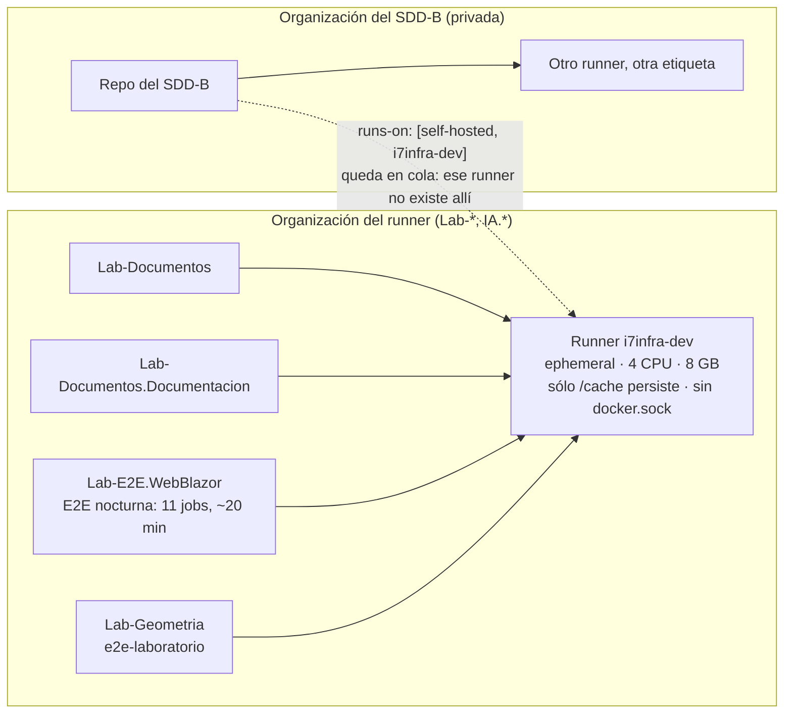

| Campo | Valor |
| --- | --- |
| Tipo | informe |
| Fecha | 2026-10-26 |
| Autor | Despacho R99: refutador. Entra último y a cara descubierta: conoce el folio 080 y los informes que cita (`R01:66`, `R01:127`) |
| Encargo | Refutar, no verificar (`R01:256`). Por cada Dnn: SOSTIENE / DEBILITA / REFUTA, con motivo, evidencia y corrección |
| Corrige | — (no modifica el folio 080; propone) |

# Refutación del análisis de decisiones — expediente 0002

## Índice

1. [Mandato y forma](#1-mandato-y-forma)
2. [Alias y definiciones](#2-alias-y-definiciones)
3. [Método: tres frentes, muestreo y ensayos](#3-método-tres-frentes-muestreo-y-ensayos)
4. [Hallazgos transversales](#4-hallazgos-transversales)
5. [Tablero de veredictos](#5-tablero-de-veredictos)
6. [Veredicto por decisión](#6-veredicto-por-decisión)
7. [Muestreo de evidencia (44 citas)](#7-muestreo-de-evidencia-44-citas)
8. [Condiciones del jurado de composición: K2 y K3](#8-condiciones-del-jurado-de-composición-k2-y-k3)
9. [Excepciones a conocimientos](#9-excepciones-a-conocimientos)
10. [Correcciones propuestas y filas para el lote](#10-correcciones-propuestas-y-filas-para-el-lote)
11. [Lo no verificado](#11-lo-no-verificado)
12. [Inventario de lo creado y lo borrado](#12-inventario-de-lo-creado-y-lo-borrado)
13. [Barrido S2 de este folio](#13-barrido-s2-de-este-folio)

---

## 1. Mandato y forma

**Mandato.** Leer el folio 080 y los informes que cita. Atacar cada decisión D01–D29 en tres frentes:

- **Evidencia**: ¿la cita dice eso? Se abren rutas y URLs; se muestrean al menos 20.
- **Aplicación**: ¿cuesta lo que dice?, ¿funciona en el runner único self-hosted `i7infra-dev`, compartido con la E2E?,
  ¿un agente sin contexto la puede seguir?
- **Objetivo**: ¿responde al pedido (`TP`) y a la regla de simplicidad, practicidad y escalabilidad (`TP:36`)?, ¿crea
  deriva nueva?

**Lo que este folio no hace.** No reabre las decisiones de la presidencia (folio 001, D1–D6). No dictamina: el jurado
de veredicto decide. Las correcciones son propuestas.

**Escala de veredicto.**

| Veredicto | Significa |
| --- | --- |
| SOSTIENE | El ataque no encontró nada que cambie la decisión. Puede llevar notas de forma |
| DEBILITA | La decisión puede quedar, pero una cita no dice lo que se afirma, un costo está mal medido, falta declarar una excepción o una regla no la puede seguir un agente sin contexto. Necesita corrección antes de pasar al jurado |
| REFUTA | El fundamento principal no se sostiene o la decisión no funciona en las condiciones reales. Hay que rehacerla o pasarla a CON REVISIÓN con otra condición |

## 2. Alias y definiciones

Los alias son los del folio 080 §2.1 (`TP`, `B/`, `EXP/`, `F0nn`, `GUIA`, `EXAMPLES`, `CGT`, `LE`, `GEO`, `IKB`, `CPA`,
`KDR`, `RDA`, `SDD-B`). Se agregan:

| Alias | Ruta o referencia |
| --- | --- |
| `EVR/` | `EXP/evidencia/R99/` (evidencia de este folio) |
| `ISDD` | `/IA/SDD/IA.SDD/` (commit `d4035aa`) |
| `RDOC` | `ISDD/SDD/Devs/Rules/Rules-Documentacion.md` |
| `REF` | `ISDD/SDD/Devs/Rules/Rules-Especificacion-Funcional.md` |
| `PERFIL` | `/IA/PROMPTs/IA.Prompts/PromptFramework/Profiles/Study-Guide-Documentation.md` |
| `LE-IADB` | `/LAB/Lab-E2E.WebBlazor/Lab-E2E.WebBlazor.Documentacion/ia-db/README.md` |

| Término | Definición en este folio |
| --- | --- |
| Celda | Un puntaje 1–5 de una alternativa en un criterio K1–K7 de la matriz de A01 |
| Celdas mínimas | Cuántos cambios de un punto en celdas (bajar el ganador o subir el segundo) bastan para empatar o invertir la decisión |
| Ciclo efímero | Lo que tarda el runner `ephemeral` en desregistrarse al terminar un job y volver a escuchar |
| Organización del runner | La organización de GitHub en la que está registrado el runner `i7infra-dev` (`RUNNER_SCOPE=org`). Es la de los repos Lab-* e IA.*; no se nombra |

## 3. Método: tres frentes, muestreo y ensayos

### 3.1 Frentes y preguntas

| Frente | Preguntas que se hicieron a cada Dnn |
| --- | --- |
| Evidencia | ¿La ruta:línea existe y dice lo afirmado? ¿La URL dice lo afirmado hoy? ¿La medida se tomó en las condiciones que la decisión supone? |
| Aplicación | ¿Corre en el runner real (imagen, herramientas, volumen, ciclo efímero, organización)? ¿Cuánto cuesta por PR? ¿Hay nombres que un agente sin contexto confunda? |
| Objetivo | ¿Cumple el literal de `TP` y la decisión 1 de la presidencia? ¿Agrega piezas sin lector? ¿Crea una copia que pueda derivar? |

### 3.2 Muestreo

44 citas abiertas una por una (§7): 30 rutas:línea internas, 7 URLs reconsultadas, 7 datos de repositorio (commits,
tags, workflows, `.csproj`). 36 dicen lo que el folio 080 afirma, 5 lo dicen con matiz que cambia el peso del argumento
y 3 no lo dicen.

### 3.3 Ensayos de este despacho

| Id | Ensayo | Qué ataca | Resultado | Evidencia |
| --- | --- | --- | --- | --- |
| R-E1 | Sensibilidad por celdas sobre el guion de A01: celdas mínimas para invertir, efecto máximo de ±10 % en un peso, peso de un solo criterio que invierte | La regla FIRME (§4.2 y §4.5 del folio 080) | El efecto máximo de ±10 % en un peso es 0,046 en las 29 decisiones; el umbral FIRME es 0,30. **La prueba de ±10 % no puede invertir ninguna decisión que ya pase el margen.** Cinco decisiones FIRME se invierten con 2 o 3 celdas | `EVR/01-sensibilidad-por-celdas.py.txt`, `EVR/02-sensibilidad-salida.txt` |
| R-E2 | Instalar y correr la suite liviana en frío dentro de la **imagen del runner** (`--entrypoint bash`, sin registrarlo, 4 CPU y 8 GB como el runner) | El costo de 5,25 s de F011 E09 (D17, D02) | Instalar lychee: 0,9–1,0 s; instalar `markdownlint-cli2` + `mermaid` + `jsdom` por npm: 13,3–16,1 s y 242 MB; correr: 2,6–2,8 s. Total 17–20 s por corrida, porque el runner sólo conserva `/cache` | `EVR/03-…sh.txt`, `EVR/04-ensayo-herramientas-salida.txt` |
| R-E3 | Leer la configuración no secreta del runner y su log de 72 h | Alcance del runner, ciclo efímero, convivencia con la E2E | `RUNNER_SCOPE=org`, `EPHEMERAL=true`, sin `docker.sock`, un único volumen `/cache`. Ciclo efímero: 56–57 s entre el fin de un job y el nuevo registro, más ~11 s hasta tomar el siguiente. La E2E nocturna ocupa ~20 min con 11 jobs. **El repo del SDD-B es de otra organización y usa otra etiqueta self-hosted** | `EVR/06-runner-alcance-y-ciclo-efimero.txt` |
| R-E4 | Extraer el OpenAPI de MovilidadUrbana en `8fb4c3a` **en tiempo de ejecución**, sin tocar el `.csproj` | La condición (b) de D25 y el ensayo pendiente E-F3 | Compila con 0 errores, `GET /openapi/v1.json` da 200, con 5 rutas y 8 operaciones (las mismas 8 de F011 E07), en 26 s en frío | `EVR/05-ensayo-openapi-en-tiempo-de-ejecucion.txt` |
| R-E5 | Reconsultar 7 páginas web que sostienen D05, D07, D17 y X3 | Frente evidencia | Una cambia el resultado de D17 (§6, D17) | `EVR/07-fuentes-web-reconsultadas.txt` |

## 4. Hallazgos transversales

### T1 — La regla FIRME es, en la práctica, «margen ≥ 0,30»

La regla del folio 080 (§2.2) pide margen ≥ 0,30 **y** que el ganador no cambie con ±10 % en ningún peso. Con pesos de
0,10 a 0,15 y celdas enteras de 1 a 5, mover un peso un 10 % y renormalizar cambia el margen como mucho en 0,046
(R-E1). La segunda condición nunca puede fallar si se cumple la primera: **no agrega información**.

La incertidumbre declarada no está en los pesos sino en las celdas («confianza media en los puntajes de celda»,
frontmatter del folio 080). Medido por celdas (R-E1):

| D | Margen | Celdas mínimas para empatar o invertir | Peso de un criterio que invierte |
| --- | --- | --- | --- |
| D23 | 0,30 | **2** | K1 ≥ 0,35 |
| D25 | 0,20 | **2** | sin K2 ya invierte |
| D08 | 0,35 | **3** | K2 ≥ 0,38; K4 ≥ 0,34 |
| D12 | 0,45 | **3** | — |
| D14 | 0,40 | **3** | — |
| D24 | 0,40 | **3** | **sin K6 ya invierte**; K1 ≥ 0,40; K2 ≥ 0,30 |

**Corrección.** Reemplazar la prueba de ±10 % por la de **celdas mínimas**: FIRME si hacen falta 4 celdas o más;
con 2 o 3, la decisión se asienta con su condición de revisión aunque el margen llegue a 0,30. Con esta regla, D08,
D12, D14, D23 y D24 pasan a CON REVISIÓN. La regla es la misma U2/U3 de F015, medida con un instrumento que sí
discrimina. **[criterio propio]**

### T2 — El runner real no es el que suponen D06, D17 y D22

Tres condiciones del runner que ningún informe registró (búsqueda de «efímero», «organización» y la etiqueta del otro
runner en los folios 001–080 y en las bitácoras: sólo F014:398 y F017:650 dicen «efímero», sin sacar consecuencias):

1. **Alcance de organización.** El runner `i7infra-dev` está registrado en la organización de los Lab-*. El repo
   del SDD-B es de otra organización y sus workflows usan otra etiqueta (`ci.yml:38` del SDD-B y otros cinco jobs).
   Un job del SDD-B con `runs-on: [self-hosted, i7infra-dev]` nunca encuentra runner y queda en cola. Esto afecta a
   E3 en D17 («todo en `[self-hosted, i7infra-dev]`»), D22 («sumar K1 a su CI») y la tabla de hipótesis de D25 (E3).
2. **Efímero, sin estado y sin Docker.** Cada job arranca en un registro nuevo (56–57 s más ~11 s de toma) y sólo
   persiste `/cache`. No hay `docker.sock`. La suite de 5,25 s de F011 E09 se midió con **dos contenedores** en el
   anfitrión: en el runner no puede correr así. Instalada en forma nativa cuesta 17–20 s en frío (R-E2). Por PR, con
   dos jobs (`docs` y `verificar`, D17), el costo realista es de **≈ 2 min 40 s** (2 ciclos efímeros de ~68 s + ~20 s
   de instalación + ~3 s de corrida), y hasta ~20 min más si el PR cae durante la E2E nocturna. El orden de magnitud
   sigue siendo aceptable, pero no es el que dice D17. **[criterio propio sobre medidas propias]**
3. **Repos públicos con runner propio.** GitHub: «self-hosted runners should almost never be used for public
   repositories» (*Secure use reference*, reconsultada el 2026-10-26, `EVR/07` §3). En un `pull_request` desde un fork,
   el maintainer tiene que revisar los «workflow files» antes de aprobar la corrida (*Approving workflow runs from
   forks*, `EVR/07` §4): el archivo de workflow que corre viene del PR. Por eso la «guarda de forks» `if:` (D17, K5 de
   D18, E-F2) **no es una barrera de seguridad**: un fork la puede borrar en su propio PR. La barrera real está en la
   configuración de la organización (aprobación obligatoria de corridas de forks, grupo de runners limitado a
   repositorios elegidos), que son actos H del PO. **[criterio propio sobre las dos fuentes]**

### T3 — Colisiones de nombres que un agente sin contexto no puede resolver

El folio 080 usa el mismo rótulo para cosas distintas:

| Rótulo | Significados en el folio 080 |
| --- | --- |
| K1–K7 | Criterios de la matriz (§4.1) · controles anti-inyección (D18) · y K1–K6 son las condiciones del jurado (F004 §7, citadas en D01 y D29) |
| C1–C14 / C1–C5 | Clases de pieza (§8.1) · chequeos de la compuerta anti-inyección (D18: «C3 avisa») · comisiones `C-*` |
| G1–G7 / G-a…G-g | Guarda de merge de `CPA` (G1–G4) · grupos del carril PR en el diagrama de §8.2 (G1–G7) · paquete de compuerta (G-a…G-g) |

El caso más claro está en §8.1, fila **C3** (`AGENTS.md`): su compuerta dice «excluido de C3 por ruta». Ahí C3 es el
chequeo de frases dirigidas a agentes, no la clase C3. Un agente que lee la tabla sin el resto del folio no puede
saber cuál es cuál. **Corrección**: clases `CL-01…CL-14`; chequeos anti-inyección `AI-1…AI-5`; controles `AK-1…AK-7`;
grupos del carril `PR-1…PR-7`. Se dejan K1–K7 para los criterios y G1–G4 para `CPA`. **[criterio propio]**

### T4 — El folio cita líneas desplazadas o rutas inexactas

Tres casos del muestreo (§7): `I01:200` va entre comillas como «Ninguna referencia elige una sola topología», pero la
línea dice otra cosa («la industria mezcla topologías según la pieza»), y la frase no aparece en `I01`. `R05:160` se
cita por «≈50 enlaces rotos en `LE`», pero el dato está en `R05:270` (H5). `SDD/Conocimiento/Index-Knowledge.md:22-24`
está en `/IA/SDD/IA.SDD/Conocimiento/Index-Knowledge.md:22-25` (no hay carpeta `SDD/Conocimiento/`). Además
`e2e.yml:70-76` no dice de qué repo es: en Lab-Geometria es la guarda de forks, en Lab-E2E.WebBlazor son `env` y
`permissions`. Ninguno cambia una decisión, pero todos fallan la prueba de un agente sin contexto.

## 5. Tablero de veredictos

| D | Veredicto | Motivo en una línea |
| --- | --- | --- |
| D01 | SOSTIENE | El panel cumple; K6 abierta es real; la etiqueta del runner no es materia de S2 |
| D02 | SOSTIENE | U0 antes de U1 y antes del enriquecimiento está medido; el primer merge vuelve al PO como dice `CPA` §3.1 |
| D03 | SOSTIENE | «Por pieza» lo sostiene `I01:200-213`, aunque la frase entre comillas no es literal (T4) |
| D04 | SOSTIENE | 0 tags en los tres repos (verificado); el SHA es la única ancla que existe siempre |
| D05 | SOSTIENE | Docusaurus «Most of the time, you don't need versioning» reconsultada; las guías sin generador están medidas |
| D06 | DEBILITA | El carril programado entre repos no corre como está escrito en un runner efímero de otra organización, y choca con `RDA:22` sin declararlo |
| D07 | SOSTIENE | `llms.txt` es «A proposal» (reconsultada); la condición «si hay sitio» es coherente con D05. Nota: E3 de F017 tiene n = 2 |
| D08 | REFUTA | Lee la reserva de `CPA:149` como «todo borrador P es contenido»; eso amplía §3.4 sin declararlo y contradice `TP:32` |
| D09 | DEBILITA | «`description` escrita por una persona» no la puede verificar ninguna compuerta y choca con la clase P de D08 |
| D10 | SOSTIENE | `KDR:402` y `KDR:404` dicen lo citado; el apartamiento está declarado y va al lote |
| D11 | DEBILITA | La decide el filtro F6, no la matriz: margen real 0,05 contra B, y la norma citada no la leyó nadie |
| D12 | SOSTIENE | Consecuente con D11; la condición de compra es comprobable |
| D13 | DEBILITA | La variante V2 activa C1 (especificación SDD) y C14 (canales de sitio), y MovilidadUrbana no tiene ni SDD ni sitio |
| D14 | DEBILITA | Pone el RRD en `02-Especificacion-Funcional/`, que no está en la tabla maestra de `REF` §2.1: es una excepción no declarada |
| D15 | SOSTIENE | `Expediente-Rules.md:268-271` y `:420-423` (A13) dicen lo citado |
| D16 | SOSTIENE | Coherente con el patrón «equivalente local» (`R03:398`) |
| D17 | REFUTA | La razón para descartar `workflow_call` no se sostiene (la referencia oficial sí dice qué runner usa); E3 no puede correr en `i7infra-dev`; el costo real por PR es otro |
| D18 | DEBILITA | La regla de cinco condiciones vale, pero los rótulos chocan (T3) y la lista de dominios en clase H frena cada referencia nueva de D28 |
| D19 | SOSTIENE | `.csproj` de la ApiWeb verificado (`GenerateDocumentationFile`, `NoWarn CS1591`); 8 operaciones reproducidas |
| D20 | DEBILITA | Integra bien, pero carga las colisiones de T3, una fila (C14) sin sitio que la active y la excepción de D14 |
| D21 | SOSTIENE | `copiar.py`, `cierre.py` y `--check` existen; sólo hay que corregir una ruta (T4) |
| D22 | DEBILITA | En el SDD-B ningún orquestador cambia (la mesa no es orquestador), y la decisión 1 de la presidencia pide mejorar los orquestadores de ambos |
| D23 | SOSTIENE | Las citas de `RDOC` y `Root-Rules.md:646` son exactas. Es frágil (2 celdas, T1): CON REVISIÓN de hecho |
| D24 | DEBILITA | «La mayoría declara "Ninguno obligatorio"» es falso (3 de 6) y 13.18 nombra a Lab-Geometria; además el ganador depende sólo de K6 |
| D25 | SOSTIENE | Se queda A; R-E4 resuelve E-F3 sin tocar `LE`. Pero el fundamento «tocar `LE` exige expediente» exagera `LE-IADB:85` |
| D26 | SOSTIENE | G-a…G-g son medibles en el runner; copiar la salida a `evidencia/` cubre que las URL de Actions expiran |
| D27 | SOSTIENE | `PERFIL:35`, `:56-63` y `:85` dicen lo citado; F8 bien aplicado |
| D28 | SOSTIENE | `Rule-Evidences.md:25` pide la fecha de obtención; 0/20 → 20/20 de F016. Su costo se cruza con D18 (ver allí) |
| D29 | SOSTIENE | La ruta real del Profile existe y la del pedido no; el default no toca el Profile |

**Cuenta.** SOSTIENE 17 · DEBILITA 10 · REFUTA 2.

## 6. Veredicto por decisión

> Cada ficha: veredicto · evidencia (lo abierto) · aplicación · objetivo · corrección. Lo que es juicio de este
> despacho va rotulado **[criterio propio]**.

### D01 — Panel, condición K6 y etiqueta del runner · SOSTIENE

- **Evidencia.** F004 §7, fila K6 (`004:442`), dice lo que D01 afirma; no hay folio de providencia posterior al 004
  (listado de `EXP/actuaciones/`, 2026-10-26).
- **Aplicación.** La etiqueta literal de `TP:34` no es ruta ni usuario. Nota de T2: la etiqueta sí identifica a una
  organización concreta, cosa que afecta a E3 (ver D17), no a S2.
- **Corrección.** Ninguna. P-1 (la providencia de la opción B) sigue pendiente.

### D02 — U0, U1 y la ia-db · SOSTIENE

- **Evidencia.** `CPA` §3.1 (líneas 92–104): la delegación se asienta «con fecha y con quién lo decidió» y, si no
  está, «rige el padre». Esto sostiene que el merge de U0 sea del PO. Los enlaces rotos de `GUIA` siguen vivos: lychee
  `--offline` sobre la carpeta de la guía da exit 2 en R-E2.
- **Aplicación.** La aceptación de U0 (un enlace roto plantado pone el check en `failure`) se puede medir en el runner.
  Costo realista por corrida: el de T2.
- **Objetivo.** Una parte de U1 (los 8 enlaces y el frontmatter de `GUIA`) arregla un archivo que D27 pasa a `obsoleto`.
  Igual hace falta para que la línea de base llegue a 0 (condición 4 de D18): está bien, pero se dice.
  **[criterio propio]**
- **Corrección.** Anotar en U1 que el saneamiento de `GUIA` sirve a la línea de base y no sobrevive a D27.

### D03 — Catálogo de clases · SOSTIENE

- **Evidencia.** `I01:200`: «Se recorre por pieza documental, no por proyecto: la industria mezcla topologías según la
  pieza». Sostiene la decisión, pero el folio 080 lo cita entre comillas como «Ninguna referencia elige una sola
  topología», frase que no existe en `I01` (T4).
- **Aplicación.** Ver T3: la numeración C1–C14 choca con los chequeos C1–C5.
- **Corrección.** Citar la línea textual o quitar las comillas; renombrar las clases (T3).

### D04 — Ancla de versión · SOSTIENE

- **Evidencia.** `git tag | wc -l` da 0 en Lab-Documentos, Lab-Documentos.Documentacion y Lab-E2E.WebBlazor
  (2026-10-26). `LE` está en `8fb4c3a`, `GEO` en `4b114d7` e `IKB` en `1585af9`, como dice el folio 080.
- **Corrección.** Ninguna.

### D05 — Sitio y generador · SOSTIENE

- **Evidencia.** Docusaurus, *Versioning* (reconsultada): «Most of the time, you don't need versioning as it will
  just increase your build time and introduce complexity to your codebase» y «keep the number of your versions below
  10» (`EVR/07` §6). Coincide con `I01:209` (D5′). F014 e6: `build_exit=255` con enlace roto.
- **Aplicación.** Sin generador para las guías, no hay herramienta que instalar en el runner efímero: es la opción más
  barata bajo T2.
- **Corrección.** Ninguna.

### D06 — Enlaces entre repos y forma de citar · DEBILITA

- **Evidencia.**
  - `RDA:22`: «los enlaces y las trazas apuntan al ID, no a la ruta». D06 mantiene «relativos dentro del cuerpo»
    siguiendo `Rule-Markdown.md:33` («Rutas relativas entre documentos relacionados»), y la §9 del folio 080 (fila 7) dice
    «No» apartamiento. Las dos reglas del mismo PromptFramework tiran en sentidos distintos y el folio sólo nombra una.
  - F011 E09: 0,78 s para `lychee --offline`, medido en contenedor, no en el runner (T2).
- **Aplicación.** El carril programado corre `lychee --root-dir <raíz del workspace>`. En el runner:
  1. No hay árbol del workspace: el runner es efímero y sólo persiste `/cache`. Cada corrida tiene que clonar todos
     los repos hermanos y rearmar las rutas `/LAB/…`, `/IA/…`, `/PROG2/…`, que no coinciden con la estructura plana de
     la organización. Hace falta una tabla repo → ruta del workspace que el folio no prevé.
  2. El SDD-B es privado y de otra organización: el `GITHUB_TOKEN` no lo alcanza (`I07-H8`, citado en D17). Hace falta
     un secreto, y eso contradice K5 de D18 («job sin secretos»).
  3. «Issue único por repo» necesita `issues: write`, y el patrón del workspace es `contents: read` (`R03:393`).
- **Objetivo.** Bien orientada (ID calificado + permalink). Lo que falta es que pueda correr.
- **Corrección.**
  1. Carril programado sólo sobre los repos públicos de la organización del runner (clon anónimo), con una tabla
     versionada repo → ruta del workspace.
  2. El SDD-B tiene su propio carril, en su organización y con su runner.
  3. El workflow programado declara `issues: write` como excepción al patrón 3 de `R03:393`.
  4. Declarar en §9 la tensión con `RDA:22`: la clave es el `doc_id` y el enlace relativo es sólo el medio.
  5. Sumar a E-F11 el armado del árbol.

### D07 — Canales para agentes · SOSTIENE

- **Evidencia.** llmstxt.org: «A proposal to standardise on using an /llms.txt file…» (`EVR/07` §7). Sostiene X5.
- **Nota.** «2/2 con el archivo, 0/2 sin él» y «1 de 2» (F017 E3) son muestras de n = 2. Sirven para orientar, no para
  medir. D07 no se apoya sólo en eso (la compuerta de D18 es la que hace cumplir), así que no cae.
- **Corrección.** Escribir «n = 2, orientativo» donde se cita E3.

### D08 — Intervención automática y aprobación · REFUTA

- **Evidencia.** `CPA:149` (reserva 1 de §3.4): «El cierre lleva una decisión **pendiente** sobre el contenido
  entregado: fusionar sería decidirla». D08 resuelve la disidencia F015/F017 diciendo que «todo borrador P es
  contenido» y que por eso vuelve a la persona. La reserva habla de una **decisión pendiente**, no de cualquier
  contenido: §3.4 (líneas 141–160) enumera cinco reservas y ninguna es «lo redactó un LLM». La «convergencia» que
  afirma el folio 080 no está en la fuente. **D08 amplía §3.4** y declara «Excepciones: ninguna».
- **Aplicación.** El equipo es una persona (`R03:212-214`). Con D08, todo PR de documentación redactado por un agente
  (casi todos en E1–E3) espera una aprobación explícita del PO. La regla vigente del workspace es que todo PR va por
  `CPA` con merge delegado (memoria del proyecto «PR siempre con conformación automática»; no es fuente del árbol, se
  cita como contexto). D08 frena el ciclo justo donde la delegación lo destraba.
- **Objetivo.** `TP:32` pide que en la tarea documental «puedan intervenir de forma automática la IA» y que las
  personas «entiendan el flujo de trabajo para poder intervenir». D08 cumple la segunda mitad a costa de la primera.
- **Matriz.** Con la proyección «sólo `TP:36`», C gana (`EV/02`). En celdas, bastan 3 (T1).
- **Corrección.**
  1. El alcance de la aprobación de P **no lo decide la mesa**: es un parámetro de la delegación, que según `CPA` §3.1
     «la decide el responsable del producto» y «declara su excepción». Va como parte de L2 en el lote.
  2. Propuesta de la mesa para esa fila: P se fusiona por la guarda G1–G4 cuando no hay reserva de §3.4. Vuelven a la
     persona la lista H de D08 (`AGENTS.md`, workflows, lista de dominios, pasar `status` a `vigente`, contenido
     normativo, publicación externa, excepciones) y todo PR que **declare** una decisión pendiente.
  3. Lo que E3 de F017 enseña (un agente rompió una regla) se cubre con la compuerta determinista y con «verificador ≠
     redactor», no con aprobar cada PR.
  4. Si el PO quiere aprobación explícita en todo P, queda asentada como excepción de su delegación, con fecha.
  5. Estado: CON REVISIÓN (T1).

### D09 — Contrato de frontmatter · DEBILITA

- **Evidencia.** `RDA:21` trae los 10 campos con `confidence` condicional, como dice D09. `R07:366` confirma que el
  Profile no fija el contrato.
- **Aplicación.** «`description` … escrita por una persona» no tiene observable: ningún validador puede saber quién
  escribió un campo. Además, en D08 los borradores son de clase P (los redacta un agente). Un agente sin contexto que
  redacta una página no sabe si puede llenar `description` o tiene que dejarla vacía, y una `description` vacía
  rompe el esquema.
- **Corrección.** `description` obligatoria (≤ 160) y **revisada** por la persona en el PR que pasa `status` a
  `vigente` (acto H de D08). El esquema verifica presencia y largo; la autoría no se pide. Lo que E1 de F017 mostró
  (la descripción automática no sirve para elegir página) se cubre con esa revisión.

### D10 — Contrato de trazas · SOSTIENE

- **Evidencia.** `KDR:402` («Id | RN-nn») y `KDR:404` («Ancla | ‹§ de la fuente / CU-n paso / archivo:línea›»): el
  apartamiento está bien identificado y va al lote (L5). `KDR:38` («Nunca se decide acá: se eleva al autor») sostiene la
  fila H de D08 en la fase 2.
- **Corrección.** Ninguna.

### D11 — Columna vertebral normativa · DEBILITA

- **Evidencia.** `EV/02`: B («sólo marcos abiertos») suma 3,95 frente a 4,00 de A y queda excluida por F6. El
  «margen 1,65» del tablero es contra C, la tercera. El margen real de la elección es **0,05**, y lo decide un filtro.
  El alcance de 26514 (`I05:125`: «Excluye la capacitación por computadora y los materiales de cursos formales») sí
  está verificado en el comité ISO. Las cláusulas no: la norma no se compró (D12) e ISO dio 403 (F016 §12).
- **Objetivo.** F6 excluye lo que «ignora un estándar … que la mesa relevó». Citar 26514 «sin apartado» porque nadie
  la leyó es poco más que nombrarla. El cumplimiento de «que consulten los estandares» (`TP:36`) se apoya, en la
  práctica, en Diátaxis, arc42, C4 y MADR, que son los que sí se leyeron. **[criterio propio]**
- **Corrección.**
  1. En el tablero, informar el margen contra la mejor alternativa excluida («0,05; decide F6»).
  2. Decir qué aporta 26514 en forma verificable: sólo su **alcance** (`I05:125`) y su índice público. No se usa
     ninguna cláusula.
  3. Si E2 necesita una cláusula, rige D12.

### D12 — Compra de 26514 · SOSTIENE

- Consecuente con D11. La condición de compra (una compuerta bloqueante que necesite el texto de una cláusula) es
  comprobable. Frágil en celdas (3, T1), pero reversible por diseño.

### D13 — Tronco con variantes · DEBILITA

- **Evidencia interna.** Tabla de variantes de D13: V2 (MovilidadUrbana) activa «C1–C7, C12, C14».
  - C1 es «Especificación: NB, CU, RN, ADR» en `SDD/` (§8.1), y MovilidadUrbana **no tiene SDD**: por eso D10 usa
    `RN-LOC-nn` provisionales en fichas dentro del árbol de la demo.
  - C14 son canales «sólo si hay sitio», y D05 decide que no hay sitio para la demo.
- **Aplicación.** Un agente que aplica V2 tal cual crearía `SDD/` y `llms.txt` donde la propia mesa decidió que no van.
- **Corrección.** V2 = C2 (RRD en `docs/_requisitos.md`), C3, C4, C5, C6 (con fichas `RN-LOC` como anexo), C7 y C12.
  C1 y C14 quedan inactivas, con motivo. El folio 080 §13 ya rotula esta tabla como criterio propio: corregirla no
  cambia la decisión.

### D14 — Fases y RRD · DEBILITA

- **Evidencia.** «Mantenim» aparece 0 veces en `TP` (`grep -ci`, 2026-10-26). `TP:26` nombra las cinco fases. La parte
  de fases se sostiene. Pero D14 y la fila C2 de §8.1 ubican el RRD, en un destino con SDD, en
  `02-Especificacion-Funcional/Requerimientos-Documentales.md`. La tabla maestra de esa categoría (`REF` §2.1,
  líneas 52–61) enumera `Especificacion-Funcional.md`, `Definicion-…`, `Casos-De-Uso/`, `Reglas-De-Negocio/`,
  `Modelo-Datos/…`, `Glosario-Funcional.md` y el `README.md`. **El RRD no está**, y `grep` de
  «Requerimientos-Documentales» en `ISDD/SDD/Devs/Rules/` da 0. Es un artefacto nuevo dentro de una categoría
  normada: un apartamiento que la §9 del folio 080 no declara.
- **Aplicación.** En E2 (Geometría, IA.SDD 13.22), una auditoría de la norma marcaría el archivo como no previsto.
- **Corrección.** Agregar en §9: «`REF` §2.1 — RRD como artefacto nuevo en `02-…`; impacto: un archivo por unidad de
  entrega; vía: el mismo ADR de apartamiento de D23 (que ya introduce documentación de usuario en Geometría) y la
  propuesta de cambio de norma de L4». En destinos sin SDD no cambia nada.

### D15 — PR como unidad y reintegro · SOSTIENE

- **Evidencia.** `Expediente-Rules.md:268-271` (reintegro por `Root-Rules` §14 y A13–A15 como hallazgo P1) y `:420-423`
  (A13) dicen lo citado.

### D16 — «Cómo intervenir» · SOSTIENE

- **Aplicación.** «El mismo comando que la CI» exige un guion local equivalente. El runner no tiene las herramientas
  (T2), así que el guion tiene que instalarlas: es el patrón 7 de `R03:398` (`ci-local.sh`). Basta nombrarlo.

### D17 — Workflow sobre el runner · REFUTA

- **Evidencia.**
  - El descarte de B (`workflow_call`) se apoya en que «la página oficial "Reuse workflows" no dice qué runners
    self-hosted usa el workflow llamado» (F014:378-379, `:616`). Es cierto de **esa** página (reconsultada,
    `EVR/07` §2). Pero la referencia oficial *Reusing workflow configurations*, sección «Self-hosted runners», lo dice:
    los workflows llamados «can access self-hosted runners from the caller's context», en el repositorio que llama y
    en su organización, cuando el dueño es el mismo (`EVR/07` §1, reconsultada el 2026-10-26). Lab-Documentos,
    Lab-Documentos.Documentacion, Lab-E2E.WebBlazor y Lab-Geometria son de la misma organización que el runner
    (`git remote`, 2026-10-26). **El fundamento del descarte cae.**
  - «`GITHUB_TOKEN` no cruza repos» (I07-H8) no impide llamar un workflow reutilizable de un repo público de la misma
    organización.
- **Aplicación.**
  1. *Copia y deriva.* A copia la plantilla en cada repo con una cabecera `plantilla:`, sin compuerta que detecte que
     la copia cambió. Es la deriva que D21 resuelve para los conocimientos con `copiar.py --check`, y X4 la nombra como
     problema. B referencia `docs-guard.yml@<tag>`: una fuente, sin copias.
  2. *E3 no corre en `i7infra-dev`* (T2-1). El SDD-B tiene que usar el runner de su organización, con otra etiqueta.
     `TP:34` dice «Configura el workflow con este runner». Para el SDD-B ese runner no existe en su organización.
  3. *Costo.* El costo real por PR es ≈ 2 min 40 s (T2-2), no 5,25 s. `timeout-minutes: 2` en `verificar` cubre la
     ejecución, pero no la espera en cola ni el ciclo efímero.
  4. *Guarda de forks.* No protege el runner (T2-3).
- **Matriz.** Corrigiendo sólo lo que la evidencia cambia: B K2 2 → 4 (el runner sí se hereda), B K3 4 → 5 (un sistema
  nuevo = una línea `uses:`), A K7 4 → 3 (copias sin compuerta). Resultado: A 4,15 y B 4,15, **empate**. Cuenta:
  B = 0,15 × (4+4+5+4+4+4) + 0,10 × 4 = 4,15; A = 0,15 × (4+4+5+4+5+3) + 0,10 × 4 = 4,15. **[criterio propio en las tres
  celdas]**
- **Corrección.**
  1. Dentro de la organización del runner, **B**: `docs-guard.yml` reutilizable en Lab-Documentos, versionado por tag
     anotado, llamado con `uses: …/docs-guard.yml@<tag>` desde cada repo con `runs-on: [self-hosted, i7infra-dev]`.
     Primer ensayo de U0: comprobar que el job llamado toma el runner (E-F12 nuevo).
  2. Para el SDD-B, **copia fijada** con cabecera y huella (sha256 contra el tag de la plantilla), comprobada por un
     paso `--check`, y `runs-on` con la etiqueta del runner **de su organización**. Asentarlo en el lote como lectura
     de `TP:34` para E3 (fila L10, §10).
  3. Un solo job que valida y agrega, en lugar de `docs` + `verificar`, para pagar un solo ciclo efímero.
     Condición: el agregador estricto sigue siendo necesario si hay jobs condicionales (`R03:333`).
  4. Seguridad: la aprobación obligatoria de corridas de forks y el grupo de runners limitado a repos elegidos van al
     lote como actos H del PO (fila L11). La guarda `if:` se mantiene como higiene, no como barrera.
  5. Estado: CON REVISIÓN hasta E-F12.

### D18 — Qué bloquea y qué avisa · DEBILITA

- **Evidencia.** La regla de cinco condiciones es la unión exacta de F011 §3.6 y F015 Q23. F017 E2 (exit 1, seis
  hallazgos) está en `evidencia/C-AGENTES-IA/salidas/E2-compuerta.txt`, como dice el folio 080.
- **Aplicación.**
  1. *Rótulos* (T3): «K1–K7» y «C3 avisa» chocan con otros K y C del mismo folio.
  2. *Lista de dominios en clase H.* «URL fuera de la lista de dominios … bloquea» y la lista es H (sólo la persona la
     cambia). D28 manda completar las referencias. Las 20 referencias rehechas por F016 E01 tienen **12 hosts
     distintos**, contra 6 en la guía hoy (`grep -oE` sobre `evidencia/C-ACADEMICO/E01-veinte-referencias-apa.md` y
     sobre la carpeta de la guía, 2026-10-26). Durante el enriquecimiento, casi cada referencia nueva frena el PR hasta
     que la persona edite la lista: el mismo cuello de botella que D08.
- **Corrección.**
  1. Renombrar (T3).
  2. C4 bloquea las URL fuera de la lista **en el cuerpo de la prosa y en archivos de instrucciones**. En el anexo de
     referencias (`ref-…`), validado por `reflint`, sólo avisa.
  3. La lista de dominios pasa de H a P con aprobación explícita (es una decisión concreta y visible en el diff).
  4. K5 (guarda de forks) no es control de seguridad del runner (T2-3).

### D19 — Fuente generada en el build · SOSTIENE

- **Evidencia.** `LE/src/MovilidadUrbana.ApiWeb/MovilidadUrbana.ApiWeb.csproj:10-11`: `GenerateDocumentationFile=true` y
  `NoWarn CS1591` ya están. No hay `ApiDescription.Server`, y por eso hace falta el cambio que D19 propone para el
  build. R-E4 reprodujo las 8 operaciones de F011 E07.
- **Corrección.** Ninguna para D19. Ver D25 para la demo.

### D20 — Arquitectura del sistema documentador · DEBILITA

- **Objetivo.** Responde a la decisión 2 de la presidencia: cubre contenido, fuentes, topología, versionado,
  audiencias, publicación, CI y agentes.
- **Aplicación.** Como documento para un agente sin contexto, arrastra:
  1. las colisiones de T3, incluida la fila C3;
  2. la fila C14, que en esta corrida ninguna variante puede activar (D05: sin sitio);
  3. la ubicación de C2 en destinos SDD, que es la excepción no declarada de D14;
  4. en §8.2, el carril programado con `lychee --root-dir`, que no corre así (D06), y el carril PR con
     `docs-guard@v` copiado (D17).
- **Corrección.** Aplicar T3, D06, D14 y D17 al catálogo y a los diagramas. Marcar C14 como «latente: se activa con el
  primer sitio».

### D21 — Conocimiento compartido · SOSTIENE

- **Evidencia.** `IKB/tools/` contiene `copiar.py`, `cierre.py`, `indice.py` y `compuerta/` (`ls`, 2026-10-26).
  `IKB/README.md:70-80` documenta `copiar.py <Alias> --destino`. «Un documento que se suma desde otro repositorio llega
  con su cierre» está en `/IA/SDD/IA.SDD/Conocimiento/Index-Knowledge.md:24-25`, no en la ruta que cita el folio 080
  (T4).
- **Aplicación.** El paso `copiar.py --check` en el SDD-B corre en el runner de su organización (T2-1). No cambia nada
  de la decisión.
- **Corrección.** Corregir la ruta.

### D22 — «Mejorar los orquestadores» · DEBILITA

- **Evidencia.** `R04:190-192`: «Ningún `AG-*.md` cambió …; las cuatro compuertas de lectura no corren desde el
  2026-08-29 … Lo vivo es la mesa de expertos a pedido». Es exacto.
- **Objetivo.** La decisión 1 de la presidencia (carta común) pide «aplicación al SDD-B **con mejora de orquestadores
  de ambos SDD**», y `TP:30` dice «mejorando los agentes orquestadores de ambos». Para el SDD-B, D22 A propone
  «cargarlo en la mesa a pedido de sus expedientes» y «sumar K1 a su CI». Ninguna de las dos toca un orquestador: la
  mesa no es un agente orquestador y el CI tampoco. En IA.SDD sí cambia algo (Momento 2 de AG-00110). En el SDD-B, lo
  que el pedido llama orquestador queda igual. **[criterio propio]**
- **Aplicación.** «Sumar K1 a su CI» va en el runner de la otra organización (T2-1).
- **Corrección.** Dos caminos, a elección del jurado:
  1. Nombrar el punto de entrada que hoy orquesta en el SDD-B (el prompt de la mesa a pedido que abren sus
     expedientes) como «orquestador vivo» y fijar un cambio verificable en él (condición de carga del conocimiento +
     disparo de `docs-guard` como insumo de cierre), con su observable en E3.
  2. Declararle al PO, en el lote, que los orquestadores AG-xx del SDD-B están dormidos y que la «mejora» apunta a la
     mesa, para que lo asiente (fila L12). Sin una de las dos, la compuerta E3 no puede dar `PROCEDE` sobre «mejora de
     orquestadores de ambos».

### D23 — Vía normativa de la piloto · SOSTIENE

- **Evidencia.** `RDOC:102` («Esta categoría no documenta al usuario final no técnico»), `:457` (tres roles), `:723`,
  `:801` y `:1003` dicen lo citado. `Root-Rules.md:646` («Un apartamiento que sobrevive dos o más…») también.
  `GEO/SDD/Docs/Unidades-Entrega/GeometriaFactory-Web/03-UX-UI-DX/Experiencia-De-Uso.md:100` dice «El producto no lleva
  manual».
- **Fragilidad.** 2 celdas la invierten (T1). Ya tiene condición de revisión. Que el tablero diga «FIRME (en el
  umbral)» confunde: es CON REVISIÓN.
- **Corrección.** Estado CON REVISIÓN. Sumarle la excepción de D14 (el RRD), que viaja por el mismo ADR.

### D24 — Migración a 13.22 · DEBILITA

- **Evidencia.** El folio 080 afirma que «la mayoría declara "Ninguno obligatorio"». En `ISDD/CHANGELOG.md`:
  - «Ninguno obligatorio»: 13.22 (`:54`), 13.21 (`:106`) y 13.19 (`:185`);
  - 13.20: «Ninguno retroactivo»;
  - 13.18 (`:271-277`): «**Nada retroactivo, y no es "ninguno"**», con una fila para **`Lab-Geometria`**: su
    expediente `0001-Migracion-Normativa-A-13.16` queda como forma histórica, re-medido con A1–A12;
  - 13.17: minor sin esa fórmula.

  Son 3 de 6, y el único salto que nombra al destino de la piloto no dice «ninguno».
- **Matriz.** Sin K6 gana B (R-E1). El ganador depende de un solo criterio, y ese criterio (coherencia con el SDD)
  favorece por definición a «estar en la última versión». **[criterio propio]**
- **Objetivo.** La razón de fondo se sostiene: la piloto corre la Fase I, que 13.20–13.22 cambian (reintegración,
  `CPA`, `Excepcion-A-Un-Conocimiento`).
- **Corrección.** Corregir la cita. Sumar a E-F9 lo que 13.18 dice de Lab-Geometria (forma histórica del 0001, A1–A12).
  Estado CON REVISIÓN (3 celdas, T1), con la condición de `Migracion-Rules` §3 que ya trae.

### D25 — Dónde vive la mini demo · SOSTIENE

- **Evidencia.**
  - A favor de A: `TP:16` (los ejemplos en `EXAMPLES`) es exacto.
  - En contra del fundamento: el folio 080 dice «tocar `LE` exige un expediente (`R05:238-241`, ia-db de `LE`)». La
    regla de origen, `LE-IADB:85`, prohíbe «traducir ni renombrar texto visible, URL, contrato JSON, `data-testid`,
    `AutomationId` ni comentarios». No prohíbe toda modificación. Agregar una propiedad al `.csproj` o una carpeta
    `docs/` no está alcanzado por esa línea. La lectura de `R05:238-241` es más amplia que su fuente. Eso sube K2 de B
    y achica un margen que ya era 0,20.
- **Ensayo R-E4.** La condición de revisión (b) de D25 («el contrato no se puede emitir en el CI de la demo sin tocar
  el `.csproj` de `LE`») **no se da**. Con `git archive 8fb4c3a`, build y arranque de la ApiWeb en `Development`,
  `GET /openapi/v1.json` devuelve 200 con 8 operaciones en 26 s (`EVR/05`). La demo puede mostrar «fuente generada del
  SHA» sin tocar `LE`, por extracción en ejecución. E-F3 queda resuelto. Corre en la imagen del runner, que tiene
  dotnet 10.
- **Objetivo.** A demuestra el problema de `TP:20` (c) y su mecanismo. Queda.
- **Corrección.**
  1. Reescribir el fundamento: «`LE-IADB:85` prohíbe renombrar textos y contratos; esta corrida además se abstiene de
     tocar `LE` por alcance».
  2. Cambiar la condición (b) por: «si la extracción en ejecución deja de dar el contrato completo (por ejemplo,
     `MapOpenApi` sólo en `Development`)».
  3. Documentar en la demo que la extracción en ejecución es un **medio de la demo**, no la recomendación de D19 para
     el código, que sigue siendo el build.

### D26 — Compuerta de cada escalón · SOSTIENE

- **Aplicación.** G-b (una corrida verde con URL y SHA) se puede medir en el runner. Las URL de Actions expiran y la
  copia a `evidencia/` lo cubre. Para E3, G-b corre en el runner de la otra organización (T2-1): agregarlo al criterio.

### D27 — Cuerpo documental · SOSTIENE

- **Evidencia.** `PERFIL:35` (de lo general a lo particular), `:56-63` (estructura fija de seis partes) y `:85` (lector
  sin conocimiento previo) dicen lo citado. `R02:319` («No cumple como guía de estudio en el sentido del perfil»)
  también.
- **Objetivo.** Más piezas (K1 = 3), pero las exige el Profile (`TP:67-68`). Sin alternativa admitida más simple.

### D28 — Citación · SOSTIENE

- **Evidencia.** `Rule-Evidences.md:25`: «Documentación o recurso | Referencia y fecha de obtención». Sostiene «fecha
  siempre» dentro del marco.
- **Interacción.** Cada referencia nueva puede traer un dominio nuevo (12 hosts en 20 referencias). Se resuelve en D18,
  no aquí.

### D29 — Propuesta al dueño del Profile · SOSTIENE

- **Evidencia.** `TP:68` cita `/IA/IA.Prompts/PromptFramework/…`, que no existe. `PERFIL` sí existe en
  `/IA/PROMPTs/IA.Prompts/…` (`ls`, 2026-10-26). La corrección de ruta que D29 lleva al lote es exacta.

## 7. Muestreo de evidencia (44 citas)

Resultado: ✓ dice lo afirmado · ≈ lo dice con un matiz que cambia el peso · ✗ no lo dice.

| # | Cita del folio 080 | Qué se abrió | Res. | Observación |
| --- | --- | --- | --- | --- |
| 1 | `TP:16` ejemplos en `EXAMPLES` | `TP:16` | ✓ | — |
| 2 | `TP:26` cinco fases | `TP:26` | ✓ | — |
| 3 | «Mantenim» 0 apariciones | `grep -ci mantenim TP` = 0 | ✓ | — |
| 4 | `TP:34` etiqueta del runner | `TP:34` | ✓ | — |
| 5 | `TP:36` simplicidad, practicidad, escalabilidad, estándares | `TP:36` | ✓ | También dice «tendencias del mercado» (§8) |
| 6 | `TP:67-68` Profile | `TP:68` | ✓ | La ruta del pedido no existe (D29) |
| 7 | `I01:200` «Ninguna referencia elige una sola topología» | `I01:200`; `grep` en `I01` | ✗ | Frase no literal y ausente (T4) |
| 8 | `I01:202-213` matriz D1–D8 | `I01:202-213` | ✓ | — |
| 9 | `I01:209` D5′ | `I01:209` | ✓ | — |
| 10 | `R03:212-214` una persona, dos identidades | idem | ✓ | — |
| 11 | `R03:141-156` la ia-db indexa | idem | ✓ | — |
| 12 | `R03:333` agregador estricto | idem | ✓ | — |
| 13 | `R03:391-398` siete patrones | idem | ✓ | — |
| 14 | `R03:256-267` tres versiones | idem | ✓ | — |
| 15 | `R04:190-192` AG-xx sin uso desde 2026-08-29 | idem | ✓ | — |
| 16 | `R04:315-316` el mismo repo no evita el desfase | idem | ✓ | — |
| 17 | `R04:322-323` reintegro no ejercido | idem | ✓ | — |
| 18 | `R05:238-241` tocar `LE` exige expediente | idem + `LE-IADB:85` | ≈ | La fuente prohíbe renombrar, no toda modificación (D25) |
| 19 | `R05:160` ≈50 enlaces rotos | `R05:160`, `R05:270` | ✗ | El dato está en `R05:270` (T4) |
| 20 | `R05:120` sin roles | idem | ✓ | — |
| 21 | `R05:190` ruta:constante | idem | ✓ | — |
| 22 | `R06:211` IA.SDD sin docs as code | idem | ✓ | — |
| 23 | `R06:131` otra corrida en la ia-db | idem | ✓ | — |
| 24 | `R07:366` Profile sin contrato de frontmatter | idem | ✓ | — |
| 25 | `R02:319` no cumple como guía | idem | ✓ | — |
| 26 | `I05:125` 26514 excluye cursos formales | idem | ✓ | — |
| 27 | `I02:355` cron semanal | idem | ✓ | — |
| 28 | `I03:196` aprobador ≠ solicitante | idem | ✓ | — |
| 29 | `R01:460`, `:473-476` no por silencio | idem | ✓ | — |
| 30 | `KDR:38`, `:402`, `:404` | idem | ✓ | — |
| 31 | `CPA:149` reserva de contenido | `CPA:141-160` | ≈ | Dice «decisión pendiente», no «todo contenido P» (D08) |
| 32 | `IKB/README.md:70-108`, `IKB/tools/` | `:70-80`, `ls` | ✓ | — |
| 33 | `RDOC:102`, `:457`, `:723`, `:801`, `:1003` | idem | ✓ | — |
| 34 | `Root-Rules.md:646` | idem | ✓ | — |
| 35 | `Expediente-Rules.md:268-271`, `:420-436` | `:268-271`, `:420-423` | ✓ | — |
| 36 | `SDD/Conocimiento/Index-Knowledge.md:22-24` | `/IA/SDD/IA.SDD/Conocimiento/Index-Knowledge.md:20-25` | ≈ | Contenido exacto, ruta inexacta (T4) |
| 37 | `Migracion-Rules.md:100-108` estado objetivo | idem | ✓ | — |
| 38 | `CHANGELOG.md`: «la mayoría … Ninguno obligatorio» | `:6-326` | ✗ | 3 de 6; 13.18 nombra a Lab-Geometria (D24) |
| 39 | `Experiencia-De-Uso.md:100` | idem | ✓ | — |
| 40 | `PERFIL:35`, `:56-63`, `:85`; `RDA:21-22`; `Rule-Markdown.md:33`; `Rule-Evidences.md:25` | idem | ≈ | `RDA:22` tira contra `Rule-Markdown.md:33` (D06) |
| 41 | `GUIA:11` traza duplicada; `GUIA:161` «adoptada»; enlaces de `:189`, `:203`, `:432`, `:633` | idem | ✓ | — |
| 42 | `e2e.yml:70-76` guarda de forks; `verificar.yml:14` `ubuntu-latest` | los dos `e2e.yml`; `GEO.Documentacion` | ✓ | `e2e.yml` sin repo: sólo vale en Lab-Geometria (T4) |
| 43 | Medidas F011 E09 (0,78 s; 5,25 s; 15,8 s) y F014 e6 (exit 255) | `evidencia/C-VERIFICACION/E09…md:20-21`; `evidencia/C-ARQ-NET/e6.txt:1` | ✓ | Medidas en contenedor del anfitrión, no en el runner (T2) |
| 44 | URLs: Docusaurus, llmstxt.org, *Control the concurrency*, *Reuse workflows* | `EVR/07` §2, §5–§7 | ✓ | La conclusión de D17 cae por la página de referencia (`EVR/07` §1) |

Además se verificó la huella de la evidencia de A01: `sha256` de `EV/01-matriz-a01.py.txt` = `0113d75b…c4906f` y de
`EV/02-matriz-salida.txt` = `ae401003…461af0`. Coinciden con el folio 080 §4.5.

## 8. Condiciones del jurado de composición: K2 y K3

### 8.1 K2 — umbrales y cuantificadores del pedido sin lectura

La carta (F004 §7, K2) le pide al refutador buscar umbrales y cuantificadores del pedido que nadie haya leído. Si
alguno queda en `PROCEDE` sin lectura, el rol formal entra con silla propia en el ciclo siguiente.

| Cuantificador o umbral de `TP` | ¿Lectura en el folio 080? | Estado |
| --- | --- | --- |
| «**mini** demo» (`TP:30`) | No. D25 le asigna a E1 cinco afirmaciones, 17 piezas, OpenAPI, trazas de dos niveles y CI, sin un umbral de tamaño que diga qué es «mini» | **Sin lectura** |
| «**tendencias del mercado**» (`TP:36`) | No: 0 apariciones en el folio 080. F6 cubre «estándares», no «tendencias». Ningún criterio K1–K7 las mide | **Sin lectura** |
| «estudio **profundo**» (`TP:20`) | No: 0 apariciones en el folio 080. No hay umbral de profundidad | **Sin lectura** |
| «**todas** las pruebas que sean necesarias» (`TP:36`) | Se lee como habilitación (F001:186), no como umbral. §10 del folio 080 enumera los ensayos que faltan | Leído |
| «**Toda** afirmación debe estar respaldada» (`TP:61`) | Sí: rótulo «criterio propio» y §13 | Leído |
| «**ambos**» orquestadores (`TP:30`) | Leído, pero no cumplido para el SDD-B (D22) | Leído, observado |

**Consecuencia según K2**: quedan tres cuantificadores sin lectura. Por la condición asentada en F004 §7, el rol formal
entra con silla propia en el ciclo siguiente. Propuesta mínima para que lo encuentre ya leído **[criterio propio]**:

- «mini» = la demo cabe en un PR revisable (≤ 20 piezas, ≤ 1 workflow y menos de 15 min de corrida en el runner,
  ciclo efímero incluido);
- «tendencias del mercado» = criterio K8 «adopción observada», con fuente I06 o I07 por alternativa, que pese 0 hasta
  que el jurado le dé peso;
- «profundo» = cada núcleo N01–N08 con al menos una fuente de industria primaria por decisión (la matriz §4.1 ya lo
  cumple en los criterios, no en cada decisión).

### 8.2 K3 — que no se dupliquen C-ANALISTA y C-DECISIONES

`F013:21`: «No fija pesos (son de `C-DECISIONES`)»; `F013:202`: «Los pesos entre criterios son de `C-DECISIONES`». En
Q03, Q09, Q17 y Q19, F013 propone alternativas y F015 las pondera, y el folio 080 §4.6 lo trata así. **Sin
duplicación.**

## 9. Excepciones a conocimientos

Excepciones que este folio encuentra **no declaradas** en el folio 080 §9:

| # | Conocimiento o norma + § | Qué propone el folio 080 en su lugar | Impacto operativo | Decisión |
| --- | --- | --- | --- | --- |
| R1 | `CPA` 2.0 §3.4 (cinco reservas; `CPA:141-160`) | Todo PR de clase P vuelve a la persona: amplía la reserva 1 | Cada PR redactado por un agente espera al PO; contradice la delegación vigente | D08 → tratarlo como parámetro de la delegación (L2) |
| R2 | `REF` §2.1, tabla maestra de la categoría 02 | Archivo nuevo `Requerimientos-Documentales.md` en `02-Especificacion-Funcional/` | Un archivo no previsto por unidad de entrega en destinos SDD (Geometría, E2) | D14 → por el ADR de D23 y la propuesta L4 |
| R3 | `RDA:22` («los enlaces … apuntan al ID, no a la ruta») | Enlaces relativos dentro del cuerpo (`Rule-Markdown.md:33`) | Ninguno si se declara que la clave es el `doc_id` y el relativo es el medio | D06 → declarar |
| R4 | Patrón 3 del workspace, `contents: read` (`R03:393`) | El carril programado abre issues (`issues: write`) | Un permiso más en un workflow programado | D06 → declarar |

Este folio no propone apartarse de ningún conocimiento: las correcciones de §6 reducen excepciones (R1) o las declaran
(R2–R4).

## 10. Correcciones propuestas y filas para el lote

### 10.1 Correcciones al folio 080 (para A01 o la presidencia)

| # | Corrección | Decisiones |
| --- | --- | --- |
| C-1 | Cambiar la prueba ±10 % por celdas mínimas; con 2–3 celdas, CON REVISIÓN | D08, D12, D14, D23, D24 |
| C-2 | Renombrar clases, chequeos, controles y grupos (T3) | D03, D18, D20 |
| C-3 | Corregir las cuatro citas de T4 | D03, D21, D25, E-F2 |
| C-4 | Rehacer D17: B en la organización del runner; copia con huella y runner propio en el SDD-B; un solo job; costo real por PR | D17, D20, D02 |
| C-5 | Acotar el carril programado de D06 a los repos de la organización del runner, con una tabla repo → ruta | D06, D20 |
| C-6 | D08: el alcance de la aprobación de P pasa a la delegación (L2), con la propuesta de §6 | D08 |
| C-7 | V2 sin C1 ni C14 | D13 |
| C-8 | Declarar R2–R4 en §9 | D06, D14 |
| C-9 | Corregir la cita del CHANGELOG y sumar 13.18 a E-F9 | D24 |
| C-10 | D25: fundamento corregido; condición (b) nueva; E-F3 resuelto por R-E4 | D25 |
| C-11 | D22: nombrar el orquestador vivo del SDD-B o elevarlo al lote | D22 |
| C-12 | D11: informar el margen contra la excluida y lo que aporta 26514 en forma verificable | D11 |
| C-13 | D09: `description` revisada, no «escrita por una persona» | D09 |
| C-14 | D18: C4 sólo avisa en el anexo de referencias; la lista de dominios pasa a P con aprobación | D18 |

### 10.2 Ensayos nuevos

| Id | Ensayo | Decide |
| --- | --- | --- |
| E-F12 | Un `workflow_call` desde Lab-Documentos.Documentacion a `docs-guard.yml@<tag>` de Lab-Documentos, con `runs-on: [self-hosted, i7infra-dev]` en el llamado: ¿lo toma el runner? | D17 (B) |
| E-F13 | Tiempo de pared por PR en el runner real, con 1 job y con 2, y con la E2E nocturna en curso | D17, D02 |
| E-F14 | Armar el árbol del workspace en el runner efímero para `lychee --root-dir` con los repos públicos | D06 |

### 10.3 Filas nuevas para el lote del PO (no se asientan por silencio, `R01:460`)

| # | Fila | Si no responde |
| --- | --- | --- |
| L10 | Lectura de `TP:34` para E3: el SDD-B usa el runner de su organización (otra etiqueta), porque `i7infra-dev` no existe allí | E3 no tiene CI en runner propio: la compuerta E3 da `INSUFICIENTE` en G-b |
| L11 | Configuración de la organización del runner: aprobación obligatoria de corridas de forks y grupo de runners limitado a repos elegidos (actos H) | Rige la guarda `if:`, que no protege el runner (T2-3) |
| L12 | Si la «mejora de orquestadores» en el SDD-B apunta a la mesa a pedido (los AG-xx están dormidos) | La compuerta E3 no puede dar `PROCEDE` sobre «ambos» |
| L2 (ampliada) | La delegación fija si P necesita aprobación explícita o se fusiona por guarda sin reserva de §3.4 | Rige `CPA` §3.4 tal cual |

## 11. Lo no verificado

- **F017 E1** («6/6 frente a 5/6», «4,5/6») y **F017 E3** (n = 2): se leyó el archivo de corridas
  (`evidencia/C-AGENTES-IA/salidas/corridas-agentes.json`, 17 registros), pero no se recontaron uno por uno. Motivo:
  ningún veredicto depende de esas cifras.
- **F013 E-A01–E-A04, F010 E1–E6, F016 E01–E05** no se re-midieron. Se usaron sólo como los cita el folio 080, salvo el
  recuento de hosts de E01, que sí se hizo.
- **Que la configuración de la organización del runner ya exija aprobación para forks**: no se consultó (sin
  credencial de administración de la organización en este despacho). T2-3 vale igual: la guarda `if:` no es barrera
  en ningún caso.
- **El rescore de D17** (empate 4,15) cambia tres celdas: es juicio de este despacho.
- **Material for MkDocs en mantenimiento hasta el 2027-05-05** (D05, de F014 §3.3): no se reconsultó. D05 no depende de
  eso.
- **Que el `GITHUB_TOKEN` no alcance un repo privado de otra organización**: se toma de I07-H8, sin ensayo propio.

## 12. Inventario de lo creado y lo borrado

| Qué | Dónde | Estado |
| --- | --- | --- |
| Este folio | `EXP/actuaciones/085-refutacion.md` | Creado |
| Evidencia R99 (7 archivos, texto) | `EVR/01…07` | Creados |
| Directorio de intermedios: guion de sensibilidad, guion de herramientas, salidas, `git archive` de `LE` en `8fb4c3a` con su build y el JSON del OpenAPI | `fc-work/docascode/R99/` del anfitrión, fuera del workspace | **Borrado**. Una parte era de root (creada por el contenedor del SDK) y se borró con un contenedor efímero `--rm` de la misma imagen. El listado posterior de `fc-work/docascode/` sale vacío |
| Contenedores de ensayo: 2 × imagen del runner `i7infra-dev` (`--entrypoint bash`, sin registrar runner), 1 × `mcr.microsoft.com/dotnet/sdk:10.0` para R-E4, 1 × la misma imagen para borrar | `--rm` | Sin restos: `docker ps -a` no muestra contenedores de ensayo. Las imágenes ya estaban en el anfitrión |
| Paquetes npm (242 MB) y binario de lychee | Dentro de los contenedores `--rm` | Desaparecieron con el contenedor |

No se escribió fuera de `EXP/`. No se tocaron los runners en ejecución (sólo `docker inspect` y `docker logs`, de
lectura). Sin commits, push ni PR.

## 13. Barrido S2 de este folio

| Campo | Valor |
| --- | --- |
| Comando | `grep -nIiE` con el patrón de directorio personal del folio 080 §15, el usuario del host, el nombre del servicio privado, el de su organización, el de la organización del runner y la etiqueta del otro runner, sobre este folio y `EVR/` |
| Fecha | 2026-10-26 |
| Resultado | **Vacío** (salida 1) |

Las organizaciones de GitHub se describen («la del runner», «la del SDD-B»), no se nombran. El servicio privado sólo
aparece como `SDD-B`.

Sigue: jurado de veredicto sobre los folios 010–017, 080 y este 085 · presidencia: providencia de la opción B (P-1) y
decisión sobre la entrada del rol formal por K2 (§8.1).
