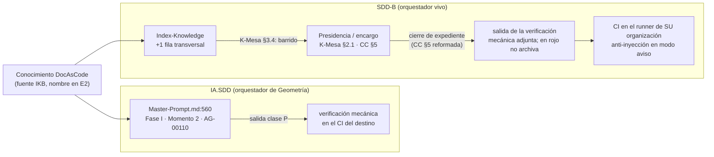

| Campo | Valor |
| --- | --- |
| Tipo | reconsideración (una vuelta, `R01`: decisión sin 3/5 `PROCEDE`) |
| Fecha | 2026-10-26 |
| Autor | Despacho A02 |
| Decisión reconsiderada | D22 del folio 080 (`080:985-1011`), refutada como DEBILITA en `085:497-513` |
| Votos de origen | 2 `PROCEDE` (condicionados a C-11) y 3 `INSUFICIENTE`; los cinco prefieren la propuesta y piden lo mismo: nombrar el orquestador vivo del SDD-B con un cambio verificable, o elevar L12 |
| Evidencia nueva | `evidencia/A02-reconsideracion-D22/ensayos-D22.txt` (R-A1 a R-A6) |
| Resultado | D22 reformulada (mismo id), con `alternativa_2` y fila L12 reescrita para el lote |

# Reconsideración de D22

## Índice

1. [Qué pidió el jurado](#1-qué-pidió-el-jurado)
2. [Alias y definiciones](#2-alias-y-definiciones)
3. [Evidencia nueva](#3-evidencia-nueva)
4. [Decisión D22 reformulada](#4-decisión-d22-reformulada)
5. [alternativa_2](#5-alternativa_2)
6. [Cómo responde a cada motivo](#6-cómo-responde-a-cada-motivo)
7. [Observables para la compuerta E3](#7-observables-para-la-compuerta-e3)
8. [Fila L12 reescrita para el lote del PO](#8-fila-l12-reescrita-para-el-lote-del-po)
9. [Excepciones a conocimientos](#9-excepciones-a-conocimientos)
10. [Lo no verificado](#10-lo-no-verificado)
11. [Constancia de ensayos y limpieza](#11-constancia-de-ensayos-y-limpieza)

---

## 1. Qué pidió el jurado

Los cinco votos coinciden en el hueco (síntesis de la presidencia, votos de D22):

- `TP:30` pide aplicar el conocimiento al SDD-B «mejorando los agentes orquestadores de ambos». La decisión 1 de la
  presidencia lo fija como escalón 3.
- D22 A, en el SDD-B, sólo «carga el conocimiento en la mesa» y «suma K1 a su CI». Ninguna de esas dos cosas es un
  orquestador (`085:501-505`).
- Los AG-xx del SDD-B están dormidos (`R04:190-192`). Mejorarlos no sirve.
- Sin C-11 o L12, la compuerta E3 no puede dar `PROCEDE` sobre «ambos» (`085:512-513`).
- K1 en el CI del SDD-B corre en el runner de la otra organización (`085:135-160`, T2-1).
- Un voto agrega que la importación inmediata suma riesgo sin validar.

## 2. Alias y definiciones

| Término | Definición en este folio |
| --- | --- |
| `<SDD-B>` | Raíz del repositorio de código del servicio de notificaciones push (privado), en el commit `9641e74` (2026-10-21). Se usa el mismo alias que `R04:36` |
| `<SDD-B.Doc>` | Repositorio de documentación hermano (`R04:37`) |
| K-Mesa | `<SDD-B>/Prompts/Conocimientos/Knowledge-Mesa-De-Expertos-A-Pedido.md`, versión 1.15 (2026-10-21). Es un fork `propio` del conocimiento de IKB |
| CC | `<SDD-B>/Prompts/Agentes/_convenciones_comunes.md`, versión 1.7 (2026-10-08, `CC:3-5`) |
| Orquestador vivo | **[criterio propio]** El agente que hoy abre un expediente, plantea el enunciado, arma el despacho, encarga a otros agentes y cierra. En el SDD-B es quien preside la mesa a pedido o conduce un encargo sin mesa, y lo gobiernan dos textos: K-Mesa (`§2.1`, `§3.4`, `§5.1`) y CC (`§5`, cuarta vía; `§10`) |
| Chequeo anti-inyección | Es lo que el folio 080 llamaba «K1» en D22: la compuerta de F017 (`017:458`, controles C1–C5). Se renombra porque «K1» ya nombra otras dos cosas: el criterio Simplicidad (`080:128`) y la invariante «vaciable» del catálogo del SDD-B (`<SDD-B>/Prompts/Agentes/_reglas_base_conocimiento.md:236`) |
| Verificación mecánica de la documentación | El job de CI de D17 (`docs-guard` o su copia) que revisa enlaces, trazas y anti-inyección y termina con un código de salida |

**Por qué «orquestador vivo» y no AG-xx.** Hay cuatro hechos medidos:

1. Las compuertas de lectura no corren desde el 2026-08-29, y ningún `AG-*.md` cambió en la ventana que mide R04
   (`R04:190-192`). Los `AG-*.md` sólo recibieron retoques de texto por expedientes de norma. El último es `326ddef`
   (2026-10-04): una línea de `AG-04_01`, verificada con `git show --stat`. Retocar el texto de un agente no lo pone a
   correr.
2. La regla de despacho de conocimiento de CC §7 sólo la ejecutan los orquestadores de fase (`CC:135`), que no
   corren.
3. CC §10 alcanza a «todo orquestador y toda mesa que el proyecto convoque» (`CC:434-436`). La mesa queda dentro del
   alcance normativo de los orquestadores.
4. K-Mesa se autodefine como la mecánica que rige «también un encargo a agentes sin mesa» (`K-Mesa:33`). Su origen
   1.13 dice que el desvío del caso ApiKey «salió de los encargos del orquestador» (`K-Mesa:767`). Esto quiere decir
   que el propio SDD-B ya llama «orquestador» a quien conduce los encargos fuera del pipeline de fases. En los
   expedientes 0041 y 0042, K-Mesa aparece 34 y 409 veces respectivamente (recuento por `grep -o`, ensayos de A02).

**Lectura de «ambos» en `TP:30`.** **[criterio propio]** La frase encadena «piloto con Geometría … y finalmente
aplicarlo al [SDD-B] mejorando los agentes orquestadores de ambos». Geometría trabaja sobre IA.SDD. Por lo tanto,
«ambos» se refiere al orquestador de IA.SDD (que es el de Geometría) y al del SDD-B, que es la misma lectura de D22 y
de la decisión 1 de la presidencia.

## 3. Evidencia nueva

Los comandos y salidas completos están en `evidencia/A02-reconsideracion-D22/ensayos-D22.txt`.

| Id | Ensayo | Resultado | Qué decide |
| --- | --- | --- | --- |
| R-A1 | Tamaño de K-Mesa sin §10, contra el techo `propio` de 100.000 B (`_reglas_base_conocimiento.md:164-171`) | **99.841 B: quedan 159 B de margen.** El §0 no declara la excepción de §5. Nivel 1: 9.134 B de 12.000 | Cualquier regla nueva que se escriba **dentro** de K-Mesa rompe §4.6 y obliga a partir el documento. El cambio tiene que ir a CC o al índice |
| R-A2 | Barrido literal de K-Mesa (`K-Mesa:278-280`) sobre una copia del índice con una fila nueva (alias provisional `DocAsCode-Doble-Audiencia`, `transversal`) | Sin la fila hay 0 coincidencias de «documenta»; con la fila aparece 1. Índice: de 18 a 19 filas | La carga del conocimiento en la mesa sale **sola**, por `§3.4`, sin tocar K-Mesa. Por eso «cargarlo en la mesa» no mejora al orquestador: confirma la objeción del jurado |
| R-A3 | Cambio de CC §5 (cuarta vía) aplicado sobre una copia | Diff `74c74,77`, +326 B. **K2 en verde**: el texto agregado no nombra ningún archivo ni alias del catálogo (19 alias probados, 0 coincidencias). Observable: `grep -c` de la frase da 0 hoy y 1 aplicado | Es un cambio verificable en el orquestador vivo y cumple las invariantes del catálogo del SDD-B |
| R-A4 | Chequeo anti-inyección de F017 (`evidencia/C-AGENTES-IA/herramientas/agent_channels.py check`) sobre copias de `Prompts/` y `docs/` del SDD-B | **257 hallazgos, rc=1.** `Prompts/Agentes`: 21 C2 (los 21 son BOM U+FEFF al inicio del archivo) + 2 C3. `Prompts/Conocimientos`: 78 C1 (todos dentro de bloques de código) + 88 C5 (esqueletos HTML de plantillas). `docs/` (742 .md): 66 C1 + 1 C3 + 1 C5 | En modo bloqueante, el CI del SDD-B queda en rojo el primer día, casi todo por falsos positivos. Esto confirma el voto «la importación inmediata agrega riesgo sin validar» |
| R-A5 | Runners | El repo de código usa el runner autoalojado de **su** organización, con etiqueta propia (`<SDD-B>/.github/workflows/ci.yml:38` y otros cinco jobs). Ese runner tiene `python3` (`crear-etiqueta.yml:200`). El repo de documentación corre en `ubuntu-latest` (`<SDD-B.Doc>/.github/workflows/verificar.yml:10`) | El chequeo es Python puro y no necesita Docker, así que corre en cualquiera de los dos sin `i7infra-dev`. Coincide con L10 |
| R-A6 | Precedente de cambio a CC | La propuesta de 0041 a CC §10 quedó «sin aplicar» (`<SDD-B>/docs/expedientes/0041-…/actuaciones/007-propuesta.md:10`, §4) y 18 días después no está en CC 1.7 (`grep` sin salida) | Un cambio a CC es un PR de norma (`R04:200-208`) y sin el PO no se asienta. Por eso hace falta `alternativa_2` |

## 4. Decisión D22 reformulada

**D22 — Qué es «mejorar los orquestadores» y qué entra al marco común (Q31, Q34, X2).**

Se mantienen los dos elementos comunes de A: el conocimiento nuevo y la verificación mecánica de la documentación
como insumo del cierre. El SDD-B deja de recibir sólo «carga» y pasa a recibir **un cambio verificable en su
orquestador vivo**.

| Pieza | IA.SDD (Geometría) | SDD-B |
| --- | --- | --- |
| Orquestador que cambia | `/IA/SDD/IA.SDD/SDD/Devs/Orchestrator/Master-Prompt.md:560`, Fase I, Momento 2 de AG-00110, con salida de clase P (sin cambios respecto de D22 A) | **Orquestador vivo**: la presidencia de la mesa a pedido y el conductor de encargos, gobernados por CC §5 y K-Mesa §2.1 |
| Cambio verificable | El que fija E2 sobre el Momento 2 | **CC §5, cuarta vía.** La oración «los gates de deriva se corren sobre lo reintegrado» (`CC:74`) apoya el cierre de cada expediente en compuertas que no corren (`R04:190-192`). Se le agrega, sin nombrar documentos del catálogo (K2): «**Antes de archivar**, el cierre adjunta la salida de la verificación mecánica de la documentación que el CI del repositorio corre sobre la rama del cambio (comando, código de salida y fecha); con esa verificación en rojo el expediente no se archiva, y si el repositorio no la tiene, el cierre lo declara como deuda». Texto ensayado en R-A3. CC pasa de 1.7 a 1.8, con fila de control de cambios |
| Conocimiento | Se suma a `/IA/SDD/IA.SDD/Conocimiento/` con su condición de carga (E2, `C-SDD-CONOCIMIENTO`) | Una fila en `Index-Knowledge.md` con `Consumidor: transversal` y `Tema` que nombra la documentación. Entra a la mesa por el barrido de K-Mesa §3.4 (R-A2). **K-Mesa no se toca**: le quedan 159 B (R-A1) |
| CI | El de Geometría, en `[self-hosted, i7infra-dev]` (organización del runner) | El runner de **su** organización, con su etiqueta, o `ubuntu-latest` en el repo de documentación (R-A5; L10). **Nunca** `i7infra-dev` |
| Chequeo anti-inyección | Según D17/D18 | **Sólo en modo aviso** (no bloquea) en la primera entrega. Antes de que bloquee: exentar el BOM inicial, excluir los bloques de código de C1/C5 y revisar los 68 de `docs/`. El paso a bloqueante lo decide E3 cuando los falsos positivos lleguen a 0 sobre el corpus (R-A4). El cambio cabe en una línea (`017:710`) |
| Vía | Compuerta E2 | **PR de norma** del SDD-B, por expediente propio en ese repo (cuarta vía), con revisión de su mesa y aprobación del PO (`R04:200-208`). Se presenta en E3 y no se aplica en esta fase |
| Del SDD-B al marco común | Nada nuevo en esta corrida. La prioridad de fuentes generalizada va como propuesta a E3 (sin cambios) | — |

**Por qué esta pieza y no otra.** **[criterio propio sobre R-A1 a R-A3]**

- CC §5 es el único texto que **todos** los expedientes vivos del SDD-B atraviesan al cerrar (`CC:66-77`, `A13–A15`:
  «el expediente no se archiva sin reintegrar»).
- Su dependencia de gates dormidos es un defecto real, medido, y el conocimiento DocAsCode lo resuelve sin crear
  agentes.
- K-Mesa no admite el agregado (R-A1).
- CC §7 sólo la ejecutan los orquestadores de fase dormidos (`CC:135`).

**Segunda alternativa.** Ver §5.

**Disidencias y resolución.** No se reabre la descartada B (subagente nuevo): sigue mejorando lo que no corre. La C
(importar ya prioridad de fuentes, reincorporación y delegación) sigue diferida a E3, como en `080:1003-1009`.

## 5. alternativa_2

**D22-alt2 — Elevar L12 sin tocar la norma del SDD-B.**

| Elemento | Contenido |
| --- | --- |
| Qué hace | En el SDD-B: la fila del índice (R-A2) y el chequeo anti-inyección en modo aviso, en el CI del repo de documentación (`ubuntu-latest`, R-A5). **CC no se toca.** En el lote se declara que los AG-xx del SDD-B están dormidos y que la «mejora de orquestadores» sobre el SDD-B se cumple sólo como **carga** en la mesa, para que el PO la asiente o la rechace |
| Cuándo rige | Si el PO no aprueba el cambio de CC §5 en E3. Por R-A6, el silencio no lo asienta (`R01:460`) |
| Costo | Menor: no hay PR de norma y no hay revisión de mesa en el SDD-B |
| Lo que pierde | «Ambos» queda cumplido a medias. **La compuerta E3 da `INSUFICIENTE` en ese ítem** y lo declara como deuda en el cierre (`085:512-513`). El cierre de expedientes del SDD-B sigue apoyado en gates que no corren |
| Por qué es la segunda | Es la única que no depende del PO para cerrar el escalón 3, a costa del objetivo |

## 6. Cómo responde a cada motivo

| Motivo del jurado o del refutador | Respuesta | Evidencia |
| --- | --- | --- |
| «Ninguna de las dos toca un orquestador» | El orquestador vivo recibe un cambio de texto en CC §5. La carga del conocimiento queda como efecto automático del índice y no se presenta como mejora | R-A2, R-A3; `CC:74`; `CC:434-436` |
| «Nombrar el orquestador vivo» | La presidencia de la mesa a pedido y el conductor de encargos, gobernados por K-Mesa §2.1 y CC §5 y §10 | §2; `K-Mesa:33`, `:101`, `:767` |
| «Con un cambio verificable» | Hoy `grep -c "verificación mecánica de la documentación" CC` da 0 y aplicado da 1. Además, el primer expediente que cierre después tiene que adjuntar la salida del CI | R-A3; §7 |
| «O elevar L12» | Fila L12 reescrita (§8). `alternativa_2` cubre el caso en que el PO no la apruebe | §5, §8 |
| «K1 corre en el runner de la otra organización» | Se fija: runner de su organización o `ubuntu-latest`, nunca `i7infra-dev` | R-A5; L10 |
| «La importación inmediata agrega riesgo sin validar» | Medido: 257 hallazgos, casi todos falsos positivos. Entra en modo aviso y se calibra antes de bloquear | R-A4 |
| «Sin C-11 o L12, E3 no da `PROCEDE`» | E3 tiene observables propios (§7). Si el PO rechaza, E3 da `INSUFICIENTE` en ese ítem, explícito y no por silencio | §5, §7 |

## 7. Observables para la compuerta E3

| # | Observable | Comando o prueba | Verde |
| --- | --- | --- | --- |
| O1 | CC §5 reformada | `grep -c "verificación mecánica de la documentación" <SDD-B>/Prompts/Agentes/_convenciones_comunes.md` | `1`, con versión 1.8 y fila de control de cambios |
| O2 | K2 del catálogo | Texto agregado contra todos los alias de `Index-Knowledge.md` | 0 coincidencias |
| O3 | Fila del conocimiento | Barrido de `K-Mesa:280` | La fila aparece con `Estado` Vigente |
| O4 | Cierre real | El primer expediente del SDD-B que cierre después de O1 adjunta la salida del CI (comando, código, fecha) en su `evidencia/` | Presente; si la verificación está en rojo, el expediente no aparece archivado |
| O5 | Anti-inyección en aviso | Job del CI en su runner, con `continue-on-error` o equivalente | Corre, informa los hallazgos y no bloquea |
| O6 | Paso a bloqueante | El mismo chequeo después de la calibración (BOM, bloques de código) | 0 hallazgos sobre el corpus; recién entonces bloquea |
| O7 | IA.SDD | Momento 2 de AG-00110 con salida de clase P (E2) | Según E2 |

## 8. Fila L12 reescrita para el lote del PO

| # | Fila | Si no responde |
| --- | --- | --- |
| L12 | Aprobar en E3, como PR de norma del SDD-B, el agregado a `_convenciones_comunes.md` §5: el cierre de expediente adjunta la verificación mecánica de la documentación y no archiva en rojo. Se reconoce que el orquestador vivo es la presidencia de la mesa a pedido y el conductor de encargos, no los AG-xx | Rige `alternativa_2`. «Ambos» queda `INSUFICIENTE` en E3 y se declara como deuda. No se asienta por silencio (`R01:460`) |

## 9. Excepciones a conocimientos

- **Ninguna en la decisión principal.**
  - El cambio de CC §5 sigue la vía que el SDD-B prevé para su norma (expediente + PR de norma, `R04:200-208`).
    Cumple K2 (R-A3).
  - Queda fuera de la guarda de K1 «vaciable» por el mismo motivo que 0041 dio para §10: no es uno de los enganches
    del catálogo (`0041/actuaciones/007-propuesta.md:137`). **[criterio propio por analogía; se verifica en E3]**
  - K-Mesa no se toca, así que su techo de §4.6 no se compromete (R-A1).
  - El conocimiento se suma sin tocar la norma de IA.SDD (`080:1011`).
- **Chequeo anti-inyección en modo aviso.** No es apartamiento de un conocimiento catalogado. Es una calibración de la
  propuesta de F017, que lo daba como bloqueante y reversible con una línea (`017:710`). Impacto operativo: durante
  la calibración un hallazgo verdadero no frena el merge. Lo mitiga la revisión del PR.

## 10. Lo no verificado

| Qué | Motivo |
| --- | --- |
| Que el runner de la organización del SDD-B tome un job nuevo de documentación sin cambios de configuración | No se lanzó un workflow: esta fase no permite commits ni PR. Hay evidencia indirecta (`python3` en `crear-etiqueta.yml:200`) |
| Que §5 de CC no sea un enganche del catálogo | La lista de «los cinco enganches» no está enumerada junto a `_reglas_base_conocimiento.md:236`. Se toma la afirmación análoga de 0041 |
| Reparto exacto de los 68 hallazgos de `docs/` entre verdaderos y falsos | Se contaron por control y por posición (dentro o fuera de bloques de código). No se leyó el contenido, para no transcribir material privado |
| Recuentos 34 y 409 de K-Mesa en 0041 y 0042 | Son ocurrencias de cadena (`grep -o`), no actos distintos |

## 11. Constancia de ensayos y limpieza

- **Creado:** una carpeta de trabajo propia del despacho, fuera del workspace y fuera de `/vm/claude-tmp`, con copias
  de `Index-Knowledge.md`, de CC y de `Prompts/` y `docs/` del SDD-B, y las salidas del chequeo. No se usaron
  contenedores.
- **Borrado:** la carpeta completa, al terminar.
- **Versionable que queda:** este folio y `evidencia/A02-reconsideracion-D22/ensayos-D22.txt`, sólo con recuentos y
  rutas con alias. No contiene contenido del SDD-B, ni dominios, hosts, etiquetas privadas o claves.
