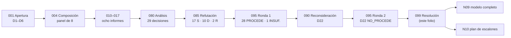

| Campo | Valor |
| --- | --- |
| Tipo | resolucion |
| Fecha | 2026-10-26 |
| Autor | Presidencia de la mesa (despacho P10). Consolida y no vota |
| Corrige | — |

Norma y secciones leídas: `R01` §4 (ciclo, paso 10), §10 (jurado), §11 (consulta a un tercero), §12 (expediente),
§14 (cierre) y §15 (qué sale al PO), derivados de `KB-privada/Knowledges/Knowledge-Mesa-De-Expertos-A-Pedido.md`
3.1, `KB-privada/Rules/Rule-Mesa.md` 1.0 (§3.5.4–§3.5.7 y §5, bloque de cierre) y
`KB-privada/Knowledges/Knowledge-Excepcion-A-Un-Conocimiento.md` 2.0. Insumos: folios 001–004, 0060, 0070,
010–017, 080, 085, 090 y 095. Modelo y plan que esta resolución asienta: `N09-Integracion.md` y
`N10-Plan-De-Implementacion.md` de la carpeta de bitácoras de la corrida.

# Resolución — expediente 0002

## Índice

1. [Qué resuelve este folio](#1-qué-resuelve-este-folio)
2. [Alias y definiciones](#2-alias-y-definiciones)
3. [Dictamen por decisión](#3-dictamen-por-decisión)
4. [Dictamen pregunta por pregunta (Q01–Q46)](#4-dictamen-pregunta-por-pregunta-q01q46)
5. [Decisiones que no quedaron cerradas: D22 y D07](#5-decisiones-que-no-quedaron-cerradas-d22-y-d07)
6. [Contradicciones X1–X13, resueltas](#6-contradicciones-x1x13-resueltas)
7. [Reservas](#7-reservas)
8. [Excepciones a conocimientos (consolidado, para avisar al PO)](#8-excepciones-a-conocimientos-consolidado-para-avisar-al-po)
9. [Lote para el PO](#9-lote-para-el-po)
10. [Reintegra](#10-reintegra)
11. [Cierre de mesa](#11-cierre-de-mesa)

---

## 1. Qué resuelve este folio

La mesa abrió el caso el 2026-10-26 (folio 001), compuso el panel por jurado (004), despachó ocho comisiones a ciegas
(010–017), consolidó 46 preguntas y 13 contradicciones en 29 decisiones (080), las sometió al refutador (085), votó
(095, ronda 1), reconsideró la única sin mayoría (090) y la volvió a votar (095, ronda 2). Este folio asienta el
resultado y lo vuelve operativo.

Lo que **no** se rediscute: las seis decisiones de la presidencia del enunciado (folio 001, D1–D6). En particular, D1
fija que los tres escalones son alcance de esta corrida y que «la mesa decide **cómo**, no **si**».



## 2. Alias y definiciones

| Alias | Referencia (desde la raíz del workspace) |
| --- | --- |
| `TP` | `/LAB/Lab-Documentos/Lab-Documentos.Documentacion/PROMPTs/DEVs/Enchacement/01-Replanteo-Y-Analisis/Replanteo-Y-Analisis.md` |
| `F0nn` | Folio `actuaciones/0nn-…md` de este expediente |
| `N09`, `N10` | Bitácoras `N09-Integracion.md` y `N10-Plan-De-Implementacion.md` de `/LAB/Lab-Documentos/Lab-Documentos.Documentacion/PROMPTs/DEVs/Enchacement/01-Replanteo-Y-Analisis/OUTPUTs/Bitacoras/` |
| `CPA` | `KB-privada/Knowledges/Knowledge-Conformacion-Pull-Request-Automatico.md` 2.0 |
| `KDR` | `KB-privada/Knowledges/Knowledge-Deduccion-De-Reglas-De-Negocio.md` |
| `RDOC` | `/IA/SDD/IA.SDD/SDD/Devs/Rules/Rules-Documentacion.md` |
| `REF` | `/IA/SDD/IA.SDD/SDD/Devs/Rules/Rules-Especificacion-Funcional.md` |
| `SDD-B` | El SDD del servicio de notificaciones push (privado). No se nombra de otro modo |

| Término | Definición |
| --- | --- |
| Dictamen | Respuesta cerrada a una pregunta, sin «depende». Lo que no se puede cerrar lleva motivo y default |
| FIRME / CON REVISIÓN | Estado de firmeza de la decisión. FIRME: el ganador no cambia con menos de cuatro celdas de la matriz. CON REVISIÓN: cambia con dos o tres, y la decisión lleva una condición de revisión comprobable (`085` T1, corrección C-1) |
| Corrección C-n | Ajuste del refutador (`085` §10.1) que uno o más jueces pusieron como condición de su `PROCEDE` (`095` §6). La resolución las aplica |
| D22-R | La versión de D22 reformulada en `090` §4, que el jurado no llegó a votar como tal (`095` §4.2) |
| Clase de intervención D/P/H | D: la produce un generador determinista. P: la propone un agente. H: sólo una persona (`080` §2.2) |
| `CL-nn`, `AI-n`, `AK-n`, `PR-n` | Rótulos nuevos de clases de pieza, chequeos anti-inyección, controles anti-inyección y grupos del carril PR (corrección C-2). Reemplazan a C1–C14, C1–C5, K1–K7 y G1–G7 del folio 080. K1–K7 quedan para los criterios de la matriz y G1–G4 para la guarda de `CPA` |

## 3. Dictamen por decisión

| D | Preguntas | Resultado (095) | Variante | Estado | Correcciones aplicadas | Condición de revisión |
| --- | --- | --- | --- | --- | --- | --- |
| D01 | Q01, X8, X10 | `PROCEDE` 5–0 | propuesta | FIRME | — | — (pendiente de forma: providencia de la opción B, N10 PRE-01) |
| D02 | Q02, Q40, X12 | `PROCEDE` 5–0 | propuesta | FIRME | Nota: el saneamiento de `GUIA` sirve a la línea de base 0 y no sobrevive a D27 | — |
| D03 | Q03, X13 | `PROCEDE` 5–0 | propuesta | FIRME | C-2, C-3 | — |
| D04 | Q04, Q09 | `PROCEDE` 5–0 | propuesta | FIRME | — | — |
| D05 | Q05, Q26 | `PROCEDE` 5–0 | propuesta | FIRME | — | — |
| D06 | Q06, Q07, X11 | `PROCEDE` 5–0 | propuesta | FIRME | C-5, C-8 (R3, R4) | — |
| D07 | Q10, Q11, X5 | `PROCEDE` 4–0 | propuesta | FIRME, **quórum incompleto** (§5.2) | F017 E3 rotulado «n = 2, orientativo» | Ratificación de J5 en el ciclo 2 |
| D08 | Q12, Q13, X9 | `PROCEDE` 5–0 | **alternativa_2** | CON REVISIÓN | C-6, C-1 | Si el PO, al asentar la delegación (L2), pide aprobación explícita en todo P, rige la propuesta como excepción de su delegación |
| D09 | Q14 | `PROCEDE` 5–0 | propuesta | FIRME | C-13 | — |
| D10 | Q38, Q39, X7 | `PROCEDE` 5–0 | propuesta | FIRME | — | — |
| D11 | Q17 | `PROCEDE` 5–0 | propuesta | FIRME (decide F6; margen 0,05 contra la excluida) | C-12 | Rige D12 si E2 necesita una cláusula |
| D12 | Q46 | `PROCEDE` 5–0 | propuesta | CON REVISIÓN | C-1 | Se compra sólo si una compuerta necesita el texto de una cláusula |
| D13 | Q19 | `PROCEDE` 5–0 | propuesta | FIRME | C-7 | — |
| D14 | Q18, Q21 | `PROCEDE` 5–0 | propuesta | CON REVISIÓN | C-8 (R2), C-1 | La de `080` D14: si se prefiere «mantenimiento» como nombre visible, la alternativa B va al lote; sin respuesta rige A |
| D15 | Q20 | `PROCEDE` 5–0 | propuesta | FIRME | — | — |
| D16 | Q15 | `PROCEDE` 5–0 | propuesta | FIRME | Nombrar el guion local equivalente (patrón 7 de `R03:398`) | — |
| D17 | Q22, Q24, Q25, Q28, X3 | `PROCEDE` 5–0 (4 alt. / 1 prop.) | **alternativa_2** | CON REVISIÓN | C-4 | E-F12: si el workflow llamado no toma el runner del repo que llama, se vuelve a la plantilla copiada con huella y `--check` |
| D18 | Q16, Q23 | `PROCEDE` 5–0 | propuesta | FIRME | C-2, C-14 | — |
| D19 | Q27 | `PROCEDE` 5–0 | propuesta | FIRME | — | — |
| D20 | Q29 | `PROCEDE` 5–0 | propuesta | FIRME | C-2, C-7, C-8, CL-14 «latente», carriles de D06 y D17 | — |
| D21 | Q08, Q30, Q35, X4 | `PROCEDE` 5–0 | propuesta | FIRME | C-3 (ruta de `Index-Knowledge`) | — |
| D22 | Q31, Q34, X2 | `NO_PROCEDE` 2–3 (ronda 2) | — | **Sin dictamen votado** (§5.1) | — | D22-R al jurado en el ciclo 2 |
| D23 | Q32, X1 | `PROCEDE` 5–0 | propuesta | CON REVISIÓN | C-1, suma la excepción R2 de D14 | Si al cerrar E2 la piloto no necesitó el rol «usuario», se retira la propuesta de cambio de norma (queda el apartamiento) |
| D24 | Q33 | `PROCEDE` 5–0 | propuesta | CON REVISIÓN | C-9, C-1 | Si el plan de `Migracion-Rules` §3 encuentra un salto mayor, la migración va a expediente propio y la piloto espera |
| D25 | Q36, Q37, X6 | `PROCEDE` 5–0 | propuesta | CON REVISIÓN | C-10; umbral provisional de «mini» | Pasa a la alternativa B si (a) Lab-E2E abre el expediente que autoriza tocar el código, o (b) la extracción del contrato en ejecución deja de dar el contrato completo |
| D26 | Q41 | `PROCEDE` 5–0 | propuesta | FIRME | G-b de E3 corre en el runner de la organización del SDD-B | — |
| D27 | Q42, Q43 | `PROCEDE` 5–0 | propuesta | FIRME | C-13 (la `description` se revisa, no se exige su autoría) | — |
| D28 | Q44 | `PROCEDE` 5–0 | propuesta | FIRME | — | — |
| D29 | Q45 | `PROCEDE` 5–0 | propuesta | FIRME | — | — |

**Estado de firmeza [criterio propio de la presidencia].** Es el del folio 080 corregido por C-1 en las cinco
decisiones que el refutador nombró (D08, D12, D14, D23, D24): ningún voto objeta C-1 y al menos uno lo pide en cada
una (`095` §6). D17 y D25 quedan CON REVISIÓN por su propia condición.

### 3.1 Texto asentado de las dos decisiones que ganaron por la alternativa_2

**D08 — Intervención automática y aprobación (Q12, Q13, X9).** Tres clases de intervención:

- **D** (generador determinista) y **P** (lo propone un agente) se fusionan por la guarda G1–G4 de `CPA` §3.3 cuando
  la delegación está asentada y **no hay reserva de `CPA` §3.4**. El PR de clase P lleva `origin` y `confidence`, y el
  verificador es distinto del redactor.
- **H** (sólo una persona) y todo PR que **declare una decisión pendiente** vuelven a la persona, que aprueba de forma
  explícita en el PR.
- Lista H (sin cambios respecto de `080` D08): `AGENTS.md`, `CLAUDE.md`, `CODEOWNERS`, workflows, excepciones de la
  compuerta, pasar `status` a `vigente`, contenido normativo, publicación externa y excepciones a conocimientos. La
  lista de dominios permitidos pasa de H a **P con aprobación explícita** (corrección C-14).
- Actos siempre humanos: aceptar, rechazar o diferir cada requerimiento del RRD; decidir divergencias entre letra e
  intención; aceptar ADR; el merge de H y de los P con reserva; deprecar, archivar, etiquetar y publicar.
- La segunda identidad de git no aprueba lo de la primera. El primer merge de cada repo, el que asienta la delegación,
  vuelve al PO (`CPA` §3.1).
- **El alcance de la aprobación de P es un parámetro de la delegación**, que decide y fecha el PO (`CPA:94-103`). Va
  como parte de la fila L2 del lote (§9). La mesa propone el texto de arriba; si el PO pide aprobación explícita en todo
  P, la propuesta de `080` D08 rige como excepción de su delegación, con fecha.

**D17 — Workflow sobre el runner (Q22, Q24, Q25, Q28, X3).**

- Dentro de la organización del runner, **un workflow reutilizable** `docs-guard.yml` vive en Lab-Documentos, se
  versiona por SHA y, cuando el PO lo etiqueta, por tag anotado. Cada repo lo llama con `uses:` y
  `runs-on: [self-hosted, i7infra-dev]`. El primer ensayo de E1-U0b (N10) comprueba que el job llamado toma el runner
  (E-F12).
- **Un solo job** que valida y agrega, para pagar un solo ciclo efímero (≈ 68 s por job según `085` T2). El agregador
  estricto se mantiene si hay pasos condicionales (`R03:333`). `timeout-minutes: 10`. Grupo de concurrencia propio
  (`docs-${{ github.workflow }}-${{ github.ref }}`) con cancelación en PR; no comparte `e2e-laboratorio`.
- Se exigen los siete patrones del workflow de Concepts (`R03:391-398`), no su archivo.
- El PR #2 del repo auxiliar de Geometría (`ubuntu-latest`) no se toca. Cuando cierre, una unidad propia de E2 pasa su
  `verificar` al runner (N10 E2-U6).
- En el SDD-B (otra organización): **copia fijada** de `docs-guard.yml` con cabecera y huella sha256 contra el tag de la
  plantilla, comprobada por un paso `--check`, y `runs-on` con la etiqueta del runner **de su organización** (fila L10).
- Seguridad: la guarda `if:` contra forks se mantiene como higiene, no como barrera. La barrera es la configuración de
  la organización (aprobación obligatoria de corridas de forks, grupo de runners limitado a repos elegidos): actos H
  del PO (fila L11).
- Costo realista por PR: unos 2 min 40 s con dos jobs (`085` T2), menos con uno; la medición real es E-F13.
- Disidencia registrada: J4 prefirió la propuesta (un workflow por repo, como el antecedente) con las mismas
  correcciones de runner, guarda y costo, y dejó a E-F12 decidir el paso a `workflow_call` (`095` §7, D17).

## 4. Dictamen pregunta por pregunta (Q01–Q46)

| Q | Pregunta (síntesis de `F002` §8) | D | Resultado | Respuesta cerrada |
| --- | --- | --- | --- | --- |
| Q01 | ¿Quién ocupa el quinto cupo y quién queda postergado? | D01 | PROCEDE | `C-AGENTES-IA` ocupa el quinto cupo. `C-DEVOPS`, `C-CONFIG-RELEASE`, `C-SDD-CONOCIMIENTO` y `C-NORMAS-IA` quedan postergados con entrada en las compuertas. La presidencia asienta la opción B del folio 003 §7 por providencia antes de la carta del ciclo 2 |
| Q02 | ¿La escritura empieza por delegación y `Verificar` en el runner? | D02 | PROCEDE | Sí. U0 en Lab-Documentos y en Lab-Documentos.Documentacion; el merge de U0 lo hace el PO |
| Q03 | ¿Topología por pieza o única por proyecto? | D03 | PROCEDE | Por pieza, mediante un catálogo cerrado de 14 clases (`CL-01`…`CL-14`, N09 §5). Una clase nueva se abre por expediente |
| Q04 | ¿Cuál es el ancla de versión doc ↔ código? | D04 | PROCEDE | En el mismo repo, el commit. Entre repos, `base_commit` (SHA) obligatorio y `base_tag` cuando exista. La existencia del ancla bloquea; el desfase avisa |
| Q05 | ¿Se versiona el sitio publicado? | D05 | PROCEDE | No. Una sola versión publicada (`main`) con sello de versión y fecha de verificación por página |
| Q06 | ¿Compuerta en PR o aviso programado para enlaces entre repos? | D06 | PROCEDE | Las dos. En PR, bloqueante y sin red. Programado semanal, sólo aviso, sobre los repos públicos de la organización del runner, con tabla repo → ruta |
| Q07 | ¿Cómo se cita entre repos? | D06 | PROCEDE | `Repo@ancla:corpus_id/doc_id` con permalink por SHA. Dentro del cuerpo, relativos; en expediente y bitácoras, ruta desde la raíz del workspace |
| Q08 | ¿Fuente única o copias sincronizadas? | D21 | PROCEDE | Fuente única en KB-privada; copias fijadas con `tools/copiar.py`, `BASE-FIJADA.md` y `copiar.py --check` bloqueante |
| Q09 | ¿Tags y changelog o ritmo propio en Lab-Documentos? | D04 | PROCEDE | Ritmo propio con versión SemVer del cuerpo en su README y tag anotado al cerrar cada compuerta (acto H) |
| Q10 | ¿Qué canales para agentes son obligatorios? | D07 | PROCEDE (4/5) | Siempre: Markdown con frontmatter, `AGENTS.md` puntero, ia-db en `.Documentacion`, OpenAPI en build. Si hay sitio: `.md` por página, `llms.txt` rotulado «propuesta» y agregado < 50 000 tokens. MCP fuera de E1–E3 |
| Q11 | ¿Relación ia-db ↔ `llms.txt`? | D07 | PROCEDE (4/5) | La ia-db es índice interno y enlaza al `llms.txt`; nunca al revés |
| Q12 | ¿Qué intervenciones automáticas se permiten y cuáles exigen persona? | D08 | PROCEDE (alt. 2) | Matriz fase × clase de N09 §4.2: D y P por guarda sin reserva; H y P con decisión pendiente, persona |
| Q13 | ¿Quién aprueba un PR de agente con una persona y dos identidades? | D08 | PROCEDE (alt. 2) | La guarda G1–G4 con delegación asentada para D y P; la persona, de forma explícita, para H y para P con reserva. La segunda identidad no aprueba a la primera |
| Q14 | ¿Qué frontmatter y prefijos? | D09 | PROCEDE | Los diez campos de `RDA:21` más `description` (obligatoria, ≤ 160, revisada por la persona en el PR que pasa a `vigente`). Vocabulario cerrado de `CGT`; prefijos con registro cerrado |
| Q15 | ¿Cómo se entera una persona del ciclo? | D16 | PROCEDE | Documento de proceso «Cómo intervenir» con bloques entradas/salidas/validaciones y una instancia de una página por proyecto |
| Q16 | ¿Qué controles contra inyección indirecta? | D18 | PROCEDE | Chequeos `AI-1`…`AI-5` (frases dirigidas al agente, `AI-3`, sólo avisa hasta E-F10) y controles `AK-1`…`AK-7` |
| Q17 | ¿26514/26515 livianas más marcos abiertos? | D11 | PROCEDE | Sí. De 26514 sólo se usan su alcance (`I05:125`) y su índice; ninguna cláusula. Diátaxis, arc42, C4 y MADR 4.0.0 hacen el trabajo |
| Q18 | ¿Qué artefacto registra los requerimientos documentales? | D14 | PROCEDE | El RRD: con SDD, en `02-Especificacion-Funcional/` por el ADR de D23 (excepción R2); sin SDD, `docs/_requisitos.md` |
| Q19 | ¿Una metodología o tronco con variantes? | D13 | PROCEDE | Tronco común con cuatro variantes (V1 corpus, V2 app sin roles, V3 panel con roles, V4 servicio con paquetes) |
| Q20 | ¿Cómo se integra el expediente y cómo reintegra? | D15 | PROCEDE | El PR es la unidad de cambio; el expediente se abre por `RE` §1; reintegra con la fila `Reintegra` y A13/A15 de `Expediente-Rules` 1.1 |
| Q21 | ¿Se agrega el mantenimiento como fase? | D14 | PROCEDE | No. Entra como control de deriva dentro de la fase 5 y como disparador de reentrada |
| Q22 | ¿Un workflow o una plantilla por repo? | D17 | PROCEDE (alt. 2) | Un workflow reutilizable en Lab-Documentos, llamado desde cada repo de la organización del runner |
| Q23 | ¿Qué bloquea y qué avisa? | D18 | PROCEDE | Bloquea el control que cumple las cinco condiciones (determinista sin red, defecto del mismo PR, prueba negativa, línea de base 0, sin falsos positivos conocidos). CQ-01…14 y PE-01…12 como anexos |
| Q24 | ¿Cómo convive con la E2E en el runner único? | D17 | PROCEDE (alt. 2) | Todo en `[self-hosted, i7infra-dev]`, un solo job, grupo de concurrencia propio con cancelación en PR |
| Q25 | ¿Qué pasa con el PR #2 de Geometría? | D17 | PROCEDE (alt. 2) | No se toca. Al cerrar, una unidad de E2 pasa ese `verificar` al runner |
| Q26 | ¿Qué generador? | D05 | PROCEDE | Ninguno para las guías (render de GitHub más `docs-guard`). DocFX 2.81 sólo para el sitio técnico .NET de un escalón. MkDocs y Docusaurus descartados |
| Q27 | ¿OpenAPI y XML en el build? | D19 | PROCEDE | Sí, en API y bibliotecas. CS1591 silenciado en apps, obligatorio en paquetes. MAUI fuera en E1. En E1 no se toca el código de Lab-E2E |
| Q28 | ¿Se versiona el workflow de Concepts como base? | D17 | PROCEDE (alt. 2) | No. Se escribe uno documental nuevo y se exigen sus siete patrones |
| Q29 | ¿Arquitectura del sistema documentador entero? | D20 | PROCEDE | Catálogo integrado de 14 clases y flujo del sistema (N09 §3 y §5) |
| Q30 | ¿Dónde vive el conocimiento DocAsCode? | D21 | PROCEDE | Fuente en KB-privada; copia en `IA.SDD/Conocimiento/` con su cierre y origen declarado |
| Q31 | ¿Qué es «mejorar los orquestadores»? | D22 | NO_PROCEDE | **Sin dictamen votado.** Default: D22-R va al jurado en el ciclo 2, antes de cualquier unidad que cambie un orquestador (§5.1) |
| Q32 | ¿Apartamiento con ADR o cambio de norma? | D23 | PROCEDE | Las dos vías: apartamiento con ADR en Geometría, ADR que supera «El producto no lleva manual» con aprobación del PO, y propuesta de cambio de norma al lote, decidida en E3 |
| Q33 | ¿Se migra Geometría a 13.22 antes de la piloto? | D24 | PROCEDE | Sí, como primera unidad propia de E2 |
| Q34 | ¿Qué parte de la norma del SDD-B entra al marco común? | D22 | NO_PROCEDE | **Sin dictamen votado.** Default: nada entra en esta corrida hasta que se vote D22-R (§5.1) |
| Q35 | ¿Cómo se trae la dependencia de IA.SDD al SDD-B? | D21 | PROCEDE | `git archive` en un commit fijo, con MANIFIESTO sha256 y aviso de deriva; E-F5 compara con `IKB/tools/cierre.py` |
| Q36 | ¿Dónde vive la mini demo? | D25 | PROCEDE | En `Examples/` de la guía en Lab-Documentos, con `source.lock` al SHA `8fb4c3a` de MovilidadUrbana |
| Q37 | ¿Qué demuestra cada escalón? | D25 | PROCEDE | Una hipótesis falsable por escalón, con observable y prueba negativa (N09 §8) |
| Q38 | ¿Contrato de `traces`? | D10 | PROCEDE | Pantalla → CU de su unidad (`CU-100NN` en Geometría); regla → RN de su unidad dueña (`RN-020NN`); `CU-000NN` sólo API |
| Q39 | ¿Cómo se trazan las reglas sin ID en MovilidadUrbana? | D10 | PROCEDE | IDs provisionales `RN-LOC-nn` en fichas con la forma de `KDR` §5.1 dentro de la demo |
| Q40 | ¿Se corrige primero la deuda de la guía? | D02 | PROCEDE | Sí: U1 con alcance cerrado, después de U0 y antes del enriquecimiento |
| Q41 | ¿Qué evidencia y dónde en cada compuerta? | D26 | PROCEDE | Folio de criterios previo y paquete G-a…G-g; el dictamen es un folio `resolucion` de este expediente |
| Q42 | ¿Cuerpo documental o archivo único? | D27 | PROCEDE | Cuerpo documental; el archivo actual pasa a `obsoleto` con tabla de correspondencia |
| Q43 | ¿Qué temas y qué ruta de lectura? | D27 | PROCEDE | Siete temas `TEM-01`…`TEM-07` y tres rutas: aprender, intervenir y agente |
| Q44 | ¿APA 7 con fecha y la guía como piloto? | D28 | PROCEDE | Sí |
| Q45 | ¿Se eleva la propuesta al dueño del Profile? | D29 | PROCEDE | Sí, al lote (L6). Default: el Profile no se toca |
| Q46 | ¿Se compra 26514:2022? | D12 | PROCEDE | No en esta corrida |

**Cobertura.** 46 de 46 preguntas con fila. 44 con respuesta cerrada votada; 2 (Q31 y Q34) sin dictamen votado, con
motivo y default (§5.1).

## 5. Decisiones que no quedaron cerradas: D22 y D07

### 5.1 D22 (Q31, Q34)

**Qué pasó.** En la ronda 1, D22 sacó 2 `PROCEDE` y 3 `INSUFICIENTE`: los cinco jueces pidieron nombrar el orquestador
vivo del SDD-B con un cambio verificable, o elevar la fila L12 (`095` §7, D22; corrección C-11). La reconsideración
(090) hizo los ensayos R-A1 a R-A6 y reformuló D22 (D22-R): el orquestador vivo del SDD-B es la presidencia de la mesa a
pedido y el conductor de encargos; el cambio verificable es un agregado a `_convenciones_comunes.md` §5 (cuarta vía) por
PR de norma de ese repo; el chequeo anti-inyección entra en modo aviso; el CI corre en el runner de su organización o
en `ubuntu-latest`, nunca en `i7infra-dev`; la alternativa es elevar L12 (`090` §4–§8). La ronda 2 votó por error el
texto de 080, y salió `NO_PROCEDE` 2–3, con la irregularidad de las dos corridas de J5 (`095` §4.2 y §4.3).

**Qué resuelve la presidencia.**

1. Se asienta el `NO_PROCEDE` del texto de 080 para D22. Ese texto se archiva y no se ejecuta.
2. Q31 y Q34 quedan **sin dictamen votado** en el ciclo 1. La mesa cierra por decisión con este ítem abierto (§11).
3. D22-R (`090` §4, con su alternativa de `090` §5) se somete al jurado como decisión propia en la **primera votación
   del ciclo 2**, junto con la ratificación de D07 por J5 (§5.2) y la revisión de los `NO_PROCEDE` por el refutador
   que exige la marca de homogeneidad (`095` §5). Unidad N10 PRE-04.
4. **Default mientras no se vote** (el más conservador): ninguna unidad cambia un orquestador, ni en IA.SDD ni en el
   SDD-B, y nada de la norma del SDD-B entra al marco común. Las unidades de N10 que dependen de esto (E2-U4 y E3-U3)
   tienen a PRE-04 como dependencia bloqueante. Las demás unidades de E1 y E2 no dependen de D22 y siguen.
5. **Por qué no se vuelve a votar ahora [criterio propio].** `RM:332` permite una sola vuelta del `INSUFICIENTE`, y esa
   vuelta ya se usó. D22-R es un texto distinto, con evidencia nueva, y le corresponde una votación propia. El ciclo 2
   arranca con la compuerta E1, antes de que el plan llegue a la primera unidad que cambia un orquestador (E2-U4).
6. Lo que la decisión 1 de la presidencia ya fija (folio 001, D1) no se pierde: la mejora de los orquestadores de ambos
   SDD **es alcance**; lo que falta votar es **cómo**.

### 5.2 D07 (Q10, Q11)

D07 sacó 4 `PROCEDE` de 4 votos válidos: J5 omitió el voto (`095` §4.4). Cuatro `PROCEDE` son mayoría aun sobre cinco,
así que el resultado no puede cambiar. Se asienta `PROCEDE` con la marca «quórum incompleto (4/5)» y J5 la ratifica en
PRE-04. Las unidades de E1 que usan D07 (`AGENTS.md` puntero, frontmatter, ia-db) no esperan esa ratificación.

## 6. Contradicciones X1–X13, resueltas

| # | Contradicción (`N00` §6) | Resolución asentada | Decisión |
| --- | --- | --- | --- |
| X1 | Ayuda al usuario final frente a `RDOC` (usuario final fuera de alcance) y a «El producto no lleva manual» | Apartamiento con ADR en Geometría, ADR que supera `Experiencia-De-Uso.md:100` con aprobación del PO y propuesta de cambio de norma, decidida en E3. Ambos ADR antes de la primera rama de código de la piloto | D23 |
| X2 | ¿La ia-db de Lab-Documentos tiene marco SDD propio? | Cerrada por la presidencia: es un índice; el marco SDD es de workspace (`R03:141-156`) | F001 D5 (no depende de D22) |
| X3 | `TP:34` frente al `ubuntu-latest` del repo auxiliar de Geometría y el runner compartido | Workflow reutilizable en el runner, un solo job, grupo de concurrencia propio; el PR #2 no se toca y pasa al runner en E2; el SDD-B usa el runner de su organización | D17 (alt. 2) |
| X4 | El mismo conocimiento en tres versiones vivas | Fuente única en KB-privada; copias fijadas con huella y `--check` | D21 |
| X5 | `llms.txt` llamado «adoptado»; la prueba de concepto lo filtra por cookie | Madurez «propuesta»; corrección de `GUIA:161` en U1; índice público sin sesión aparte del de rol; `401`/`404`, no `302` | D07, D02 |
| X6 | Demo MAUI sin roles frente a privilegios en servidor | La demo muestra audiencias, no roles; los roles vuelven en E2 | D25 |
| X7 | Trazas a `CU-000NN` cuando las pantallas están en `CU-100NN` | Pantalla → CU de su unidad; regla → RN de su unidad dueña; `CU-000NN` sólo API | D10 |
| X8 | `TP:30`, ¿alcance o plan? | Cerrada por la presidencia: alcance escalonado | F001 D1; D01 |
| X9 | «Aprobador ≠ solicitante» con una persona y dos identidades | La segunda identidad no aprueba; verificador ≠ redactor; D y P por guarda sin reserva; H con aprobación explícita | D08 (alt. 2) |
| X10 | Ruta del host en la carta frente a S2 | Cerrada por la presidencia (D6). La etiqueta del runner no es ruta ni usuario | F001 D6; D01 |
| X11 | Enlaces relativos frente a rutas desde la raíz | Relativos dentro del cuerpo publicado (la clave es el `doc_id`, el relativo es el medio: excepción E-8); raíz en expediente y bitácoras; ID calificado más permalink entre repos | D06 |
| X12 | `Rule-Indexing` frente a la fase de sólo lectura y otra corrida en la ia-db de Geometría | Reindexado como PR de clase P al cerrar cada escalón; la ia-db de Geometría no se toca con PR ajenos abiertos | D02 |
| X13 | Ninguna topología sola evitó la deriva | Topología por clase, con compuerta y ancla por clase | D03, D04, D18 |

## 7. Reservas

| # | Reserva | Estado | Qué se hace |
| --- | --- | --- | --- |
| RS-1 | Consulta a un tercero (`Knowledge-Mesa-Consulta-A-Un-Tercero` 2.0) | **En reserva** (folio 001, D4): no hay destinatario ni canal, y el conocimiento asigna al PO ponerlos (`R01` §11). No se activó en el ciclo 1 | Se declara en este cierre. Se activa sólo si el PO nombra destinatario y canal; el canal lo usa la presidencia en la sesión principal, nunca un workflow. Los «académicos» de `TP:36` fueron comisión (F016) |
| RS-2 | D22 `NO_PROCEDE` (texto de 080) | Archivado; Q31 y Q34 sin dictamen votado | D22-R al jurado en PRE-04 (§5.1). Default conservador mientras tanto |
| RS-3 | D07 con quórum incompleto | `PROCEDE` 4/5 | Ratificación de J5 en PRE-04 (§5.2) |
| RS-4 | Homogeneidad > 80 % (`095` §5) | Ciclo marcado | El refutador revisa los tres `NO_PROCEDE` de D22 en PRE-04 |
| RS-5 | Cuantificadores sin lectura: «mini», «tendencias del mercado», «profundo» (`085` §8.1) | Por la condición K2 del jurado de composición (`F004:438`), el rol formal entra con silla propia en el ciclo 2 | Hasta entonces el plan usa la lectura provisional del refutador, rotulada como tal: «mini» = la demo cabe en un PR revisable (≤ 20 piezas, 1 workflow, < 15 min en el runner) |
| RS-6 | Ensayos que faltan (`080` §10 y `085` §10.2) | E-F3 resuelto por R-E4 (`085` §6, D25). Abiertos: E-F1, E-F2, E-F4 a E-F14 | Cada uno tiene unidad en N10 y decide lo que dice su fila |
| RS-7 | Postergados por cupo (`C-DEVOPS`, `C-CONFIG-RELEASE`, `C-SDD-CONOCIMIENTO`, `C-NORMAS-IA`) | Registrados (`F004` §6.1) | Entran en las compuertas según la opción B (PRE-01); `C-SDD-CONOCIMIENTO` es el lector natural de D22-R |
| RS-8 | `INSUFICIENTE` | No quedó ninguno | — |

## 8. Excepciones a conocimientos (consolidado, para avisar al PO)

Por la regla del workspace sobre apartamientos (avisar al PO) y `Knowledge-Excepcion-A-Un-Conocimiento` (nunca por
silencio), las filas marcadas «Sí» van al lote (§9).

| # | Conocimiento o norma + § | Qué se propone en su lugar | Impacto operativo | ¿Apartamiento? | Decisión · fila |
| --- | --- | --- | --- | --- | --- |
| E-1 | `KDR` §5.1, campo «Ancla» (`KDR:404`: `archivo:línea`) | `ruta#Símbolo@SHA` para código | Las fichas con `archivo:línea` siguen valiendo; el validador acepta los dos modos y `archivo:línea` sólo avisa | **Sí** | D10 · L5 |
| E-2 | `KDR` §5.1, campo «Id» (`KDR:402`: `RN-nn`) | `RN-<DOMINIO>-nn` sólo en proyectos sin SDD | Ninguno en los SDD | Menor, declarado | D10 · L5 |
| E-3 | `Rule-Dual-Audience` del PromptFramework (`RDA:21-22`) | Extensión: `description` obligatoria; `corpus_id` y `version` en el README; prefijos nuevos con registro | Migración del frontmatter del cuerpo nuevo | No (extensión) | D09 |
| E-4 | `RDOC:102`, `:723`, `:801`, `:1003` (usuario final fuera de alcance) | Documentar al usuario final en la piloto por ADR en el destino y propuesta de cambio de norma | NB, CU y ADR nuevos en Geometría; la norma común no se toca sin el PO | **Sí**, en el destino | D23 · L3, L4 |
| E-5 | `REF` §2.1, tabla maestra de la categoría 02 | RRD como archivo nuevo en `02-Especificacion-Funcional/` | Un archivo no previsto por unidad de entrega en destinos SDD | **Sí**, en el destino | D14 · por el ADR de D23 y L4 |
| E-6 | Catálogo de conocimientos del SDD-B (`Prompts/Conocimientos/README.md:25-35`, fork y copia no verbatim) | Copia fiel con huella; lo propio por `Hereda-de` | Reconciliar 14 homónimos en E3 | **Sí**, en el SDD-B | D21 · L8 |
| E-7 | Convención de cita del SDD-B (`_convenciones_comunes.md:74-75`, nombre de archivo y §) | Ruta más versión dentro de la copia vendorizada | Reescribir las citas de 14 reglas | **Sí**, en el SDD-B, por su vía normativa | D21 · L8 |
| E-8 | `RDA:22` («los enlaces … apuntan al ID») frente a `Rule-Markdown.md:33` (relativas) | Dentro del cuerpo, enlace relativo como medio y `doc_id` como clave | Ninguno | Declarado | D06 |
| E-9 | Patrón 3 del workspace, `contents: read` (`R03:393`); no es conocimiento catalogado | El carril programado de enlaces abre issues con `issues: write` | Un permiso más en un workflow programado | Declarado | D06 |
| E-10 | APA 7 (norma externa) | Fecha de consulta siempre, por `Rule-Evidences.md:25` | Una línea más por referencia | Declarado | D28 |
| E-11 | `Knowledge-Versionado-Producto-Integral` 2.0 §2.6 y §4 | El tag como ancla documental, no como número; versión editorial del cuerpo | Ninguno | No (precisión) | D04 |
| E-12 | `CPA` 2.0 §3.1 y §3.4 | Se cumplen. Con D08 por la alternativa_2 desaparece la ampliación de §3.4 que el refutador había marcado (`085` §9, R1). El alcance de P es parámetro de la delegación | Ninguno | No | D08, D02 · L2 |
| E-13 | Profile `Study-Guide-Documentation` | Sin cambios; propuesta al lote | Ninguno hasta que decida el PO | No | D29 · L6 |
| E-14 | `Rule-Mesa` 1.0, quórum de cinco (`RM:330`) | D07 asentada con 4/5 y ratificación posterior | Ninguno sobre E1 | Declarado (procedimiento) | `095` §9 |
| E-15 | `Rule-Expediente` 1.0 §3.1 y §3.4, tipo del folio en el nombre | El acta 095 conserva el nombre del despacho y declara `Tipo: informe` | Ninguno | Declarado (forma) | `095` §9 |

Las excepciones que traía la reconsideración de D22 (`090` §9: chequeo anti-inyección en modo aviso en el SDD-B) no
rigen: D22-R no está votada.

## 9. Lote para el PO

Ninguna fila se asienta por silencio (`R01:460`). Origen del hecho: el folio que la propone.

| # | Fila | Origen | Si no responde |
| --- | --- | --- | --- |
| L1 | Fila de alcance: `TP:30` como alcance escalonado de esta corrida, para que conste | F001 D1 | Rige D1, ya decidida; la fila se lista igual |
| L2 | Asentar y fechar la delegación del merge en Lab-Documentos y en Lab-Documentos.Documentacion (U0), con techo e intervalo de la guarda y su excepción. **Incluye el alcance de P** (D08 por la alternativa_2): P se fusiona por la guarda sin reserva de `CPA` §3.4, o, si el PO lo prefiere, P con aprobación explícita | F080 L2; F085 L2 ampliada; D08 | Rige el ciclo manual (`CPA` §3.1): el plan sigue, más lento, y el merge de cada PR lo hace el PO |
| L3 | ADR que supera «El producto no lleva manual» (`Experiencia-De-Uso.md:100`) en Geometría | D23 | La piloto no tiene objeto: escalada de alcance; E2 no arranca su aplicación (sí la migración) |
| L4 | Propuesta de cambio de `RDOC` (rol «usuario») y del RRD en `REF` §2.1, decidida en E3 | D23, D14 | Queda el apartamiento por ADR en Geometría |
| L5 | Apartamiento de `KDR` §5.1 «Ancla» (`ruta#Símbolo@SHA`) e «Id» sin SDD | D10 | El validador acepta los dos modos; `archivo:línea` sólo avisa |
| L6 | Propuesta al dueño del Profile: objetivos `OBJ-nn`, ejercicios `EJR-nn`, ruta real del framework, contrato de frontmatter, verificación por lector sin contexto | D29 | Default: objetivos en la ruta del README y ejercicios en un anexo; el Profile no se toca. Cierra en la compuerta E1 |
| L7 | Abrir un expediente en Lab-E2E.WebBlazor para los cambios de código (OpenAPI en build, `X-Sesion-Id`, máximo de 60, ID en XML doc) con el defecto H-L07 como insumo | D25, D19, D10 | La demo sigue en `Examples/` con `source.lock` y extracción del contrato en ejecución |
| L8 | Copia fiel y cita por ruta en el SDD-B (E-6, E-7) | D21 | Se decide en E3; sin respuesta, E3 vendoriza y no reescribe citas |
| L9 | Compra de 26514:2022, sólo si ocurre el evento de D12 | D12 | No se compra |
| L10 | Lectura de `TP:34` para E3: el SDD-B usa el runner de su organización, con su etiqueta, porque `i7infra-dev` no existe allí | F085 L10; D17 | La compuerta E3 da `INSUFICIENTE` en G-b |
| L11 | Configuración de la organización del runner: aprobación obligatoria de corridas de forks y grupo de runners limitado a repos elegidos (actos H) | F085 L11; D17 | Rige la guarda `if:`, que no protege el runner; queda declarado como riesgo |
| L12 | Aprobar en E3, como PR de norma del SDD-B, el agregado a `_convenciones_comunes.md` §5 que propone D22-R; reconocer que el orquestador vivo del SDD-B es la presidencia de la mesa a pedido y el conductor de encargos | F090 §8 | Rige la alternativa de D22-R: «ambos» queda `INSUFICIENTE` en E3 y se declara como deuda. Sólo aplica si el jurado aprueba D22-R en PRE-04 |
| L13 | Constancia de la irregularidad de la ronda 2: texto votado anterior a la reconsideración y dos corridas de J5 con rótulos distintos (`095` §4.2–§4.3) | F095 | Rige el tratamiento de §5.1: `NO_PROCEDE` del texto de 080 y votación de D22-R en el ciclo 2 |

## 10. Reintegra

| Qué vuelve | A dónde | Cuándo | Unidad (N10) |
| --- | --- | --- | --- |
| Metodología, arquitectura de referencia, contratos (frontmatter, trazas, citación) y procedimiento «Cómo intervenir» | Cuerpo de la guía en Lab-Documentos (`TEM-01`…`TEM-07`, anexos) | Escalón 1 | E1-U4a a E1-U4f |
| Plantilla `docs-guard.yml` | Lab-Documentos (`.github/workflows/`) | Escalón 1 | E1-U0a, E1-U2 |
| Conocimiento DocAsCode | KB-privada (fuente única) y copia en `IA.SDD/Conocimiento/` | Escalón 2 | E2-U3, E2-U4 |
| Documentación de usuario final, RRD, registro de IDs | Lab-Geometria (`SDD/` y ADR) | Escalón 2 | E2-U2, E2-U5 |
| Vendor de IA.SDD, copia fiel y, si se aprueba D22-R, el cambio de orquestador | Repo del SDD-B, por su vía normativa | Escalón 3 | E3-U1 a E3-U4 |
| ia-db | `ia-db/` de Lab-Documentos.Documentacion y, sin PR ajenos, de Lab-Geometria.Documentacion | Al cierre de cada escalón | E1-U5, E2-U6 |

Ningún documento nombrado aquí existe todavía en su destino: el expediente no se archiva hasta que cada uno cite este
expediente en su control de cambios (D15).

## 11. Cierre de mesa

```text
CIERRE DE MESA — Replanteo y análisis DocAsCode (expediente 0002), 2026-10-26

  PANEL
    Convocados:     C-REQUISITOS: 7 · C-VERIFICACION: 10 · C-LECTOR: 7 · C-ANALISTA: 12 · C-ARQ-NET: 9 ·
                    C-DECISIONES: 14 · C-ACADEMICO: 9 · C-AGENTES-IA: 8 (decisiones procedentes que citan su
                    informe como fundamento de la variante ganadora; aproximación, acta 095 §5)
    Descartados:    ninguno fuera de los heredados del folio 003 §6.2
    Ad hoc:         I06 e I07 (folios 0060 y 0070: marcos SDD de mercado y complementos de industria) ·
                    A01 (folio 080: consolidó 29 decisiones) · A02 (folio 090: reconsideración de D22, evidencia
                    R-A1 a R-A6) · R99 refutador (folio 085: 17 S · 10 D · 2 R; invirtió D08 y D17)
    Postergados:    C-DEVOPS, C-CONFIG-RELEASE, C-SDD-CONOCIMIENTO, C-NORMAS-IA (por cupo, RM:259)
    Aporte nulo:    ninguno

  HALLAZGOS
    Detectados: 29 decisiones (46 preguntas, 13 contradicciones)   Procedentes: 28
    Con parche: 14 correcciones del refutador aplicadas (C-1 a C-14; C-11 queda en D22-R)
    Descartados por C: 0

  COMPUERTA
    Resultado:      no hay compuerta mecánica de escalón en este ciclo; barrido S2 de 095, 099 y evidencia/P10:
                    vacío (ver abajo)
    No mirado:      las citas dentro de cada voto (las muestreó el refutador, 085 §7); el motor del workflow
                    (por qué J5 corrió dos veces en la ronda 2)

  ENTREGA A QUIEN CONVOCÓ
    Parches:            14, en el modelo (N09) y el plan (N10)
    Deuda declarada:    5 — D22-R sin votar (evento: PRE-04) · D07 sin ratificar por J5 (PRE-04) · revisión de
                        NO_PROCEDE por homogeneidad (PRE-04) · rol formal de K2 (ciclo 2) · ensayos E-F1, E-F2,
                        E-F4 a E-F14 (cada uno en su unidad de N10)
    Capas a revalidar:  folio 080 §8 (lo reemplaza N09) · guía actual (pasa a obsoleta en E1-U4f) · ia-db de
                        Lab-Documentos.Documentacion (E1-U5)
    Escaladas:          13 filas de lote (L1–L13), en un solo lote

  CIERRE
    Por decisión, no por criterio: un solo ciclo, y la ronda 2 fue una reconsideración parcial. Abierto: D22 (Q31,
    Q34), quórum de D07, homogeneidad, K2, ensayos de RS-6 y lote L1–L13
    Contador:       ciclo 1 de la mesa de este expediente; 2 rondas de veredicto (la 2, sólo D22). Propio de
                    esta mesa: no acumula con el de ninguna otra verificación
```

**Cuenta de folios** (`R01` §14):

| Rol | Folios | Cantidad |
| --- | --- | --- |
| Comisiones convocadas | 010, 011, 012, 013, 014, 015, 016, 017 | 8 |
| Refutador | 085 | 1 |
| Análisis de decisiones (y su reconsideración) | 080, 090 | 2 |
| Perito | — (no se convocó) | 0 |
| Jurado de composición | 004 | 1 |
| Jurado de veredicto | 095 | 1 |
| **Subtotal de la cuenta** | | **13** |
| Fichas de excepción (se listan aparte) | ninguna admitida | 0 |
| Presidencia: providencia, presentación, propuesta de panel, resolución | 001, 002, 003, 099 | 4 |
| Investigaciones complementarias | 0060, 0070 | 2 |
| **Total de folios del expediente** | `ls actuaciones/ \| wc -l` | **19** |

La cuenta da: las ocho comisiones del panel (004 §4) tienen su informe, y el refutador, el análisis y los dos jurados
tienen el suyo. La mesa queda cerrada para el ciclo 1.

**Cruce de «secciones leídas».** Los folios 080, 085, 090, 095 y este declaran las secciones que leyeron. Los votos
del jurado no traen ese campo (`095` §10); queda como deuda de forma de los despachos del workflow.

**Barrido S2** sobre `actuaciones/095-acta-jurado-veredicto.md`, este folio y `evidencia/P10/`:

| Campo | Valor |
| --- | --- |
| Comando | `grep -rnIiE` con el patrón del directorio personal del host (`/home/<usuario>`, `/Users/`, `C:\Users`), el usuario del host, el nombre del servicio privado y el de su organización |
| Fecha | 2026-10-26 |
| Resultado | **Vacío** (código de salida 1 de `grep`) sobre los dos folios, `evidencia/P10/` y la carátula. El servicio privado sólo aparece como `SDD-B`. En `N09` y `N10` queda la ruta del host en la fila «Carpeta» del encabezado, tolerada en bitácoras (folio 001, D6); E1-U0c la reemplaza antes de versionar |

**Constancia de lo creado y lo borrado.**

| Qué | Dónde | Estado |
| --- | --- | --- |
| Acta del jurado de veredicto | `actuaciones/095-acta-jurado-veredicto.md` | Creado |
| Esta resolución | `actuaciones/099-resolucion.md` | Creado |
| Votos extraídos (redactados) | `evidencia/P10/01-votos-jurado-veredicto.json` | Creado |
| Modelo completo y plan | `N09-Integracion.md`, `N10-Plan-De-Implementacion.md` (bitácoras) | Creados |
| Bitácora maestra y carátula | `00-Bitacora-Maestra.md`, `README.md` del expediente | Actualizadas |
| Directorio de intermedios del despacho (extracciones, fragmentos de tabla, plantilla del acta) | `fc-work/docascode/P10/` del anfitrión, fuera del workspace | **Borrado** al terminar |

Sin commits, push ni PR. Contenedores: seis corridas efímeras (`--rm`) de `minlag/mermaid-cli:latest`, imagen ya presente, para validar los seis diagramas de este folio, `N09` y `N10` (todos renderizan); `docker ps -a` sin restos.

Sigue: implementación escalón 1 · presidencia
