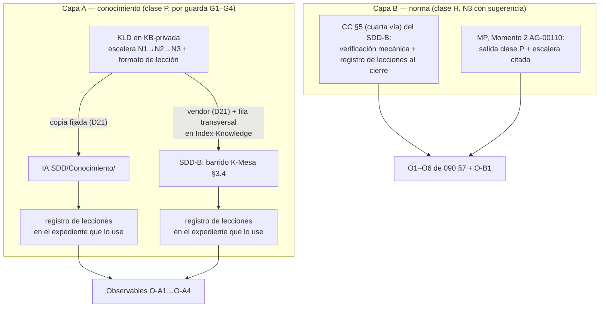

| Campo | Valor |
| --- | --- |
| Tipo | analisis (paso de análisis de decisiones, ciclo 2; `R01` §4) |
| Fecha | 2026-10-27 |
| Autor | Despacho A20. Propone; no vota |
| Orden del día | `F100` §5 (PRE-04 de `N10` §5) |

Secciones leídas: `F100` completo; `F099` §2, §3, §3.1, §4, §5, §7, §8, §9, §11; `F090` completo; `F095` §5;
`F085` tabla T1 (`085:123-128`) y veredictos por decisión (`085:202-230`); `C10:46-56`; `N10` §5, §11 y fila E3-U3
(`N10:404`); `N09:22`, `:441`, `:460-463`, `:480-483`, `:494`; `TP:18-20`, `:34-38` y `wc -l`; Master-Prompt de IA.SDD
(`/IA/SDD/IA.SDD/SDD/Devs/Orchestrator/Master-Prompt.md:557-561`); listado de
`KB-privada/Knowledges/`; índice de `DocsAsCode-Bitacoras/` (`00-Indice.md`).

# 110 — Análisis de decisiones, ciclo 2

## Índice

1. [Qué trae este folio](#1-qué-trae-este-folio)
2. [Alias y definiciones](#2-alias-y-definiciones)
3. [Marco del ciclo 2: el objetivo de fondo como criterio](#3-marco-del-ciclo-2-el-objetivo-de-fondo-como-criterio)
4. [Punto 1 — D22-R' con variante de respaldo](#4-punto-1--d22-r-con-variante-de-respaldo)
5. [Punto 2 — Ratificación de D07](#5-punto-2--ratificación-de-d07)
6. [Punto 3 — Revisión por homogeneidad](#6-punto-3--revisión-por-homogeneidad)
7. [Punto 4 — L12](#7-punto-4--l12)
8. [Punto 5 — Correcciones de forma P-2 a P-5](#8-punto-5--correcciones-de-forma-p-2-a-p-5)
9. [Registro de lecciones de decisión de este folio](#9-registro-de-lecciones-de-decisión-de-este-folio)
10. [Excepciones a conocimientos](#10-excepciones-a-conocimientos)
11. [Lo no verificado](#11-lo-no-verificado)
12. [Observaciones](#12-observaciones)

## 1. Qué trae este folio

Ocho decisiones para el jurado del ciclo 2, cada una con propuesta y `alternativa_2` fundadas:

| Id | Punto del orden del día | Tipo |
| --- | --- | --- |
| D22-R' | 1 | Decisión de fondo (reemplaza a D22-R como texto a votar; D22-R queda como `alternativa_2`) |
| D07-R | 2 | Ratificación |
| H-D22 | 3 | Revisión de los tres `NO_PROCEDE` de D22 |
| H-5 | 3 | Revisión de las cinco decisiones del ciclo 1 con más riesgo (D08, D17, D23, D24, D25) |
| L12' | 4 | Fila del lote reescrita |
| P-2, P-3, P-4/P-5 | 5 | Forma |

## 2. Alias y definiciones

Los alias de `F099` §2 rigen (`TP`, `CPA`, `KDR`, `RDOC`, `REF`, `SDD-B`). Se agregan:

| Término | Definición |
| --- | --- |
| `CC` | `<SDD-B>/Prompts/Agentes/_convenciones_comunes.md` 1.7 (alias de `F090` §2) |
| `K-Mesa` | Fork del conocimiento de mesa en el SDD-B, 1.15, con 159 B de margen contra su techo (`F090` R-A1) |
| `MP` | `/IA/SDD/IA.SDD/SDD/Devs/Orchestrator/Master-Prompt.md` |
| `DB/` | `/LAB/Lab-Documentos/Lab-Documentos.Documentacion/PROMPTs/Guides/14-Sistema-De-Documentador-Tecnico/OUTPUTs/DocsAsCode-Bitacoras/` |
| Escalera de resolución | **[criterio propio, del testimonio de `F100` §1]** Orden en que un orquestador resuelve una duda: **N1 análisis previo** (la resuelve solo con lo que hay a la vista y deja constancia); **N2 mesa** (si el análisis la declara compleja: alternativas, jurado, la mejor fundada queda aprobada); **N3 consulta al humano con sugerencia** (sólo si es *irreducible*: irreversible con consecuencia externa, cambio de alcance o acto H; la consulta lleva propuesta, alternativa y default, nunca una pregunta abierta) |
| Lección de decisión | Registro breve, por decisión resuelta sin el PO: contexto, nivel de la escalera que la cerró, criterio usado, evidencia, resultado y, si el PO la corrige después, la corrección. Es la materia prima del conocimiento de lógica de decisión |
| `KLD` | Conocimiento de lógica de decisión, nombre provisional `Knowledge-Logica-De-Decision` en `KB-privada/Knowledges/`. **No existe** (listado del directorio, 2026-10-27: sólo están los de conformación de PR y los de mesa). El nombre definitivo se fija en E2, como el del conocimiento DocAsCode |

## 3. Marco del ciclo 2: el objetivo de fondo como criterio

El PO fijó un horizonte (`F100` §1, §4): que el conocimiento analítico se enriquezca hasta que subagentes orquesten solos
todo el desarrollo. Este folio lo trata como **criterio K-OBJ** que se suma a K1–K7 de la matriz (`F080`), con esta
lectura operativa:

- K-OBJ alto: la variante reduce consultas al PO **sin** esconderle lo irreducible, y deja una huella reutilizable
  (lección) de cómo se decidió.
- K-OBJ bajo: la variante depende de una aprobación del PO para producir cualquier mejora, o decide sin dejar rastro.

No es una invención del despacho: el workspace ya tiene el antecedente en la memoria del asistente
(`mesa-decide-y-queda-aprobado`, 2026-09-14; `delegacion-con-mesa`, 2026-09-13; `no-preguntas-menores-mesa-y-pr-propios`,
2026-09-14). Las tres asientan la misma escalera, pero **sólo como preferencia del asistente**, no como texto de ningún
orquestador ni de ningún conocimiento. Ese es el hueco que D22-R' cierra.

## 4. Punto 1 — D22-R' con variante de respaldo

### 4.1 Problema

`C10` P-1 (`C10:52`): si PRE-04 no aprueba D22-R, E2-U4 y E3-U3 no se ejecutan (`N10` §11, fila «PRE-04 no aprueba
D22-R») y «ambos orquestadores» queda en deuda, lo que choca con D1 de la presidencia («la mesa decide cómo, no si»,
`F099:53-54`). La causa es estructural: **toda** mejora de D22-R pasa por un cambio de norma (CC §5 en el SDD-B por PR de
norma con PO, `F090` R-A6; Momento 2 de AG-00110 en IA.SDD, `N10:435`, clase H «PO (vía de norma)»). Una variante de
respaldo que también dependa de norma no es respaldo.

### 4.2 D22-R' — propuesta

**Dos capas.** La capa A no toca norma y garantiza la mejora en ambos SDD; la capa B es la mejora de norma y va con
sugerencia al PO.

| Pieza | IA.SDD (orquestador de Geometría) | SDD-B (orquestador vivo: presidencia y conductor de encargos, `F090` §2) |
| --- | --- | --- |
| **A1. Conocimiento** | `KLD` se copia a `/IA/SDD/IA.SDD/Conocimiento/` con su condición de carga, sin tocar la norma (regla del workspace: en IA.SDD el conocimiento se suma a `Conocimiento/`) | `KLD` entra vendorizado (D21) y con **una fila** en `Index-Knowledge.md`, `Consumidor: transversal`. Entra a la mesa sola por el barrido de K-Mesa §3.4 (mecanismo medido en `F090` R-A2). **K-Mesa no se toca** (159 B, R-A1) |
| **A2. Contenido de `KLD`** | (1) Escalera N1/N2/N3 con criterio de irreductibilidad: irreversible con consecuencia externa, cambio de alcance, acto H de `F099` §3.1 (lista H de D08). (2) Forma de la consulta N3: propuesta + `alternativa_2` + default + qué pasa si no responde (la forma de `F099` §9, ya probada en este expediente). (3) Formato de lección (§2). (4) Regla de corrección: si el PO corrige una decisión, la corrección se agrega a la lección y, si es generalizable, se propone como cambio de `KLD` (clase P) | Igual |
| **A3. Registro de lecciones** | El expediente que use `KLD` lleva un folio o tabla «Lecciones de decisión» (una fila por decisión resuelta en N1 o N2) | Igual, en el `evidencia/` o en la resolución del expediente |
| **A4. Semilla** | Las lecciones de este expediente (§9 de este folio y las que asiente el bitacorista en `DB/`) son las primeras filas de ejemplo de `KLD` | Igual |
| **B1. Norma** | MP Momento 2 de AG-00110 (`MP:560`): salida de clase P (D22 A, sin cambios) **más** una línea que cita `KLD` como regla de decisión del orquestador | CC §5, cuarta vía: el texto ensayado en R-A3 (verificación mecánica antes de archivar) **más**: «el cierre adjunta el registro de decisiones resueltas sin el PO, con el nivel que las cerró». Debe cumplir K2 del catálogo (no nombrar archivos ni alias): se redacta sin nombrar `KLD`, como en R-A3 |
| **B2. Vía** | Compuerta E2, PR de norma, clase H | E3, PR de norma del SDD-B (`R04:200-208`), clase H |
| CI | `[self-hosted, i7infra-dev]` | Runner de su organización con su etiqueta o `ubuntu-latest` en el repo de documentación (L10, R-A5). Anti-inyección **en aviso** hasta 0 falsos positivos (R-A4) |

**Por qué la capa A cuenta como mejora del orquestador y no como «carga» [criterio propio; se somete al refutador].**
El jurado del ciclo 1 descartó «cargar el conocimiento DocAsCode en la mesa» porque no cambia lo que el orquestador
*hace*: sólo le da material (`F090` §1, `085:501-505`). `KLD` es distinto en su objeto: gobierna **cómo decide y cuándo
interrumpe** el orquestador, que es exactamente la función que `F090` §2 usa para definir «orquestador vivo» (abre,
encarga, cierra). El cambio no se verifica por texto sino por **conducta**: el siguiente expediente de cada SDD trae su
registro de lecciones. Si el refutador muestra que esa conducta no aparece sin la capa B, la capa A no alcanza y rige
el punto 4.4.

**Observables de la capa A** (para E2 y E3):

| # | Observable | Prueba | Verde |
| --- | --- | --- | --- |
| O-A1 | `KLD` existe en la fuente y en ambas copias | `copiar.py --check` en IA.SDD; MANIFIESTO sha256 en el SDD-B (D21) | rc 0 en los dos |
| O-A2 | `KLD` entra a la mesa del SDD-B | Barrido de `K-Mesa:280` sobre el índice con la fila | La fila aparece (mecanismo de R-A2) |
| O-A3 | Conducta en IA.SDD | El primer expediente de Geometría posterior a O-A1 tiene registro de lecciones | ≥ 1 fila con nivel N1/N2/N3 y evidencia |
| O-A4 | Conducta en el SDD-B | El primer expediente del SDD-B posterior a O-A2 tiene registro de lecciones | ≥ 1 fila con nivel y evidencia |
| O-B1 | Capa B aplicada | `grep -c` de la frase agregada en CC y en MP | 1 en cada uno, con versión y control de cambios |

**Fundamento por criterio.**

| Criterio | Lectura | Cita |
| --- | --- | --- |
| D1 de la presidencia (cómo, no si) | La capa A no depende de aprobación de norma: garantiza «ambos» | `F099:53-54`, `C10:52` |
| K-OBJ | Escalera + lecciones es el mecanismo literal del testimonio | `F100` §1, §4 |
| Clase de intervención | Un conocimiento nuevo es P; con L2 aceptada se fusiona por la guarda G1–G4 | `F099` §3.1 (D08); `F100:62` |
| Invariantes del SDD-B | K-Mesa intacta; la fila del índice usa la vía medida; CC sólo por norma | `F090` R-A1, R-A2, R-A6 |
| Simplicidad (K1) | Un documento y una fila por SDD; sin agentes nuevos (la B de D22 sigue descartada, `F090` §4) | `F090:144-145` |
| Riesgo | Un conocimiento que «aprende» puede derivar a decidir lo irreducible; lo acota la lista H, que `KLD` no puede modificar (cambiar `KLD` es P, cambiar la lista H es H) | `F099` §3.1 |

### 4.3 alternativa_2 — D22-R tal como `F090` §4, con L12 elevada

CC §5 con el texto de R-A3 (sólo verificación mecánica) y Momento 2 de AG-00110; si el PO no aprueba, rige
`F090` §5 (fila del índice + anti-inyección en aviso; «ambos» `INSUFICIENTE` en E3). Ventaja: ya ensayada (R-A1–R-A6),
menor superficie. Lo que pierde: no responde a P-1 (sin aprobación de norma no hay mejora verificable del orquestador) y
tiene K-OBJ bajo (no registra lecciones ni fija la escalera).

### 4.4 Mejora mínima verificable (si ninguna prospera)

`F100` §5.1 pide votarla. Propuesta: **sólo A1 + A3 en un SDD por vez, empezando por IA.SDD** (Geometría es la piloto,
E2), con O-A1 y O-A3 como observables; el SDD-B recibe la fila del índice en E3. Es mínima porque no requiere ni norma
ni vendor nuevo en el SDD-B antes de E3.

## 5. Punto 2 — Ratificación de D07

**D07-R — propuesta.** J5 ratifica `PROCEDE` sobre el texto asentado en `F099` §4 (Q10, Q11) sin reabrir variantes.
Fundamento: 4 `PROCEDE` son mayoría sobre 5 y el resultado no puede cambiar (`F099` §5.2); el ciclo 2 sólo cierra el
quórum (`RM:330`, E-14). Agregado K-OBJ: la ratificación se registra como lección N1 («quórum incompleto con resultado
invariante: ratificar sin mesa»).

**alternativa_2.** Revotación completa de D07 por los cinco jueces. Sólo si el refutador encuentra, en el punto 3, un
motivo de fondo (por ejemplo, que `llms.txt` haya cambiado de estado desde «A proposal», `085:208`). Costo: una ronda
más para un resultado invariante.

## 6. Punto 3 — Revisión por homogeneidad

### 6.1 Los tres `NO_PROCEDE` de D22 (H-D22)

**Propuesta.** Ratificar los tres `NO_PROCEDE` **como voto sobre el texto de `F080`**, que queda archivado
(`F099` §5.1.1), y declarar que **no se trasladan** a D22-R' ni a D22-R: votaron otro texto (`F095` §4.2). La revisión
no encuentra homogeneidad sospechosa en ellos: son el único disenso del ciclo y coinciden con el `DEBILITA` del
refutador (`085:223`).

**alternativa_2.** Pedir al refutador que conteste cada `NO_PROCEDE` contra D22-R' para comprobar que el motivo
(«ningún orquestador cambia en el SDD-B») queda resuelto por la capa A o la B. Más caro, pero sirve de prueba del
argumento de §4.2.

### 6.2 Las cinco decisiones con más riesgo (H-5)

**Criterio de selección [criterio propio].** Se eligen por tres señales combinadas: fragilidad de la matriz (celdas que
invierten el ganador, `085:123-128`), veredicto del refutador `REFUTA`/`DEBILITA` (`085:202-230`) y dependencia de un
hecho todavía no ensayado. Las que suman dos o más señales:

| D | Fragilidad (`085` T1) | Refutador | Hecho no ensayado | Propuesta | alternativa_2 |
| --- | --- | --- | --- | --- | --- |
| **D08** | 3 celdas | REFUTA (invertida) | — | **Ratificar por la alternativa_2 y pasar a FIRME**: su condición de revisión («si el PO pide aprobación explícita en todo P») quedó resuelta en contra por L2 aceptada con P incluido (`F100:62`). Agregar la escalera de §2 como regla de la clase P con decisión pendiente: la duda se lleva primero a N1/N2 y sólo vuelve a persona si es irreducible | Mantener CON REVISIÓN hasta que el PO confirme por escrito la lectura de `F100` (§6 de ese folio) |
| **D23** | 2 celdas | SOSTIENE, «frágil» | Que la piloto necesite el rol usuario | **Ratificar CON REVISIÓN**; L3/L4 aplicadas (`F100:63-64`) quitan el riesgo de objeto, no la fragilidad. La condición de `F099:118` sigue | Bajar a «apartamiento sólo por ADR» y retirar ya la propuesta de cambio de `RDOC`; menos ruido normativo, pero contradice L4 |
| **D24** | 3 celdas, sin K6 invierte | DEBILITA (premisa falsa: 3 de 6, no mayoría) | Plan de `Migracion-Rules` §3 | **Ajustar el fundamento**: quitar «la mayoría declara Ninguno obligatorio» y fundar sólo en K6 y en que 13.18 nombra a Lab-Geometria (`085:225`). Mantener CON REVISIÓN | Desacoplar: la piloto arranca sobre la versión actual y la migración va a expediente propio desde el inicio; pierde homogeneidad con la norma vigente |
| **D25** | 2 celdas, sin K2 invierte | SOSTIENE con reparo | Umbral de «mini» | **Activar su condición (a)**: L7 aplicada abre el expediente de Lab-E2E.WebBlazor (`F100:67`), así que D25 pasa a la alternativa B **cuando ese expediente exista**; hasta entonces sigue A con `source.lock`. Fijar «mini» como en §8.4 | Quedarse en A hasta E2 aunque el expediente se abra; más simple, pero ignora la condición que la propia decisión fijó |
| **D17** | — (alt. 2) | REFUTA (invertida) | E-F12 (que el job llamado tome el runner) | **Ratificar CON REVISIÓN**; E-F12 es la primera unidad de E1-U0b y su resultado decide (`F099:154-155`). Disidencia de J4 registrada | Arrancar con la variante de J4 (un workflow por repo) y migrar a `workflow_call` sólo si E-F12 pasa; menos riesgo inicial, más duplicación |

Se vieron y quedan fuera de las cinco: D12 y D14 (3 celdas, pero `SOSTIENE`/`DEBILITA` sin hecho abierto; sus
condiciones son comprobables, `F099:107` y `:109`); D06, D09, D11, D13, D18 y D20 (`DEBILITA` corregidos por C-n
aplicadas en `F099` §3).

## 7. Punto 4 — L12

**L12' — propuesta.** Reescribir L12 para que no sea condición del escalón sino consulta N3 con sugerencia:

| # | Fila | Si no responde |
| --- | --- | --- |
| L12' | Aprobar en E3, como PR de norma del SDD-B, la capa B de D22-R' (CC §5: verificación mecánica antes de archivar y registro de decisiones al cierre) y, en E2, la línea equivalente en MP Momento 2. **Recomendación: sí.** Se reconoce que el orquestador vivo es la presidencia de la mesa a pedido y el conductor de encargos | Rige la capa A: «ambos» se cumple por O-A1 a O-A4 y la capa B queda declarada como mejora pendiente, sin `INSUFICIENTE`. No se asienta la norma por silencio (`R01:460`) |

Fundamento: con la capa A, el silencio del PO ya no bloquea el escalón (P-1 resuelto) y la norma sigue siendo acto H
(lista H de D08). El jurado decide L12' si aprueba D22-R'.

**alternativa_2.** Si gana D22-R (alternativa de §4.3), rige la L12 de `F090` §8 sin cambios: «ambos» queda
`INSUFICIENTE` en E3 si el PO no aprueba.

## 8. Punto 5 — Correcciones de forma P-2 a P-5

### 8.1 P-2 — numeración `0060`/`0070`

**Propuesta.** No renombrar. Declarar en la carátula (`README.md` del expediente) la convención: «`0060` y `0070` son
investigaciones complementarias intercaladas entre `004` y `010`; el cuarto dígito evita colisión con la serie de
comisiones». Fundamento: renombrar obliga a reescribir referencias en 10 archivos (`C10:53`) y rompe citas ya
asentadas; el orden lexicográfico actual ya los ubica bien.

**alternativa_2.** Renombrar a `006-`/`007-` y reescribir las referencias con un solo reemplazo verificado por `grep`
(0 coincidencias de `0060-`/`0070-` después). Más homogéneo, más riesgo de cita rota.

### 8.2 P-3 — «Lo no verificado» y «Observaciones» en `099` y `002`

**Propuesta.** No editar folios firmados. La presidencia emite un folio de **corrigenda** (siguiente número libre) que
agrega, para `002` y `099`, las dos secciones por referencia; desde el ciclo 2 toda actuación nueva las trae (este folio
lo hace: §11 y §12). Fundamento: el expediente es acumulativo; `F099` ya consigna su contenido no verificado disperso
(§7 RS-5, RS-6; §11 «No mirado»), así que la corrigenda sólo lo reúne.

**alternativa_2.** Editar `099` y `002` agregando las secciones al final, con fila en un control de cambios. Más
legible, pero altera folios que otros citan por número de sección.

### 8.3 P-4 — líneas de `TP`

**Propuesta.** Corregir en `N09` (`N09:22` y `:441`) «67 líneas» por «68 líneas (`wc -l` da 67: la última no termina
en salto)». Verificado hoy: `wc -l TP` = 67. Las citas `TP:65-68` (`N09:494`) quedan válidas.

**alternativa_2.** Agregar el salto final a `TP`. Descartable: `TP` es del PO (carpeta `PROMPTs/` fuera de `OUTPUTs/`,
regla del workspace) y no se escribe.

### 8.4 P-5 — umbrales de `TP:20` (f) «estudio profundo» y `TP:36` (i) «tendencias»

**Propuesta (lectura provisional, hasta que entre el rol formal de K2, RS-5).** Con unidad en `N10` E1-U4 (compuerta E1):

| Término | Umbral | Unidad de medida | Unidad N10 |
| --- | --- | --- | --- |
| «estudio profundo» (`TP:20` f) | Cada `TEM-01`…`TEM-07` cita ≥ 3 fuentes primarias con fecha de consulta (D28) y ≥ 1 ensayo reproducible con comando y salida en `evidencia/` | fuentes y ensayos por tema | E1-U4 (todas las sub-unidades), verificado en G-a de E1 |
| «tendencias del mercado» (`TP:36` i) | ≥ 2 adopciones públicas verificables por práctica recomendada, cada una con fuente de ≤ 24 meses a la fecha de la compuerta | adopciones y antigüedad en meses | E1-U4b (TEM-01, TEM-03) |
| «mini» (RS-5, para D25) | ≤ 20 piezas, 1 workflow, < 15 min en el runner (lectura de `F099` RS-5, sin cambios) | piezas, workflows, minutos | E1-U3 (demo) |

**alternativa_2.** Dejar los tres sin umbral hasta el rol formal de K2 y marcar las filas de `N09:462` y `:482` como
`INSUFICIENTE` explícito en E1. Respeta la condición K2 del jurado de composición (`F004:438`), pero la compuerta E1 no
podría cerrar esos ítems.

## 9. Registro de lecciones de decisión de este folio

Por `F100` §4: qué habría resuelto cada decisión sin mesa. Es la primera semilla de `KLD` (A4).

| Decisión | Nivel que basta | Por qué | Lección candidata |
| --- | --- | --- | --- |
| D22-R' | N2 (mesa) + N3 sólo para la capa B | Hay alternativas reales y una parte es norma (H) | «Si toda mejora depende de una aprobación H, partir la decisión: una capa P que garantice el objetivo y una capa H que se consulta con sugerencia» |
| D07-R | N1 | Resultado invariante | «Quórum incompleto con mayoría ya alcanzada: ratificar sin mesa» |
| H-D22 | N1 | El texto votado está archivado | «Un voto sobre un texto archivado no se traslada a su reformulación» |
| H-5 D08 | N1 | La condición de revisión quedó resuelta por un hecho (L2) | «Cuando el hecho que fija una condición de revisión ocurre, la decisión cambia de estado sin mesa» |
| H-5 D24 | N1 | Error de premisa medible | «Una premisa falsa se corrige en el fundamento; sólo vuelve a mesa si cambia el ganador» |
| H-5 D25 | N1 | Condición propia activada por L7 | Igual que D08 |
| L12' | N2 | Redefine qué pasa si el PO calla | «El silencio del PO nunca asienta un acto H, pero tampoco debe bloquear un objetivo que una capa P puede cumplir» |
| P-2…P-5 | N1 | Forma, reversibles | «Lo reversible y de forma se resuelve con análisis previo; no se lleva al PO» |

## 10. Excepciones a conocimientos

- **Ninguna nueva en la propuesta.** La capa A suma un conocimiento sin tocar la norma de IA.SDD ni K-Mesa; la capa B
  va por la vía de norma de cada SDD.
- **Declarado:** la escalera N1/N2/N3 hoy vive sólo como preferencia del asistente (memoria). Pasarla a `KLD` no se
  aparta de ningún conocimiento; si el jurado la aprueba, `Knowledge-Mesa-De-Expertos-A-Pedido` (IKB) debería citarla
  en su próxima versión: eso es propuesta, no excepción.
- Las de `F090` §9 (anti-inyección en aviso) rigen sólo si se aprueba D22-R' o D22-R.

## 11. Lo no verificado

| Qué | Motivo |
| --- | --- |
| Que `KLD` cambie la conducta del orquestador del SDD-B sin la capa B | Sólo se verifica con el primer expediente posterior (O-A4); es el supuesto central de §4.2 y va al refutador |
| Que la frase de la capa B en CC §5 cumpla K2 del catálogo | No se ensayó sobre copia como R-A3; debe repetirse antes de E3 |
| Que el MP admita la línea de B1 sin conflicto con `Rules-Documentacion.md` §0.3–§0.6 (`MP:560`) | No se leyó esa norma en este despacho |
| Lectura de `TP:20` (f) y `TP:36` (i) | Provisional hasta el rol formal de K2 |
| Que el PO comparta la lectura de `F100` | Criterio de la presidencia (`F100` §6) |

## 12. Observaciones

- O-1: este folio reemplaza a D22-R como texto principal a votar; si el jurado prefiere votar D22-R tal cual, queda
  como `alternativa_2` (§4.3) sin perder la variante de respaldo (§4.4).
- O-2: el bitacorista asienta en `DB/` la entrada de este despacho y copia la tabla §9 como insumo de `KLD`.
- O-3: sin commits, PR ni contenedores. Archivos creados: este folio.

Sigue: refutación del ciclo 2 · refutador
