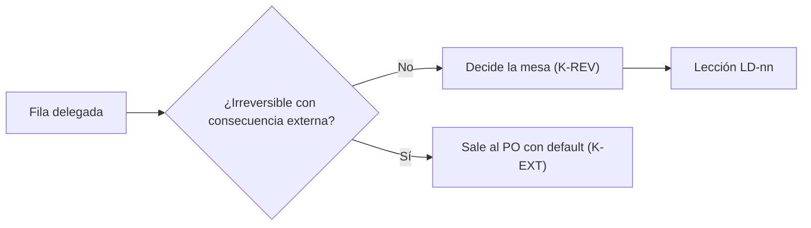

# 131 — Decisiones delegadas

| Campo | Valor |
| --- | --- |
| Tipo | resolucion (mesa breve por delegación del PO, `130` §2) |
| Fecha | 2026-10-27 |
| Autor | Presidencia; mesa breve (núcleo, `C-DECISIONES`, `C-ARQ-NET`) |
| Corrige | `099` §9 y `129` §4.2 en las filas tratadas |

## Índice

1. [Criterios de decisión](#1-criterios-de-decisión)
2. [Decisiones](#2-decisiones)
3. [Lecciones de decisión](#3-lecciones-de-decisión)
4. [Lo que sigue saliendo al PO](#4-lo-que-sigue-saliendo-al-po)

## 1. Criterios de decisión

| Id | Criterio | Fuente |
| --- | --- | --- |
| K-REV | Si la decisión es aditiva o reversible, se decide por análisis sin trámite | `130` §2 (objetivo de autonomía); `Rule-Detencion-Y-Lote` §3.2 |
| K-EXT | Sólo lo irreversible con consecuencia externa (dinero, organización, terceros) sale al PO, con sugerencia y default | `130` §4; `Rule-Detencion-Y-Lote` §3.7 |
| K-ADR | Una regla o ADR propio que choca se supera con un ADR o cambio consecuente, no con consulta | `130` §2, L3/L4 |
| K-NORMA | No se asienta norma por silencio; la delegación escrita no es silencio | `R01:460`; `130` §2, L2 |
| K-VER | Nada se declara cumplido sin medir | `129` §4.1 |

## 2. Decisiones

| Fila | Alternativas | Decisión | Criterios |
| --- | --- | --- | --- |
| L1 | (a) listar la fila de alcance `TP:30` como constancia; (b) omitirla | **(a)** Se asienta: E1–E3 es el alcance escalonado de esta corrida | K-REV (aditiva, sólo constancia) |
| L5 | (a) apartamiento de `KDR` §5.1: `ruta#Símbolo@SHA` para código y `RN-<DOMINIO>-nn` sin SDD, el validador acepta ambos modos y `archivo:línea` avisa; (b) sólo `archivo:línea`; (c) proponer el cambio a `KDR` ya | **(a)**, registrada como excepción E-1/E-2; la propuesta a `KDR` se evalúa en E2-U3 con la medida de E1 | K-REV (el validador admite ambos; reversible), K-VER (se mide antes de tocar el conocimiento) |
| L6 | (a) modificar el Profile; (b) default: objetivos en la ruta del README, ejercicios en un anexo, Profile intacto, y propuesta escrita al dueño en E1-G; (c) nada | **(b)**. La propuesta (`OBJ-nn`, `EJR-nn`, ruta real del framework, contrato de frontmatter, verificación por lector sin contexto) se emite como anexo del folio de E1-G; aplicarla al Profile es un PR de norma posterior por la delegación | K-REV, K-VER (se propone con la evidencia de E1) |
| L8 | (a) copia fiel con huella y `Hereda-de` + reescritura de citas por ruta y versión; (b) sólo vendorizar; (c) nada | **(a)** en dos PR de norma del SDD-B dentro de E3: primero la copia fiel y la reconciliación de los 14 homónimos (E3-U2), después la reescritura de citas de las 14 reglas; cada uno revertible por separado | K-ADR (norma propia del SDD-B que choca), K-REV (dos PR separados), K-NORMA (delegación escrita) |
| L9 | (a) comprar 26514:2022; (b) no comprar salvo evento de D12 | **(b)**. Si ocurre el evento de D12, sale al PO con sugerencia (gasto: K-EXT) | K-EXT |
| L12' | (a) capa B sí: línea en el Momento 2 de AG-00110 (IA.SDD, E2-U4) y agregado a CC §5 del SDD-B (E3-U3); (b) sólo capa A | **(a)**. Recomendación de `129` §4.2 era sí; la delegación escrita la habilita como PR de norma por `CPA`. O-A3/O-A4 siguen `PENDIENTE` hasta medirse | K-NORMA, K-REV (PR revertible), K-VER |
| L13 | (a) asentar la constancia de la irregularidad de la ronda 2; (b) omitirla | **(a)** Se asienta: el texto votado en la ronda 2 era anterior a la reconsideración y J5 tuvo dos corridas con rótulos distintos (`095` §4.2–§4.3); el tratamiento fue `NO_PROCEDE` del texto de 080 y votación de D22-R en el ciclo 2 | K-REV (aditiva; transparencia del caso) |

**Efecto en el plan.** C2-4 cae: con capa B, «ambos orquestadores» en el SDD-B se mide en E3 (O-B1). E3-U0 ya no
espera L10, L12 ni L8: tienen respuesta. Sólo L11 queda del PO.

## 3. Lecciones de decisión

| Id | Decisión | Nivel | Criterio | Lección |
| --- | --- | --- | --- | --- |
| LD-04 | L1 y L13 sin consulta | N1 | K-REV | Una constancia nunca es materia de lote: se asienta |
| LD-05 | L5 por doble modo | N1 | K-REV, K-VER | Ante un apartamiento de conocimiento, el validador tolerante con aviso permite medir antes de cambiar el conocimiento |
| LD-06 | L6 por propuesta en compuerta | N1 | K-REV | Un documento de otro dueño no se toca en caliente: se propone con evidencia en el hito que la produce |
| LD-07 | L8 en dos PR | N1 | K-ADR | Un cambio normativo grande se parte en pasos revertibles; la delegación escrita lo habilita |
| LD-08 | L9 sigue fuera | N1 | K-EXT | El gasto es el ejemplo canónico de lo que sale al PO |
| LD-09 | L12' sí | N1 | K-NORMA | La recomendación de la mesa más la delegación escrita bastan para un PR de norma revertible |

## 4. Lo que sigue saliendo al PO

| Fila | Por qué | Default mientras tanto |
| --- | --- | --- |
| L11 | Configuración de organización (K-EXT) | Mitigaciones de `130` §6 |
| L9 (si ocurre el evento de D12) | Gasto (K-EXT) | No se compra |
