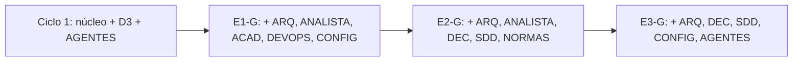

# 132 — Providencia: opción B

| Campo | Valor |
| --- | --- |
| Tipo | providencia (PRE-01 de `N10` §5; numerada 130 en el plan original, renumerada) |
| Fecha | 2026-10-27, anterior a la primera rama de E1 |
| Autor | Presidencia (despacho P30) |

## Índice

1. [Definiciones](#1-definiciones)
2. [Lo que se asienta](#2-lo-que-se-asienta)
3. [Composición por compuerta](#3-composición-por-compuerta)
4. [Mitigación del obligatorio ausente](#4-mitigación-del-obligatorio-ausente)
5. [Pase](#5-pase)

## 1. Definiciones

- **D3**: los cuatro especialistas obligatorios de la carta (`C-ARQ-NET`, `C-ANALISTA`, `C-ACADEMICO`, `C-DECISIONES`).
- **Techo**: núcleo + 5 sillas (`RM:259`).
- **Opción B**: D3 completo en el ciclo 1; en cada compuerta, los obligatorios y variables que el objeto juzgado pide.

## 2. Lo que se asienta

Se asienta la **opción B** del folio 003 §7 (D01, firme por `129` §3). Fundamento: con la opción A `C-NORMAS-IA` no
entra nunca, y `TP:36` pide consultar estándares; la opción B no deja a ningún especialista sin silla y su costo es
esta providencia. Reversible por constancia.

## 3. Composición por compuerta

| Compuerta | Mesa |
| --- | --- |
| Ciclo 1 (metodología) | Núcleo + D3 + `C-AGENTES-IA` (ya corrió) |
| E1-G | Núcleo + `C-ARQ-NET`, `C-ANALISTA`, `C-ACADEMICO` + `C-DEVOPS`, `C-CONFIG-RELEASE` |
| E2-G | Núcleo + `C-ARQ-NET`, `C-ANALISTA`, `C-DECISIONES` + `C-SDD-CONOCIMIENTO`, `C-NORMAS-IA` |
| E3-G | Núcleo + `C-ARQ-NET`, `C-DECISIONES` + `C-SDD-CONOCIMIENTO`, `C-CONFIG-RELEASE`, `C-AGENTES-IA` |

## 4. Mitigación del obligatorio ausente

El obligatorio que no tiene silla en una compuerta recibe el dictamen como lector y puede emitir solicitud de
convocatoria para el ciclo siguiente (`RM:242-244`). `C-AGENTES-IA` no repite en ciclos seguidos, así que la regla de
no reconvocatoria (`RM:263-265`) no lo alcanza.

## 5. Pase

Pasa a `133` (criterios de E1, PRE-03) y habilita la onda 1 de `N10` §14.
