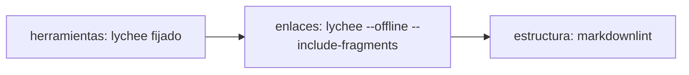

# 210 — E1-U0a: delegación del merge y `docs-guard` mínimo en Lab-Documentos

## Índice

1. Definiciones
2. Qué se hizo
3. Criterios de aceptación
4. Ensayo de cierre y E-F1
5. PR, merge y CI
6. Lecciones de decisión
7. Limpieza

## 1. Definiciones

- **docs-guard**: workflow `.github/workflows/docs-guard.yml` de Lab-Documentos; compuerta mínima de documentación.
- **Línea de base**: los 8 enlaces rotos de `GUIA-DIR` que E1-U1 tiene en su alcance cerrado (N10 §6).
- **CPA**: `Knowledge-Conformacion-Pull-Request-Automatico` 2.0.

## 2. Qué se hizo

Rama `exp0002/e1-u0a-delegacion-y-docs-guard`, desde `origin/main` (9c70089; la ficha decía 5d5c2b4, ya superado), en
worktree propio. Archivos:

| Archivo | Contenido |
| --- | --- |
| `CHANGELOG.md` | Entrada 2026-10-27 con «Delegación del merge»: fecha, responsable (PO), asiento (folio 130 §2), testimonio L2 literal, alcance (incluye el primer merge), techo 120 min, intervalo 30 s, método y excepción |
| `.github/workflows/docs-guard.yml` | `pull_request` + `workflow_call` (inputs `ruta`, `herramientas-ref`); un job en `[self-hosted, i7infra-dev]`, `timeout-minutes: 10`, grupo `docs-${{ github.workflow }}-${{ github.ref }}`, `cancel-in-progress` sólo en PR; `permissions: contents: read`; checkout fijado por SHA (v4.2.2) con `persist-credentials: false`; guarda `if:` contra forks; sin `container:` |
| `scripts/ci-local.sh` | Pasos `herramientas` → `enlaces` → `estructura`; el workflow llama a cada paso del mismo script (mismos pasos, mismo orden por construcción) |
| `scripts/docs-guard.lychee.toml` | lychee 0.18.1 (SHA-256 fijo); excluye con nombre la línea de base |
| `scripts/docs-guard.markdownlint-cli2.jsonc` | markdownlint-cli2 0.17.2; sólo MD001, MD003, MD024 (hermanos), MD025 (sin título de frontmatter), MD042, MD056 |

## 3. Criterios de aceptación

| # | Criterio | Cumple | Evidencia |
| --- | --- | --- | --- |
| 1 | `grep -n "Delegación del merge"` con fecha y responsable | Sí | `CHANGELOG.md:15` (nueva) y `:35` (la del expediente 0001); `evidencia/E1-U0a/01-ci-local.txt` |
| 2 | Corrida verde de `docs-guard` sobre el `head.sha` | Sí | Run 40505934724 sobre 8c3fc99 y run 40508916199 sobre la cabeza auditada 87c3b65; `02-corridas-runner.txt` |
| 3 | Par rojo/verde plantado en rama que no se fusiona | Sí | PR #12 (base = rama de U0a, cerrado sin fusionar): rojo run 40505939059 sobre 12d8999 (falla en «2/3 enlaces»), verde run 40507350875 sobre c5cf38f (revert). Rama borrada (404) |
| 4 | `self-hosted, i7infra-dev` ≥ 1 y sin `container:` | Sí | 1 y 0; `01-ci-local.txt` |

## 4. Ensayo de cierre y E-F1

- `scripts/ci-local.sh` sobre el worktree, con caché vacía: exit 0 (24 enlaces, 15 OK, 0 errores, 9 excluidos;
  markdownlint 15 archivos, 0 errores). Salida en `evidencia/E1-U0a/01-ci-local.txt`.
- **E-F1** (primera corrida real): job creado 12:42:51Z, iniciado 12:49:05Z → **espera en cola 6 min 14 s**;
  ejecución 62 s. Tras el merge de main la espera fue de **15 min 28 s** (13:04:48Z → 13:20:16Z), con el runner
  ocupado por `framework-concept-demo` del mismo PR. La ejecución propia ronda 1 min; el costo es la cola.

## 5. PR, merge y CI

- PR: <https://github.com/hdcm-dev/Lab-Documentos/pull/11> (cita el testimonio de 130 §2).
- Guarda: G1 cabeza 87c3b65 = auditada; G2 la primera lectura dio `behind` (main tiene check estricto `fw-ok` y avanzó
  con #13): se fusionó `origin/main` en la rama, se esperó la CI de la nueva cabeza y la relectura dio `clean`; G3: 5
  check-runs (`fw-ok`, `docs-guard`, `alcance` en éxito; `apk`, `compuerta` omitidos por alcance declarado); G4 sin reserva.
- Merge commit atado al SHA: **f603984a3a4b35ea62feb7e5b3f68c0ad3331311** (`merged: true`). Rama borrada: DELETE 204, GET 404.
- Controles del commit de merge: ninguno corre en `push` (ambos workflows son `pull_request`); lo medido es la cabeza 87c3b65.
- La dependencia PRE-03 ya estaba hecha (folio 133): la rama salió de `origin/main`.

## 6. Lecciones de decisión

- **LD-01 — Línea de base excluida con nombre, no compuerta en rojo.** `GUIA-DIR` tenía 8 enlaces rotos y los
  sanea E1-U1, que depende de U0a. Se excluyen por patrón y con comentario en `docs-guard.lychee.toml` (7 a retirar en
  U1, 1 defecto plantado que se conserva). Aditivo y reversible: decidido sin elevar.
- **LD-02 — Techo 120 min, intervalo 30 s.** La ficha deja los valores al agente; el runner es único y compartido,
  y E-F1 midió hasta 15 min de cola. Se duplicó el techo de la delegación del expediente 0001.
- **LD-03 — El workflow llama al script por paso.** Así «mismos pasos en el mismo orden» vale por construcción, y
  `workflow_call` toma scripts y configuración de Lab-Documentos por `herramientas-ref` (U0b debe pasar el mismo SHA
  del `uses:`).
- **LD-04 — MD025 sin título de frontmatter.** La guía tiene `title:` y H1; contar ambos daba 13 falsos positivos
  estructurales.
- **LD-05 — `behind` por check estricto.** Con `strict: true` en main, cada PR paralelo obliga a actualizar la rama y
  repetir la cola. Las unidades siguientes deben contarlo en su techo.

## 7. Limpieza

- Creado y borrado: worktree `fc-work/docascode/wt/e1-u0a`, ramas locales y remotas `exp0002/e1-u0a-delegacion-y-docs-guard`
  y `exp0002/e1-u0a-par-rojo-verde`, PR #12 cerrado.
- Intermedios en `fc-work/docascode/`: cuerpos JSON del PR, script de lectura de corridas, encabezado de la credencial
  y la caché de lychee: borrados al cerrar.
- No se tocó el working tree principal de Lab-Documentos (tiene cambios del PO; su `main` local queda en 5d5c2b4, sólo
  se hizo `fetch --prune`). Sin contenedores.
