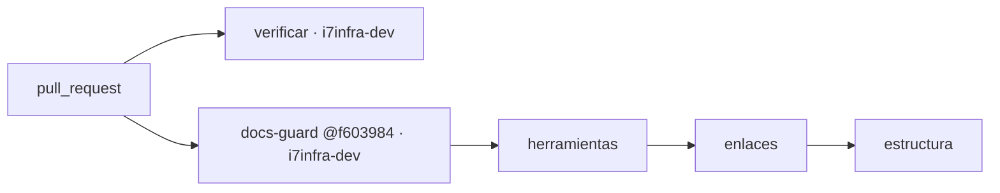

# 211 — E1-U0b: delegación del merge y llamador de `docs-guard` en Lab-Documentos.Documentacion

## Índice

1. Definiciones
2. Qué se hizo
3. Criterios de aceptación
4. Ensayo de cierre
5. PR, merge y CI
6. Lecciones de decisión
7. Limpieza

## 1. Definiciones

- **Llamador**: el job `docs-guard` de `.github/workflows/verificar.yml`, que invoca por `workflow_call` el workflow
  reutilizable de Lab-Documentos fijado por SHA.
- **E-F12**: hipótesis de la ficha: el job llamado corre en el runner propio `i7infra-dev` (se lee en su registro).
- **CPA**: `Knowledge-Conformacion-Pull-Request-Automatico` 2.0.
- **Par rojo/verde**: PR que no se fusiona, con un defecto plantado (rojo) y luego corregido (verde).

## 2. Qué se hizo

Corrida reanudada: la anterior dejó abiertos el PR #17 (unidad) y el PR #18 (par), con el worktree
`fc-work/docascode/wt/e1-u0b` sobre la rama del par. Se retomaron sin duplicar ramas ni PR.

Rama `exp0002/e1-u0b-delegacion-y-verificar`, desde `origin/main` en `cd8be3d` (la ficha decía `8da0cd9`, superado; y
`main` ya traía un `verificar.yml` mínimo del expediente 0001, así que «sin `.github/`» tampoco regía). La dependencia
E1-U0a ya estaba fusionada (`f603984`, hdcm-dev/Lab-Documentos#11).

| Archivo | Contenido |
| --- | --- |
| `CHANGELOG.md` | Entrada 2026-10-27, sección «Delegación del merge»: fecha, responsable (PO), asiento (folio 130 §2), testimonio L2 literal, alcance (incluye el primer merge del repo), techo 120 min, intervalo 30 s, método (merge atado al SHA, sin squash) y excepción |
| `.github/workflows/verificar.yml` | Job nuevo `docs-guard`: `uses: hdcm-dev/Lab-Documentos/.github/workflows/docs-guard.yml@f603984a…` con `ruta: .github` y `herramientas-ref` igual al SHA del `uses:`. El job `verificar` existente pasa a `[self-hosted, i7infra-dev]`, checkout fijado por SHA (v4.2.2), guarda `if:` contra forks. `permissions: contents: read`, sin `pull_request_target`, `concurrency` con cancelación sólo en PR |
| `.github/README.md` | Documentación de la CI (definiciones, tabla de jobs, mermaid, seguridad, reproducción local, cómo cambiar el SHA). Es además la carpeta que verifica el llamador |

## 3. Criterios de aceptación

| # | Criterio | Cumple | Evidencia |
| --- | --- | --- | --- |
| 1 | Sección de delegación con fecha y responsable | Sí | `CHANGELOG.md`, «Delegación del merge (Conformacion-Pull-Request-Automatico 2.0, expediente 0002)»: fecha 2026-10-27, responsable PO |
| 2 | **E-F12**: el job llamado corrió en `i7infra-dev` | Sí | Job 122215336639 (run 40511792195, cabeza 0cf7e8a): `Runner name: 'i7infra-runner-dev'`, labels `self-hosted, i7infra-dev`; `evidencia/E1-U0b/verde-pr17-docs-guard.log`. No rige la condición de revisión de D17 (copia con huella) |
| 3 | Par rojo/verde plantado | Sí | PR #18: rojo en 99eedde (job 122215361269, `2/3 enlaces`: 1 error, `anexo-inexistente.md`), verde en 294a2e1 (revert 2f1211d + commit vacío; run 40522272259 por `workflow_dispatch`, job 122252267296, `🔍 6 Total ✅ 6 OK 🚫 0 Errors`, `Summary: 0 error(s)`); `rojo-pr18-docs-guard.log`, `verde-par-docs-guard.log` |

## 4. Ensayo de cierre

- **Defecto plantado**: enlace a `.github/anexo-inexistente.md` en el README de la CI. El llamador falló en
  `2/3 enlaces` con `🔍 7 Total ✅ 6 OK 🚫 1 Error`, exit 2, en `i7infra-runner-dev`.
- **Corregido**: revert (árbol idéntico a la cabeza de #17). El primer intento falló por red al bajar lychee
  (`curl: (92) HTTP/2 stream 1 was not closed cleanly`, 3 min 38 s colgado; `verde-pr18-intento1-falla-red.log`).
  Mientras tanto se fusionó #17 y se borró su rama, que era la **base** de #18: GitHub cerró #18 solo
  (`base_ref_deleted`, 13:56:22Z) y los relanzamientos dieron `startup_failure`. El verde se obtuvo con
  `workflow_dispatch` de `Verificar` sobre la rama del par (294a2e1, árbol = cabeza de #17): ambos jobs en éxito en
  `i7infra-runner-dev`, sin abrir un PR duplicado.
- **Cola** (E-F1/E-F13): rojo creado 13:24:45Z, `verificar` tomado 13:44:32Z (≈20 min de cola: el runner estaba con
  la E2E de Geometría y E1-U1); verde de #17: 13:24:42Z → 13:25:47Z.

## 5. PR, merge y CI

- PR: <https://github.com/hdcm-dev/Lab-Documentos.Documentacion/pull/17> (cita el testimonio L2 de 130 §2: delega
  también el primer merge del repo).
- Guarda en la última relectura: G1 cabeza `0cf7e8a` = auditada; G2 `mergeable: true`, `clean` (main había avanzado
  con #16 sin conflicto y sin protección de rama: plan free); G3 2 check-runs en éxito (`verificar`,
  `docs-guard / docs-guard`); G4 sin reserva.
- Merge commit atado al SHA: **34bdd44895d199c62e0bddd85b29ea8a0d4f4a78** (`merged: true`). Rama remota: DELETE 204,
  GET 404. `0cf7e8a` alcanzable desde `origin/main` tras `fetch --prune`.
- Controles del commit de merge: `verificar.yml` corre en `pull_request` y `workflow_dispatch`, no en `push`; lo medido
  es la cabeza.
- PR #18 (par, base = rama de #17): cerrado sin fusionar (por GitHub al borrarse la base), rama borrada (DELETE 204, GET 404).

## 6. Lecciones de decisión

- **LD-01 — Fusionar sin actualizar la rama con main.** `main` avanzó con #16 (folios del expediente 0001, sin tocar
  `.github/` ni `CHANGELOG.md`) y la API dio `clean`: sin check estricto en este repo, actualizar sólo repetía la cola
  (~20 min). La guarda G2 es la regla; decidido sin elevar.
- **LD-02 — El merge de la unidad no esperó al verde del par.** El verde del par tiene el árbol idéntico al de #17,
  que ya estaba verde; el rojo había confirmado que el llamador detecta. Esperar no agregaba información. Costo no
  previsto: el par estaba apilado sobre la rama de #17 y quedó cerrado al borrarla (ver LD-05).
- **LD-03 — Falla de red en «herramientas»: relanzar el job, no tocar el cambio.** El error fue de transporte
  (curl 92) antes de verificar nada. Se relanzó sólo el job fallido. **Pase a E1-U2**: `ci-local.sh herramientas`
  no reintenta ni tiene caché persistente en el runner; conviene `curl --retry 3 --retry-all-errors` y caché del
  tarball verificado por SHA-256. (El relanzamiento por API falló igual por LD-05, no por la red.)
- **LD-04 — `ruta: .github` como carpeta verificada.** El repo no tiene aún un cuerpo de documentación propio fuera de
  `PROMPTs/` (del PO); la carpeta de la CI con su README da al llamador algo real que verificar sin tocar `PROMPTs/`.
  E1-U0c amplía la ruta cuando versiona `OUTPUTs/`.
- **LD-05 — Par apilado: verde por `workflow_dispatch`, no PR nuevo.** Un PR de par con base en la rama de la unidad
  se cierra cuando CPA borra esa rama tras el merge. Para las unidades siguientes: se termina el par (rojo y verde)
  antes de fusionar y borrar la rama de la unidad, como hizo U0a con #12. Aquí, con `workflow_dispatch` declarado en `verificar.yml`, se corrió la misma verificación sobre
  la rama del par sin duplicar PR.

## 7. Limpieza

- Creado y borrado: worktree `fc-work/docascode/wt/e1-u0b`; ramas locales y remotas
  `exp0002/e1-u0b-delegacion-y-verificar` y `exp0002/e1-u0b-par-rojo-verde`; PR #18 cerrado.
- Intermedios: logs de jobs y encabezado de credencial en el scratchpad de la sesión, borrados; `pr2.json` y `cr.sh`
  de la corrida anterior en `fc-work/docascode/`, borrados. Se dejó `fc-work/docascode/h.cfg` (encabezado compartido
  de la misma hora; puede usarlo E1-U1): la presidencia lo retira al cerrar la onda. Sin contenedores.
- No se tocó el working tree principal (tiene cambios del PO; su `main` local queda en `8da0cd9`, sólo `fetch --prune`).
