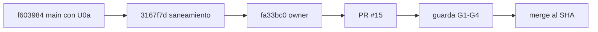

# 211 — E1-U1: saneamiento con alcance cerrado de la guía del sistema documentador

## Índice

1. Definiciones
2. Qué se hizo
3. Criterios de aceptación
4. Ensayo de cierre
5. PR, merge y CI
6. Lecciones de decisión
7. Limpieza

## 1. Definiciones

- **GUIA-DIR**: `Guides/Documentacion-Tecnica/Sistema-De-Documentacion-E-Integracion/` de Lab-Documentos.
- **GUIA**: `GUIA-DIR/Sistema-Documentador-Tecnico-Guide.md`.
- **Alcance cerrado (D02)**: sólo los ítems listados en la ficha de E1-U1 (N10); nada de APA ni reescritura.
- **Defecto plantado**: el enlace `Consola/Ayuda/comun/no-existe.md` de la prueba de concepto; se conserva a propósito.
- **CPA**: `Knowledge-Conformacion-Pull-Request-Automatico` 2.0 (clase P).

## 2. Qué se hizo

Rama `exp0002/e1-u1-saneamiento-guia`, desde `origin/main` f603984 (E1-U0a ya fusionada, PR #11), en un worktree
propio. La primera corrida dejó el commit 3167f7d subido y el PR #15 abierto. Esta reanudación los retomó (no se
duplicaron ni la rama ni el PR) y agregó fa33bc0.

| Archivo | Cambio |
| --- | --- |
| GUIA | 8 enlaces rotos (`../Documentacion-Tecnica/` → `../Creacion-Guias-Tecnicas/`); frontmatter según el corpus (`status: borrador`, `origin: ia-generated`, `confidence: alta`, `audience: [humano, agente]`, `owner: {cuenta-del-PO}`); `DOC-ADR` sin duplicar en `traces`; cita literal de ACT-10; Docusaurus fijado por commit (no `main`) y `@props` en lugar de `@product`; fila de `llms.txt` de «adoptada» a «propuesta publicada, no un estándar» (X5); ítems de R02 §11.2 (recuento de páginas, `translation_of`, 302/401 marcados como no re-medidos); tabla única del contrato de frontmatter en 7.3 (`owner`, `last_review`) |
| `GUIA-DIR/Examples/Lanzar-Example.md` | `$P` y ruta de lanzamiento apuntan a la carpeta real (R02 §11.2) |
| `GUIA-DIR/Examples/Prueba-Ayuda-Por-Rol/README.md` | Recuento (7 fuentes + 2 traducciones = 9) y nota de los dos respaldos de cultura deliberados |
| `README.md`, `Guides/README.md` | Estaban vacíos: ruta de lectura mínima |
| `scripts/docs-guard.lychee.toml` | Se retiran las 7 exclusiones saneadas; quedan con nombre y motivo el defecto plantado y los dos respaldos de cultura de `Web/Ayuda/en/` |
| `CHANGELOG.md` | Entrada de E1-U1 |

## 3. Criterios de aceptación

| # | Criterio | Cumple | Evidencia |
| --- | --- | --- | --- |
| 1 | `lychee --offline` sobre GUIA-DIR, exit 0 | Sí | 24 en total, 20 OK, 0 errores, 4 excluidos (3 con nombre y 1 externo); `evidencia/E1-U1/01-ensayo-de-cierre.txt` |
| 2 | `grep -c "adoptad"` en GUIA = 0 (fila de `llms.txt`) | Sí | 0; la línea 161 dice «propuesta publicada en `llmstxt.org`, no un estándar» |
| 3 | Línea de base 0 en PR-1 y PR-4 sobre GUIA-DIR | Sí | PR-1 (enlaces): 0 errores. PR-4: markdownlint, 15 archivos y 0 errores; mermaid 11.4.1, 6 bloques y 0 inválidos |
| — | Merge CPA (clase P) | Sí | §5 |

## 4. Ensayo de cierre

`scripts/ci-local.sh` en el worktree: verde (exit 0) sobre 3167f7d y otra vez sobre fa33bc0. La salida recortada
está en `evidencia/E1-U1/01-ensayo-de-cierre.txt`. Corrida en el runner: §5.

## 5. PR, merge y CI

- **PR**: https://github.com/hdcm-dev/Lab-Documentos/pull/15 (base `main`, testimonio L2 del PO citado en el cuerpo).
- **Cabeza auditada**: fa33bc0ea928b3888a52915c699586919fdd4bd0.
- **CI en el runner** `[self-hosted, i7infra-dev]`: docs-guard run 40514695217 en éxito; framework-concept-demo run 40514695337 en éxito (`alcance` éxito, `compuerta` y `apk` omitidos por omisión declarada, `fw-ok` en verde). Espera: `fw-ok` estuvo en cola unos 30 min (10:45 → 11:16) por el runner compartido; terminó alrededor de las 11:20. En main no hay workflows de `push`: el SHA de merge no tiene corridas, como se esperaba.
- **Merge**: `ad71e4745fc85b1a5889cc707ddb8f3006ac6ec2` (`PUT …/merge`, `merge_method: merge`, `sha` = cabeza auditada). Última relectura antes del merge: G1 abierto y misma cabeza; G2 `mergeable: true` + `clean`; G3 2 corridas, ambas en éxito; G4 sin reserva.
- **Rama remota**: borrada (DELETE 204) y comprobada (GET 404).

## 6. Lecciones de decisión

- **LD-01 — Retomar en vez de rehacer.** La corrida anterior dejó la rama subida, el PR #15 abierto y la evidencia
  parcial. Se verificó el estado (rama local y remota en el mismo SHA, worktree limpio, PR abierto con esa cabeza) y se
  siguió desde ahí. No se abrió otro PR. Abrir uno nuevo habría dejado dos con la misma cabeza y habría roto la regla
  de no duplicar.
- **LD-02 — `owner` dentro del alcance.** El barrido S2 mostró que el `owner` de GUIA era un nombre corto que además
  coincide con un usuario local, mientras que las otras guías usan el identificador público del autor. Alinearlo entra en
  «frontmatter atípico» (D02), es aditivo y reversible, así que se decidió sin elevarlo. El costo es una corrida más en
  el runner.
- **LD-03 — `blocked` no es rechazo definitivo.** El primer `mergeable_state` fue `blocked` porque `fw-ok` (exigido en
  modo estricto) estaba en cola. Según G2/G3 eso significa «calcula/en curso»: se relee hasta que llega a `clean` o se
  vence el techo de 120 min, y no se declara reserva antes de tiempo.

## 7. Limpieza

- Se retiró el worktree `{dir-de-trabajo}/wt/e1-u1` (`git worktree remove`) y se borró la rama local `exp0002/e1-u1-saneamiento-guia`.
- Se borró el script de sondeo del scratchpad de la sesión. No se crearon contenedores.
- No se tocó el working tree principal de Lab-Documentos: su `main` local sigue en 5d5c2b4 porque hay cambios del PO sin commitear; sólo se hizo `git fetch --prune` (`origin/main` = ad71e47).
- Quedan intactos el worktree `e1-u0b` (es de otra unidad) y la caché de herramientas de `docs-guard`.
