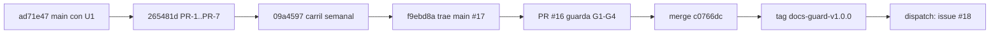

# 212 — E1-U2: docs-guard completo (PR-1 a PR-7), carril programado y etiqueta docs-guard-v1.0.0

## Índice

1. Definiciones
2. Qué se hizo
3. Criterios de aceptación
4. Ensayo de cierre
5. PR, merge y CI
6. Lecciones de decisión
7. Limpieza

## 1. Definiciones

- **docs-guard**: el workflow `.github/workflows/docs-guard.yml` de Lab-Documentos. Es un solo job con un paso por grupo (PR-1 a PR-7, `autoprueba`, `avisos`), cada paso con `continue-on-error`, y un agregador estricto al final (N09 §8.1).
- **Carril programado**: `.github/workflows/docs-enlaces-semanal.yml` más `tools/docs-guard/semanal.sh` (N09 §8.2). Sólo avisa y abre o actualiza un único issue.
- **G-c**: cada control que bloquea tiene un par de fixtures, uno rojo y uno verde.
- **AK-7**: un fixture permanente con inyecciones AI-1 a AI-5. Tiene que dar rojo en cada corrida.
- **CPA**: `Knowledge-Conformacion-Pull-Request-Automatico` (clase P).

## 2. Qué se hizo

La rama `exp0002/e1-u2-docs-guard-completo` salió de `origin/main` ad71e47 (E1-U1 fusionada, PR #15) en un worktree propio. La primera corrida dejó los commits 265481d y 09a4597, el PR #16 abierto y la evidencia 01 a 03. Esta reanudación los retomó: no se duplicaron ni la rama ni el PR. Mientras tanto, main había avanzado con el #17 (medición del TPR) y el PR quedó `behind`. Se trajo main con un merge (f9ebd8a). El único conflicto fue `CHANGELOG.md` y se conservaron las dos entradas.

| Pieza | Contenido |
| --- | --- |
| `.github/workflows/docs-guard.yml` | PR-1 a PR-7, `autoprueba` y `avisos` en un job, con un agregador estricto. `contents: read`, sin `pull_request_target`, actions fijadas por SHA y guarda `if:` contra forks |
| `tools/docs-guard/dg.py` | Controles portados de C-VERIFICACION/herramientas, `agent_channels.py` (AI-1 a AI-5) y `reflint.py`. Usa sólo la biblioteca estándar |
| `tools/docs-guard/fixtures/` | Pares rojo/verde por control y el fixture AK-7 |
| `tools/docs-guard/dominios.txt` | Dominios permitidos (AK-4/C-14) |
| `prefijos.txt`, `excepciones.txt`, `esquemas/`, `arbol.tsv` | Registro de prefijos, excepciones con huella, esquema de frontmatter y tabla repo → ruta |
| `tools/docs-guard/mermaid/` | Parser de mermaid 11.4.1 fijado por lockfile |
| `.github/workflows/docs-enlaces-semanal.yml`, `semanal.sh` | Carril programado: cron semanal, `workflow_dispatch` y `issues: write` sólo para el informe |
| `scripts/ci-local.sh` | Los mismos pasos en el mismo orden; `todo` agrega |

## 3. Criterios de aceptación

| # | Criterio | Cumple | Evidencia |
| --- | --- | --- | --- |
| 1 | Par rojo/verde por cada control que bloquea (G-c) | Sí | El paso `autoprueba` dio 25 casos ok (`evidencia/E1-U2/02-ci-local-base.txt`). El caso 17 del ensayo desactiva AI-1 en el código y la autoprueba da rojo |
| 2 | AI-3 avisa y no bloquea | Sí | Caso 09 del ensayo: rc=0 con el aviso `AI-3 frase-dirigida-al-agente` (`01-ensayo-de-cierre.txt`) |
| 3 | AI-4 sólo avisa en el anexo de referencias | Sí | El par `ai-4/rojo` da rc=1 y `ai-4-anexo/aviso` da rc=0 con aviso (autoprueba) |
| 4 | El fixture AK-7 da rojo en cada corrida | Sí | La autoprueba lo exige en cada corrida. Caso 16: con el fixture desarmado, la autoprueba da rojo |
| 5 | El carril programado corre una vez a mano y abre o actualiza un issue | Sí | Run 40556547619 (`workflow_dispatch` sobre c0766dc) en éxito. Abrió https://github.com/hdcm-dev/Lab-Documentos/issues/18 (`04-runner-y-cierre.txt`) |
| 6 | Medir E-F10 y E-F14 | Sí | E-F10: AI-3 da 0 en la guía y 13 en `Guides/`, todos en 3 archivos que enseñan a armar agentes (`03-carril-semanal-local.md` §6). E-F14: 4 repos y 137 MB; 16,5 s en local y 46,7 s en el runner (`04-runner-y-cierre.txt`) |
| — | Merge CPA (primer merge delegado) y tag `docs-guard-v1.0.0` | Sí | §5 |

## 4. Ensayo de cierre

Se corrió `scripts/ci-local.sh todo` con cada defecto plantado, uno por vez, en una copia del worktree para cada caso: 18 casos. La base y AI-3 dieron verde. Cada uno de los otros dio rojo sólo en su grupo (`evidencia/E1-U2/01-ensayo-de-cierre.txt`). Después de traer main se volvió a correr `todo` sobre f9ebd8a: verde, rc=0. La corrida en el runner está en §5.

## 5. PR, merge y CI

- **PR**: https://github.com/hdcm-dev/Lab-Documentos/pull/16. El cuerpo cita el testimonio L2 del PO del 2026-10-27: es el primer merge delegado de este repo.
- **Cabeza auditada**: f9ebd8a96aa0f461075d01788d6f47a3631d5ff4.
- **CI** en `[self-hosted, i7infra-dev]`: docs-guard 40554387515, docs-enlaces-semanal 40554387636 (en seco, sin tocar issues) y framework-concept-demo 40554387609, las tres en éxito. Hubo cola por el runner compartido de 17:51 a 18:04 UTC.
- **Última relectura**: G1 abierto y con la misma cabeza; G2 `mergeable: true` y `clean`; G3 3 corridas en éxito; G4 sin reserva.
- **Merge**: `c0766dc03fa0fcd3793a5e1185867845465ca3ed` (`merge_method: merge`, `sha` igual a la cabeza auditada).
- **Rama remota**: DELETE y después GET 404. f9ebd8a es alcanzable desde `origin/main`.
- **Etiqueta**: `docs-guard-v1.0.0` → c0766dc. Es una referencia ligera creada por la API.
- **Controles del commit de merge**: el carril programado, por `workflow_dispatch`, terminó en éxito. main no tiene workflows de `push`.
- **Trabajo ajeno en main**: #17 (TPR de Framework Concept), integrado con el merge f9ebd8a.

## 6. Lecciones de decisión

- **LD-01 — Retomar el PR `behind` con un merge, no con rebase.** La rama ya estaba publicada y el PR tenía corridas en verde. Un rebase reescribía SHA ya auditados. El merge de main es aditivo y deja rastro, así que se decidió sin elevarlo. El conflicto, que era sólo del CHANGELOG, se resolvió conservando las dos entradas.
- **LD-02 — Hacer el dispatch después del merge.** GitHub sólo permite `workflow_dispatch` de un workflow que ya está en la rama por defecto. Por eso el criterio 5 se cumple después del merge, y el PR lo declaró de antemano. Mientras el PR estuvo abierto, el carril corrió en seco con el evento `pull_request`.
- **LD-03 — Etiqueta ligera por la API.** No hay `gh`, y el working tree principal no se toca. Por eso la etiqueta se creó por `POST /git/refs` sobre el commit de merge. Es reversible: se puede reemplazar por una anotada sin cambiar el SHA.
- **LD-04 — La main local del PO no se actualiza.** El checkout principal tiene cambios del PO y quedó en 5d5c2b4. La verificación de alcanzabilidad se hizo con `fetch` y `origin/main`. Hacer `git switch main && pull` ahí habría tocado su trabajo.
- **LD-05 — Observación para una unidad próxima.** El informe del carril se corta en 60 000 bytes con `head -c` (el issue #18 quedó en 59 990). El corte puede dejar abierto un `
` y perder el pie con el enlace a la corrida. El arreglo es aditivo: cortar por línea y cerrar el bloque. No bloquea el criterio 5 y queda como deuda conocida del carril.

## 7. Limpieza

- Se retiró el worktree `{dir-de-trabajo}/wt/e1-u2` y se borraron la rama local y la remota (404).
- Se borraron los intermedios de esta unidad en `{dir-de-trabajo}/`: `u2/`, `u2-*`, `cache-u2/` y `u2-todo*.txt`. Los de U1 (`cache-u1`, `u1-*`, `pr.json`, `e1u1-edit.py`) y los compartidos (`cache`, `tools`, `mmd`) no se tocaron.
- No se crearon contenedores. El working tree principal de Lab-Documentos no se tocó.
