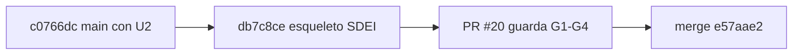

# 214 — E1-U4a: esqueleto del cuerpo documental SDEI (README, Marco, Mapa y anexos)

## Índice

1. Definiciones
2. Qué se hizo
3. Criterios de aceptación
4. Ensayo de cierre
5. PR, merge y CI
6. Lecciones de decisión
7. Limpieza

## 1. Definiciones

- **GUIA-DIR**: `/LAB/Lab-Documentos/Lab-Documentos/Guides/Documentacion-Tecnica/Sistema-De-Documentacion-E-Integracion/` (N10 §2).
- **Cuerpo nuevo**: carpeta con un `README.md` que declara `corpus_id`. Ahí `docs-guard` exige frontmatter en todo archivo que no sea README y `reflint` bloquea.
- **P-LECT parcial**: prueba de lectura de README, Marco y Mapa por un lector sin contexto que no ve los anexos.
- **CPA**: `Knowledge-Conformacion-Pull-Request-Automatico`.

## 2. Qué se hizo

**Reanudación.** Una corrida anterior había dejado el worktree `{dir-de-trabajo}/wt/e1-u4a` y la rama local en c0766dc, sin commits, sin rama remota, sin PR y sin folio. Se retomaron ese worktree y esa rama (`reset` a `origin/main` c0766dc, que no tenía cambios propios). No se duplicó nada.

| Pieza (en GUIA-DIR) | `doc_id` | Contenido |
| --- | --- | --- |
| `README.md` | `IDX-SDEI` | `corpus_id: SDEI`, `version: 2.0.0-borrador`, los diez campos y `description`. Objetivos `OBJ-SDEI-01..05` (default de L6). Las tres rutas de D27, con diagrama. Tabla de contenido completa: lo existente, los temas y la mini demo marcados «en redacción», y la ruta provisional con la correspondencia GUIA → TEM de D27 |
| `00-Marco.md` | `MARCO-SDEI` | Definiciones. Escenarios `ESC-SDEI-1..4` = V1–V4 de N09 §6 (declarados como encabezados, así entran al registro de IDs). Contextos `CTX-SDEI-1..4`, actores `ACT-SDEI-1..6`, convenciones y un caso que recorre el marco (RN-LOC-01, 60/80) |
| `01-Mapa.md` | `MAPA-SDEI` | «Estoy acá → qué aplico» por escenario, por contexto (con dos filas para «el código cambió»), por artefacto (catálogo CL-01..14 de N09 §5) y por actor. Índice de los 8 anexos |
| `99-Anexos/Esquema-Frontmatter-Y-Prefijos.md` | `ANX-SDEI-ESQUEMA` | CR-4: diez campos más `description`, README y ayuda, trazas de dos niveles, registro de prefijos, forma del RRD, ejemplo con sus errores, fuente de verdad (`esquemas/`, `prefijos.txt`) |
| `99-Anexos/Glosario.md` | `ANX-SDEI-GLOSARIO` | Siglas (PR-n, AI-n, AK-n, G1–G4, CQ/PE/VER, CL) y términos, con alias y dónde se ancla cada uno |
| `99-Anexos/Referencias.md` | `ANX-SDEI-REFERENCIAS` | 31 entradas APA 7 con ancla `ref-…`, fecha de consulta y estado V/P (D28). Las fechas son las de las bitácoras I01–I07; no se reconsultó |
| `99-Anexos/Criterios-De-Calidad.md` | `ANX-SDEI-CQ` | CQ-01..14 (I05 §7), con qué control de `docs-guard` automatiza CQ-03, 05, 11, 13 y 14 |
| `99-Anexos/Patrones-De-Ejemplos.md` | `ANX-SDEI-PE` | PE-01..12 (I05 §9) y las marcas de procedencia |
| `99-Anexos/Lista-De-Verificacion.md` | `ANX-SDEI-VER` | Los ítems VER-* de R07 §5 que se aplican a una guía (E, G, T, M, D, H, A, V, W06, W09, I04, I06), con la compuerta que ya los verifica |
| `99-Anexos/Como-Decidir.md` | `ANX-SDEI-DECIDIR` | K1–K7 y su escala anclada (080 §4.1–§4.3), pesos, filtros F1–F8 y regla de firmeza (015 §7). Matriz trabajada de D27 con sensibilidad recalculada: margen mínimo 1,48 con ±10 %. Cierra con «quién decide» (D/P/H, decisión consecuente, lo irreversible al PO) |
| `99-Anexos/Ejercicios.md` | `ANX-SDEI-EJERCICIOS` | `EJR-SDEI-01..05`, uno por objetivo, con ejemplo trabajado previo y claves (L6, folio 131) |

Fuera de GUIA-DIR: `tools/docs-guard/prefijos.txt` registra `GP` (guía práctica de un ejemplo). `Examples/Lanzar-Example.md` suma frontmatter (`GP-SDEI-LANZAR`) sin cambiar el texto. `CHANGELOG.md` suma la entrada.

## 3. Criterios de aceptación

| # | Criterio | Cumple | Evidencia |
| --- | --- | --- | --- |
| 1 | `docs-guard` verde | Sí | Local: `todo` verde, 8/8 grupos y 25 casos de autoprueba ok (`evidencia/E1-U4a/01-ensayo-de-cierre.txt`). Runner: docs-guard 40567848891 en éxito sobre db7c8ce, job en `i7infra-runner-dev` con etiquetas `self-hosted,i7infra-dev` |
| 2 | Todo documento con los diez campos más `description` | Sí | PR-2: 25 archivos con frontmatter, 0 errores. Chequeo campo por campo: 12/12 documentos nuevos o tocados con los diez campos, `confidence` y `description` |
| 3 | README con tabla de contenido completa y rutas (VER-G07) | Sí | README §3 (tres rutas, diagrama y tabla) y §4 (todo archivo de la carpeta, más los temas y la mini demo en redacción) |
| 4 | Cada anexo enlazado desde el Mapa | Sí | Los 8 anexos aparecen en `01-Mapa.md`, de 2 a 6 enlaces cada uno, y §6 los lista todos |
| — | Merge CPA | Sí | §5 |

## 4. Ensayo de cierre

- **`scripts/ci-local.sh todo`** sobre db7c8ce dio verde, rc=0. Lychee: 233 enlaces, 201 OK y 0 errores. Mermaid: 14 bloques, 0 inválidos. Trazas: 55, con 46 resueltas y 9 avisos heredados de la PoC de ayuda por rol (CU sin `source.lock`, igual que antes de esta unidad). `reflint`: 31 referencias, 0 errores. AI-4: 25 avisos, todos en el anexo de referencias, donde sólo avisa.
- **Defectos plantados** en el cuerpo nuevo, uno por vez y revertidos, todos en rojo:
  - una ancla rota en el Marco, en PR-1;
  - la `description` borrada, en PR-2;
  - el año borrado de `ref-merrill-2002`, en PR-7 `reflint`.
- **P-LECT parcial**, en tres rondas. El lector fue una sesión nueva de Claude Code en modo no interactivo, sin herramientas, que recibió sólo el texto de README, Marco y Mapa.

  | Ronda | Dudas de gravedad alta | Dudas que el lector declaró sin respuesta |
  | --- | --- | --- |
  | 1 | 9 | 65 de 71 |
  | 2 | 6 | 62 de 74 |
  | 3 | 4 | 68 de 80 |

  Después de cada ronda se corrigieron las dudas altas, y también las cuatro de la ronda 3. Quedan dudas medias y bajas: en su mayoría las responden el Glosario y el Esquema, que el lector no veía, o son propias de los temas en redacción (`evidencia/E1-U4a/02` a `05`). El umbral de cero dudas rige para G-e en E1-G, no para esta unidad. **No se cumple todavía sobre los tres documentos solos**, y lo hereda la P-LECT de la compuerta.

## 5. PR, merge y CI

- **PR**: https://github.com/hdcm-dev/Lab-Documentos/pull/20. El cuerpo lleva el informe, el ensayo y el testimonio L2 del PO.
- **Cabeza auditada**: db7c8ce5c182f85d6f82a6d446cc2981c56e5d9e.
- **CI** en `[self-hosted, i7infra-dev]`: docs-guard 40567848891 y framework-concept-demo 40567848791, las dos en éxito. Hubo cola por el runner compartido de 19:18 a 19:29 UTC; el job de docs-guard tardó 1 min 41 s.
- **Guarda**: techo 120 min e intervalo 30 s, según la delegación del CHANGELOG. Pasó a las 16:34:43 (-03:00). G1: abierto y con la misma cabeza. G2: `mergeable: true` y `clean`. G3: 2 corridas en éxito. G4: sin reserva.
- **Merge**: `e57aae24e579187aebf078b647718b4041582a7a` (`merge_method: merge`, `sha` atado a db7c8ce). **Lo fusionó el agente.**
- **Rama remota**: DELETE 204 y después GET 404. db7c8ce es alcanzable desde `origin/main`.
- **Controles del commit de merge**: ninguno. main no tiene workflows de `push` en este repositorio, igual que en E1-U2.
- **Trabajo ajeno en main**: ninguno entre c0766dc y el merge.

## 6. Lecciones de decisión

- **LD-01 — Identificadores calificados con el `corpus_id`.** El registro de IDs de `traces-resolve` es único para todo el repositorio. Ya hay 112 encabezados `ESC-1`…`ESC-4`, varios `CTX-n` y `ACT-nn`, y `MARCO-*`/`MAPA-CONCEPTUAL` en otras guías. Con IDs cortos, una traza a `ESC-1` sería ambigua (rojo). Se decidió `ESC-SDEI-n`, `ANX-SDEI-*`, etc., sin elevarlo: es aditivo y reversible. Quedó declarado como **[criterio propio]** en el anexo del esquema §5.
- **LD-02 — Prefijo nuevo `GP` en lugar de forzar uno existente.** `Lanzar-Example.md` entra al cuerpo nuevo y necesita frontmatter. No es ejercicio (`EJR`), ni anexo (`ANX`), ni tema. El registro admite prefijos por PR (clase P), así que se agregó `GP` (guía práctica de un ejemplo), que también usará E1-U4d para sus guías prácticas.
- **LD-03 — Tocar `Lanzar-Example.md` pese a la modificación local del PO.** El cambio local del PO (la ruta de invocación) ya está en `origin/main` desde E1-U1, así que no compite con esta unidad. El frontmatter se agrega arriba sin tocar el texto, y el working tree principal no se tocó.
- **LD-04 — CL-03 activa en el escenario «corpus de guías».** N09 §6 (V1) no la lista, pero E1-U4e agrega `AGENTS.md` en Lab-Documentos y la ruta «agente» de D27 parte de él. La contradicción entre fuentes se resolvió a favor de lo que el plan construye. Es reversible y se señala acá (VER-E09).
- **LD-05 — Fechas de consulta transcriptas.** D28 exige fecha en toda fuente web. El anexo usa la de las bitácoras (2026-10-26) y declara en su §1 que no se reconsultó. Volver a consultarlas requiere red y queda para E1-U4f (piloto APA), que es donde D28 cierra.
- **LD-06 — P-LECT con un lector efímero sin herramientas.** No hay herramienta de subagentes en este despacho. Una sesión `claude -p` sin herramientas que recibe sólo el texto cumple «lector sin contexto». Sobrestima las dudas, porque no ve los anexos. Para la G-e de E1-G conviene darle la ruta completa (README → anexos).
- **LD-07 — Efecto del `corpus_id` sobre las unidades paralelas.** Desde este merge, todo `.md` bajo GUIA-DIR exige frontmatter con los diez campos, y `reflint` bloquea. E1-U3 (mini demo en `Examples/`) tiene que traer frontmatter en todos sus `.md` que no sean README, y va a encontrar un conflicto en `CHANGELOG.md`, que se resuelve conservando las dos entradas.

## 7. Limpieza

- Se retiró el worktree `{dir-de-trabajo}/wt/e1-u4a` y se borraron la rama local y la remota (404).
- Se borraron los intermedios de esta unidad en `{dir-de-trabajo}/`: la caché `cache-dg`, las salidas `u4a-ci*.txt` y `u4a-neg*.txt`, `marco.bak`, las entradas y salidas de P-LECT (`plect-in*`, `plect-out*`, `plect-err*`, `plect3.done`), `u4a-body.md`, `u4a-guard.sh` y `u4a-guard.log`. No se tocaron los de otras unidades (`cache`, `cache-u1`, `cache-u3`, `u3/`, `plect/`, `tools`, `mmd`, `u1-*`, `pr.json`, `wt/e1-u3`).
- Se creó la evidencia en `evidencia/E1-U4a/` (01 a 05), sin rutas del host.
- No se crearon contenedores. El working tree principal de Lab-Documentos no se tocó.
