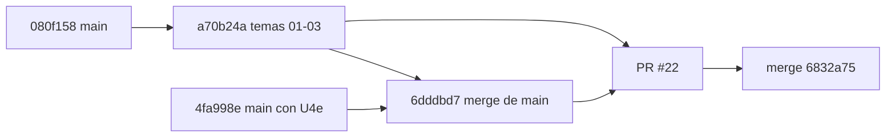

# 218 — E1-U4b: temas 01 a 03 del cuerpo SDEI

## Índice

1. Definiciones
2. Qué se hizo
3. Criterios de aceptación
4. Ensayo de cierre
5. PR, merge y CI
6. Lecciones de decisión
7. Hallazgos para la presidencia
8. Limpieza

## 1. Definiciones

- **GUIA-DIR**: `/LAB/Lab-Documentos/Lab-Documentos/Guides/Documentacion-Tecnica/Sistema-De-Documentacion-E-Integracion/` (N10 §2).
- **Seis encabezados del Profile**: Definición, Aplicación por escenario, Ejemplos concretos, Preguntas guía, Criterios de calidad y Anexo (Profile Study-Guide-Documentation, «Estructura de cada documento temático»).
- **Adopción pública**: un repositorio público donde la práctica está materializada en una ruta concreta, con un commit que la toca dentro de los 24 meses anteriores a la fecha de corte (umbral de P-5, `129` §4.3, **[criterio propio]** del plan).
- **P-LECT del tema**: prueba de lectura de un tema por un lector sin contexto que sólo recibe el texto de ese tema.
- **CPA**: `Knowledge-Conformacion-Pull-Request-Automatico`.

## 2. Qué se hizo

**Reanudación.** No había nada de una corrida anterior: ni worktree en `{dir-de-trabajo}/wt/e1-u4b`, ni rama local o remota `exp0002/e1-u4b*`, ni PR, ni folio. Se partió de `origin/main` `080f158`, que ya contenía E1-U4a (`e57aae2`) y E1-U3.

| Pieza (en GUIA-DIR) | `doc_id` | Fuente N09 | Contenido |
| --- | --- | --- | --- |
| `TEM-01-Sistema-Documentador.md` | `TEM-SDEI-01` | §3 | Definición, arquitectura de referencia (mermaid y componentes) y catálogo breve CL-01..14. Los cuatro escenarios y contextos. El portal de OneSignal leído con el tema. Adopciones P1–P3. Inventario por comando. El caso 60/80 de punta a punta, con la cadena de fuentes y la divergencia H. Plantilla de inventario |
| `TEM-02-Ciclo-Documental.md` | `TEM-SDEI-02` | §4, §7 | Fases 1a–5 y 5m, con entradas, salidas, actores, D/P/H y controles, y la regla de retorno a 1a o a 4. RRD, estados (con la regla de deriva de un documento vigente **[criterio propio]**), cláusulas, «clara» e «integración». La fila RD-01 de la mini demo por fases y la delegación. Plantilla de RRD y de cláusula |
| `TEM-03-Topologia-Y-Versionado.md` | `TEM-SDEI-03` | §5, §7 | Cuatro topologías y cuatro anclas, con dónde se escribe cada una y cuándo usar SHA o etiqueta. SemVer y CHANGELOG, trazas y unicidad del registro, la regla del mismo pull request (mermaid). El `source.lock` real y las adopciones P4–P6. Ensayo de traza desfasada e ID ambiguo. El caso Lab-Geometria. Plantilla de topología y ancla |

Fuera de los temas:

- `99-Anexos/Referencias.md` §7: 4 fuentes primarias nuevas (SemVer, Keep a Changelog, Diátaxis, GivenWhenThen) y 12 repositorios citados por commit. Todas fueron consultadas el 2026-10-27.
- `README.md`: las tres filas de la tabla de contenido.
- `01-Mapa.md`: el pie enlaza el tema 01.
- `CHANGELOG.md`: la entrada nueva.

Las fuentes ya existentes que se citan se releyeron el 2026-10-27, en página o en resumen: Winters et al. (2020), Backstage, Docusaurus, GitLab, ISO 26514, Böckeler (2025), Aghajani et al. (2019 y 2020), Tan et al. (2024), Bhat et al. (2026) y Yamasaki et al. (2026). Al releerlas se corrigió una afirmación del borrador que el resumen de Aghajani et al. (2019) no sostenía.

## 3. Criterios de aceptación

| # | Criterio | Cumple | Evidencia |
| --- | --- | --- | --- |
| 1 | Seis encabezados del Profile, idénticos (VER-T01..T07) | Sí | `evidencia/E1-U4b/05-salida.txt`: los tres temas tienen los seis en orden y con el mismo nombre. En `06-defectos-plantados.txt`, un encabezado renombrado da rojo |
| 2 | Enlace al anterior y al siguiente (VER-G08) | Sí, con salvedad | TEM-01 ← Mapa (el pie del Mapa ahora apunta a TEM-01) y → TEM-02; TEM-02 ↔ TEM-01 y TEM-03; TEM-03 ← TEM-02. El siguiente de TEM-03 es TEM-04, que todavía no existe (E1-U4c), así que nombra «Tema 04, en redacción» y enlaza las secciones de la guía de un solo archivo que lo cubren. PR-1 resuelve todos los enlaces |
| 3 | APA con fecha de consulta y ancla `ref-…` | Sí | PR-7 `reflint`: 47 referencias, 0 errores. Chequeo 05: 0 citas sin ancla. Una cita plantada a `ref-fowler-2031` da rojo en PR-1 |
| 4 | `docs-guard` verde | Sí | Local sobre `6dddbd7` (`00-ensayo-de-cierre.txt`) y runner (§5) |
| 6 | ≥ 3 fuentes primarias con fecha y ≥ 1 ensayo reproducible por tema; en TEM-01 y TEM-03, ≥ 2 adopciones públicas ≤ 24 meses por práctica | Sí | Fuentes citadas por tema: 14, 6 y 11. Ensayos con comando y salida: `01` (TEM-01), `02` (TEM-02), `03` (TEM-03) y `04` (adopciones, TEM-01 y TEM-03). Adopciones: P1 con 3, P2 con 2, P3 con 3, P4 con 2, P5 con 2 y P6 con 2. La más vieja es de 2026-01-26; la ventana empieza el 2024-10-27 |
| — | Merge CPA (pasar a vigente es PR aparte) | Sí | §5. Los tres temas quedan en `status: borrador` |

## 4. Ensayo de cierre

**`scripts/ci-local.sh todo`.** Dio verde y rc=0 sobre `a70b24a` y otra vez sobre `6dddbd7`, después de integrar main.

| Grupo | Resultado sobre `6dddbd7` |
| --- | --- |
| PR-1 | lychee: 430 enlaces, 382 OK y 0 errores |
| PR-2 | 35 archivos con frontmatter, 0 errores |
| PR-3 | AI-4 con 26 avisos, todos en el anexo de referencias |
| PR-4 | Mermaid: 22 bloques, 0 inválidos |
| PR-5 | 90 trazas y 81 resueltas; los 9 avisos son heredados de la PoC de ayuda por rol |
| PR-7 | `reflint`: 47 referencias |
| Autoprueba | Verde |

**Defectos plantados.** Se plantaron uno por vez y se revirtieron (`06`). Los tres dieron rojo:

- una cita a un ancla inexistente, en PR-1;
- una traza a `TEM-SDEI-09`, en PR-5;
- un encabezado renombrado, en el chequeo 05.

**P-LECT del tema.** El lector fue una sesión nueva de Claude Code, no interactiva y sin herramientas. Recibió una consigna fija y sólo el texto del tema (`07-plect-*`).

| Ronda | TEM-SDEI-01 (total / altas) | TEM-SDEI-02 | TEM-SDEI-03 |
| --- | --- | --- | --- |
| 1 | 32 / 2 | 25 / 5 | 23 / 4 |
| 2 | 24 / 1 | 31 / 2 | 29 / 1 |
| 3 | 23 / 1 | 31 / 3 | 27 / 2 |

En cada ronda se corrigieron todas las dudas altas, también las 6 de la ronda 3, sin hacer una cuarta ronda. Las altas no bajan a cero: cada ronda encuentra dudas nuevas, la mayoría sobre vocabulario que el Marco y el Glosario definen y que el lector no veía. **El umbral de cero dudas no se cumple sobre los temas leídos solos.** Lo hereda la P-LECT de G-e en E1-G, igual que en E1-U4a.

## 5. PR, merge y CI

- **PR**: https://github.com/hdcm-dev/Lab-Documentos/pull/22. El cuerpo lleva el informe, el ensayo, la convención para las unidades paralelas, el hallazgo H-1 y el testimonio L2 del PO. Dos comentarios: la cabeza nueva y el cierre del ciclo.
- **Primera cabeza**: `a70b24a`. Al abrir el PR, el estado era `dirty`, porque E1-U4e (#21, `4fa998e`) se había fusionado mientras tanto y había conflicto en `CHANGELOG.md`. Se detuvo la guarda, se integró `origin/main` conservando las dos entradas, se volvió a correr `ci-local.sh` (verde) y la guarda se reinició.
- **Cabeza auditada**: `6dddbd7d933d0b709bed5162c55bd61a4c360bb3`.
- **CI** en `[self-hosted, i7infra-dev]`, ejecutada en `i7infra-runner-dev`:
  - docs-guard 40585466886, en éxito: de 21:17:09 a 21:18:59 UTC;
  - framework-concept-demo 40585466891, en éxito: hasta 21:27:09 UTC.
- **Guarda**: techo de 120 min e intervalo de 30 s, según la delegación del CHANGELOG. Pasó a las 18:27:22 (-03:00). Antes del merge se hizo una última relectura:
  - G1: abierto y con la misma cabeza;
  - G2: `mergeable: true` y `clean`;
  - G3: 2 corridas, todas en éxito;
  - G4: sin reserva.
- **Merge**: `6832a752ddbf7aaaaa555c200a9763588d8fc5ef` (`merge_method: merge`, `sha` atado a `6dddbd7`). **Lo fusionó el agente.**
- **Rama remota**: DELETE 204 y después GET 404. `6dddbd7` es alcanzable desde `origin/main`.
- **Controles del commit de merge**: 0 corridas. main no tiene workflows de `push`, igual que en E1-U2 y E1-U4a.
- **Trabajo ajeno en main**: E1-U4e, integrado antes del merge. El working tree principal de Lab-Documentos no se tocó, porque tiene cambios ajenos; sólo se hizo `git fetch --prune`.

## 6. Lecciones de decisión

- **LD-01 — `TEM-SDEI-nn` en lugar de `TEM-nn`.** `Concepts/Framework-Concept/` ya declara `TEM-01` a `TEM-08` como `doc_id`. Con el registro de IDs único por repositorio, `TEM-01` sería una traza ambigua (el caso 3 del ensayo 03 lo muestra). Se siguió LD-01 de E1-U4a sin elevarlo: es aditivo y reversible. El README y el Mapa siguen nombrando «TEM-01» como etiqueta de lectura.
- **LD-02 — Encabezados H2 sin número.** Así las anclas (`#definición`, `#preguntas-guía`) son las mismas en todos los temas, cualquiera sea el número de secciones extra (VER-T07, VER-A03). Antes va `Índice` y después `Fuentes y observaciones` (VER-E07). Se avisó en el PR a E1-U4c y E1-U4d.
- **LD-03 — La adopción se mide con un commit de la ruta que materializa la práctica.** Tener una página que diga «usamos X» no alcanza: lo que se pide es una consulta reproducible y con fecha (API pública de GitHub y `git ls-remote`), citada por commit como pide D28. El ensayo 04 la repite con una fecha de corte como argumento. Prueba presencia y actividad, no efectividad, y así lo dicen los temas.
- **LD-04 — Tocar README, Mapa, Referencias y CHANGELOG pese al paralelo P-C.** N10 §4 dice que las unidades P-C sólo comparten el README, «que ya cerró E1-U4a». Pero sin las filas de la tabla de contenido y sin el pie del Mapa, VER-G07 y VER-G08 quedarían incumplidos. Se tocaron sólo las tres filas propias y el pie. El riesgo de conflicto se aceptó y se avisó; es aditivo. El CHANGELOG tuvo conflicto con E1-U4e y se resolvió conservando las dos entradas.
- **LD-05 — El siguiente de TEM-03 sin enlace a TEM-04.** Un enlace a un archivo que no existe pone PR-1 en rojo. Se nombró el tema y se enlazó la guía de un solo archivo, que es la ruta provisional del README. Lo cierra quien fusione E1-U4c.
- **LD-06 — Regla de deriva de un documento vigente [criterio propio].** Si una corrección no cambia lo que el documento promete, el documento sigue `vigente`. Si cambia alcance o requerimiento, vuelve a `borrador`. Ni N09 ni las decisiones lo fijaban, y lo pidió la P-LECT (TEM-02, ronda 3). Es reversible y queda rotulado.
- **LD-07 — No corregir `dg.py` por `traces: []`.** Ver §7. Tocar la herramienta de la compuerta etiquetada (`docs-guard-v1.0.0`) desde una unidad de temas excede la ficha. Se documentó la discrepancia en TEM-03 y los ensayos usan trazas no vacías.
- **LD-08 — Integrar main en la rama, no rebase.** La cabeza `a70b24a` ya estaba publicada en el PR. Un merge de `origin/main` conserva lo auditado y deja el conflicto visible. La guarda se reinició sobre la cabeza nueva, como pide G1.

## 7. Hallazgos para la presidencia

- **H-1 (docs-guard).** `tools/docs-guard/dg.py`, en `validar`, trata `[]` como campo faltante (`valor.get(r) in (None, '', [])`). Pero `cuerpo.schema.json` no pone `minItems` en `traces`, y el anexo del esquema dice «Sí (puede ser `[]`)». Hoy una página sin dependencias no puede declararse. Se corrige en la herramienta (por ejemplo, sacar `[]` de la condición) o en el anexo; según el anexo §8, «manda el archivo», pero el archivo es el esquema JSON y no `dg.py`. Es aditivo y reversible y le corresponde a la unidad que mantenga docs-guard.
- **H-2 (P-LECT).** Un lector sin herramientas y sin el Marco produce entre 1 y 3 dudas altas nuevas por ronda en temas de este tamaño. Para G-e conviene que el lector reciba la ruta completa (README → Marco → Mapa → tema → Glosario), como ya sugirió LD-06 de E1-U4a.

## 8. Limpieza

**Lo que se borró:**

- el worktree `{dir-de-trabajo}/wt/e1-u4b` (`git worktree remove`);
- la rama local y la remota (404);
- `{dir-de-trabajo}/u4b/`, con los archivos de credencial (`auth.curl`, `askpass.sh`, modo 600/700, creados con `git credential fill` y nunca impresos), las salidas `ci1..3.txt`, `neg.txt`, `t2.bak`, `body.md`, `guard.sh`, `guard.log` y `plect/`;
- la caché `{dir-de-trabajo}/cache-dg`, que había creado esta unidad.

**Lo que no se tocó:** los intermedios de otras unidades (`cache`, `cache-u1`, `cache-u4d`, `u4c`, `u4d*`, `wt/e1-u4c`, `wt/e1-u4d`, entre otros).

**Lo que se modificó:** se agregó una nota al archivo compartido `{dir-de-trabajo}/convencion-temas-sdei.txt`. Dice que E1-U4b está en main con H2 sin número y cómo es su pie de navegación, para que E1-U4c y E1-U4d se alineen según la regla que ellas mismas fijaron allí.

**Lo que se creó:** la evidencia en `evidencia/E1-U4b/`, sin rutas del host:

- `00-ensayo-de-cierre.txt`;
- los ensayos `01` a `04`, con su `.sh` y su salida;
- el chequeo `05`;
- `06-defectos-plantados.txt`;
- las nueve rondas de P-LECT `07-plect-r*-tem*.md` y su `07-plect-resumen.md`.

No se crearon contenedores.
