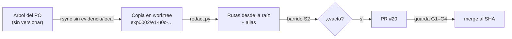

# 230 — E1-U0c: versionar el expediente 0002 y las bitácoras en Lab-Documentos.Documentacion

## Índice

1. Definiciones
2. Qué se hizo
3. Criterios de aceptación
4. Ensayo de cierre
5. PR, merge y CI
6. Lecciones de decisión
7. Limpieza
8. Pase

## 1. Definiciones

- **Árbol a agregar**: `PROMPTs/DEVs/Enchacement/01-Replanteo-Y-Analisis/OUTPUTs/` (`Bitacoras/` y `Expedientes/0002-…/`),
  sin `evidencia/local/`.
- **Barrido S2**: `grep -rnIiE` con el patrón del folio 099 §11 (directorio personal del host, usuario, servicio
  privado y su organización), extendido por la carta común a repos privados citados, runner de la organización privada
  e IPv4 privadas/CGNAT.
- **Alias de publicación**: marcadores que reemplazan en la copia versionada lo que no se publica. Tabla en el
  `README.md` del expediente (versión publicada).
- **CPA**: `Knowledge-Conformacion-Pull-Request-Automatico` 2.0.

## 2. Qué se hizo

1. **Reanudación**: no había worktree, rama local/remota, PR ni folio de E1-U0c. Se empezó desde cero.
2. Worktree propio desde `origin/main` (`34bdd44`, con E1-U0b fusionada) en `{dir-de-trabajo}/wt/e1-u0c`, rama
   `exp0002/e1-u0c-expediente-y-bitacoras`. El working tree principal del PO no se tocó (sigue en `main` local
   `8da0cd9`, con sus cambios).
3. Copia del árbol a agregar con `rsync`, excluyendo `evidencia/local/`. El `.gitignore` del expediente ya excluye
   `evidencia/local/` y capturas (`png`, `jpg`, `ndjson`, `mp4`, `apk`).
4. Reemplazos sobre la copia (script en `evidencia/E1-U0c/02-redact.py`, copia redactada): 99 rutas del workspace del
   equipo a rutas desde la raíz (`/LAB/…`, `/IA/…`, `/PROG2/…`); 14 de la carpeta de intermedios a `{dir-de-trabajo}`;
   2 de la memoria del agente; 146 menciones de la base de conocimientos privada a `KB-privada`; 3 del repo privado de
   runners a `INFRA-privada`; cuenta y usuario; en la cita literal L10 del folio 130, el servicio y la organización entre
   corchetes; la organización, el contenedor y la etiqueta del runner del SDD-B a alias (9 + 2 + 2). Un último resto
   (`C00:195`, ruta del host abreviada) se pasó a `/home/<usuario>/…`.
5. Se agregó al `README.md` del expediente (en la copia) la tabla de alias de la versión publicada.
6. Un solo commit (`cc2bfd6`, 178 archivos), push, PR #20 y conformación CPA.

## 3. Criterios de aceptación

| # | Criterio | ¿Cumple? | Evidencia |
| --- | --- | --- | --- |
| 1 | Barrido S2 vacío sobre todo lo agregado | **Sí** | `evidencia/E1-U0c/01-barrido-s2.txt`: patrón A con 3 falsos positivos explicados (URL pública de kubernetes.io `docs/home/`, API pública de GitHub `/users/<autor>` por `-i`, el 099 citando su propio patrón); patrón B `exit 1 / 1` (vacío) |
| 2 | `evidencia/local/` fuera del índice | **Sí** | `git ls-files <EXP>/evidencia/local \| wc -l` = `0` (última línea de la evidencia) |
| 3 | `verificar` verde | **Sí** | Run 40526214446 (`Verificar`, `pull_request`): jobs `verificar` y `docs-guard / docs-guard` en éxito, en `i7infra-runner-dev` |

## 4. Ensayo de cierre

Barrido S2 con el patrón del folio 099 §11 sobre el árbol a agregar, ya reemplazado. Salida recortada en
`evidencia/E1-U0c/01-barrido-s2.txt` (el usuario del host aparece como `<usuario>`). Resultado: **vacío**.

## 5. PR, merge y CI

| Campo | Valor |
| --- | --- |
| PR | https://github.com/hdcm-dev/Lab-Documentos.Documentacion/pull/20 |
| Cabeza auditada | `cc2bfd6f3a8c3f9d3b6749808db3d1eb7c7a26fe` |
| Base | `main` `34bdd44` |
| Delegación citada | `CHANGELOG.md`, «Delegación del merge» (E1-U0b, 2026-10-27, PO, testimonio L2) |
| CI de la cabeza | 1 corrida (40526214446) en éxito; G1 a G4 releídos justo antes del merge: abierto, misma cabeza, `mergeable` true y `clean`, sin reserva |
| Merge | Merge commit `60d94f3c3aea84205f0a0ae3e50d6b8211aacae4`, atado al SHA auditado; `cc2bfd6` alcanzable desde `origin/main` |
| Rama remota | Borrada; `GET git/ref/heads/…` → 404 |
| CI del commit de merge | 0 corridas: `verificar.yml` sólo se dispara por `pull_request` y `workflow_dispatch` (no por `push`); no hay controles que leer |

## 6. Lecciones de decisión

- **LD-01 — Repos privados también se aliasan.** El criterio de N10 nombra cuatro categorías (ruta, usuario, servicio,
  organización), pero la carta común pide barrer también los nombres de repos privados. Se consultó la API: la base de
  conocimientos y el repo de runners son **privados**; `IA.Prompts` e `IA.SDD` son públicos. Se aliasaron sólo los
  privados (`KB-privada`, `INFRA-privada`). Es aditivo y reversible; no se elevó.
- **LD-02 — La cita literal del PO se redacta entre corchetes.** L10 (folio 130) nombraba el servicio y su
  organización. Se reemplazaron dentro de la cita por `[SDD-B]` y `[organización del SDD-B]`, y la etiqueta del runner
  por `{runner-del-SDD-B}`; el plan versionado (N10, E3-U4) lleva el alias. Quien ejecute E3 lee el valor real en la
  copia local, que no se modificó.
- **LD-03 — Alias sin corchetes angulares.** En texto fuera de código, `<x>` lo traga el render de Markdown y los
  rótulos de mermaid. Se usaron `{x}` y `KB-privada`, y se documentaron en el README del expediente.
- **LD-04 — Falsos positivos del patrón de 099 §11.** `-i` hace que `/Users/` atrape `/users/` de la API pública de
  GitHub, y `(/|-)home/` atrapa `docs/home/` de una URL pública. Se dejó constancia con un patrón B que sólo descarta
  esas citas públicas; conviene que E1-U2 tome `/Users/` sensible a mayúsculas.
- **LD-05 — Copia publicada y árbol de trabajo divergen.** El árbol del PO no se toca (carta). Consecuencia: al
  actualizar su `main`, git rechazará sobrescribir los archivos sin versionar de `OUTPUTs/`. El PO o la presidencia
  deben mover o borrar la copia local antes del `pull`; los folios posteriores a este commit (este incluido) se
  versionan en una resincronización con el mismo `redact.py`.
- **LD-06 — El folio no va en el PR.** Lleva el SHA del merge, que no se conoce antes. Queda en el árbol de trabajo
  para la resincronización (LD-05).

## 7. Limpieza

| Qué | Dónde | Estado |
| --- | --- | --- |
| Worktree | `{dir-de-trabajo}/wt/e1-u0c` | Retirado (`git worktree remove`) |
| Rama local y remota | `exp0002/e1-u0c-expediente-y-bitacoras` | Borradas (local `git branch -D`, remota 404) |
| Intermedios (`redact.py`, `guard.sh`, `guard.log`, `body.md`, copia del barrido) | `{dir-de-trabajo}/u0c/` | Borrados (`rm -rf`) |
| Evidencia | `evidencia/E1-U0c/` (barrido y copia redactada del script) | Creada |
| Contenedores | ninguno | — |
| `{dir-de-trabajo}/h.cfg` | compartido con otras unidades | No se tocó |

## 8. Pase

E1-U5 (y cualquier unidad que dependa de E1-U0c) encuentra el expediente y las bitácoras versionados en `main`. Queda
pendiente la resincronización de los folios posteriores al commit `cc2bfd6` (LD-05).
