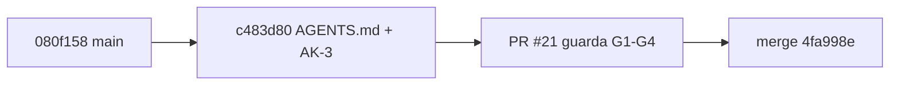

# 250 — E1-U4e: `AGENTS.md` puntero de Lab-Documentos

## Índice

1. Definiciones
2. Qué se hizo
3. Criterios de aceptación
4. Ensayo de cierre
5. PR, merge y CI
6. Lecciones de decisión
7. Limpieza

## 1. Definiciones

- **Ruta «agente»**: una de las tres rutas de lectura del cuerpo `SDEI` (D27). Empieza en `AGENTS.md`.
- **CL-03**: la clase de pieza `AGENTS.md` de N09 §5. Va en la raíz de cada repositorio, es clase H y su control es «existe, sus enlaces resuelven y queda excluido de AI-3 por ruta (AK-3)».
- **AK-3**: una excepción con huella en `tools/docs-guard/excepciones.txt`, con el formato `sha256 ruta control`. Vale mientras el archivo tenga ese SHA-256.
- **CPA**: `Knowledge-Conformacion-Pull-Request-Automatico`.

## 2. Qué se hizo

**Reanudación.** No había worktree, rama local ni remota, PR ni folio de una corrida anterior. Se empezó desde `origin/main` (080f158), que ya contenía E1-U4a (#20, e57aae2).

| Pieza | Cambio |
| --- | --- |
| `AGENTS.md` (raíz) | Es un puntero nuevo con frontmatter (`IDX-LABDOC-AGENTS`, que valida contra el esquema del cuerpo). Explica qué es el repositorio y da la ruta de lectura del agente: README del cuerpo → convenciones del Marco §5 → esquema de frontmatter → glosario → Mapa. Incluye un diagrama mermaid, cómo validar con `scripts/ci-local.sh`, la tabla clase P / clase H (que remite a «Cómo decidir» §6), los 7 anexos de referencia, un ejemplo y cómo cambia el archivo (huella) |
| `tools/docs-guard/excepciones.txt` | Primera excepción AK-3: `2449556…fafb  AGENTS.md  AI-3` |
| `scripts/ci-local.sh` | `enlaces`, `ai` y `estructura` revisan además el `AGENTS.md` de la raíz cuando existe. Si falta, `enlaces` avisa sin bloquear |
| README del cuerpo `SDEI` | La fila de la ruta «agente» enlaza `AGENTS.md`. La caja del mermaid ya no dice «en redacción» |
| `README.md` (raíz), `tools/docs-guard/README.md`, `CHANGELOG.md` | Enlazan y documentan la pieza |

## 3. Criterios de aceptación

| # | Criterio | Cumple | Evidencia |
| --- | --- | --- | --- |
| 1 | Existe | Sí | `AGENTS.md` en la raíz, en 4fa998e |
| 2 | Sus enlaces resuelven | Sí | lychee `--offline --include-fragments` sobre `AGENTS.md`: 26 enlaces, 26 OK. Con un destino y un ancla rotos plantados, PR-1 da rojo con rc=1 y nombra los dos (`evidencia/E1-U4e/03`). En la CI también lo revisa el grupo `enlaces` |
| 3 | Excluido de AI-3 por ruta con huella (AK-3) | Sí | Sin la excepción, AI-3=1 por «Instrucciones para agentes» (aviso). Con la excepción, AI-3=0. Con el archivo cambiado y la huella sin renovar, AI-3=1 otra vez (`evidencia/E1-U4e/01`) |
| — | Merge CPA, el primero delegado de clase H, citando 130 §2 | Sí | §5. El cuerpo del PR transcribe el testimonio L2 |

## 4. Ensayo de cierre

- `scripts/ci-local.sh` (todo) sobre c483d80 dio **verde**, rc=0 (`evidencia/E1-U4e/02`):
  - Los 8 grupos dieron verde, con `AGENTS.md` dentro de enlaces, ai y estructura.
  - lychee revisó 319 enlaces: 287 OK, 0 errores y 32 excluidos.
  - markdownlint revisó 34 archivos con 0 errores. mermaid revisó 19 bloques con 0 inválidos.
  - AI-3 dio 0. AI-4 dio 25 avisos, todos en el anexo de referencias, donde sólo avisa.
  - Hubo 25 casos de autoprueba, todos ok.
- Defecto plantado en `AGENTS.md`: un destino y un ancla rotos dieron rojo en PR-1. Se revirtió, y la huella se confirmó igual a la registrada.
- Controles sueltos sobre `AGENTS.md`: `dg.py esquema` dio verde (frontmatter válido). `dg.py trazas AGENTS.md GUIA-DIR` dio verde: sus 6 trazas resuelven.

## 5. PR, merge y CI

- **PR**: https://github.com/hdcm-dev/Lab-Documentos/pull/21
- **Cabeza auditada**: c483d80a133e544ade8bb21f17c0ebd46179c2e1
- **CI** en `[self-hosted, i7infra-dev]`, las 3 corridas en éxito:
  - docs-guard 40580884735: job en `i7infra-runner-dev`, de 20:50:22 a 20:51:58 UTC.
  - mini-demo-movilidad 40580884841.
  - framework-concept-demo 40580884749.
  - Hubo cola desde 20:45 UTC por el runner compartido.
- **Guarda**: techo de 120 min e intervalo de 30 s, según la delegación del CHANGELOG. Pasó a las 17:53:42 (-03:00):
  - G1: el PR seguía abierto y con la misma cabeza.
  - G2: `mergeable: true` y `clean`. Mientras corrían los controles el estado fue `blocked`.
  - G3: 3 corridas en éxito.
  - G4: sin reserva.
- **Merge**: `4fa998e613932dd5b767b9c220764fb351c6553d` (`merge_method: merge`, `sha` atado a c483d80). Lo fusionó el agente, por la delegación escrita del PO (130 §2, L2).
- **Rama remota**: DELETE devolvió 204 y el GET posterior, 404. c483d80 es alcanzable desde `origin/main`.
- **Controles del commit de merge**: ninguno. main no tiene workflows de `push`.

## 6. Lecciones de decisión

- **LD-01 — La compuerta revisa `AGENTS.md` aunque esté fuera de la RUTA.** La RUTA por defecto es GUIA-DIR, y con ella «sus enlaces resuelven» sólo se probaba a mano. Se extendieron tres grupos de `ci-local.sh` al `AGENTS.md` de la raíz del directorio actual. El cambio es aditivo y reversible, así que se decidió sin elevar. No se agregó un grupo nuevo, para no tocar el agregador del workflow.
- **LD-02 — Si falta `AGENTS.md`, avisa y no bloquea.** CL-03 lo pide en cada repositorio, pero otros repositorios usan el script por el workflow reutilizable. Bloquear los pondría en rojo apenas suban su `herramientas-ref`. Exigirlo queda para cuando cada repo tenga el suyo.
- **LD-03 — Se excluye sólo AI-3, no todo el archivo.** Un puntero para agentes le habla al agente por oficio: «Instrucciones para agentes» dispara AI-3 y es legítimo. AI-1, AI-2, AI-4 y AI-5 lo siguen mirando. La huella hace que cualquier edición vuelva a exponerlo hasta que una persona la renueve (clase H).
- **LD-04 — Frontmatter en `AGENTS.md`.** La convención AGENTS.md no lo exige, pero la carta pide frontmatter y el esquema del cuerpo lo acepta. Se le dio `doc_id` con el prefijo registrado `IDX` y trazas a documentos que existen, sin crear un prefijo nuevo.
- **LD-05 — Se tocó el README del cuerpo, que cerró E1-U4a.** El cambio fueron dos líneas: el enlace en la fila «agente» y la caja del mermaid sin «en redacción». Si no, la ruta seguía rotulada como inexistente. Puede haber un conflicto menor con U4b, U4c o U4d si tocan líneas vecinas; se resuelve conservando los dos cambios.
- **LD-06 — La tabla P/H de `AGENTS.md` sólo lista lo que «Cómo decidir» §6 y la ficha de E1-U2 respaldan.** Se sacó «controles nuevos de `docs-guard`» de la columna P, porque la ficha de E1-U2 los pone bajo aprobación. En su lugar entró «un prefijo nuevo con su motivo», con el precedente LD-02 de E1-U4a.

## 7. Limpieza

- Se retiró el worktree `{dir-de-trabajo}/wt/e1-u4e` y se borraron la rama local y la remota (404).
- Se borraron los intermedios en `{dir-de-trabajo}/`: `e1-u4e-ensayo/`, con salidas, `body.md`, `guard.sh`, `guard.log` y la copia de `AGENTS.md`, y la caché `cache-docs-guard/`. No se tocaron los worktrees de U4b, U4c y U4d ni los intermedios de otras unidades.
- Se creó la evidencia en `evidencia/E1-U4e/` (01 a 03), sin rutas del host (marcadores `<worktree>` y `<cache>`).
- No se crearon contenedores. No se tocó el working tree principal de Lab-Documentos.
