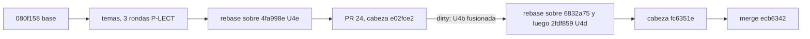

# 252 — E1-U4c: temas 04 a 06 del cuerpo SDEI (doble audiencia, ayuda al usuario final, compuertas y CI)

## Índice

1. Definiciones
2. Qué se hizo
3. Criterios de aceptación
4. Ensayo de cierre
5. PR, merge y CI
6. Lecciones de decisión
7. Limpieza
8. Observaciones para la presidencia

## 1. Definiciones

- **GUIA-DIR**: `/LAB/Lab-Documentos/Lab-Documentos/Guides/Documentacion-Tecnica/Sistema-De-Documentacion-E-Integracion/`.
- **P-LECT**: prueba de lectura que hace un lector sin contexto (N09 §4.5). Acá fue una sesión `claude -p --tools ""` que recibió el tema, el Marco y el Glosario.
- **CPA**: `Knowledge-Conformacion-Pull-Request-Automatico`.

## 2. Qué se hizo

**Reanudación.** No había nada de una corrida anterior: ni worktree, ni rama local o remota, ni PR, ni folio. La unidad empezó de cero, en el worktree `{dir-de-trabajo}/wt/e1-u4c` desde `origin/main` 080f158.

| Pieza (en GUIA-DIR) | `doc_id` | Contenido | Fuentes con fecha | Ensayo reproducible |
| --- | --- | --- | --- | --- |
| `TEM-04-Doble-Audiencia.md` | `TEM-SDEI-04` | Una fuente para personas y agentes. Canales por escenario y contexto. `AGENTS.md` como puntero, con su excepción AI-3 con huella. Índice generado del frontmatter. AI-1 a AI-5. El asistente de la persona usuaria | 7 (agentsmd, howard, owasp, chatlatanagulchai, chen, wang, yamasaki) | Índice generado dos veces, con `diff` vacío; AI-1 y AI-2 plantados dan rojo |
| `TEM-05-Ayuda-Al-Usuario-Final.md` | `TEM-SDEI-05` | Ayuda escrita a partir de la especificación, sin generarla. Traza con versión y filas `RD-`. La divergencia 60/80 se declara sin decidirla. Rol resuelto en el servidor (404, mismo filtro para `.md` y `llms.txt`). Cruce de rol. Idiomas | 3 (iso-26514, aghajani-2019, tan-2024), más van der Meij y Carroll (libro, sin URL) | `traces-resolve`: versión desfasada e ID inexistente dan rojo |
| `TEM-06-Compuertas-Y-CI.md` | `TEM-SDEI-06` | Dos carriles. Regla de bloqueo de cinco condiciones con árbol. Pares rojo/verde y AK-7. Seguridad del runner, forks y G3. `PR-6` y sus dos vías de extracción. Cómo leer una corrida. Plantilla para dar de alta un control | 4 (writethedocs, winters, gitlab-sf, gitlab-testing-sf) | `ci-local.sh todo` en verde; un ancla plantada da rojo en PR-1 |

Fuera de los temas:

- `README.md` del cuerpo: las filas de TEM-04 a 06 enlazan a sus archivos.
- `99-Anexos/Referencias.md`: nueva entrada `ref-gitlab-testing-sf`, con la fecha de consulta 2026-10-26 transcripta de I02 [F31].
- `00-Marco.md` §6, `PE-01` y `EJR-SDEI-04`: el caso 60/80 es el nombre de una localidad, no un comentario (LD-04).
- `TEM-03` y `TEM-07`: sus pies enlazan a TEM-04 y TEM-06.
- `CHANGELOG.md`: entrada de la unidad, conservando las entradas de E1-U4e, E1-U4b y E1-U4d.

## 3. Criterios de aceptación

| # | Criterio | Cumple | Evidencia |
| --- | --- | --- | --- |
| 1 | Seis encabezados del Profile, idénticos (VER-T01..T07) | Sí. Los siete temas en main usan `## Definición` … `## Anexo`, sin número | Lista de encabezados de TEM-01 a 07 en el árbol final. LD-02 |
| 2 | Enlace anterior/siguiente (VER-G08) | Sí. Cadena TEM-03 → 04 → 05 → 06 → 07 en los dos sentidos | Pie de cada tema; PR-1 en verde |
| 3 | APA con fecha y ancla `ref-…` | Sí. `reflint` da 0 errores. Toda cita enlaza al anexo | `evidencia/E1-U4c/01` |
| 4 | `docs-guard` verde | Sí, en local y en el runner | §4 y §5 |
| 6 | ≥ 3 fuentes primarias con fecha y ≥ 1 ensayo reproducible por tema | Sí: 7, 3 y 4 fuentes. Un ensayo por tema, con sus comandos y su salida registrada en el texto | `evidencia/E1-U4c/02`, `03` y `04` |
| — | Merge CPA | Sí | §5 |

El criterio 5 (plantilla «Cómo intervenir») corresponde a E1-U4d.

## 4. Ensayo de cierre

- **`scripts/ci-local.sh todo`** sobre fc6351e: verde, rc=0. Lychee: 542 enlaces, 489 OK, 0 errores y 53 excluidos. Trazas: 121, con 112 resueltas; los 9 avisos son los heredados de la PoC de ayuda por rol. AI-1, AI-2, AI-3 y AI-5 en 0; los AI-4 sólo avisan en el anexo de referencias. Autoprueba en verde (`evidencia/E1-U4c/01-ensayo-de-cierre.txt`).
- **Defectos plantados**, uno por vez y revertidos, todos en rojo: AI-1 y AI-2 en el Mapa (`02`); traza desfasada y traza inexistente en la ayuda de la mini demo (`03`); ancla rota en TEM-06 (`04`).
- **P-LECT**: tres rondas por tema (`05-plect.md`).

  | Tema | Altas, ronda 1 | Ronda 2 | Ronda 3 |
  | --- | --- | --- | --- |
  | TEM-04 | 2 | 1 | 0 |
  | TEM-05 | 0 | 0 | 1 |
  | TEM-06 | 1 | 1 | 1 |

  Todas las altas se corrigieron, también las dos de la ronda 3, que no tuvo una ronda más (mismo criterio que E1-U4a). Las medias siguen entre 9 y 14 por tema: cada ronda lee un texto más completo y el lector encuentra preguntas nuevas, y muchas las responden documentos que no veía. **No se llega a cero dudas sobre cada tema leído solo**. Ese umbral queda para la G-e de E1-G.

## 5. PR, merge y CI

- **PR**: https://github.com/hdcm-dev/Lab-Documentos/pull/24. El cuerpo lleva el informe, el ensayo, la delegación del CHANGELOG y el testimonio L2 literal del PO.
- **Cabeza auditada**: fc6351e23a3b4b4aae8b912f7093654cf3601755. La primera cabeza, e02fce2, quedó `dirty` porque mientras tanto se fusionaron E1-U4b (#22) y E1-U4d (#23). Se rebasó, se resolvieron README y CHANGELOG, se alinearon los encabezados y se empujó con `--force-with-lease`.
- **CI** en `[self-hosted, i7infra-dev]`: docs-guard 40590237182 y framework-concept-demo 40590236904, las dos en éxito. Sobre e02fce2 también habían dado éxito (40586922380 y 40586922559).
- **Guarda**: techo de 120 min e intervalo de 30 s. G1: abierto, con la cabeza auditada. G2: `mergeable: true` y `clean`. G3: 2 corridas de workflow en éxito. G4: sin reserva. Relectura final a las 18:57:30 (-03:00).
- **Merge**: `ecb63420d2204ab6073136275713cb6be008e99e` (`merge_method: merge`, `sha` atado a fc6351e). La respuesta dijo `merged: true`. **Lo fusionó el agente.**
- **Rama remota**: DELETE y después GET de la ref, que dio 404. `ls-remote` vacío. fc6351e es alcanzable desde `origin/main`.
- **Controles del commit de merge**: ninguno, porque main no tiene workflows de `push`.

## 6. Lecciones de decisión

- **LD-01 — `doc_id` calificado `TEM-SDEI-0n`.** `TEM-04`…`TEM-08` ya existen en `Concepts/Framework-Concept`, y el registro de IDs es único para todo el repositorio. Sigue el criterio de LD-01 de E1-U4a. Coincidió con E1-U4b y E1-U4d sin coordinar.
- **LD-02 — Quien fusiona último alinea los encabezados.** Las unidades paralelas no podían coordinarse en vivo. Dejé una nota en `{dir-de-trabajo}/` (ya borrada) con la regla «quien fusione último alinea a main». Empecé con títulos numerados. Cuando E1-U4b entró sin número, los quité y reescribí las anclas del índice. E1-U4d hizo lo mismo. VER-T07 queda cumplido en los siete temas.
- **LD-03 — Temas hermanos no fusionados, en code span.** Un enlace a un archivo que todavía no existe da rojo en PR-1. Mientras tanto se nombraron en code span. En cada rebase se convirtieron en enlaces, incluido el pie de TEM-03 y de TEM-07, que no son míos: es un cambio aditivo y de navegación.
- **LD-04 — Corregir el Marco con la ficha como fuente.** La P-LECT detectó que el Marco §6 decía «comentario» y la ficha `RN-LOC-01`, verificada contra el código, dice «nombre de una localidad». Gana la evidencia anclada al SHA. Se corrigieron tres menciones (Marco, PE-01 y EJR-SDEI-04) sin elevarlo: es reversible y corrige un dato. El ejemplo ilustrativo `RD-03 comentario` del anexo del esquema se dejó, porque está rotulado como ilustrativo.
- **LD-05 — G3 por corrida de workflow, no por job.** `framework-concept-demo` tiene los jobs `apk` y `compuerta` condicionados al alcance. En un PR que no toca la demo salen `skipped`, y el agregador `fw-ok` da éxito. Mi primera guarda los leyó por job y declaró reserva. Lo correcto es leer la corrida del workflow, que terminó en éxito. Es el mismo caso que db7c8ce en E1-U4a. Se corrigió la guarda y no se elevó. Conviene que el conocimiento CPA diga explícitamente que G3 se lee por corrida de workflow y que un job salteado por alcance dentro de una corrida exitosa no es reserva.
- **LD-06 — Ayuda servida por el producto ≠ canal derivado.** La P-LECT señaló que `llms.txt` aparecía como CL-14 («sólo con sitio») y también en el panel. Se separó: el `.md` y el `llms.txt` que sirve la ayuda del producto son parte de CL-06. Es una aclaración del modelo que E1-G puede querer llevar al glosario.
- **LD-07 — Índice interno según el Marco.** El primer borrador activaba CL-08 en ESC-SDEI-1 y 2. Se alineó con la tabla del Marco, que lo activa en ESC-SDEI-3 y 4. El Marco define los ejes una sola vez, así que manda.
- **LD-08 — Lo no implementado se dice como tal.** El cruce de rol, la frescura de traducciones y la evidencia de relectura no son controles de `docs-guard`. Los temas lo dicen y rotulan **[criterio propio]** lo que proponen, en lugar de presentarlo como existente.
- **LD-09 — Las cifras registradas se refrescan en cada rebase.** Las salidas registradas en los temas (totales de lychee y de trazas) cambian con cada unidad que entra a main. Se volvieron a correr y se actualizaron en cada rebase, para que el texto coincida con la cabeza fusionada. La salida del Mapa en TEM-04 conserva la línea 131 de la corrida original; en la cabeza final es la 132. Es una diferencia de una línea que no cambia el ensayo.

## 7. Limpieza

- Se retiró el worktree `{dir-de-trabajo}/wt/e1-u4c` y se borraron la rama local y la remota (404).
- Se borraron los intermedios de esta unidad: `{dir-de-trabajo}/u4c/` (salidas de `ci-local`, entradas y salidas de P-LECT, `indice.py`, `api.sh`, `guard.sh`, cuerpos del PR, respuestas de la API), `u4c-ci-base.txt` y la nota de convención `convencion-temas-sdei.txt`. No se tocaron la caché compartida `cache/` ni los archivos de otras unidades.
- La evidencia quedó en `evidencia/E1-U4c/` (01 a 05), sin rutas del equipo.
- No se crearon contenedores. El working tree principal de Lab-Documentos no se tocó (sólo `fetch`). PROMPTs/ sólo recibió este folio y la evidencia, como pide el despacho.

## 8. Observaciones para la presidencia

- En `{dir-de-trabajo}/` quedó, de otra unidad, un archivo con un token de GitHub en texto plano (un `.cfg` con el encabezado de autorización). No lo usé ni lo copié. Conviene borrarlo y rotar el token.
