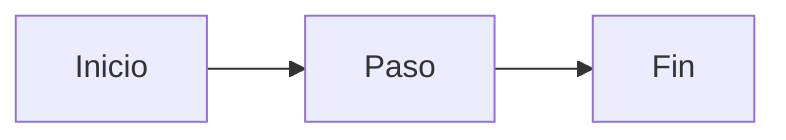

# Empezar

Página de ensayo C-ARQ-NET (contenido mínimo para medir generadores; no es la ayuda real).

## Pasos

1. Abrí la pestaña correspondiente.
2. Completá los campos.
3. Tocá **Guardar**.

Ver también [la arquitectura](../tecnica/arquitectura.md).
