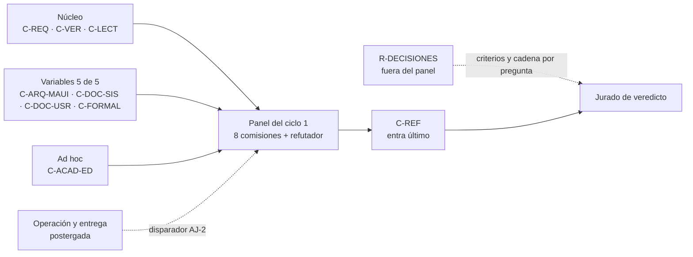

| Campo | Valor |
| --- | --- |
| Tipo | informe |
| Fecha | 2026-11-01 |
| Autor | Jurado de composición (tres miradas, J1 a J3); redacta el acta la presidencia, que no vota |
| Corrige | — |

Norma y secciones leídas: `Mesa-De-Expertos-A-Pedido` 3.1 (`MEP`), fila del jurado del mapa de carga
(`MEP:109`: §2, §3, §4, §7, §8 y, además, `Excepcion-A-Un-Conocimiento` y `Cadena-De-Consecuencias`), paso 4
(`MEP:146`) y fila «Composición» de §4 (`MEP:332`); `Rule-Mesa` 1.1 (`RM`) §3.4.1 a §3.4.5 (`RM:190-268`), §3.5.2
(`RM:289-302`) y §3.5.4; `Cadena-De-Consecuencias` 2.0 §2. Insumos: la propuesta de panel (`PP`, bitácora 02,
§6 y §7), la providencia de apertura (folio 001) y los núcleos `N1`–`N7` y `CG`. Los alias son los del folio 001 §1.

# Acta del jurado de composición — expediente 0003

## Índice

1. [Qué se vota y con qué insumos](#1-qué-se-vota-y-con-qué-insumos)
2. [Lectura de las frases del pedido que nombran perfiles](#2-lectura-de-las-frases-del-pedido-que-nombran-perfiles)
3. [Las dos composiciones y su cadena de consecuencias](#3-las-dos-composiciones-y-su-cadena-de-consecuencias)
4. [Votos](#4-votos)
   1. [J1 — Evidencia y coherencia histórica](#41-j1--evidencia-y-coherencia-histórica)
   2. [J2 — Impacto y riesgo](#42-j2--impacto-y-riesgo)
   3. [J3 — Costo, beneficio y simplicidad](#43-j3--costo-beneficio-y-simplicidad)
5. [Recuento y ajustes adoptados](#5-recuento-y-ajustes-adoptados)
6. [Panel resultante: comisiones](#6-panel-resultante-comisiones)
7. [Roles fuera del panel](#7-roles-fuera-del-panel)
8. [Cobertura de las preguntas P-01 a P-28](#8-cobertura-de-las-preguntas-p-01-a-p-28)
9. [Postergados y descartes](#9-postergados-y-descartes)
10. [Condiciones para las cartas](#10-condiciones-para-las-cartas)
11. [Excepciones a conocimientos](#11-excepciones-a-conocimientos)
12. [Lo no verificado](#12-lo-no-verificado)

---

## 1. Qué se vota y con qué insumos

| Término | Qué designa en esta acta | Fuente |
| --- | --- | --- |
| Jurado de composición | Las miradas que votan qué comisiones forman el panel del ciclo | `RM:297-299`; `MEP:146` |
| Mirada | El criterio con que vota cada jurado. Aquí, tres, cada una con dos de las cinco funciones de `RM` §3.5.4 | `RM` §3.5.4; §11 de esta acta |
| Silla | Un lugar del panel con una pregunta única y su no-competencia | `RM` §3.4.4 |
| Techo | Núcleo más cinco variables o ad hoc por ciclo | `RM:259-260` |
| Convocatoria automática | La del rol formal: si su señal aparece, entra sin votación | `RM:227-228` |
| `CONVOCAR`, `NO_CONVOCAR`, `INSTANCIAR_AD_HOC` | Las palabras del voto | `RM:297-299` |

**Qué se vota.**

1. **La cuestión principal**: composición A o B de `PP` §6.2, o un ajuste.
2. **Las sillas que no se votan**, con constancia: el núcleo permanente (`RM:194`, «Se convoca siempre») y el rol
   formal, de convocatoria automática si su señal está en el corpus.
3. **Que queden convocados**, por pedido del PO, el analista de sistemas, el arquitecto de apps móviles MAUI .NET,
   el especialista en análisis de decisiones (fuera del panel, como rol), la documentación técnica de usuario y de
   sistemas y el académico en edición bibliográfica y de libros (`TP:73`; E-16 del folio 001).
4. **La lista final de comisiones**, con id, silla, titular, pregunta única, preguntas a cargo, no-competencia y
   tope de hallazgos.

**Qué no se vota.** Las decisiones cerradas del folio 001 §8, entre ellas la delegación del PO: la propuesta mejor
fundada que elige el jurado queda aprobada. La composición nunca es motivo de escalada (`RM:301-302`).

## 2. Lectura de las frases del pedido que nombran perfiles

Columna derecha: la lectura **que menos agrega** (`MEP` §3.1), para no convocar más de lo que el pedido dice.

| Ubicación | Frase literal | Lectura mínima |
| --- | --- | --- |
| `TP:38` | «incluir expertos en revisión bibliografica y edición de material bibliografico» | Una silla de edición bibliográfica. No está en el catálogo de `RM:213-225`: es **ad hoc** con carta de mandato (`RM` §3.4.4) |
| `TP:73` | «analistas en sistemas» | Una silla. El catálogo no tiene «analista», pero la pregunta de Requisitos del núcleo (`RM:198`) es la del analista; el antecedente lo tituló así (`IA.Knowledge.Base/Expedientes/0001-…/actuaciones/003-informe-jurado-composicion.md:109`, citado en `PP:276`) |
| `TP:73` | «arquitectos en aplicaciones moviles en MAUI .NET» | Una silla: Arquitectura del catálogo (`RM:215`), titulada por ese perfil |
| `TP:73` | «especialistas en analisis el cúal se le pida criterios de decisión y analisis de las decisiones» | Un rol que **no emite hallazgos**: pide criterios y analiza decisiones. Es el análisis de decisiones del paso 6 bis, ampliado a todas las preguntas (`PP` §6.3) |
| `TP:73` | «especialistas en documentación técnica de usuario y sistemas» | **Dos lecturas.** Mínima literal: una silla («especialistas en documentación técnica») con dos objetos. Por catálogo: dos sillas, Uso y accesibilidad (`RM:224`) y Trazabilidad documental (`RM:225`). Es la cuestión A frente a B (§3) |
| `TP:73` | «académicos en edición de material bibliografico y libros para consultar y crear ejemplos y material de consulta» | La misma silla ad hoc de `TP:38`; no un tercero (no hay canal ni destinatario: lectura A de `PP` §6.5) |
| `TP:73` | «que consulten los estandares»; «basarse en las tendencias del mercado y los estandares de la industria» | Un **mandato** para todas las comisiones, no una silla (`PP` §6.4) |
| `TP:73` | «Los investigadores especializados pueden ensayar» | Peritos, fuera del panel (`PP` §6.3) |

## 3. Las dos composiciones y su cadena de consecuencias

Las dos comparten el núcleo (Requisitos con el analista de sistemas, Verificación, Lector sin contexto,
Refutador), Arquitectura con el arquitecto MAUI .NET, el Formal y el académico ad hoc. Difieren en dos sillas.

| | Composición A (`PP:283-291`) | Composición B (`PP:293-296`) |
| --- | --- | --- |
| Documentación técnica | Dos sillas: sistemas (trazabilidad) y usuario (uso y accesibilidad) | Una silla: «Documentación técnica de usuario y de sistemas» |
| Operación y entrega | Postergada al ciclo 2 | Convocada, por la etiqueta de runner (`docs-guard.yml:60`), la versión del cuerpo (`SDEI/README.md:22`, `2.0.0-borrador`) y la delegación faltante (`N7` H8) |
| Variables usadas | 5 de 5 | 5 de 5 |

**Cadena de consecuencias** (`Cadena-De-Consecuencias` §2, los cuatro pasos):

| Paso | A | B |
| --- | --- | --- |
| 1. ¿Dónde cae el costo? | En las preguntas de entrega (P-08, P-09, P-11, P-19, P-20) sin especialista propio | En la silla de documentación, que carga trazas y ayuda a la vez |
| 2. ¿Cuánto pesa ahí? | Esas cinco preguntas tienen 2 lectores cada una en el panel de A (§8). Dos de ellas ya tienen el marco cerrado: P-09 lo fija la conformación automática (`N7` §4.2) y P-11, si se elige renombrar, es clase H y va al lote del PO (`PP:358`) | En `N1` §4 hay 36 hallazgos; un conteo por palabra clave da 13 filas sobre trazas, prefijos, IDs o anclas y 8 sobre ayuda, usuario o `RD-` (`grep -i -c` sobre las filas `^| N1-`, con solapamiento). Una sola silla carga como mínimo 13 + 8 frente al tope de 12 |
| 3. ¿Qué pierde la alternativa? | Pierde la mirada de operación sobre runner, sitio y versión | Pierde la separación entre la ayuda al usuario final (`TEM-05`, `Examples/Prueba-Ayuda-Por-Rol/`) y el sistema de IDs y trazas, que el catálogo trata como dos señales distintas (`RM:224-225`) |
| 4. ¿Es reversible? | Sí: Operación entra por convocatoria en caliente en el mismo ciclo, o en el ciclo 2 (`RM:246-248`, `RM:259-260`) | Sí, pero la fusión no se deshace dentro del ciclo: un informe topado no se reabre |

## 4. Votos

Cada mirada votó por separado, sin ver las otras. El orden de esta sección no es el de llegada.

### 4.1 J1 — Evidencia y coherencia histórica

Funciones de `RM` §3.5.4: Evidencia y Coherencia histórica.

| Asunto | Voto | Fundamento |
| --- | --- | --- |
| A o B | **A** | `RM:225` y `RM:224` son dos señales distintas del catálogo, y las dos tienen ubicación en el corpus: trazabilidad en `prefijos.txt:24` frente a `Esquema…:117` (`N1-05`) y commits muertos (`N1-17`); uso en `TEM-05`, `Examples/Prueba-Ayuda-Por-Rol/` y la ADR-10010 de Geometría (`N4` §3.6) (`PP:288-289`). `RM:229` («No se duplican roles») no aplica: son dos competencias, no una repetida. La frase de `TP:73` es «documentación técnica de usuario y sistemas»: nombra dos objetos. Una corrección a `PP:296`: dice que trazas y ayuda son «los dos ejes con más hallazgos (N1 §6)», pero `N1` §6 clasifica por tipo (a-f), no por eje. El conteo por palabra clave de §3 sostiene la idea con otra fuente |
| Analista como titular de Requisitos | `CONVOCAR` (constancia) | Núcleo permanente (`RM:194`); precedente del 0001 (`PP:276`). Ocupar el núcleo libera un cupo para lo que el pedido nombra |
| Arquitecto MAUI .NET | `CONVOCAR` | Pedido literal (`TP:73`) y señal de `RM:215`: la demo tiene web, API y móvil (`docs/tecnica/arquitectura.md:27-30`, `N1-31`) |
| Formal | Constancia: entra por convocatoria automática | Señal con ubicación: pesos 0,15 y 0,10 en `Como-Decidir.md:74-76`, «≥ 85 %» (`N3` §5.6) y «≥ 6 de 8» (`N4` §7.3) (`PP:290`). P-25 pregunta literalmente por umbrales |
| Académico ad hoc | `INSTANCIAR_AD_HOC` | `TP:38` y `TP:73`; ningún rol de `RM:213-225` cubre aparato crítico, obra de consulta ni citación |
| Análisis de decisiones fuera del panel | Conforme | `TP:73` pide criterios y análisis, no hallazgos; `MEP:328` lo deja fuera del denominador |
| Operación y entrega | `NO_CONVOCAR` (techo) | Señal real (`PP:294-296`), pero en el 0002 el cupo se priorizó por severidad esperada y lo que el pedido nombra (folio 004 del 0002, §3.8). Acá el pedido no nombra operación |

### 4.2 J2 — Impacto y riesgo

Funciones de `RM` §3.5.4: Impacto y Riesgo e irreversibilidad.

| Asunto | Voto | Fundamento |
| --- | --- | --- |
| A o B | **A, con ajuste** | Impacto: el P0 más probable del caso es «un dato falso sobre el ejemplo conductor» (folio 001 §9), y los dos ejemplos que fallan hoy son de traza y de ayuda: la regla compuesta de `TEM-05:48` frente a `TEM-05:88` (folio 001 §10, fila 6) y el ejemplo que viola sus dos mitades (`N1-21`, `N4` H1). Con una sola silla, el tope corta justo ahí (§3, paso 2). Riesgo de A: las preguntas de entrega quedan sin especialista. Pero la única irreversible es P-11 (renombrar la etiqueta toca workflows de tres repos y el runner) y esa ya es clase H: va al lote del PO, no la cierra el panel (`PP:358`). **Ajuste**: que Verificación cargue P-09, P-11, P-19 y P-20, y que Operación quede habilitada por convocatoria en caliente con disparador |
| Analista en Requisitos | `CONVOCAR` (constancia) | Si falta, nadie pide atomicidad de las reglas que hoy se contradicen (P-13 a P-18) |
| Arquitecto MAUI .NET | `CONVOCAR` | Si falta, P-16, P-21, P-27 y P-28 quedan sin quien mida contra el sistema real; `N1-31` es un dato del ejemplo conductor que el Marco cuenta mal |
| Formal | Constancia | Sin él, P-25 sale con «≥ 85 %» frente a «≥ 6 de 8» sin lectura común (`CG` C-04) |
| Académico ad hoc | `INSTANCIAR_AD_HOC` | Si falta, las seis intervenciones (`TP:58-67`) no tienen quien juzgue la obra de consulta antes de editarla |
| Análisis de decisiones | Conforme | Riesgo de solape con Requisitos: se cubre con su no-competencia (no emite hallazgos) |
| Operación y entrega | `NO_CONVOCAR` (techo), con disparador | Disparador: Verificación o Arquitectura emiten una solicitud de convocatoria con P1 sobre P-09, P-11 o P-19 (`RM:242-248`) |

### 4.3 J3 — Costo, beneficio y simplicidad

Funciones de `RM` §3.5.4: Costo y beneficio; además lee los criterios del PO (simplicidad, practicidad,
escalabilidad, `TP:73`).

| Asunto | Voto | Fundamento |
| --- | --- | --- |
| A o B | **B** | Simplicidad: la lectura mínima de `TP:73` es una silla («especialistas en documentación técnica de usuario y sistemas»), y el techo es el mismo en las dos. Con B, el panel cubre una señal más del catálogo (Operación, `RM:219`: «versionado», que `SDEI/README.md:22` y P-08 tocan) sin costo de cupo. Costo: un informe más largo en una silla; se mitiga subiendo su tope. Escalabilidad: si el cuerpo crece, una silla única de documentación es la que se replica en otros cuerpos. Reconozco el riesgo de §3, paso 4: un tope que corta no se reabre en el ciclo |
| Analista en Requisitos | `CONVOCAR` (constancia) | Ahorra una silla: es el mejor costo-beneficio del panel |
| Arquitecto MAUI .NET | `CONVOCAR` | Su aporte (tres aplicaciones, multirrepo) no lo cubre otro |
| Formal | Constancia | Barato: pocas preguntas (P-13, P-25, P-26) y tope bajo |
| Académico ad hoc | `INSTANCIAR_AD_HOC` | Es la silla que el pedido nombra dos veces (`TP:38`, `TP:73`) |
| Análisis de decisiones | Conforme | Cumple `TP:73` sin ocupar cupo |
| Operación y entrega | `CONVOCAR` (coherente con B) | Si gana A, pido como mínimo el ajuste de J2: preguntas de entrega a Verificación y disparador escrito |

## 5. Recuento y ajustes adoptados

Mayoría simple (`RM:298`). No hubo empate.

| Asunto | J1 | J2 | J3 | Resultado |
| --- | --- | --- | --- | --- |
| A o B | A | A (con ajuste) | B | **A ajustada**, 2 a 1 |
| Analista como titular de Requisitos | `CONVOCAR` | `CONVOCAR` | `CONVOCAR` | Constancia: núcleo |
| Arquitecto MAUI .NET (Arquitectura) | `CONVOCAR` | `CONVOCAR` | `CONVOCAR` | `CONVOCAR`, 3/3 |
| Formal | constancia | constancia | constancia | Convocatoria automática |
| Académico en edición bibliográfica y de libros | `INSTANCIAR_AD_HOC` | `INSTANCIAR_AD_HOC` | `INSTANCIAR_AD_HOC` | Ad hoc, 3/3, con carta de mandato (§6) |
| Análisis de decisiones fuera del panel | conforme | conforme | conforme | Rol, sin silla (§7) |
| Operación y entrega | `NO_CONVOCAR` | `NO_CONVOCAR` con disparador | `CONVOCAR` | **Postergado**, 2 a 1, con disparador (§9) |

**Ajustes adoptados** (los pide J2 y los acepta J3 como mínimo si gana A; J1 no se opone):

- **AJ-1.** Verificación carga P-09, P-11, P-19 y P-20 como lector propio (§8).
- **AJ-2.** Operación y entrega queda habilitada por convocatoria en caliente si Verificación o Arquitectura emiten
  una solicitud con P1 sobre P-09, P-11 o P-19 (`RM:246-248`). Si entra, toma la última vacante del ciclo siguiente
  si la del ciclo está llena.
- **AJ-3.** La corrección de J1 a `PP:296` queda asentada: el fundamento de A no es `N1` §6 sino el conteo de §3,
  paso 2.

**Homogeneidad.** Tres de siete asuntos no fueron unánimes en el voto (A o B, Operación) o en su fundamento. No
aplica la marca de `RM` §3.5.4 (más del 80 % de unanimidad), que además es del veredicto.

## 6. Panel resultante: comisiones

Núcleo (no cuenta en el techo) más cinco variables o ad hoc: Arquitectura, Trazabilidad documental, Uso y
accesibilidad, Formal y el académico ad hoc. **5 de 5.**

| Id | Silla | Titular | Pregunta única | Preguntas a cargo | No-competencia | Tope |
| --- | --- | --- | --- | --- | --- | --- |
| `C-REQ` | Requisitos (núcleo) | Analista de sistemas | ¿Cada afirmación del cuerpo, del libro y del conocimiento es unívoca, atómica y verificable? ¿Qué falta? | P-01, P-13, P-14, P-15, P-16, P-17, P-18, P-21, P-23, P-24, P-28 | Forma editorial y estilo del libro; pesos y criterios de decisión; arquitectura de la demo | 12 |
| `C-VER` | Verificación (núcleo) | Ingeniero de verificación documental (CI y compuertas) | ¿Cómo se prueba cada afirmación y cada decisión de entrega? ¿Qué quedó sin criterio de aceptación? | P-04, P-09, P-11, P-12, P-19, P-20, P-22, P-25, P-26, P-27 | Contenido y estilo editorial; la decisión de clase H del runner (la eleva, no la cierra) | 12 |
| `C-LECT` | Lector sin contexto (núcleo) | Agente que no participó, de otro arnés si se puede; no lee `N1`–`N7` | ¿Puede trabajar con el libro y con el conocimiento sin preguntar? Cada pregunta es un hallazgo | P-03, P-06, P-17, P-23, P-24, P-26 | Proponer correcciones de fondo: sólo pregunta y dice dónde se trabó | 12 |
| `C-ARQ-MAUI` | Arquitectura (variable) | Arquitecto de apps móviles MAUI .NET | ¿Lo que el cuerpo, el libro y el conocimiento dicen de la demo (web, API y móvil) y de la topología multirrepo corresponde al sistema real y sirve para un proyecto MAUI .NET nuevo o existente? | P-06, P-11, P-16, P-18, P-21, P-26, P-27, P-28 | Forma editorial, citación, umbrales; el diseño de los servicios (L-3) | 12 |
| `C-DOC-SIS` | Trazabilidad documental (variable) | Especialista en documentación técnica de sistemas | ¿Los IDs, prefijos, trazas, citas entre documentos y versiones del cuerpo son únicos y resolubles, y el libro y el conocimiento los conservan? | P-01, P-02, P-04, P-08, P-09, P-10, P-12, P-13, P-14, P-22 | Ayuda al usuario final; estilo; la CI como ejecución (eso es `C-VER`) | 12 |
| `C-DOC-USR` | Uso y accesibilidad (variable) | Especialista en documentación técnica de usuario | ¿La ayuda al usuario final y por rol que el cuerpo prescribe y ejemplifica sirve a quien la usa y es coherente con su regla de traza? | P-03, P-05, P-07, P-15, P-16 | IDs fuera de la ayuda; CI; arquitectura de la app | 10 |
| `C-FORMAL` | Formal (convocatoria automática) | Especialista en métodos cuantitativos | ¿Cada umbral, peso y cuantificador del cuerpo, del conocimiento y de las métricas de ensayo tiene una lectura única y medible? | P-13, P-25, P-26 | Contenido técnico y editorial; elegir entre opciones (eso es del análisis de decisiones) | 6 |
| `C-ACAD-ED` | Ad hoc: edición bibliográfica y de libros | Académico en edición de material bibliográfico y libros | ¿El libro funciona como obra de consulta: estructura, aparato crítico, índices, glosario, citación y ejemplos? | P-01, P-02, P-03, P-05, P-06, P-07, P-08, P-10, P-19, P-20 | Contenido técnico de las compuertas y de la demo; editar (editan los editores, fuera del panel) | 12 |
| `C-REF` | Refutador (núcleo) | Agente que no participó en las comisiones | Ataca la lectura dominante, el objetivo (qué se dio por fijo sin pedirlo; si hay una solución más chica) y cada ficha de excepción. Entra último | P-01, P-02, P-04, P-19, P-23, P-25, y las lecturas L-1 a L-6 | Emitir hallazgos nuevos fuera de lo que refuta; votar | 12 |

**Carta de mandato de `C-ACAD-ED`** (`RM` §3.4.4). Señal: `TP:38`, `TP:50`, `TP:58-67`, `TP:73`. Pregunta única: la
de la tabla. Competencia: estructura de obra, aparato crítico, índices, glosario, norma de citación, ejemplos como
material de consulta. No-competencia: la de la tabla. Tope: 12. Disolución: al veredicto del ciclo.

**Mandato común de investigación** (E-20). Cada comisión cita fuentes externas con URL y fecha de consulta
(2026-11-01) o norma con su número. La base es `N6` §3, como hipótesis a refutar. Ejemplos de lo que `N6` ya trae
y cada silla debe contrastar: `C-DOC-USR` con ISO/IEC/IEEE 26514:2022 (https://committee.iso.org/standard/77451.html,
consultada el 2026-11-01, `N6:136-143`) e IEC/IEEE 82079-1:2019 (https://webstore.iec.ch/en/publication/29075,
`N6:157-165`); `C-ACAD-ED` con Diátaxis (https://diataxis.fr/, `N6:99-107`) y las guías de estilo de Google
(https://developers.google.com/style, `N6:210-217`) y Microsoft (https://learn.microsoft.com/en-us/style-guide/welcome/,
`N6:228-234`). La familia 26511/26512/26513/26515 está **no verificada** en `N6:145-155` y no se cita hasta abrir
la ficha oficial.

## 7. Roles fuera del panel

| Id | Rol | Titular | Mandato | Preguntas | No-competencia |
| --- | --- | --- | --- | --- | --- |
| `R-DECISIONES` | Análisis de decisiones (paso 6 bis, ampliado por el pedido) | Especialista en análisis y criterios de decisión | Por cada pregunta: criterios (simplicidad, practicidad, escalabilidad, fuente única, paso por la compuerta), cadena de consecuencias de cada alternativa (`Cadena-De-Consecuencias` §2) y el camino de compromiso de cada ficha de excepción admitida | P-01 a P-28 | No emite hallazgos ni vota (`MEP:328`) |
| — | Peritos e investigadores | Los que designe la mesa | Reproducción del conocimiento (`N3` §5.6), render del libro (`N2` §12.3), prueba del lector sobre el tutorial, ayuda por rol levantada | — | No votan; corren en `{host-de-pruebas}` |
| — | Quien aplica | Presidencia y editores de las seis intervenciones | Aplica el plan aprobado | — | Nunca un rol del panel |
| — | Jurado de veredicto | Otro despacho | Vota los hallazgos | — | No diseña parches |

## 8. Cobertura de las preguntas P-01 a P-28

Derivada de la tabla de §6 con un recuento por pregunta. **Toda pregunta tiene dos lectores o más en el panel**,
sin contar al refutador ni a `R-DECISIONES`.

| P | Tema | Lectores | N.º |
| --- | --- | --- | --- |
| P-01 | Libro frente a fuentes | C-REQ, C-DOC-SIS, C-ACAD-ED | 3 |
| P-02 | `doc_id` del libro | C-DOC-SIS, C-ACAD-ED | 2 |
| P-03 | Partes, orden y anexos | C-LECT, C-DOC-USR, C-ACAD-ED | 3 |
| P-04 | PR común | C-VER, C-DOC-SIS | 2 |
| P-05 | Guía de estilo de base | C-DOC-USR, C-ACAD-ED | 2 |
| P-06 | `Lanzar-Example` | C-LECT, C-ARQ-MAUI, C-ACAD-ED | 3 |
| P-07 | Caso del portal de notificaciones | C-DOC-USR, C-ACAD-ED | 2 |
| P-08 | Guía obsoleta y versión del cuerpo | C-DOC-SIS, C-ACAD-ED | 2 |
| P-09 | Delegación del merge | C-VER, C-DOC-SIS | 2 |
| P-10 | Commits fuera de `main` | C-DOC-SIS, C-ACAD-ED | 2 |
| P-11 | Etiqueta de runner | C-VER, C-ARQ-MAUI | 2 |
| P-12 | U25 y U26 | C-VER, C-DOC-SIS | 2 |
| P-13 | Términos con dos sentidos | C-REQ, C-DOC-SIS, C-FORMAL | 3 |
| P-14 | `PE` | C-REQ, C-DOC-SIS | 2 |
| P-15 | Traza de la ayuda | C-REQ, C-DOC-USR | 2 |
| P-16 | Clases por escenario | C-REQ, C-ARQ-MAUI, C-DOC-USR | 3 |
| P-17 | Quién decide la fase 1b | C-REQ, C-LECT | 2 |
| P-18 | Aviso programado | C-REQ, C-ARQ-MAUI | 2 |
| P-19 | Sitio publicado | C-VER, C-ACAD-ED | 2 |
| P-20 | Mermaid en CI | C-VER, C-ACAD-ED | 2 |
| P-21 | Capas A y B de `TEM-07` | C-REQ, C-ARQ-MAUI | 2 |
| P-22 | Prefijo y `doc_type` del conocimiento | C-VER, C-DOC-SIS | 2 |
| P-23 | Forma del conocimiento | C-REQ, C-LECT | 2 |
| P-24 | Neutralidad respecto de SDD | C-REQ, C-LECT | 2 |
| P-25 | Métrica de la reproducción | C-VER, C-FORMAL | 2 |
| P-26 | Oráculo e insumos | C-VER, C-LECT, C-ARQ-MAUI, C-FORMAL | 4 |
| P-27 | Dónde viven los ensayos | C-VER, C-ARQ-MAUI | 2 |
| P-28 | Ensayo de Geometría y escalón 2 | C-REQ, C-ARQ-MAUI | 2 |

Carga por silla: C-REQ 11, C-VER 10, C-LECT 6, C-ARQ-MAUI 8, C-DOC-SIS 10, C-DOC-USR 5, C-FORMAL 3, C-ACAD-ED 10.

## 9. Postergados y descartes

| Rol | Estado | Motivo | Entrada |
| --- | --- | --- | --- |
| Operación y entrega | **Postergado** (2 a 1) | Techo; sus preguntas tienen dos lectores (AJ-1); P-11 irreversible ya va al lote del PO | Convocatoria en caliente por AJ-2, o ciclo 2 |
| Seguridad | Descartado (`PP:316`) | La única señal es anti-inyección, que mide la compuerta; lo privado lo cubre el barrido | Solicitud de convocatoria si una comisión la emite |
| Interfaz externa | Descartado (`PP:317`) | El contrato OpenAPI de la demo está verde (`N7` §3.1) | — |
| Industria y estándares como silla | Descartado (`PP:318`) | Es mandato de todas (§6) | — |
| Datos y dominio, Concurrencia, Rendimiento, Cumplimiento | Descartados (`PP:319`) | Sin señal en el cuerpo | — |
| Consulta a un tercero | En reserva | No hay tercero ni canal (lectura A de `PP` §6.5) | Si aparece, rige `MCT` |

## 10. Condiciones para las cartas

| # | Condición | Pedida por |
| --- | --- | --- |
| K1 | Cada carta lleva la ruta y versión de `MEP` 3.1, la línea «Secciones leídas», la lectura P0–P3 del folio 001 §9 y el tope de §6 | Norma (`MEP:144`) |
| K2 | `C-VER` declara en su informe, para P-09, P-11 y P-19, si emite solicitud de convocatoria de Operación (AJ-2) | J2, J3 |
| K3 | `C-REF` comprueba que cada umbral y cuantificador tenga lectura de `C-FORMAL`, y que `C-REQ` y `R-DECISIONES` no se dupliquen en P-01 y P-13 | J1, J2 |
| K4 | `C-DOC-SIS` y `C-DOC-USR` declaran su frontera en P-15 y P-16: la traza de la ayuda la juzga `C-DOC-USR` por el lado del usuario y `C-REQ` por la regla; `C-DOC-SIS` sólo si toca prefijos | J1 |
| K5 | `C-LECT` no recibe `N1`–`N7` ni este folio: sólo el cuerpo, el libro cuando exista y el conocimiento | Norma (`RM:200`) |
| K6 | Toda afirmación sobre `{servicio-privado}` se escribe por alias; la evidencia privada no viaja en los informes | Folio 001 §8 |

## 11. Excepciones a conocimientos

| Conocimiento y § | Qué dice | Qué se hace en su lugar | Impacto operativo |
| --- | --- | --- | --- |
| `RM` 1.1 §3.5.2, paso 3, y §3.5.4 | «Los cinco jueces de §3.5.4 votan» la composición | Votan **tres** miradas, cada una con dos funciones (J1 evidencia y coherencia; J2 impacto y riesgo; J3 costo-beneficio y los criterios del PO), por orden del despacho. **Alternativa de cumplir:** dos votos más, uno por función, sobre la cuestión A/B | La cuestión A/B se decide 2 a 1; con cinco votos podría cambiar. La composición no escala (`RM:301-302`), así que el costo de un error es un informe topado o una convocatoria en caliente, los dos reversibles |
| `RE` 1.0 §3.1 y §3.4 (tipo del nombre igual al de la cabecera) | El folio se nombra con un tipo del conjunto cerrado | El nombre `004-acta-jurado-composicion.md` lo fijó el despacho; «acta» no es un tipo. Se declara `Tipo: informe`, como en el 0002. **Alternativa:** `004-informe-jurado-composicion.md` | Las comprobaciones E-3 y E-4 fallan sobre este folio hasta renombrar |
| `MEP:144`, paso 2 (carta archivada en `evidencia/`) | Toda carta se archiva antes de despachar | La carta del jurado no está archivada: el folio se escribe fuera del expediente. **Alternativa:** archivarla como `evidencia/004-carta-jurado-composicion.md` al foliar | La trazabilidad de los votos descansa en esta acta |
| Folio 003 | La propuesta de panel es la pieza que vota el jurado | Hoy es la bitácora `PP`; no está foliada como 003. **Alternativa:** foliarla como `003-propuesta-de-panel.md`, como en el 0002 | Las citas `PP:n` valen igual (folio 001 §10, fila 13) |

## 12. Lo no verificado

- **Los conteos por palabra clave de §3**: 13 y 8 filas de 36, con solapamiento. Son una medida de orden, no una
  clasificación. Comando: `awk '/^## 4/,/^## 5/' Nucleo-N1.md | grep '^| N1-' | grep -i -c '<patrón>'`.
- **Las líneas de los núcleos citadas en los votos** (`N3` §5.6, `N4` §7.3, `N7` §4.2) se tomaron de `PP`, que las
  cita; el jurado no las reabrió una por una. Las de `N6` sí se leyeron (`N6:97-165`, `N6:208-243`).
- **La independencia de las tres miradas.** Las simuló un mismo agente, en pasadas separadas. `RM` §3.5.4 advierte
  que dos agentes del mismo modelo tienden a coincidir; el voto dividido en A/B y en Operación es una señal en
  contra de la homogeneidad, no una prueba.
- **Mensajes de otra sesión**: no llegó ninguno a mitad de turno.

Sigue: cartas a las comisiones del §6 y a `R-DECISIONES` · presidencia
