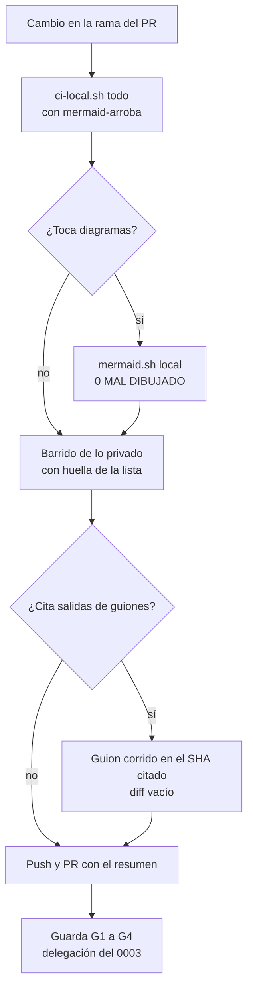

| Campo | Valor |
| --- | --- |
| Tipo | informe |
| Fecha | 2026-11-01 |
| Autor | Comisión C-VER, titular: ingeniero de verificación documental (CI y compuertas). A ciegas: leyó los folios 001 y 004 de esta mesa, el contrato de entrada (`02-Propuesta-De-Panel.md`), la cohesión y los núcleos N1-N7; **no** leyó ningún informe `01x` de otra comisión |
| Corrige | — |
| Secciones de Mesa-De-Expertos-A-Pedido 3.1 leídas | §0 (l. 1-111, con el «Mapa de carga»), §2.1 (pasos 2, 5, 10), §2.2, §2.3, §3.1 («Cuándo no hace falta una mesa»), §3.2, §3.3, §4 («Criterio de corte», «Datos reales»), §5.2 |
| Otros documentos cargados | `Cadena-De-Consecuencias` 2.0 §2; `Escalas-De-Juicio` 1.2 §3.3; `Mesa-Consulta-A-Un-Tercero` 2.0 §0-§2; `Conformacion-Pull-Request-Automatico` 2.0 §3.1 y §3.3 |

**Mandato.** Pregunta única de la silla: ¿cómo se prueba cada afirmación y cada decisión de entrega, y qué quedó sin
criterio de aceptación? Preguntas a cargo: P-04, P-09, P-11, P-12, P-19, P-20, P-22, P-25, P-26 y P-27 (folio 004,
tabla de comisiones; AJ-1). **No-competencia:** contenido y estilo editorial; la decisión de clase H sobre la etiqueta
de runner, que esta comisión **eleva y no cierra**. Tope: 12 hallazgos.

## Índice

1. [Definiciones y alias](#1-definiciones-y-alias)
2. [Resumen de dictámenes](#2-resumen-de-dictámenes)
3. [Dictámenes por pregunta](#3-dictámenes-por-pregunta)
   1. [P-04 — Qué entra en el PR común](#31-p-04--qué-entra-en-el-pr-común)
   2. [P-09 — Delegación del merge del expediente 0003](#32-p-09--delegación-del-merge-del-expediente-0003)
   3. [P-11 — Etiqueta de runner](#33-p-11--etiqueta-de-runner)
   4. [P-12 — Cierre de U25 y U26](#34-p-12--cierre-de-u25-y-u26)
   5. [P-19 — Sitio publicado](#35-p-19--sitio-publicado)
   6. [P-20 — Mermaid dibujado en la CI](#36-p-20--mermaid-dibujado-en-la-ci)
   7. [P-22 — Prefijo y doc_type del conocimiento](#37-p-22--prefijo-y-doc_type-del-conocimiento)
   8. [P-25 — Métrica de la reproducción](#38-p-25--métrica-de-la-reproducción)
   9. [P-26 — Oráculo e insumos](#39-p-26--oráculo-e-insumos)
   10. [P-27 — Dónde viven los ensayos](#310-p-27--dónde-viven-los-ensayos)
4. [Hallazgos propios](#4-hallazgos-propios)
5. [Convocatoria de Operación y entrega (AJ-2)](#5-convocatoria-de-operación-y-entrega-aj-2)
6. [Ensayos corridos](#6-ensayos-corridos)
7. [Lo que revisé y está bien](#7-lo-que-revisé-y-está-bien)
8. [Dudas para el entrevistador](#8-dudas-para-el-entrevistador)
9. [Excepciones a conocimientos](#9-excepciones-a-conocimientos)
10. [No verificado](#10-no-verificado)
11. [Inventario y notas de la corrida](#11-inventario-y-notas-de-la-corrida)

## 1. Definiciones y alias

| Término | Definición en este informe |
| --- | --- |
| **Criterio de aceptación** | Condición que un comando o una lectura contesta con sí o no, fijada **antes** de producir lo que se acepta |
| **Control** | Programa que termina con código 0 (verde) o distinto de 0 (rojo). Si bloquea un PR, es **compuerta** |
| **Prueba negativa** | Un defecto plantado en un insumo que pasa: el control tiene que dar rojo con el defecto y verde sin él. Una variable por corrida (Mesa-De-Expertos-A-Pedido §3.3, «El peritaje cambia una sola variable») |
| **Oráculo** | La respuesta esperada de un caso de prueba, escrita antes de la corrida, contra la que se compara lo que produce el aplicador. Término de la norma ISO/IEC/IEEE 29119-1 (*test oracle*), citada sin apartado |
| **Insumo fijo** | Entrada de un ensayo identificada por un commit que un tercero puede bajar del remoto |
| **Guion publicado** | Bloque `[Compilado: …]` del cuerpo que muestra un comando y su salida, para que el lector lo repita |

Alias de cita. `SDEI/` es `Lab-Documentos/Guides/Documentacion-Tecnica/Sistema-De-Documentacion-E-Integracion/` en el
commit `0bed863` (`main` de LD al 2026-11-01). `LD` es Lab-Documentos; `LDD`, Lab-Documentos.Documentacion; `LGD`,
Lab-Geometria.Documentacion. `EXP2` es `LDD:PROMPTs/DEVs/Enchacement/01-Replanteo-Y-Analisis/OUTPUTs/Expedientes/0002-Replanteo-Metodologia-DocAsCode/`.
`PP` es el contrato de entrada (`02-Propuesta-De-Panel.md`); `N1`…`N7`, los núcleos; `COH`, la cohesión. `KPRA` es
`Knowledge-Conformacion-Pull-Request-Automatico` 2.0. Por lo público del destino: `{org}` es la organización de GitHub
de los laboratorios, `{etiqueta-de-runner}` la etiqueta de `runs-on` de `LD:.github/workflows/docs-guard.yml:60`,
`{host-de-pruebas}` la máquina donde corrieron los ensayos, `{servicio-privado}` el servicio privado de notificaciones y
`{dir-de-trabajo}` la carpeta local de esta comisión. Los ensayos `E-V01`…`E-V07` están en §6, con su huella.

## 2. Resumen de dictámenes

| P | Posición (una línea) | Ensayo o cita que la sostiene |
| --- | --- | --- |
| P-04 | **C ajustada: PR común mínimo, con criterio de entrada.** Entra lo que un entregable necesita para pasar la compuerta o lo que corrige un dato falso de un archivo común; los cambios de comportamiento de `dg.py` van a un expediente de herramienta | E-V01, E-V04; `LDD:.github/workflows/verificar.yml:72-73` |
| P-09 | **Providencia de delegación en el expediente 0003 y fila de `CHANGELOG` en cada repo**, en el primer PR de cada uno; no ampliar el asiento del 0002 | `grep` de los dos `CHANGELOG.md`; KPRA §3.1 |
| P-11 | **Parámetro en el conocimiento y nada en los workflows**; la nota del Marco ya existe. El renombre **se eleva** al lote del PO como clase H, con su cadena | `SDEI/00-Marco.md:52`; `Lista-De-Verificacion.md:154`; 10 líneas `runs-on` en tres repos |
| P-12 | **U25 antes del libro y U26 dentro del mismo cambio**: la corrida nueva ya difiere de lo publicado | E-V03 |
| P-19 | **Sin sitio.** GitHub dibuja el Markdown y el mermaid; el ensayo MkDocs queda informativo sólo en el PR del libro | N7 §3.3; documentación de GitHub y de Material for MkDocs |
| P-20 | **Alternativa nueva: control determinista en PR-4 más dibujado local obligatorio.** El control ve los 2 diagramas que el dibujado ve, en 39 ms y sin contenedor | E-V04, E-V05 |
| P-22 | **`ANX-SDEI-ESPECIFICACION` con `doc_type: anexo`**: verde sin tocar archivos comunes; `KNW` exige dos | E-V01 |
| P-25 | **Una métrica común con denominador declarado**; las trampas de N4 entran como ítems del oráculo, no como segunda métrica | `N3:428-440`; `N4:300-308` |
| P-26 | **Oráculo sellado con huella y de autor distinto del aplicador, que no sea la columna del Marco**; insumo sólo con commit del remoto | `SDEI/00-Marco.md:106`; E-V06 |
| P-27 | **Geometría: evidencia en el expediente 0003 de LDD, sin PR a LGD.** Servicio privado: carpeta local privada, con sólo su huella en lo público | E-V06; Mesa-De-Expertos-A-Pedido §3.2 |

## 3. Dictámenes por pregunta

Cada dictamen sigue los cuatro pasos de `Cadena-De-Consecuencias` §2 en la fila «Cadena» y termina con el criterio de
aceptación que lo vuelve comprobable.

### 3.1 P-04 — Qué entra en el PR común

**Posición.** Alternativa **C ajustada**. Un PR común por repo, anunciado a FRAMEWORK MAUI, que lleva sólo:

| Repo | Ítem | Por qué entra | Prueba que lo acepta |
| --- | --- | --- | --- |
| LD | `tools/docs-guard/prefijos.txt:24`: `PE` pasa a «patrón de ejemplo» | Dato falso en archivo común: el anexo dice «patrón de ejemplo» (`SDEI/99-Anexos/Esquema-Frontmatter-Y-Prefijos.md:117`) y el registro dice «pregunta de evaluación» | `grep -n '^PE ' prefijos.txt` igual a la fila del anexo |
| LD | Control `mermaid-arroba` en PR-4, con fixture rojo y verde en `autoprueba` (P-20) | Cierra un defecto medido que hoy pasa verde | E-V04: rojo con el fixture plantado, verde sin él; `ci-local.sh todo` verde |
| LD y LDD | Fila de delegación del 0003 en `CHANGELOG.md` (P-09) | Sin ella rige la conformación manual (KPRA §3.1) | `grep -n 0003 CHANGELOG.md` devuelve la fila con los seis campos de §3.2 |

**No entran** (van a un expediente de herramienta): exclusión de carpetas (U4d), precedencia de versión (caso R de N4),
IDs locales y versión de ID en sección (N5 B2-B3), ni `KNW` (P-22).

| Paso de la cadena | Lectura |
| --- | --- |
| ¿Dónde cae? | En `tools/docs-guard/**`, que comparten las sesiones de FRAMEWORK MAUI (PP §5, decisiones cerradas: «un PR común a la vez por repo») y que LDD consume como workflow reutilizable fijado por SHA (`LDD:.github/workflows/verificar.yml:72-73`, pin `bf86669`; «Subir el pin es clase H») |
| ¿Cuánto pesa? | Con C ajustada: 3 archivos de LD que ya existen más 2 fixtures; con B, además lógica nueva de `dg.py` cuyo requisito sale de ensayos que **todavía no corrieron** (N3 §8: «No existe el conocimiento»). Un cambio de control sin el ensayo que lo pide es un «efecto no medido», que KPRA §3.4 lista como reserva |
| ¿Qué pierde la alternativa? | C ajustada demora las mejoras de `dg.py`: los ensayos de Geometría y del servicio privado van a tropezar con `_legacy/` y la versión doble (N4 §5). Se paga declarándolas como trampas del oráculo (P-25), que es justamente lo que el ensayo quiere medir. B pierde la prueba negativa de cada cambio en un PR que ya mezcla tres objetivos |
| ¿Es reversible? | Las dos lo son; C ajustada es más barata de revertir (archivos de texto y un control nuevo) |

**Fuentes externas.** DORA, «Working in small batches»: «It reduces the time it takes to get feedback on changes,
making it easier to triage and remediate problems» (https://dora.dev/capabilities/working-in-small-batches/, consultado
el 2026-11-01). GitHub, «Secure use reference»: «Pin references to actions to a commit SHA in your workflow files»
(https://docs.github.com/en/actions/reference/security/secure-use, consultado el 2026-11-01), que es por qué un cambio de
`dg.py` no llega a LDD sin un PR propio de subida de pin.

**Riesgos.** Que el PR común se abra antes del veredicto de P-22 y P-20 y haya que reabrirlo: se mitiga abriéndolo
después del veredicto (COH §7, paso 4). Que FRAMEWORK MAUI tenga otro PR común abierto: se lee la lista de PR abiertos
antes de abrir (COH §8, M6: ninguno a las 18:11 UTC).

**Criterio de aceptación del PR común.** (1) Cada ítem lleva en el cuerpo del PR el requisito o la pregunta P-xx que lo
pide; (2) todo cambio de control trae un fixture rojo que se vio fallar antes del arreglo (Mesa-De-Expertos-A-Pedido
§3.3, «Una prueba que no se vio fallar no cierra»); (3) `scripts/ci-local.sh todo` verde, con `autoprueba`; (4) `fw-ok`
y `docs-guard` verdes en el SHA del PR (G3); (5) el anuncio a FRAMEWORK MAUI consta antes del merge.

### 3.2 P-09 — Delegación del merge del expediente 0003

**Posición.** **Providencia de delegación** como folio del expediente 0003, y **fila de `CHANGELOG.md`** en LD y en LDD,
cada una en el primer PR del 0003 de su repo (en LD, el PR común; en LDD, el PR que versiona el expediente).

**Medición.** `grep -n 0003` sobre `LD:CHANGELOG.md` y `LDD:CHANGELOG.md` (worktrees del 2026-11-01): sin salida en los
dos. Las delegaciones vigentes dicen «**Alcance:** los PR del expediente 0002 en este repositorio» (`LD:CHANGELOG.md:305-312`)
y «los PR del expediente 0002 en […] Lab-Documentos.Documentacion» (`LDD:CHANGELOG.md:30-37`). KPRA §3.1: «Si el agente
no la encuentra, rige el padre».

| Paso de la cadena | Lectura |
| --- | --- |
| ¿Dónde cae? | En cada merge de la reedición: sin asiento, cada uno vuelve al PO |
| ¿Cuánto pesa? | Todos los PR del plan (COH §7: al menos PR común, coherencia, libro, conocimiento, integración, por dos repos) |
| ¿Qué pierde la alternativa? | «Ampliar el alcance del 0002» reescribe un asiento ya fechado y deja la delegación del 0003 sin folio propio: el expediente 0003 no puede contestar desde cuándo y por qué fusiona. «Manual hasta el cierre» frena lo que la delegación vigente del PO quiere evitar (testimonio literal en `LD:CHANGELOG.md:308`: «preguntas y confirmaciones tontas») |
| ¿Es reversible? | Sí: KPRA §3.1, «Es revocable por unidad» |

**Criterio de aceptación.** La fila de cada `CHANGELOG.md` tiene los seis campos de KPRA §3.1, comprobables con `grep`:
fecha, responsable, asiento (ruta del folio de providencia), alcance («los PR del expediente 0003 en este repositorio»,
incluido el que la asienta), guarda (techo e intervalo) y excepción. La providencia cita el testimonio con literal, canal,
fecha y huella SHA-256 (Mesa-De-Expertos-A-Pedido §3.2). Se considera asentada cuando la fila está en `main` del repo.

**Riesgo.** El primer merge (el que asienta) se fusiona por una delegación que todavía no está en `main`. Se cubre si la
providencia incluye ese merge en el alcance, como hizo el 0002 («incluido el primer merge», `LDD:CHANGELOG.md:33`).
**Convocatoria AJ-2:** no la pido (§5).

### 3.3 P-11 — Etiqueta de runner

**Posición.** **Parámetro en el conocimiento (N3 §4.4), sin tocar workflows, y sin nota nueva en el Marco** porque ya
existe. El renombre se **eleva** al lote del PO como clase H (no lo cierra esta comisión).

**Mediciones.**

- `SDEI/00-Marco.md:52` ya dice: «`[self-hosted, {etiqueta-de-runner}]` es la etiqueta del runner del laboratorio, no
  una dirección». La alternativa «nota en el Marco» (N1-35) está hecha.
- La etiqueta está fijada como **ítem de verificación** y como **filtro de decisión**:
  `SDEI/99-Anexos/Lista-De-Verificacion.md:154` (`VER-W09`: «El workflow de CI corre en el runner con la etiqueta
  exacta…») y `SDEI/99-Anexos/Como-Decidir.md:82` (`F1`). Copiados al conocimiento, lo vuelven inaplicable «en otro
  contexto» (E-03).
- `grep -n 'runs-on'` da **10 líneas** con la etiqueta: 7 en LD (`docs-guard.yml:60`, `mini-demo-movilidad.yml:35`,
  `docs-enlaces-semanal.yml:43`, `framework-concept-demo.yml:43,88,149,169`), 1 en LDD (`verificar.yml:35`) y 2 en
  Lab-Geometria (`e2e.yml:69,149`); además 7 líneas del cuerpo SDEI.

**Cadena del renombre, para el lote del PO.**

| Paso | Lectura |
| --- | --- |
| ¿Dónde cae? | En el único check obligatorio de LD: `fw-ok` (API pública, `branches/main` de LD: `required_status_checks.contexts: ["fw-ok"]`, consultado el 2026-11-01). Su job corre con la misma etiqueta (`framework-concept-demo.yml:169`) |
| ¿Cuánto pesa? | Si el workflow cambia de etiqueta antes que el runner, el job queda en cola: «A job can be in the queue for 24 hours before it is automatically cancelled» (https://docs.github.com/en/actions/reference/limits, consultado el 2026-11-01). Mientras tanto ningún PR de LD se fusiona, tampoco los de FRAMEWORK MAUI |
| ¿Qué pierde no renombrar? | Un nombre de máquina queda en tres repos públicos (N2 H-5); el Marco ya aclara que no es una dirección |
| ¿Es reversible? | El acto sí; su costo alcanza a terceros (otra sesión, otro repo, la configuración del runner en la organización). Es irreversible con consecuencia externa en el sentido de `Detencion-Y-Lote` §3.7 |

**Fuentes externas.** GitHub, «Using labels with self-hosted runners»: las etiquetas se asignan al runner en la
organización y las no usadas «will be automatically deleted within 24 hours»
(https://docs.github.com/en/actions/hosting-your-own-runners/managing-self-hosted-runners/using-labels-with-self-hosted-runners,
consultado el 2026-11-01).

**Criterio de aceptación de la posición.** En el conocimiento: `grep -c` de la etiqueta literal = 0 y aparece el
parámetro `{etiqueta-del-runner}` con su definición. En `VER-W09` y `F1`: la redacción dice «la etiqueta que fija el
caso» y la cita a la etiqueta vigente queda como ejemplo del caso (esto último es contenido: lo redacta quien aplica).
**Si el PO aprueba el renombre**, el criterio es: runner con las dos etiquetas antes del cambio de workflows, los 10
`runs-on` cambiados en PR coordinados, una corrida verde de `fw-ok` con la etiqueta nueva y recién después se quita la
vieja.

### 3.4 P-12 — Cierre de U25 y U26

**Posición.** **Alternativa A: U25 (corrida nueva) antes del libro, en `EXP2/evidencia/E1-R/ensayos/`, como la define
`EXP2/actuaciones/259-*.md:80-83`; U26 (marcas a URL y SHA) en el mismo PR de coherencia del cuerpo.** La alternativa B
(sólo URL y SHA en el libro) cita una salida que hoy ya no es la que se obtiene.

**Medición (E-V03).** Corrí los tres primeros guiones originales sobre `LD` `0bed863` en {host-de-pruebas}; corren en
menos de 0,2 s cada uno, rc=0, y **difieren** de las salidas publicadas:

| Guion | Publicado (cita) | Corrida nueva | Diferencia |
| --- | --- | --- | --- |
| `03-tem03-ancla.sh` | `SDEI/TEM-03-Topologia-Y-Versionado.md:235`: `ROJO (errores=3 …)` | `ROJO (errores=5 …) … ids-duplicados=2`, dos líneas `ERROR id-duplicado` nuevas | El control `id-duplicado` (DEF-16, `scripts/ci-local.sh:17`) no existía en `080f158` |
| `02-tem02-rrd.sh` | `SDEI/TEM-02-Ciclo-Documental.md:225` | Mismos errores; la línea de resumen suma `readme-del-cuerpo-sin-frontmatter=0` | Cambio de formato, no de resultado |
| `01-tem01-inventario.sh` | `EXP2/evidencia/E1-U4b/01-salida.txt` | Suma `proceso 2` y `tema 7` | El inventario creció |

Además, `TEM-03:221` y `TEM-07:200` citan `080f158`, que un clon nuevo no tiene (N1-17): el TEM-07 no se puede correr
literal hasta que P-10 decida cómo se citan esos commits.

| Paso de la cadena | Lectura |
| --- | --- |
| ¿Dónde cae? | En el lector del libro que repite el guion: obtiene `errores=5` donde el libro dice `errores=3` |
| ¿Cuánto pesa? | Lectura P1 del contrato: «lectura divergente entre lectores». Rehacer los tres guiones cuesta menos de un segundo de cómputo |
| ¿Qué pierde B? | La fidelidad de los guiones publicados; el libro hereda el desfase |
| ¿Es reversible? | Sí |

**Criterio de aceptación.** Por guion: salida nueva con el SHA de LD en la primera línea, `diff` contra la original con
cada diferencia explicada (259 §4), y el bloque `[Compilado: …]` del cuerpo reemplazado por la salida nueva con URL
permanente `https://github.com/{org}/Lab-Documentos.Documentacion/blob/<sha>/<ruta>`. Para todo bloque de salida del
libro: `diff` vacío entre lo citado y lo que da el guion en el SHA citado.

### 3.5 P-19 — Sitio publicado

**Posición.** **No hay sitio** en este expediente. El libro se lee en GitHub; el ensayo MkDocs queda **informativo** y
sólo en el PR del libro, con slug compatible con GitHub (N7 §3.3: 0 advertencias de anclas con
`pymdownx.slugs.slugify`).

**Fundamento.** LD no tiene generador ni workflow que publique páginas (N7 §3.3, `find` sin resultados; confirmado con
`ls LD/.github/workflows`: cuatro workflows, ninguno publica). GitHub dibuja Markdown y mermaid: «Diagram rendering is
available in GitHub Issues, GitHub Discussions, pull requests, wikis, and Markdown files»
(https://docs.github.com/en/get-started/writing-on-github/working-with-advanced-formatting/creating-diagrams,
consultado el 2026-11-01). Material for MkDocs: «End of life on May 5, 2027» y «Zensical is our modern successor»
(https://squidfunk.github.io/mkdocs-material/, consultado el 2026-11-01): un sitio nuevo sobre Material compra una
migración con fecha.

| Paso de la cadena | Lectura |
| --- | --- |
| ¿Dónde cae? | Con sitio: un workflow de publicación nuevo (archivo común), una dependencia con fin de vida y 22 enlaces que salen del `docs_dir` (N7 §3.3) |
| ¿Cuánto pesa? | Sin sitio: 0 archivos nuevos |
| ¿Qué pierde no publicar? | Búsqueda y navegación lateral; el libro unificado las compensa en parte con su índice (E-21) |
| ¿Es reversible? | Sí: publicar después no rompe nada si el libro ya pasa el ensayo con slug de GitHub |

**Criterio de aceptación.** En el PR del libro: `mkdocs build` con `pymdownx.slugs.slugify` sin advertencias de anclas
(informativo, no bloquea) y `docs-guard` verde (bloquea). **AJ-2:** no pido convocar (§5).

### 3.6 P-20 — Mermaid dibujado en la CI

**Posición.** **Alternativa nueva, C:** (1) un control determinista `mermaid-arroba` en PR-4, que rechaza en una
etiqueta de mermaid el patrón de autoenlace de correo; (2) `mermaid.sh` **local obligatorio** antes de los PR que tocan
diagramas, con su resumen en el cuerpo del PR. No se lleva el dibujado completo a la CI.

**Medición (E-V04, E-V05).**

- Dibujé los cuatro archivos donde aparece `@` en una etiqueta: **2 «MAL DIBUJADO»** (`Esquema-Frontmatter-Y-Prefijos.md:82`,
  `_requisitos.md:56`, ambos con `ID@1.0` o `@1.1`) y **2 ok** (`MovilidadUrbana-Mini-Demo/README.md`, con
  `nn@ver` y `Símbolo@SHA`; `TEM-05`, con `ID@versión`). La diferencia es el punto después de la arroba.
- Eso coincide con la regla del autoenlace de correo de GFM: después de la arroba, caracteres «separated by periods»,
  con al menos un punto (GitHub Flavored Markdown Spec 0.29-gfm, «Autolinks (extension)»,
  https://github.github.com/gfm/#extended-email-autolink, consultado el 2026-11-01).
- El control prototipo (expresión `[\w.+-]@[\w-]+\.[\w-]` sobre el texto de etiquetas) marca **exactamente los 2** de
  28 bloques, sin falsos positivos sobre los 3 benignos, en **39 ms**; con un fixture plantado da rojo y con `#64;` da
  verde.
- El dibujado completo tarda 163 s para 27 diagramas (N7 §3.2) y necesita contenedor; los runners de la etiqueta «no
  tienen docker.sock ni KVM» (`LD:.github/workflows/framework-concept-demo.yml:12`) y `ci-local.sh:27` dice «No usa
  contenedores: el runner tampoco». Llevarlo a la CI exige instalar un navegador sin contenedor en el runner, lo que
  requiere acuerdo del PO (restricción dura del contrato: «nada se instala en un host sin acuerdo del PO»).

| Paso de la cadena | Lectura |
| --- | --- |
| ¿Dónde cae? | En el PR común (`tools/docs-guard/**`) y en cada PR de contenido |
| ¿Cuánto pesa? | C: un control de decenas de líneas y dos fixtures; 39 ms por corrida. Dibujado en CI: navegador en el runner, ~6 s por diagrama |
| ¿Qué pierde C? | Defectos de dibujado de otra clase, que hoy no conocemos; los cubre el dibujado local obligatorio |
| ¿Es reversible? | Sí |

**Criterio de aceptación.** Fixture rojo (`traces: [ID@1.0]` en una etiqueta) da rojo y fixture verde (`ID#64;1.0`) da
verde en `autoprueba`; sobre `SDEI/` en `0bed863` el control da rojo con las 2 líneas y, tras la corrección de N1-25
con `#64;` o espacios, verde; `mermaid.sh` sobre los mismos archivos da 0 «MAL DIBUJADO».

### 3.7 P-22 — Prefijo y doc_type del conocimiento

**Posición.** **`ANX-SDEI-ESPECIFICACION` con `doc_type: anexo`** (N3 M-1 B).

**Medición (E-V01).** Archivo de ensayo en `SDEI/Conocimientos/` de una copia de LD en `0bed863`, `dg.py esquema`:

| `doc_id` / `doc_type` | Resultado |
| --- | --- |
| `KNW-…` / `conocimiento` | **ROJO, 2 errores**: `doc_type` fuera del vocabulario (`tools/docs-guard/esquemas/cuerpo.schema.json:10`) y `«KNW-» no está en el registro` |
| `ANX-…` / `anexo` | **verde** |
| `KNW-…` / `anexo` | ROJO, 1 error (prefijo) |
| `ANX-…` / `conocimiento` | ROJO, 1 error (vocabulario) |

`KNW` necesita **dos** archivos comunes (`prefijos.txt` y `cuerpo.schema.json`), no uno.

| Paso de la cadena | Lectura |
| --- | --- |
| ¿Dónde cae? | `KNW`: en el PR común y en el esquema que valida a todos los cuerpos que usan el workflow reutilizable |
| ¿Cuánto pesa? | `ANX`: 0 archivos comunes. `KNW`: 2, más un fixture para la autoprueba |
| ¿Qué pierde `ANX`? | El tipo no dice «conocimiento»: un lector que filtra por `doc_type` no lo encuentra como tal. Se compensa con el título y con `corpus_id` del README del cuerpo |
| ¿Es reversible? | Sí: pasar de `ANX` a `KNW` después es renombrar un `doc_id` y sus trazas, medible con PR-5 |

**Riesgo propio.** Un conocimiento le habla a un agente: dos frases de prueba («Instrucciones para agentes», «Ejecutá el
siguiente comando») dieron **2 avisos AI-3** (E-V02). No bloquean (`dg.py:428`, `bloquea=ai3_bloquea`, falso por defecto),
pero quedan como avisos permanentes: ver V-12.

**Criterio de aceptación.** `scripts/ci-local.sh todo` verde con el conocimiento dentro de `SDEI/`, sin tocar
`tools/docs-guard/**`.

### 3.8 P-25 — Métrica de la reproducción

**Posición.** **Una métrica común a todos los casos, con el denominador declarado antes de correr**; las ocho trampas de
N4 (`N4:300-308`) se escriben **como ítems del oráculo de C1**, no como una segunda métrica. Los umbrales los fija la
comisión formal; esta comisión fija cómo se miden.

| Medida | Instrumento | Cómo pasa |
| --- | --- | --- |
| Cobertura | Planilla de decisiones D-01…D-nn del aplicador | 100 % contestadas o «pendiente» con motivo |
| Coincidencia | Comparación ítem por ítem con el oráculo sellado, en las cuatro categorías de `N3` §5.6 paso 5 | Umbral **entero** sobre un denominador fijo: con 17 decisiones, «≥ 85 %» es 15 de 17 (88 %), porque 14 de 17 es 82 %. Los ítems «sin oráculo» se excluyen antes de correr, no después |
| Invenciones | Script que verifica que cada `ruta:línea` citada por el aplicador existe en el SHA del insumo, más muestreo del refutador | 0 |
| Compuerta | `docs-guard` sobre los artefactos del ensayo, con un par rojo y verde | Verde, con el rojo visto |
| Prueba negativa | Corrida con §3.2 del conocimiento borrado (`N3` §5.6 paso 4) | El aplicador declara el hueco y no completa por inferencia |
| Estabilidad | Dos corridas independientes por caso | Se informa el acuerdo entre corridas; una decisión que cambia entre corridas es hallazgo del conocimiento |

**Fundamento.** Dos métricas para la misma prueba son «dos conjuntos cerrados para la misma pregunta», lo que la base
prohíbe para las escalas de juicio (Mesa-De-Expertos-A-Pedido §3.2, «Niveles P0–P3, nunca una segunda escala»); el
mismo principio vale para el criterio de un ensayo. Fijar plan y medidas antes de mirar los datos es la práctica del
prerregistro: «specifying your research plan in advance of your study» (Center for Open Science,
https://www.cos.io/initiatives/prereg, consultado el 2026-11-01).

**Riesgo.** Que «0 preguntas sin respuesta» (N3) y «cada pregunta = hueco» (N4) se lean como contradicción: no lo son si
la pregunta se registra y además cuenta como falla.

**Criterio de aceptación.** Antes de la primera corrida existe un folio con: lista de ítems, denominador, umbrales
enteros, instrumentos y huella SHA-256 del oráculo.

### 3.9 P-26 — Oráculo e insumos

**Posición.** El oráculo de cada caso lo escribe **un agente distinto del aplicador**, se sella con SHA-256 en un folio
**antes** de correr y **no es la columna del Marco** (`SDEI/00-Marco.md:102-109`), porque esa tabla es objeto de
corrección en la misma reedición (P-16). Para C1 sirve `N4` §4 corregido con las trampas; para C2, la hoja de
integración privada de N5, sellada en lo privado (sólo la huella pasa a lo público). El insumo del aplicador es el
conocimiento y el repo del caso **en un commit que exista en el remoto**; la plantilla A-01 vacía es parte del
conocimiento, no un insumo aparte.

**Medición (E-V06).** Para Geometría hay tres ia-db: `origin/main` en `0202722` con la **3.0**
(`ia-db/README.md:121` de ese commit: «Versión: **3.0**»); la **4.0** del PR #3 en `b47d22b` (API pública, PR abiertos
de LGD: `3 ia-db/4.0 b47d22b main`); y otra **4.0** sin commitear en el clon local (33 entradas en `git status`). La tercera
no la puede bajar nadie: un ensayo sobre ella no se reproduce.

**Fundamento.** Un oráculo que el propio ensayo viene a corregir penaliza las respuestas correctas (circularidad). La
tabla del Marco omite CL-06 y CL-09 en `ESC-SDEI-4` (`00-Marco.md:106`) y N5 sostiene que el caso real las tiene (lo
tomo como `C`: no pude verificarlo sin lo privado). Norma: ISO/IEC/IEEE 29119-1, que define el oráculo de prueba como
fuente de los resultados esperados, citada sin apartado.

**Criterio de aceptación.** (1) Folio de oráculo con autor, fecha, SHA-256 y SHA del insumo, anterior en el historial
del expediente al folio de la corrida; (2) el aplicador recibe la URL del repo y el SHA, y la carta lo dice; (3) para
Geometría: `0202722` o `b47d22b`, nunca el árbol local; la elección la hace quien preside y se declara.

### 3.10 P-27 — Dónde viven los ensayos

**Posición.** **Geometría:** la corrida, sus artefactos y su evidencia van al **expediente 0003 de LDD** (repo público,
con delegación una vez resuelta P-09), en `evidencia/`; si hace falta correr `docs-guard` sobre los artefactos en el
layout del proyecto, se usa un worktree descartable de LGD, sin PR. **Servicio privado:** sólo la carpeta privada local
de la reedición; a lo público pasan las cifras y la huella SHA-256 de cada pieza.

**Medición (E-V06).** LGD no tiene delegación ni workflows en `main`: `git ls-tree -r --name-only origin/main | grep -c
'^.github/workflows'` = 0; `README.md` de `main` sin la palabra «delegación»; la delegación y el control `Verificar`
esperan en el PR #2 (`entrega/delegacion-y-verificar`, `27291b1`). Un PR de ensayo en LGD no tendría corridas que leer
(G3: «Ninguna: reserva», KPRA §3.3) y su merge volvería al PO.

**Fundamento.** «Cada folio vale por sí solo; la evidencia cruda queda local» con cifras, comando, extracto y huella
(Mesa-De-Expertos-A-Pedido §3.2). El worktree es el medio de paralelo que la base admite (KPRA §3.5) y Git lo define
como «Manage multiple working trees attached to the same repository» (https://git-scm.com/docs/git-worktree, consultado
el 2026-11-01). Un PR en el repo privado del servicio pide una delegación en ese repo que nadie verificó (COH §6.1: «PR
abiertos del repo privado y estado de su CI», no verificado) y escribe sobre un producto que L-3 deja fuera.

**Criterio de aceptación.** Geometría: carpeta de evidencia del 0003 con el SHA del insumo, el oráculo sellado, la salida
de `docs-guard` y la planilla de P-25; ningún PR abierto en LGD por el ensayo (`pulls?state=open` sin ramas `dac/`).
Servicio privado: el folio público cita cifras y huellas; el barrido de lo privado de V-08 da 0 coincidencias.

## 4. Hallazgos propios

Lectura P0–P3 del contrato (PP §8): P0 viola una restricción dura o hace imposible el objetivo; P1 retrabajo o lectura
divergente; P2 pérdida acotada; P3 claridad.

| ID | Nivel | Qué falla y dónde | Ancla | Impacto si no se corrige | Dirección |
| --- | --- | --- | --- | --- | --- |
| V-01 | P1 | Las salidas publicadas de los guiones de TEM-01, TEM-02 y TEM-03 ya no son las que dan los mismos guiones con el `dg.py` de `main`; en TEM-03 el caso 3 pasa de `errores=3` a `errores=5` | E1: E-V03; `SDEI/TEM-03-Topologia-Y-Versionado.md:235` | El libro hereda un resultado que el lector no obtiene | U25 antes del libro (P-12) |
| V-02 | P2 | `SDEI/TEM-06-Compuertas-Y-CI.md:198` cita `docs-guard.yml, l. 40-51`; ese contenido está hoy en las líneas 50-61 | E1: `diff` de `TEM-06:199-212` contra `docs-guard.yml:51-62` (sólo difiere el cierre del bloque) | Cita de línea vieja | Actualizar el rango al rehacer el capítulo |
| V-03 | P2 | `CQ-03` se declara automatizable («¿Toda referencia a código, ruta o símbolo existe en el commit citado?», `Criterios-De-Calidad.md:33`, mapeado a PR-5 en `:73`), pero ningún control compara un `[Compilado: ruta, l. x–y]` con su fuente: V-02 pasa verde | E1: E-V07 (prototipo: 5 marcas, 1 desfasada real) y E2: `dg.py:852-866` (`cita-linea` sólo mira rutas absolutas sin línea) | Un control declarado que no se ejerce (filtro «Descripción o control», Mesa-De-Expertos-A-Pedido §3.3) | Aviso `compilado-linea` en el expediente de herramienta; mientras, deuda declarada, sin reescribir `CQ-03` |
| V-04 | P1 | PR-4 da verde con dos diagramas que no se dibujan; la causa es el autoenlace de correo de GFM | E1: E-V04 y E-V05 | Diagramas rotos en el libro y en GitHub | Control `mermaid-arroba` (P-20) |
| V-05 | P1 | La etiqueta de runner es ítem de verificación exacto y filtro de decisión del cuerpo | E2: `Lista-De-Verificacion.md:154` (`VER-W09`); `Como-Decidir.md:82` (`F1`) | Un conocimiento que la copie no se aplica en otro contexto (E-03) | Parametrizar (P-11) |
| V-06 | P3 | La nota que N1-35 propone para el Marco ya existe | E2: `SDEI/00-Marco.md:52` | Trabajo repetido | Retirar esa alternativa de P-11 |
| V-07 | P1 | No hay delegación del 0003 en LD ni en LDD, y LGD no tiene delegación ni workflows en `main` | E1: `grep -n 0003` en los dos `CHANGELOG.md` sin salida; `git ls-tree` de LGD = 0 workflows | Todo merge vuelve al PO; un PR en LGD queda en reserva por G3 | P-09; P-27 sin PR a LGD |
| V-08 | P1 | El barrido de lo privado bloquea (N7 §6, paso 6), pero su lista no está versionada ni tiene huella: nadie puede comprobar después qué lista se usó | E2: `N7` §6 paso 6 («la lista concreta vive en {dir-de-trabajo}/privado/ y no se copia») | El control que protege la restricción dura más grave (P0) no deja evidencia auditable | Cada PR registra en su cuerpo el SHA-256 de la lista usada, el comando y «0 coincidencias»; el folio del cierre las cuenta |
| V-09 | P1 | El oráculo que propone N3 para C1 y C2 es la columna del Marco, que la reedición corrige | E2: `N3:413-414`; `SDEI/00-Marco.md:106` | El ensayo castiga respuestas correctas | P-26 |
| V-10 | P1 | El insumo de Geometría no está fijo: tres ia-db, una sin commitear | E1: E-V06 | Ensayo no reproducible | P-26, punto 3 |
| V-11 | P2 | «≥ 85 %» sin denominador ni regla de redondeo, con ítems «sin oráculo» que se excluyen | E2: `N3:432-433` | Un 14 de 17 se discute después de correr | P-25: umbral entero y denominador previo |
| V-12 | P3 | Un conocimiento dirigido a agentes dispara AI-3 en cada frase imperativa a un agente | E1: E-V02 (2 avisos en 2 líneas de prueba) | Avisos permanentes que entrenan a ignorar AI-3 | Redactar en tercera persona o registrar la excepción por huella en `excepciones.txt` (AK-3), decidido en el PR del conocimiento |

## 5. Convocatoria de Operación y entrega (AJ-2)

Declaración que pide el folio 004 (K2) para P-09, P-11 y P-19:

| Pregunta | ¿Solicito convocatoria? | Por qué |
| --- | --- | --- |
| P-09 | **No** | Se contesta con una lectura (KPRA §3.1) y un `grep`: no hay decisión de operación abierta (Mesa-De-Expertos-A-Pedido §3.1, «Cuándo no hace falta una mesa») |
| P-11 | **No en este ciclo; sí condicionada** | La decisión es clase H y va al lote del PO. **Disparador comprobable:** si el PO aprueba el renombre, se convoca Operación y entrega para el plan de cambio (orden runner → workflows → quitar la etiqueta vieja) antes del primer PR que toque un `runs-on` |
| P-19 | **No** | La posición es «sin sitio»: no hay nada que operar |

## 6. Ensayos corridos

Todos el 2026-11-01 en {host-de-pruebas}, sin escribir en ningún repo. Las copias de trabajo y las salidas quedan en
{dir-de-trabajo}/cver/.

| ID | Qué | Comando (resumido) | Resultado | Huella SHA-256 de la salida |
| --- | --- | --- | --- | --- |
| E-V01 | Prefijo y `doc_type` del conocimiento | `git archive` de LD `0bed863` a una copia; archivo de ensayo en `SDEI/Conocimientos/`; `python3 -I tools/docs-guard/dg.py esquema SDEI/` con cuatro variantes | `KNW`/`conocimiento` rojo (2); `ANX`/`anexo` verde | `f23990bee45b3f973d25d56663b1ec5b7b6cd6fdc541123e2cbcdc5a4e775670` |
| E-V02 | AI-3 sobre frases dirigidas a agentes | `dg.py ai SDEI/` con dos líneas agregadas | verde con `AI-3=2` avisos, rc=0 | `51ec8eb8279baf7dd980c83c64c3e18ef97979b46a95c0ccbcd644eb85282873` |
| E-V03 | U25 parcial: guiones originales sobre `main` | `bash EXP2/evidencia/E1-U4b/0{1,2,3}-*.sh <LD>`, `diff` contra `0{1,2,3}-salida.txt` | rc=0 los tres; 0,08 s, 0,11 s y 0,18 s; difieren como en §3.4 | Las tres, completas debajo de esta tabla |
| E-V04 | Control determinista `mermaid-arroba` | `python3 -I mermaid_arroba.py SDEI/ AGENTS.md`; fixture rojo y verde | Sobre SDEI: ROJO, 28 bloques, 2 errores, 39 ms; fixture rojo rc=1, verde rc=0 | `30d71d23b4d27bdf93f2ee76aad5eb54ac83dcf87bff2f1c5aa59aae7552e71f` (salida); `d67e2ce81c52b9193f6ec8060e221e930132cd5abc11cf825b0288c65e053f88` (script) |
| E-V05 | Dibujado de una variable: punto después de la arroba | `tools/medios/mermaid.sh` (contenedor `minlag/mermaid-cli:11.4.2`) sobre los 4 archivos con `@` en etiquetas | 2 MAL DIBUJADO (con punto), 2 ok (sin punto); 22 s | `6e3aa7139cbcec0041d0c5f38adb0d4a9b76dd291e9d580fc63df15458e8c06e` |
| E-V06 | Estado de LGD y de la protección de ramas | `git ls-tree` y `git show` sobre `origin/main` de LGD; API pública `branches/main` y `pulls?state=open` | LGD: 0 workflows, ia-db 3.0 en `main`, PR #2 y #3 abiertos; LD `main` `0bed863` protegida con `fw-ok`; LDD `main` `e3c97df` sin protección | Salida en la sesión, no guardada (lectura de API) |
| E-V07 | Prototipo de control `compilado-linea` | `python3 -I compilado.py <LD> SDEI/` | 5 marcas: 1 ok exacta (`TEM-03:162`), 2 fragmentos rotulados que son subconjunto correcto (`TEM-05:119,168`), 1 desfasada real (`TEM-06:198`), 1 falso positivo (la marca de ejemplo de `Patrones-De-Ejemplos.md:51`) | `4ce3804d3378f89b4d88df0d467cad14f62b3d57f2199594b3d2c7f972052802` (salida); `c54a8c5778ce4beb35e50ed5680703f12338ca90ec4dbc57b9f992b757c50e77` (script) |

Huellas completas de E-V03: `8aaf03fba72c382ad5e70c20b37ce0358ace7f2d014747b38d85bcd7e7342081` (01),
`e9144e85d3e170e6e3e6ceb19ef32298dd983baa8e6dcf44c388930e6618dde0` (02),
`8d35896a9d334670a4c46435ef044370dabad3b3d4c005439da9440470c4d629` (03).

Procedimiento que propongo como criterio de cada PR de la reedición (amplía N7 §6 con V-04 y V-08):

*Figura 1. Lo que cada PR prueba antes de la guarda: los pasos nuevos frente a N7 §6 son el control de arroba, la
huella de la lista del barrido y el `diff` de las salidas citadas.*

## 7. Lo que revisé y está bien

1. **Línea base de enlaces y anclas.** Dos verificadores independientes coinciden en 0 enlaces rotos fuera de los tres
   declarados (N7 §3.4); no la volví a correr entera, pero E-V01 y E-V02 corrieron sobre la misma copia sin rojos
   ajenos al archivo de ensayo.
2. **El pin del workflow reutilizable en LDD** está por SHA completo (`verificar.yml:73`), como pide la guía de
   seguridad de GitHub citada en §3.1.
3. **PR-2 con el anexo**: `ANX`/`anexo` pasa sin tocar nada común (E-V01), así que el conocimiento no depende del PR común.

## 8. Dudas para el entrevistador

Formato de `Mesa-Consulta-A-Un-Tercero` §2. Esta comisión no usa ningún canal.

| Rol | Pregunta | Por qué | Prioridad | Qué hago si no contesta |
| --- | --- | --- | --- | --- |
| C-VER | ¿Se renombra la etiqueta de runner en los tres repos y en la organización? | Es clase H con consecuencia externa (§3.3); destraba la convocatoria condicionada de §5 | Baja | Queda como está, parametrizada en el conocimiento; va a deuda declarada con el disparador de §5 |

## 9. Excepciones a conocimientos

Ninguna. Las posiciones siguen las convenciones del barrido (PP §5).

## 10. No verificado

| Afirmación | Por qué no |
| --- | --- |
| Que CL-06 y CL-09 se apliquen al caso privado (`N5` §5) | No transcribo ni verifico lo privado; queda como `C` |
| U25 completo: `04-adopciones.sh` y los guiones de TEM-04…07 | Sólo corrí 01-03; el de TEM-07 no corre hasta P-10 (`080f158` fuera de `main`) |
| Que GitHub dibuje un libro de 50 000 palabras en una sola página | No hay libro todavía (COH §6.1) |
| Versión de mermaid que usa GitHub frente a `mermaid-cli 11.4.2` | La página de GitHub manda a consultarla con un bloque `info`; no lo hice |
| El control `compilado-linea` como herramienta | Es un prototipo de 30 líneas con un falso positivo conocido |

## 11. Inventario y notas de la corrida

- **Creado:** este folio. En {dir-de-trabajo}/cver/: una copia de LD por `git archive` (con un archivo de ensayo agregado),
  dos scripts de prueba, salidas y renders de mermaid. Nada en repos versionados; ni commits, ni push, ni PR.
- **Borrado:** nada.
- **Mensajes de otra sesión a mitad de turno:** no llegó ninguno.
- **Lectura:** `LDD` `main` avanzó a `e3c97df` (API pública, 2026-11-01) desde el `8b96bc6` que cita el contrato; las
  citas a LDD de este folio son del worktree de la reedición y no dependen de ese avance.
