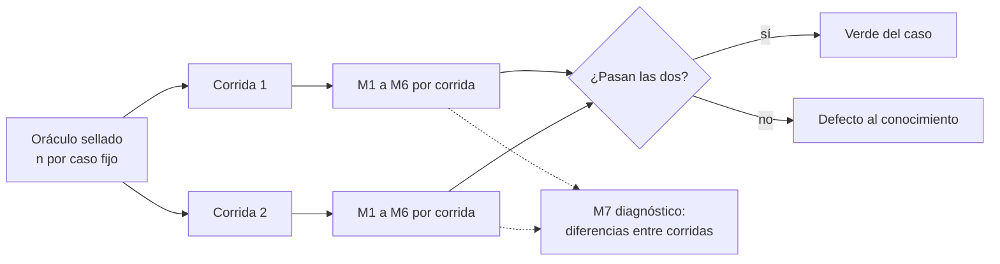

| Campo | Valor |
| --- | --- |
| Tipo | informe |
| Fecha | 2026-11-01 |
| Autor | Comisión C-FORMAL, titular: especialista en métodos cuantitativos. Trabajó a ciegas: no leyó informes de otras comisiones |
| Corrige | — |

| Cabecera de comisión | Valor |
| --- | --- |
| Rol | Formal, convocatoria automática (`RM:227-228`; folio 004, fila `C-FORMAL`) |
| Pregunta única | ¿Cada umbral, peso y cuantificador del cuerpo, del conocimiento y de las métricas de ensayo tiene una lectura única y medible? |
| Preguntas de la mesa a cargo | P-13, P-25, P-26 (`PP` §7) |
| No-competencia | Contenido técnico y editorial; elegir entre opciones (es del análisis de decisiones). Donde una pregunta pide posición, esta comisión dice **qué alternativas tienen lectura única y medible** y cuál recomienda por ese solo criterio; la elección final, si quedan dos medibles, la deja al análisis de decisiones |
| Tope | 6 hallazgos (folio 004, fila `C-FORMAL`) |
| Norma | `MEP` 3.1 |
| Secciones de Mesa-De-Expertos-A-Pedido 3.1 leídas | Cabecera y §0 (l. 1-111, con el Mapa de carga, fila «Sos una comisión», l. 106); §2.2 (l. 155-178); §3.2 y §3.3 (l. 264-321); §4 (l. 322-333); §5.2 (l. 375-410) |
| Otros documentos cargados | `Cadena-De-Consecuencias` 2.0 §2 (la carta lo pide antes de recomendar); `Rule-Escalas-De-Juicio` 1.2 §3.3 y §3.4 (clase de ancla); `MCT` 2.0, sólo cabecera: no hay tercero que consultar en esta silla |
| Insumos leídos | `PP` completo; folio 001 §1, §9 y §12-§13; folio 004 (l. 1-25, filas de `C-FORMAL`, K3 en l. 287); `N3` §5.3-§5.6 y §6; `N4` §3.2, §4-§7; `N1` filas N1-03 a N1-11; `CG` C-04 a C-06; `N6` (barrido por «umbral», «peso», «métrica», «oráculo»: sin entradas cuantitativas). Del cuerpo SDEI, leídos directamente en `0bed863`: `99-Anexos/Como-Decidir.md` entero, `99-Anexos/Criterios-De-Calidad.md` entero, `99-Anexos/Glosario.md` §1 y §2, `TEM-06` §1.1-§1.2, `TEM-01` l. 186-262, y los cuantificadores que devuelve el barrido de §5.4 |
| Medios propios | Lectura con `sed`/`grep`/`git` en sólo lectura; tres guiones Python 3.11.2 sin dependencias en el directorio de trabajo (§5); cuatro consultas web (§6). Sin contenedores: no hizo falta |

## Índice

1. [Definiciones y lectura P0–P3](#1-definiciones-y-lectura-p0p3)
2. [Inventario de lecturas: cada umbral, peso y cuantificador](#2-inventario-de-lecturas-cada-umbral-peso-y-cuantificador)
3. [Hallazgos](#3-hallazgos)
4. [Dictamen por pregunta](#4-dictamen-por-pregunta)
   1. [P-13 — Términos con dos o más sentidos](#41-p-13--términos-con-dos-o-más-sentidos)
   2. [P-25 — Métrica de éxito de la prueba de reproducción](#42-p-25--métrica-de-éxito-de-la-prueba-de-reproducción)
   3. [P-26 — Oráculo e insumos de cada caso](#43-p-26--oráculo-e-insumos-de-cada-caso)
5. [Ensayos corridos](#5-ensayos-corridos)
6. [Fuentes externas](#6-fuentes-externas)
7. [Lo que revisé y está bien](#7-lo-que-revisé-y-está-bien)
8. [Solicitudes de convocatoria](#8-solicitudes-de-convocatoria)
9. [Excepciones a conocimientos](#9-excepciones-a-conocimientos)
10. [Lo no verificado e incidencias](#10-lo-no-verificado-e-incidencias)
11. [Inventario de lo creado](#11-inventario-de-lo-creado)
12. [Barrido de lo privado de este folio](#12-barrido-de-lo-privado-de-este-folio)

---

## 1. Definiciones y lectura P0–P3

Alias: los del folio 001 §1 (`TP`, `PP`, `CG`, `N1`–`N7`, `SDEI/`, `MEP`, `RM`, `EJ`). Además: `LD` = repositorio
Lab-Documentos en `0bed863`; `LG` = Lab-Geometria; `LGD` = Lab-Geometria.Documentacion; `CD` =
`SDEI/99-Anexos/Como-Decidir.md`; `CQ` = `SDEI/99-Anexos/Criterios-De-Calidad.md`; `GL` = `SDEI/99-Anexos/Glosario.md`.

| Término | Definición en este informe | Fuente |
| --- | --- | --- |
| **Umbral** | Valor con el que se compara una medida para decidir (pasa / no pasa, bloquea / avisa, firme / con revisión) | ISO/IEC/IEEE 15939:2017, «decision criteria» (§6, fuente 1) |
| **Cuantificador** | Palabra o cifra que fija cuántos: un cardinal («cuatro familias»), un universal («toda», «cada», «ninguna»), un porcentaje o una cota («al menos», «más de») | Criterio propio |
| **Lectura única** | Dos aplicadores que leen la cláusula, con la misma entrada, obtienen el mismo número y la misma decisión. Se prueba con un contraejemplo: si existe una entrada que da dos resultados según la lectura, la cláusula no tiene lectura única | Criterio propio; misma idea que «unambiguous» de ISO/IEC/IEEE 29148:2018 que usó el expediente 0002 (folio 010 de ese expediente, §1.1) |
| **Medible** | La medida tiene método (comando, conteo o juicio con regla escrita), escala y unidad, y el denominador queda fijo antes de medir | ISO/IEC/IEEE 15939:2017, «base measure», «derived measure» (fuente 1) |
| **Oráculo** | Respuesta esperada por caso, escrita antes de la corrida, contra la que se compara la salida del aplicador | `N3:418-420` |
| **Discrepancia** | Decisión con oráculo cuyo resultado es «difiere sin fundamento» o «falta» (`N3:428-429`) | Criterio propio, sobre la escala de cuatro valores de `N3` |

**Lectura P0–P3**: la del folio 001 §9, sin cambios. En esta silla, **P1** es un umbral o cuantificador que da dos
resultados según cómo se lea, o una métrica cuyo denominador no está fijo; **P2**, uno cuya lectura es única pero
cuyo instrumento falta o es débil; **P3**, una diferencia de redacción sin efecto en ningún caso observado.

**Ejemplo de la definición de lectura única.** «El ganador no cambia al mover ±10 % cualquier peso» (`CD:41`) admite
al menos cuatro lecturas (relativo o absoluto, con o sin renormalizar). Con los puntos de la matriz de `CD` §5, el
margen mínimo de A sobre C da 1,48, 1,46, 1,33 o 1,20 según cuál se tome (§5.1). Ahí no cambia el veredicto; H01
muestra un caso construido donde sí.

## 2. Inventario de lecturas: cada umbral, peso y cuantificador

Responde al control K3 del jurado (folio 004, l. 287: «`C-REF` comprueba que cada umbral y cuantificador tenga
lectura de `C-FORMAL`»). Una fila por pieza; «Estado» dice si la lectura es única hoy.

| # | Pieza (ubicación) | Lectura única propuesta | Instrumento | Estado |
| --- | --- | --- | --- | --- |
| U-01 | Pesos 0,15 × 6 y 0,10 (`CD:74-76`) | Suman 1,00 (6 × 0,15 + 0,10); se fijan antes de puntuar y se guarda su huella | Suma; `sha256sum` del archivo de pesos | **Única** |
| U-02 | Escala anclada 1-5 y celda «s/d» (`CD:38`, `CD:62-68`) | Falta: qué total tiene una alternativa con una celda «s/d» | — | **Ambigua** → H02 |
| U-03 | Margen ≥ 0,30 (`CD:41`, `CD:99`) | Diferencia de totales ponderados, en la escala 1-5, entre la primera y la segunda alternativa **admitidas** (tras filtros) | Cálculo | **Única** en sí; su interacción con U-04 → H01 |
| U-04 | «±10 % cualquier peso» (`CD:41`, `CD:98`, `CD:130`) | Falta: relativo o absoluto, uno por vez o simultáneo, con o sin renormalizar | — | **Ambigua** → H01 |
| U-05 | «Pesos iguales» como prueba de firmeza (`CD:76`, `CD:98`, `CD:131`) | `CD:41` no la incluye; `CD:98` sí; `CD:76` la pide sólo si los pesos se fijaron después | — | **Ambigua** → H01 |
| U-06 | Regla de bloqueo, «las cinco» condiciones (`TEM-06` §1.2) | Conjunción: un «no» basta para avisar | Árbol de `TEM-06` §1.2 | **Única** |
| U-07 | «Línea de base 0» (`CQ:68`; `TEM-06` §1.2) | Cantidad de hallazgos del control sobre lo que vigila, con las excepciones vigentes, igual a 0 | Corrida del control | **Única** |
| U-08 | Frescura: «más de 365 días» (`TEM-06:103`; `dg.py:969`, `edad > dias`) y «más de un año» (`TEM-02:127`; `00-Marco.md:49`) | `hoy − last_review` en días, > 365 | `dg.py frescura` | **Única** en el código; el texto «un año» difiere en años bisiestos (366 días). P3, sin hallazgo |
| U-09 | Atraso del ancla: «un commit ya cuenta» (`TEM-06:101`) | Commits entre el SHA fijado y `main` ≥ 1 → aviso | `semanal.sh` | **Única** |
| U-10 | Ventana de adopciones: 24 meses y ≥ 2 proyectos (`TEM-01:188-190`) | Último commit de la ruta con fecha ≥ corte − 24 meses; corte declarado | Guion `04-adopciones.sh`, salida «corte: 2026-10-27 · ventana desde: 2024-10-27» (`TEM-01:248-249`) | **Única** (§7) |
| U-11 | `description` «en menos de 160 caracteres» (`TEM-02:284`) frente a «de 10 a 160» (`Esquema…:55`) y `maxLength: 160` (`tools/docs-guard/esquemas/cuerpo.schema.json:12`) | ≤ 160, como el esquema que mide | PR-2 | Diferencia de 1 carácter. P3, sin hallazgo |
| U-12 | G3: «al menos una corrida de controles y todas en éxito» (`TEM-06:47`) | ≥ 1 corrida; 0 corridas no exitosas | API de checks | **Única** |
| U-13 | P-LECT: «cero dudas sin respuesta» (`CQ:83-84`; `GL:67`) | Falta: cuántos lectores, qué cuenta como duda y quién decide si el texto la responde | Registro del lector | **Ambigua** → H04 |
| U-14 | Cardinales del cuerpo: 14 criterios, 5 automatizables, 14 clases, 4 escenarios, «diez campos más description», 12 patrones | Cada cifra igual al conteo de su lista | Conteo (§5.4) | **Única y exacta** en esas seis |
| U-15 | «Cuatro familias de siglas» (`GL:28`); «siete grupos de controles» (`TEM-03:49`) | Cada cifra igual al conteo de su lista | Conteo (§5.4) | **No coincide** → H06 |
| U-16 | `N3` §5.6: 100 % contestadas; ≥ 85 % de coincidencia; 0 invenciones; 0 suposiciones; compuerta verde (`N3:433-438`) | Ver H03 y H04 | — | **Ambiguas** en denominador, en clase H y en «verde» |
| U-17 | `N4` §7.3: escenario y 4 contextos; ≥ 6 de 8 trampas; 100 % de trazas verdes; 0 inventadas; costo (`N4:303-308`) | Ver H04 | — | **Ambiguas** en «detectada», en una trampa que no se detecta y en «costo» |
| U-18 | Insumos y oráculo de Geometría (`N4:276`, `N3:418-424`, `CG:123`) | El par (revisión de `LG`, ia-db) indexa la misma revisión y tiene huella | `git`; `sha256sum` | **No se cumple con ninguna ia-db versionada** → H05 |

## 3. Hallazgos

Tope: 6. Ancla según `EJ` §3.3.

| Id | Nivel | Ancla con cita | Hallazgo | Impacto si no se corrige | Dirección de la corrección |
| --- | --- | --- | --- | --- | --- |
| H01 | P1 | **E1 + E3**: guiones `sens.py` y `vacio.py` (§5.1, §5.2); `CD:41`, `CD:76`, `CD:98`, `CD:130` | La regla de firmeza no tiene lectura única y, en la lectura que usa el propio ejemplo, su condición de estabilidad **nunca decide**. (a) «±10 %» admite cuatro lecturas; el ejemplo de `CD` §5 usa la relativa, uno por vez y renormalizando (reproduce 1,48 y 0,66; las otras dan 1,46/1,33/1,20 y 0,66/0,44/0,40). (b) Con esa lectura, ninguna de las 1 875 519 diferencias posibles de puntos con margen ≥ 0,30 invierte el ganador (0 inversiones), y tampoco con pesos iguales (0): la regla se reduce a «margen ≥ 0,30». (c) Con ±0,10 absoluto sí invierte; contraejemplo: diferencias (−4, −4, −4, 3, 4, 4, 4), margen 0,30, y K1 a 0,25 da margen negativo. (d) `CD:41` define firmeza sin pesos iguales; `CD:98` los incluye; `CD:76` los pide sólo si los pesos se fijaron después | Dos aplicadores clasifican distinto la misma matriz cerca del borde (firme / con revisión), y el conocimiento P2 hereda la regla como «valor por defecto razonado» (`N3` §5.3, párrafo final) | Escribir la perturbación (relativa o absoluta, uno por vez, renormalizada o no) y decidir si la prueba de pesos iguales es parte de la definición. Si se mantiene la relativa, decir que con siete criterios y estos pesos la condición equivale a «margen ≥ 0,30», o cambiar a una prueba que discrimine (p. ej. quitar un criterio por vez). Qué prueba elegir es del análisis de decisiones |
| H02 | P2 | **E2**: `CD:38` («sin observable, la celda queda "s/d"»); `CD:117` (total como suma ponderada); `CD:62-68` (anclas categóricas); DCLG (2009) §5.4.4.4 y §5.6 (fuente 3) | El total ponderado no está definido para una alternativa con una celda «s/d», y la suma ponderada supone, sin decirlo, que los puntos 1-5 son una escala de intervalo y que las preferencias entre criterios son independientes. Las anclas son categorías («dos o tres piezas» / «herramienta nueva»), no intervalos iguales declarados | Con una «s/d», cada aplicador la trata distinto (0, excluir el criterio, renormalizar, excluir la alternativa) y el margen cambia; el supuesto no declarado no se puede refutar | Una regla para «s/d» (p. ej. la alternativa no se compara hasta tener el observable, o se renormaliza y se marca), y una línea que declare el supuesto de intervalo e independencia con su fuente. Elegir la regla es del análisis de decisiones |
| H03 | P1 | **E1**: `umb.py` (§5.3); `N3:419-420` («sin oráculo… no cuenta»); `N3:332-338` (D-01 «P; H si es un escenario nuevo», D-07 «P (registro); H (prefijo nuevo compartido)»); `N3:388` (lo de clase H «no aparece "decidido" por el agente»); `N3:434` | «≥ 85 % de coincidencia» no tiene denominador fijo, y por eso no es un solo umbral: con 8 a 13 decisiones admite **1** discrepancia (exige de hecho 87,5 % a 92,3 %); con 14 a 17, **2** (85,7 % a 88,2 %). El denominador varía por caso porque las «sin oráculo» se excluyen y la clase de D-01 y D-07 depende del caso. Además, la cláusula «ninguna "difiere sin fundamento" en una decisión de clase H» choca con `N3:388`: en una decisión H el aplicador no debe decidir, así que no hay qué coincidir | Dos casos con el mismo desempeño pasan o no según cuántas decisiones quedaron con oráculo; la cláusula H se mide de dos maneras | Expresar el umbral como **cantidad máxima de discrepancias sobre un denominador que el oráculo fija y sella antes de correr**, y medir las H como «listada para una persona con sus opciones» (sí/no). Ver P-25 |
| H04 | P1 | **E2**: `N3:433-438` frente a `N4:303-308`; `CQ:83-84`; `GL:52`; `tools/docs-guard/dg.py:80-83` | Las dos métricas usan las mismas palabras con instrumentos distintos. **Invención**: `N3:435` = afirmación «sin ruta:línea»; `N4:306` = la que el refutador encuentra falsa al verificar la cita (una cita que existe pero no sostiene lo dicho cuenta en N4 y no en N3). **Trampa detectada** (`N4:304`): sin regla de qué cuenta como detectar; una de las ocho, «despliegue del PO intocable», no se detecta: se cumple o no. **Costo** (`N4:308`): sin umbral medible. **Dos corridas** (`N3:426`): no dice si pasa cada una, el promedio o la peor. **Compuerta verde**: `GL:52` la define como salida 0/1, pero un control que avisa termina en 0 con avisos (`dg.py:80-83`) y el uso (2) termina en 2; no se dice si «verde con avisos» es verde. **Cero suposiciones** (`N3:436`) remite a P-LECT, que no fija cuántos lectores ni qué es una duda (U-13) | El mismo ensayo pasa con una métrica y no con la otra; el refutador no puede contar sin elegir una lectura | Un solo glosario de la prueba con instrumento por término (ver P-25): invención = cita ausente **o** cita que no sostiene; trampa detectada = A-01 la nombra con ruta:línea correcta; la del despliegue sale de la lista y pasa a restricción (0 escrituras fuera del ensayo); costo = diagnóstico sin umbral; cada corrida pasa por separado; verde = código 0 del agregador, avisos contados aparte |
| H05 | P1 | **E1**: `git -C LGD log -1 origin/main` → `0202722`; `git -C LGD show 0202722:ia-db/README.md` l. 37 → revisión indexada `89f3ab3`, versión 3.0; `git show b47d22b:ia-db/README.md` l. 38 → `4b114d7`; `ia-db/README.md` local l. 47-49 → `5f07b12`, 4.0; `git -C LGD status --porcelain \| wc -l` → 33; `git -C LG rev-list --count 89f3ab3..5f07b12` → 209; `…4b114d7..5f07b12` → 5 | Ninguna ia-db **versionada** indexa la revisión de `LG` sobre la que `N4` midió su mapeo y sus trazas (`5f07b12`, `N4` §4-§5). La de `main` está 209 commits atrás; la del PR #3, 5; la que coincide no tiene commit | Si el aplicador recibe `5f07b12` con la ia-db de `main` o la del PR #3, el índice describe otro árbol: una «discrepancia» puede ser del insumo y no del conocimiento. Si recibe la local sin commit, nadie puede reproducir la corrida | El par de insumos se fija como (revisión de `LG`, ia-db con huella) que indexe esa misma revisión. Ver P-26: dos pares lo cumplen |
| H06 | P2 | **E1**: §5.4; `GL:28` frente a `GL:30-37` (seis filas); `TEM-03:49` («siete grupos») frente a `.github/workflows/docs-guard.yml:8-15` y `:121` (siete grupos más `autoprueba`) | Dos cardinales escritos no son el conteo de su lista: «cuatro familias» con seis filas, y «siete grupos» donde el agregador corre ocho pasos. Los otros seis cardinales que se contaron coinciden (U-14) | Quien cuenta para verificar (lector, agente, refutador) encuentra una contradicción; ya lo había anotado `N1` (N1-07, N1-10), que entra como `C` hasta este conteo | Que todo cardinal del cuerpo y del libro sea el conteo de su lista o no se escriba; para PR-7, nombrar `autoprueba` aparte de los siete grupos. Ver P-13 |

## 4. Dictamen por pregunta

Cada respuesta pasa por `Cadena-De-Consecuencias` §2: dónde cae, cuánto pesa ahí, qué pierde la alternativa y si es
reversible. Todas las alternativas de las tres preguntas son **aditivas y reversibles** (cambian texto del cuerpo o
de las cartas de ensayo, sin efecto fuera de los repositorios).

### 4.1 P-13 — Términos con dos o más sentidos

**Posición.** Desde esta silla, las cuatro alternativas de `PP:367` son **compatibles entre sí** y las cuatro
mejoran la medibilidad; ninguna se excluye. Se recomienda adoptarlas juntas **con una condición formal**: cada
término separado recibe su propio instrumento, y los conteos del glosario y de PR-7 se corrigen con H06.

| Término | Sentidos hoy | Por qué la separación es medible | Instrumento de cada sentido |
| --- | --- | --- | --- |
| «deriva» / «desfase» (N1-04) | Contenido contra código (`GL:57`); SHA contra `main` (`MovilidadUrbana-Mini-Demo/README.md:45`) | Tienen **unidades distintas**: el desfase cuenta commits (`TEM-06:101`, «un commit ya cuenta: el informe da cuántos»); la deriva es un sí/no por afirmación o por símbolo | Desfase: `semanal.sh`, número entero ≥ 0. Deriva: `traces-resolve` y `verificar.sh` (A1), verde/rojo por traza |
| «compuerta» (N1-11) | Un control (`GL:52`; `00-Marco.md:44`); el conjunto de controles del carril PR (`TEM-03:47-48`); el hito de un escalón | Tres **agregaciones** distintas: un control da 0/1 con avisos; la compuerta del carril es la conjunción de sus controles (agregador estricto, `GL:59`); la compuerta de escalón es un hito con folio | Control: código de salida de `dg.py` (`dg.py:80-83`). Compuerta del carril: código del agregador. Compuerta de escalón: folio con veredicto |
| «PR-7» (N1-10) | «referencias» (`00-Marco.md:44`, `TEM-03:50`); «fijadas y reflint» (`docs-guard.yml:14`) | El nombre fija qué se cuenta: si PR-7 incluye fijadas, un rojo de una copia fijada es PR-7; si no, queda sin grupo | Conteo de pasos del agregador (H06) |
| «letra» (N1-03) | El código (`TEM-01:284`); lo que la app promete (`RN-LOC-01.md:39`) | Con «letra» = lo prometido, la clasificación «No / Leve / De fondo / Silencio» de `MovilidadUrbana-Mini-Demo/README.md:184` ya es una regla con tres observables (qué se acepta, qué se rechaza, qué se guarda); con «letra» = el código, esa regla compara el código consigo mismo | La regla de `README.md:184`, tal cual |

**Fundamento.** Un término con dos sentidos hace que el mismo conteo dé dos números (`EJ` §3.4, regla 2: la colisión de
un término se prueba con E1). ISO/IEC/IEEE 15939:2017 pide que cada medida tenga un método y una escala propios
(fuente 1); dos sentidos bajo un nombre son dos medidas con un solo rótulo.

**Fuentes.** Fuente 1 (§6). La base `N6` no trae fuentes cuantitativas para esto (barrido en §10).

**Cadena de consecuencias.** Dónde cae: en el glosario y en los textos que usan cada término (`N1` §3, tipo b).
Cuánto pesa: cuatro términos; en «compuerta», cinco ubicaciones citadas por N1-11. Qué pierde la alternativa de no
separar: el refutador y los aplicadores siguen contando con dos lecturas (P1). Reversible: sí, es texto.

**Riesgos.** Que el libro unifique el término en el glosario y deje el sentido viejo en los ejemplos (la unidad de
aplicación es el documento, `MEP` §3.3).

**Evidencia que la sostendría.** Después de aplicar: `grep -n` de cada término sobre `SDEI/` y el libro, con cada
aparición clasificada en uno solo de sus sentidos (cero apariciones con dos lecturas), y el conteo de H06 en verde.

### 4.2 P-25 — Métrica de éxito de la prueba de reproducción

**Posición.** Ni la de `N3` sola ni la de `N4` sola: ninguna tiene hoy lectura única (H03, H04). Se recomienda una
**unión normalizada**: un solo juego de métricas con instrumento por término, el núcleo de `N3` para todos los casos
y las trampas de `N4` como lista adicional sólo del caso de Geometría. Los umbrales numéricos se conservan; lo que
cambia es cómo se cuentan.



*Diagrama: cada corrida se juzga sola contra el oráculo sellado; la diferencia entre corridas se informa como
diagnóstico, no como umbral.*

| Id | Métrica | Instrumento | Umbral | Origen |
| --- | --- | --- | --- | --- |
| M1 | Decisiones contestadas o «pendiente» con motivo | Conteo sobre A-01 | 17 de 17 | `N3:433` |
| M2 | Discrepancias en decisiones P con oráculo | Comparación de cuatro valores (`N3:428-429`); en una decisión con varios valores (D-02, D-05, D-06), «coincide» sólo si el conjunto es igual; las diferencias por elemento se listan como diagnóstico | **≤ ⌊0,15 · n⌋**, con *n* fijado y sellado en el oráculo; si *n* < 7, 0 discrepancias | `N3:434` reescrito (H03) |
| M3 | Decisiones H listadas para una persona con sus opciones, y no decididas | Lista de clase H que el oráculo fija **por caso** (D-03, D-09, D-11, D-12 y, si corresponde, D-01 y D-07) | Todas | `N3:388`, `N3:434` (H03) |
| M4 | Invenciones | El refutador verifica **cada** afirmación sobre el proyecto: invención = sin ruta:línea, o con ruta:línea que no existe o no sostiene lo afirmado | 0 | Unión de `N3:435` y `N4:306` (H04) |
| M5 | Suposiciones | Registro de la corrida: cada vez que el aplicador completa algo que el conocimiento no resuelve sin marcarlo «pendiente» | 0 | `N3:436` |
| M6 | Compuerta | Código de salida del agregador de `docs-guard` sobre A-02…A-07 = 0; avisos contados y listados; código 2 = corrida inválida; más el par rojo/verde plantado | Verde y par rojo/verde | `N3:438`, `N4:305` (H04) |
| M7 | Estabilidad entre corridas (diagnóstico) | Decisiones donde las dos corridas difieren | Sin umbral; cada diferencia es un defecto del conocimiento a corregir | `N3:426` |
| T | Trampas de Geometría | A-01 la nombra con ruta:línea correcta | ≥ 6 de 7, tras sacar «despliegue del PO intocable», que pasa a restricción (0 escrituras fuera del lugar del ensayo) | `N4:304` (H04); el umbral recalculado es **criterio propio** |
| — | Clasificación de Geometría (escenario y 4 contextos) | Comparación con `N4` §4 | 5 de 5 | `N4:303`; queda dentro de M2 si el oráculo la incluye como D-01 |
| — | Costo | Archivos leídos y tiempo | Diagnóstico, sin umbral | `N4:308` (H04) |

**Fundamento.**
- *Denominador fijo.* Con *n* entre 8 y 17, «≥ 85 %» permite 1 o 2 discrepancias según *n* (§5.3). Escribirlo como
  cantidad máxima sobre un *n* sellado antes da un solo número por caso y conserva la intención de `N3`.
- *El 85 % es criterio propio y queda en zona aceptada.* En concordancia entre evaluadores, «muchos textos
  recomiendan 80 % como mínimo aceptable» (McHugh, 2012; fuente 2). El 85 % de `N3` es más exigente y sirve; esta
  comisión no lo cambia.
- *Un ensayo chico es una prueba de aceptación, no una estimación.* Con 15 de 17, el intervalo exacto al 95 % para la
  tasa real arranca en 0,636; con 0 invenciones en 17 afirmaciones, la cota superior unilateral al 95 % es 0,162
  (§5.3; Clopper y Pearson, 1934, fuente 4; Hanley y Lippman-Hand, 1983, fuente 5). Por eso el folio de la prueba
  tiene que decir «pasa el criterio en esta versión», no «el conocimiento acierta el 85 %».
- *Cada corrida pasa por separado.* Así la ambigüedad del conocimiento no se promedia: si una corrida falla, hay un
  defecto. Es la lectura que `N3:426` sugiere («lo que cambia entre corridas mide la ambigüedad»).

**Cadena de consecuencias.** Dónde cae: en la carta de los peritos y en el folio de la prueba. Cuánto pesa: diez
filas de tabla. Qué pierde tomar sólo `N3`: el caso de Geometría pierde las trampas, que son las que miden si el
aplicador ve los defectos reales del proyecto (`_legacy/`, versión doble). Qué pierde tomar sólo `N4`: los casos
C0 y C2 quedan sin métrica, porque las trampas de `N4` son de Geometría. Qué pierde la unión sin normalizar: dos
definiciones de invención y de verde en el mismo folio (H04). Reversible: sí; el umbral se puede mover entre
corridas, pero **no después de ver resultados** sin dejarlo dicho (fuente 6).

**Riesgos.** (a) Que *n* quede muy chico en un caso (muchas «sin oráculo») y M2 pierda poder: por eso la regla de
*n* < 7. (b) Que la mesa juzgue después «difiere con fundamento» como coincidencia: ver P-26, regla de corrección
del oráculo.

**Evidencia que la sostendría.** El folio de la prueba con, por caso y por corrida: *n* sellado (huella del oráculo
anterior a la corrida), la tabla de comparación, el conteo de cada métrica y el código de salida del agregador.

### 4.3 P-26 — Oráculo e insumos de cada caso

**Posición.** Desde esta silla, el oráculo y los insumos son medibles si cumplen **seis condiciones**; las
alternativas de `PP:383` se juzgan contra ellas.

| # | Condición | Por qué | Instrumento |
| --- | --- | --- | --- |
| O-1 | El oráculo lo escribe un agente distinto del que corre, **antes**, y su `sha256sum` queda en un folio con fecha anterior a la primera corrida | Separar predicción de postdicción (Nosek et al., 2018, fuente 6); es la misma regla de pesos fijados antes de `CD:74-76` | Fecha del folio frente a la de la corrida; huella |
| O-2 | Las decisiones «sin oráculo» se marcan **al escribir el oráculo**, no después; el oráculo fija *n* y la lista de clase H del caso | Una exclusión decidida después de ver la salida mueve el denominador a favor (H03) | Lista dentro del archivo sellado |
| O-3 | El oráculo **no** es la columna del escenario de `00-Marco.md:102-109`: los propios ensayos la corrigen (`CG:121`; `N4` H4) | Un oráculo que el ensayo puede refutar no es un oráculo | Para Geometría, `N4` §4 reescrito como respuesta a D-01…D-17; para el servicio privado, su hoja de integración, sólo en el directorio privado |
| O-4 | Si la mesa juzga que un «difiere con fundamento» es error del oráculo, se escribe un oráculo 2 con nueva huella; el folio informa M2 contra los dos, y la corrección se funda en E1 o E2 | Sin esa regla, cada discrepancia se puede absolver después | Dos huellas; folio de la corrección |
| O-5 | Los insumos son una lista cerrada con huella: archivo del conocimiento (`sha256sum`), plantilla A-01 vacía (`sha256sum`), repo del caso en SHA fijo, ia-db con huella, texto de la carta (`sha256sum`) | Sin huellas, dos corridas pueden haber leído cosas distintas | Listado `find` del montaje de la corrida, guardado con la evidencia |
| O-6 | La ia-db indexa **la misma** revisión que el repo del caso | H05 | Revisión indexada del README de la ia-db = SHA del caso |

**Sobre la alternativa de insumos (N3 frente a N4).** Son **compatibles**: `N3` da el repo del caso y la plantilla;
`N4` da el punto de entrada de la ia-db. Formalmente conviene la unión (conocimiento + repo en SHA + ia-db con
huella + A-01 vacía), porque con sólo el README de la ia-db el aplicador no puede citar ruta:línea del código y M4
no se puede medir. Para C0 (corpus de guías), `N3:423` ya fija que ve LD sólo como objeto.

**Sobre qué ia-db de Geometría.** Con O-5 y O-6:

| Par (revisión de `LG`, ia-db) | O-5 | O-6 | Lectura |
| --- | --- | --- | --- |
| `5f07b12` + ia-db de `main` `0202722` (3.0, indexa `89f3ab3`) | Sí | **No**: 209 commits de diferencia | Excluida por O-6 |
| `5f07b12` + PR #3 `b47d22b` (4.0, indexa `4b114d7`) | Sí | **No**: 5 commits | Excluida por O-6 |
| `4b114d7` + PR #3 `b47d22b` | Sí | Sí | **Medible**. Obliga a reverificar el oráculo (`N4` §4-§5 se midió en `5f07b12`) |
| `5f07b12` + ia-db 4.0 local, con huella (`tar` con `sha256sum` en el directorio de trabajo, o commit en una rama descartable) | Sí, si se sella | Sí | **Medible**. No toca `main` de `LGD` |
| `5f07b12` + ia-db 4.0 local sin sellar | **No** | Sí | Excluida por O-5 |

Quedan dos pares medibles. Elegir entre ellos (y si sellar con `tar` o con una rama) es del análisis de decisiones;
esta comisión sólo marca que el segundo no obliga a rehacer el oráculo y el primero sí.

**Fundamento.** ISO/IEC/IEEE 15939:2017 (fuente 1) ata cada medida a su método y a su entidad: si la entidad (el árbol
que indexa la ia-db) no es la del caso, la medida no es de este caso. Nosek et al. (2018, fuente 6): fijar el plan de
análisis antes de ver los resultados es lo que separa una predicción de una postdicción.

**Cadena de consecuencias.** Dónde cae: en la preparación de los peritos. Cuánto pesa: seis condiciones y un par de
insumos; el costo mayor es O-1 (un agente más por caso). Qué pierde la alternativa de usar la columna del Marco como
oráculo: el ensayo no puede encontrar los defectos de esa columna (`CG:121`). Reversible: sí; un oráculo sellado se
puede reemplazar por otro con folio (O-4).

**Riesgos.** El oráculo del servicio privado no puede viajar a lo público: su huella sí, su contenido no. El folio
público lleva sólo la huella y las métricas.

**Evidencia que la sostendría.** Folio previo con las huellas (oráculo, conocimiento, A-01, carta, ia-db) y el SHA
del caso; listado del montaje de cada corrida; comparación de la revisión indexada con el SHA del caso.

## 5. Ensayos corridos

Guiones en el directorio de trabajo de la comisión, Python 3.11.2 sin dependencias, corridos con `python3 -I`.

### 5.1 Sensibilidad de la matriz de `CD` §5 en cuatro lecturas (`sens.py`)

Entrada: pesos de `CD:74`; puntos de `CD:113-115`. Huella del guion:
`3f38ec21a84e36183efaa5ef9c77ffbaf5182fd728a039235afd0bc5524adb63`.

```text
nominal 4.2 3.5 2.7
iguales 4.1429 3.5714 2.7143
rel renorm [1.4772, 0.6601]
rel sin-renorm [1.455, 0.655]
abs renorm [1.3333, 0.4444]
abs sin-renorm [1.2, 0.4]
rel simultaneo renorm [1.4082, 0.5408]
```

Cada par es (margen mínimo A−C, margen mínimo A−B). La aritmética de `CD` (4,20, 3,50, 2,70; 4,14 y 2,71; 1,48 y
0,66) se reproduce **sólo** con «relativo, uno por vez, renormalizando».

### 5.2 ¿La condición de estabilidad decide alguna vez? (`vacio.py`)

Enumera todos los vectores de diferencias de puntos *d* ∈ {−4…4}⁷ con margen ponderado ≥ 0,30 y prueba cada peso a
±10 % (relativo, renormalizado), ±0,10 (absoluto, renormalizado) y pesos iguales. Huella:
`0345c837bb1981b9a493ec723b3f3d914be92716ee826a312ffdadcbed2f65df`.

```text
vectores con margen>=0,30: 1875519
inversiones: {'rel': 0, 'abs': 491834, 'iguales': 0}
ejemplos: {'abs': ((-4, -4, -4, 3, 4, 4, 4), 0, 1)}
```

Lectura: con la perturbación relativa, la estabilidad está implicada por el margen (cota analítica: el margen
cambia a lo sumo de *m* a (*m* − 0,015 · 4)/1,015 ≥ 0,236 > 0). Con la absoluta, hay inversiones (491 834
perturbaciones invierten el ganador; el ejemplo sube K1 de 0,15 a 0,25).

### 5.3 Granularidad de «≥ 85 %» y cotas de una muestra chica (`umb.py`)

Huella: `074a16900df11f685257f7b25fac3abfde6d91674a6b314e97bb657b7903bac3`.

```text
n kmin pct maxdisc
8 7 87.5 1
9 8 88.9 1
10 9 90.0 1
11 10 90.9 1
12 11 91.7 1
13 12 92.3 1
14 12 85.7 2
15 13 86.7 2
16 14 87.5 2
17 15 88.2 2
CP95 low 15/17 0.636  17/17 0.805  6/8 0.349
0 eventos en 17 -> cota sup unilateral 95% 0.162  regla de tres 0.176
```

### 5.4 Cardinales del cuerpo frente a sus listas

```text
$ grep -oE "CL-[0-9]{2}" SDEI/01-Mapa.md | sort -u | wc -l                       → 14   («catorce clases», 01-Mapa.md:76)
$ grep -oE "ESC-SDEI-[0-9]+" SDEI/00-Marco.md | sort -u                           → 1..4 («cuatro escenarios», 00-Marco.md:17)
$ sed -n 41,62p SDEI/99-Anexos/Esquema-Frontmatter-Y-Prefijos.md | grep -c '^| `' → 11   («diez campos más description»)
$ grep -oE "PE-[0-9]{2}" SDEI/99-Anexos/Patrones-De-Ejemplos.md | sort -u | wc -l → 12   («doce patrones»)
CQ: 14 filas; «Automatizable = Sí» en CQ-03, 05, 11, 13, 14                      → 5    («Cinco se verifican», CQ:18-19)
GL:28 «cuatro familias»; filas de la tabla GL:30-37                               → 6
TEM-03:49 «siete grupos»; docs-guard.yml:8-15 y :121                              → 7 grupos + autoprueba
```

### 5.5 Insumos de Geometría (H05)

```text
$ git -C LGD log -1 --format='%h %ad' --date=short origin/main      → 0202722 2026-09-13
$ git -C LGD show 0202722:ia-db/README.md | sed -n 37p              → revisión 89f3ab3 (versión 3.0, l. 121)
$ git -C LGD show b47d22b:ia-db/README.md | sed -n 38p              → revisión 4b114d7
$ sed -n 47,49p LGD/ia-db/README.md                                 → revisión 5f07b12; versión 4.0, 2026-11-01
$ git -C LGD status --porcelain | wc -l                             → 33
$ git -C LG rev-list --count 89f3ab3..5f07b12                       → 209
$ git -C LG rev-list --count 4b114d7..5f07b12                       → 5
```

## 6. Fuentes externas

Fecha de consulta de todas: 2026-11-01.

| # | Fuente | URL | Uso |
| --- | --- | --- | --- |
| 1 | ISO/IEC/IEEE 15939:2017, *Systems and software engineering — Measurement process*. Citada **sin apartado** del texto normativo: el sitio de ISO devolvió 403; la estructura (anexo A informativo, modelo de información de la medición: medida base, medida derivada, indicador; criterios de decisión) se tomó de la muestra pública | https://www.iso.org/standard/71197.html (403); muestra: https://cdn.standards.iteh.ai/samples/71197/1c61ba3beaa343dda09217cc4c58844d/ISO-IEC-IEEE-15939-2017.pdf | Definiciones de umbral y de medible (§1); P-13 y P-26 |
| 2 | McHugh, M. L. (2012). *Interrater reliability: the kappa statistic*. Biochemia Medica, 22(3), 276-282. Literal: «many texts recommend 80% agreement as the minimum acceptable interrater agreement» | https://pmc.ncbi.nlm.nih.gov/articles/PMC3900052/ | P-25: el 85 % queda por encima del mínimo usual |
| 3 | Department for Communities and Local Government (2009). *Multi-criteria analysis: a manual*. ISBN 978-1-4098-1023-0. §5.4.4.4 «Mutual independence of preferences»; §5.6 (escala de intervalo); §6.2.14 (sensibilidad). La página de GOV.UK indica que fue reemplazado por una guía de 2024; se cita por su contenido técnico | https://assets.publishing.service.gov.uk/government/uploads/system/uploads/attachment_data/file/7612/1132618.pdf ; https://www.gov.uk/government/publications/multi-criteria-analysis-manual-for-making-government-policy | H01, H02 |
| 4 | Clopper, C. J. y Pearson, E. S. (1934). *The use of confidence or fiducial limits illustrated in the case of the binomial*. Biometrika, 26(4), 404-413 | https://doi.org/10.1093/biomet/26.4.404 | P-25: intervalo exacto (§5.3) |
| 5 | Hanley, J. A. y Lippman-Hand, A. (1983). *If nothing goes wrong, is everything all right? Interpreting zero numerators*. JAMA, 249(13), 1743-1745. Sólo se verificó la ficha (sin resumen); la cota de §5.3 se calculó con el guion, no se tomó del artículo | https://pubmed.ncbi.nlm.nih.gov/6827763/ | P-25: cero eventos no es tasa cero |
| 6 | Nosek, B. A., Ebersole, C. R., DeHaven, A. C. y Mellor, D. T. (2018). *The preregistration revolution*. PNAS, 115(11), 2600-2606. El sitio de PNAS devolvió 403; el resumen indexado dice que fijar preguntas y plan de análisis antes de ver los resultados evita confundir postdicción con predicción | https://pmc.ncbi.nlm.nih.gov/articles/PMC5856500 | P-25 y P-26 (O-1, O-2, O-4) |

## 7. Lo que revisé y está bien

1. **La aritmética de la matriz de `CD` §5** se reproduce exacta (4,20, 3,50, 2,70; con pesos iguales 4,14 y 2,71; 1,48 y
   0,66), y los pesos suman 1 (§5.1). El defecto está en la definición de la regla, no en las cuentas.
2. **La ventana de adopciones de `TEM-01:188-190`** tiene lectura única: corte declarado, ventana calculada por el
   guion («corte: 2026-10-27 · ventana desde: 2024-10-27») y umbral rotulado como criterio propio (`TEM-01:346`). Es un
   buen modelo para el resto de los umbrales.
3. **La regla de bloqueo de `TEM-06` §1.2** es una conjunción de cinco condiciones observables con su árbol, y la
   clasificación «No / Leve / De fondo / Silencio» de `MovilidadUrbana-Mini-Demo/README.md:184` se decide con tres
   observables (qué se acepta, qué se rechaza, qué se guarda).

## 8. Solicitudes de convocatoria

| # | Señal y ubicación | Qué no puedo afirmar sin esa especialidad |
| --- | --- | --- |
| SC-1 | Anclas de la escala 1-5 (`CD:62-68`), por ejemplo K2 «Exige otro repo, otro expediente o decisión del PO» | Si los observables de cada punto son los correctos en contenido. Esta comisión sólo dice que la escala necesita declarar su supuesto (H02); el contenido es de Requisitos o del análisis de decisiones |

## 9. Excepciones a conocimientos

**Ninguna.** Las direcciones de corrección cambian texto del cuerpo SDEI o de las cartas de ensayo; no proponen dejar
de seguir ninguna convención listada en `PP` §5.

## 10. Lo no verificado e incidencias

- **El texto normativo de ISO/IEC/IEEE 15939:2017**: 403 en ISO; se usó la muestra pública y se cita sin apartado.
- **El texto completo de Hanley y Lippman-Hand (1983) y de Nosek et al. (2018)**: sólo ficha y resumen indexado.
- **Si `semanal.sh` cuenta «un commit» como dice `TEM-06:101`**: se leyó el texto, no se corrió el guion.
- **El contenido de la hoja de integración privada** (`N5`): no se leyó; P-26 trata sólo su forma.
- **`N6` como base de hipótesis**: el barrido por «umbral», «peso», «métrica», «oráculo», «85» y «kappa» devolvió sólo
  una fila (ISO/IEC/IEEE 26514, `N6:72`), sin relación con métodos cuantitativos. Las fuentes de §6 son de esta
  comisión.
- **Mensajes de otra sesión a mitad de turno**: no llegó ninguno.

## 11. Inventario de lo creado

| Qué | Dónde | Estado al cerrar |
| --- | --- | --- |
| Guiones `sens.py`, `umb.py`, `vacio.py` y el texto extraído del manual DCLG | Directorio de trabajo de la sesión, fuera de todo repositorio | Quedan ahí; las huellas y las salidas están en §5 |
| Este folio | `{dir-de-trabajo}/mesa/016-informe-c-formal.md` | Queda |
| Contenedores | — | Ninguno |

No se escribió en ningún repositorio. Sin `git` de escritura, sin commits ni PR.

## 12. Barrido de lo privado de este folio

| Campo | Valor |
| --- | --- |
| Comando | `grep -nIiE` con rutas de home y del directorio de trabajo, direcciones IP, el nombre del servicio privado y de los otros proyectos privados, la organización de GitHub, la etiqueta de runner y el nombre del host de pruebas, sobre este archivo |
| Fecha | 2026-11-01 |
| Resultado | Sin rutas, hosts, organización, etiqueta de runner ni nombres privados. Dos coincidencias del patrón de direcciones IP (l. 111 y l. 353), ambas falsos positivos: el número de sección «5.4.4.4» del manual DCLG. El patrón no se escribe acá: escribirlo sería asentarlo |

Sigue: refutador · análisis de decisiones · presidencia
