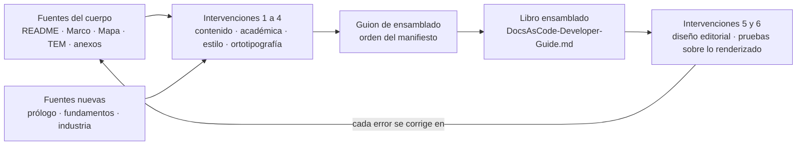

| Campo | Valor |
| --- | --- |
| Tipo | informe |
| Fecha | 2026-11-01 |
| Autor | Comisión C-REF: refutador del núcleo permanente (`RM:201`), titulado por un agente que no participó en las comisiones. **Trabajó a ciegas por orden del despacho** (ver H-01) |
| Corrige | — (no modifica ningún folio; propone) |

| Cabecera de comisión | Valor |
| --- | --- |
| Rol | Refutador: ataca la lectura dominante, el objetivo (qué se dio por fijo sin pedirlo; si hay una solución más chica) y cada ficha de excepción; comprueba que todo umbral tenga lectura de `C-FORMAL` y que `C-REQ` y `R-DECISIONES` no se dupliquen (folio 004 §6, fila `C-REF`, y §10, K3) |
| Carta | Despacho de la presidencia recibido en la sesión, texto computado por el arnés. **No está archivada en `evidencia/`** (`MEP:144`, paso 2): este folio se escribe en el directorio de la mesa |
| Norma | `IA.Knowledge.Base/Knowledges/Knowledge-Mesa-De-Expertos-A-Pedido.md` 3.1 (`MEP`) |
| Secciones de MEP 3.1 leídas | Cabecera y §0 con el «Mapa de carga» (l. 1-108); §1 (l. 110-136); §2.1 y §2.2 (l. 139-170); §3.1 a §3.3 (l. 240-300); fila «Criterio de corte» de §4 (l. 328) y fila «No seguir un conocimiento» (l. 333). La fila del mapa «Sos el refutador» pide «lo del presidente» (§1 a §8): §5, §6 y §8 **no se leyeron enteras**; ningún hallazgo se apoya en ellas |
| Otros documentos cargados | `Knowledge-Cadena-De-Consecuencias` 2.0 §0 a §6 (l. 17-135); `Knowledge-Excepcion-A-Un-Conocimiento` 2.1 §3, §4 y §5.1 (l. 84-163); `Knowledge-Mesa-Consulta-A-Un-Tercero` 2.0, sólo títulos (lectura A de `PP` §6.5: no hay tercero); `Rule-Mesa` 1.1 (`RM`) l. 150-151, 190-268, 297, 453; `Rule-Expediente` 1.0 §3.3; `Rule-Forma-De-Conocimiento` 1.3 cabecera y §0; `Knowledge-Conformacion-Pull-Request-Automatico` 2.0 §3.1 |
| Insumos leídos | Pedido `TP` entero (104 líneas, huella comprobada); `PP` (`nucleos/02-Propuesta-De-Panel.md`) entero; folio 001 §7, §9-§11; folio 004 §2-§12; `N2` §2-§4, §6, §11; `N3` §3, §5.6; `N4` §5, §7.3; `N6` §3.1, §5; `N7` tabla de hallazgos. **No se leyeron** los informes `01x` de las comisiones ni ninguna ficha |
| Medios propios | Lectura de los worktrees con `git`, `grep`, `sed`; un ensayo de libro ensamblado sobre una copia `git archive` del worktree de LD, en `{dir-de-trabajo}/scratchpad/cref/`; seis consultas web (§8) |

## Índice

1. [Definiciones y forma de este informe](#1-definiciones-y-forma-de-este-informe)
2. [Ataque al objetivo](#2-ataque-al-objetivo)
3. [Ataque a las lecturas L-1 a L-6](#3-ataque-a-las-lecturas-l-1-a-l-6)
4. [Posición por pregunta](#4-posición-por-pregunta)
5. [Hallazgos](#5-hallazgos)
6. [Fichas de excepción y condición K3](#6-fichas-de-excepción-y-condición-k3)
7. [Ensayo corrido](#7-ensayo-corrido)
8. [Fuentes externas](#8-fuentes-externas)
9. [Lo que revisé y está bien](#9-lo-que-revisé-y-está-bien)
10. [Lo no verificado](#10-lo-no-verificado)
11. [Inventario y barrido de este folio](#11-inventario-y-barrido-de-este-folio)

## 1. Definiciones y forma de este informe

| Término | Qué designa acá |
| --- | --- |
| `TP` | El prompt 02 (`…/14-Sistema-De-Documentador-Tecnico/02-Ajuste-Coherencia-Reedicion-Documentacion.md`), `sha256` `da388e9d…74b37`, comprobada el 2026-11-01 |
| `PP` | La propuesta de panel y contrato de entrada (bitácora `DB-R02-02`) |
| Cuerpo, `SDEI` | `Lab-Documentos/Guides/Documentacion-Tecnica/Sistema-De-Documentacion-E-Integracion/` en `0bed863` |
| Libro | `DocsAsCode-Developer-Guide.md`, que todavía no existe (folio 001 §10, fila 10) |
| **Libro ensamblado** | Alternativa nueva de este folio (C′): el libro se genera uniendo las fuentes del cuerpo en un orden declarado; las fuentes siguen siendo la única fuente y el archivo generado no se edita a mano |
| Lectura dominante | La que `PP` y el folio 001 adoptan para cada frase doble y cada pregunta |
| Escala de veredicto | **SOSTIENE**: el ataque no cambia nada. **DEBILITA**: puede quedar, pero un costo está mal medido, una cita no dice eso o falta declarar algo. **REFUTA**: la evidencia la invierte o hay una solución más chica que cumple el pedido. Es la del folio 085 del expediente 0002 |
| P0-P3 | La lectura del folio 001 §9: P0 viola una restricción dura o hace imposible el objetivo; P1 retrabajo o lectura divergente; P2 pérdida acotada; P3 claridad |

Cada hallazgo declara su clase de ancla (`MEP:270`): **E1** medido con comando y salida; **E2** citado por archivo y
línea; **C** juicio o heredado sin verificar.

## 2. Ataque al objetivo

El objetivo del folio 001 §7 tiene origen por cláusula. Lo que sigue es lo que **se dio por fijo sin que el pedido lo
diga** y la solución más chica que lo cumple (`MEP:148`, paso 6).

| # | Lo dado por fijo | Literal del pedido | Ataque | Veredicto |
| --- | --- | --- | --- | --- |
| O-1 | «un conocimiento de especificación que **alguien sin contexto** pueda aplicar» | «agentes de IA o humanos **en otro contexto diferente** pudieran aplicarlos en nuevos o ya existentes proyectos» (`TP:18`) | «Otro contexto» es otro proyecto, con su propio contexto; «sin contexto» es un lector ciego. La diferencia agranda la prueba: control C0, caso opcional C3, prueba negativa y oráculo escrito por un tercer agente (`N3` §5.6, protocolo 1-4). El pedido nombra dos casos: Geometría y `{servicio-privado}` (`TP:20`) | **DEBILITA** (H-02) |
| O-2 | El libro se redacta como texto nuevo que convive con las fuentes (lectura A de L-1) | «que este documento reuna los documentos individuales» (`TP:48`) | Reunir no fija quién manda ni obliga a dos copias. Hay una solución más chica que cumple `TP:42-50` sin versiones paralelas: el libro ensamblado (§4, P-01) | **REFUTA** la lectura como fija (H-03) |
| O-3 | Seis intervenciones con un registro por intervención | «Te dejo una guía para que trabajes en tu plan» (`TP:58`) | La tabla es una guía para el plan, no un entregable por fila. El registro por intervención sale de una falla del caso de FRAMEWORK MAUI (`N2:136`), no del pedido: es agregado | **DEBILITA** leve (H-12) |
| O-4 | E-15 como incógnita que el dictamen contesta (folio 001 §7, último párrafo) | «nos queda el material suficiente para que un grupo de desarrolladores […] trabaje» (`TP:70`) | Es una afirmación de propósito, no una pregunta. Convertirla en incógnita agrega un entregable (un juicio de suficiencia) que nadie pidió | **DEBILITA** (H-10) |
| O-5 | Un sitio publicado o su ensayo (AG-2) | Ninguno | Ya marcado como agregado en `PP:137`; ver P-19 | SOSTIENE la marca |

**Solución más chica que cumple el objetivo literal.** Libro ensamblado de las fuentes (P-01, C′) + fundamentos y
casos de la industria como dos fuentes nuevas del cuerpo + una ronda editorial cuyas cuatro primeras intervenciones
corrigen las fuentes y cuyas dos últimas leen la versión ensamblada y renderizada + conocimiento en la forma de la
base + prueba de efectividad en los **dos** casos que nombra `TP:20`, con oráculo previo. Todo lo demás (C0, C3,
prueba negativa, sitio, registro por intervención, juicio de suficiencia) es agregado y va marcado.

## 3. Ataque a las lecturas L-1 a L-6

| L | Lectura dominante (`PP:121-128`) | Ataque | Veredicto |
| --- | --- | --- | --- |
| L-1 | **A**: el libro reúne y las fuentes siguen y mandan; «no obliga a depreciar 30 documentos» | (1) A no es «la que menos agrega»: agrega una obligación permanente (corrección doble, `N2:259-262`) y deja dos textos del mismo dato, contra `Rule-Documentation.md:28` («Un dato vive en un solo documento») y `Rule-Dual-Audience.md:32` («nunca mantener versiones paralelas»). (2) La corrección doble cubre sólo lo «de fondo» (`N2:261`): lo que corrigen estilo y ortotipografía queda sólo en el libro, así que el texto **revisado** queda subordinado a fuentes **no revisadas** («manda el documento fuente», `N2:259`). (3) El «30» no se sostiene (H-06). (4) Hay una tercera lectura que no deprecia nada y no duplica: C′ | **DEBILITA** A; propone C′ |
| L-2 | Una sola ubicación, la de `TP:54` | `TP:54` está en «Solicitudes» y es la ruta del encargo a los expertos; `TP:18` describe el plan. Tomar una sola es la que menos agrega | **SOSTIENE** |
| L-3 | Los ensayos producen artefactos de ensayo; no se corrige el diseño de los servicios | `TP:20` admite las dos lecturas de «realizar las correcciones». A restringe sólo lo que el pedido no nombra. Nota: E-05 (deseable) pide material de Geometría para los ejemplos; con A ese material sale de los artefactos de ensayo, no del producto | **SOSTIENE** |
| L-4 | Una ronda con seis intervenciones en orden, cada una con su registro | Una ronda: correcto. «Cada una con su registro» es agregado (O-3). Con C′, las intervenciones 1-4 actúan sobre las fuentes y 5-6 sobre la versión ensamblada: `TP:66` define la corrección de pruebas como «Errores de la versión diagramada», que presupone fuente → versión diagramada | **SOSTIENE** con la marca |
| L-5 | El expediente 0003 ya abierto | «si se requiere tal seguimiento» (`TP:73`) es condicional; abrir uno por núcleo agrega | **SOSTIENE** |
| L-6 | Worktrees propios | `TP` no lo dice; el chat lo trae con «tal vez» (deseable, E-28). Los worktrees cumplen «instanciar una clon» en lo que importa (aislar la copia de trabajo) | **SOSTIENE** |

## 4. Posición por pregunta

### P-01 — Relación entre el libro y los documentos fuente

**Posición: alternativa nueva C′, libro ensamblado.** Las fuentes del cuerpo son la única fuente; el libro se
genera con un guion corto que une las fuentes en el orden de un manifiesto, baja un nivel los encabezados, reescribe
los encabezados que empiezan con un ID a «título (`ID`)» y reescribe los enlaces entre archivos a anclas del libro.
Lo que sólo existe en el libro (prólogo, fundamentos `TP:52`, referencias y casos de la industria `TP:56`) entra
como **fuentes nuevas** del cuerpo, con su frontmatter. El archivo generado se versiona en la ruta de `TP:48`, con
una línea que dice que no se edita a mano, y un control local lo regenera y compara antes de cada PR.



*Figura 1. C′: el libro se lee y se revisa como libro; las correcciones vuelven a la fuente y el libro se regenera.*

**Fundamento.**

1. Es el patrón de la industria para una obra unificada que se mantiene en partes: mdBook arma el libro desde
   `SUMMARY.md` («used by mdBook to know what chapters to include, in what order they should appear»), y AsciiDoc
   parte un documento grande en archivos con `include` («Partition a large document into smaller files») (§8).
2. Cumple a la vez `TP:48` (un solo documento), `Profile Study-Guide-Documentation.md:47` («Un documento por unidad
   temática») y `Rule-Documentation.md:28-29` (un dato en un documento; documentos pequeños), que A y B cumplen sólo
   a medias (A duplica; B elimina los documentos por tema).
3. La objeción de `N2:257` («impide las seis intervenciones») no se sostiene: el pedido mismo define la última
   intervención sobre «la versión diagramada» (`TP:66`), y en C′ las seis ocurren (Figura 1).
4. **Medido** (§7): un guion de unas 40 líneas armó un libro de 3377 líneas y 261 458 bytes que pasa `esquema` y
   `trazas` en verde con `ids-duplicados=0`, con `doc_id: DOC-SDEI-GUIA`.

**Cadena de consecuencias** (`Cadena-De-Consecuencias` §2; puntuación con la escala anclada del propio cuerpo,
`99-Anexos/Como-Decidir.md:60-80`, pesos de su §4; **[criterio propio de este despacho]**, cada punto con su
observable):

| Criterio (peso) | A edición de lectura | B libro canónico | C′ libro ensamblado |
| --- | --- | --- | --- |
| K1 Simplicidad (0,15) | 4: una pieza nueva (el libro) | 4: una pieza nueva, fuentes a `obsoleto` | 3: dos piezas (guion y libro) más dos fuentes nuevas |
| K2 Practicidad (0,15) | 4: medido en copia (`N2` §4.1) | 3: paso sin medir (re-apuntar trazas) | 4: medido en copia (§7) |
| K3 Escalabilidad (0,15) | 3: cada tema nuevo se escribe dos veces | 4: una edición por cambio | 5: un tema nuevo = una fila del manifiesto |
| K4 Costo (0,10) | 3: redacción a mano de ≈ 50 000 palabras (`N2` §11) más corrección doble | 3: misma redacción más re-apuntar Mapa, `AGENTS.md`, README y `traces` (`N2:256`) | 4: un PR mecánico más las fuentes nuevas |
| K5 Doble audiencia (0,15) | 4: sirve a los dos con un paso extra (dos textos) | 3: el agente pierde los documentos chicos (`N2:256`) | 5: una sola fuente sirve a los dos |
| K6 Coherencia (0,15) | 2: choca con `Rule-Documentation.md:28` y `Rule-Dual-Audience.md:32` | 2: choca con `Profile:47` y `Rule-Documentation.md:29` | 4: compatible sin cambiar norma |
| K7 Deriva (0,15) | 3: se detecta a mano | 5: no hay copia | 5: regenerar y comparar es determinista |
| **Total** | **3,30** | **3,45** | **4,30** |
| Con pesos iguales | 3,29 | 3,43 | 4,29 |

| Paso | Respuesta |
| --- | --- |
| 1. ¿Dónde cae? | A: en cada PR futuro que toque el cuerpo (dos ediciones) y en el agente que lee una fuente distinta del libro revisado. B: en las referencias que hoy apuntan a los documentos por tema. C′: en el guion (enlaces y encabezados) y en los editores, que corrigen en la fuente |
| 2. ¿Cuánto pesa? | C′: 36 enlaces rotos en el ensayo sin reescritura de enlaces (§7, PR-1), 28 errores AI-4 comunes a las tres opciones (H-05). A: ≈ 50 000 palabras duplicadas (`N2` §11). B: **sin medir** el número de referencias entrantes; lo mediría `grep -rn 'TEM-SDEI-\|MARCO-SDEI\|MAPA-SDEI'` sobre LD y LDD |
| 3. ¿Qué pierde la otra? | Si se elige C′, se pierde la libertad de reescribir transiciones sólo en el libro: van a una fuente de prólogo o de parte. Si se elige A, se pierde la fuente única. Si se elige B, se pierden los documentos por tema del Profile |
| 4. ¿Reversible? | Las tres. C′ → A cuesta borrar el guion (el libro queda). A → C′ cuesta reconciliar dos textos ya divergidos: crece con el tiempo |

**Recomendación: C′**, decidida por los pasos 1 y 4. Condición de revisión: si al reescribir enlaces el guion supera
las 150 líneas o deja enlaces rotos que PR-1 detecta, se vuelve a A con un control mecánico de deriva.
**Riesgo:** la letra de `TP:42` («que los editores editen un documento unificado»); se lee como que el producto
editado es unificado. Si el jurado lee que la edición tiene que ocurrir sobre el archivo unificado, A queda en pie
**con** un control que compare libro y fuentes; sin ese control, A no pasa K7.
**Evidencia que la sostendría:** el guion con reescritura de enlaces dando PR-1 a PR-5 en verde sobre la copia.

### P-02 — `doc_id` del libro

**Posición: `DOC-SDEI-GUIA`, `doc_type: guia-de-estudio`. SOSTIENE la recomendación de `N2` D-N2-2, ahora medida.**
`01-Cohesion-Global.md` §3.3 decía que el `doc_id` exacto no se había ensayado; el ensayo de §7 lo hizo: `esquema`
verde (`errores=0`) y `trazas` verde (`ids-duplicados=0`). `LIB` exige tocar `tools/docs-guard/prefijos.txt`, archivo
común con FRAMEWORK MAUI (`N2:270`). **Riesgo:** semántica imperfecta («documento temático por tipo»,
`prefijos.txt:11`); el precedente `DOC-SDT-0001` fue también una guía de un solo archivo. **Fuente externa:** no
aplica: es un registro local.

### P-04 — Qué entra en el PR común y cuándo

**Posición: C, reducida.** El PR común lleva **sólo lo que un requisito no puede evitar**:

| Candidato | ¿Necesario? | Evidencia |
| --- | --- | --- |
| Prefijo del libro | No | `DOC-SDEI-GUIA` verde (§7) |
| Prefijo del conocimiento | No | `ANX-SDEI-…` verde medido (`N3:157-160`) |
| Dominios en `dominios.txt` | No, si el libro cita el anexo de referencias en lugar de llevar URL | AI-4 bloquea URL fuera del anexo (`dg.py:400`, `:432`; H-05) |
| Cambios de `dg.py` (exclusión de `_legacy/`, precedencia de versión, IDs locales) | No para este pedido | `N4` ya rodeó `_legacy/` con una copia sin esa carpeta (`N4:227`, «`geo-vigente` = sin `_legacy/` (561 `.md`)»). Son AG-4: van a un expediente propio |
| Mermaid en la CI | No es de este pedido | Control local de `N7` H3 alcanza para el PR del libro |
| Fila de delegación en `CHANGELOG.md` | **Sólo si** P-09 decide merge automático | `AGENTS.md:54` dice que vale la delegación de `CHANGELOG.md`; `Conformacion-Pull-Request-Automatico` §3.1: «Si el agente no la encuentra, rige el padre» |

**Fundamento:** cada archivo común tocado obliga a coordinar con FRAMEWORK MAUI (`PP:260`); lo que no está atado a un
requisito es agregado (`PP:139`). **Riesgo:** si el jurado elige `KNW` (P-22) o bibliografía con URL dentro del libro,
el PR común crece y tiene que entrar **antes** del PR del libro, o la compuerta da rojo. **Evidencia que la
sostendría:** el PR del libro y el del conocimiento en verde sin tocar `tools/docs-guard/`.

### P-19 — ¿Hay sitio publicado?

**Posición: no, y tampoco un ensayo MkDocs. REFUTA las alternativas 2 y 3.** El pedido pide un archivo Markdown
(`TP:48`) y nada sobre un sitio: es AG-2 (`PP:137`). La «versión diagramada» de la corrección de pruebas (`TP:66`)
es el Markdown renderizado donde se lee: GitHub renderiza diagramas «in […] pull requests, wikis, and Markdown files»
(§8), y `tools/medios/mermaid.sh` ya es el medio local (`N7` H3). Un generador suma una cadena de herramientas
(K4 = 2 en `Como-Decidir.md:66`), y el candidato citado tiene fecha de fin: «End of life on May 5, 2027» en la página
de Material for MkDocs (§8), que confirma `N6:304`. **Riesgo:** sin medir si GitHub renderiza un Markdown de
260 a 600 KB (la consulta del libro de FRAMEWORK MAUI, 199 KB, no lo mostró; §10). **Evidencia que la sostendría:**
captura del libro renderizado en el PR, con sus diagramas.

### P-23 — Forma del conocimiento

**Posición: forma estricta de la base, §0-§10, con frontmatter delante de los once campos. SOSTIENE `N3` M-2, con
un cambio de fundamento.** No la manda una regla: `Rule-Forma-De-Conocimiento` fija «la forma de las piezas de la
base» (§0), y la pieza vive en LD (L-2); `N3:83` lo reconoce («Fuera de la base F-1 no aplica»). La funda el
propósito: la forma existe para que «un consumidor que no comparte el espacio de trabajo de quien la escribió pueda
elegirla, citarla, cargarla […] sin conocer ningún framework» (Forma §0), que es lo que pide `TP:18`. Además trae la
regla de falla que la prueba de reproducción necesita (`N3:89-90`) y un verificador (`N3:378`). La forma libre del
caso de FRAMEWORK MAUI no tiene verificador y no pasa la compuerta del cuerpo sin frontmatter (`N3:148-150`).
**Riesgo:** el costo de dos cabeceras y de la versión repetida (`N3:174-178`). **Fuente externa:** Agent Skills, que
la regla cita por la carga progresiva (`N3:91`); no la reconsulté (§10).

### P-25 — Métrica de éxito de la prueba de reproducción

**Posición: alternativa nueva. REFUTA la unión; DEBILITA las métricas de `N3` y `N4`.**

1. **Una sola tabla**, decisión por decisión, con las cuatro clases de `N3` §5.6, paso 5 (coincide; difiere con
   fundamento; difiere sin fundamento; falta). Las ocho trampas de `N4` §7.3 **entran como filas del oráculo** de
   Geometría, no como métrica aparte: así no hay dos unidades (decisiones frente a trampas) ni dos umbrales.
2. **Umbrales sólo donde el cero es la norma del pedido** (`TP:96-98`, «No inventar»): 0 invenciones; 0 «difiere sin
   fundamento» en decisiones de clase H; 0 suposiciones sin pregunta registrada.
3. **El porcentaje de coincidencia se informa, no se usa como compuerta** hasta tener una medición que lo sostenga.
   «≥ 85 %» y «≥ 6 de 8» son **[criterio propio]** (`N3:432`, `N4` §7.3) y la base no adopta umbrales sin medición:
   «un umbral de rendimientos decrecientes no se adopta sin una medición que lo sostenga» (`MEP:328`).
4. **Dos corridas por caso y se informa si coinciden**, que es como la industria mide confiabilidad entre intentos:
   τ-bench propone pass^k «to evaluate the reliability of agent behavior over multiple trials» (§8).

**Lecturas dobles que `C-FORMAL` tiene que cerrar si el jurado conserva «≥ 85 %»:** ¿por caso o sumando casos?; ¿por
corrida o exigido a las dos?; ¿«pendiente con motivo» cuenta como coincide?; ¿el denominador excluye «sin oráculo»?
Con 17 decisiones (D-01 a D-17), 85 % exige 15 (88,2 %); con 16 con oráculo, 14 (87,5 %). **Riesgo:** sin umbral
porcentual, el veredicto de «efectivo» queda en juicio del jurado sobre la tabla. **Evidencia que la sostendría:**
la tabla de las dos corridas de C1 con el oráculo fijado antes y su huella.

## 5. Hallazgos

Tope: 12. Todos refutan algo del contrato de entrada o de los núcleos que viajan como hipótesis.

| Id | P | Ancla | Hallazgo | Evidencia | Corrección propuesta |
| --- | --- | --- | --- | --- | --- |
| H-01 | P1 | E2 | **El refutador fue despachado a ciegas, contra la norma.** `MEP:120`: el refutador «Es el único que lee los informes, y por eso entra último»; `RM:205`: es «la única excepción a la ceguera». Con la carta a ciegas no se pueden atacar las fichas ni lo que las comisiones sostienen, ni comprobar K3 sobre los folios. A la hora de este folio, `ls mesa/` muestra 001, 004, 010 a 015 y ningún folio de `C-FORMAL`, `C-ACAD-ED` ni `R-DECISIONES` | `MEP:120`, `MEP:148`; `RM:201-205`; carta de este despacho | Una segunda pasada de `C-REF` con los informes, o que el jurado haga el cruce de §6 con esos folios a la vista. Se declara en el cierre |
| H-02 | P1 | E2 | **El objetivo cambia «en otro contexto diferente» por «sin contexto»** y agranda la prueba (C0, C3, prueba negativa) | `TP:18` frente a folio 001 §7; `N3` §5.6, protocolo 1-4 | Reescribir la cláusula con el literal; C0, C3 y la prueba negativa salen como agregados marcados |
| H-03 | P1 | E2 | **La lectura A de L-1 crea versiones paralelas por diseño**: la corrección doble cubre sólo lo «de fondo», así que el texto revisado del libro diverge de la fuente que manda | `N2:259-262`; `Rule-Documentation.md:28`; `Rule-Dual-Audience.md:32` | Adoptar C′ (§4, P-01) o exigir a A un control mecánico libro ↔ fuente |
| H-04 | P1 | E1 | **«C impide las seis intervenciones» es falso**: un libro ensamblado pasa la compuerta y las intervenciones 5 y 6 actúan sobre él | `N2:257`; `TP:66`; §7 | Corregir `N2` D-N2-1 y sumar C′ a P-01 |
| H-05 | P1 | E1 | **AI-4 bloquea URL fuera del anexo de referencias.** `N2` R-10 dice que «sólo avisan»; vale únicamente para un archivo cuyo nombre contenga «referencias» o con `doc_type: anexo-referencias`. Un libro con bibliografía propia (`N2` R-6, `TP:56`) da rojo | `dg.py:400` (`es_anexo_de_referencias`), `dg.py:432` (`bloquea=not anexo`); ensayo: `PR-3 anti-inyeccion: ROJO (errores=28 avisos=28)`, los 28 errores en el libro | Que el libro cite el anexo por enlace y no lleve URL, o que P-04 sume los dominios antes del PR del libro |
| H-06 | P2 | E1 | **«30 documentos» no se sostiene** | `find SDEI -name '*.md'` sin `Examples/`: 19 (18 más la guía obsoleta); con los tres de primer nivel de `Examples/`: 22; con todo `Examples/`: 42. `PP:123` y `N2:599` dicen 30 sin comando | Reemplazar por el recuento con su comando |
| H-07 | P1 | E2 | **Las excepciones de los folios 001 §11 y 004 §11 no tienen ficha y son de conveniencia**; ver §6 | `Excepcion-A-Un-Conocimiento` §3, filtro «¿Contradicción o conveniencia?» | Cumplir las siete (§6) |
| H-08 | P1 | E1 | **Hay más umbrales que lectores formales.** Al menos doce umbrales o cuantificadores en el cuerpo y en los ensayos (§6.2), y `C-FORMAL` tiene tope 6 y tres preguntas (folio 004 §6). Los pesos y el margen de `Como-Decidir.md` (`:41`, `:74`) no están en ninguna P-xx | `grep -nE '≥\|%\|umbral\|0,[0-9]+'` sobre el cuerpo (§6.2); folio 004 §6 y §8 | Que `C-FORMAL` dé lectura de cada umbral en «lo que revisé y está bien», aunque no emita hallazgo; si no, que el jurado lo marque como no leído |
| H-09 | P1 | E2 | **La frontera entre `C-REQ` y `R-DECISIONES` en P-01 y P-13 no está escrita.** La no-competencia de `C-FORMAL` dice «elegir entre opciones (eso es del análisis de decisiones)»; la de `C-REQ` dice «pesos y criterios de decisión», pero no «elegir entre opciones», y las dos sillas tienen P-01 y P-13 | Folio 004 §6, filas `C-REQ` y `C-FORMAL`; §7, fila `R-DECISIONES` | Que el jurado lea la parte de `C-REQ` sobre P-01 y P-13 como insumo (¿cada alternativa es unívoca y verificable?) y la elección como de `R-DECISIONES` |
| H-10 | P2 | E2 | **E-15 no es una incógnita**: `TP:70` afirma un propósito; contestarla agrega un entregable | `TP:70`; folio 001 §7 | Reclasificar como dato de propósito |
| H-11 | P1 | E2 | **Los umbrales de P-25 son de criterio propio y la base no adopta umbrales sin medición** | `N3:432`; `N4` §7.3; `MEP:328` | La métrica de §4, P-25 |
| H-12 | P3 | E2 | **El registro por intervención y el ensayo MkDocs son agregados sin marca** en L-4 y P-19 | `PP:126`; `PP:360`; `TP:58` | Marcarlos en `PP` §3.4 como AG-6 y AG-7 |

## 6. Fichas de excepción y condición K3

### 6.1 Fichas

`ls mesa/` no muestra ninguna ficha `*-ficha-*.md`. Las excepciones del caso están declaradas en tablas de los folios
001 §11 y 004 §11, **sin la forma de ficha** (`Excepcion-A-Un-Conocimiento` §5.1). Aplico la pregunta del paso 6
(«¿cuánto cuesta realmente cumplir?») a cada una:

| Folio | Excepción | Costo de cumplir | ¿Contradicción? | Veredicto |
| --- | --- | --- | --- | --- |
| 001 §11 | Folio 001 asentado después del 002 | Renombrar dos archivos y una traza en una rama todavía sin PR (folio 001 §10, fila 4) | No: conveniencia | Cumplir, o proponer el cambio de la regla |
| 001 §11 | Testimonio redactado por lo privado | Es la vía que la regla prevé (el propio folio lo dice) | No es excepción | No va como excepción |
| 001 §11 | Carta no archivada | Copiar la carta a `evidencia/` | No | Cumplir |
| 004 §11 | Tres miradas en lugar de cinco jueces | Dos despachos más (`RM:297`) | No: conveniencia. Además las tres miradas las simuló el mismo agente (folio 004 §12) | Cumplir: la composición A/B se decidió 2 a 1 |
| 004 §11 | Nombre `acta` fuera del conjunto de tipos | Renombrar a `004-informe-jurado-composicion.md` | No | Cumplir |
| 004 §11 | Carta del jurado no archivada | Copiarla | No | Cumplir |
| 004 §11 | `PP` no foliada como 003 | Copiarla como folio 003 | No | Cumplir |

Ninguna se admite como ficha: «“Es más simple”, “no aplica del todo” […] no son contradicciones: en ese caso **se
cumple**» (`Excepcion-A-Un-Conocimiento` §3). No hay ficha admitida, así que el paso 6 bis no se convoca por ellas.

### 6.2 Umbrales y su lectura (K3)

A ciegas no puedo comprobar qué leyó `C-FORMAL`. Dejo el inventario contra el que el jurado lo compruebe:

| # | Umbral o cuantificador | Dónde | ¿En alguna P de `C-FORMAL`? |
| --- | --- | --- | --- |
| U-1 | Pesos 0,15 y 0,10 | `99-Anexos/Como-Decidir.md:74` | No |
| U-2 | Margen de firmeza 0,30 | `Como-Decidir.md:41` | No |
| U-3 | Sensibilidad ±10 % | `Como-Decidir.md:41` | No |
| U-4 | 24 meses de vigencia de una práctica | `TEM-01:190`; `TEM-03:179` | No |
| U-5 | Dos adopciones por práctica | `TEM-01:346`; `TEM-03:323` | No |
| U-6 | Cero dudas sin respuesta (P-LECT) | `TEM-02:143`; `Criterios-De-Calidad.md:84` | No |
| U-7 | 365 días de frescura | `dg.py:979` (`'--dias': '365'`) | No |
| U-8 | ≥ 85 % de coincidencia | `N3:432` | P-25 |
| U-9 | 100 % contestadas; 0 invenciones; 0 sin respuesta | `N3` §5.6, paso 6 | P-25 |
| U-10 | ≥ 6 de 8 trampas | `N4` §7.3 | P-25 |
| U-11 | 100 % de trazas verdes | `N4` §7.3 | P-25 |
| U-12 | «Cuatro familias» con seis filas | `PP:290` (`N1-07`) | P-13, si se lee como término |

### 6.3 `C-REQ` frente a `R-DECISIONES` (K3)

Comprobado sólo sobre los mandatos (folio 004 §6 y §7), no sobre los folios (H-01, H-09). En P-01 y P-13 las dos
sillas pueden recomendar alternativa. La duplicación se evita si el jurado lee a `C-REQ` como insumo de univocidad y a
`R-DECISIONES` como la elección.

## 7. Ensayo corrido

**Qué:** P-01 (C′) y P-02. **Dónde:** copia `git archive HEAD` del worktree de LD (`0bed863`) en
`{dir-de-trabajo}/scratchpad/cref/ld/`. **Guion:** `armar.py` (≈ 40 líneas, biblioteca estándar), `sha256`
`09fe0d58…cd23c`. Une README, Marco, Mapa, TEM-01 a TEM-07 y los ocho anexos; quita el frontmatter de cada uno; baja
un nivel los encabezados; reescribe «`### ID — Título`» a «`#### Título (`ID`)`»; antepone frontmatter con
`doc_id: DOC-SDEI-GUIA`, `doc_type: guia-de-estudio` y `description`. **No** reescribe enlaces.

```text
[Compilado: salida del 2026-11-01]
línea de base, sin libro: esquema rc=0 · trazas rc=0 · ai rc=0
libro: 3377 líneas, 261458 bytes, 16 bloques mermaid; sha256 d29bc173…8673c
esquema  == PR-2 esquema: verde (errores=0 avisos=0) archivos-con-frontmatter=42
trazas   == PR-5 traces-resolve: verde (errores=0 avisos=9) trazas=122 resueltas=113 ids-duplicados=0
         (sin libro: verde (errores=0 avisos=9) trazas=121; los 9 avisos son de Prueba-Ayuda-Por-Rol, previos)
ai       == PR-3 anti-inyeccion: ROJO (errores=28 avisos=28)
         28 errores AI-4 dominio-no-permitido en el libro (doi.org, arxiv.org, …); los 28 avisos, en Referencias.md
enlaces  con libro: 845 Total · 707 OK · 36 Errors · PR-1 fuera-del-repo verde
         sin libro: 622 Total · 569 OK · 0 Errors
```

**Lectura.** El ensamblado pasa PR-2 y PR-5 sin tocar herramienta común. Faltan dos cosas, las dos medidas: reescribir
enlaces (36 rotos) y no copiar URL fuera del anexo (28 errores AI-4, que también afectan a A y B). PR-4 y PR-7 no se
corrieron sobre el libro.

## 8. Fuentes externas

Consultadas el 2026-11-01.

| Fuente | URL | Qué afirma (literal) | Para qué |
| --- | --- | --- | --- |
| mdBook, «SUMMARY.md» | https://rust-lang.github.io/mdBook/format/summary.html | «The summary file is used by mdBook to know what chapters to include, in what order they should appear»; «Without this file, there is no book» | P-01: libro desde capítulos |
| Asciidoctor, «Includes» | https://docs.asciidoctor.org/asciidoc/latest/directives/include/ | «Partition a large document into smaller files for better organization and to make restructuring simpler» | P-01 |
| Write the Docs, «Docs as Code» | https://www.writethedocs.org/guide/docs-as-code/ | «writing documentation with the same tools as code»; lista Version Control, Code Reviews, Automated Tests | P-01: el control de regeneración es un test automatizado |
| GitHub Docs, «Creating diagrams» | https://docs.github.com/en/get-started/writing-on-github/working-with-advanced-formatting/creating-diagrams | «Diagram rendering is available in GitHub Issues, GitHub Discussions, pull requests, wikis, and Markdown files» | P-19 |
| Material for MkDocs | https://squidfunk.github.io/mkdocs-material/ | «End of life on May 5, 2027»; «Critical maintenance continues through May 5, 2027» | P-19; confirma `N6:304` |
| Yao, Shinn, Razavi y Narasimhan (2024), *τ-bench* | https://arxiv.org/abs/2406.12045 | «We also propose a new metric (pass^k) to evaluate the reliability of agent behavior over multiple trials» | P-25 |

`N6` como hipótesis: confirmé el fin de vida de Material (`N6:304`). No encontré en la página de la parte 0 de DITA 1.3
(https://docs.oasis-open.org/dita/dita/v1.3/os/part0-overview/dita-v1.3-os-part0-overview.html) una definición citable
de mapa: no la uso.

## 9. Lo que revisé y está bien

- La huella de `TP` coincide con `PP:62` (`da388e9d…74b37`).
- L-2, L-3, L-5 y L-6 son las lecturas que menos agregan (§3).
- La marca de AG-2 (sitio) y de AG-4 (cambios de `dg.py`) como agregados (`PP:137`, `PP:139`).
- `DOC-SDEI-GUIA` es verde en la compuerta, como recomendaba `N2` D-N2-2.
- La forma estricta del conocimiento (`N3` M-2), con el fundamento corregido.
- La cobertura de dos lectores por pregunta del folio 004 §8.

## 10. Lo no verificado

- El costo de B en referencias entrantes (§4, P-01, paso 2).
- El largo final del guion con reescritura de enlaces, y PR-4 y PR-7 sobre el libro ensamblado.
- Si GitHub renderiza un Markdown del tamaño del libro: la consulta a la página del libro de FRAMEWORK MAUI mostró
  sólo «2857 lines (2122 loc) · 199 KB» y no el cuerpo; puede ser por el render en el navegador.
- Agent Skills (P-23) no se reconsultó.
- Los informes de las comisiones, las fichas y los folios de `C-FORMAL`, `C-ACAD-ED` y `R-DECISIONES`: no leídos por
  la carta (H-01).
- **Mensajes a mitad de turno:** no llegó ninguno que cambiara el encargo.

## 11. Inventario y barrido de este folio

| Creado | Dónde | Qué |
| --- | --- | --- |
| Este folio | `{dir-de-trabajo}/agentes/dac-0003/mesa/018-informe-c-ref.md` | Único archivo escrito fuera del scratchpad |
| Copia de LD, guion, libro de ensayo y salidas | `{dir-de-trabajo}/scratchpad/cref/` | Evidencia cruda local; no se versiona |

Sin commits, sin PR, sin escritura en repositorios. Sin contenedores.

| Campo | Valor |
| --- | --- |
| Comando | `grep -nIiE` con los patrones de rutas de usuario y de trabajo, los dos hosts, el nombre del servicio privado, los privados de la carta y direcciones IP, sobre este folio |
| Fecha | 2026-11-01 |
| Resultado | Vacío (código 1 de `grep`): el folio usa `{dir-de-trabajo}` y `{servicio-privado}`, y no nombra hosts, IP ni el servicio privado |

Sigue: veredicto · jurado
