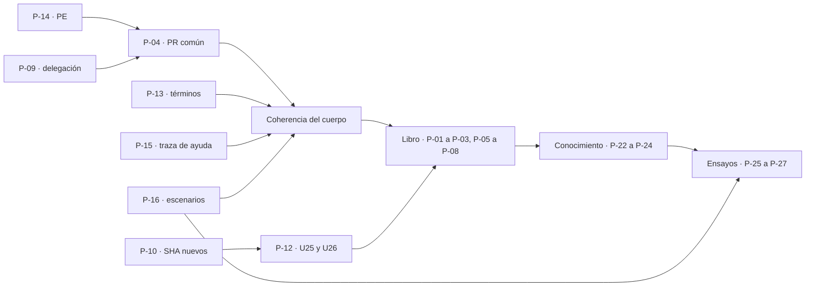

| Campo | Valor |
| --- | --- |
| Tipo | informe |
| Fecha | 2026-11-01 |
| Autor | Silla R-DECISIONES: análisis de decisiones, rol fuera del panel (paso 6 bis de `MEP`, ampliado por `TP:73`). **No emite hallazgos que se voten ni vota** (`MEP:328`); no cuenta en el techo. Los hallazgos de §8 son insumo para las comisiones y el refutador, rotulados como tales |
| Corrige | — |

# Análisis de decisiones — expediente 0003

## Índice

1. [Mandato, alcance y forma](#1-mandato-alcance-y-forma)
2. [Alias y definiciones](#2-alias-y-definiciones)
3. [Insumos leídos y verificaciones propias](#3-insumos-leídos-y-verificaciones-propias)
4. [Método: criterios, pesos, escala, filtros y firmeza](#4-método-criterios-pesos-escala-filtros-y-firmeza)
5. [Tablero de las 28 preguntas](#5-tablero-de-las-28-preguntas)
6. [Preguntas, una por una](#6-preguntas-una-por-una)
   1. [Libro: P-01, P-02, P-03, P-05 a P-08](#61-libro-p-01-p-02-p-03-p-05-a-p-08)
   2. [Herramienta común y gobierno: P-04, P-09 a P-12, P-19, P-20](#62-herramienta-común-y-gobierno-p-04-p-09-a-p-12-p-19-p-20)
   3. [Coherencia del cuerpo: P-13 a P-18, P-21](#63-coherencia-del-cuerpo-p-13-a-p-18-p-21)
   4. [Conocimiento y ensayos: P-22 a P-28](#64-conocimiento-y-ensayos-p-22-a-p-28)
7. [Camino de compromiso de las fichas](#7-camino-de-compromiso-de-las-fichas)
8. [Hallazgos propios (insumo, P0–P3)](#8-hallazgos-propios-insumo-p0p3)
9. [Fuentes externas](#9-fuentes-externas)
10. [Lo no verificado e incidencias](#10-lo-no-verificado-e-incidencias)
11. [Barrido de lo privado de este folio](#11-barrido-de-lo-privado-de-este-folio)

## 1. Mandato, alcance y forma

**Mandato** (carta de la silla; `PP` §6.3): por cada pregunta P-01 a P-28 de `PP` §7, los criterios (simplicidad,
practicidad, escalabilidad, fuente única, paso por la compuerta), la cadena de consecuencias de cada alternativa y el
camino de compromiso de cada ficha de excepción admitida. Además, posición recomendada, fundamento, fuentes externas,
riesgos y qué evidencia la sostendría; y hasta 12 hallazgos propios con lectura P0–P3.

**A ciegas.** No se leyó ningún informe de comisión (`mesa/01x-*`). Se leyeron la providencia 001 y los núcleos, que
no son informes de comisión.

**Lo que este folio no hace.** No dictamina ni vota: propone. No reabre las decisiones cerradas de `F001` §8
(territorios, delegación general del PO del 2026-09-14, alias de lo privado, conocimiento canónico en LD). No
reemplaza al refutador. Donde la evidencia no alcanza, lo dice y nombra lo que la sostendría.

**Forma de cada pregunta (§6).** Posición · alternativas con su puntaje (§5) · cadena de consecuencias en los cuatro
pasos de `CDC` §2 · fundamento y fuentes · riesgos · evidencia que la sostendría · estado (FIRME o CON REVISIÓN con su
condición). Lo que es juicio de esta silla va rotulado **[criterio propio]**.

## 2. Alias y definiciones

### 2.1 Alias

| Alias | Qué es |
| --- | --- |
| `TP` | El tool-prompt 02 del PO (`…/PROMPTs/Guides/14-Sistema-De-Documentador-Tecnico/02-Ajuste-Coherencia-Reedicion-Documentacion.md`, 104 líneas, huella `da388e9d…74b37` según `F001` §10) |
| `CH` | El pedido del chat del 2026-11-01 (`F001` §3) |
| `PP` | Bitácora 02, propuesta de panel y contrato de entrada |
| `CG` | Bitácora 01, cohesión global |
| `N1`…`N7` | Bitácoras de núcleo (N5, versión ofuscada) |
| `F001` | Providencia de apertura del expediente 0003 |
| `SDEI/` | `Lab-Documentos/Guides/Documentacion-Tecnica/Sistema-De-Documentacion-E-Integracion/`, en `0bed863` |
| `LD`, `LDD` | Lab-Documentos y Lab-Documentos.Documentacion (públicos) |
| `LG`, `LGD` | Lab-Geometria y Lab-Geometria.Documentacion (públicos) |
| `MEP` | `Knowledge-Mesa-De-Expertos-A-Pedido` 3.1 |
| `CDC` | `Knowledge-Cadena-De-Consecuencias` 2.0 |
| `EXC` | `Knowledge-Excepcion-A-Un-Conocimiento` 2.1 |
| `CPA` | `Knowledge-Conformacion-Pull-Request-Automatico` 2.0 |
| `DEC` | `SDEI/99-Anexos/Como-Decidir.md` (`ANX-SDEI-DECIDIR`), el método de decisión del propio cuerpo |
| `{dir-de-trabajo}` | Directorio de trabajo de la sesión (scratchpad, worktrees y carpeta de la mesa) |
| `{host-de-pruebas}` | Máquina donde corrieron los ensayos |
| `{etiqueta-runner}` | La etiqueta personalizada de runner que usan los workflows de LD (`docs-guard.yml:60`) y que contiene el nombre de una máquina |
| `{servicio-privado}` | El servicio privado de notificaciones; en el cuerpo, alias **SDD-B** (`SDEI/00-Marco.md:170`) |
| `<org>` | La organización de GitHub dueña de LD, LDD, LG y LGD |

### 2.2 Definiciones

| Término | Definición en este folio | Fuente |
| --- | --- | --- |
| Criterio (K1–K5) | Dimensión por la que se compara toda alternativa; las cinco del mandato | Carta de la silla; §4.1 |
| Escala anclada | 1 a 5 por criterio, cada punto con un observable | `DEC` §3 para K1–K3; anclas propias para K4 y K5 (§4.3) |
| Filtro duro | Restricción que excluye una alternativa antes de puntuar; no se compensa | `DEC` §1; filtros de §4.4 |
| Margen | Diferencia de puntaje ponderado entre la primera y la segunda alternativa admitidas | `DEC` §1 |
| FIRME | Margen ≥ 0,30 y el ganador no cambia con ±10 % en cada peso ni con la proyección «sólo `TP:73`» | `DEC` §1 y §4 (regla de firmeza del cuerpo) |
| CON REVISIÓN | No es FIRME: se toma la alternativa reversible y se escribe una condición comprobable | `DEC` §1; `CDC` §2, paso 4 |
| Cadena | Los cuatro pasos de `CDC` §2: dónde cae, cuánto pesa ahí, qué pierde la otra, si es reversible | `CDC` §2 |

**Ejemplo de lectura.** P-14, alternativa «`PE` = patrón de ejemplo» = (5, 5, 4, 5, 5): no agrega pieza (K1 = 5),
se cambia una línea y está medido (K2 = 5), un sistema nuevo no paga nada pero tampoco gana nada (K3 = 4), deja una
sola definición (K4 = 5) y la compuerta no cambia de veredicto (K5 = 5). Puntaje: 0,20 × 24 = 4,80.

## 3. Insumos leídos y verificaciones propias

| Insumo | Lectura |
| --- | --- |
| `TP` | Entero (clon del PO; no está en el worktree, como registran `N2` E1 y `N7` H11) |
| `PP` | Entero, en especial §3 (enunciado), §5 (convenciones), §6.3 (este rol) y §7 (preguntas) |
| `CG`, `N1`, `N2`, `N3`, `N4`, `N5` (ofuscada), `N6`, `N7` | Enteros o por secciones de decisión; `N5` privado no se leyó porque la versión ofuscada alcanzó para las preguntas a cargo |
| `F001` | §8 a §11 |
| `MEP` | §0 (mapa de carga, fila «Hacés el análisis de decisiones»), §2.1 paso 6 bis (l. 149), §4 (l. 328, 333) |
| `CDC` | Entero (§0 a §7) |
| `EXC` | §5.3 (esqueleto del camino de compromiso) y §6 |
| `CPA` | §3.1 (la delegación) |
| `DEC` | Entero: criterios, escala, filtros, firmeza y matriz trabajada |
| Cuerpo `SDEI/` | Las líneas citadas en §6, releídas en el worktree de LD en `0bed863` |

**Verificaciones propias** (2026-11-01, en `{host-de-pruebas}`, sólo lectura salvo copias en el scratchpad):

| # | Comando | Salida | Sirve a |
| --- | --- | --- | --- |
| V1 | `git log -1 --format='%h %s'` en el worktree de LD | `0bed863 Merge pull request #41 …` | Base |
| V2 | `sed -n 24p tools/docs-guard/prefijos.txt`; `sed -n 117p SDEI/99-Anexos/Esquema-Frontmatter-Y-Prefijos.md`; `grep -rnoE '\bPE-[0-9]{2}\b' SDEI \| wc -l` y `grep -rlE …` | `PE interno pregunta de evaluación`; `` | `PE` | interno | Patrón de ejemplo | ``; **25** usos de `PE-nn` como patrón, en **7** archivos; «pregunta de evaluación» sólo en `prefijos.txt:24` | P-14 |
| V3 | `grep -n doc_type tools/docs-guard/esquemas/cuerpo.schema.json` | Vocabulario cerrado sin `conocimiento` ni `libro`; con `anexo` y `guia-de-estudio` (l. 10) | P-02, P-22 |
| V4 | Copia `git archive HEAD` de LD; libro de ensayo con `doc_id: DOC-SDEI-GUIA`, `doc_type: guia-de-estudio`, `traces: [IDX-SDEI@2.0, MARCO-SDEI, TEM-SDEI-01]` y un encabezado `` #### 1.1 Corpus de guías (`ESC-SDEI-1`) ``; `dg.py esquema`, `trazas`, `ai` | `PR-2 esquema: verde (errores=0)`; `PR-5 traces-resolve: verde (errores=0 avisos=9) trazas=124 resueltas=115 ids-duplicados=0`; `PR-3 anti-inyeccion: verde (errores=0 avisos=28)` | P-02 |
| V5 | En la misma copia, `version: 2.0.0-borrador.1` en el README del cuerpo (frontmatter y tabla); `dg.py trazas` y `esquema` | Los dos verdes; las trazas `IDX-SDEI@2.0` siguen resolviendo | P-08 |
| V6 | `git cat-file -t` y `git merge-base --is-ancestor <c> origin/main` para `080f158`, `fe10086`, `e3841b6`, `6878568` | Los cuatro existen en el worktree; `080f158` y `fe10086` **no** son ancestros de `main`; `e3841b6` (#19) y `6878568` (#25) **sí** | P-10 |
| V7 | `git diff --stat 080f158 e3841b6`; ídem `fe10086 6878568` | **3 archivos**, 5 líneas, todos fuera de `SDEI/` y de `tools/` (dos guías de despliegue y una de testing, con nombres redactados por la reescritura) | P-10, P-12 |
| V8 | `grep -rn '080f158\|fe10086' SDEI \| wc -l` | 8 citas, en TEM-01, TEM-02, TEM-03 y TEM-07 (incluida `TEM-07:200`, `git checkout --quiet 080f158`) | P-10 |
| V9 | `grep -n 'runs-on' .github/workflows/*.yml` en LD | 8 líneas en 4 workflows con `{etiqueta-runner}`; 4 de ellas en `framework-concept-demo.yml`, territorio de FRAMEWORK MAUI | P-11 |
| V10 | `sed -n 166,179p SDEI/TEM-07-Marco-SDD.md`; `git log -S 'Ninguna de las dos'` | «Ninguna de las dos existe todavía» (l. 170-171); introducida por `3e8ccbb` el 2026-10-27 18:36 -0300 | P-21 |
| V11 | En IA.SDD (público): `git log -1 --format='%h %ci' -- Conocimiento/Knowledge-Logica-De-Decision.md`; `git grep -n Logica-De-Decision -- SDD/Devs` | `38bf059 2026-10-27 09:54:01 -0300`; definición de «Lección» (l. 52) y §3.9 «Cada decisión es una lección»; líneas de norma que mandan consultarlo antes de detener: `SDD/Devs/Orchestrator/Master-Prompt.md:1025` y `SDD/Devs/Rules/Mesa-Rules.md:570` | P-21 |
| V12 | `sed -n 48p` y `sed -n 88p SDEI/TEM-05-Ayuda-Al-Usuario-Final.md`; `grep -rh '^traces:' Examples/Prueba-Ayuda-Por-Rol` | Regla compuesta (`RD-` + CU de la unidad); 7 líneas `traces:` a `CU-000NN@1.1` | P-15 |
| V13 | En LG `5f07b12`: `grep -rh '^# CU-1000[0-9]' SDD/Docs` sin `_legacy` | `CU-10001` a `CU-10009` vigentes; `CU-10005 — Enviar un trabajo y ver el resultado…` | P-15 |
| V14 | `sed -n 100,109p SDEI/00-Marco.md`; `sed -n 145,148p` | Tabla «Qué cambia entre escenarios»; `ACT-SDEI-2` Analista decide los requerimientos documentales | P-16, P-17 |
| V15 | `sed -n 166p SDEI/TEM-02-Ciclo-Documental.md` | «Docente o responsable de la guía» decide en `ESC-SDEI-1` | P-17 |
| V16 | `sed -n 14p tools/docs-guard/semanal.sh`; `sed -n 183,184p SDEI/00-Marco.md` | El carril semanal mide «atraso» de `base_commit` y `source.lock` contra `main`; el Marco dice que el aviso programado detecta que el símbolo cambió | P-18 |
| V17 | `grep -nE 'latest\|/LAB/\|tunnel' SDEI/Examples/Lanzar-Example.md` | `@devcontainers/cli@latest` (l. 51, 59), `cloudflared:latest` (l. 92), ruta del workspace (l. 18, 35), túneles del usuario (l. 101) | P-06 |
| V18 | `sed -n 36,40p SDEI/99-Anexos/Referencias.md` | Convención «Software: con la versión usada» (l. 38) | P-03 |
| V19 | `grep -n '0003' CHANGELOG.md` en LD y LDD; `ls -R` del expediente 0003 en el worktree de LDD | Sin filas del 0003; `actuaciones/` sólo con el folio 002 | P-09 |
| V20 | `git show origin/dac/0003-apertura:<bitácoras de Reedicion-02> \| grep -ci <nombre de máquina>` en LDD | Las copias empujadas nombran máquinas fuera de la etiqueta de runner (ver §8, RD-H01) | §8 |
| V21 | Conteo de términos con `grep -riow` sobre `SDEI` | «compuerta» 152 en 25 archivos; «deriva» 36 en 13; «letra» 18 en 7; «PR-7» 21 en 11 | P-13 |

## 4. Método: criterios, pesos, escala, filtros y firmeza

El método es el del propio cuerpo (`DEC` §1-§4), con los criterios del mandato. Usar el método que el libro va a
enseñar es la opción de fuente única: si la mesa decide con otro, el libro enseña algo que su propia mesa no usó.

### 4.1 Los cinco criterios

| K | Criterio | Qué mide | Origen | Fuente de industria (consultada el 2026-11-01) |
| --- | --- | --- | --- | --- |
| K1 | Simplicidad | Cuántas piezas, herramientas o reglas nuevas agrega | `TP:73` | `DEC` K1 (Böckeler, 2025, ya en Referencias) |
| K2 | Practicidad | Si funciona hoy con lo que hay, sin pasos humanos ni permisos extra, y si está medido | `TP:73` | Write the Docs, *Docs as Code* [S9]: «the same tools as code» |
| K3 | Escalabilidad | Cuánto cuesta aplicarlo a un sistema nuevo | `TP:73` | `DEC` K3 (Backstage, ya en Referencias) |
| K4 | Fuente única | Si un dato queda en un solo lugar o, si se repite, con una regla que corrige o detecta la divergencia | Carta; `Rule-Documentation.md:28` («Un dato vive en un solo documento») | GitLab, *Documentation Style Guide* [S2]: «The GitLab documentation is the SSoT…»; «share the link to the documentation instead of rephrasing the information» |
| K5 | Paso por la compuerta | Si la alternativa pasa `docs-guard` (y la compuerta de la base, si viaja allí), medido | Carta; `TEM-06` | Write the Docs [S9]: «Automated Tests» como componente de *docs as code* |

### 4.2 Pesos

0,20 cada uno. Los cinco salen del mandato y ninguna fuente los ordena: razón insuficiente, como `DEC` §4. **Se
fijaron y se les tomó huella antes de puntuar**: archivo de pesos en el scratchpad, `sha256`
`43fb734a6c266cf100ed6ce04bb30197702c39cfd088429df40a8b306e162c3a`, 2026-11-01T18:45:08Z. Sensibilidad: ±10 % en
cada peso; y la proyección «sólo `TP:73`» (K1–K3 a 1/3, K4 y K5 a cero), porque los dos últimos son del mandato de la
silla, no del pedido.

### 4.3 Escala anclada

K1–K3: la de `DEC` §3, sin cambios. K4 y K5 tienen anclas propias **[criterio propio]**:

| Punto | K4 Fuente única | K5 Paso por la compuerta |
| --- | --- | --- |
| 5 | El dato vive en un solo lugar | Verde medido con el `dg.py` vigente |
| 4 | Se repite con una regla escrita de corrección en el mismo PR, o un control que detecta la divergencia | Verde esperado por un ensayo análogo, sin tocar la compuerta |
| 3 | Se repite con una regla manual sin control | Sin medir |
| 2 | Dos lugares sin regla | Exige cambiar la compuerta (PR común) antes de pasar |
| 1 | Dos versiones divergentes vigentes | Rojo medido |

### 4.4 Filtros duros

| Filtro | Excluye la alternativa que… | Origen |
| --- | --- | --- |
| F-A | escribe en lo público rutas del equipo, hosts, IPs, usuarios o nombres de lo privado | `SDEI/00-Marco.md:170`; E-06; restricción dura (`F001` §8) |
| F-B | escribe en territorio ajeno (FRAMEWORK MAUI, `PROMPTs/` del PO fuera de `OUTPUTs/`) o instala sin acuerdo | `F001` §8 |
| F-C | contradice una frase requisito del pedido | `F001` §4 |
| F-D | se apoya en un dato no verificado presentado como hecho | `TP:96-98` |
| F-E | cambia el producto (código o especificación de Geometría o de `{servicio-privado}`) | L-3 de `F001` §4.3 |
| F-F | deja incumplida una convención vigente del propio cuerpo | `SDEI/00-Marco.md` §5; `SDEI/99-Anexos/Referencias.md` §1 |

### 4.5 Cálculo

Guion propio en Python 3, sin dependencias ni red, corrido con `python3 -I` el 2026-11-01: `sha256`
`5baeb6eba6460594b369b25121814241d2357fb82085169da81de2c52e5cf260`; salida `47543d14…cea99`. Los dos viven en el
scratchpad de la sesión (`{dir-de-trabajo}`); todo lo que el guion necesita está en §5 (puntos por celda y pesos), así
que se puede recalcular sin él.

**Resultado global.** 28 preguntas: 20 FIRME (una de ellas por filtro, P-03) y 8 CON REVISIÓN (P-05, P-11, P-12,
P-15, P-20, P-22, P-24, P-26). En P-05 y P-20 hay empate exacto: se decide por la cadena (pasos 3 y 4), y se dice.

## 5. Tablero de las 28 preguntas

Puntos en el orden (K1, K2, K3, K4, K5). Total = 0,20 × suma.

| P | Recomendada (puntos · total) | Segunda (puntos · total) | Excluidas | Margen | Estado |
| --- | --- | --- | --- | --- | --- |
| P-01 | A edición de lectura; manda la fuente; corrección doble (4,4,4,3,4 · 3,80) | B libro canónico (3,2,3,5,2 · 3,00) | C generado, F-C | 0,80 | FIRME |
| P-02 | `DOC-SDEI-GUIA` (5,4,4,4,5 · 4,40) | `LIB-SDEI` (4,3,4,5,2 · 3,60) | — | 0,80 | FIRME |
| P-03 | Arquitectura de N2 + anexo de herramientas + «de la explicación al conocimiento» + forma Diátaxis por capítulo (3,4,4,4,4 · 3,80) | — | N2 sola y N2 + Diátaxis por parte, F-F | — | FIRME por filtro |
| P-04 | C: PR común con `PE` y filas de delegación; `dg.py` a un expediente de herramienta (5,4,3,4,4 · 4,00) | A (3,3,4,4,3 · 3,40) | — | 0,60 | FIRME |
| P-05 | Convenciones del cuerpo + Google como segundo nivel (4,4,4,4,4 · 4,00) | Sólo convenciones (5,3,3,5,4 · 4,00) | — | 0,00 | CON REVISIÓN |
| P-06 | Reescrito en LD, sin datos del entorno y con versiones fijas; el libro remite y resume (4,4,4,5,4 · 4,20) | Movido a LDD (3,3,3,4,4 · 3,40) | Íntegro, F-A | 0,80 | FIRME |
| P-07 | **HISTÓRICO (fecha)** con referencia APA (5,5,4,4,4 · 4,40) | Excluido y declarado (5,4,3,3,5 · 4,00) | — | 0,40 | FIRME |
| P-08 | Libro y archivado en el mismo PR; el cuerpo pasa a `2.0.0-borrador.1` (4,5,4,5,5 · 4,60) | Abrir `2.1.0` (3,3,4,5,4 · 3,80) | — | 0,80 | FIRME |
| P-09 | Providencia en el 0003 + fila de `CHANGELOG` en LD y LDD con la decisión del PO; el PR que la asienta, manual (4,4,4,5,4 · 4,20) | Manual hasta el cierre (5,2,2,5,5 · 3,80) | — | 0,40 | FIRME |
| P-10 | SHA nuevo + número de PR, con el mapa del rescate (4,5,5,5,5 · 4,80) | Sólo PR (5,3,4,4,4 · 4,00) | — | 0,80 | FIRME |
| P-11 | Nota en el Marco + parámetro en el conocimiento (4,5,5,5,5 · 4,80) | Sólo nota (5,5,4,4,5 · 4,60) | — | 0,20 | CON REVISIÓN |
| P-12 | U25 y U26 antes del libro, sólo para los guiones que el libro cita (3,4,4,5,5 · 4,20) | URL + SHA ahora; corrida en la fase 4 (4,4,4,4,3 · 3,80) | — | 0,40 | CON REVISIÓN (cambia con «sólo `TP:73`») |
| P-13 | Adoptar las cuatro distinciones de N1 (4,4,4,5,4 · 4,20) | Dejar como está (5,3,3,2,4 · 3,40) | — | 0,80 | FIRME |
| P-14 | `PE` = patrón de ejemplo (5,5,4,5,5 · 4,80) | `PE` = pregunta de evaluación (4,3,4,4,4 · 3,80) | — | 1,00 | FIRME |
| P-15 | Retrazar a `CU-100NN` + RRD + `source.lock`; completar `TEM-05:48` (3,4,4,5,5 · 4,20) | Sólo reescribir `:48` (5,4,3,3,4 · 3,80) | — | 0,40 | CON REVISIÓN (cambia con «sólo `TP:73`») |
| P-16 | Composición de escenarios + filas puntuales (3,4,5,5,4 · 4,20) | Sumar clases a las columnas (4,4,3,4,4 · 3,80) | — | 0,40 | FIRME |
| P-17 | La analista (manda el Marco) (5,5,4,5,4 · 4,60) | Docente o responsable (4,3,3,3,4 · 3,40) | — | 1,20 | FIRME |
| P-18 | Reescribir el texto (5,5,4,5,4 · 4,60) | Programar A1 (2,3,4,5,4 · 3,60) | — | 1,00 | FIRME |
| P-19 | Sin sitio; ensayo informativo (5,5,4,5,4 · 4,60) | MkDocs (2,4,4,4,3 · 3,40) | — | 1,20 | FIRME |
| P-20 | Control local obligatorio (5,4,3,5,3 · 4,00) | Regla estática en PR-4 y render en CI (4,00 cada una) | — | 0,00 | CON REVISIÓN |
| P-21 | Reescribir con lo verificado (5,5,4,5,4 · 4,60) | Dejar (5,4,3,2,4 · 3,60) | — | 1,00 | FIRME |
| P-22 | `ANX-SDEI-ESPECIFICACION`, `doc_type: anexo` (5,5,3,3,5 · 4,20) | `KNW` + `conocimiento` (4,3,5,5,3 · 4,00) | — | 0,20 | CON REVISIÓN |
| P-23 | Forma estricta con doble cabecera (3,5,5,5,5 · 4,60) | Forma libre (5,3,2,3,2 · 3,00) | — | 1,60 | FIRME |
| P-24 | Neutral: «SDD» sólo en el apéndice por escenario (4,4,5,5,5 · 4,60) | Sin restricción (5,5,3,4,3 · 4,00) | — | 0,60 | CON REVISIÓN (cambia con «sólo `TP:73`») |
| P-25 | Métrica de N3 + trampas de N4 como ítems del oráculo; C0 calibra (4,4,5,5,4 · 4,40) | N3 sola (4,4,4,4,4 · 4,00) | — | 0,40 | FIRME |
| P-26 | Oráculo de N4 §4 y hoja privada, con huella antes; insumos: conocimiento, plantilla A-01, LG `4b114d7` + LGD `b47d22b` (3,4,4,5,4 · 4,00) | Columna del Marco (5,4,3,2,4 · 3,60) | — | 0,40 | CON REVISIÓN (cambia con «sólo `TP:73`») |
| P-27 | Evidencia de Geometría en el expediente 0003; lo privado, local, con sus huellas publicadas (4,4,4,5,4 · 4,20) | Rama descartable (4,3,3,3,4 · 3,40) | — | 0,80 | FIRME |
| P-28 | No mezclar; «escalón 2» queda en el 0002 (5,5,4,5,4 · 4,60) | Mezclar (3,2,3,3,3 · 2,80) | — | 1,80 | FIRME |



*Figura 1. Orden en que las decisiones se condicionan: el PR común depende de `PE` y de la delegación; el libro, del
cuerpo corregido y de los guiones re-anclados; los ensayos, del conocimiento y de las clases por escenario.*

## 6. Preguntas, una por una

### 6.1 Libro: P-01, P-02, P-03, P-05 a P-08

#### P-01 — Relación entre el libro y los documentos fuente

**Posición: A**, edición de lectura: manda la fuente, el libro no redeclara IDs y toda corrección de fondo se aplica
a la fuente en el mismo PR (`N2` §6.1). C queda excluida por F-C: el pedido quiere que «los editores editen» y una
revisión «como si fuera un libro» en seis intervenciones (`TP:42`, `:50`, `:58-67`); un libro generado no se edita.

**Cadena.**

| Paso | A edición de lectura | B libro canónico |
| --- | --- | --- |
| Dónde cae | En los editores y en quien corrige después: cada corrección de fondo toca dos archivos | En las trazas y punteros que hoy apuntan a Marco, Mapa y temas, y en la ruta «agente» del README |
| Cuánto pesa | 19 Markdown fuente fuera de `Examples/` (`find SDEI -name '*.md' -not -path '*/Examples/*' \| wc -l` = 19) | 4 archivos con `traces:` a `TEM-SDEI-nn` en LD y LDD (`grep -rlE 'traces:.*TEM-SDEI'` = 4), más `AGENTS.md` (archivo común, clase H) y el Mapa |
| Qué pierde la otra | B pierde los documentos chicos que pide `Rule-Documentation.md:29` y el Profile (un documento por tema) | A paga el riesgo de deriva libro↔fuente, acotado por la regla de corrección doble |
| Reversible | Sí: se pasa a B más tarde con una tabla de destinos, como se hizo con `DOC-SDT-0001` | Costoso: re-apuntar trazas y volver a declarar IDs en sus fuentes |

**Fundamento.** GitLab sostiene la fuente única sin prohibir la repetición: «Does not mean that content cannot be
duplicated» y pide enlazar antes que reescribir [S2]. A es exactamente eso: el libro reúne, la fuente manda.
**Riesgo:** deriva entre libro y fuente sin control automático (K4 = 3). **Evidencia que la sostendría:** ensayo
`N2` E4 (verde) y V4; después del primer PR, cero divergencias entre el anexo I y las fuentes en la ronda de
corrección de pruebas. **Condición de revisión [criterio propio]:** si la ronda de pruebas o un PR posterior encuentra
una divergencia de fondo libro↔fuente que la corrección doble no evitó, se propone a un expediente de herramienta un
control mecánico (huella por sección en el anexo I).

#### P-02 — `doc_id` del libro

**Posición: `DOC-SDEI-GUIA`** con `doc_type: guia-de-estudio`. **Medido hoy con el `doc_id` exacto** (V4): esquema,
trazas y anti-inyección en verde. Eso cierra el hueco de `CG` §3.3 («el `doc_id` exacto no se ensayó»).

**Cadena.** `DOC`: cae en la semántica del prefijo («documento temático por tipo de documentación»,
`prefijos.txt:11`), que ya usó la guía de un solo archivo; pesa cero archivos comunes. `LIB`: cae en `prefijos.txt` y
en el anexo del esquema, y obliga a que el PR común se fusione antes que el libro (K5 = 2); lo que gana es un nombre
exacto. Las dos son reversibles mientras nadie trace al libro; después, cambiar el `doc_id` pone en rojo a quien lo
traza (detectable). **Riesgo:** ninguno medido. **FIRME.**

#### P-03 — Partes, orden y anexos

**Posición:** la arquitectura de `N2` §7 (prólogo, partes I-VI, capítulos 1-18, anexos A-J, orden TEM-01→07) con
tres agregados: (1) un **anexo de herramientas** con la versión que fija la CI; (2) una sección **«de la explicación
al conocimiento»** (en el capítulo 17 o en el anexo I) para que las remisiones `consulta` del conocimiento resuelvan
(`N3` §7); (3) la **forma Diátaxis por capítulo** en la tabla de rutas del prólogo, no en el título de cada parte.

**Por qué filtro y no puntaje.** Sin (1), el libro cita markdownlint, lychee y mermaid sin referencia, contra la
convención «Software: con la versión usada» (`Referencias.md:38`, V18): F-F. Rotular **por parte** también cae en
F-F práctico: la Parte V mezcla tutorial (cap. 13), cómo hacer (cap. 12) y referencia (cap. 15); Diátaxis distingue
cuatro formas por necesidad [S8], y una parte con tres formas recibiría un rótulo falso.

**Cadena.** Cae en el bloque B6 de redacción (`N2` §7.5): un anexo más (≈ una página) y una columna en la tabla del
prólogo. Lo que pierde la alternativa «N2 sola»: el cumplimiento de su propia convención y la remisión del
conocimiento. Reversible: sí. **Evidencia que la sostendría:** `ci-local.sh todo` verde sobre el libro y el
conocimiento con sus `consulta` resolviendo (PR-5).

#### P-05 — Guía de estilo de base para las rondas de estilo y ortotipografía

**Posición: convenciones del cuerpo (`00-Marco.md` §5) primero y Google *developer documentation style guide* como
segundo nivel.** Empate exacto con «sólo convenciones» (4,00 y 4,00): lo decide la cadena.

**Cadena.** «Sólo convenciones» cae en los editores: ante un caso que `00-Marco.md` §5 no cubre (por ejemplo,
mayúsculas en títulos o listas), cada editor resuelve a su modo, y eso es retrabajo de clase P1 entre rondas. Google
cae en una fuente en inglés que el editor tiene que trasladar. Google declara la misma precedencia que el cuerpo:
«Refer to project-specific guidelines first, then this guide…» y «This guide contains guidelines, not rules» [S1];
o sea, no compite con las convenciones. Microsoft queda tercera porque esta silla no abrió su regla de precedencia
(K2 = 3). Las tres son reversibles con una línea en el registro de rondas.

**Riesgo:** ninguna de las dos guías rige la ortotipografía del castellano. La ronda ortotipográfica necesita una
obra académica de la lengua; la candidata obvia es la *Ortografía de la lengua española* de la RAE y la ASALE
(2010), pero su ficha en rae.es devolvió HTTP 403 a esta silla el 2026-11-01: **sin verificar**, y queda para la
comisión de edición. **Condición de revisión:** si en las dos primeras rondas aparece una decisión de estilo que ni
las convenciones ni Google resuelven, se agrega al registro de rondas como convención propia y se cita.

#### P-06 — Cómo entra `Lanzar-Example`

**Posición:** reescribirlo **en LD**, como guía práctica, con versiones fijas y sin datos del entorno; el capítulo
14.3 lo resume y remite. «Íntegro» queda excluido por F-A: trae la ruta del workspace (l. 18, 35), `@latest` sin fijar
(l. 51, 59, 92) contra `TEM-06:288` y los túneles del usuario (l. 101) (V17).

**Cadena.** Reescribir cae en 141 líneas de un archivo (`wc -l`); moverlo a LDD cae en el capítulo 14.3, que se
queda sin procedimiento propio en el mismo repositorio que el ejemplo, y en un enlace entre repositorios que tiene
que ir por SHA (`00-Marco.md:164`). Con «remite y resume», el procedimiento vive una sola vez (K4 = 5). Reversible:
sí. **Evidencia que la sostendría:** el barrido de lo privado y `ci-local.sh` en verde sobre el archivo reescrito, y
una corrida del procedimiento en contenedor efímero que llegue al panel.

#### P-07 — Caso del portal de un proveedor de notificaciones

**Posición: entra como HISTÓRICO (fecha)**, con su fecha original y una entrada APA en el anexo B. Reverificarlo es
deseable, no requisito.

**Cadena.** Reverificar cae en una comisión que hoy no lo hizo (`CG` §6.3) y, si la página cambió, en reescribir
18.1 (K2 = 3, sin medir). Excluirlo cae en el único dato de industria que sólo vive en la guía obsoleta (`N1` §3):
se pierde al archivarla (K4 = 3). HISTÓRICO no afirma nada nuevo: dice qué se vio y cuándo. Reversible: sí; si una
reverificación llega antes de la ronda académica, la marca se reemplaza. **Riesgo:** la marca no reemplaza la
referencia; sin entrada APA sigue rompiendo `00-Marco.md:165`. **Cuidado de lo privado:** el proveedor se nombra
como proveedor público, nunca asociado a `{servicio-privado}`.

#### P-08 — Archivado de la guía obsoleta y versión del cuerpo

**Posición:** el libro y el archivado de `DOC-SDT-0001` entran **en el mismo PR**, y ese PR sube el cuerpo de
`2.0.0-borrador` a **`2.0.0-borrador.1`**.

**Por qué esa versión.** La guía obsoleta promete que «se archiva en la versión siguiente del cuerpo»
(`Sistema-Documentador-Tecnico-Guide.md:27`). Para SemVer, `2.0.0-borrador.1` es la versión siguiente de
`2.0.0-borrador`: «A larger set of pre-release fields has a higher precedence than a smaller set» y el ejemplo
`1.0.0-alpha < 1.0.0-alpha.1` [S3, §11.4]. Una pre-release «indicates that the version is unstable» [S3, §9]: no hay
release publicada que proteger, y abrir `2.1.0` sin haber cerrado nunca `2.0.0` no tiene base en la norma. Medido
(V5): las trazas `IDX-SDEI@2.0` siguen en verde, porque la traza usa MAYOR.MENOR.

**Cadena.** Cae en un PR más grande: las siete remisiones vivas a la guía (`N1` §3) se re-apuntan al libro en el
mismo cambio; si se archiva antes, quedan rotas. Diferir el archivado a `2.0.0` cae en los 33 avisos `url-fecha` por
corrida (`N1` §2) y en dos documentos vigentes en uso con el mismo contenido (K4 = 3). Reversible: sí, el archivo es
inmutable pero el movimiento se deshace con un PR. **Evidencia que la sostendría:** `ci-local.sh todo` en verde sin
los 33 avisos y `grep` sin remisiones a `Sistema-Documentador-Tecnico-Guide.md` fuera del archivo.

### 6.2 Herramienta común y gobierno: P-04, P-09 a P-12, P-19, P-20

#### P-04 — Qué entra en el PR común y cuándo

**Posición: C, acotada.** El PR común de LD lleva sólo: la línea `PE` de `prefijos.txt` (P-14) y las filas de
delegación del 0003 en `CHANGELOG.md` (P-09). Nada de `dg.py`: la exclusión de carpetas, la precedencia de versión y
los IDs locales van como propuestas a un expediente de herramienta. Si la mesa elige `KNW` en P-22 o la regla estática
en P-20, entran al mismo PR común; esta silla no los recomienda (§5).

**Cadena.**

| Paso | C (recomendada) | B (con `dg.py`) |
| --- | --- | --- |
| Dónde cae | En los ensayos, que corren sin las opciones nuevas de `dg.py` | En la herramienta común que usan FRAMEWORK MAUI y LDD, y en el pin de LDD |
| Cuánto pesa | Los ensayos ya tienen un rodeo medido: copia `geo-vigente` sin `_legacy/` (`N4` §5, A' verde) | `dg.py` tiene 1032 líneas (`wc -l`); LDD lo fija en `bf86669` (`N7` §4.1) y subir el pin es clase H; cambiar `dg.py` es clase H (`N1` §8 punto 5) |
| Qué pierde la otra | C deja sin resolver, para otros sistemas, los huecos de `TEM-07:239` (K3 = 3) | B agrega un cambio de clase H a un PR que ya tiene que coordinarse con otra sesión |
| Reversible | Sí: el expediente de herramienta puede abrirse en cualquier momento | Un cambio en la herramienta común alcanza a quien la usa: costo de volver mayor |

**Fundamento.** Ningún requisito del pedido necesita hoy las opciones nuevas de `dg.py` (filtro implícito en
`PP` AG-4: «entran sólo si la mesa los liga a un requisito»). **FIRME.**

#### P-09 — Cómo se asienta la delegación del merge del expediente 0003

**Posición:** providencia en el expediente 0003 y una fila de `CHANGELOG.md` en LD y en LDD, con la forma de la del
0002 (`LD CHANGELOG.md:285-292`), **con la decisión del PO asentada con su fecha**; el PR que la asienta se conforma
en manual. Mientras no esté asentada, rige la conformación manual (`CPA` §3.1: «Si el agente no la encuentra, rige el
padre»).

**Por qué la decisión es del PO y no de la mesa.** `CPA` §3.1: «La decide el responsable del producto y se asienta con
fecha y con quién lo decidió». La delegación general del 2026-09-14 aprueba la propuesta mejor fundada de la mesa,
pero no es una delegación de merge con techo, intervalo y excepción. Esto no es una escalada: la decisión de fondo
(ciclo automático con los parámetros del 0002) está tomada y fundada; falta la llave. Es un **obstáculo** de `CDC` §3:
una pregunta de una línea al PO, ahora: «¿Delegás el merge de los PR del expediente 0003 en LD y LDD con los
parámetros del 0002 (120 min, 30 s, misma excepción)?». Ver la ficha candidata XC-2 (§7).

**Cadena.** Asentar cae en dos archivos y en un PR manual (el de arranque); ampliar el 0002 cae en el asiento de otro
expediente, que cubre «los PR del expediente 0002» (`LD CHANGELOG.md:289`), y mezcla dos alcances (K4 = 3); manual
hasta el cierre cae en el PO, que tendría que fusionar cada PR (K2 = 2). Reversible: la delegación «es revocable por
unidad» (`CPA` §3.1). **FIRME.**

#### P-10 — Cómo se citan los commits que quedaron fuera de `main`

**Posición: SHA nuevo con número de PR**: `e3841b6` (#19) en lugar de `080f158`, y `6878568` (#25) en lugar de
`fe10086`, con el mapa de commits del rescate como respaldo, y enlace permanente al SHA.

**Evidencia nueva de esta silla (V6, V7).** Los SHA nuevos son ancestros de `main`; los viejos no. Y la diferencia
entre cada par es de **3 archivos y 5 líneas, todos fuera de `SDEI/` y de `tools/`**: la reescritura sólo redactó
nombres en guías de despliegue y testing. El árbol del cuerpo y de la compuerta es idéntico, así que el guion de
`TEM-07:200` debería dar la misma salida sobre `e3841b6` (lo confirma U25, P-12).

**Cadena.** Cae en 8 citas de cuatro temas (V8). «Sólo PR» pierde el guion: `git checkout` necesita un SHA (K2 = 3).
`refs/pull` pierde el clon: un clon nuevo no trae esas referencias por defecto (`N1-17` midió el fallo) y dependen de
que la plataforma las conserve. GitHub documenta que un enlace con ID de commit «will permanently link to the exact
version of the file in that commit» y que el de una rama «can change» [S4]. Reversible: sí. **FIRME.**

#### P-11 — La etiqueta de runner con nombre de máquina

**Posición:** nota en el Marco (la etiqueta es histórica; el host lo decide la organización) **y** el runner como
parámetro en el conocimiento, sin la etiqueta concreta (`N3` §4.4). Renombrar, no ahora.

**Cadena.** Renombrar cae en 8 líneas de 4 workflows de LD, 4 de ellas en el territorio de FRAMEWORK MAUI (V9), más
LDD, el `e2e.yml` de LG y la configuración del runner: clase H y archivos comunes. GitHub permite agregar etiquetas a
un runner existente por la API y quitar etiquetas personalizadas [S6]: un renombre con período de convivencia es
posible, pero no barato. La nota cae en una fila del Marco. El parámetro en el conocimiento cae en el texto que N3
igual escribe. Las dos primeras son reversibles; el renombre, a medias (terceros con workflows propios). **CON
REVISIÓN** (margen 0,20; con «sólo `TP:73`» gana «sólo nota»). **Condición:** cuando se cambie la configuración del
runner por otro motivo, o cuando un tercer repositorio quiera usar la etiqueta, se abre el renombre como clase H.
Ver también RD-H01: la etiqueta ya es pública; lo que sí se corrige es nombrar máquinas en prosa.

#### P-12 — Cierre de U25 y U26

**Posición:** U26 (marcas a URL + SHA) y U25 (corrida nueva) **antes del libro**, pero sólo para los guiones que el
libro va a citar; la corrida se guarda donde el 0002 la declaró (`evidencia/E1-R/`) y el 0003 la cita.

**Cadena.** Hacerlo antes cae en el bloque de coherencia (paso 5 de `CG` §7): unos minutos de `dg.py` por guion
(`N1` §2: las corridas son de segundos). Diferirlo cae en el libro, que publicaría guiones no re-corridos después de
la reescritura: la lectura P0 de `F001` §9 incluye «un guion publicado que no corre». Reversible: las dos. **CON
REVISIÓN** (con «sólo `TP:73`» gana diferir). **Condición:** si V7 se confirma (árbol idéntico), U25 puede reducirse
a un guion de muestra por tema; si una salida difiere, se corren todos.

#### P-19 — ¿Hay sitio publicado?

**Posición: no.** El ensayo MkDocs queda como control informativo por PR del libro, con slug compatible con GitHub
(`N7` §3.3, 0 advertencias de anclas).

**Cadena.** Un sitio cae en un generador nuevo, un workflow de publicación y 22 enlaces que salen del `docs_dir`
(`N7` §3.3). Material for MkDocs anuncia «End of life on May 5, 2027» y un sucesor [S5]: atar el libro a ese tema
compra una migración con fecha. Sin sitio, el canal es el render de GitHub, que hoy existe (`00-Marco.md:119`, «hoy
ningún escenario publica sitio»). Reversible: sí. **Condición:** se reabre si una fila `RD-` del RRD pide sitio o
`llms.txt` para el cuerpo. **FIRME.**

#### P-20 — Dibujado de mermaid: control local o CI

**Posición: control local obligatorio antes de cada PR** (`N7` §6, paso 2) y corrección de los dos diagramas con
`#64;` o espacios (`N7` §3.2). Empate exacto a tres (4,00): lo decide el paso 4 de la cadena.

**Cadena.**

| Opción | Dónde cae | Cuánto pesa | Reversible |
| --- | --- | --- | --- |
| Local | En quien abre el PR | 163 s para 27 diagramas (`N7` §3.2); nada común | Sí, sin costo |
| Regla estática en PR-4 (`@` en etiqueta = error) **[criterio propio, alternativa nueva]** | En `dg.py`, archivo común, clase H | Sin medir cuántos casos atrapa además de `@` | Sí, con PR común |
| Render en CI | En el workflow común y en la cola del runner compartido | +≈ 3 min por PR y una imagen con navegador; `mmdc` dibuja a SVG/PNG/PDF y procesa bloques en Markdown [S10] | Sí, con PR común |

Entre tres empatadas, la que se revierte sin tocar nada común. **CON REVISIÓN. Condición:** si un diagrama mal
dibujado llega a `main` o aparece una causa distinta de `@`, se abre el expediente de herramienta con la regla
estática primero (más barata) y el render en CI después.

### 6.3 Coherencia del cuerpo: P-13 a P-18, P-21

#### P-13 — Términos con dos o más sentidos

**Posición:** adoptar las cuatro distinciones de `N1`: **letra** (lo que se promete) frente a intención y
comportamiento; **deriva** (contenido frente a código) frente a **desfase** (SHA atrasado, como lo llama
`semanal.sh:14`); **control**, **compuerta** (carril PR) y **compuerta de escalón**; **PR-7 «fijadas y
referencias»**, contando `autoprueba`.

**Cadena.** Cae en el texto: «compuerta» aparece 152 veces en 25 archivos, «deriva» 36 en 13, «letra» 18 en 7 y
«PR-7» 21 en 11 (V21). No todas cambian: sólo las que usan el sentido que se separa. Dejarlo cae en el glosario del
libro, que definiría un término con dos sentidos (K4 = 2) y en cualquier aplicador del conocimiento. Reversible: sí.
**Fundamento:** el glosario se rige por `Icono-Y-Ancla` (`F001` §8), cuyo tema es entregar una definición con la que
se pueda operar. **Evidencia que la sostendría:** P-LECT sin preguntas sobre esos términos. **FIRME.**

#### P-14 — Qué significa `PE`

**Posición: `PE` = patrón de ejemplo**; se corrige `prefijos.txt:24` en el PR común, y los pendientes del expediente
usan `PEND-`.

**Cadena (V2).** «Patrón de ejemplo» tiene 25 usos en 7 archivos; «pregunta de evaluación» existe sólo en una línea
del registro. Elegir el sentido del registro cae en reescribir 25 usos y en inventar un prefijo nuevo para los
patrones. Ver RD-H06: la regla del anexo «manda el archivo» (`Esquema…:199-200`) aplicada a ciegas forzaría la
dirección cara. Reversible: sí. **FIRME** (margen 1,00).

#### P-15 — A qué traza una página de ayuda

**Posición:** retrazar las páginas de `Prueba-Ayuda-Por-Rol` a los casos de uso de la unidad Web de Geometría
(`CU-10001` a `CU-10009` existen y están vigentes en `5f07b12`, V13; por ejemplo «enviar un trabajo» →
`CU-10005`), sumar sus filas `RD-` y un `source.lock` a LG, y completar `TEM-05:48` para que diga la regla entera que
ya está en `:88`.

**Cadena.** Cae en 7 líneas `traces:` (V12), un RRD chico y un `source.lock`. Lo que gana: el escenario `ESC-SDEI-3`
deja de no tener ningún ejemplo verificable (los 9 avisos «no verificable» de `N1` §2 pasan a verificarse). Lo que
pierde «declarar el ejemplo anterior a la regla»: el libro mostraría en los capítulos 8 y 14 un ejemplo que viola la
regla que enseña, que es un dato falso sobre el ejemplo (lectura P0 de `F001` §9). Reversible: sí. **Riesgo:** con
`source.lock`, un cambio de versión en LG pone en rojo el ejemplo; es la detección que el cuerpo promete, no un
defecto. **CON REVISIÓN** (con «sólo `TP:73`» gana «sólo reescribir `:48`»). **Condición:** si el retrazado exige
cambiar algo en LG (no debería: sólo se lee), se vuelve a «declarar el límite» y se abre el pedido aparte.

#### P-16 — Qué clases activa cada escenario

**Posición:** una regla de **composición de escenarios** en el Marco §2.5 («un proyecto puede activar más de un
escenario; las clases activas son la unión»), más cuatro filas puntuales: CL-08 y CL-13 en `ESC-SDEI-1` (`N1-23`);
CL-09 en `ESC-SDEI-4` (los expedientes de un servicio con SDD, `N5` B6); fuente generada de `ESC-SDEI-3` como
«OpenAPI y, si está activo, comentarios XML» (`N4` H4); ancla de `ESC-SDEI-4` con caso «familia sin etiqueta → SHA en
`source.lock`», que reusa el ancla de `ESC-SDEI-2` (`N5` B7).

**Cadena.** Sumar CL-06 a la columna de `ESC-SDEI-4` cae en cada servicio sin panel, que activaría ayuda al usuario
final sin tenerla; la composición cae en una frase del Marco y escala a cualquier combinación nueva (K3 = 5). La
composición no agrega fases, así que respeta el invariante «un escenario nunca agrega fases al ciclo»
(`00-Marco.md:58-60`). Reversible: sí. **Evidencia que la sostendría:** la clasificación de C1 y C2 en los ensayos
coincide con el oráculo sin «difiere con fundamento». **FIRME.**

#### P-17 — Quién decide la fase 1b en `ESC-SDEI-1`

**Posición: la analista (`ACT-SDEI-2`)**, porque manda el Marco (`00-Marco.md:145`); `TEM-02:166` y la clave de
`EJR-SDEI-05` la citan y aclaran que en un corpus de guías ese rol suele ejercerlo quien es responsable de la guía.

**Cadena.** Cambiar el Marco al docente cae en `00-Marco.md:148`, que dice que estudiante y docente no deciden «el
contenido normativo del cuerpo»: habría que reescribir dos filas del Marco y el principio de roles (K4 = 3). Con la
analista, el cambio cae en dos textos que citan. La aclaración rol↔persona es la misma que aprobó el folio 255 del
0002 para `owner` (O-A: «`owner` es un rol», `N1-34`). El Profile pide el marco «definido una sola vez y
referenciado» (`N2` PF-2). **FIRME** (margen 1,20).

#### P-18 — Qué dice el cuerpo del aviso programado

**Posición: reescribir** (`00-Marco.md:183-184`, `Ejercicios.md:116`, `01-Mapa.md:70`): el carril semanal avisa que el
SHA quedó N commits atrás; la deriva por símbolo la mide A1 al correr la demo.

**Cadena.** Programar A1 cae en un workflow común (clase H), en compilar .NET en la cola del runner compartido cada
semana y en la frontera con FRAMEWORK MAUI. Reescribir cae en tres frases. Lo que pierde reescribir: la detección
semanal por símbolo, que hoy tampoco existe (V16). **Condición [criterio propio]:** si un PR de la demo encuentra en
rojo una ficha por un cambio de símbolo que llevaba más de una semana en `main` sin aviso, se propone programar A1.
**FIRME.**

#### P-21 — «Las capas A y B no existen» en `TEM-07`

**Posición: reescribir con lo que esta silla verificó** (V10, V11). En el IA.SDD público, el 2026-10-27 a las 09:54
(-0300), `38bf059` publicó un conocimiento de lógica de decisión que define y registra **lecciones** de decisión (la
función de la capa A) y dos líneas de norma que mandan correrlo antes de detener (`Master-Prompt.md:1025`,
`Mesa-Rules.md:570`: la función de la capa B). La frase de `TEM-07` se escribió el mismo día a las 18:36 (`3e8ccbb`).

**Texto propuesto [criterio propio]:** «La capa A tiene un candidato publicado en un marco SDD (un conocimiento de
lógica de decisión con lecciones) y la capa B, una línea en la norma de su orquestador. Si son las capas de este
diseño lo decide el escalón 2.» Así no se afirma una identidad que no se probó.

**Cadena.** Dejarlo cae en el libro (capítulo 10), que repetiría un dato que ya era inexacto al escribirse (K4 = 2).
Reescribir cae en un párrafo. Reversible: sí. **FIRME.**

### 6.4 Conocimiento y ensayos: P-22 a P-28

#### P-22 — Prefijo y `doc_type` del conocimiento

**Posición: `ANX-SDEI-ESPECIFICACION` con `doc_type: anexo`** (verde medido por `N3` §3.4), provisoria.

**Cadena.** `ANX` cae en la semántica: «anexo» pasa a designar también una pieza normativa con §6 (K4 = 3), y un
lector sin contexto puede tomarla por material de consulta. `KNW` cae en el PR común (prefijo y vocabulario del
esquema), que tiene que fusionarse antes que el conocimiento, y en `cuerpo.schema.json`, que comparte FRAMEWORK MAUI
(K5 = 2-3). Margen 0,20: **CON REVISIÓN**; se toma la que no toca nada común. **Condición:** cuando entre un segundo
conocimiento a un cuerpo de LD, o cuando el PO apruebe la copia a la base común (`N3` M-4), se abre `KNW` y
`conocimiento` en el PR común y se cambia el `doc_id` (las trazas que apunten al viejo dan rojo: detectable).

#### P-23 — Forma del conocimiento

**Posición: forma estricta de la base, con doble cabecera** (frontmatter para `docs-guard` y once campos para la
compuerta de la base), §0-§10 y §6 con niveles. `N3` §3.4 midió que **las dos compuertas aceptan** esa forma.

**Cadena.** La forma estricta cae en la redacción (más secciones, K1 = 3). La libre cae en la verificación: sin
frontmatter, PR-2 rojo medido; y sin §6 normativa, la prueba de reproducción no tiene contra qué contar «contestadas»
(K3 = 2). Reversible: las dos, pero la libre impide la copia a la base sin reescribir. Del conocimiento de FRAMEWORK
MAUI se toman los contenidos que `N3` §3.3 lista (cuándo usarlo, principio → criterio → fuente, checklist,
referencias, límites), no su cabecera. **FIRME** (margen 1,60).

#### P-24 — Neutralidad respecto de SDD

**Posición: neutral**: «marco de especificación del proyecto» en el cuerpo y «SDD» sólo en el apéndice por escenario.

**Cadena.** En LD no se exige; la restricción cae en el vocabulario y en una entrada de terminología. Sin restricción,
el costo cae en la copia a la base: su lista de neutralidad incluye `\bSDD\b` (`N3` §3.1), y la copia daría rojo.
Reversible: sí. **CON REVISIÓN** (con «sólo `TP:73`» gana sin restricción). **Condición:** si el PO decide que no hay
copia a la base, la restricción se puede levantar sin costo.

#### P-25 — Métrica de éxito de la reproducción

**Posición:** un solo juego de métricas, el de `N3` §5.6 (100 % contestadas o «pendiente» con motivo; coincidencia
≥ 85 % en decisiones con oráculo; 0 invenciones; 0 suposiciones; compuerta verde con par rojo/verde), y **las trampas
de `N4` §7.3 entran como ítems del oráculo de C1**, no como un umbral aparte. El caso **C0** (el propio LD, conocido)
**calibra**: si C0 no llega al umbral, el defecto está en el oráculo o en la carta, no en el caso.

**Cadena.** La unión de las dos métricas cae en dos umbrales para la misma prueba (`CG` C-05) y en un «≥ 6 de 8» que
sólo vale para Geometría (K3 = 2 para N4 sola). Los umbrales son **[criterio propio]** de N3 y N4; se fijan con
huella antes de correr, como los pesos de `DEC` §4. Reversible: sí, pero sólo antes de correr; después, cambiar el
umbral invalida la medición. **FIRME.**

#### P-26 — Oráculo e insumos de cada caso

**Posición.** Oráculo: `N4` §4 para C1 y la hoja de integración privada de `N5` para C2, escritos por otro agente y
con `sha256` antes de correr. La columna del Marco **no** es oráculo: P-15 y P-16 la corrigen con esos mismos casos
(circularidad, `CG` C-04); después de los ensayos, la columna se contrasta con el oráculo. Insumos del aplicador: el
conocimiento, la plantilla A-01 vacía y el repositorio del caso en un SHA fijo. Para C1, **el par LG `4b114d7` + LGD
`b47d22b`** (PR #3): la ia-db de esa rama indexa `4b114d7`, que es lo desplegado (`v1.2.0`), y `4b114d7..5f07b12`
sólo toca `AGENTS.md` y tres archivos de `SDD/` (`N4` §3.7). La ia-db 4.0 local sin commitear queda afuera: no es
reproducible.

**Cadena.** Cae en un agente más (el que escribe el oráculo) y en fijar la rama de un PR ajeno por SHA. Lo que pierde
la columna del Marco: nada de costo, pero mide contra un dato que el ensayo va a cambiar (K4 = 2). **CON REVISIÓN**
(con «sólo `TP:73`» gana la columna). **Condición:** si el PR #3 de LGD se cierra sin fusionar y su rama se borra,
se usa `refs/pull/3/head` por SHA o se pasa a `0202722` + `5f07b12` y se declara.

#### P-27 — Dónde viven los ensayos

**Posición (alternativa nueva).** Geometría: la evidencia del ensayo va al expediente 0003 en LDD (público, territorio
propio), no a una rama de LGD ni a un PR en LGD. `{servicio-privado}`: sólo en el directorio privado de la mesa, y en el
expediente 0003 se publican **sus huellas** (`sha256`) y las lecciones ofuscadas, nunca el contenido.

**Cadena.** Una rama descartable en LGD cae en un repositorio con un PR de arranque abierto y una ia-db sin commitear
de otra sesión (`N4` §9), y se pierde si se borra (K4 = 3). Un PR en los repositorios de los casos cae en la
documentación de productos ajenos al pedido (L-3) y, en el privado, en su delegación y en lo privado. El expediente
propio cae en una carpeta `evidencia/` que ya existe vacía (`F001` §10, fila 8). Reversible: sí. **Fundamento:** la
corrección que pide el pedido es del conocimiento y del libro (L-3), no del diseño de los servicios. **FIRME.**

#### P-28 — ¿El ensayo en Geometría es la primera mitad del escalón 2?

**Posición: no.** El escalón 2 queda en el expediente 0002, se llama «escalón 2» (no «G2», por la colisión de
`CG` §4) y recibe los resultados del ensayo como insumo citado.

**Cadena.** Mezclar cae en el criterio de paso a vigente de `TEM-07` (l. 25-28: la compuerta corriendo en la CI de LG),
que un ensayo sin merge y sin tocar el producto no puede cumplir: la «primera mitad» quedaría abierta sin evento de
cierre. No mezclar cae en una remisión. Reversible: sí. **FIRME** (margen 1,80).

## 7. Camino de compromiso de las fichas

**Estado.** Este folio se escribe antes de la refutación: **ninguna ficha está admitida todavía** (`MEP:149`, paso 6
bis: «Sin ficha admitida, no se convoca»). Lo que sigue es el análisis **anticipado** de las dos fichas candidatas que
las preguntas dejan a la vista, con la forma de `EXC` §5.3, para que el jurado no tenga que esperar un ciclo si el
refutador las admite. Si admite otra, este folio necesita un agregado.

### 7.1 XC-1 — Libro único frente a «un dato en un solo documento» y «documentos pequeños»

```text
ANÁLISIS DEL CAMINO DE COMPROMISO — XC-1 (ficha candidata; origen P-01, N2 §2.3)
  Sigue rigiendo:          Rule-Documentation.md:28-29 en el cuerpo: Marco, Mapa, siete temas y anexos siguen
                           siendo la fuente, chicos y especializados; el Profile (un documento por tema) se cumple
                           en el cuerpo.
  Fuera del documento:     la existencia de un archivo unificado que repite contenido (TP:48 lo pide); ahí la
                           referencia es GitLab Style Guide [S2]: SSoT sin prohibir la repetición, enlazar antes que
                           reescribir.
  Alternativas:            Alt-1 edición de lectura (P-01 A) — la más cercana a cumplir
                           Alt-2 libro canónico, fuentes obsoletas (P-01 B)
    Descartadas antes de ponderar: libro generado — TP:42 y :50 piden edición humana en seis intervenciones (E2)
  Criterios y pesos (fijados antes de puntuar):
    K-1 Cercanía a cumplir — 0,40 — fuente: Rule-Documentation.md:28-29
    K-2 Reversibilidad     — 0,30 — fuente: CDC §2, paso 4
    K-3 Fuente única con enlace — 0,30 — fuente: GitLab Style Guide [S2] — pesa como K-2 porque es la materia
        que la excepción deja fuera
  Ponderación (0 a 3):
    Alt-1: K-1 3 (las 19 fuentes siguen vigentes, V-§6 P-01) · K-2 3 (se pasa a Alt-2 con una tabla de destinos)
           · K-3 2 (repite, con regla de corrección doble) → 2,70
    Alt-2: K-1 1 (los documentos por tema pasan a obsoleto) · K-2 1 (re-apuntar trazas y AGENTS.md, clase H)
           · K-3 3 → 1,60
  Caminos:
    C-1 (recomendado) Alt-1: cumple todo lo que se puede cumplir y paga sólo la repetición que el pedido exige —
        reversible
    Sin C-2: Alt-2 quedó segunda; la pondría primera un peso de K-3 de 0,80 o más, y no es razonable porque
        dejaría de regir el documento en la materia que sí se puede cumplir
  Mientras se decide:      provisorio: se sigue C-1 (es la posición de P-01)
```

### 7.2 XC-2 — Merge automático del 0003 sin la delegación que exige `CPA` §3.1

```text
ANÁLISIS DEL CAMINO DE COMPROMISO — XC-2 (ficha candidata; origen P-09, N7 H8)
  Sigue rigiendo:          CPA entero: guarda G1-G4, merge atado al SHA, reservas; y §3.1 «si el agente no la
                           encuentra, rige el padre» (conformación manual).
  Fuera del documento:     nada, si se cumple; si la mesa asentara sola la delegación, quedaría fuera quién decide
                           el merge; ahí la referencia es la separación de funciones: NIST SP 800-53 Rev. 5,
                           control AC-5 «Separation of Duties» (sin apartado verificado en la fuente primaria;
                           marca P, fuentes secundarias concordantes consultadas el 2026-11-01)
  Alternativas:            Alt-1 pregunta de una línea al PO y providencia + CHANGELOG con su decisión; mientras
                           tanto, manual — la más cercana a cumplir
                           Alt-2 la mesa asienta la delegación bajo la delegación general del 2026-09-14
                           Alt-3 ampliar el alcance de la delegación del 0002
    Descartadas antes de ponderar: —
  Criterios y pesos (fijados antes de puntuar):
    K-1 Cercanía a cumplir — 0,40 — fuente: CPA §3.1
    K-2 Reversibilidad     — 0,30 — fuente: CDC §2, paso 4
    K-3 Separación de funciones — 0,30 — fuente: NIST SP 800-53 Rev. 5, AC-5 — quien ejecuta el merge no es quien
        lo autoriza
  Ponderación (0 a 3):
    Alt-1: 3 · 3 (revocable por unidad, CPA §3.1) · 3 → 3,00
    Alt-2: 1 (la decide quien no es el responsable del producto) · 2 · 1 → 1,30
    Alt-3: 2 (la decidió el PO, pero para otro alcance: LD CHANGELOG.md:289) · 2 · 2 → 2,00
  Caminos:
    C-1 (recomendado) Alt-1 — reversible; el costo es una pregunta y un PR manual de arranque
    Sin C-2: Alt-3 quedó segunda; la pondría primera un peso de K-1 de cero, y no es razonable porque K-1 es fijo
        del método
  Mientras se decide:      rige el padre: conformación manual de los PR del 0003
```

## 8. Hallazgos propios (insumo, P0–P3)

Esta silla no emite hallazgos para el voto (`MEP:328`). Estos son insumo para que una comisión o el refutador los
haga propios. Lectura P0–P3 de `F001` §9.

| # | Hallazgo | Evidencia | Lectura | Propuesta |
| --- | --- | --- | --- | --- |
| RD-H01 | Las copias **empujadas** de las bitácoras de la reedición en la rama `dac/0003-apertura` de LDD (repositorio público) nombran máquinas en prosa, además de la etiqueta de runner: la del host que no se debe tocar (`02-Propuesta-De-Panel.md:392`, fila «Restricciones duras») y la de pruebas (6 menciones en `Nucleo-N4.md`) | V20: `git show origin/dac/0003-apertura:<ruta> \| grep -ci <nombre>` sobre cada bitácora de `Reedicion-02/` | **P0**: restricción dura de `F001` §8 y `00-Marco.md:170` («en lo versionado no van … hosts»). Daño bajo (sin IP ni credencial) y corrección barata porque todavía no hay PR | Alias `{host-de-pruebas}` y equivalentes antes de abrir el PR; reescribir la cabeza de la rama si la presidencia lo juzga necesario |
| RD-H02 | La frase de `TEM-07` «Ninguna de las dos [capas] existe todavía» ya era inexacta al escribirse | V10 (`3e8ccbb`, 18:36) frente a V11 (`38bf059`, 09:54 del mismo día, IA.SDD público) | P1 | P-21 |
| RD-H03 | La reescritura de la historia no tocó el cuerpo ni la compuerta: cada par de SHA viejo/nuevo difiere en 3 archivos ajenos | V7 | P2 (abarata P-10 y P-12) | P-10; U25 puede reducirse a muestra |
| RD-H04 | El `doc_id` exacto que recomienda N2 nunca se había ensayado; ya se ensayó y da verde | V4 | P2 (cierra `CG` §3.3) | P-02 |
| RD-H05 | «Se archiva en la versión siguiente del cuerpo» (`Sistema-Documentador-Tecnico-Guide.md:27`) no dice qué es «siguiente» para una pre-release; SemVer §11.4 lo resuelve y la compuerta lo tolera | V5; [S3] | P1 (dos lecturas: archivar ya o al pasar a `2.0.0`) | P-08 |
| RD-H06 | La regla «si una tabla de este anexo y su archivo no coinciden, manda el archivo» (`Esquema-Frontmatter-Y-Prefijos.md:199-200`), aplicada literalmente a `PE`, impone la corrección cara (25 usos) para conservar un sentido que nadie usa | V2 | P1 | En P-14, corregir el archivo; y que la regla diga que manda el archivo **salvo** decisión de la mesa en sentido contrario, asentada en el mismo PR |
| RD-H07 | La delegación del PO del 2026-09-14 no es una delegación de merge en el sentido de `CPA` §3.1 (techo, intervalo, excepción, «con quién lo decidió»): un merge automático del 0003 sin asiento propio quedaría sin base | `CPA` §3.1; V19 | P1 | P-09; XC-2 |
| RD-H08 | El contrato de entrada (`PP` §7) da alternativas pero no fija criterios ni pesos antes de los informes; la regla del propio cuerpo lo exige (`DEC` §4: «Los pesos se fijan antes de puntuar y se guarda su huella») | `PP` §7; `DEC` §4 | P2 | Esta silla los fijó con huella (§4.2); la presidencia puede adoptarlos o fijar otros con huella antes del veredicto |
| RD-H09 | El README del cuerpo declara la versión dos veces (frontmatter, l. 3, y tabla, l. 22): es el mismo patrón de «versión doble» que `N4` §5 (caso R) muestra como trampa en Geometría | `sed -n 3p` y `sed -n 22p SDEI/README.md`; V5 tuvo que cambiar las dos | P2 | Que el libro y el conocimiento enseñen «una sola fuente de versión por documento» con el caso propio; la tabla del README puede remitir al frontmatter |
| RD-H10 | Para C1 hay un par de revisiones coherente y versionado (LG `4b114d7` + LGD `b47d22b`) que ningún núcleo propuso; el que N4 tenía a mano mezcla `5f07b12` con una ia-db sin commitear | `N4` §3.2, §3.7 | P1 (sin él, el ensayo no es reproducible) | P-26 |
| RD-H11 | Este rol se convoca fuera de la condición de `MEP:149` (sin ficha admitida); sus caminos de compromiso son anticipados | `MEP:149`; `PP` §6.3 | P3 | §7; agregado si el refutador admite otra ficha |

## 9. Fuentes externas

Todas abiertas por esta silla el 2026-11-01, salvo donde se indica.

| Id | Fuente | Qué se tomó |
| --- | --- | --- |
| S1 | Google. *Google developer documentation style guide*. https://developers.google.com/style | «Refer to project-specific guidelines first, then this guide…»; «This guide contains guidelines, not rules» |
| S2 | GitLab. *Documentation Style Guide*. https://docs.gitlab.com/development/documentation/styleguide/ | «The GitLab documentation is the SSoT…»; «Does not mean that content cannot be duplicated…»; «share the link to the documentation instead of rephrasing the information» |
| S3 | Preston-Werner, T. *Semantic Versioning 2.0.0*. https://semver.org/ | §3 (una versión publicada no se modifica), §9 (pre-release inestable), §11.4 (precedencia de pre-release y ejemplo `1.0.0-alpha < 1.0.0-alpha.1`) |
| S4 | GitHub Docs. *Getting permanent links to files*. https://docs.github.com/en/repositories/working-with-files/using-files/getting-permanent-links-to-files | El enlace con ID de commit es permanente; el de una rama «can change» |
| S5 | Material for MkDocs. https://squidfunk.github.io/mkdocs-material/ | «End of life on May 5, 2027»; sucesor Zensical |
| S6 | GitHub Docs. *Using labels with self-hosted runners*. https://docs.github.com/en/actions/hosting-your-own-runners/managing-self-hosted-runners/using-labels-with-self-hosted-runners | Etiquetas personalizadas; agregar por API a un runner existente; quitar etiquetas |
| S7 | MADR. https://adr.github.io/madr/ | Versión 4.0.0 (2024-09-17); sección opcional *Confirmation* (útil para el criterio verificable de una decisión del libro) |
| S8 | Diátaxis. https://diataxis.fr/ | «Diátaxis identifies four distinct needs, and four corresponding forms of documentation» |
| S9 | Write the Docs. *Docs as Code*. https://www.writethedocs.org/guide/docs-as-code/ | Definición; componentes, entre ellos «Automated Tests» |
| S10 | mermaid-cli. https://github.com/mermaid-js/mermaid-cli | Dibuja a SVG/PNG/PDF; procesa bloques mermaid dentro de Markdown |
| S11 | Keep a Changelog 1.1.0. https://keepachangelog.com/en/1.1.0/ | Sección `Unreleased` para lo que viene (consultada; no se usó en una decisión) |
| S12 | Docusaurus. *Versioning*. https://docusaurus.io/docs/versioning | «Most of the time, you don't need versioning» (apoyo lateral a P-19) |
| N-1 | NIST SP 800-53 Rev. 5, control AC-5 «Separation of Duties» | **P**: la fuente primaria no se abrió (el catálogo de csrc.nist.gov devolvió sólo navegación); título y enunciado concordantes en fuentes secundarias del buscador |
| N-2 | RAE y ASALE. *Ortografía de la lengua española* (2010) | **Sin verificar**: rae.es devolvió HTTP 403. Candidata para la ronda ortotipográfica |

`N6` se tomó como hipótesis: S1, S2, S5, S7, S8 y S9 coinciden con lo que `N6` §3 afirma; S3, S4, S6, S10, S11 y S12
son nuevas de esta silla.

## 10. Lo no verificado e incidencias

- **Puntajes de celda.** Son juicio de esta silla con el observable de la escala; los que se apoyan en una medida
  propia llevan su V-n. Los demás se apoyan en los núcleos (`C` hasta que una comisión los verifique, `PP` §1).
- **Tiempo del render en CI** (P-20): 163 s es la corrida local de `N7`, no una corrida en el runner.
- **Que el guion de `TEM-07` dé la misma salida sobre `e3841b6`**: inferido de V7 (árbol idéntico), no corrido.
- **Microsoft Writing Style Guide**: no se abrió su regla de precedencia (P-05).
- **NIST AC-5 y la Ortografía de la RAE**: ver §9.
- **La API de GitHub** devolvió «rate limit exceeded» a una consulta anónima; la visibilidad pública de IA.SDD se
  comprobó por la página web (`curl -o /dev/null -w '%{http_code}' https://github.com/<org>/IA.SDD` = 200).
- **Ensayos en el scratchpad** (V4, V5): copia `git archive` de LD, sin tocar ningún repositorio; quedan en
  `{dir-de-trabajo}` y se borran al cierre.
- **Mensajes a mitad de turno:** no llegó ningún mensaje de otra sesión ni texto que cambiara el encargo.
- **Escritura:** sólo este folio. Nada de git, PR ni escritura en otro lugar.

## 11. Barrido de lo privado de este folio

Comprobado sobre el texto antes de entregarlo: sin rutas `/home` ni `/vm` (se usa `{dir-de-trabajo}`), sin IPs, sin
nombres de máquinas (se usa `{host-de-pruebas}` y `{etiqueta-runner}`), sin el nombre de `{servicio-privado}` ni de su
organización, ni de otros proyectos privados, sin secretos. El proveedor del portal de P-07 no se nombra. Del
directorio privado de la mesa no se transcribió nada.
