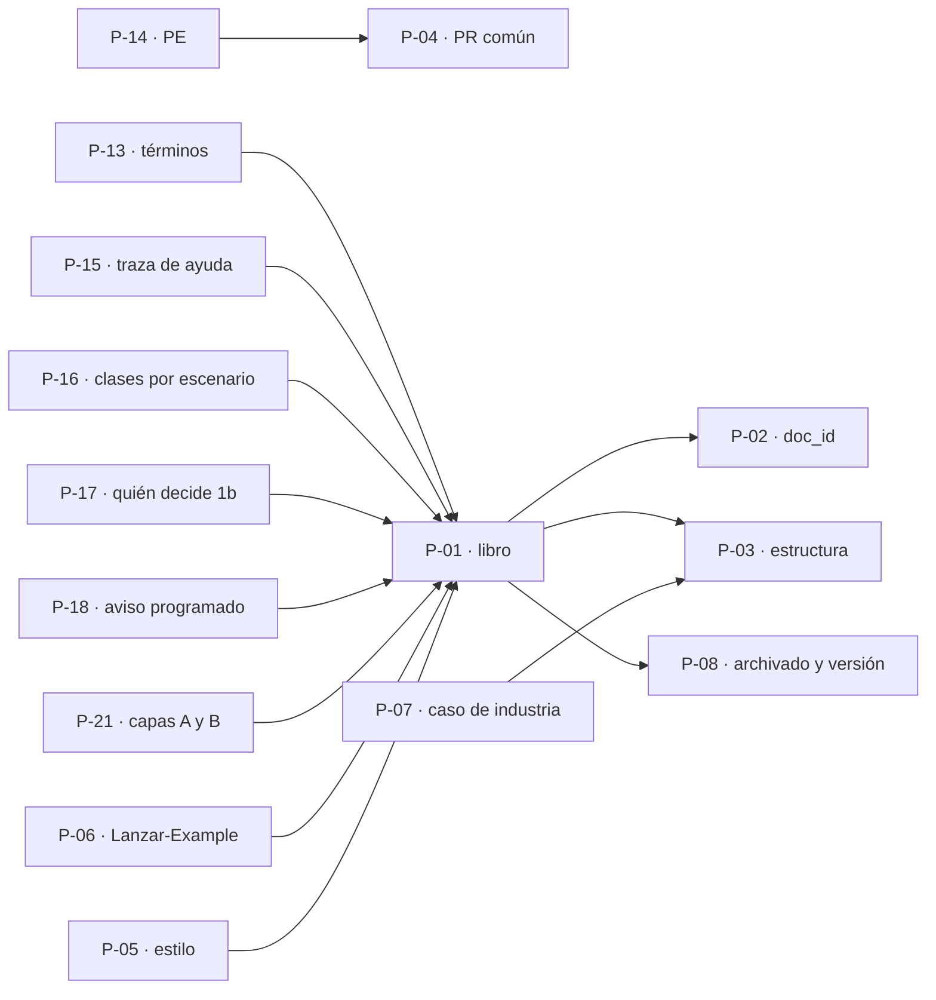

| Campo | Valor |
| --- | --- |
| Tipo | informe |
| Fecha | 2026-11-01 |
| Autor | Especialista en análisis de decisiones, rol fuera del panel (paso 6 bis de `MEP`, ampliado por `TP:73`). **Consolida, no es comisión**: no emite hallazgos que se voten ni vota (`MEP:328`); no cuenta en el denominador. Leyó los informes F010 a F019 (no es a ciegas) |
| Corrige | — (complementa a F019, que se escribió a ciegas; donde este folio difiere, lo dice en §7) |

# Análisis de decisiones (alcance A) — expediente 0003

## Índice

1. [Mandato, alcance y forma](#1-mandato-alcance-y-forma)
2. [Alias y definiciones](#2-alias-y-definiciones)
3. [Insumos leídos y verificaciones propias](#3-insumos-leídos-y-verificaciones-propias)
4. [Método: criterios, pesos, escala, filtros y firmeza](#4-método-criterios-pesos-escala-filtros-y-firmeza)
5. [Tablero](#5-tablero)
6. [Preguntas, una por una](#6-preguntas-una-por-una)
   1. [Libro: P-01 a P-08](#61-libro-p-01-a-p-08)
   2. [Coherencia del cuerpo: P-13 a P-18 y P-21](#62-coherencia-del-cuerpo-p-13-a-p-18-y-p-21)
7. [Dónde discrepan las comisiones y cómo se resuelve](#7-dónde-discrepan-las-comisiones-y-cómo-se-resuelve)
8. [Fichas de excepción y camino de compromiso](#8-fichas-de-excepción-y-camino-de-compromiso)
9. [Filas para el lote del PO](#9-filas-para-el-lote-del-po)
10. [Fuentes externas](#10-fuentes-externas)
11. [Lo no verificado e incidencias](#11-lo-no-verificado-e-incidencias)
12. [Inventario de lo creado y lo borrado](#12-inventario-de-lo-creado-y-lo-borrado)
13. [Barrido de lo privado de este folio](#13-barrido-de-lo-privado-de-este-folio)

---

## 1. Mandato, alcance y forma

**Mandato.** Para cada pregunta del alcance —P-01 a P-08 (libro; P-04 incluida por la herramienta común que el libro
necesita) y P-13 a P-18 y P-21 (coherencia del cuerpo)—: las alternativas, las de `PP` §7 y las que trajeron las
comisiones; criterios explícitos con peso; cadena de consecuencias de cada alternativa (`CDC` §2); puntaje;
alternativa dominante o empate declarado; y dónde discrepan las comisiones. Las otras preguntas (P-09 a P-12, P-19,
P-20, P-22 a P-28) no son de este folio.

**Lo que este folio no hace.** No reabre las decisiones cerradas de `F001` §8. No dictamina ni vota: propone al
jurado. No reemplaza al refutador. Donde la evidencia de los informes no alcanza, lo dice (§11).

**Forma de cada pregunta (§6).** Alternativas con quién las propone · matriz (K1 a K6) · dominancia y margen ·
cadena (los cuatro pasos) · recomendación y estado · discrepancias. Lo que es juicio de esta silla va rotulado
**[criterio propio]**.

## 2. Alias y definiciones

| Alias | Qué es |
| --- | --- |
| `TP` | El tool-prompt 02 del PO, 104 líneas, `sha256` `da388e9d…74b37` (recalculado hoy; coincide con `F001` §10). No está en el worktree de LDD; se leyó del clon principal, sólo lectura |
| `PP` · `CG` | Bitácora 02 (propuesta de panel y contrato de entrada) · bitácora 01 (cohesión global) |
| `N1`…`N7` | Bitácoras de núcleo (N5 en su versión ofuscada) |
| `F001`, `F004` | Providencia de apertura y acta del jurado de composición |
| `F010`…`F019` | Informes: C-REQ, C-VER, C-LECT, C-ARQ-MAUI, C-DOC-SIS, C-DOC-USR, C-FORMAL, C-ACAD-ED, C-REF y R-DECISIONES (este último a ciegas) |
| `SDEI/` | Carpeta del cuerpo en LD (`Guides/Documentacion-Tecnica/Sistema-De-Documentacion-E-Integracion/`), en `0bed863` |
| `GV` | `SDEI/Sistema-Documentador-Tecnico-Guide.md`, la guía obsoleta (`DOC-SDT-0001`, 841 líneas) |
| `LD`, `LDD`, `LG`, `LGD` | Lab-Documentos, Lab-Documentos.Documentacion, Lab-Geometria y Lab-Geometria.Documentacion (públicos) |
| `MEP` · `CDC` · `DEC` | `Knowledge-Mesa-De-Expertos-A-Pedido` 3.1 · `Knowledge-Cadena-De-Consecuencias` 2.0 · `SDEI/99-Anexos/Como-Decidir.md` |
| `{dir-de-trabajo}` | Directorio de trabajo de la sesión (scratchpad y carpeta de la mesa) |
| `{servicio-privado}` | El servicio privado de notificaciones; en el cuerpo, alias **SDD-B** |

| Término | Definición en este folio |
| --- | --- |
| Dominante | Una alternativa que es **igual o mejor en los seis criterios** y estrictamente mejor en uno que otra. La dominancia no depende de los pesos: una alternativa dominada sale sin discusión de pesos |
| FIRME | Margen ≥ 0,30 contra la mejor alternativa **no dominada** y mismo ganador con las tres pruebas de sensibilidad de §4.5 |
| CON REVISIÓN | No es FIRME: se toma la alternativa que la cadena (pasos 3 y 4) prefiere y se escribe la condición comprobable para revisarla (`CDC` §2, paso 4) |
| Empate declarado | Puntaje igual con los tres juegos de pesos; se dice qué lo desempata y que el desempate no es de la matriz |
| Núcleo y variante | Cuando las dos primeras son la misma decisión con un agregado compatible, el **núcleo** (lo común) se mide contra las alternativas de verdad distintas, y la **variante** (el agregado) aparte |

## 3. Insumos leídos y verificaciones propias

| Insumo | Lectura |
| --- | --- |
| `TP` | Líneas 16-22, 40-80 |
| `PP` | §7 (preguntas y alternativas) y §8 (lectura P0–P3, restricciones duras) |
| `N6` | §3.1 y §5 (base de industria, como hipótesis a refutar) |
| F010 | §2, §3 (H01 a H12), §4 (P-01, P-13 a P-18, P-21), §8 |
| F011 | §2, §3.1 (P-04), §4 |
| F012 | §3, §4 (P-03, P-06, P-17), §6 |
| F013 | §3, §4 (P-06, P-11, P-16, P-18, P-21) |
| F014 | §3, §4 (P-01, P-02, P-04, P-08, P-13, P-14), §5, §8 |
| F015 | §3, §4 (P-15, P-16, P-07, P-05, P-03), §7 |
| F016 | §4.1 (P-13), §5.4 |
| F017 | §3, §4 (P-01 a P-08, P-10, P-19, P-20), §5, §8 |
| F018 | §2 a §7 |
| F019 | §1 a §6 (en especial §4, §5 y las preguntas del alcance), §7, §8, §9 |
| `CDC` | Entero. `MEP`: §0 (fila del análisis de decisiones), §2.1 (paso 6 bis, l. 149), §3.3 (filtro «Descripción o control», l. 285), §4 (l. 328) |

**Verificaciones propias** (2026-11-01, sólo lectura en el worktree de LD en `0bed863`, salvo descargas en
`{dir-de-trabajo}`):

| # | Comando | Salida | Sirve a |
| --- | --- | --- | --- |
| W1 | `grep -riow --include=*.md` de «desfase», «atraso» y «deriva» en `SDEI/`, sin `GV` | desfase **12** en 8 archivos; atraso **4** en 3; deriva **31** en 12 | P-13 |
| W2 | `sed -n 8,16p tools/docs-guard/semanal.sh` | Control 3 se llama **«atraso»** (`:14`, «cada base_commit (y el sha de cada source.lock) contra main»); control 4 se llama **«deriva»** (`:15`, «piezas fijadas (BASE-FIJADA.md) con su SHA-256») | P-13 |
| W3 | `sed -n 101,102p SDEI/TEM-06-*.md`; `grep -n atraso SDEI/99-Anexos/Glosario.md` | `TEM-06:101` «Atraso de `base_commit` y de `source.lock`»; `TEM-06:102` «Deriva de copias fijadas»; `Glosario.md:48` «atraso de anclas» | P-13 |
| W4 | `sed -n 33,34p tools/docs-guard/dg.py` | La opción `--deriva` compara anclas contra otra revisión (p. ej. `main`): deriva = contenido frente a código | P-13 |
| W5 | `sed -n 3p` y `sed -n 22p SDEI/README.md`; `git tag -l`; `sed -n 27p GV` | `version: 2.0.0-borrador` (dos veces); una sola etiqueta: `docs-guard-v1.0.0`; `GV:27` «En la versión siguiente del cuerpo: se mueve a un archivo inmutable…» | P-08 |
| W6 | `sed -n 11p README.md` y `Guides/README.md` | Las dos trazan `DOC-SDT-0001` | P-08 |
| W7 | `grep -n '^# ' SDEI/README.md`; `grep doc_id Concepts/Framework-Concept/MAUI-Framework-Developer-Guide.md` | H1 del cuerpo: «Sistema de documentación e integración — **guía de estudio**»; el libro de la otra sesión es `FC-GUIA-LIBRO` | P-02 |
| W8 | `sed -n 89p SDEI/01-Mapa.md` | CL-09 «Expedientes, bitácoras **y prompts**» → «Repo hermano `.Documentacion`» | P-06 |
| W9 | `sed -n 105,108p` y `:183-184` de `SDEI/00-Marco.md`; `:145`, `:148` | Fila «Clases activas»; el aviso programado «detecta que el método … cambió»; `ACT-SDEI-2` decide; `ACT-SDEI-5` «no decide» el contenido normativo | P-16, P-17, P-18 |
| W10 | `sed -n 48p` y `:84-89` de `SDEI/TEM-05-*.md` | `:48` «Toda página de usuario traza a un `RD-`»; `:88` (`ESC-SDEI-3`) «La fila `RD-` y el caso de uso de la unidad»; `:86` (`ESC-SDEI-2`) fichas y `RD-`; `:89` (`ESC-SDEI-4`) «La versión del paquete» | P-15 |
| W11 | `sed -n 24p tools/docs-guard/prefijos.txt`; `sed -n 199,200p SDEI/99-Anexos/Esquema-Frontmatter-Y-Prefijos.md` | `PE interno pregunta de evaluación`; «manda el archivo» | P-14 |
| W12 | `curl` de ocho fuentes externas (§10) | Las ocho responden 200 y contienen la frase que se cita | P-01, P-05, P-06, P-08 |

## 4. Método: criterios, pesos, escala, filtros y firmeza

### 4.1 Los seis criterios

| K | Criterio | Qué mide | Origen |
| --- | --- | --- | --- |
| K1 | Simplicidad | Cuántas piezas, herramientas o reglas nuevas agrega | `TP:73` («simplicidad») |
| K2 | Practicidad | Si funciona hoy con lo que hay, sin permisos extra, y si está medido | `TP:73` («practicidad») |
| K3 | Escalabilidad | Cuánto cuesta aplicarlo a un sistema o tema nuevo | `TP:73` («escalibilidad») |
| K4 | Fuente única | Si un dato queda en un solo lugar o, si se repite, con una regla o un control que detecte la divergencia | Carta de la silla; `Rule-Documentation.md:28` |
| K5 | Paso por la compuerta | Si pasa `docs-guard`, medido | Carta de la silla; `TEM-06` |
| K6 | Alineación con la industria | Si la sostienen tendencias del mercado o estándares, con fuente abierta hoy o norma con número | `TP:73` («basarse en las tendencias del mercado y los estandares de la industria») |

### 4.2 Pesos

K1, K2, K3 y K6 a **0,20** cada uno, porque tienen origen literal en el pedido; K4 y K5 a **0,10**, porque vienen
del mandato de la silla y además cada uno ya tiene un filtro duro detrás (F-F y F-H, §4.4) **[criterio propio]**. Se
fijaron y se les tomó huella **antes de puntuar**: `pesos.txt`, `sha256` `69cde840…b47741e`, 2026-11-01T18:57:08Z.
Difieren de F019, que puso los cinco de su mandato a 0,20 y no tenía K6: la carta de esta silla agrega la alineación
con la industria.

### 4.3 Escala anclada

K1 a K3: la de `DEC` §3, sin cambios. K4 y K5: las anclas de F019 §4.3 (5 = un solo lugar / verde medido; 1 = dos
versiones divergentes vigentes / rojo medido). K6, anclas propias **[criterio propio]**:

| Punto | K6 Alineación con la industria |
| --- | --- |
| 5 | Dos o más fuentes abiertas el 2026-11-01, o una norma con número, sostienen la práctica |
| 4 | Una fuente abierta el 2026-11-01 la sostiene |
| 3 | No hay fuente aplicable: decisión de casa |
| 2 | Una fuente abierta la contradice |
| 1 | La contradice una norma con número |

### 4.4 Filtros duros

F-A a F-F son los de F019 §4.4 (lo privado en lo público; territorio ajeno o instalar sin acuerdo; contradice una
frase requisito del pedido; dato no verificado como hecho; cambia el producto; deja incumplida una convención vigente
del cuerpo). Este folio suma dos:

| Filtro | Excluye la alternativa que… | Origen |
| --- | --- | --- |
| F-G | reescribe un **control** declarado y no ejercido para que deje de prometerlo, sin voto de derogación | `MEP:285`, filtro «Descripción o control» |
| F-H | deja la compuerta en **rojo medido** en el PR que la aplica | Restricción dura de `PP` §8 (P0: «la compuerta en rojo») |

### 4.5 Cálculo y firmeza

Guion propio, Python 3 sin dependencias ni red, `python3 -I`: `matriz.py` `sha256` `0cd4b17e…63f1c`; salida
`salida.txt` `sha256` `29fa36fb…9389e`; los dos en `{dir-de-trabajo}`. Todo lo que el guion necesita (puntos y pesos)
está en §5 y §6: se recalcula sin él.

**Sensibilidad.** Tres pruebas: pesos iguales (1/6); proyección «sólo `TP:73`» (K1, K2, K3, K6 a 0,25; K4 y K5 a
cero); ±10 % relativo en cada peso, de a uno y renormalizando. Se declara esa lectura de «±10 %» porque F016 H01 mostró
que tiene cuatro y que, con ésta, la prueba nunca invierte un ganador con margen ≥ 0,30; por eso las dos primeras son
las que de verdad informan.

**Corrida.** La primera corrida tenía cinco celdas K6 fuera de su ancla (P-04 B, P-13 «dejar», P-15 síntesis, P-18
las tres); se corrigieron contra §4.3 antes de escribir y se volvió a correr. Ningún ganador cambió; P-18 bajó de
margen 0,30 a 0,10, pero su ganador domina (§6.2). Se declara para que no quede como ajuste silencioso.

**Resultado.** De 15 decisiones (14 preguntas; P-13 con dos subdecisiones disputadas): **10 se resuelven sin
discusión de pesos** (8 por dominancia o FIRME y 2 con núcleo FIRME), **4 quedan CON REVISIÓN** y **1 en empate
exacto** (P-02).

## 5. Tablero

Puntos en el orden (K1, K2, K3, K4, K5, K6). Total = Σ peso × punto.

| P | Recomendada (puntos · total) | Segunda no dominada (total) | Dominadas o excluidas | Margen | Estado |
| --- | --- | --- | --- | --- | --- |
| P-01 | **D, edición ensamblada** (3,3,5,5,3,5 · 4,00) | A+ edición de lectura con ancla por SHA y sin reformular (3,80) | A desnuda (dominada por A+); B (2,80); C (F-C) | 0,20 | CON REVISIÓN |
| P-02 | `DOC-SDEI-LIBRO` o `DOC-SDEI-GUIA` (5,5,4,5,5,3 · 4,40 cada una) | — | `LIB-SDEI` (3,50) | 0,00 | EMPATE; desempate fuera de la matriz (§6.1) |
| P-03 | **Núcleo** N2 + Diátaxis por capítulo + herramientas + «de la explicación al conocimiento»; **variante V2** con unicidad de encabezados y piezas de obra de consulta (3,4,4,5,4,5 · 4,10) | V1 sin la variante (3,90) | N2 sola (F-F); Diátaxis por parte (F-D) | 0,20 | Núcleo FIRME por filtro; variante CON REVISIÓN |
| P-04 | **Núcleo C**: `PE` + delegación; nada de `dg.py` (5,4,3,5,5,4 · 4,20) | C + control de mermaid si P-20 lo elige (4,10) | A (3,30); B (2,60) | 0,90 núcleo · 0,10 variante | Núcleo FIRME; variante atada a P-20 |
| P-05 | **M3**: cuerpo → RAE y ASALE → Microsoft (*Spanish (Neutral)*) (4,4,4,4,4,5 · 4,20) | Sólo convenciones (3,50) | T (dominada); Google (dominada) | 0,70 | FIRME |
| P-06 | **Núcleo**: procedimiento genérico reescrito en la fuente de LD, versiones fijas, sin entorno; el libro lo trae. **Variante**: tool-prompt saneado a LDD (3,4,4,4,4,5 · 4,00) | Sin conservar el tool-prompt (4,10) | Íntegro (F-A); mover todo a LDD (3,40) | 0,70 núcleo · 0,10 variante | Núcleo FIRME; variante CON REVISIÓN |
| P-07 | **Reverificado** con fecha 2026-11-01 y referencia APA (4,5,4,5,5,5 · 4,60) | HISTÓRICO (4,00) | Excluido (3,60) | 0,60 | FIRME |
| P-08 | **X1**: libro y archivado de `GV` en el mismo PR; cuerpo a `2.0.0-borrador.1` (4,5,4,5,5,5 · 4,60) | — | X2, X3 y `2.1.0` (dominadas por X1) | — | DOMINANTE |
| P-13 | **Adoptar las separaciones con instrumento** (4,4,4,5,4,5 · 4,30) | Dejar (3,00) | — | 1,30 | FIRME |
| P-13 b | **«atraso»** para SHA frente a `main` (5,5,4,5,5,3 · 4,40) | — | «desfase» (dominada) | — | DOMINANTE |
| P-13 c | **«deriva de copia fijada»** para la copia que cambió (5,5,4,4,5,3 · 4,30) | — | «huella cambiada» (dominada) | — | DOMINANTE |
| P-14 | **`PE` = patrón de ejemplo** (5,5,4,5,5,3 · 4,40) | — | «pregunta de evaluación» (dominada) | — | DOMINANTE |
| P-15 | **Síntesis**: `:48` remite a la tabla por escenario; retrazar a `CU-100NN@ver`, RRD con rango propio, releer; sin `source.lock` hasta que haya trabajo de CI (3,5,4,5,5,5 · 4,40) | Declarar el ejemplo anterior (3,70) | `:48` con las dos mitades para todos (dominada); con `source.lock` ya (F-H); rebajar la regla (F-G) | 0,70 | FIRME |
| P-16 | **S**: fila prescriptiva «por defecto» + composición por unión + anotación de lo ausente en el ejemplo, medido en SHA + correcciones medidas (3,4,5,5,4,4 · 4,10) | Composición sin anotación (4,20) | Derivar la fila del ejemplo (3,70); filas sueltas (3,50) | 0,50 núcleo · −0,10 variante | Núcleo FIRME; variante CON REVISIÓN |
| P-17 | **El rol `ACT-SDEI-2` decide en todos los escenarios; `TEM-02` nombra al ocupante** (5,5,5,5,4,4 · 4,70) | — | Analista sola, docente, «analista o PO» (dominadas) | — | DOMINANTE |
| P-18 | **Reescribir lo que el carril hace y declarar como deuda que A1 no está programado** (5,5,4,5,4,3 · 4,30) | — | Sólo reescribir y programar A1 (dominadas) | — | DOMINANTE |
| P-21 | **Reescribir con un hecho fechado**: SHA, alias y versión, diferencias de campos declaradas, sin afirmar identidad (5,5,4,5,4,4 · 4,50) | — | «Candidato» sin diferencias y dejar (dominadas) | — | DOMINANTE |

*Figura 1. Las correcciones del cuerpo (P-13 a P-18, P-21, P-06) van antes del libro en cualquier alternativa de
P-01: con D porque el libro se arma de las fuentes; con A+ porque la corrección doble las exige.*

## 6. Preguntas, una por una

### 6.1 Libro: P-01 a P-08

#### P-01 — Relación entre el libro y los documentos fuente

| Alt. | Descripción | Propone | K1–K6 | Total |
| --- | --- | --- | --- | --- |
| A | Edición de lectura; manda la fuente; corrección doble en el mismo PR, sin control | `PP`; N2 D-N2-1; F019 | 4,4,3,3,4,3 | 3,50 |
| A+ | A con tres agregados: anexo de correspondencia o colofón con el SHA de LD sobre el que se editó cada capítulo (F014, F017 H10), el libro no reformula reglas ni umbrales (F010) y un control de co-cambio libro↔fuente (F010) | F014, F017; F010 como segunda opción | 4,4,3,4,4,4 | 3,80 |
| B | Libro canónico; fuentes a `obsoleto` | `PP`; N2 | 3,2,3,5,3,2 | 2,80 |
| C | Libro generado sin piezas propias | `PP`; N2 | — | **F-C**: sin lugar para los fundamentos (`TP:52`) ni las referencias (`TP:56`) |
| **D** | **Edición ensamblada**: un guion arma el libro de las fuentes en el orden de un manifiesto; prólogo, fundamentos y casos de industria son fuentes nuevas; intervenciones 1 a 4 sobre las fuentes, 5 y 6 sobre lo ensamblado; un control regenera y compara | F010 (D) y F018 (C′), por separado y a ciegas | 3,3,5,5,3,5 | **4,00** |

**Dominancia.** A+ domina a A (igual en K1, K2, K3, K5; mejor en K4 y K6): **la edición de lectura sin control queda
fuera**, y en eso coinciden las cuatro comisiones que la tocaron (F010, F014, F017, F018 piden un control). D y A+
no se dominan: D gana en K3, K4 y K6; A+ en K1, K2 y K5. Margen 0,20, el mismo ganador con pesos iguales (4,00 frente a
3,83) y con «sólo `TP:73`» (4,00 frente a 3,75).

**Celdas con su observable.** D K2 = 3: el ensayo de F018 §7 armó 3377 líneas con PR-2 y PR-5 en verde e
`ids-duplicados=0`, pero sin reescribir enlaces deja 36 rotos en PR-1; F010 midió 256 enlaces relativos entre fuentes a
convertir (son dos medidas distintas: todos los relativos frente a los que rompen). D K5 = 3: el libro final no se
midió. A+ K4 = 4: el SHA por capítulo detecta que una fuente cambió (`git diff --stat <sha>..HEAD -- <fuente>`, F014),
no que dos textos digan cosas distintas. D K6 = 5: mdBook (`SUMMARY.md`), Asciidoctor (`include`) y DITA (*bookmap*,
`conref`), dos abiertas hoy por esta silla (W12).

**Cadena.**

| Paso | D ensamblada | A+ lectura con ancla |
| --- | --- | --- |
| ¿Dónde cae? | En un guion (≈ 40 líneas en F018 §7, sin reescritura de enlaces) y en dos o tres fuentes nuevas; en los editores, que corrigen en la fuente | En cada PR futuro que toque el cuerpo: dos ediciones; y en el colofón o anexo de correspondencia |
| ¿Cuánto pesa? | 36 enlaces rotos a resolver (F018 §7); 17 encabezados con ID a reescribir (F010 §6 E5); **sin medir** dónde vive el guion: en `tools/docs-guard/` es archivo común (P-04) y en `SDEI/` no se ensayó si la compuerta lo tolera | ≈ 50 000 palabras duplicadas (N2 §11, citado por F018); un `git diff --stat` por PR; 19 fuentes (F019 §6, `find … \| wc -l`) |
| ¿Qué pierde la otra? | Si se elige D, se pierde la libertad de reescribir transiciones sólo en el libro: van a una fuente de parte | Si se elige A+, se pierde la fuente única: lo que corrigen estilo y ortotipografía queda sólo en el libro (F018 L-1, punto 2) |
| ¿Reversible? | Sí y barato: borrar el guion deja el libro como A | Sí, pero volver a D cuesta reconciliar dos textos ya divergidos, y crece con cada PR |

**Recomendación: D, CON REVISIÓN**, decidida por el paso 4: es la reversible barata frente a una cuya reversión crece.
**Condición de revisión** (la de F018, comprobable): si el guion con reescritura de enlaces supera 150 líneas o deja
enlaces rotos que PR-1 detecta, se pasa a **A+**, nunca a A. **Dos condiciones de entrada** que valen para D y para A+:
(1) el guion o el libro no llevan URL fuera del anexo de referencias, porque AI-4 bloquea (`dg.py:400`, `:432`; F018
H-05: 28 errores en el ensayo); (2) el guion vive en la carpeta del cuerpo y no en `tools/docs-guard/`, para no sumar
un archivo común (P-04).

**Frase de dos lecturas que decide el jurado.** «que los editores editen un documento unificado» (`TP:42`): editarlo
**a través de sus fuentes**, viendo el resultado unificado en el mismo PR (F010, F018), o editar el archivo final
(F014, F017, F019). `TP:66` («Errores de la versión diagramada») favorece la primera: presupone fuente → versión
diagramada. Si el jurado toma la segunda, D cae por F-C y gana A+. Es una lectura del pedido, no una escalada: la
delegación del 2026-09-14 la deja en el jurado.

#### P-02 — `doc_id` del libro

| Alt. | Propone | K1–K6 | Total |
| --- | --- | --- | --- |
| `DOC-SDEI-GUIA`, `guia-de-estudio` | N2; F017; F018; F019 (medido verde por F017, F018 y F019) | 5,5,4,5,5,3 | 4,40 |
| `DOC-SDEI-LIBRO`, `guia-de-estudio` | F014 (medido verde por F014 E4 y N2 E4) | 5,5,4,5,5,3 | 4,40 |
| `LIB-SDEI` con prefijo nuevo | N2 | 4,3,4,5,2,3 | 3,50 |

**Empate exacto** con los tres juegos de pesos. Las dos pasan PR-2, PR-3 y PR-5 sin tocar archivos comunes; K6 = 3
porque ninguna norma de la industria fija prefijos internos (F017, F018). `LIB` pierde por 0,90: exige un PR común
coordinado para una sola pieza.

**Desempate, fuera de la matriz [criterio propio].** Por univocidad (la lectura P1 de `PP` §8): el H1 del cuerpo se
llama «… — **guía de estudio**» (W7), así que `…-GUIA` nombra al libro igual que al cuerpo entero; `…-LIBRO` nombra la
pieza y sigue el caso que funciona en el mismo repositorio, `FC-GUIA-LIBRO` (W7; F014). A favor de `…-GUIA`: el nombre
de archivo del pedido es «Developer-**Guide**» (`TP:48`). Las dos son reversibles mientras nadie trace al libro (hoy,
cero trazas). **Recomendación: `DOC-SDEI-LIBRO`**, con el empate declarado; si el jurado prefiere seguir el nombre de
archivo del pedido, `DOC-SDEI-GUIA` no pierde nada medido.

#### P-03 — Partes, orden y anexos

**Núcleo, FIRME por filtro.** La arquitectura de N2 §7 (prólogo, partes I-VI, capítulos 1-18, anexos A-J, orden
TEM-01→07) con: Diátaxis **por capítulo**, no por parte (F012 lo propone por parte; F015, F017 y F019 por capítulo:
la parte V mezcla formas y un rótulo por parte sería falso → F-D); software con su versión (`Referencias.md:38` lo
exige → sin él, F-F); y la sección «de la explicación al conocimiento» (N3 §7; F012, F017, F019).

| Alt. | Descripción | K1–K6 | Total |
| --- | --- | --- | --- |
| V1 | Núcleo, con anexo de herramientas nuevo | 4,4,4,4,3,4 | 3,90 |
| **V2** | Núcleo + **unicidad de encabezados** (F012: 7 títulos repetidos 7 veces y 43 enlaces a anclas de temas; GitHub sufija `-1`, `-2` sin error visible) + herramientas **como sección «Software» del anexo B**, no anexo nuevo (F017) + portada y colofón con equivalencias de nombre, SHA de las fuentes y «Cómo citar» (F017 H03, H10) + anexo A como glosario-índice alfabético (F017 H07) + ruta «escribo la ayuda de un producto» y G.9 en dos variantes (F015) + plan de tomos si el tamaño pasa el umbral (F017 H01: 345 a 407 KB estimados frente a 400 KB del modo crudo de la API de GitHub) | 3,4,4,5,4,5 | **4,10** |

**Variante, CON REVISIÓN** (margen 0,20; empate con «sólo `TP:73`», 4,00 y 4,00). Cadena: V2 cae en el bloque de
redacción B1 y B6 (N2 §7.5) y pesa 49 encabezados a renombrar y 43 enlaces (F012, medido); V1 se ahorra eso y paga
lectores que caen en el capítulo equivocado sin error visible (P1). Las dos son reversibles. **Se recomienda V2** por
el paso 3: lo que V1 pierde está medido y es P1; lo que V2 cuesta es una sola vez. **Condición de revisión:** si el
render completo del libro en GitHub (peritaje pedido por F017) entra entero, el plan de tomos se retira.

#### P-04 — Qué entra en el PR común y cuándo

| Alt. | Descripción | Propone | K1–K6 | Total |
| --- | --- | --- | --- | --- |
| A | Prefijos (`PE`, `KNW` o `LIB`), delegación, mermaid en PR-4 | `PP` | 3,3,4,4,3,3 | 3,30 |
| B | A más cambios de `dg.py` | `PP` | 2,2,4,4,2,2 | 2,60 |
| **Cmin** | **`PE` en `prefijos.txt:24` (P-14) y la fila de delegación en `CHANGELOG.md` de LD y LDD (P-09); nada de `dg.py`** | F019; F014 y F011 como núcleo | 5,4,3,5,5,4 | **4,20** |
| C+ | Cmin + control de mermaid con fixtures rojo y verde | F011 | 4,4,4,5,4,4 | 4,10 |

**Núcleo C, FIRME** (0,90 sobre A; estable). Las cinco comisiones que respondieron (F011, F014, F018, F019 y, por
remisión, F010) mandan los cambios de `dg.py` a un expediente de herramienta: B cae en la herramienta común que usan
FRAMEWORK MAUI y LDD, con el pin de LDD (`bf86669`, subirlo es clase H; F011 §3.1) y con requisitos de ensayos que no
corrieron. K6 = 4 para C: DORA, «Working in small batches» (F011, consultada el 2026-11-01).

**Variante atada a otra pregunta.** C+ sólo existe si P-20 (fuera de este folio) elige el control en PR-4; esta silla
no la puntúa como decisión propia. La fila `FC` del anexo del esquema (F014) **no es archivo común**: vive en `SDEI/`
y puede ir en el PR de coherencia **[criterio propio]**. `dominios.txt` (F018) no hace falta si el libro no lleva URL
(P-01, condición 1).

**Cuándo.** Después del veredicto de P-20 y P-22, para no reabrirlo (F011); y antes del PR del libro sólo si algo del
libro lo necesita. Con P-02 y P-01 como se recomiendan, nada lo necesita.

#### P-05 — Guía de estilo de base

| Alt. | Descripción | Propone | K1–K6 | Total |
| --- | --- | --- | --- | --- |
| S | Sólo convenciones del cuerpo | `PP` | 5,3,3,5,4,2 | 3,50 |
| G | Convenciones + Google | N6 §5.3; F019 (empate) | 4,4,4,4,4,3 | 3,80 |
| **M3** | **Convenciones del cuerpo (voseo incluido) → RAE y ASALE (*Ortografía* 2010, *DPD*) → Microsoft Writing Style Guide y su *Spanish (Neutral)***; donde choque con el nivel 1, manda el 1 | F015 | 4,4,4,4,4,5 | **4,20** |
| T | M3 + Google en inglés para lo que no depende de la lengua | F017 | 3,4,4,4,4,5 | 4,00 |

**FIRME.** M3 domina a G (igual en todo, mejor en K6) y a T (mejor en K1). Contra S, la única no dominada, el margen es
0,70 y estable. **Refuta a N6 §5.3** («para castellano, ninguna de las dos aplica»): la lista de Microsoft trae
*Spanish (Neutral)* (W12, abierta hoy), sin variante rioplatense. Google declara su alcance «for software developers
and other technical practitioners» (F015 fuente 8): no cubre la ayuda al usuario final (CL-06).

**Cadena.** Cae en una fila en `00-Marco.md` §5 y en P.4 del libro; S cae en los editores sin árbitro para dudas de
lengua (la errata «enviálo» de F015 H10 pasó todas las rondas anteriores). Reversible. **Riesgo declarado:** la ficha
de la *Ortografía* en rae.es dio 403 a F017 y F019; se cita por título y año, sin apartado. La guía de Microsoft
recomienda esas mismas obras (F015 fuente 6, §2.1 del PDF), y eso respalda el nivel 2.

#### P-06 — Cómo entra `Lanzar-Example`

| Alt. | Descripción | Propone | K1–K6 | Total |
| --- | --- | --- | --- | --- |
| Íntegro | Al capítulo 14.3 tal cual | N2 §8.6 | — | **F-A**: ruta del espacio de trabajo (`:18`, `:35`) y túneles del usuario (`:101`) |
| Todo a LDD | El libro queda sin procedimiento | N1-32 | 4,3,3,4,4,3 | 3,40 |
| Reescrito en LD con lo de agente adentro | Una sola pieza en voz de agente | F019 | — | **F-F**: CL-09 pone los prompts en el hermano (`01-Mapa.md:89`, W8) |
| RWs | Procedimiento genérico reescrito en la fuente; lo de agente se quita | — (lectura de esta silla) | 4,4,4,5,4,4 | 4,10 |
| **SPLIT** | **Procedimiento genérico reescrito en la fuente de LD (versiones fijas, variables explicadas, sin entorno, con remisión a `TEM-05` §3.3, sin `Rule-Evidences.md`); el libro lo trae; el tool-prompt, saneado con alias, a LDD** | F012, F013, F017 | 3,4,4,4,4,5 | 4,00 |

**Núcleo, FIRME** (0,70 sobre «todo a LDD»): el procedimiento se reescribe en la fuente. Medido: compila con 0
errores, «9 páginas, 0 fallas», y el paso 5 da 200/302/200/404/200 sin túnel (F012 ensayos 1 y 2; F013 E4). K6 = 5:
Docker («Image tags are mutable», W12) y GitHub (fijar por SHA, F011).

**Variante, CON REVISIÓN** (0,10; empate con «sólo `TP:73`»). Cadena: RWs pierde la única receta para agentes de
levantar y publicar la prueba; SPLIT paga mantener dos piezas de acuerdo. **LDD es público**: el tool-prompt movido
también pasa por F-A, así que va saneado o no va (ninguna comisión lo dijo; **[criterio propio]**). **Se recomienda
SPLIT** porque `TP:18` nombra a agentes como consumidores. **Condición de revisión:** si al sanearlo con alias el
prompt deja de poder correrse, se descarta (RWs) y lo dice el PR.

#### P-07 — Caso del portal de un proveedor público de notificaciones

| Alt. | Propone | K1–K6 | Total |
| --- | --- | --- | --- |
| **Reverificado** (fecha 2026-11-01, método de conteo declarado, entrada APA; el argumento en el patrón, las cifras como datos fechados) | F015, F017 | 4,5,4,5,5,5 | **4,60** |
| HISTÓRICO con fecha original | F019 | 5,5,3,3,5,3 | 4,00 |
| Excluido y declarado | `PP` | 5,4,3,3,5,2 | 3,60 |

**FIRME** (0,60). El argumento de F019 para HISTÓRICO era que reverificar estaba «sin medir»; dos comisiones lo
midieron hoy con `curl`. El patrón sigue (`.md` servido, OpenAPI 3.1 en la línea 60, generador declarado,
`llms.txt`); tres de cinco cifras cambiaron (920 → 834 líneas; 1133 → 206 apariciones del generador; 170 → 179
entradas `- [` según F015, o 159 líneas con `.md` según F017: **dos métodos de conteo distintos**, y por eso el
método se declara). Con HISTÓRICO, el libro publicaría cifras que a la fecha ya no son ciertas (K4 = 3).
**Agregados que el jurado debería adoptar:** va como documentación de quien integra, no como modelo de ayuda al
usuario final (F015); se nombra como proveedor público y nunca asociado a `{servicio-privado}` (F019). **Condición de
revisión** (F015): si al publicar el libro la consulta tiene más de 90 días, se repite en ese mismo PR.

#### P-08 — Archivado de la guía obsoleta y versión del cuerpo

| Alt. | Descripción | Propone | K1–K6 | Total |
| --- | --- | --- | --- | --- |
| **X1** | Libro y archivado de `GV` en el mismo PR; el cuerpo pasa a `2.0.0-borrador.1`; archivado = re-apuntar las dos trazas de W6 a `IDX-SDEI`, retirar las siete remisiones y borrar `GV` citando su enlace permanente al SHA | F019 (versión); F014 (cómo archivar); F017 (mismo cambio) | 4,5,4,5,5,5 | **4,60** |
| X2 | Igual, sin subir la versión | F017 | 4,5,4,4,4,4 | 4,20 |
| X3 | Libro en `2.0.0-borrador`; el PR del libro retira remisiones; `GV` se archiva en el corte de `2.0.0` | F014 | 4,4,4,3,5,5 | 4,20 |
| `2.1.0` | Abrir una menor nueva | N2 D-N2-6 | 3,3,4,5,4,2 | 3,30 |

**DOMINANTE.** X1 es igual o mejor que cada una en los seis criterios. **Las mediciones no se contradicen:** F019 V5
midió verde **la subida de versión**; F014 E5 midió rojo **el archivado sin re-apuntar** `README.md:11` y
`Guides/README.md:11` (W6). X1 incluye el re-apunte; PR-5 lo vigila: si se olvida, el merge se bloquea, no pasa en
silencio. `GV:27` dice «la versión siguiente del cuerpo»; SemVer §11.4 ordena `2.0.0-borrador < 2.0.0-borrador.1`
(W12), así que X1 cumple la letra sin esperar a `2.0.0`, que no tiene fecha. X2 la incumple (K4 = 4, K5 = 4); X3 deja
dos documentos con el mismo contenido hasta el corte, con 33 avisos `url-fecha` por corrida (F014). «Archivo
inmutable» = enlace permanente a un SHA ancestro de `main` (F014, GitHub *permanent links*). **Agregado [criterio
propio]:** la versión vive dos veces en el README (frontmatter y tabla, W5; F019 RD-H09); la subida cambia las dos.

### 6.2 Coherencia del cuerpo: P-13 a P-18 y P-21

#### P-13 — Términos con dos o más sentidos

**Decisión general, FIRME** (adoptar 4,30 frente a dejar 3,00). Coinciden F010, F014, F016 y F019: **letra** = lo que
la app promete, separada de intención y comportamiento, y se corrige `TEM-01:283-284` («la letra (el código)»);
**compuerta** = el conjunto del carril PR, **control** = uno solo, **compuerta de escalón** = el hito (F010 y N1-11
dicen lo mismo con otras palabras); **PR-7 «fijadas y referencias»** y «siete grupos **más** `autoprueba`» (F016 H06).
Condición de F016, que se adopta: **cada sentido con su instrumento** (atraso: entero ≥ 0 de `semanal.sh`; deriva:
verde/rojo por traza). K6 = 5: ISO/IEC/IEEE 29148:2018 (*unambiguous*) e ISO/IEC/IEEE 24765:2017 (vocabulario), normas
con número (F014). Dejar contradice la primera (K6 = 1).

**P-13 b — el nombre del SHA frente a `main`. DOMINANTE: «atraso».**

| Alt. | Propone | K1–K6 | Total |
| --- | --- | --- | --- |
| **«atraso»** | F010 | 5,5,4,5,5,3 | **4,40** |
| «desfase» (o «desfase del ancla») | N1-04; F014; F016; F019 | 4,4,4,3,4,3 | 3,70 |

El instrumento ya dice «atraso»: control 3 de `semanal.sh:14`, `TEM-06:101` y `Glosario.md:48` (W2, W3). La prosa usa
«desfase» 12 veces y «atraso» 4 (W1): F014 elige por mayoría de prosa. Pero elegir «desfase» deja dos nombres para un
sentido —el del informe que la herramienta escribe y el del texto— o pide cambiar un archivo común (`semanal.sh`, P-04).
«Atraso» cuesta reescribir 12 líneas de prosa y ningún archivo común. **Dos citas de los folios no se sostienen:** F019
(P-13 y V16) dice que `semanal.sh:14` lo llama «desfase», y F016 cita `TEM-06:101` como fuente de «desfase»; las dos
líneas dicen «atraso» (W2, W3).

**P-13 c — la copia fijada que cambió su huella. DOMINANTE: «deriva de copia fijada».**

| Alt. | Propone | K1–K6 | Total |
| --- | --- | --- | --- |
| **«deriva de copia fijada»**, siempre calificada | Es el nombre de `TEM-06:102` y del control 4 de `semanal.sh:15` (W2, W3) | 5,5,4,4,5,3 | **4,30** |
| «huella cambiada» | F010 | 4,4,4,3,4,3 | 3,70 |

«Huella cambiada» es más claro, pero el control de la herramienta se llama «deriva» (W2) y cambiarle el rótulo es
archivo común. Con el término compuesto y una entrada propia en el glosario, «deriva» a secas queda para contenido
frente a código (`dg.py --deriva`, W4). K4 = 4 y no 5: el control sigue rotulado «deriva» a secas. **Condición de
revisión:** el rótulo de `semanal.sh:15` pasa a «deriva de copia fijada» en el expediente de herramienta; mientras
tanto, el glosario lo registra como alias.

**Cadena (las tres).** Cae en el texto: 12 líneas de «desfase», las líneas de N1-11 y el glosario. Lo que se pierde al
no separar es lo que F010 H02 ya midió: el aviso de «deriva» del carril se lee como deriva de contenido, y esa es la
puerta de H01 (P0). Reversible: es texto. Los folios cerrados del 0002 no se reescriben (F010).

#### P-14 — Qué significa `PE`

**DOMINANTE: `PE` = patrón de ejemplo** (4,40 frente a 3,20). Unanimidad: F010, F011, F014 y F019. «Pregunta de
evaluación» aparece sólo en `prefijos.txt:24` (W11); patrón de ejemplo tiene 25 usos en 7 archivos (F019 V2). Los
pendientes del expediente usan `PEND-`; los `PE-1…14` del folio 290 del 0002 no se reescriben (F010, F014). La regla
«manda el archivo» (`Esquema…:199-200`, W11) forzaría la dirección cara. Basta con corregir el archivo en el PR común
(P-04). La propuesta de F019 RD-H06 de cambiar esa regla es aparte y opcional.

#### P-15 — A qué traza una página de ayuda y cómo se corrige el ejemplo

| Alt. | Descripción | Propone | K1–K6 | Total |
| --- | --- | --- | --- | --- |
| Retrazar + RRD + `source.lock` ya | Las tres cosas en el PR de coherencia | F019; F010 | — | **F-H**: con `source.lock` y sin un trabajo de CI con `--fuente`, `ROJO (errores=8)` (F015 H03, medido) |
| Sólo reescribir `:48` rebajando la regla | Para que el ejemplo pase | `PP` | — | **F-G** (`MEP:285`; F015) |
| USR48 | `:48` dice las dos mitades para toda página; `:88` y `:98` remiten | F015 | 3,5,3,4,5,4 | 3,90 |
| Declarar el ejemplo anterior a la regla | — | `PP` | 5,5,3,2,5,2 | 3,70 |
| **SYN** | **`:48` remite a la tabla por escenario (F010) sin rebajar `:88`; retrazar las 7 páginas en castellano a `CU-1000x@versión` de la unidad Web en `5f07b12`; RRD con rango propio (`RD-21`…; F015 H04: `RD-01` choca y da rojo); releer el texto (el paso de previsualizar y el aviso de la baja); `translation_of` alineado; `source.lock` cuando exista el trabajo de CI** | F010 (`:48`) + F015 (ejemplo) | 3,5,4,5,5,5 | **4,40** |

**FIRME** (0,70 sobre la única no dominada; SYN domina a USR48). **Por qué `:48` remite y no enumera** (punto donde
F010 y F015 discrepan): `:48` define el RRD para toda página, y la tabla da cuatro respuestas por escenario (W10). Si
se escribe la regla compuesta de `ESC-SDEI-3` en `:48`, queda falsa para `ESC-SDEI-2` (fichas y `RD-`) y para
`ESC-SDEI-4` (versión del paquete). Remitir no rebaja nada: `:88` conserva las dos mitades, así que F-G no aplica.
**Lo que F015 agrega y la matriz no ve:** la mitad «caso de uso de la unidad» no la controla nadie (verde con la API y
con la Web, H02). Su pregunta de evaluación en `TEM-05` entra en el mismo PR. **Condición de revisión** (F015): el
`source.lock` entra cuando la CI de LD tenga el trabajo con `--fuente`, o cuando el escalón 2 lleve la compuerta a la
CI de LG.

#### P-16 — Qué clases activa cada escenario

| Alt. | Descripción | Propone | K1–K6 | Total |
| --- | --- | --- | --- | --- |
| F | Filas puntuales, sin regla | N1-23; N4 H4; N5 | 4,4,3,3,4,3 | 3,50 |
| RDER | Fila «por defecto» derivada del ejemplo; altas y bajas con motivo en la ficha de diseño; **sin** escenarios compuestos | F010 | 4,4,4,3,4,3 | 3,70 |
| COMP | Composición por unión (una oración en el Marco) + filas puntuales; sin CL-06 en `ESC-SDEI-4` | F015; F019 | 4,4,5,4,4,4 | 4,20 |
| **S** | **COMP + fila prescriptiva «Clases activas por defecto» con altas y bajas con motivo (F010) + anotación por celda de lo que el ejemplo no tiene, medido en su SHA (F013)** + correcciones medidas: `ESC-SDEI-1` y `ESC-SDEI-2` suman CL-08 y CL-13 (F010 H07, F013 H02); en `ESC-SDEI-3`, XML «prevista» (F010; N4 H4); en `ESC-SDEI-2`, CL-03 y XML de CL-04 «no presentes en el ejemplo» (F013 H02, H03); el ancla «sin etiqueta» de N5 B7 como fila de ancla | Síntesis de F010, F013, F015 y F019 | 3,4,5,5,4,4 | 4,10 |

**Núcleo FIRME**: composición por unión, con 0,50 sobre RDER. **Variante CON REVISIÓN**: COMP y S empatan con pesos
iguales (4,17). **Discrepancia:** F010 rechaza los compuestos porque «multiplican filas sin regla». La unión no agrega
filas: es una oración, y respeta «un escenario nunca agrega fases» (`00-Marco.md:58-60`). F010 tiene razón en otra
cosa: la fila no dice si es mínimo, máximo u observación (H07). Pero derivarla del ejemplo vuelve norma los defectos
del ejemplo, y F013 H02 midió uno (CL-03 pedida y ausente en el ejemplo MAUI). **Se recomienda S** por el paso 3: sin
la anotación, la fila usada como oráculo (N3 §5.6) da coincidencias falsas (F013 H02, P1). Cuesta una marca por
celda, una sola vez. **Condición de revisión:** si P-26 fija un oráculo que no sale de la fila del Marco (F011, F013 y
F016 lo piden), la anotación se puede retirar en la edición siguiente. **Fuera de lo medido:** CL-06 y CL-09 en
`ESC-SDEI-4` se apoyan en el núcleo privado, que no se transcribe; con la composición, el caso privado queda como
`ESC-SDEI-4` + `ESC-SDEI-3` (F015) sin tocar la columna.

#### P-17 — Quién decide la fase 1b en `ESC-SDEI-1`

| Alt. | Propone | K1–K6 | Total |
| --- | --- | --- | --- |
| **Decide el rol `ACT-SDEI-2` en todos los escenarios; `TEM-02:164-169` dice qué persona lo ocupa (en `ESC-SDEI-1`, la responsable de la guía o quien el PO designe por delegación asentada); la clave de `EJR-SDEI-05` contesta con el rol** | F012 («un rol, una regla»); F010; F019 | 5,5,5,5,4,4 | **4,70** |
| La analista, sin nombrar al ocupante | `00-Marco.md:145` | 5,4,4,4,4,3 | 4,00 |
| Docente o responsable de la guía | `TEM-02:166` | 4,3,3,3,4,2 | 3,10 |
| Analista o PO | Clave de `EJR-SDEI-05` | 5,3,3,3,4,2 | 3,30 |

**DOMINANTE.** Hoy hay cuatro respuestas (F010 H08, F012 LECT-01). «Docente» choca con `00-Marco.md:148` (W9). K6 = 4:
GitHub `CODEOWNERS`, un responsable por ruta (F012 F-4). **Riesgo** (F012): si el ocupante es el PO, se confunden rol y
persona; la celda dice «ocupa el rol», no «otro actor». El caso real de `TEM-02:202` (la mesa, por delegación) queda
como ejemplo de delegación, no como un quinto decisor (F010). Cambian `TEM-02:166`, la clave de `EJR-SDEI-05` y, si
hace falta, una nota en el Marco.

#### P-18 — Qué dice el cuerpo del aviso programado

| Alt. | Propone | K1–K6 | Total |
| --- | --- | --- | --- |
| **R+D: reescribir lo que el carril hace (cuenta commits de atraso de `base_commit` y `source.lock`; A1 mide la deriva por símbolo cuando corre la demo) y declarar como deuda que A1 no está programado, con su evento de cierre** | F013 | 5,5,4,5,4,3 | **4,30** |
| R: sólo reescribir | F010; F019 | 5,5,4,4,4,3 | 4,20 |
| P: programar A1 en el carril semanal | N1-24 | 2,3,4,5,3,3 | 3,20 |

**DOMINANTE.** **Discrepancia:** para F010 es **descripción** (P0, «`TEM-06:101` nunca le atribuyó al carril la deriva
por símbolo»); para F013 es un **control** declarado y no ejercido («un aviso programado detecta…», `00-Marco.md:183-184`,
W9). Si es control, R cae por F-G (`MEP:285`). R+D sirve con las dos lecturas: si era descripción, la línea de deuda
no estorba; si era control, evita absolverlo. Cuesta una línea. P cae en un workflow común (clase H) y en la cola del
runner compartido, y no corrige el texto que hoy es falso. **Evento de cierre de la deuda** (comprobable): el PR del
expediente de herramienta que programe A1, o el folio que decida no programarlo. **Condición de revisión** (F019): si
un PR de la demo encuentra en rojo una ficha por un cambio de símbolo que llevaba más de una semana en `main` sin
aviso, la deuda sube a P1. Se reescriben a la vez `00-Marco.md:183-184`, `01-Mapa.md:68-70` y `Ejercicios.md:112-116`
(la unidad de aplicación es el documento).

#### P-21 — «Las capas A y B no existen» en `TEM-07`

| Alt. | Propone | K1–K6 | Total |
| --- | --- | --- | --- |
| **SYN: hecho fechado** — en IA.SDD@`bac7e48` (el SHA que ya cita `TEM-07:165`) hay un conocimiento de lógica de decisión, versión 1.0, que registra lecciones (§3.9, §5.3), y dos líneas de norma que mandan correrlo antes de detener (`Master-Prompt.md:1025`, `Mesa-Rules.md:570`); su lección no tiene los campos «evidencia» ni «resultado» que `TEM-07:176` pide a la capa A; en LG no hay copia, sólo una aplicación citada (`ADR-10010`). Si son las capas del diseño lo decide el escalón 2 | F010 + F013 + F019 | 5,5,4,5,4,4 | **4,50** |
| CAND: «candidato» sin declarar diferencias | F019 | 5,5,4,4,4,4 | 4,40 |
| Dejar | — | 5,4,3,1,4,2 | 3,30 |

**DOMINANTE.** Tres sillas lo verificaron por separado en IA.SDD público (F010 H09, F013 H04, F019 V10-V11). La frase
ya era inexacta cuando se escribió (`38bf059`, 09:54, frente a `3e8ccbb`, 18:36 del mismo día; F019). **Discrepancia
de redacción y cuidado de lo público:** F013 escribe «copia de la base común» y F010 compara la huella con la de la
base. La base de conocimientos es privada, así que el texto público cita sólo IA.SDD por SHA y no la nombra **[criterio
propio]**. Que la copia no sea fiel queda en el expediente, no en `TEM-07`. Es una **descripción** (`MEP:285`; F013):
el diseño de las capas está rotulado «borrador», no es un ADR aceptado. `TEM-07:95` se ajusta en el mismo cambio
(F010).

## 7. Dónde discrepan las comisiones y cómo se resuelve

| P | Discrepancia | Quiénes | Resolución en este folio | Qué la decide |
| --- | --- | --- | --- | --- |
| P-01 | A frente a una edición ensamblada | A: F014, F017, F019 · D/C′: F010, F018 | D CON REVISIÓN; A desnuda, dominada; si cae D, A+ | Paso 4 de `CDC`; la lectura de `TP:42`, que es del jurado |
| P-01 | «C impide las seis intervenciones» | N2 y F019 (F-C) frente a F018 H-04 | Vale para C pura, no para D: `TP:66` pone la corrección de pruebas sobre la versión diagramada | Literal de `TP:66` |
| P-02 | `…-GUIA` o `…-LIBRO` | F017, F018, F019 frente a F014 | Empate; desempate por univocidad: `…-LIBRO` | W7 |
| P-03 | Diátaxis por parte o por capítulo | F012 (por parte) frente a F015, F017, F019 | Por capítulo (F-D) | N2 §7.2, parte V mixta |
| P-03 | Anexo de herramientas nuevo o sección del anexo B | F019 / N6 frente a F017 | Sección del anexo B (un anexo menos) | K1 |
| P-04 | Qué entra además del núcleo | F011 (mermaid), F014 (fila `FC`), F018 (sólo delegación) | Núcleo `PE` + delegación; mermaid según P-20; fila `FC` al PR de coherencia | No es archivo común |
| P-05 | Google, Microsoft o la norma académica | F019 (Google) frente a F015 y F017 | M3; refuta N6 §5.3 | Dominancia; W12 |
| P-06 | Destino del tool-prompt | F019 (en LD) frente a F012, F013, F017 (a LDD) | A LDD **saneado**; F-F para dejarlo en LD | `01-Mapa.md:89` |
| P-07 | Reverificar o HISTÓRICO | F019 frente a F015, F017 | Reverificado; el «sin medir» de F019 ya se midió | Ensayos de F015 y F017 |
| P-07 | Conteo de entradas de `llms.txt` | F015 (179) frente a F017 (159) | Métodos distintos; el libro declara el método | — |
| P-08 | Archivar ahora o en `2.0.0`; subir o no la versión | F014 (corte `2.0.0`), F017 (ahora, sin subir), F019 (ahora, `borrador.1`) | X1, que domina a las tres; incluye el re-apunte de F014 | SemVer §11.4; W5, W6 |
| P-13 | «desfase» o «atraso» | F014, F016, F019 frente a F010 | «atraso», por el instrumento; dos citas de folios corregidas | W1 a W3 |
| P-13 | Tercer sentido de «deriva» | F010 («huella cambiada») | «deriva de copia fijada», como dice la herramienta | W2, W3 |
| P-15 | Qué dice `:48`; si entra `source.lock` ya | F010 (remite; `source.lock`), F015 (enumera; sin `source.lock`), F019 (`source.lock`) | `:48` remite (F010); sin `source.lock` (F015): con él, rojo medido | F-H; W10 |
| P-16 | Escenarios compuestos sí o no; fila prescriptiva o derivada | F010 (no; derivada) frente a F015, F019 (sí); F013 (pide/presente) | Composición + fila prescriptiva + anotación de lo ausente | Paso 3 de `CDC`; F013 H02 |
| P-18 | Descripción o control | F010 (descripción) frente a F013 (control) | R+D, que vale con las dos lecturas | `MEP:285` |
| P-21 | Cómo nombrar el origen de la capa A | F010 y F013 (la base) frente a F019 | Sólo IA.SDD por SHA; la base privada no se nombra | F-A |

Además, lo que **F019 sostuvo a ciegas y los informes refutan**: `source.lock` ya (P-15, rojo medido por F015);
HISTÓRICO por «reverificación sin medir» (P-07); Google como segundo nivel (P-05); y la cita de `semanal.sh:14` como
«desfase» (P-13). Lo que **los informes confirman de F019**: P-02 verde medido, P-08 `borrador.1`, P-14, P-17 y P-21.

## 8. Fichas de excepción y camino de compromiso

F018 §6.1: no hay ninguna ficha foliada, y las siete excepciones de F001 §11 y F004 §11 son de conveniencia: se
cumplen. **Sin ficha admitida, el paso 6 bis no se convoca** (`MEP:149`), así que este folio no corre ningún camino de
compromiso. La ficha candidata XC-1 de F019 §7.1 («libro único frente a "un dato en un solo documento"») **desaparece
si se elige D** en P-01, porque no hay copia; con A+ sigue siendo candidata. Si el refutador la admite, el análisis
anticipado de F019 §7.1 vale con un cambio: la Alt-1 pasa a ser A+, porque A desnuda queda dominada.

## 9. Filas para el lote del PO

Ninguna. Las 14 preguntas del alcance son reversibles, con un costo de volver medido o acotado. Ninguna alcanza a
terceros que ya hayan tomado algo: el libro no está publicado, nadie lo traza y la versión `2.0.0` nunca se etiquetó
(W5). Por la delegación del 2026-09-14, las decide el jurado. La lectura de `TP:42` (P-01) es una lectura del pedido
que el jurado puede hacer; no es una escalada.

## 10. Fuentes externas

**Abiertas por esta silla el 2026-11-01 con `curl`** (W12): las ocho respondieron 200 y contienen la frase citada.

| Id | Fuente | Qué se tomó | P |
| --- | --- | --- | --- |
| X1 | mdBook. *SUMMARY.md*. https://rust-lang.github.io/mdBook/format/summary.html | «used by mdBook to know what chapters to include, in what order…» | P-01 |
| X2 | Asciidoctor. *Includes*. https://docs.asciidoctor.org/asciidoc/latest/directives/include/ | «Partition a large document into smaller files for better organization…» | P-01 |
| X3 | GitLab. *Documentation Style Guide*. https://docs.gitlab.com/development/documentation/styleguide/ | «Does not mean that content cannot be duplicated…»; «…instead of rephrasing the information» | P-01 |
| X4 | Preston-Werner, T. *Semantic Versioning 2.0.0*. https://semver.org/ | §11.4: `1.0.0-alpha < 1.0.0-alpha.1` | P-08 |
| X5 | Diátaxis. https://diataxis.fr/ | «four distinct needs, and four corresponding forms of documentation» | P-03 |
| X6 | Microsoft. *Microsoft Localization Style Guides*. https://learn.microsoft.com/en-us/globalization/reference/microsoft-style-guides | Lista Spanish (Mexico), (Neutral), (Spain) y (US) | P-05 |
| X7 | Google. *Developer documentation style guide*. https://developers.google.com/style | «Refer to project-specific guidelines first, then this guide, and finally third-party references…» | P-05 |
| X8 | Docker. *Building best practices*. https://docs.docker.com/build/building/best-practices/ | «Image tags are mutable…» | P-06 |

**Tomadas de los informes, sin reabrir** (consulta del 2026-11-01 que declara cada folio): OASIS DITA 1.3 *bookmap* y
`conref` (F014, F010); Write the Docs *Docs as Code* (F010, F018); GitHub *permanent links* (F014, F019); DORA *Working
in small batches* (F011); GitHub *About code owners* (F012); GitHub *Section links* (F012); GitHub *REST API for
Markdown*, 400 KB (F017); Microsoft *Spanish (Neutral) Style Guide*, PDF y §2.1 (F015, F017); Microsoft *Writing
step-by-step instructions* (F015). Normas citadas por número y sin apartado: ISO/IEC/IEEE 29148:2018 e ISO/IEC/IEEE
24765:2017 (F014); ISO/IEC/IEEE 26514:2022 (F015, ya en `Referencias.md:84`). Sin verificar en fuente primaria: RAE y
ASALE, *Ortografía de la lengua española* (2010), porque rae.es dio 403 a F017 y F019.

**`N6` como hipótesis.** Se confirma: Diátaxis (X5), la precedencia de Google (X7) y GitLab SSoT (X3). Se refuta:
§5.3 (sí hay guía de la industria en castellano, X6). Se acota: §5.6 (rotular por parte) queda por capítulo.

## 11. Lo no verificado e incidencias

| Qué | Estado | Cómo se mediría |
| --- | --- | --- |
| Si un guion de ensamblado puesto en `SDEI/` pasa la compuerta (P-01, D) | **Sin medir** | Copia `git archive` de LD con el guion en la carpeta del cuerpo; `scripts/ci-local.sh todo` |
| El libro ensamblado con enlaces reescritos (P-01, D) | **Sin medir**: F018 lo corrió sin reescritura (36 rotos) | El mismo ensayo de F018 §7, con reescritura de enlaces; PR-1 a PR-5 |
| El render del libro completo en la vista web de GitHub (P-03) | **Sin medir**; F017 pidió un perito | Captura del archivo completo en un PR de prueba |
| Que el tool-prompt saneado con alias siga corriendo (P-06) | **Sin medir** | Correrlo en contenedor efímero con las variables de alias resueltas |
| Las líneas de IA.SDD de P-21 | No reabiertas por esta silla; las verificaron por separado F010, F013 y F019 | `git show bac7e48:<ruta> \| grep -n` |
| Los puntajes de celda | Juicio de esta silla, cada uno con su observable en §6 | — |

**Incidencias.** La ruta del pedido que da la carta no existe en el worktree de LDD: se leyó del clon principal, con
huella igual a `F001` §10. No llegó ningún mensaje de otra sesión ni texto a mitad de turno que cambiara el encargo.
Este folio difiere de F019 en los pesos (seis criterios con K6, frente a cinco) y en cinco recomendaciones (P-01, P-02,
P-05, P-07, P-15). Lo dice §7 para que el jurado no lea dos análisis como uno.

## 12. Inventario de lo creado y lo borrado

| Qué | Dónde | Estado |
| --- | --- | --- |
| Este folio | `mesa/080-analisis-de-decisiones-a.md` | Creado |
| `pesos.txt` (`69cde840…`), `matriz.py` (`0cd4b17e…`), `salida.txt` (`29fa36fb…`) | `{dir-de-trabajo}/scratchpad/r080/` | Creados; quedan como evidencia hasta el cierre |
| Ocho páginas HTML descargadas (W12) | Ídem | Creadas; sólo se buscaron frases con `grep`, no se ejecutó nada |

No se escribió en ningún repositorio. No se usó git más que para leer.

## 13. Barrido de lo privado de este folio

`grep -niE` sobre este folio con los nombres privados de la carta, el nombre del servicio privado, el proveedor del
caso P-07, los nombres de máquina, rutas absolutas del equipo, el nombre de la base privada y el patrón de IPv4:
**0 coincidencias** (la salida queda en el retorno del despacho). El proveedor público de P-07 no se nombra.
