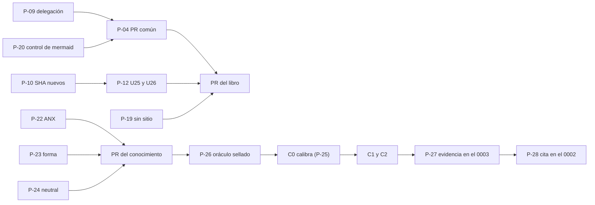

| Campo | Valor |
| --- | --- |
| Tipo | informe |
| Fecha | 2026-11-01 |
| Autor | Silla R-DECISIONES, pasada B: análisis de decisiones, rol fuera del panel (paso 6 bis de `MEP`, ampliado por `TP:73`). **Consolida, no es comisión**: no emite hallazgos que se voten ni vota (`MEP:328`, «El análisis de decisiones y el jurado no emiten hallazgos»). Las observaciones de §7 son insumo, no hallazgos |
| Corrige | — (complementa a `F019`, que se escribió a ciegas; donde este folio difiere de `F019`, lo dice y dice por qué) |

# Análisis de decisiones, pasada B — expediente 0003

## Índice

1. [Mandato, alcance y forma](#1-mandato-alcance-y-forma)
2. [Alias](#2-alias)
3. [Insumos leídos y verificaciones propias](#3-insumos-leídos-y-verificaciones-propias)
4. [Método: criterios, pesos, escala, filtros y firmeza](#4-método-criterios-pesos-escala-filtros-y-firmeza)
5. [Tablero](#5-tablero)
6. [Preguntas, una por una](#6-preguntas-una-por-una)
7. [Dónde discrepan las comisiones y cómo se resuelve](#7-dónde-discrepan-las-comisiones-y-cómo-se-resuelve)
8. [Orden de las decisiones y lo que sale al PO](#8-orden-de-las-decisiones-y-lo-que-sale-al-po)
9. [Fuentes externas](#9-fuentes-externas)
10. [Lo no verificado e incidencias](#10-lo-no-verificado-e-incidencias)
11. [Barrido de lo privado de este folio](#11-barrido-de-lo-privado-de-este-folio)

---

## 1. Mandato, alcance y forma

**Mandato.** Para cada pregunta a cargo (P-04, P-09, P-10, P-11, P-12, P-19, P-20, P-22 a P-28): las alternativas de
`PP` §7 y las que trajeron las comisiones; criterios explícitos con peso (simplicidad, practicidad, escalabilidad,
fuente única, paso por la compuerta, alineación con la industria); la cadena de consecuencias de cada alternativa
(`CDC` §2, cuatro pasos); el puntaje; la alternativa dominante o el empate declarado; y dónde discrepan las comisiones.

**Con los informes a la vista.** A diferencia de `F019`, esta pasada leyó los diez informes `F010`–`F019`. Eso permite
lo que `F018` H-01 pedía y no pudo hacer: cruzar lo que sostienen las comisiones.

**Lo que este folio no hace.** No dictamina ni vota: propone. No reabre las decisiones cerradas de `F001` §8. No
reemplaza la segunda pasada del refutador que `F018` H-01 pide. No hay fichas de excepción admitidas (`F018` §6.1:
«`ls mesa/` no muestra ninguna ficha»), así que no hay camino de compromiso que analizar (`MEP:149`); donde una
alternativa se aparta de un conocimiento sin ficha, se la excluye por filtro (§4.4, F-G).

**Forma de cada pregunta (§6).** Alternativas con la comisión que las sostiene · celdas con su observable · cadena en
cuatro pasos · dominante, margen y estado · discrepancias. Lo que es juicio de esta silla va rotulado
**[criterio propio]**.

## 2. Alias

| Alias | Qué es |
| --- | --- |
| `TP` | El pedido del PO: `PROMPTs/Guides/14-Sistema-De-Documentador-Tecnico/02-Ajuste-Coherencia-Reedicion-Documentacion.md` (huella `da388e9d…74b37`, `F001` §10) |
| `PP` | Bitácora 02, propuesta de panel y contrato de entrada |
| `CG` | Bitácora 01, cohesión global |
| `N1`…`N7` | Bitácoras de núcleo (N5 en su versión ofuscada) |
| `F0nn` | Folio `mesa/0nn-*.md` del expediente 0003: `F010` C-REQ, `F011` C-VER, `F012` C-LECT, `F013` C-ARQ-MAUI, `F014` C-DOC-SIS, `F015` C-DOC-USR, `F016` C-FORMAL, `F017` C-ACAD-ED, `F018` C-REF, `F019` R-DECISIONES (pasada A, a ciegas) |
| `LD`, `LDD` | Lab-Documentos y Lab-Documentos.Documentacion (públicos); `LD` en `0bed863` |
| `LG`, `LGD` | Lab-Geometria y Lab-Geometria.Documentacion (públicos) |
| `SDEI/` | `Guides/Documentacion-Tecnica/Sistema-De-Documentacion-E-Integracion/` de `LD` |
| `DEC` | `SDEI/99-Anexos/Como-Decidir.md`, el método de decisión del propio cuerpo |
| `MEP` | `Knowledge-Mesa-De-Expertos-A-Pedido` 3.1 |
| `CDC` | `Knowledge-Cadena-De-Consecuencias` 2.0 |
| `CPA` | `Knowledge-Conformacion-Pull-Request-Automatico` 2.0 |
| `{dir-de-trabajo}` | Directorio de trabajo de la sesión |
| `{etiqueta-runner}` | La etiqueta personalizada de runner de los workflows, que contiene un nombre de máquina |
| `{servicio-privado}` | El servicio privado de notificaciones |
| `<org>` | La organización de GitHub dueña de `LD`, `LDD`, `LG` y `LGD` |

## 3. Insumos leídos y verificaciones propias

| Insumo | Lectura |
| --- | --- |
| `PP` | §1, §7 y §8 enteros (preguntas, restricciones duras, lectura P0–P3) |
| `F010`–`F019` | Las secciones de las preguntas a cargo (ubicadas con `grep -n` de cada `P-xx`), sus cadenas y sus hallazgos citados en §6 |
| `CDC` | Entero (§0 a §7) |
| `MEP` | §0 fila del análisis de decisiones (l. 108), §2.1 paso 6 bis (l. 149), §4 (l. 322-333) |
| `DEC` | §1 a §4 (l. 32-90) |

**Verificaciones propias** (2026-11-01, sólo lectura; las copias, en `{dir-de-trabajo}`):

| # | Comando | Salida | Sirve a |
| --- | --- | --- | --- |
| W1 | `git -C <LD> log -1 --format='%h %s'` | `0bed863 Merge pull request #41 …` | Base |
| W2 | `grep -c 0003 CHANGELOG.md` en `LD` y en `LDD` | `0` y `0` | P-09 |
| W3 | `grep -n 'Delegación del merge\|tontas' CHANGELOG.md` en `LD` | Delegación del 0002 en **l. 285-292** (testimonio en l. 288, alcance «los PR del expediente 0002 en este repositorio, incluido el primer merge» en l. 289); la de l. 305-311 es la del expediente 0001 de FRAMEWORK MAUI | P-09; §7 D-2 |
| W4 | `grep -n 'runs-on' .github/workflows/*.yml` en `LD` (salida con la etiqueta redactada) | **7 directivas** `runs-on: [self-hosted, {etiqueta-runner}]` (`docs-guard.yml:60`, `mini-demo-movilidad.yml:35`, `docs-enlaces-semanal.yml:43`, `framework-concept-demo.yml:43,88,149,169`) más **1 comentario** (`framework-concept-demo.yml:7`) | P-11; §7 D-3 |
| W5 | `sed -n 52p SDEI/00-Marco.md`; `sed -n 154p SDEI/99-Anexos/Lista-De-Verificacion.md`; `sed -n 82p SDEI/99-Anexos/Como-Decidir.md` | El Marco ya dice que la etiqueta «es la etiqueta del runner del laboratorio, no una dirección»; `VER-W09` y el filtro `F1` llevan la etiqueta literal | P-11 |
| W6 | `sed -n 20p` y `sed -n 24p tools/docs-guard/prefijos.txt`; `grep -n '^| \`FC\`' SDEI/99-Anexos/Esquema-Frontmatter-Y-Prefijos.md` | l. 20: `FC` registrado; l. 24: `PE interno pregunta de evaluación`; el anexo del esquema no tiene fila `FC` (sin salida). El anexo vive en `SDEI/`, no en `tools/` | P-04 |
| W7 | `sed -n 398,402p` y `sed -n 430,434p tools/docs-guard/dg.py` | `es_anexo_de_referencias` mira el nombre o `doc_type: anexo-referencias`; AI-4 `bloquea=not anexo`. Confirma `F018` H-05 | P-04 |
| W8 | `grep -n 'uses:.*docs-guard' .github/workflows/verificar.yml` en `LDD` | `LDD` usa el workflow reutilizable de `LD` fijado por SHA (`@bf86669…`, l. 73) | P-04, P-20 |
| W9 | `grep -rn '080f158\|fe10086' SDEI \| wc -l` | **8** líneas en TEM-01 (218, 343), TEM-02 (218, 342), TEM-03 (162, 221) y TEM-07 (187, 200); `fe10086` no aparece en `SDEI/` | P-10; §7 D-14 |
| W10 | `git -C <LG> cat-file -t 4b114d7`; `git -C <LGD> cat-file -t b47d22b`; `git -C <LGD> show b47d22b:ia-db/README.md \| grep -n 4b114d7` | Los dos existen; el README de la ia-db de `b47d22b` dice en l. 38 «revisión `4b114d7` … etiquetada `v1.2.0`» | P-26 |
| W11 | `git -C <LD> tag` | Una sola etiqueta: `docs-guard-v1.0.0` | P-28 (el cuerpo nunca se etiquetó) |
| W12 | `curl -sL -w '%{http_code}'` sobre las seis fuentes decisivas de §9 y `grep -o` del literal | Las seis responden 200 y el literal está (§9) | K6 |

## 4. Método: criterios, pesos, escala, filtros y firmeza

Se usa el método del cuerpo (`DEC` §1-§4), como hizo `F019`: si la mesa decide con otro, el libro enseña un método
que su propia mesa no usó. Lo que cambia respecto de `F019` es lo que pide esta carta (un sexto criterio) y lo que
`F016` H01 mostró sobre la regla de firmeza.

### 4.1 Los seis criterios

| K | Criterio | Qué mide | Origen |
| --- | --- | --- | --- |
| K1 | Simplicidad | Cuántas piezas, herramientas o reglas nuevas agrega | Criterio del PO; `TP:73`; `DEC` K1 |
| K2 | Practicidad | Si funciona hoy con lo que hay, sin pasos humanos ni permisos extra, y si está medido | Criterio del PO; `DEC` K2 |
| K3 | Escalabilidad | Cuánto cuesta aplicarlo a un sistema nuevo | Criterio del PO; `DEC` K3 |
| K4 | Fuente única | Si el dato queda en un solo lugar o, repetido, con una regla o un control que corrige la divergencia | Carta; `Rule-Documentation.md:28` |
| K5 | Paso por la compuerta | Si pasa `docs-guard` (y la compuerta de la base, si la pieza viaja allí) y si deja a la compuerta diciendo la verdad | Carta; `TEM-06` |
| K6 | Alineación con la industria | Si coincide con una norma o una práctica documentada, citada con URL y fecha o con número | Criterio del PO; `N6` como hipótesis |

### 4.2 Pesos

**1/6 cada uno.** La carta enumera los seis sin orden y ninguna fuente los ordena: razón insuficiente, como `DEC` §4.
**Se fijaron y se les tomó huella antes de puntuar**: `pesos.json` en `{dir-de-trabajo}`, `sha256`
`e373485d19b10f3ba7708bfe85c9dca5650f006db8112457c36156258438fe3c`, 2026-11-01T18:56:07Z. El mismo archivo fija la
**proyección «criterios del PO»** (K1, K2, K3 y K6 a 0,25; K4 y K5 a cero), porque K4 y K5 vienen del mandato de la
silla y no del PO.

### 4.3 Escala anclada

K1–K3: la de `DEC` §3 sin cambios. K4–K6 con anclas propias **[criterio propio]**, fijadas junto con los pesos:

| Punto | K4 Fuente única | K5 Paso por la compuerta | K6 Alineación con la industria |
| --- | --- | --- | --- |
| 5 | El dato vive en un solo lugar | Verde medido con el `dg.py` vigente, sin falso verde conocido | Coincide con una norma o con dos o más fuentes de práctica, reabiertas |
| 4 | Se repite con regla escrita de corrección o con control que detecta la divergencia | Verde esperado por un ensayo análogo | Coincide con una fuente de práctica |
| 3 | Se repite con regla manual sin control | Sin medir, o verde con un falso verde conocido | Sin fuente aplicable: decisión local |
| 2 | Dos lugares sin regla | Exige cambiar la compuerta antes de pasar, o rojo medido en la compuerta de la base | Una fuente aplicable sugiere otra cosa |
| 1 | Dos versiones divergentes vigentes, o la regla hace prevalecer el dato falso | Rojo medido en `docs-guard` | Contradice una norma o práctica documentada |

**Celdas «s/d».** Ninguna: donde falta medida, K5 = 3 por ancla. Así se evita el hueco de `F016` H02 (no hay regla
para el total con «s/d»). Queda en pie la otra advertencia de `F016` H02: la suma ponderada trata la escala 1–5 como
de intervalo; por eso §5 informa también la ventaja en puntos de celda.

### 4.4 Filtros duros

Los de `F019` §4.4 (F-A a F-F), más uno:

| Filtro | Excluye la alternativa que… | Origen |
| --- | --- | --- |
| F-B | escribe en territorio ajeno **o instala en un host sin acuerdo del PO** | `PP` §8, restricciones duras |
| F-E | cambia el producto (código o especificación de Geometría o de `{servicio-privado}`) | L-3 de `F001` §4.3 |
| F-G | se aparta de un conocimiento que rige sin ficha de excepción | `MEP` §4, «No seguir un conocimiento que rige»: «Sólo por contradicción, con ficha» |

### 4.5 Firmeza: la lectura que se usa

`DEC` §1 llama firme a un margen ≥ 0,30 «y el ganador no cambia al mover ±10 % cualquier peso». `F016` H01 midió que
esa frase tiene cuatro lecturas y que, en la relativa (la única que reproduce el ejemplo del anexo), la condición
nunca decide: 1 875 519 vectores con margen ≥ 0,30, 0 inversiones; con ±0,10 absoluto hubo 491 834 (`F016` §5.2).
Por eso esta silla corre **las dos**: ±10 % relativo renormalizado y ±0,10 absoluto renormalizado, uno por vez, más la
proyección del PO. **FIRME** = margen ≥ 0,30 y ninguna inversión en las tres pruebas. Además se informa la
**ventaja en puntos de celda** (margen × 6): con ventaja 2, dos celdas movidas un punto empatan.

**Cálculo.** Guion `calc.py` (Python 3, sin dependencias, `python3 -I`), `sha256`
`8d514cc8788d8d96cf8fdf2bb54f98d602afff634e2830e66e6f67a03b644878`; celdas `celdas.json`, `sha256`
`3771d96cb5c3f65ae00fb42b55f6a019cd24f6afcc9c78aa7179d25950cba2f7`; salida `sha256`
`f12a13c44965371028c957eed41ca60db70081a21169da65845d8d489fea3d54`. Los tres quedan en `{dir-de-trabajo}`; todo lo que
hace falta para recalcular está en §5 y §6.

## 5. Tablero

Puntos en el orden (K1, K2, K3, K4, K5, K6). Total = suma / 6.

| P | Dominante (puntos · total) | Segunda (puntos · total) | Excluidas por filtro | Margen · ventaja | Proy. PO | Estado |
| --- | --- | --- | --- | --- | --- | --- |
| P-04 | **C**: `PE` + filas de delegación; lo de `dg.py` a expediente de herramienta; el control de mermaid entra si P-20 lo elige (5,5,3,5,5,5 · 4,67) | C reducida, sin `PE` (5,5,3,1,5,4 · 3,83) | A (dibujado en la CI), F-B | 0,83 · 5 | C | FIRME |
| P-09 | **D1**: providencia + filas de `CHANGELOG` en LD y LDD con la decisión del PO, alcance con el primer merge; manual hasta entonces (4,4,4,5,5,4 · 4,33) | D4 manual hasta el cierre (5,2,2,5,5,4 · 3,83) | D2 (la mesa se la asienta sola), F-G | 0,50 · 3 | D1 | FIRME |
| P-10 | **E1**: «PR #n, merge `<sha nuevo>`» + nota de equivalencia con su alcance (4,5,5,5,5,5 · 4,83) | E2 sólo PR (5,3,4,4,4,2 · 3,67) | — | 1,17 · 7 | E1 | FIRME |
| P-11 | **R-B**: parámetro por plataforma en el conocimiento; `VER-W09` y `F1` sin el literal; workflows intactos (4,5,5,5,5,5 · 4,83) | R-A sólo nota (5,5,2,3,5,3 · 3,83) | — | 1,00 · 6 | R-B | FIRME |
| P-12 | **U-A′**: U26 y U25 de los guiones que el libro cita, antes del libro, con salida vigente y `diff` explicado (4,5,4,5,5,5 · 4,67) | U-B U26 antes, U25 en la fase 4 (5,5,4,3,5,4 · 4,33) | — | 0,33 · 2 | U-A′ | FIRME (ventaja 2) |
| P-19 | **S0**: sin sitio y sin ensayo MkDocs; captura del render completo en GitHub en el PR del libro (5,5,4,5,5,5 · 4,83) | S1 sin sitio con ensayo MkDocs informativo (4,4,4,5,5,4 · 4,33) | — | 0,50 · 3 | S0 | FIRME |
| P-20 | **R+L**: control `mermaid-arroba` en PR-4 con fixtures + dibujado local obligatorio en los PR que tocan diagramas (4,4,5,5,4,5 · 4,50) | R sólo control (4,5,5,4,3,4 · 4,17) | Dibujado en la CI, F-B | 0,33 · 2 | R+L | FIRME (ventaja 2) |
| P-22 | **ANX**: `ANX-SDEI-ESPECIFICACION`, `doc_type: anexo`, `version` igual a `**Versión:**` (5,5,3,4,5,3 · 4,17) | KNW (3,3,5,5,2,3 · 3,50) | — | 0,67 · 4 | ANX | FIRME |
| P-23 | **E+**: forma estricta con doble cabecera, excepción escrita a «`version` sólo en el README» y una línea que diga qué versión manda (3,5,5,4,5,5 · 4,50) | Eb estricta sin frontmatter (4,3,4,5,1,4 · 3,50) | — | 1,00 · 6 | E+ | FIRME |
| P-24 | **N-T**: neutral en todo el conocimiento, apéndice incluido; lo propio de SDD al libro o a un perfil (4,4,5,5,4,5 · 4,50) | N-A «SDD» en el apéndice (4,4,4,4,2,4 · 3,67) | — | 0,83 · 5 | N-T | FIRME |
| P-25 | **e**: una tabla decisión por decisión, trampas como filas del oráculo, instrumentos de `F016`, umbral entero ≤ ⌊0,15·n⌋ sellado, cada corrida pasa sola, C0 calibra (4,4,5,5,4,5 · 4,50) | f ceros duros y porcentaje sólo informado (5,3,5,5,4,4 · 4,33) | — | 0,17 · 1 | e | **CON REVISIÓN** |
| P-26 | **O3**: oráculo escrito por un agente distinto desde el repo del caso en su SHA (N4 §4 y la hoja privada, como borrador), con O-1 a O-6; Geometría `LG 4b114d7` + `LGD b47d22b` (3,4,5,5,4,5 · 4,33) | O2 N4 §4 como oráculo (4,4,4,4,4,4 · 4,00) | — | 0,33 · 2 | O3 | FIRME (ventaja 2) |
| P-27 | **G-c**: evidencia de Geometría en el expediente 0003 de LDD, sin PR a LGD; lo privado sólo en local, con cifras y huellas públicas (4,4,4,5,4,4 · 4,17) | G-a rama descartable en LGD (4,4,3,3,4,4 · 3,67) | PR en el repo privado, F-E y F-A | 0,50 · 3 | G-c | FIRME |
| P-28 | **No mezclar**: el ensayo entra al escalón 2 como evidencia citada; «escalón 2», no «G2» (5,5,4,5,5,4 · 4,67) | Mezclar (3,2,3,2,3,2 · 2,50) | — | 2,17 · 13 | No mezclar | FIRME |

**Resultado.** 14 preguntas: 13 FIRME (tres con ventaja de sólo 2 puntos de celda: P-12, P-20, P-26) y 1 CON
REVISIÓN (P-25). Ninguna prueba de sensibilidad invirtió un ganador; la proyección del PO coincide en las 14. Frente a
`F019`, cambian de estado P-11, P-12, P-20 y P-26 (de CON REVISIÓN a FIRME, por las mediciones de las comisiones) y
cambia de alternativa P-19, P-24 y P-25 (§7).

## 6. Preguntas, una por una

### 6.1 P-04 — Qué entra en el PR común y cuándo

**Alternativas.** A de `PP` (prefijos, delegación, dibujado de mermaid en PR-4). B de `PP` (A más cambios de `dg.py`).
C de `PP`, que sostienen con ajustes `F011` §3.1 (C + control de mermaid), `F014` P-04 (C + fila `FC` en el anexo del
esquema) y `F019` §6.2. **C reducida** de `F018` P-04 (sólo la fila de delegación, y sólo si P-09 decide automático).

**Celdas.** C: K1 5 (una línea y dos filas, ninguna pieza nueva), K2 5 (medido: `prefijos.txt:24` es texto que ningún
control interpreta, `F014` E9), K3 3 (deja para otro sistema los huecos de `dg.py`), K4 5 (corrige el dato falso de
W6), K5 5, K6 5 (DORA, lotes chicos; GitHub, fijar por SHA). C reducida: K4 1, porque deja `PE` falso en el registro
y la regla `Esquema-Frontmatter-Y-Prefijos.md:199-200` («manda el archivo») hace prevalecer el sentido que nadie usa.
B: K1 2, K2 2 (lógica nueva pedida por ensayos que no corrieron, `F011` §3.1), K5 2, K6 2 (contra lotes chicos).
A queda excluida por F-B en su forma literal: el dibujado en la CI pide un navegador en un runner sin contenedores
(`F011` §3.6: `framework-concept-demo.yml:12`, `ci-local.sh:27`).

| Paso | C (dominante) | B |
| --- | --- | --- |
| Dónde cae | En `prefijos.txt` y en dos `CHANGELOG.md`; lo de `dg.py` espera en un expediente propio | En `dg.py`, que comparten LD, LDD y FRAMEWORK MAUI, y en el pin de LDD (W8) |
| Cuánto pesa | Una línea y dos filas | `dg.py` cambia de comportamiento; subir el pin de LDD es clase H (`F011` §3.1) |
| Qué pierde la otra | C posterga `_legacy/` y la versión doble; los ensayos los toman como trampas del oráculo (`F011` §3.1) | B mezcla tres objetivos en un PR y pierde la prueba negativa de cada uno |
| Reversible | Sí, texto | Más caro: alcanza a quien usa la herramienta |

**Dominante: C** (4,67, FIRME). **Composición final del PR común**: `PE` = patrón de ejemplo (P-14) + filas de
delegación (si P-09 las obtiene) + el control `mermaid-arroba` con sus fixtures (si P-20 lo elige, §6.7) + los cinco
criterios de entrada de `F011` §3.1. Lo que **no** entra: la fila `FC` del anexo del esquema (W6: el anexo vive en
`SDEI/`, no es archivo común; va al PR de coherencia), `KNW` (P-22), `LIB` y los dominios de `dominios.txt`, siempre
que el libro cite el anexo de referencias por enlace y no lleve URL propias (`F018` H-05; W7). **Advertencia de
alcance**: el control de mermaid llega a LDD recién cuando se suba el pin (W8), que es clase H; mientras tanto, en LDD
rige el dibujado local.

### 6.2 P-09 — Cómo se asienta la delegación del merge del 0003

**Alternativas.** D1: providencia + fila de `CHANGELOG` en LD y LDD (`PP`; `F011` §3.2, `F014` P-09, `F019` §6.2).
D2: la mesa la asienta bajo la delegación general del 2026-09-14 (implícita; nadie la sostiene). D3: ampliar la del
0002 (`PP`). D4: manual hasta el cierre (`PP`).

**Celdas.** D1: K2 4 (pide un acto humano: una línea del PO), K4 5, K6 4 (separación de funciones, NIST SP 800-53
AC-5, con marca P en `F019` §9). D4: K2 2 y K3 2 (cada PR vuelve al PO; contra el propósito que el PO dejó escrito en
`LD:CHANGELOG.md:288`). D3: K4 2 (dos alcances en un asiento ya fechado). D2: excluida por F-G: `CPA` §3.1, «La
decide el responsable del producto».

| Paso | D1 (dominante) | D4 |
| --- | --- | --- |
| Dónde cae | En una pregunta al PO y en el primer PR de cada repo | En el PO, en cada merge de la reedición |
| Cuánto pesa | Una línea; W2: hoy no hay ninguna fila del 0003 | Al menos cinco PR por dos repos (`F011` §3.2, COH §7) |
| Qué pierde la otra | D1 fusiona a mano el primer PR si el PO tarda | D4 pierde lo que el PO pidió evitar |
| Reversible | Sí: «Es revocable por unidad» (`CPA` §3.1) | Sí |

**Dominante: D1** (4,33, FIRME). Es un **obstáculo** (`CDC` §3), no una escalada: la decisión de conformar en
automático está fundada; falta la llave. Pregunta de una línea (§8). El alcance incluye el primer merge, como el
precedente del 0002 (W3, l. 289), y la fila lleva los seis campos de `F011` §3.2.

### 6.3 P-10 — Cómo se citan los commits fuera de `main`

**Alternativas.** E1: «PR #n, merge `<sha nuevo>`» (`F014`, `F017`, `F019`); E2: sólo número de PR; E3: URL de
`refs/pull`. Consenso de las tres comisiones que la tratan.

**Celdas.** E1 sólo pierde un punto en K1 (una nota de equivalencia). E2: K6 2, porque `Referencias.md:39` pide
fuentes «por versión publicada o por commit» y GitHub documenta que el enlace con SHA es permanente (§9).

| Paso | E1 | E2 / E3 |
| --- | --- | --- |
| Dónde cae | 8 líneas en 4 temas (W9) | Las mismas 8 |
| Cuánto pesa | 8 sustituciones; el árbol del cuerpo y de la herramienta es idéntico entre cada par (`F014` E8, `F019` V7) | E2: `git checkout` necesita un SHA, el guion de `TEM-07:200` deja de correr; E3: un clon nuevo no trae `refs/pull` |
| Qué pierde la otra | Nada medido | — |
| Reversible | Sí | Sí |

**Dominante: E1** (4,83, FIRME). La nota declara el alcance de la equivalencia («mismo contenido en `tools/docs-guard`,
`Guides/Documentacion-Tecnica`, `scripts` y `.github`», `F014` P-10).

### 6.4 P-11 — La etiqueta de runner

**Alternativas.** R-A nota en el Marco (`PP`, N1-35). R-B parámetro en el conocimiento, sin tocar workflows (`PP`,
N3 §4.4), que `F011` §3.3 completa con `VER-W09` y `F1` y `F013` P-11 abre **por plataforma** (Linux; Mac para iOS).
R-C renombrar ahora (`PP`, N2 H-5).

**Celdas.** R-A: K3 2, porque sola deja `VER-W09` y `F1` con el literal (W5) y un caso MAUI no los puede cumplir
(`F013` H06; Microsoft Learn: iOS «only run on a Mac»); además ya está hecha (W5). R-B: K1 4 (tres líneas). R-C: K1 2,
K2 2 (7 directivas en LD, W4, más LDD y LG; el único check obligatorio de LD corre con esa etiqueta, y un job sin
runner espera hasta 24 h, `F011` §3.3).

| Paso | R-B (dominante) | R-C |
| --- | --- | --- |
| Dónde cae | En el conocimiento y en dos anexos del cuerpo | En tres repos de workflows, la configuración del runner y el check `fw-ok` |
| Cuánto pesa | Tres líneas de texto | 10 `runs-on` (`F011` §3.3) y una ventana en la que LD no fusiona |
| Qué pierde la otra | R-B deja el nombre de máquina en la etiqueta pública | R-C detiene LD si el orden falla |
| Reversible | Sí | El acto sí; su costo alcanza a otra sesión y a la organización |

**Dominante: R-B por plataforma** (4,83, FIRME). **Sin fila al PO**: la mesa no recomienda renombrar, y lo reversible
no se eleva (`CDC` §4). Condición para reabrir (comprobable, de `F019`): cambio de la configuración del runner por
otro motivo, o un tercer repositorio que quiera usar la etiqueta. Si se reabre, rige el procedimiento de `F011` §3.3
(runner con las dos etiquetas antes de tocar workflows).

### 6.5 P-12 — Cierre de U25 y U26

**Alternativas.** U-A de `PP` (corrida nueva y marcas antes del libro; `F011` §3.4), con la restricción de `F019`
(sólo los guiones que el libro cita) = **U-A′**. U-B de `PP` ajustada por `F014` P-12 (U26 antes, U25 a la fase 4 y
`04-adopciones.sh` rotulado «no reproducido»).

**Celdas.** La diferencia está en K4: U-B publica en el libro salidas que el `dg.py` vigente ya no da. `F011` E-V03
lo midió: `03-tem03-ancla.sh` pasa de `errores=3` a `errores=5` por el control `id-duplicado`. U-B = K4 3; U-A′ = K4 5,
con K1 4 por la corrida.

| Paso | U-A′ (dominante) | U-B |
| --- | --- | --- |
| Dónde cae | En el PR de coherencia: correr los guiones citados | En el lector del libro que repite el guion contra `main` |
| Cuánto pesa | Menos de 0,2 s por guion (`F011` E-V03) | Una salida que no coincide (P1 de `PP` §8, «lectura divergente») |
| Qué pierde la otra | U-A′ no pierde la salida histórica: queda citada con su SHA equivalente (P-10) | U-B se ahorra segundos de cómputo |
| Reversible | Sí | Sí |

**Dominante: U-A′** (4,67, FIRME con ventaja 2). Las dos comisiones tienen razón en su hecho (§7 D-4); decide que el
libro enseña la herramienta vigente. `04-adopciones.sh` se rotula «no reproducido» hasta que corra (`F014`).

### 6.6 P-19 — ¿Hay sitio publicado?

**Alternativas.** S1: sin sitio, ensayo MkDocs informativo (`PP`; `F011` §3.5, `F017` §4.9, `F019`). S0: sin sitio y
sin ensayo (`F018` P-19). S2: sitio MkDocs con Material. S3: otro generador (`N6`).

**Celdas.** S0 y S1 difieren en K1 (el ensayo agrega una herramienta), K2 (hay que instalarla en algún lado) y K6
(`F018` H-12: es un agregado sin marca). S2: K6 2, Material anuncia «End of life on May 5, 2027» (reabierto, §9).

| Paso | S0 (dominante) | S1 |
| --- | --- | --- |
| Dónde cae | En el PR del libro: una captura del render completo en GitHub | En el PR del libro: un `mkdocs build` informativo |
| Cuánto pesa | Una captura | Una herramienta y su entorno, sin efecto en la compuerta |
| Qué pierde la otra | S0 no prueba los slugs de MkDocs, que sólo importan si un día hay sitio | S1 no prueba lo que sí está en riesgo: que GitHub dibuje el libro entero (`F017` H01) |
| Reversible | Sí | Sí |

**Dominante: S0** (4,83, FIRME). Condición de reapertura (de `F017` §4.9, comprobable): el render completo del libro
en GitHub falla **y** partirlo en tomos no alcanza. **Cambia la posición de `F019`**, que conservaba el ensayo.

### 6.7 P-20 — Mermaid: control local o CI

**Alternativas.** L local obligatorio (`PP`, N7 H3). Dibujado en la CI (`PP`, N1-25). **R+L** (alternativa nueva de
`F011` §3.6): control determinista en PR-4 que rechaza el autoenlace de correo de GFM en etiquetas, más dibujado local
obligatorio. R sólo el control. `F017` §4.10 pide que la salida del dibujado quede en el PR y deriva el dónde.

**Celdas.** El empate de `F019` venía de que la regla estática estaba «sin medir»; `F011` E-V04/E-V05 la midió:
atrapa los 2 diagramas rotos de 28, sin falsos positivos, en 39 ms. L: K5 3 (la compuerta da verde con dos diagramas
rotos, `F011` V-04). Dibujado en la CI: excluido por F-B (navegador en un runner sin contenedores).

| Paso | R+L (dominante) | L |
| --- | --- | --- |
| Dónde cae | En `dg.py` (PR común) y en quien abre un PR con diagramas | Sólo en quien abre el PR |
| Cuánto pesa | Un control y dos fixtures; 39 ms | 163 s para 27 diagramas (`N7` §3.2), sin control automático |
| Qué pierde la otra | R+L no atrapa en la CI defectos de otra clase; los cubre la parte local | L deja pasar a `main` lo que ya se sabe detectar |
| Reversible | Sí, con PR común | Sí |

**Dominante: R+L** (4,50, FIRME con ventaja 2). Entra al PR común (§6.1). Criterio de aceptación: el de `F011` §3.6.

### 6.8 P-22 — Prefijo y `doc_type` del conocimiento

**Alternativas.** ANX (`PP`, N3 M-1 B; `F011` §3.7, `F014` P-22, `F019`). KNW (`PP`, N3 M-1 A). Consenso.

**Celdas.** ANX: K3 3 y K6 3 (semántica estirada; ninguna fuente aplica). KNW: K5 2 (`F011` E-V01: rojo con dos
errores; pide **dos** archivos comunes, `prefijos.txt` y `cuerpo.schema.json`).

| Paso | ANX (dominante) | KNW |
| --- | --- | --- |
| Dónde cae | En la semántica de `anexo` | En el PR común y en el esquema que comparten todos los cuerpos |
| Cuánto pesa | 0 archivos comunes | 2 archivos comunes y un fixture |
| Qué pierde la otra | Quien filtra por `doc_type` no lo encuentra como conocimiento | KNW pide un PR común para una sola pieza |
| Reversible | Sí: renombrar el `doc_id`; hoy 0 trazas lo apuntan (`F014`) | Sí |

**Dominante: ANX** (4,17, FIRME). Con el agregado de `F014` DS-06: `version` del frontmatter igual a `**Versión:**`.
Condición para pasar a `KNW`: un segundo conocimiento en LD o la copia aprobada a la base. Riesgo a decidir en el PR
del conocimiento: los avisos AI-3 por frases dirigidas a agentes (`F011` V-12).

### 6.9 P-23 — Forma del conocimiento

**Alternativas.** Forma estricta de la base con frontmatter (`PP`, N3 M-2), que sostienen `F010`, `F012`, `F018` y
`F019`. Forma libre (`PP`). Estricta sin frontmatter (variante medida por `F012`, ensayo 3).

**Celdas.** E+ pierde un punto en K4: lleva dos números de versión, con una regla que dice cuál manda. Eb: K5 1
(`F012`: PR-2 rojo, `sin-frontmatter`). Libre: K5 1 y K3 2 (sin §6 normativa, la prueba no tiene contra qué contar).

| Paso | E+ (dominante) | Libre |
| --- | --- | --- |
| Dónde cae | En quien redacta: 11 líneas de cabecera más 12 de frontmatter (`F012` P-23) | En la verificación y en la copia a la base |
| Cuánto pesa | Medido verde en PR-2 y PR-5 (`F012` ensayo 4) | Rojo medido |
| Qué pierde la otra | E+ cuesta más texto | Libre pierde «para quién» y «cuándo» (`F012`) y la regla de falla (`F018`) |
| Reversible | Sí | Sí, pero la copia a la base pide reescribir |

**Dominante: E+** (4,50, FIRME), con los tres agregados de las comisiones, que son compatibles: excepción escrita a
«`version` sólo en el README» en `00-Marco.md:161` (`F010` H11, CA-10), una línea que diga qué versión manda
(`F012`) y `version` = `**Versión:**` (`F014` DS-06). Fundamento: el propósito de la forma, no su obligatoriedad
fuera de la base (`F018` P-23).

### 6.10 P-24 — Neutralidad respecto de SDD

**Alternativas.** N-A «SDD» sólo en el apéndice (`PP`, N3 M-3; `F012`, `F019`). N-0 sin restricción (`PP`). **N-T**
neutral en todo el conocimiento, apéndice incluido; lo propio de SDD al libro o a un perfil (`F010` P-24, nueva).

**Celdas.** `F010` §6 E4 midió que una sola línea con «SDD» en un apéndice da `FALLA - neutralidad (1)`, rc=1, en la
compuerta de la base: N-A no cumple su propio fin. N-A y N-0: K5 2. `F012` agrega que el alias actual del caso
privado dispara `\bSDD\b`.

| Paso | N-T (dominante) | N-A |
| --- | --- | --- |
| Dónde cae | En la redacción: remisiones al libro en lugar de un apéndice | En la copia a la base |
| Cuánto pesa | Un rótulo para el caso privado y las remisiones | Rojo medido en la compuerta de la base |
| Qué pierde la otra | N-T pierde ejemplos SDD a mano en el conocimiento | N-A cierra la copia a la base sin decirlo |
| Reversible | Sí | Sí |

**Dominante: N-T** (4,50, FIRME). **Cambia la posición de `F019`**, por la medición de `F010`. Si el PO decidiera que
no hay copia a la base, la restricción podría aflojarse sin costo; mientras no lo decida, N-T no cuesta más.

### 6.11 P-25 — Métrica de éxito de la reproducción

**Alternativas.** a N3 sola, b N4 sola, c unión (`PP`). d unión normalizada M1–M7 con las trampas como lista aparte
≥ 6 de 7 (`F016` §4.2). e métrica única con las trampas como filas del oráculo y umbral entero sobre *n* sellado
(`F011` §3.8, `F019`), con los instrumentos de `F016`. f ceros duros, porcentaje sólo informado y pass^k (`F018` P-25).

**Celdas.** e: K6 5 (prerregistro, COS; McHugh 2012 sobre 80 % como mínimo; ISO/IEC/IEEE 15939:2017 por instrumento).
f: K1 5 (sin umbral), K2 3 (el veredicto de «efectivo» queda a juicio del jurado, riesgo que `F018` admite). d: K1 3
(dos unidades, decisiones y trampas). c: K4 2 (dos definiciones de invención y de verde, `F016` H04).

| Paso | e (dominante) | f |
| --- | --- | --- |
| Dónde cae | En el folio previo a la corrida: *n*, umbral y huella | En el jurado, que juzga la tabla sin umbral |
| Cuánto pesa | Una tabla y un número por caso; con 17 decisiones, ≤ 2 discrepancias (`F016` §4.2) | Sin costo previo; costo posterior en la deliberación |
| Qué pierde la otra | e fija un umbral **[criterio propio]** sin medición previa | f no da un criterio de paso verificable por comando |
| Reversible | Sólo antes de correr (`F016`: no se mueve después de ver resultados sin decirlo) | Sí |

**Dominante: e, CON REVISIÓN** (margen 0,17, ventaja 1). Lo decide el paso 4: las dos son reversibles sólo antes de
correr, así que se toma la que deja un criterio verificable y se le da la medición que le falta. **Condición de
revisión (comprobable):** la corrida de **C0** (el propio LD, caso conocido) va primero; si C0 no queda dentro de
⌊0,15·n⌋, se corrige el oráculo o el umbral con nueva huella (O-4 de `F016`) **antes** de correr C1 y C2. Las
discrepancias sobre el fundamento de f, en §7 D-10.

### 6.12 P-26 — Oráculo e insumos de cada caso

**Alternativas.** O1 columna del Marco (`PP`, N3). O2 `N4` §4 y hoja privada como oráculo, escritos antes con huella
(`PP`; `F019`). **O3** oráculo escrito por un agente distinto desde el repo del caso en su SHA, con `N4` §4 y la hoja
privada como borrador (`F013` P-26), bajo las condiciones O-1 a O-6 de `F016` §4.3 y el «sólo commit del remoto» de
`F011` §3.9. O4 = O3 con el par `5f07b12` + ia-db 4.0 local sellada (segundo par medible de `F016`).

**Celdas.** O1: K4 2 y K6 2 (circular: la reedición corrige esa columna; `F011` V-09; ISO/IEC/IEEE 29119-1 define el
oráculo como fuente de los resultados esperados). O2: K4 4, porque `N4` §4 se midió sobre `5f07b12` y el par elegido
es `4b114d7` (`F016`: «obliga a reverificar el oráculo»). O4: K2 3 y K4 3 (sellar trabajo sin commitear de otra sesión;
nadie de afuera lo baja).

| Paso | O3 (dominante) | O2 |
| --- | --- | --- |
| Dónde cae | En un agente más por caso | En el autor de `N4`, que diseñó parte del conocimiento |
| Cuánto pesa | Un oráculo por caso, con huella; el par es reproducible (W10: la ia-db de `b47d22b` indexa `4b114d7`) | Reverificar `N4` §4 contra `4b114d7` igual |
| Qué pierde la otra | O3 cuesta un despacho más | O2 mide en parte al que escribió el oráculo |
| Reversible | Sí, por oráculo 2 con nueva huella (O-4) | Sí |

**Dominante: O3** (4,33, FIRME con ventaja 2). Riesgo y mitigación de `F013`: si el PR #3 de LGD se cierra sin
fusionar, se usa `refs/pull/3/head` por SHA y la copia del índice queda en la evidencia con su huella. `0202722` queda
afuera por O-6 (209 commits de atraso, `F016`), aunque `F012` lo aceptaba.

### 6.13 P-27 — Dónde viven los ensayos

**Alternativas.** G-a rama descartable en un worktree de LGD, sin merge (`PP`, N4 §7.2; `F013` P-27). G-b PR en LGD
(`PP`). **G-c** evidencia en el expediente 0003 de LDD, con worktree descartable de LGD sólo si hace falta correr
`docs-guard` en el layout del proyecto, sin PR (`F011` §3.10, `F019`). Para lo privado, todas las comisiones coinciden:
sólo local, y en lo público cifras y huellas; el PR en su repo queda excluido por F-E y F-A.

**Celdas.** G-a: K3 3 y K4 3 (la evidencia se pierde si se borra la rama; `LGD` tiene PR #2 y #3 en curso). G-b: K2 2
(`LGD` no tiene workflows ni delegación en `main`; el PR quedaría en reserva, `F011` E-V06).

| Paso | G-c (dominante) | G-a |
| --- | --- | --- |
| Dónde cae | En `evidencia/` del 0003, que existe vacía (`F001` §10) | En un repo con otra sesión trabajando |
| Cuánto pesa | Carpeta de evidencia con SHA del insumo, oráculo sellado, salida de `docs-guard` y planilla | Una rama que nadie fusiona |
| Qué pierde la otra | G-c publica artefactos de un repo público; lo crudo pesado (copia de la ia-db) puede quedar local con su huella (`MEP` §3.2) | G-a deja la evidencia fuera del expediente que la usa |
| Reversible | Sí | Sí |

**Dominante: G-c** (4,17, FIRME).

### 6.14 P-28 — ¿El ensayo es la primera mitad del escalón 2?

**Alternativas.** Mezclar (`PP`, N4 H6). No mezclar (`PP`, N4 §9; `F010`, `F013`, `F019`). Consenso.

| Paso | No mezclar (dominante) | Mezclar |
| --- | --- | --- |
| Dónde cae | Una remisión desde el 0002 al folio del ensayo | En el criterio de cierre del escalón 2: «la compuerta corriendo en la CI de Lab-Geometria» (`TEM-07:25-26`) |
| Cuánto pesa | Una cita | Una «mitad» sin evento de cierre: el ensayo no toca la CI del producto (L-3) |
| Qué pierde la otra | Reusar el trabajo, salvo por cita | Un folio que vale para dos expedientes |
| Reversible | Sí | Sí |

**Dominante: no mezclar** (4,67, FIRME). Con la condición previa que agrega `F010` H10: el estado del escalón 1
tiene dos respuestas foliadas en el 0002 (folios 290 y 259); esa corrigenda es del 0002, no de esta mesa, y se le
recomienda a su presidencia.

## 7. Dónde discrepan las comisiones y cómo se resuelve

| # | P | Discrepancia | Cómo se resuelve |
| --- | --- | --- | --- |
| D-1 | P-04 | `F018` saca `PE` del PR común; `F011`, `F014` y `F019` lo ponen | Entra: P-14 tiene consenso y la regla «manda el archivo» haría prevalecer el sentido falso (§6.1). `F018` no trató P-14 |
| D-1b | P-04 | `F014` pone la fila `FC` del anexo del esquema en el PR común | No es archivo común (W6): va al PR de coherencia |
| D-2 | P-09 | `F011` pide citar «el testimonio» en la providencia; `F014` y `F019` piden uno **nuevo** del PO | Hace falta uno nuevo: cada delegación vigente es por expediente (W3: 0001 y 0002 con asiento propio) y `CPA` §3.1 la pone en el responsable. Además, `F011` cita la delegación del 0002 en `LD:CHANGELOG.md:305-312` y el testimonio en `:308`; en `0bed863` están en `:285-292` y `:288` (W3) |
| D-3 | P-11 | `F011` eleva el renombre al lote del PO; `F013` y `F019`, no ahora con condición. `F019` contó 8 líneas en LD; `F011`, 7 | No se eleva lo que la mesa no recomienda (§6.4). Las 8 de `F019` incluyen un comentario: son 7 directivas (W4) |
| D-4 | P-12 | `F014`: la salida de `080f158` sigue valiendo en `e3841b6`, U25 puede esperar. `F011`: la corrida de hoy ya da otra cosa | Los dos hechos son ciertos (uno compara SHA equivalentes; el otro, la herramienta vigente). Decide qué enseña el libro: la herramienta vigente (§6.5) |
| D-5 | P-19 | `F018` no quiere el ensayo MkDocs; `F011`, `F017` y `F019` lo dejan informativo | Sin ensayo: la evidencia que falta es el render en GitHub, no los slugs de MkDocs (§6.6) |
| D-6 | P-20 | `F019` empataba a tres; `F011` midió la regla estática; `F017` deriva el dónde | La medición de `F011` rompe el empate (§6.7). Lo de `F017` (salida en el PR) entra en la parte local |
| D-7 | P-23 | Mismo resultado, fundamentos distintos: norma (`F010`, `F019`) o propósito (`F018`) | Vale el de `F018`: `Rule-Forma-De-Conocimiento` §0 fija la forma de las piezas **de la base**; los agregados de `F010`, `F012` y `F014` son compatibles y se suman |
| D-8 | P-24 | `F010` neutral total; `F012`, `F019` y N3 «SDD» en el apéndice | Decide la medición de `F010` (rc=1 con una línea en el apéndice) (§6.10) |
| D-9 | P-25 | `F016` trampas como lista aparte (≥ 6 de 7); `F011`, `F018` y `F019` las ponen como filas del oráculo | Filas del oráculo: una sola unidad. El recálculo de `F016` (sacar «despliegue intocable», que es restricción) se mantiene: esa fila pasa a la restricción de escritura |
| D-10 | P-25 | `F018` funda «sin umbral» en `MEP:328` | `MEP:328` habla del **criterio de corte** de la mesa («un umbral de rendimientos decrecientes no se adopta sin una medición»), no de toda métrica. La preocupación de fondo (umbral sin medición) se atiende con la calibración en C0 (§6.11) |
| D-11 | P-26 | `F019` y la primera alternativa de `F016` usan `N4` §4 como oráculo; `F013` lo baja a borrador | Borrador: un oráculo escrito por quien diseñó parte del conocimiento mide al autor (§6.12) |
| D-12 | P-26 | `F012` acepta `0202722`; `F016` lo excluye por O-6. `F016` admite el par con la ia-db local sellada; `F011`, `F012` y `F013` exigen commit del remoto | Excluidos los dos: O-6 y reproducibilidad por terceros (§6.12) |
| D-13 | P-27 | `F013` rama descartable en LGD; `F011` y `F019` expediente 0003 | Expediente 0003; el worktree de LGD queda como medio para correr la compuerta, no como lugar de la evidencia (§6.13) |
| D-14 | P-10 | `F017` cuenta 7 citas al SHA viejo; `F014` y `F019`, 8 | Son 8 líneas en 4 temas (W9) |

## 8. Orden de las decisiones y lo que sale al PO

*Figura 1. El PR común espera a P-09 y P-20; el libro, al PR común y a los guiones re-corridos; los ensayos, al
conocimiento, al oráculo sellado y a la calibración de C0.*

**Al PO sale una sola línea, y es un obstáculo, no una escalada** (`CDC` §3): «¿Delegás el merge de los PR del
expediente 0003 en LD y LDD, incluido el primero, con la guarda y la excepción del 0002?». Mientras no conteste, rige
la conformación manual (`CPA` §3.1). Nada de lo recomendado en este alcance es irreversible con consecuencia externa:
el renombre de la etiqueta, que sí lo sería (`F011` §3.3), no se recomienda.

## 9. Fuentes externas

Reabiertas por esta silla el 2026-11-01 con `curl` (W12): respondieron 200 y el literal está.

| Id | Fuente | Literal comprobado | Pregunta |
| --- | --- | --- | --- |
| X1 | GitHub Docs, *Actions limits*. https://docs.github.com/en/actions/reference/limits | «queue for 24 hours before it is automatically cancelled» | P-11 |
| X2 | Material for MkDocs. https://squidfunk.github.io/mkdocs-material/ | «End of life on May 5, 2027» | P-19 |
| X3 | GitHub Flavored Markdown Spec, autolinks. https://github.github.com/gfm/ | «separated by periods» (autoenlace de correo) | P-20 |
| X4 | DORA, *Working in small batches*. https://dora.dev/capabilities/working-in-small-batches/ | «reduces the time it takes to get feedback on changes» | P-04 |
| X5 | GitHub Docs, *Creating diagrams*. https://docs.github.com/en/get-started/writing-on-github/working-with-advanced-formatting/creating-diagrams | «Diagram rendering is available in GitHub Issues, GitHub Discussions, pull requests, wikis, and Markdown files» | P-19 |
| X6 | Yao et al. (2024), *τ-bench*. https://arxiv.org/abs/2406.12045 | «pass^k) to evaluate the reliability of agent behavior over multiple trials» | P-25 |

Citadas por las comisiones con fecha 2026-11-01 y **no reabiertas** por esta silla: GitHub, *Secure use reference*
y *Using labels with self-hosted runners* (`F011`); GitHub, *Getting permanent links to files* (`F014`, `F019`);
Microsoft Learn, *Deployment & testing — .NET MAUI* (`F013` F2); Center for Open Science, *Preregistration*
(`F011`); McHugh (2012), Clopper y Pearson (1934), Nosek et al. (2018) (`F016` §6); git-scm, *git-worktree*
(`F011`). Normas citadas sin apartado: ISO/IEC/IEEE 29119-1:2022 (`F011`, `F012`), ISO/IEC/IEEE 15939:2017
(`F016`), NIST SP 800-53 Rev. 5 AC-5 (`F019`, marca P). `N6` se tomó como hipótesis: X2 y X5 la confirman.

## 10. Lo no verificado e incidencias

- **Puntajes de celda.** Son juicio de esta silla con el observable de §4.3; los que se apoyan en una medida citan su
  W-n o el ensayo de la comisión. Tres decisiones FIRME tienen ventaja de sólo 2 puntos (P-12, P-20, P-26): dos
  celdas leídas distinto las empatan.
- **Ensayos de las comisiones no repetidos.** `F011` E-V03 (salidas que cambian), E-V04/E-V05 (control de mermaid);
  `F010` §6 E4 (neutralidad rc=1); `F012` ensayos 3 y 4. Se toman como E1 de sus folios; esta silla no los volvió a
  correr.
- **Render completo del libro en GitHub** (P-19): sin medir por nadie; `F017` pidió un perito.
- **Mensajes a mitad de turno.** No llegó ningún mensaje de otra sesión ni texto que cambiara el encargo.
- **Escritura.** Sólo este folio. Los archivos de cálculo quedan en `{dir-de-trabajo}`. Nada de git, PR ni escritura
  en repos.

## 11. Barrido de lo privado de este folio

Comprobado sobre el texto antes de entregarlo: sin rutas absolutas del equipo (se usa `{dir-de-trabajo}` y `<LD>`,
`<LG>`, `<LGD>`), sin IPs, sin nombres de máquinas (la etiqueta de runner va como `{etiqueta-runner}`), sin el nombre
de `{servicio-privado}` ni de su organización, sin la organización de GitHub (va como `<org>`), sin otros proyectos
privados ni secretos. Del directorio privado de la mesa no se transcribió nada.
