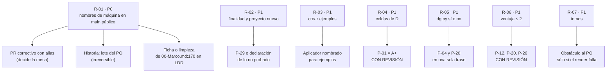

| Campo | Valor |
| --- | --- |
| Tipo | informe |
| Fecha | 2026-11-01 |
| Autor | Refutador, segunda pasada (la que pide `F018` H-01). Entra último y a cara descubierta: leyó la providencia, el acta de composición, los diez informes `F010`–`F019` y los dos análisis `F080` y `F081`. No vota ni dictamina (`MEP:328`) |
| Corrige | — (no modifica ningún folio; propone. Donde un folio afirma algo que ya no es cierto, lo dice en §7) |

# Refutación, segunda pasada — expediente 0003

## Índice

1. [Mandato, forma y escala](#1-mandato-forma-y-escala)
2. [Alias y definiciones](#2-alias-y-definiciones)
3. [Insumos y verificaciones propias](#3-insumos-y-verificaciones-propias)
4. [Ataque a la lectura dominante del enunciado](#4-ataque-a-la-lectura-dominante-del-enunciado)
5. [Ataque al objetivo](#5-ataque-al-objetivo)
6. [Ataque a las alternativas dominantes](#6-ataque-a-las-alternativas-dominantes)
   1. [Tablero de veredictos](#61-tablero-de-veredictos)
   2. [P-01: la edición ensamblada no gana con sus propias anclas](#62-p-01-la-edición-ensamblada-no-gana-con-sus-propias-anclas)
   3. [P-04 frente a P-20: dos FIRME que se contradicen](#63-p-04-frente-a-p-20-dos-firme-que-se-contradicen)
   4. [«FIRME» con ventaja de uno o dos puntos](#64-firme-con-ventaja-de-uno-o-dos-puntos)
   5. [P-03: el plan de tomos contradice «un solo documento»](#65-p-03-el-plan-de-tomos-contradice-un-solo-documento)
   6. [Ataques P2 y P3 a otras dominantes](#66-ataques-p2-y-p3-a-otras-dominantes)
7. [Contradicciones entre comisiones que los análisis no tomaron](#7-contradicciones-entre-comisiones-que-los-análisis-no-tomaron)
8. [Afirmaciones sin evidencia o vencidas](#8-afirmaciones-sin-evidencia-o-vencidas)
9. [Qué cambia si los ataques prosperan](#9-qué-cambia-si-los-ataques-prosperan)
10. [Lo no verificado e incidencias](#10-lo-no-verificado-e-incidencias)
11. [Inventario de lo creado y lo borrado](#11-inventario-de-lo-creado-y-lo-borrado)
12. [Barrido de lo privado de este folio](#12-barrido-de-lo-privado-de-este-folio)

---

## 1. Mandato, forma y escala

**Mandato.** Atacar la lectura dominante del enunciado (`F001` §4), el objetivo (`F001` §7), cada alternativa
dominante de `F080` y `F081`, y toda afirmación sin evidencia. Por cada ataque: qué, por qué (con evidencia o
fuente), severidad P0–P3 y qué cambiaría si prospera. Además, señalar contradicciones entre comisiones que el
análisis no tomó (`MEP:148`, paso 6).

**Lo que este folio no hace.** No repite los ataques de la primera pasada (`F018` §2-§3): los cita cuando un análisis
no los tomó. No reabre las decisiones cerradas de `F001` §8. No dictamina: el jurado de veredicto decide.

**Escala de veredicto** (la de `F018` §1 y del folio 085 del expediente 0002):

| Veredicto | Significa |
| --- | --- |
| SOSTIENE | El ataque no encontró nada que cambie la decisión. Puede llevar notas de forma |
| DEBILITA | Puede quedar, pero un costo está mal medido, una cita no dice eso o falta declarar algo |
| REFUTA | La evidencia la invierte, o hay una contradicción que la deja sin pie |

**Lectura P0–P3**: la de `F001` §9, sin cambios. P0 viola una restricción dura o hace imposible el objetivo; P1
retrabajo o lectura divergente; P2 pérdida acotada; P3 claridad.

## 2. Alias y definiciones

| Alias | Qué es |
| --- | --- |
| `TP` | El tool-prompt 02 del PO, `sha256` `da388e9d…74b37` (recalculado hoy, igual a `F001` §10). No está en el worktree de LDD; se leyó del clon principal, sólo lectura |
| `MEP`, `CDC`, `CPA` | `Knowledge-Mesa-De-Expertos-A-Pedido` 3.1, `Knowledge-Cadena-De-Consecuencias` 2.0, `Knowledge-Conformacion-Pull-Request-Automatico` 2.0 |
| `DEC` | `SDEI/99-Anexos/Como-Decidir.md`, el método de decisión del cuerpo |
| `F0nn` | Folio `mesa/0nn-*.md` de este expediente |
| `LD`, `LDD`, `LG`, `LGD` | Lab-Documentos, Lab-Documentos.Documentacion, Lab-Geometria, Lab-Geometria.Documentacion (públicos) |
| `SDEI/` | `Guides/Documentacion-Tecnica/Sistema-De-Documentacion-E-Integracion/` de `LD` en `0bed863` |
| `GV` | `SDEI/Sistema-Documentador-Tecnico-Guide.md`, la guía obsoleta |
| `R2/` | `PROMPTs/Guides/14-Sistema-De-Documentador-Tecnico/OUTPUTs/DocsAsCode-Bitacoras/Reedicion-02/` de `LDD` |
| `M1`, `M2` | Los dos nombres de máquina que aparecen en `R2/`: `M1` es `{host-de-pruebas}`; `M2`, el host que no se toca. No se escriben (`SDEI/00-Marco.md:170`) |
| `{servicio-privado}` · `{dir-de-trabajo}` · `{etiqueta-runner}` · `<org>` | Como en `F001` §1 y `F081` §2 |

| Término | Definición en este folio |
| --- | --- |
| Ventaja en celdas | Margen × 6 con pesos iguales: cuántos puntos de celda separan a la primera de la segunda (`F081` §4.5) |
| Ruido entre evaluadores | Diferencia de celdas que dos sillas del mismo rol le dan a la **misma** alternativa. Se mide en P-04, la única pregunta que puntúan las dos (§6.4) |
| Obstáculo | Algo que impide cumplir un requisito literal y que no decide la mesa sino quien pidió (`CDC` §3) |

## 3. Insumos y verificaciones propias

**Leídos enteros:** `F001`, `F080`, `F081`, `PP` (`02-Propuesta-De-Panel.md`), `TP`. **Leídos por secciones:**
`F004` (l. 80-90, 200-270), `F010` §1-§3, `F017` §2-§3, `F018` §1-§4, `F019` §8, los hallazgos P0 de todos los
informes (`grep` de `| P0 |` y `**P0**`).

**Verificaciones propias** (2026-11-01, sólo lectura; descargas y cálculos en `{dir-de-trabajo}/r085/`):

| # | Comando | Salida | Sirve a |
| --- | --- | --- | --- |
| V1 | `cat -n` y `sha256sum` de `TP` | 105 líneas numeradas (la última sin salto, por eso `wc -l` da 104); huella igual | §4 |
| V2 | `git -C <LDD> log -1 --format='%h %cs %s' origin/main`; `git merge-base --is-ancestor e3c97df origin/main` | `e3c97df 2026-11-01 Merge pull request #50 from <org>/dac/0003-apertura`; «en main» | R-01 |
| V3 | `git -C <LDD> log -1 --format='%cI \| committer %cn' e3c97df` | `2026-11-01T15:20:03-03:00 \| committer GitHub` | R-01, §8 |
| V4 | `git -C <LDD> grep -ohiE '(M1\|M2)[a-z0-9-]*' origin/main -- R2/` (patrón real en el retorno, no acá), agrupado | `M1` sola **26**; `M1-runner-dev` 6; `M2` sola **2**; `M2-dev` 15 (etiqueta). 8 de los 10 archivos de `R2/` | R-01 |
| V5 | `git -C <LDD> grep -ci` de `M1` y de `M2` en `8b96bc6` (antes del PR #50) | `M1`: 272 en 96 archivos; `M2`: 604 en 164 archivos | R-01 |
| V6 | `sed -n 170p SDEI/00-Marco.md` | «Se nombran por un alias […]; en lo versionado no van rutas del equipo, direcciones IP, **hosts** ni usuarios» | R-01 |
| V7 | `git -C <LD> grep -ci M2 HEAD -- SDEI .github tools` | 4 workflows y 6 archivos del cuerpo nombran la etiqueta; `framework-concept-demo.yml:12` nombra además dos máquinas en un comentario | R-01 |
| V8 | `sed -n 8,16p tools/docs-guard/semanal.sh` | Control 3 «atraso», control 4 «deriva» | Muestreo de `F080` W2: **coincide** |
| V9 | `grep -c 'runs-on' .github/workflows/*.yml`; ídem sin comentarios | 8 líneas; 7 directivas | Muestreo de `F081` W4: **coincide** |
| V10 | `grep -rn '080f158\|fe10086' SDEI \| wc -l` | 8 | Muestreo de `F081` W9: **coincide** |
| V11 | `grep -riow --include=*.md` de desfase, atraso, deriva en `SDEI/` sin `GV` | 12, 4, 31 | Muestreo de `F080` W1: **coincide** |
| V12 | `sed -n 27p GV` | «Cuándo se archiva \| En la versión siguiente del cuerpo: se mueve a un archivo inmutable **y los enlaces que lo citan pasan a la versión archivada**» | R-10 |
| V13 | `sed -n 12p .github/workflows/framework-concept-demo.yml`; `sed -n 27p scripts/ci-local.sh` | Runner sin `docker.sock` ni KVM; el guion pide bash, curl, Python 3 y Node | Muestreo de `F081` §6.1: **coincide** |
| V14 | `sed -n 92,104p` de `Knowledge-Conformacion-Pull-Request-Automatico.md` | §3.1: «La decide el responsable del producto y se asienta con fecha y con quién lo decidió» | P-09 |
| V15 | `sed -n 72,76p SDEI/99-Anexos/Como-Decidir.md` | «K4 pesa menos **porque no tiene origen en el pedido**» | R-06 |
| V16 | `curl -sL` de https://rust-lang.github.io/mdBook/cli/build.html (2026-11-01, 19:07 UTC), 200 | «If not specified it will default to the value of the `build.build-dir` key in `book.toml`, or to `./book`» | R-04 |
| V17 | `curl -sL` de https://learn.microsoft.com/en-us/globalization/reference/microsoft-style-guides (2026-11-01, 19:07 UTC), 200 | «Localization Style Guides are collections of rules that define language and style conventions for specific languages» | R-15 |
| V18 | `recalculo.py` (Python 3, `-I`, sin red), `sha256` `658f5dd5…2ff57`; salida `140c981a…9c2a` | Ver §6.2 | R-04 |

**Muestreo de evidencia.** Seis citas de `F080` y `F081` reabiertas (V8 a V13): las seis coinciden. Los análisis
están bien anclados en lo que miden; los ataques de este folio van a lo que **no** midieron o a cómo lo puntuaron.

## 4. Ataque a la lectura dominante del enunciado

| Id | Qué se ataca | Por qué | Sev. | Veredicto | Qué cambia si prospera |
| --- | --- | --- | --- | --- | --- |
| R-03 | E-16 recortada (`F001:154`, `PP:91`): la cita termina en «académicos en edición de material bibliografico y libros» | `TP:73` sigue: «**para consultar y crear ejemplos y material de consulta**» (V1). El recorte borra un requisito con sujeto: crear ejemplos. `F004:85` lo transcribe entero, pero asigna la silla sólo a revisar; `F017:82` dice «no redacto ejemplos: eso es de los editores»; y `F001` §8 pone a los editores sólo en las seis intervenciones. **Nadie crea ejemplos.** Al mismo tiempo, `F017` H09 midió que `ESC-SDEI-3` no tiene ningún ejemplo verificable y manda llenarlo con el deseable E-05 | **P1** | REFUTA la lectura | E-16 se cita entera. «Crear ejemplos y material de consulta» pasa a requisito con aplicador nombrado (los editores de contenido, con el académico como consultor). E-05 sigue deseable **en su alcance** (material de Geometría), pero el hueco de `ESC-SDEI-3` deja de depender de un deseable |
| R-02a | E-15 como «incógnita» (`F001:147`) | `TP:70` no pregunta: declara la finalidad de todo el pedido («nos queda el material suficiente para que un grupo […] trabaje en una aplicación»). `F018` H-10 la baja a «dato de propósito» (menos trabajo); `F010` H12 pide instrumento y un caso C4 «proyecto nuevo» (más trabajo). Ninguno de los dos análisis tomó la discrepancia (§7, C-1). Leída como finalidad, es el **criterio de aceptación** del pedido: no se elimina ni se deja a un «juicio» del dictamen | **P1** | DEBILITA las dos lecturas | Se reclasifica como requisito de finalidad con instrumento: la prueba del lector sin contexto (`F004`, peritos: «P-LECT del tutorial») se extiende a «un agente arma una unidad nueva sólo con el libro y el conocimiento», con su criterio escrito antes (§5) |
| R-04a | Lectura de `TP:42` que `F080` §6.1 deja al jurado y su apoyo en `TP:66` | `F080` dice que «Errores de la versión diagramada» (`TP:66`) presupone fuente → versión diagramada y favorece la edición ensamblada. No discrimina: con A+ el libro `.md` es el manuscrito y su render en GitHub es la versión diagramada; la corrección de pruebas se hace igual. En cambio `TP:42` («que los editores editen un documento unificado») sí discrimina, y en contra de D: con D el archivo unificado lleva «no se edita a mano» (`F018` §4, P-01) | P1 (va con R-04) | DEBILITA el argumento | El jurado no puede apoyarse en `TP:66` para elegir D; la lectura llana de `TP:42` empuja a A+ |
| — | L-2, L-3, L-5, L-6 | Revisadas contra `TP` (V1). L-3 ya la sostuvo `F018` §3 | — | SOSTIENE | — |

## 5. Ataque al objetivo

| Id | Qué se ataca | Por qué | Sev. | Qué cambia si prospera |
| --- | --- | --- | --- | --- |
| R-02 | El OBJETIVO (`F001` §7; `PP:159-165`) no contiene la finalidad de `TP:70` ni la mitad «nuevos» de `TP:18` | `TP:18`: «aplicarlos en **nuevos o ya existentes** proyectos». Los casos de la prueba de reproducción son todos existentes (`F010` H12, sobre `N3` §5.6). `F081` resuelve P-25 a P-28 sólo con C0, C1 y C2, todos existentes. Ninguna de las 28 preguntas trata «proyecto nuevo» ni «material suficiente». La mesa puede cerrar con las 28 respondidas y el objetivo literal sin medir (lo dice `F010` H12 con otras palabras) | **P1** | Se agrega al objetivo «suficiente para que un equipo trabaje en una aplicación, nueva o existente [`TP:18`, `TP:70`]». Se abre una pregunta P-29 (instrumento y caso nuevo) o se declara, con motivo, que esa mitad no se prueba en este ciclo. Sin una de las dos, el dictamen responde 28 preguntas y deja sin contestar la del PO |
| R-01 | La restricción dura «lo privado por alias» (`F001` §8) ya está violada en el `main` público de `LDD`, y ningún análisis lo toma | `F019` RD-H01 lo levantó como **P0** con «corrección barata porque todavía no hay PR». Ya hay: el PR #50 se fusionó a `main` a las 15:20 (-03) (V2, V3). En `R2/` de `main` quedan 28 apariciones de nombres de máquina sueltos en prosa y 21 en forma de etiqueta (V4). La regla del cuerpo dice «en lo versionado no van […] hosts» (V6). `F001` §12 lo había mandado a la presidencia «antes de abrir el PR»; no hay folio que lo resuelva. `F080` §9 («Ninguna» fila al PO) y `F081` §8 («Nada de lo recomendado […] es irreversible con consecuencia externa») no lo consideran | **P0** | Dos salidas, que decide quien corresponde: (a) PR correctivo hacia adelante que reemplace los nombres por alias en `R2/` (reversible, barato, lo decide la mesa); (b) qué hacer con la historia: reescribirla es irreversible y con consecuencia externa (clones y enlaces de terceros), así que **va al lote del PO**. Además, V5 muestra que `LDD` ya tenía 876 apariciones antes del PR: la regla de `00-Marco.md:170` no se cumple en su repositorio hermano y el libro la va a enseñar. O se acota su alcance con una ficha de excepción (`Excepcion-A-Un-Conocimiento` 2.1), o se planifica la limpieza. Esto alcanza a P-11: el costo «R-B deja el nombre de máquina en la etiqueta pública» (`F081` §6.4) es marginal frente a lo que ya está publicado |

## 6. Ataque a las alternativas dominantes

### 6.1 Tablero de veredictos

| P | Dominante (folio) | Veredicto | Ataque |
| --- | --- | --- | --- |
| P-01 | D, edición ensamblada (`F080`) | **REFUTA** | R-04, §6.2 |
| P-02 | `DOC-SDEI-LIBRO` por desempate (`F080`) | SOSTIENE | El desempate es reversible y está declarado |
| P-03 | Núcleo N2 + V2 con plan de tomos (`F080`) | **DEBILITA** | R-07, §6.5 |
| P-04 | Núcleo C, «nada de `dg.py`» (`F080`) / C + control de mermaid (`F081`) | **REFUTA** la doble firmeza | R-05, §6.3 |
| P-05 | M3, Microsoft *Spanish (Neutral)* de nivel 3 (`F080`) | SOSTIENE con nota | R-15 |
| P-06 | SPLIT, tool-prompt a `LDD` (`F080`) | DEBILITA | R-11 |
| P-07 | Reverificado (`F080`) | SOSTIENE con nota | R-14 |
| P-08 | X1, borrar `GV` con enlace al SHA (`F080`) | DEBILITA | R-10 |
| P-09 | D1, delegación nueva (`F081`) | SOSTIENE | V14 confirma que la decide el responsable y se asienta por escrito |
| P-10, P-11, P-13, P-14, P-15, P-16, P-17, P-18, P-21, P-23, P-27, P-28 | Las de `F080` y `F081` | SOSTIENE | Muestreo sin desvíos (V8-V13); notas de P-11 en R-01 |
| P-12, P-20, P-26 | FIRME con ventaja 2 (`F081`) | **DEBILITA** el rótulo | R-06, §6.4 |
| P-19 | S0 (`F081`) | SOSTIENE | Coherente con R-07 si el render se mide |
| P-22, P-24 | ANX; N-T (`F081`) | DEBILITA el fundamento | R-12 |
| P-25 | e, CON REVISIÓN (`F081`) | DEBILITA | R-13 |

### 6.2 P-01: la edición ensamblada no gana con sus propias anclas

**R-04 (P1).** D gana a A+ por 0,20 (`F080` §5) gracias a dos celdas que no respetan las anclas del mismo folio:

| Celda | `F080` | Ancla del propio folio | Lo observado | Corregida |
| --- | --- | --- | --- | --- |
| D · K4 | 5 | 5 = «un dato en un solo lugar» (`F080` §4.3, anclas de `F019` §4.3) | D **versiona** el libro generado en la ruta de `TP:48` (`F018` §4: «El archivo generado se versiona […] y un control local lo regenera y compara»). El dato vive en la fuente y en su copia, con un control **local**. Es el ancla 4 de `F081` §4.3 («se repite con […] control que detecta la divergencia») | **4** |
| D · K6 | 5 | 5 = «dos o más fuentes […] sostienen **la práctica**» | mdBook, Asciidoctor y DITA ensamblan **al construir** y dejan la salida en un directorio de construcción (mdBook: `./book` por defecto, V16), no la versionan junto a las fuentes. La práctica que sostienen es «ensamblar», no «versionar la copia ensamblada» | **4** |

Recalculado (V18):

| Pesos | D (`F080`) | D con K4 = 4 | D con K4 = 4 y K6 = 4 | A+ |
| --- | --- | --- | --- | --- |
| Los de `F080` | 4,00 | 3,90 | **3,70** | **3,80** |
| Iguales | 4,00 | 3,83 | 3,67 | **3,83** |
| Sólo `TP:73` | 4,00 | 4,00 | 3,75 | 3,75 |

Con la sola corrección de K4, D queda a 0,10 y empata con pesos iguales; con las dos, A+ gana o empata en las tres
pruebas. Se suma lo que `F080` §11 declara **sin medir** para D: si el guion pasa la compuerta puesto en `SDEI/`, y
si el libro con los enlaces reescritos queda sin rotos (hoy 36, `F018` §7). Y R-04a (§4): `TP:42` pide editar el
documento unificado, que D declara «no se edita a mano».

**Qué cambia si prospera.** P-01 pasa a **A+** (edición de lectura con SHA por capítulo, sin reformular reglas, con
control de co-cambio), CON REVISIÓN: si el guion de ensamblado con reescritura de enlaces se mide en verde con PR-1
a PR-5 y en menos de 150 líneas, se reabre D. Desaparece la necesidad de alojar un guion en la carpeta del cuerpo
(condición 2 de `F080`) y la ficha candidata XC-1 de `F019` §7.1 vuelve a estar viva: el refutador la admite como
candidata (choque con «un dato en un solo documento», `Rule-Documentation.md:28`), y el camino de compromiso es el
SHA por capítulo más el control de co-cambio.

### 6.3 P-04 frente a P-20: dos FIRME que se contradicen

**R-05 (P1).** `F080` §6.1 declara **FIRME** el núcleo C de P-04: «`PE` + delegación; **nada de `dg.py`**», y recuerda
que «las cinco comisiones que respondieron […] mandan los cambios de `dg.py` a un expediente de herramienta».
`F081` §6.7 declara **FIRME** R+L en P-20: un control nuevo `mermaid-arroba` **en `dg.py`**, que entra al PR común
(`F081` §6.1, «Composición final del PR común»). El mismo `F081` §6.1 dice a la vez «lo de `dg.py` a expediente de
herramienta» y suma un control a `dg.py`. Si el jurado adopta los dos tableros, el dictamen dice y no dice que el
PR común toca la herramienta.

Por qué importa: `dg.py` es archivo común con FRAMEWORK MAUI (`F002` §3, regla 2) y `LDD` lo consume fijado por SHA
(`F081` W8); el control llega a `LDD`, donde viven las bitácoras y el expediente con sus diagramas, sólo cuando se
sube el pin, que es clase H (`F081` §6.1, «Advertencia de alcance»). Además, si P-01 quedara en D, su «control que
regenera y compara» tendría que ir a la CI (archivo común, mismo choque) o quedarse local (R-04).

**Qué cambia si prospera.** El jurado elige una de dos, y el dictamen lo dice en una sola frase: (a) P-04 = C **más**
`mermaid-arroba`, con constancia de coordinación con FRAMEWORK MAUI antes del PR y el pin de `LDD` como fila del
lote; o (b) P-20 = L ahora y `mermaid-arroba` al expediente de herramienta. Con la evidencia de `F011` (2 de 28
atrapados, 0 falsos positivos, 39 ms), (a) es la mejor fundada; pero entonces el núcleo de `F080` no es «FIRME»
como está escrito.

### 6.4 «FIRME» con ventaja de uno o dos puntos

**R-06 (P1).** P-04 es la única pregunta que puntúan las dos sillas, y le dan a la **misma** alternativa C celdas
distintas: `F080` (5,4,3,5,5,4), `F081` (5,5,3,5,5,5). Dos celdas de seis difieren en un punto. Ese es el ruido entre
evaluadores medido en este expediente. `F081` rotula **FIRME** a P-12, P-20 y P-26 con ventaja de 2 puntos de celda
(`F081` §5 y §10: «dos celdas leídas distinto las empatan»), y deja P-25 con ventaja 1. Las tres FIRME están dentro
del ruido observado.

Se suma una diferencia de método: `F081` §4.2 pone pesos iguales «como `DEC` §4», pero `DEC` §4 baja el peso del
criterio que «no tiene origen en el pedido» (V15), que es lo que hizo `F080` con K4 y K5. El jurado recibe dos
análisis con pesos, anclas y reglas de firmeza distintos (`F080` §4.5: tres pruebas; `F081` §4.5: otras tres) y los
dos usan la palabra FIRME.

**Qué cambia si prospera.** P-12, P-20 y P-26 pasan a **CON REVISIÓN**, cada una con su condición comprobable (las
que ya trae `F081` sirven). El acta de veredicto declara que «FIRME» exige ventaja mayor que el ruido medido (≥ 3
puntos de celda) **[criterio propio]** y que los dos tableros no se suman sin decir qué método rige. No cambia
ningún ganador.

### 6.5 P-03: el plan de tomos contradice «un solo documento»

**R-07 (P1).** La variante V2 que `F080` recomienda incluye un «plan de tomos si el tamaño pasa el umbral» (`F017`
H01: 345 a 407 KB estimados frente a 400 KB del modo crudo de GitHub). `TP:48` pide reunir los documentos «**en un
solo documento** llamado `…/DocsAsCode-Developer-Guide.md`». Partir el libro contradice una frase requisito: el
filtro F-C del propio `F080` (§4.4) lo excluye. `F081` §6.6 pone la misma salida como condición de reapertura de P-19.

**Qué cambia si prospera.** El plan de tomos sale de V2. Si la captura del render (P-19, S0) muestra que el archivo
único no se dibuja entero, eso es un **obstáculo** (`CDC` §3) y va al PO como pregunta de una línea («¿se admite
partir el libro en dos archivos?»), no lo decide la mesa. V2 sin tomos sigue siendo la recomendada.

### 6.6 Ataques P2 y P3 a otras dominantes

| Id | P | Qué se ataca | Por qué | Sev. | Qué cambia si prospera |
| --- | --- | --- | --- | --- | --- |
| R-10 | P-08 | X1: borrar `GV` «citando su enlace permanente al SHA» y re-apuntar las trazas a `IDX-SDEI` | (1) `GV:27` dice que «los enlaces que lo citan pasan a la **versión archivada**» (V12), no a otro documento: X1 cumple la mitad de la letra, no toda como afirma `F080` §6.1. (2) La permanencia de un SHA es justo lo que falló en este repositorio hace tres días: P-10 existe porque la reescritura del 2026-10-29 dejó `080f158` y `fe10086` fuera de `main` (`F014` DS-01, P0) | P2 | Antes de borrar, una etiqueta con nombre sobre el commit que contiene `GV` (`LD` tiene una sola, `F080` W5); los enlaces que pasan a la versión archivada apuntan a la etiqueta. Un nombre de etiqueta sobrevive a un mapa de commits; un SHA, no |
| R-11 | P-06 | SPLIT manda el tool-prompt saneado «a `LDD`» sin ruta | En `LDD`, `PROMPTs/` fuera de `OUTPUTs/` es del PO (restricción dura, `F001` §8). Si el destino es `PROMPTs/…` fuera de `OUTPUTs/`, la alternativa cae por F-B | P2 | El dictamen fija la ruta (dentro de un `OUTPUTs/`) o la variante pasa a RWs |
| R-12 | P-22, P-24 | `F081` usa la compuerta **de la base** para decidir P-24 (N-A, K5 = 2 por rc = 1) y no para P-22 (ANX) | La copia a la base es el agregado AG-3, que va al PO en el lote del cierre (`F001` §4.4). Un agregado sin aprobar no debería fundar una decisión, y si la funda, debe valer igual para las dos: nadie midió si la compuerta de la base acepta `doc_type: anexo`. El ganador de P-24 no cambia (sin la compuerta de la base, N-A sube a 4,17 contra 4,50 de N-T), pero su fundamento sí: N-T se sostiene por `TP:18` («en otro contexto diferente»), no por la base | P2 | P-24 se funda en `TP:18`; P-22 lleva la condición «si el PO aprueba AG-3, medir ANX contra la compuerta de la base antes de copiar» |
| R-13 | P-25 | e con calibración en C0 | (1) `F081` §6.11 permite corregir «el oráculo **o el umbral**» después de ver C0, y a la vez se apoya en el prerregistro para K6 = 5: mover el umbral tras ver un resultado es lo que el prerregistro evita. (2) `F018` O-1 marcó C0 como agregado; `F081` lo adopta sin marca (§7, C-2) | P2 | En C0 sólo se corrige el oráculo; el umbral queda sellado. C0 va marcado como agregado aceptado por el jurado |
| R-14 | P-07 | Nombre del proveedor público | `F080` §13 no lo nombra y `F019` pide no asociarlo nunca a `{servicio-privado}`; `F015` (fuentes 2 y 3) y `F017` H02 lo nombran en el mismo expediente que alude al servicio privado. El riesgo de asociación se evaluó en local y no se transcribe | P2 | Un solo criterio para los folios que se publiquen: nombrarlo sólo en el libro y en las referencias, no en los folios del expediente |
| R-16 | Todas | Nombre de la base de conocimientos | `F080` §6.2 (P-21) sostiene que «la base de conocimientos es privada» y que el texto público no la nombra; `F001`, `PP` y todos los informes la citan por ruta como fuente de sus normas | P2 | La presidencia fija una regla (nombrar por alias o declararla citable) y el barrido la aplica a todos los folios por igual |
| R-15 | P-05 | M3 usa la guía de Microsoft como nivel 3 y descarta Google por su alcance | La página de Microsoft define sus guías como de **localización** (V17); el mismo argumento de alcance que excluye a Google («for software developers…», `F015`) alcanza a Microsoft. No cambia el ganador: M3 sigue siendo la única con norma en castellano | P3 | El dictamen declara que el nivel 3 se toma por la lengua, no por el alcance |
| R-17 | P-09, P-17, P-25 | K6 por analogía | P-17: `CODEOWNERS` asigna revisores por ruta, no quién acepta un requerimiento; P-09: NIST AC-5 con «marca P» (plausible, no abierta); P-25: McHugh (2012) habla de acuerdo entre evaluadores, no de un umbral de discrepancias contra un oráculo, y `F081` §9 dice no haberla reabierto | P3 | Esas celdas K6 bajan a 3 o 4. Ningún ganador cambia (P-17 y P-09 tienen márgenes ≥ 0,50) |

## 7. Contradicciones entre comisiones que los análisis no tomaron

| Id | Entre | Qué dicen | Por qué importa | Propuesta |
| --- | --- | --- | --- | --- |
| C-1 | `F010` H12 frente a `F018` H-10 | `F010`: `TP:70` necesita instrumento y un caso «proyecto nuevo». `F018`: no es incógnita, es propósito; contestarla agrega un entregable | Es la finalidad del pedido (R-02). Ninguno de los dos análisis la trata: no hay P-xx | El jurado decide entre las dos con la lectura de R-02a |
| C-2 | `F018` O-1 frente a `F081` §6.11-§6.12 | `F018`: C0, C3, la prueba negativa y el oráculo de un tercer agente son agregados. `F081`: adopta C0 como calibración y O3 (oráculo de un agente distinto) como FIRME, sin marca de agregado | La solución más chica de `F018` §2 y la de `F081` difieren en cuánto se prueba | O3 y C0 entran como agregados aceptados con motivo (O3: no medir al autor; C0: R-13) |
| C-3 | `F018` O-3 frente a `F001` L-4 | `F018`: el registro por intervención es agregado. `F001`: «cada una con su registro» | Seis registros son seis folios más | El jurado lo marca; ninguno de los análisis lo puntuó |
| C-4 | `F019` RD-H01 frente a `F080` §9 y `F081` §8 | `F019`: P0, corregir antes del PR. Los análisis: nada al PO, nada irreversible | El PR ya se fusionó (R-01) | R-01 |
| C-5 | `F080` frente a `F081` en P-04 | Celdas distintas para la misma alternativa; «nada de `dg.py`» frente a «C + control en `dg.py`» | R-05, R-06 | §6.3 y §6.4 |
| C-6 | `F017` H09 frente a `F004:85` | La silla académica no redacta ejemplos; el pedido le pide crearlos | R-03 | §4 |

## 8. Afirmaciones sin evidencia o vencidas

| Folio y lugar | Afirmación | Estado | Evidencia |
| --- | --- | --- | --- |
| `F019` §8, RD-H01 | «corrección barata porque todavía no hay PR» | **Vencida** | V2, V3: PR #50 fusionado a las 15:20 (-03); `F019` es de las 15:51 |
| `F001` §10, fila 4 | «La rama `dac/0003-apertura` no tiene PR todavía» | Vencida (cierta a su hora) | V2 |
| `F080` §9 | «Ninguna» fila al lote del PO | Incompleta | R-01, R-07 |
| `F081` §8 | «Nada de lo recomendado […] es irreversible con consecuencia externa» | Cierta para lo recomendado; omite lo ya publicado | R-01 |
| `F080` §6.1, P-08 | «X1 cumple la letra» de `GV:27` | Parcial | V12 |
| `F080` §6.1, P-01 | D K4 = 5, K6 = 5 | Fuera de su ancla | §6.2, V16 |
| `F081` §4.2 | Pesos iguales «como `DEC` §4» | `DEC` §4 baja el criterio sin origen en el pedido | V15 |
| `F017` §1 | El prompt tiene 105 líneas | Las dos cifras son ciertas (105 numeradas, 104 saltos) | V1. P3, sólo para que el libro use una |

## 9. Qué cambia si los ataques prosperan

*Figura 1. Cada ataque P0/P1 y la decisión que mueve. Las líneas al PO son dos: la historia de `LDD` (R-01) y,
condicionada, partir el libro (R-07). Las dos son de la clase que la delegación del 2026-09-14 reserva al PO.*

**Filas propuestas para el lote del PO** (`Detencion-Y-Lote` 1.1 §3.5):

| # | Pregunta | Por qué es del PO |
| --- | --- | --- |
| L-1 | Las bitácoras de `R2/` ya fusionadas en `main` de `LDD` nombran máquinas. ¿Se corrige sólo hacia adelante (PR con alias) o también la historia? | Reescribir la historia de un repositorio público es irreversible y alcanza a terceros |
| L-2 | (Condicional a la captura de P-19.) Si el libro único no se dibuja entero en GitHub, ¿se admite partirlo en dos archivos? | Contradice `TP:48` |

La pregunta de delegación de `F081` §8 se mantiene: son tres líneas, no una.

**Ficha de excepción.** Este refutador **admite como candidata** XC-1 de `F019` §7.1 si P-01 queda en A+ (§6.2), y
propone una segunda, XC-3, si la presidencia elige aceptar nombres de máquina en `LDD`: «`00-Marco.md:170` no rige
para las etiquetas de runner ni para bitácoras anteriores al 2026-11-01», con su impacto.

## 10. Lo no verificado e incidencias

| Qué | Estado | Cómo se mediría |
| --- | --- | --- |
| Quién fusionó el PR #50 y con qué delegación | No determinable por git: el autor es la cuenta del PO y el committer, GitHub (V3) | Leer el evento del PR en la API (`merged_by`) y cotejar con el asiento de delegación |
| Si la compuerta de la base acepta `doc_type: anexo` | Sin medir por nadie | Correr la compuerta de la base sobre una copia del conocimiento con `ANX` |
| Si el libro único entra en el render de GitHub | Sin medir (`F017` H01) | La captura de S0 (P-19) |
| Las celdas recalculadas de D | Juicio de este despacho, con su ancla y su observable (§6.2) | — |
| Ensayos de las comisiones | No repetidos; se toman como E1 de sus folios | — |

**Incidencias.** La ruta del pedido que da la carta no existe en el worktree de `LDD` (el archivo está sin versionar
en el clon principal); se leyó de allí, con huella igual a `F001` §10. Existe un archivo hermano con el mismo nombre
en la carpeta de la guía 16, con otra huella: es otro pedido y está fuera de alcance (`F001` §8). No llegó ningún
mensaje de otra sesión ni texto a mitad de turno que cambiara el encargo.

## 11. Inventario de lo creado y lo borrado

| Qué | Dónde | Estado |
| --- | --- | --- |
| Este folio | `mesa/085-refutacion.md` | Creado |
| `recalculo.py` (`658f5dd5…`), `recalculo.txt` (`140c981a…`) | `{dir-de-trabajo}/r085/` | Creados; evidencia hasta el cierre |
| Dos páginas HTML descargadas (V16, V17) | Ídem | Creadas; sólo se extrajo texto con Python `-I`, no se ejecutó nada |

No se escribió en ningún repositorio. Git se usó sólo para leer (`log`, `grep`, `merge-base`, `show`).

## 12. Barrido de lo privado de este folio

`grep -niE` sobre este archivo con: el nombre del servicio privado y de su organización, los otros proyectos privados
de la carta, los dos nombres de máquina, la etiqueta de runner, el nombre de la organización de GitHub, el proveedor
público de P-07, rutas absolutas del equipo y el patrón de IPv4. Resultado en el retorno del despacho; el patrón no
se escribe acá.
