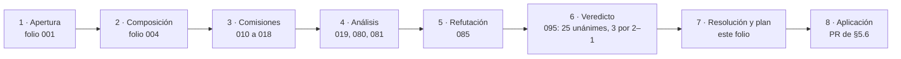
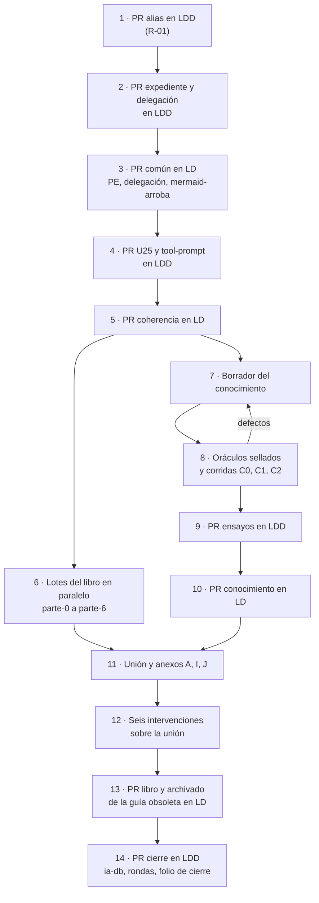
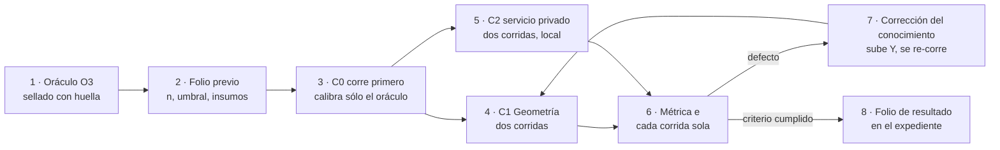

| Campo | Valor |
| --- | --- |
| Tipo | resolucion |
| Fecha | 2026-11-01 |
| Autor | Presidencia de la reedición DocsAsCode. Consolida y no vota |
| Corrige | — |

Norma y secciones leídas: `KB-privada/Knowledges/Knowledge-Mesa-De-Expertos-A-Pedido.md` 3.1 (`MEP`), mapa de carga,
fila «Presidís una mesa», y §2.1, pasos 9 y 10; `KB-privada/Rules/Rule-Mesa.md` 1.1 (`RM`) §3.5.4 a §3.5.7;
`Knowledge-Cadena-De-Consecuencias` 2.0 (`CDC`) §3 (obstáculo frente a escalada); `Knowledge-Excepcion-A-Un-Conocimiento`
2.1; `Rule-Detencion-Y-Lote` 1.1 §3.5 (lote con `SI NO RESPONDÉS`). Insumos: folios 001, 004, 010–019, 080, 081, 085
y 095; núcleos `N1`–`N7` y cohesión global (`CG`), como hipótesis ya juzgadas por la mesa.

# Resolución — expediente 0003

## Índice

1. [Qué resuelve este folio](#1-qué-resuelve-este-folio)
2. [Alias y definiciones](#2-alias-y-definiciones)
3. [Dictamen pregunta por pregunta](#3-dictamen-pregunta-por-pregunta)
4. [Ataques sin número de pregunta, resueltos](#4-ataques-sin-número-de-pregunta-resueltos)
5. [Plan de ejecución aprobado](#5-plan-de-ejecución-aprobado)
   1. [Orden general](#51-orden-general)
   2. [Estructura del libro y lotes de redacción](#52-estructura-del-libro-y-lotes-de-redacción)
   3. [Ajustes de coherencia del cuerpo](#53-ajustes-de-coherencia-del-cuerpo)
   4. [Forma del conocimiento de especificación](#54-forma-del-conocimiento-de-especificación)
   5. [Diseño de los ensayos](#55-diseño-de-los-ensayos)
   6. [Pull requests previstos](#56-pull-requests-previstos)
   7. [Las seis intervenciones editoriales](#57-las-seis-intervenciones-editoriales)
   8. [Lo que sale al PO y agregados marcados](#58-lo-que-sale-al-po-y-agregados-marcados)
6. [Excepciones a conocimientos (consolidado, para avisar al PO)](#6-excepciones-a-conocimientos-consolidado-para-avisar-al-po)
7. [Reintegra](#7-reintegra)
8. [Lo no verificado e incidencias](#8-lo-no-verificado-e-incidencias)
9. [Cierre de mesa](#9-cierre-de-mesa)

---

## 1. Qué resuelve este folio

La mesa abrió el caso el 2026-11-01 (folio 001), compuso el panel (004), despachó ocho comisiones y la primera
pasada del refutador (010–018), hizo dos análisis de decisiones (019 a ciegas, 080 y 081 con los informes a la vista),
la segunda pasada del refutador (085) y votó (095). Este folio asienta el resultado y lo vuelve un plan que se puede
aplicar sin volver a preguntar.

**Por qué el resultado queda aprobado.** La delegación del PO del 2026-09-14 dice que la propuesta mejor fundada que
elige el jurado queda aprobada, y que al PO sólo sale lo irreversible con consecuencia externa (folio 001 §8,
«DECISIONES CERRADAS»). Cada decisión de §3 se toma por esa delegación. Lo que sale al PO está en §5.8, con su motivo.

**Lo que no se rediscute:** las decisiones cerradas del folio 001 §8 (territorios y worktrees, un PR común a la vez
por repo, lo privado por alias, conocimiento canónico en `LD`, historia de `LD` y `LDD` ya reescrita).



*Figura 1. Recorrido del ciclo 1 de la mesa del expediente 0003, hasta la aplicación.*

## 2. Alias y definiciones

| Alias | Qué es |
| --- | --- |
| `TP` | El pedido del PO, `sha256` `da388e9d…74b37`, 104 líneas, sin versionar en el clon principal de `LDD` |
| `F0nn` | Folio `mesa/0nn-*.md` de este expediente; al foliar, `actuaciones/0nn-*.md` |
| `KB-privada/` | La base de conocimientos de la organización, privada. Se cita por nombre de conocimiento, versión y sección (regla R-16, §4) |
| `LD`, `LDD`, `LG`, `LGD` | Lab-Documentos, Lab-Documentos.Documentacion, Lab-Geometria, Lab-Geometria.Documentacion (públicos) |
| `SDEI/` | `Guides/Documentacion-Tecnica/Sistema-De-Documentacion-E-Integracion/` de `LD`, base `0bed863` |
| `GV` | `SDEI/Sistema-Documentador-Tecnico-Guide.md` (`DOC-SDT-0001`), la guía obsoleta |
| `R2/` | `PROMPTs/Guides/14-Sistema-De-Documentador-Tecnico/OUTPUTs/DocsAsCode-Bitacoras/Reedicion-02/` de `LDD` |
| `EXP3/` | `PROMPTs/DEVs/Enchacement/01-Replanteo-Y-Analisis/OUTPUTs/Expedientes/0003-Reedicion-DocsAsCode-Y-Especificacion/` de `LDD` |
| `{servicio-privado}` · `{host-de-pruebas}` · `{dir-de-trabajo}` · `{etiqueta-runner}` · `<org>` | Como en `F001` §1 |

| Término | Definición en este folio |
| --- | --- |
| Libro | `SDEI/DocsAsCode-Developer-Guide.md`, el documento unificado de `TP:48` |
| Conocimiento | `SDEI/Conocimientos/knowledge-DocsAsCode-Designing-Specification.md`, el de `TP:54` |
| Lote de redacción | Un archivo parcial `parte-N.md` que redacta un editor de contenido en paralelo con los demás, en `{dir-de-trabajo}/libro/`, fuera de todo repositorio hasta la unión |
| Co-cambio | Corrección de fondo hecha en el libro que se aplica también en la fuente, en el mismo PR (regla de A+, P-01) |
| FIRME / CON REVISIÓN | Regla R-06 (§4): FIRME exige ventaja de tres o más puntos de celda; si no, la decisión lleva una condición de revisión comprobable |
| Agregado | Cláusula que no sale del pedido ni de una regla con ancla E2; entra marcada (`MEP` §2.1, paso 2) |

## 3. Dictamen pregunta por pregunta

Resultado del acta 095 §3. Cada fila es la decisión aprobada; «Condición» es la que la vuelve revisable.

| P | Decisión aprobada | Votos | Estado | Condición de revisión o de entrada |
| --- | --- | --- | --- | --- |
| P-01 | **Edición de lectura A+.** El libro es una edición que reúne y ordena; manda la fuente. Colofón con el SHA de `LD` sobre el que se editó cada capítulo; el libro no reformula reglas ni umbrales (los cita con su ID); toda corrección de fondo se aplica también en la fuente en el mismo PR (co-cambio), y el PR lo prueba con `git diff --stat <sha-del-colofón>..HEAD -- <fuentes>` | 2–1 (J3: D) | CON REVISIÓN | Se reabre la edición ensamblada D sólo si un guion de ensamblado con reescritura de enlaces se mide verde en PR-1 a PR-5 y en menos de 150 líneas |
| P-02 | `doc_id: DOC-SDEI-LIBRO`, `doc_type: guia-de-estudio`; ningún archivo común | 3–0 | FIRME (desempate fuera de la matriz, declarado en `F080`) | — |
| P-03 | Núcleo de N2 §7 (prólogo, partes I–VI, capítulos 1–18, anexos A–J, orden TEM-01→07) con Diátaxis por capítulo, «Software» con versión como sección del anexo B y la sección «De la explicación al conocimiento» (17.4); variante V2 **sin plan de tomos**: encabezados únicos, portada y colofón con equivalencias de nombre, SHA de las fuentes y «Cómo citar» (APA 7), anexo A glosario-índice alfabético, figuras «Figura c.n» con pie, ruta «escribo la ayuda de un producto» y G.9 en dos variantes | 3–0 | Núcleo FIRME; V2 CON REVISIÓN | Si la captura de P-19 muestra que GitHub no dibuja el libro entero, va al PO la fila L-2 (§5.8); la mesa no parte el libro |
| P-04 | **Un PR común por repo, en una sola frase:** el PR común de `LD` lleva `PE` = patrón de ejemplo en `tools/docs-guard/prefijos.txt:24`, la fila de delegación del 0003 en `CHANGELOG.md` y el control `mermaid-arroba` en PR-4 con fixtures rojo y verde en `autoprueba`; antes de abrirlo, constancia de coordinación con FRAMEWORK MAUI; subir el pin de `LDD` es fila del lote (L-3); los demás cambios de `dg.py` (exclusión de carpetas, precedencia de versión, IDs locales) van a un expediente de herramienta | 3–0 | FIRME en la composición; el control sigue a P-20 | Criterios de aceptación de `F011` §3.1 (1)–(5) |
| P-05 | Jerarquía M3: (1) convenciones del cuerpo, voseo incluido; (2) RAE y ASALE, *Ortografía de la lengua española* (2010) y *Diccionario panhispánico de dudas*; (3) Microsoft *Spanish (Neutral) Style Guide*, tomada **por la lengua**, no por el alcance. Si chocan, manda el nivel 1. Una fila en `00-Marco.md` §5 y en P.4 del libro | 3–0 | FIRME | — |
| P-06 | **SPLIT.** El procedimiento genérico se reescribe en `SDEI/Examples/Lanzar-Example.md` (versiones fijas, variables explicadas, sin datos del entorno, remisión a `TEM-05` §3.3) y el libro lo trae en 14.3. El tool-prompt, saneado con alias, va a `LDD` en `PROMPTs/Guides/14-Sistema-De-Documentador-Tecnico/OUTPUTs/Tool-Prompts/Lanzar-Example.md` (ruta que fija la presidencia por R-11) | 2–1 (J1: RWs) | CON REVISIÓN | Si saneado deja de correr, se descarta (RWs) y el PR lo dice |
| P-07 | El caso del portal de un proveedor público entra **reverificado** al 2026-11-01, con método de conteo declarado y entrada APA; el argumento se apoya en el patrón y las cifras van como datos fechados; es documentación de quien integra, no modelo de ayuda al usuario final. El proveedor se nombra sólo en el libro y en `Referencias.md`, nunca en los folios ni junto a `{servicio-privado}` | 3–0 | FIRME | Si al publicar el libro la consulta tiene más de 90 días, se repite en ese PR |
| P-08 | **X1 con etiqueta.** Libro y archivado de `GV` en el mismo PR. Antes de borrar `GV`, etiqueta anotada `sdei-v2.0.0-borrador` sobre el commit de `main` que la contiene (nombre por versión, como `docs-guard-v1.0.0`); los enlaces que pasan a la «versión archivada» (`GV:27`) apuntan a esa etiqueta; las trazas de `README.md:11` y `Guides/README.md:11` (raíz de `LD`) se re-apuntan a `IDX-SDEI`; el cuerpo pasa a `2.0.0-borrador.1` en el frontmatter y en la tabla del README (`SDEI/README.md:22`) | 3–0 | FIRME | — |
| P-09 | **D1.** Providencia de delegación en el expediente y fila en `CHANGELOG.md` de `LD` y de `LDD`, con la decisión del PO y alcance desde el primer merge; mientras no conteste, conformación manual. Sale al PO como obstáculo de una línea (§5.8) | 3–0 | FIRME | — |
| P-10 | **E1.** Cita «PR #n, merge `<sha nuevo>`»: `080f158` → «PR #19, merge `e3841b6`»; `fe10086` → «PR #25, merge `6878568`», con nota de equivalencia que declara su alcance (el árbol de `tools/docs-guard`, `Guides/Documentacion-Tecnica`, `scripts` y `.github` es idéntico en cada par) | 3–0 | FIRME | — |
| P-11 | **R-B por plataforma.** La etiqueta de runner es un parámetro del conocimiento (`{etiqueta-runner}`; Linux, y Mac para iOS); `VER-W09` y el filtro F1 dejan de llevar el literal; los workflows no se tocan; no se renombra | 3–0 | FIRME | Se reabre si cambia la configuración del runner o un tercer repositorio quiere usar la etiqueta |
| P-12 | **U-A′.** Antes del libro se re-corren sólo los guiones que el libro cita (U25), con salida vigente y `diff` explicado contra la histórica, que queda citada con su SHA equivalente (P-10); las marcas pasan a URL y SHA de `LDD` (U26); `04-adopciones.sh` se rotula «no reproducido» hasta que corra | 3–0 | CON REVISIÓN | (a) Si una corrida no reproduce la salida que el libro cita, se corrige la cita en el mismo PR. (b) Si las salidas vigentes resultan iguales a las históricas en todos los guiones (U-B igual de verde en K4), se reconsidera y basta con U26 |
| P-13 | Separaciones, cada sentido con su instrumento: **letra** = lo que la app promete (intención = para qué; comportamiento = lo que el código hace); **atraso** = commits que el SHA fijado está detrás de la rama principal (control 3 de `semanal.sh`, entero ≥ 0); **deriva** = contenido frente a código (`traces-resolve`, verde o rojo por traza); **deriva de copia fijada** = copia cuya huella cambió (control 4 de `semanal.sh:15`; alias en el glosario hasta que el expediente de herramienta renombre el control); **control** = uno solo; **compuerta** = el carril PR; **compuerta de escalón** = el hito; **PR-7** = «fijadas y referencias», y «siete grupos más `autoprueba`» | 3–0 | FIRME | — |
| P-14 | `PE` = patrón de ejemplo (corrección en el PR común); `PEND-` para los pendientes de un expediente; los `PE-1…14` del folio 290 del 0002 no se reescriben | 3–0 | FIRME | — |
| P-15 | **SYN.** `TEM-05:48` remite a la tabla por escenario sin rebajar `:88`; las 7 páginas en castellano de la prueba de ayuda por rol se retrazan a `CU-1000x@versión` de la unidad Web de `LG` en `5f07b12`; RRD de la prueba con rango propio (`RD-21`…); se relee el texto (previsualizar, aviso de la baja) y se alinea `translation_of`; una pregunta de evaluación en `TEM-05` para la mitad «caso de uso de la unidad»; `source.lock` recién cuando exista el trabajo de CI con `--fuente` | 3–0 | FIRME | — |
| P-16 | **S.** Composición por unión (una oración en el Marco) + fila prescriptiva «Clases activas por defecto» con altas y bajas con motivo + anotación por celda de lo que el ejemplo no tiene, medido en su SHA + correcciones medidas: CL-08 y CL-13 en `ESC-SDEI-1` y `ESC-SDEI-2`; fuente XML «prevista» en `ESC-SDEI-3`; CL-03 y XML de CL-04 «no presentes en el ejemplo» en `ESC-SDEI-2`; fila de ancla «sin etiqueta» | 2–1 (J1: COMP) | Núcleo FIRME; anotación CON REVISIÓN | En la edición siguiente, si el oráculo de los ensayos quedó independiente de la fila (P-26), la anotación por celda puede retirarse |
| P-17 | Decide el rol `ACT-SDEI-2` en todos los escenarios; `TEM-02:164-169` nombra al ocupante (en `ESC-SDEI-1`, la responsable de la guía o quien el PO designe por delegación asentada); la clave de `EJR-SDEI-05` contesta con el rol | 3–0 | FIRME | — |
| P-18 | **R+D.** Se reescribe lo que hace el carril (cuenta commits de atraso de `base_commit` y `source.lock`; A1 mide la deriva por símbolo cuando corre la demo) y se declara como deuda que A1 no está programado, con evento de cierre; en `00-Marco.md:183-184`, `01-Mapa.md:68-70` y `Ejercicios.md:112-116` a la vez | 3–0 | FIRME | Evento de cierre de la deuda: el PR del expediente de herramienta que programe A1, o el folio que decida no programarlo |
| P-19 | **S0.** Sin sitio publicado ni ensayo MkDocs; captura del render completo del libro en GitHub, adjunta al PR del libro | 3–0 | FIRME | Si el render falla, L-2 al PO |
| P-20 | **R+L.** Control `mermaid-arroba` en PR-4 (dentro del PR común de P-04) + dibujado local obligatorio con `tools/medios/mermaid.sh` en todo PR que toque diagramas, con su salida en el PR; en `LDD` rige sólo lo local hasta que suba el pin | 3–0 | CON REVISIÓN | Entrada: si los fixtures de `F011` no reproducen 2 de 28 sin falsos positivos, el control no entra y rige L. Revisión: si da falsos positivos en el primer mes de PR con diagramas, se retira al expediente de herramienta |
| P-21 | Se reescribe `TEM-07:171-172` con un hecho fechado: en IA.SDD@`bac7e48` hay un conocimiento de lógica de decisión 1.0 que registra lecciones y dos líneas de norma que mandan correrlo; su lección no tiene los campos «evidencia» ni «resultado» que `TEM-07:176` pide a la capa A; en `LG` no hay copia, sólo una aplicación citada; si son las capas del diseño lo decide el escalón 2. `TEM-07:95` se ajusta en el mismo cambio | 3–0 | FIRME | — |
| P-22 | `doc_id: ANX-SDEI-ESPECIFICACION`, `doc_type: anexo`, `version` igual a `**Versión:**` | 3–0 | FIRME | Pasa a `KNW` con un segundo conocimiento en `LD` o con la copia aprobada a la base; si el PO aprueba AG-3, antes de copiar se mide `ANX` contra la compuerta de la base |
| P-23 | **E+.** Forma estricta §0–§10 con frontmatter y cabecera de once campos; excepción escrita a «`version` sólo en el README» en `00-Marco.md:161`; una línea que dice qué versión manda (la de `**Versión:**`; `version` la repite) | 3–0 | FIRME | — |
| P-24 | **N-T.** Neutral respecto de SDD en todo el conocimiento, apéndice incluido; lo propio de SDD va al libro o a un perfil. Fundamento: `TP:18` | 3–0 | FIRME | — |
| P-25 | **e.** Una tabla decisión por decisión, con las trampas como filas del oráculo, los instrumentos de `F016` §4.2, umbral entero de discrepancias ≤ ⌊0,15·n⌋ sellado con huella antes de correr, cada corrida pasa sola. C0 corre primero y sólo puede corregir el oráculo, nunca el umbral. C0 es agregado aceptado | 3–0 | CON REVISIÓN | Si C0 queda fuera del umbral, se escribe un oráculo 2 con nueva huella (O-4 de `F016`) antes de correr C1 y C2; el umbral no se mueve |
| P-26 | **O3.** El oráculo de cada caso lo escribe antes, y lo sella con huella, un agente distinto del autor del conocimiento y del aplicador, desde el repo del caso en un SHA del remoto; `N4` §4 y la hoja privada sólo como borrador; condiciones O-1 a O-6 de `F016` §4.3. Geometría: par `LG 4b114d7` + `LGD b47d22b`. O3 es agregado aceptado (motivo: no medir al autor) | 3–0 | CON REVISIÓN | (a) Si el PR #3 de `LGD` se cierra sin fusionar, se usa `refs/pull/3/head` por SHA con copia del índice y su huella. (b) Si O3 y el borrador `N4` §4 difieren en más de ⌊0,15·n⌋ filas, la diferencia se folia antes de correr C1 |
| P-27 | **G-c.** La evidencia de Geometría va a `EXP3/evidencia/`; un worktree descartable de `LGD` sólo como medio para correr la compuerta en su layout; ningún PR en `LGD`. Lo de `{servicio-privado}` queda sólo en local; en lo público, cifras y huellas | 3–0 | FIRME | — |
| P-28 | **No mezclar.** El ensayo entra al escalón 2 del 0002 como evidencia citada; se dice «escalón 2», nunca «G2». Se recomienda a la presidencia del 0002 la corrigenda del estado del escalón 1 (folios 290 y 259) | 3–0 | FIRME | — |

## 4. Ataques sin número de pregunta, resueltos

| Ataque | Qué resuelve la presidencia | Fundamento |
| --- | --- | --- |
| **R-01 (P0)**: nombres de máquina en el `main` público de `LDD` (`F085` V2–V5) | (1) **PR correctivo hacia adelante** que reemplaza los nombres de máquina por alias en `R2/` y en la carpeta `EXP3/` (§5.6, PR 1); lo decide la mesa, unánime en el jurado. (2) **La historia** va al PO (L-1): reescribirla es irreversible y alcanza a terceros. (3) Sobre la pregunta de J3: **no se admite** una ficha que exima a las bitácoras de `00-Marco.md:170`; sí se admite una excepción **acotada a las directivas `runs-on` de los workflows** (XC-3, §6), que es lo que ya implica P-11. El contenido de `LDD` anterior al 2026-11-01 que nombra máquinas (V5: folios y bitácoras de otros expedientes) **no se reescribe** desde este expediente: los folios cerrados no se corrigen por otro expediente; queda como deuda declarada, con evento de cierre en la respuesta del PO a L-1 | `00-Marco.md:170`; `F085` §5 y §9; acta 095 §5 |
| **R-02 y C-1 (P1)**: la finalidad de `TP:70` («material suficiente») y la mitad «nuevos» de `TP:18` no tienen pregunta | El jurado no eligió entre «abrir P-29» y «declarar»: los tres pidieron que el dictamen no calle. Se **abre P-29** («¿con qué instrumento se prueba que el libro y el conocimiento alcanzan para un proyecto nuevo?») para un **ciclo 2 corto, sólo con P-29**, que corre en paralelo con la redacción del libro y cierra antes de sellar los oráculos (§5.5). Propuesta de la presidencia para ese ciclo, como hipótesis: un caso C3 «proyecto nuevo», en el que el aplicador recibe sólo el conocimiento, el libro y una ficha de producto escrita antes y sellada, con la misma métrica e. **Si no responde (default):** el folio de cierre de ensayos declara, con motivo, que la mitad «nuevos» no se probó en esta edición | `F085` R-02, R-02a; acta 095 §5 |
| **R-03 y C-6 (P1)**: «crear ejemplos y material de consulta» (`TP:73`) sin aplicador | Crean ejemplos **los editores de contenido**, con la silla académica como consultora (dos jueces lo nombran; el tercero pide que se nombre). Primer hueco: `ESC-SDEI-3`, que P-15 vuelve verificable al retrazar la prueba de ayuda por rol. El material de Geometría para el libro (`N4` §8) sigue siendo el deseable E-05: entra sólo como lo pide 18.6 | `F085` R-03; `F017` H09 |
| **R-06**: regla de firmeza | FIRME exige ventaja mayor que el ruido medido entre evaluadores: **tres o más puntos de celda** **[criterio propio del refutador, adoptado por el jurado]**. Método: cada análisis puntuó con el suyo en su alcance (`F080`: P-01 a P-08, P-13 a P-18, P-21; `F081`: el resto); los tableros **no se suman**; el estado de §3 aplica R-06 sobre la ventaja de cada uno | `F085` §6.4 |
| **R-16**: cómo se nombra la base de conocimientos | En los folios públicos del 0003, la base se cita como `KB-privada/` + nombre del conocimiento + versión + sección, sin ruta del espacio de trabajo. En el libro y en el conocimiento **no** se cita como fuente (P-21 cita sólo IA.SDD, público, por SHA); las dependencias de consulta del conocimiento se nombran por alias de conocimiento, sin ruta. Al foliar (PR 2 de §5.6), el barrido reemplaza en los folios las rutas de la base por este alias, sin tocar otra cosa, y lo deja en una constancia | Precedente del 0002 (`KB-privada/` en sus folios 095 y 099); `F080` P-21 |
| **C-3**: un registro por intervención | Se marca como **agregado aceptado**, en su forma más chica: **un solo archivo** con seis entradas, `R2/05-Rondas-Editoriales.md`, no seis folios. Cada entrada se escribe aunque la intervención no cambie nada (lección del libro de FRAMEWORK MAUI, `N2` §3.2) | `F018` O-3; `F085` C-3 |
| **XC-1** (`F019` §7.1): A+ choca con «un dato vive en un solo documento» | Admitida; camino de compromiso: SHA por capítulo + control de co-cambio (§6) | Acta 095 §5; `F085` §6.2 |

## 5. Plan de ejecución aprobado

### 5.1 Orden general



*Figura 2. El libro se redacta sobre un cuerpo ya corregido; los oráculos se sellan antes de correr; las rondas
editoriales van después de los ensayos, porque los ensayos todavía pueden cambiar el texto (`CG` §7).*

**Paralelos.** Los pasos 6 (lotes) y 7–9 (conocimiento y ensayos) corren a la vez. P-29 (ciclo 2) corre en paralelo
con el paso 6 y cierra antes del paso 8. Un solo PR abierto a la vez por repositorio para lo común; los merges se
serializan y se anuncian a FRAMEWORK MAUI (folio 001 §8).

### 5.2 Estructura del libro y lotes de redacción

**Archivo:** `SDEI/DocsAsCode-Developer-Guide.md`. **Frontmatter:** `doc_id: DOC-SDEI-LIBRO`, `doc_type:
guia-de-estudio`, los diez campos más `description`, `traces` a los `doc_id` fuente (`IDX-SDEI`, `MARCO-SDEI`,
`MAPA-SDEI`, `TEM-SDEI-01`…`07`, anexos). **Jerarquía:** `#` libro; `##` prólogo, partes y «Anexos»; `###` capítulos
y anexos; `####` secciones «4.2 …»; `#####` subsecciones; nada más profundo (`N2` §7.4).

#### 5.2.1 Partes, capítulos y fuentes

Las líneas citadas son las de las fuentes en `0bed863`; el editor trabaja sobre el SHA de `main` posterior al PR de
coherencia y lo anota en el colofón. Diátaxis por capítulo: T tutorial, G guía práctica, R referencia, E explicación.

| Parte | Capítulo | Secciones | Fuentes que absorbe | Diátaxis |
| --- | --- | --- | --- | --- |
| Preliminares | Portada y colofón | Título y subtítulo; equivalencias («DocsAsCode: el método; SDEI: este cuerpo; sistema documentador: lo que el método construye», `F017` H03); edición `2.0.0-borrador.1` y fecha; tabla capítulo → fuente → SHA de `LD`; «Cómo citar» (APA 7) | `SDEI/README.md` §6 (154), §7 (169); decisiones P-01, P-03 | R |
| Prólogo | P. Cómo usar este libro | P.1 Qué es y a quién sirve · P.2 Objetivos `OBJ-SDEI-01..05` · P.3 Rutas de lectura (aprender, intervenir, agente, leer de corrido, escribo la ayuda de un producto) · P.4 Convenciones: marcas, citas, procedencia, alias de lo privado, jerarquía de estilo M3 · P.5 Relación con el cuerpo: manda la fuente, co-cambio, SHA por capítulo · P.6 Versión, estado y origen | `README.md` §1 (36), §2 (52), §3 (65), §5 (131), §6 (154), §7 (169); `00-Marco.md` §5 (157); `Patrones-De-Ejemplos.md` §2 (47) | R |
| I. Fundamentos (`TP:52`) | 1. Fundamentos: la documentación tratada como código | 1.1 El problema · 1.2 *Docs as code*: definición y componentes · 1.3 Fuente de verdad, traza y ancla de versión · 1.4 Tipos de documentación y lectores · 1.5 Dos audiencias · 1.6 Quién decide: clases D/P/H · 1.7 Verificar en vez de confiar · 1.8 La especificación como fuente · 1.9 El texto que leen agentes es superficie de ataque · 1.10 Los principios en una tabla **[criterio propio]** | `TEM-01` Qué problema (62), Qué es (36); `TEM-02` Qué problema (80); `TEM-03` Qué es (36); `TEM-04` Definición (32); `TEM-06` Definición (32); `TEM-07` Qué es (44); `00-Marco.md` §1 (33); `Esquema…` §4 (68); `Referencias.md` §2–§8 | E |
| I | 2. Fundamentos didácticos y de evidencia | 2.1 Cómo se aprende de una guía · 2.2 Evidencia y citación · 2.3 Ejemplos con procedencia y su ciclo de vida · 2.4 Cómo se evalúa una guía | `Referencias.md` §1 (32), §3 (66); `Patrones-De-Ejemplos.md` §2 (47), §3 (57); `Criterios-De-Calidad.md` §1 (27) | E |
| I | 3. Marco de referencia | 3.1 Definiciones · 3.2 Escenarios y composición por unión (P-16) · 3.3 Contextos · 3.4 Actores (P-17) · 3.5 Convenciones · 3.6 Un caso que recorre el marco · 3.7 Preguntas guía | `00-Marco.md` §1–§7 (33–196); `01-Mapa.md` §5 (98), §7 (122) | R |
| II. Diseñar el sistema documentador | 4. Qué es un sistema documentador | 4.1 Definición y qué no es · 4.2 Arquitectura y catálogo `CL-01..14` · 4.3 Aplicación por escenario · 4.4 Ejemplos · 4.5 Preguntas guía · 4.6 Criterios · 4.7 Anexo (→ G.1) · 4.8 Fuentes y observaciones | `TEM-01` (36–348) salvo 168, 186, 244 (van al cap. 18); `01-Mapa.md` §4 (74) | E |
| II | 5. El ciclo documental | 5.1 Definición: fases, RRD, estados, cláusulas · 5.2 Por escenario (P-17) · 5.3 Ejemplos · 5.4–5.7 (→ G.2) | `TEM-02` (33–349); `docs/_requisitos.md` como cita | E |
| II | 6. Topología de repositorios y versionado | 6.1 Definición y regla para ubicar una pieza · 6.2 Por escenario · 6.3 Ejemplos (`source.lock`, traza desfasada, Lab-Geometria) · 6.4–6.7 (→ G.3) | `TEM-03` (34–326) salvo 175 (cap. 18) | E |
| III. Audiencias y canales | 7. Doble audiencia | 7.1 Definición · 7.2 Por escenario · 7.3 Ejemplos (`AGENTS.md`, índice para agentes, anti-inyección, ayuda por rol para el agente) · 7.4–7.6 (→ G.4) | `TEM-04` (32–279) salvo 3.1 (103, al cap. 18) | E |
| III | 8. Ayuda al usuario final | 8.1 Definición · 8.2 Por escenario · 8.3 Ejemplos · 8.4–8.6 (→ G.5) | `TEM-05` (33–281), con la regla de P-15 | E |
| IV. Verificar e integrar | 9. Compuertas de calidad y CI | 9.1 Dos carriles y regla de bloqueo · 9.2 Por escenario · 9.3 Ejemplos · 9.4–9.6 (→ G.6) | `TEM-06` (32–311) salvo 3.1 (181, al cap. 18) | E |
| IV | 10. Integración con un marco SDD | 10.1 Definición · 10.2 Por escenario y lecciones de decisión (P-21) · 10.3 Ejemplos · 10.4–10.6 (→ G.7) | `TEM-07` (42–331) | E |
| V. Práctica | 11. Estoy acá: qué aplico | Tablas por escenario, contexto y actor, re-apuntadas a secciones del libro; «necesito… → anexo» | `01-Mapa.md` §1–§3 (32–73), §6 (109) | R |
| V | 12. Cómo intervenir: el proceso en cinco pasos | Ubicar, derivar, validar, proponer, mantener, con entradas, salidas y validaciones; instancia de `LD` como ejemplo | `Examples/Como-Intervenir.md` §1–§8 (38–175); `Como-Intervenir-Lab-Documentos.md` (15) | G |
| V | 13. Caso de estudio: la mini demo MovilidadUrbana | Qué hay y cómo funciona; correr la verificación; tutorial de una pantalla nueva; cuando el código cambia; el caso RN-LOC-01 y el 60/80; límites (tres aplicaciones) | `MovilidadUrbana-Mini-Demo/README.md` §1–§8 (33–391); fichas, ayuda y técnica como cita | T |
| V | 14. Caso de estudio: ayuda por rol | 14.1 La prueba de concepto · 14.2 Qué probar y la consola · 14.3 Levantar y publicar (procedimiento reescrito, P-06) | `Prueba-Ayuda-Por-Rol/README.md` (14, 36, 48); `Lanzar-Example.md` reescrito | G |
| V | 15. Decidir entre alternativas | Criterios, escala anclada, pesos, filtros y firmeza, matriz trabajada, quién decide | `99-Anexos/Como-Decidir.md` §1–§7 (32–174) | E |
| V | 16. Ejercicios | `EJR-SDEI-01..05`, citados en el texto | `Ejercicios.md` §1 (27), §2 (39–80) | T |
| V | 17. Mantener el libro, el cuerpo y el conocimiento | 17.1 Precedencia y co-cambio · 17.2 Versión y estados · 17.3 Carril programado aplicado al libro · 17.4 De la explicación al conocimiento: qué parte del libro destila el conocimiento y cuándo usar cada uno | P-01, P-08, P-18; `N3` §7; el conocimiento | G |
| VI. Industria (`TP:56`) | 18. El sistema documentador en la industria | 18.1 El portal de un proveedor público de notificaciones, reverificado (P-07) · 18.2 Adopciones públicas por práctica, con fecha · 18.3 Compuertas de proyectos grandes · 18.4 Normas y estándares · 18.5 Tendencias · 18.6 Aplicaciones propias: Lab-Geometria (resultados de C1) y `{servicio-privado}` por alias (cifras de C2) | `TEM-01` (168, 186, 244); `TEM-03` (175); `TEM-04` (103); `TEM-06` (181); `TEM-07` (264); `GV` §1 (sólo lo reverificado); `Referencias.md` §4–§8; `N6` §3 como hipótesis contrastada por las comisiones | E |
| Anexos | A. Glosario-índice | Alfabético (orden de la *Ortografía*), columnas término · definición · equivalente en inglés · sigla · sección donde se define; ≈ 100 entradas | `Glosario.md` + tablas de definiciones del cuerpo (`N2` §9.1) + términos de P-13 | R |
| Anexos | B. Referencias | APA 7 con ancla `ref-…`, fecha de consulta; sección «Software» con versión; las URL viven en `99-Anexos/Referencias.md` (regla R-L5) | `Referencias.md` (51 entradas) + industria | R |
| Anexos | C. Esquema de frontmatter y prefijos | §1–§8 del esquema | `Esquema-Frontmatter-Y-Prefijos.md` (32–202) | R |
| Anexos | D. Criterios de calidad | `CQ-01..14` y qué automatiza la compuerta | `Criterios-De-Calidad.md` (27–88) | R |
| Anexos | E. Lista de verificación | Ítems `VER-*` | `Lista-De-Verificacion.md` (35–158) | R |
| Anexos | F. Patrones de ejemplos | `PE-01..12` | `Patrones-De-Ejemplos.md` §1 (28) | R |
| Anexos | G. Plantillas | G.1–G.7 por tema; G.8 instancia de «Cómo intervenir»; G.9 página de ayuda en dos variantes; G.10 RRD y cláusula | Anexos de `TEM-01`…`TEM-07`; `Como-Intervenir.md` §8; `TEM-05` (238–279) | R |
| Anexos | H. Claves de los ejercicios | Claves de `EJR-SDEI-01..05` (P-17 en la 05) | `Ejercicios.md` §3 (81) | R |
| Anexos | I. Correspondencia | Sección del libro → fuente y línea; capítulo → archivos de `Examples/`; lo excluido y por qué (`N2` §9.3) | `N2` §8 y §9.3 | R |
| Anexos | J. Marcas de estado y ensayos fechados | Cada marca con su sección; cada ensayo con fecha, comando y resultado (U25, C0, C1, C2) | Ensayos de los temas, `EXP3/evidencia/` | R |

**Índice general** al principio, con prólogo, partes, capítulos y anexos (anclas de GitHub). No se propone índice de
figuras ni índice analítico aparte: el anexo A cumple esa función (`N2` §10.2).

#### 5.2.2 Extensión

Base: `N2` §11 (palabras de cada fuente, densidad del libro de FRAMEWORK MAUI, ≈ 10,4 palabras por línea) más lo que
agregan las decisiones (colofón, 17.4, G.9 en dos variantes).

| Medida | Estimación | Fuente |
| --- | --- | --- |
| Palabras | 50 000 a 59 000 | `N2` §11 |
| Líneas | ≈ 5 800 (suma de lotes, §5.2.3) | Esta resolución, sobre `N2` §11 |
| Tamaño | 345 a 407 KB | `F017` H01 |
| Mermaid | ≈ 28 | `N2` §11 |

**Presupuesto de tamaño** **[criterio propio de `F017` H01, adoptado]**: meta 350 KB medidos con `wc -c` sobre la
unión. Si la unión la pasa, la intervención de contenido deduplica antes de la captura; el techo de 400 KB es el que
GitHub documenta para el render en modo crudo (`F017` H01). Si la captura de P-19 muestra el libro cortado, rige
L-2.

#### 5.2.3 Lotes de redacción

Los lotes L0 a L8 corren en paralelo, cada uno con un editor de contenido; L9 une. Todos parten del SHA de `main` de
`LD` posterior al PR de coherencia (§5.6, PR 5) y del glosario ya corregido por P-13.

| Lote | Archivo | Capítulos | Fuentes principales | Líneas | Depende de |
| --- | --- | --- | --- | --- | --- |
| L0 | `parte-0.md` | Portada, colofón (plantilla) y prólogo P.1–P.6 | `README.md`, `00-Marco.md` §5, `Patrones…` §2 | 190 | PR coherencia |
| L1 | `parte-1.md` | Parte I, caps. 1–3 | Temas (definiciones), `00-Marco.md`, `Referencias.md`, `Patrones…`, `Criterios…`, `01-Mapa.md` §5, §7 | 820 | PR coherencia |
| L2 | `parte-2.md` | Parte II, caps. 4–6 | `TEM-01`, `TEM-02`, `TEM-03`, `01-Mapa.md` §4 | 870 | PR coherencia |
| L3 | `parte-3.md` | Parte III, caps. 7–8 | `TEM-04`, `TEM-05` | 500 | PR coherencia |
| L4 | `parte-4.md` | Parte IV, caps. 9–10 | `TEM-06`, `TEM-07` | 670 | PR coherencia |
| L5 | `parte-5a.md` | Parte V, caps. 11–14 | `01-Mapa.md`, `Como-Intervenir*`, mini demo, prueba de ayuda por rol, `Lanzar-Example.md` reescrito | 810 | PR coherencia; corre `verificar.sh` para los fragmentos |
| L6 | `parte-5b.md` | Parte V, caps. 15–17 (17.4 incluida) | `Como-Decidir.md`, `Ejercicios.md`, decisiones P-01, P-08, P-18; el conocimiento | 380 | PR coherencia; 17.4 espera al borrador del conocimiento |
| L7 | `parte-6.md` | Parte VI, cap. 18 | Temas (casos), `GV` §1 reverificado, `Referencias.md`, `N6` | 340 | 18.1–18.5: PR coherencia. 18.6: resultados de C1 y C2 |
| L8 | `anexos-b-h.md` | Anexos B a H | `Referencias.md`, `Esquema…`, `Criterios…`, `Lista…`, `Patrones…`, anexos de los temas, `Ejercicios.md` §3 | 830 | PR coherencia |
| L9 | `union.md` → `DocsAsCode-Developer-Guide.md` | Índice general, anexos A, I y J, numeración, colofón con SHA reales, unión | Listas aparte de L0–L8, `N2` §8–§9, `EXP3/evidencia/` | 360 + unión | L0–L8, PR ensayos, PR conocimiento |

**Reglas comunes a todos los lotes** (salen de `N2` §4.2 y §7.4 y de las decisiones):

| # | Regla | Origen |
| --- | --- | --- |
| R-L1 | El libro no reformula reglas ni umbrales: los cita con su ID y enlace a la fuente. Si el editor encuentra un error de fondo, lo anota en `parte-N.cocambio.tsv` (fuente:línea → texto nuevo) para aplicarlo en la fuente en el mismo PR | P-01 |
| R-L2 | Ningún encabezado empieza con un ID; el número de sección va primero y el ID entre paréntesis en monoespaciado. Encabezados únicos en todo el libro | `N2` R-4; P-03 V2 |
| R-L3 | Sin comentarios HTML ni HTML oculto; las únicas etiquetas son las anclas `<a id="ref-…"></a>` del anexo B (las pone L8) | `N2` R-5, R-6 |
| R-L4 | Citas `[Autor, año](#ref-…)` al anexo B; repositorio `[Compilado: ruta, l. x–y]`; salida `[Salida registrada: …]`; **[criterio propio]** rotulado | `00-Marco.md` §5; P-03 |
| R-L5 | El cuerpo del libro no lleva URL de dominios fuera de `dominios.txt`: AI-4 bloquea en un archivo que no es de referencias (`dg.py:398-432`). Las URL nuevas van a `99-Anexos/Referencias.md`, con fecha de consulta, en el PR del libro | `F080` P-01, condición 1; `F081` §6.1 |
| R-L6 | Mermaid: una idea por diagrama, ≤ 15 nodos, sin `classDef` ni `style`, etiquetas «1 · Texto», sin URL y sin arroba seguida de un nombre con punto (o con `#64;`); pie «*Figura c.n.*»; cada parcial pasa `tools/medios/mermaid.sh` con 0 «MAL DIBUJADO» | `N2` §7.4; P-20 |
| R-L7 | Voz: rioplatense con voseo, jerarquía M3; término nuevo definido una vez y anotado en `parte-N.glosario.tsv` para el anexo A | P-05; `N2` §9.1 |
| R-L8 | Capítulos temáticos (4–10): Objetivos, Requisitos previos, resumen de tres líneas, las seis secciones del Profile, Fuentes y observaciones, Resumen. Los demás: Objetivos, Preguntas guía, Resumen. Rótulo Diátaxis en la apertura | `N2` §7.3; P-03 |
| R-L9 | Plantillas al anexo G; el capítulo deja una línea que remite | `N2` D-N2-5 |
| R-L10 | Lo privado sólo por alias; ningún nombre de máquina, ruta del equipo, IP ni etiqueta de runner; barrido antes de entregar | `00-Marco.md:170`; R-01 |
| R-L11 | Marcas de estado y ensayos fechados anotados en `parte-N.marcas.tsv` para el anexo J | `N2` §10.1 |
| R-L12 | Validación del parcial antes de entregar: `dg.py ai` y `markdownlint-cli2` con la configuración del repositorio, `mermaid.sh`; lista de anclas internas usadas, para L9. Esquema y trazas corren sólo sobre la unión | `N2` §3.1; `N7` §6 |
| R-L13 | Ejemplos: los archivos de `Examples/` siguen siendo los artefactos; el libro cuenta y muestra fragmentos. Donde falte un ejemplo, lo crea el editor de contenido con la silla académica como consultora (R-03) | `N2` D-N2-4; §4 |

### 5.3 Ajustes de coherencia del cuerpo

Todos van en el PR de coherencia de `LD` (§5.6, PR 5), salvo los marcados con otro PR. Líneas en `0bed863`, medidas
el 2026-11-01. Los ajustes se aplican **antes** del libro, porque el libro hereda el texto de las fuentes (`N1` §8).

| Id | Archivo:línea | Cambio (texto nuevo o regla) | Decisión |
| --- | --- | --- | --- |
| AC-01 | `TEM-01-Sistema-Documentador.md:268` | «la pantalla promete 60 caracteres para el **nombre de una localidad** y el campo admite 80» | `N1-01` |
| AC-02 | `99-Anexos/Esquema-Frontmatter-Y-Prefijos.md:158` | Reemplazar la fila de ejemplo `RD-03 … comentarios` por la fila `RD-01` real recortada, como `TEM-02:185-187` | `N1-02` |
| AC-03 | `TEM-01-Sistema-Documentador.md:283-284`; `99-Anexos/Glosario.md` §2 | «una divergencia entre la letra (lo que la app promete), la intención (para qué) y el comportamiento (lo que el código hace)»; tres entradas nuevas en el glosario | P-13; `N1-03` |
| AC-04 | `99-Anexos/Glosario.md:57`; `Examples/MovilidadUrbana-Mini-Demo/README.md:45`; las 12 apariciones de «desfase» en `SDEI/` | Glosario: «Deriva — distancia entre lo que una pieza afirma y lo que el código hace; instrumento `traces-resolve`»; entradas nuevas «Atraso» (control 3 de `semanal.sh`, entero ≥ 0) y «Deriva de copia fijada» (control 4, `semanal.sh:15`, alias hasta el expediente de herramienta). En la demo y en la prosa, el sentido «SHA frente a la rama principal» se escribe «atraso» | P-13; `N1-04` |
| AC-05 | `99-Anexos/Glosario.md:52`; `00-Marco.md:44`, `:78`; `TEM-03-Topologia-Y-Versionado.md:47-48`, `:61`, `:143`; `TEM-07-Marco-SDD.md:24-26` | «control» para uno; «compuerta» para el carril PR; «compuerta de escalón» para el hito; entradas en el glosario | P-13; `N1-11` |
| AC-06 | `00-Marco.md:44`; `TEM-03-Topologia-Y-Versionado.md:49-50`; `Examples/Como-Intervenir.md:108` | «PR-7 fijadas y referencias (`reflint`, `url-fecha`)»; donde se cuentan los grupos, «siete grupos más `autoprueba`» | P-13; `N1-10` |
| AC-07 | `99-Anexos/Esquema-Frontmatter-Y-Prefijos.md:102-132` | Sumar la fila `FC` que ya tiene `prefijos.txt:20`, y la fila `PE` = patrón de ejemplo conforme al PR común | P-14; `N1-06`; `F081` D-1b |
| AC-08 | `99-Anexos/Glosario.md:28` | «Hay seis familias de siglas parecidas» | `N1-07` |
| AC-09 | `99-Anexos/Glosario.md:34` | Listar los controles que existen: «`AK-1`, `AK-3`, `AK-4`, `AK-5` y `AK-7`» | `N1-08` |
| AC-10 | `99-Anexos/Glosario.md` §2 | Completar: Fuente de verdad, Ficha, Escalón, Divergencia (leve y de fondo), Guarda de merge, Runner, Repositorio hermano, Actor, Rol, Unidad, Letra, Intención, Comportamiento, Atraso; orden alfabético | `N1-09`; `F017` H07 |
| AC-11 | `TEM-03-Topologia-Y-Versionado.md:322` | En pasado y con el estado vigente: «`docs-guard` rechazaba `traces: []`; hoy lo acepta con el aviso `traces-vacio` (`tools/docs-guard/dg.py:342-346`)» | `N1-12` |
| AC-12 | `TEM-06-Compuertas-Y-CI.md:198` | Citar por SHA del commit y por bloque: `permissions:` l. 50, `runs-on:` l. 60, `timeout-minutes:` l. 61 | `N1-13` |
| AC-13 | `TEM-02-Ciclo-Documental.md:156` | El enlace a «el tema 07» va a `TEM-07-Marco-SDD.md` | `N1-14` |
| AC-14 | `01-Mapa.md:48-49`; `TEM-06-Compuertas-Y-CI.md:215-216` | Quitar «mientras estén en redacción» y «en redacción» | `N1-15` |
| AC-15 | `TEM-03-Topologia-Y-Versionado.md:319` | Reescribir el motivo con el caso vigente (`FC-TEM-nn` en Framework Concept; `MARCO-CONVENCIONES` declarado cuatro veces) | `N1-16` |
| AC-16 | `TEM-01:218`, `:343`; `TEM-02:218`, `:342`; `TEM-03:162`, `:221`; `TEM-07:187`, `:200` | `080f158` → «PR #19, merge `e3841b6`», con la nota de equivalencia de P-10; el guion de `TEM-07:200` hace `git checkout e3841b6` | P-10; `N1-17` |
| AC-17 | `TEM-01:213-218`; `TEM-02:214-218`; `TEM-03:193`, `:212-213`, `:221` | Las remisiones a `evidencia/E1-U4b/…` pasan a URL con SHA de `LDD` de la corrida nueva (PR 4); `04-adopciones.sh` rotulado «no reproducido» | P-12; `N1-18` |
| AC-18 | `TEM-05-Ayuda-Al-Usuario-Final.md:48`; `TEM-05` preguntas guía | «Toda página de usuario traza a lo que pide su escenario (tabla de [Aplicación por escenario](#…)); la regla de `ESC-SDEI-3` está en la l. 88». Pregunta de evaluación: «¿La página traza también al caso de uso de la unidad de su pantalla?» | P-15; `N1-21` |
| AC-19 | `Examples/Prueba-Ayuda-Por-Rol/Web/Ayuda/es/**` (7 páginas) y su RRD | `traces` a `CU-1000x@versión` de la unidad Web de `LG` en `5f07b12`; RRD con `RD-21`…; `translation_of` alineado; releer previsualizar y aviso de la baja. Comprobación: `dg.py trazas` sin los 9 avisos `traza-no-verificable` | P-15; `F015` H03-H04 |
| AC-20 | `00-Marco.md:58-60`, `:100-109`; `TEM-04-Doble-Audiencia.md:86` | Oración de unión: «Un proyecto con rasgos de dos escenarios activa la unión de sus clases; la composición no agrega fases». Tabla: fila «Clases activas por defecto» prescriptiva, altas y bajas con motivo, anotación «no presente en el ejemplo (`<sha>`)» por celda; CL-08 y CL-13 en `ESC-SDEI-1` y `-2`; XML «prevista» en `ESC-SDEI-3`; CL-03 y XML de CL-04 «no presentes en el ejemplo» en `ESC-SDEI-2`; fila de ancla «sin etiqueta». `TEM-04:86`: quitar «No hay índice interno» (CL-08 existe) | P-16; `N1-23` |
| AC-21 | `TEM-02-Ciclo-Documental.md:166`; `99-Anexos/Ejercicios.md` clave de `EJR-SDEI-05`; nota en `00-Marco.md:145` si hace falta | Celda de `ESC-SDEI-1`: «`ACT-SDEI-2`; ocupa el rol la responsable de la guía o quien el PO designe por delegación asentada». La clave contesta con el rol | P-17; `N1-22` |
| AC-22 | `00-Marco.md:183-184`; `01-Mapa.md:68-70`; `99-Anexos/Ejercicios.md:112-116` | «Un aviso programado cuenta cuántos commits de atraso tiene el SHA fijado frente a la rama principal; la deriva por símbolo la mide A1 cuando corre la demo. Deuda: A1 no está programado; se cierra con el PR que lo programe o con el folio que decida no hacerlo» | P-18; `N1-24` |
| AC-23 | `TEM-07-Marco-SDD.md:171-172`, `:95` | Reemplazar «Ninguna de las dos existe todavía» por el hecho fechado de P-21; `:95` deja de condicionar CL-11 en `ESC-SDEI-3` a «la copia de la capa A» y remite al escalón 2 | P-21 |
| AC-24 | `99-Anexos/Esquema-Frontmatter-Y-Prefijos.md:82`; `Examples/MovilidadUrbana-Mini-Demo/docs/_requisitos.md:56` | Etiquetas mermaid con `#64;` en lugar de la arroba seguida de versión. **Va en el PR común** (PR 3), para que el control nuevo quede verde | P-20; `N1-25` |
| AC-25 | `Examples/MovilidadUrbana-Mini-Demo/README.md:114` | `:62 ERROR ancla-valor-distinto` → `:63` | `N1-26` |
| AC-26 | `MovilidadUrbana-Mini-Demo/README.md:54-57`; `TEM-01:240`; `01-Mapa.md:81` | Columna «Clase» con `CL-05` y `CL-01`; la ficha propia «sin SDD» se declara CL-01 con topología «dedicado + `source.lock`» | `N1-27` |
| AC-27 | `99-Anexos/Esquema-Frontmatter-Y-Prefijos.md:75`, `:166`; `TEM-03:86` | Ejemplos tomados de la demo real (`doc_id` no ambiguo, ancla `Clase.Miembro`, encabezado real de la ficha) | `N1-28` |
| AC-28 | `99-Anexos/Patrones-De-Ejemplos.md` §2 | Registrar la marca «[Salida registrada: …]» con su regla | `N1-29` |
| AC-29 | `99-Anexos/Como-Decidir.md:109` | Citar `PE-02` (ejemplo trabajado) en lugar de `PE-01` | `N1-30` |
| AC-30 | `00-Marco.md:82-83` | «tres aplicaciones (web, API y móvil)»; declarar que la copia de la regla en la API no tiene ancla | `N1-31` |
| AC-31 | `Examples/Lanzar-Example.md` (entero) | Reescrito como guía práctica genérica: objetivo, prerrequisitos, pasos, resultado, validaciones y errores; versiones fijas; variables explicadas; sin rutas, túneles ni datos del entorno; remisión a `TEM-05` §3.3; sin remisión a `GV` | P-06; `N1-32` |
| AC-32 | `00-Marco.md:78`; `TEM-03:61`, `:143` | «una etiqueta por versión» en lugar de «una etiqueta por compuerta» | `N1-34` (aprobado en el 0002, folio 255 §7) |
| AC-33 | `00-Marco.md:52`, `:135`; `TEM-06-Compuertas-Y-CI.md:209`; `99-Anexos/Lista-De-Verificacion.md:149`, `:154` (`VER-W09`); `99-Anexos/Como-Decidir.md:82` (F1); `Examples/Como-Intervenir-Lab-Documentos.md:25`; `MovilidadUrbana-Mini-Demo/README.md:337` | Sin el literal de la etiqueta: «la etiqueta de runner que fija el caso, por plataforma (Linux; Mac para iOS); en este repositorio, la de `.github/workflows/docs-guard.yml:60`». Comprobación: `grep` de la etiqueta en `SDEI/` = 0 | P-11; R-01; XC-3 |
| AC-34 | `TEM-04:15`, `TEM-05:15`, `TEM-06:15`; `README.md:135-136`; `TEM-04`…`TEM-07` | H1 «Tema 0n — …» (hoy declaran `TEM-04`, `TEM-05`, `TEM-06` sin querer); sección «Fuentes y observaciones» en los siete temas; el README dice «seis secciones más Fuentes y observaciones» | `N1-20`; `N2` H-1, H-6 |
| AC-35 | `MovilidadUrbana-Mini-Demo/README.md:383-392`; `99-Anexos/Ejercicios.md` (pie); `Examples/Como-Intervenir-Lab-Documentos.md` | Pie de navegación uniforme; índice en la instancia | `N1-33` |
| AC-36 | `00-Marco.md` §5 (157) | Fila nueva «Estilo y lengua»: la jerarquía M3 de P-05 | P-05 |
| AC-37 | `00-Marco.md:161` | Excepción: «salvo el conocimiento de `Conocimientos/`, cuyo `version` repite su `**Versión:**`». **Va en el PR del conocimiento** | P-23 |
| AC-38 | `SDEI/README.md:22` y su frontmatter; `README.md:11` y `Guides/README.md:11` (raíz de `LD`); remisiones a `GV` en `TEM-01:170`, `TEM-03:245`, `TEM-04:106`, `TEM-05:184`, `README.md:99`, `:124`, `01-Mapa.md:130`, `Prueba-Ayuda-Por-Rol/README.md:3`, `Lanzar-Example.md:27` | `2.0.0-borrador.1` en los dos lugares; trazas a `IDX-SDEI`; remisiones retiradas o llevadas al libro. **Va en el PR del libro**, con el archivado | P-08; `N1-19` |
| AC-39 | `99-Anexos/Referencias.md` | Entrada APA del portal reverificado; entradas de industria con fecha; sección «Software». **Va en el PR del libro** | P-07; P-03; `N1-19` |
| AC-40 | `LDD` `ia-db/README.md:122` | `base_commit` al SHA vigente. **Va en el PR de cierre de `LDD`** | P-10; `N1-17` |

**Fuera de este PR, con destino declarado:** `N1-36` (índice `00` de las bitácoras y corrigenda del folio 290) y la
corrigenda del estado del escalón 1 son del expediente 0002: se recomiendan a su presidencia (P-28). La clase de los
workflows y de `tools/docs-guard/` en el catálogo (`N1-23`, segunda mitad) no se votó: queda como deuda declarada.

### 5.4 Forma del conocimiento de especificación

Ruta `SDEI/Conocimientos/knowledge-DocsAsCode-Designing-Specification.md` (`TP:54`). Decisiones P-22 a P-24: anexo
con forma estricta, neutral respecto de SDD. Meta: ≤ 500 líneas; lo explicativo va al libro (`N3` §5.2).

**Cabecera** (dos bloques, en este orden; medida verde en PR-2 y PR-5 por `F012`, ensayo 4):

```yaml
---
doc_id: ANX-SDEI-ESPECIFICACION
doc_type: anexo
title: Conocimiento de especificación — diseñar el sistema documentador de un proyecto
description: Qué decidir, qué producir y cómo verificar al diseñar la documentación como código de un proyecto nuevo o existente.
status: borrador
origin: ia-assisted
confidence: media
owner: Lab-Documentos — guía del sistema documentador
last_review: <AAAA-MM-DD>
audience: [humano, agente, desarrollo, analista, po]
traces: [IDX-SDEI@2.0, MARCO-SDEI, MAPA-SDEI, TEM-SDEI-03, TEM-SDEI-06, ANX-SDEI-DECIDIR, ANX-SDEI-ESQUEMA]
version: 1.0
---
```

Después del H1, los once campos: Alias (`DocsAsCode-Designing-Specification`), Naturaleza (propio), Tema, Consumidor,
Condición de carga (en prosa: al arrancar la documentación de un proyecto, al adoptarla en uno existente, al revisar
un diseño), Hereda-de, Sustituye, Compatible-con, Versión, Estado, Fecha. Una línea dice: «Manda `**Versión:**`;
`version` del frontmatter la repite» (P-23).

| § | Título | Contenido | Regla que lo condiciona |
| --- | --- | --- | --- |
| — | Índice | §0–§10 enlazados | `TP:79` |
| 0 | Propósito y alcance | Qué caracteriza; cuándo conviene y cuándo no; qué queda afuera y dónde vive (el libro, cap. 17.4); terminología mínima con los términos de P-13; mapa de carga | P-13; P-24 |
| 1 | Identidad | Conocimiento de diseño; supuestos: Git, PR, CI con checks requeridos, Markdown | — |
| 2 | Estructura | 2.1 Piezas (catálogo `CL-01…CL-14` condensado); 2.2 Invariantes `I-01…I-20`; 2.3 Apéndice por escenario, **neutral**: «marco de especificación del proyecto», nunca «SDD»; el caso privado, como «servicio con paquetes» sin alias que contenga la sigla; 2.4 Condiciones de aplicabilidad; composición por unión (P-16) | P-24; P-16 |
| 3 | Contrato de uso | 3.1 Procedimiento en ocho pasos (mermaid); 3.2 Decisiones del aplicador `D-01…D-17` con evidencia ruta:línea o «pendiente»; 3.3 Cómo decidir (criterios, escala anclada, filtros generalizados, firmeza R-06); 3.4 Proyecto nuevo frente a existente; 3.5 Regla de falla y no inventar; 3.6 Público y privado | `N3` §5.3; R-06 |
| 4 | Decisiones ya tomadas | Tabla decisión → criterio → fuente del cuerpo | `N3` §5.2 |
| 5 | Esqueletos | 5.1 Ficha de diseño documental (A-01); 5.2 frontmatter mínimo; 5.3 fila del RRD; 5.4 instancia de «Cómo intervenir»; 5.5 `AGENTS.md` puntero; 5.6 registro de prefijos; 5.7 llamada al workflow de la compuerta con `runs-on: [self-hosted, {etiqueta-runner}]` por plataforma (Linux; Mac para iOS) | P-11 |
| 6 | Criterios de aceptación | Ítems `DE-n` atómicos con nivel; conformidad del diseño (artefactos `A-01…A-11`) y del aplicador (no inventa, aplica la regla de falla, lista las decisiones de clase H sin decidirlas) | `N3` §5.4–§5.5 |
| 7 | Anti-patrones | Incluye «copiar los parámetros del laboratorio como norma» (runner, Profile) | `N3` §4.4 |
| 8 | Conformidad | Consultivo; precedencia por perfil | — |
| 9 | Trazabilidad | Hermanos (el libro); artefactos de referencia (cuerpo `SDEI`, `docs-guard`, mini demo); Origen `derivado-de Lab-Documentos@<sha>:<ruta>` por fuente; dependencias sólo de consulta, nombradas por alias de conocimiento sin ruta (R-16); fuentes externas con fecha | R-16 |
| 10 | Control de cambios | Una fila por versión; las correcciones de los ensayos suben Y | `N3` §5.7 |

**Verificaciones antes del PR** (`N3` §5.5): `scripts/ci-local.sh todo` sobre `SDEI/` verde; `mermaid.sh` rc=0;
`grep -c '\bSDD\b'` = 0 en el archivo (P-24); barrido de lo privado = 0; ensayos C0–C2 dentro del criterio (§5.5).
La compuerta de la base **no** se corre en esta edición: sólo si el PO aprueba AG-3 (P-22).

### 5.5 Diseño de los ensayos

**Pregunta** (`TP:20`): ¿alcanza el conocimiento, solo, para que alguien sin contexto diseñe el sistema documentador
de un proyecto como lo haría quien conoce el cuerpo?



*Figura 3. El oráculo y el umbral se sellan antes; C0 sólo puede corregir el oráculo.*

| Caso | Escenario | Insumos del aplicador (lista cerrada con huella, O-5) | Oráculo | Dónde vive | Corridas |
| --- | --- | --- | --- | --- | --- |
| C0 (agregado aceptado) | Corpus de guías | Conocimiento (`sha256sum`), plantilla A-01 vacía, `LD` en SHA del remoto, visto sólo como objeto (sin leer `SDEI/`) | O3 sobre `LD` | `EXP3/evidencia/C0/` | 2 |
| C1 | Panel con roles | Conocimiento, A-01 vacía, `LG` en `4b114d7` y `LGD` en `b47d22b` (la ia-db de ese commit indexa `4b114d7`: O-6) | O3 sobre ese par, con las trampas de `N4` §7.3 como filas (siete; «despliegue intocable» pasa a restricción: 0 escrituras fuera del lugar del ensayo) | `EXP3/evidencia/C1/`; worktree descartable de `LGD` sólo para correr `docs-guard` en su layout | 2 |
| C2 | Servicio con paquetes (y su composición con panel con roles) | Conocimiento, A-01 vacía, repo de documentación de `{servicio-privado}` en SHA del remoto | O3 escrito desde ese repo; la hoja privada de `N5`, sólo borrador | Sólo `{dir-de-trabajo}/privado/`; en `EXP3/evidencia/C2/` van cifras y huellas | 2 |
| C3 | Proyecto nuevo | Lo decide P-29 (ciclo 2, §4) | — | — | — |

**Métrica e** (P-25), por corrida, con los instrumentos de `F016` §4.2:

| Medida | Instrumento | Pasa si |
| --- | --- | --- |
| M1 Cobertura | Conteo sobre A-01 | Todas las decisiones contestadas o «pendiente» con motivo |
| M2 Discrepancias | Comparación fila por fila con el oráculo (decisiones `D-01…D-17` y trampas); conjunto igual en decisiones de varios valores | ≤ ⌊0,15·n⌋ con *n* sellado; si *n* < 7, 0 |
| M3 Clase H | Lista del oráculo por caso | Todas listadas para una persona y ninguna «decidida» |
| M4 Invenciones | Script que comprueba que cada ruta:línea citada existe en el SHA del insumo, más verificación del refutador | 0 |
| M5 Suposiciones | Registro de la corrida | 0 |
| M6 Compuerta | Agregador de `docs-guard` sobre A-02…A-07 = 0, con un par rojo y verde plantado | Verde, con el rojo visto |
| M7 Estabilidad | Diferencias entre las dos corridas | Diagnóstico sin umbral: cada diferencia es un defecto del conocimiento |

**Oráculo O3** (P-26): lo escribe un agente que no escribió el conocimiento ni corre el caso, desde el repo del caso
en su SHA, con `N4` §4 y la hoja privada sólo como borrador. Condiciones O-1 a O-6 de `F016` §4.3: escrito antes y
sellado; «sin oráculo» marcado al escribirlo, con *n* y la lista de clase H fijos; nunca la columna del Marco; oráculo
2 con nueva huella si la mesa juzga un error del oráculo; insumos con huella; ia-db que indexa la misma revisión.

**Folio previo** (antes de la primera corrida, commit empujado a la rama `dac/0003-ensayos` para que la fecha conste en
el remoto): por caso, *n*, umbral entero, lista de clase H, huellas del oráculo, del conocimiento, de A-01, de la carta
y de la ia-db, y SHA del caso. Para C2, sólo las huellas.

**Lo que no entra.** La prueba negativa con §3.2 borrado (`N3` §5.6, paso 4) es un agregado que el jurado no adoptó
(`F018` O-1): no se corre en esta edición.

**Quién corre.** Peritos despachados por la presidencia: un autor de oráculo por caso, un aplicador ciego por
corrida (subagente nuevo, sin memoria ni carta con contexto del laboratorio), y el refutador para M4. Corren en
`{host-de-pruebas}` (`TP`, pedido del chat), con la guarda de turnos si son pesados. Nada se escribe en `LGD` ni en el
repo de `{servicio-privado}`.

**Después.** Los defectos vuelven al conocimiento (sube Y) y se re-corren los casos afectados. El folio de resultado
cita cada corrida. El escalón 2 del 0002 lo cita como evidencia (P-28). 18.6 del libro cuenta C1 y las cifras de C2.

### 5.6 Pull requests previstos

Ramas desde `origin/main`, en worktrees propios. Antes de abrir cada PR: el procedimiento de `N7` §6
(`ci-local.sh todo`, `mermaid.sh` sobre lo tocado, `enlaces_anclas.py`, `verificar.sh` si se toca la demo o
`tools/docs-guard/`, barrido de lo privado), con su resumen en el cuerpo del PR. Después: guarda G1–G4 de `CPA`,
merge atado al SHA, un merge por repo a la vez y anunciado. Mientras el PO no conteste P-09, cada merge es manual.

| # | Repo | Rama | Contenido | Común | Depende de |
| --- | --- | --- | --- | --- | --- |
| 1 | `LDD` | `dac/0003-alias-r2` | R-01: nombres de máquina reemplazados por alias en `R2/` y en `EXP3/`; `grep` de los nombres = 0 en esas carpetas | No | — |
| 2 | `LDD` | `dac/0003-expediente` | Folios 001, 004, 010–019, 080, 081, 085, 095, 099 a `EXP3/actuaciones/`, con el alias de R-16; folio 003 (propuesta de panel); providencia de delegación (P-09) y fila en `CHANGELOG.md` de `LDD`; cartas archivadas si el guion las conserva; carátula | No | PR 1 |
| 3 | `LD` | `dac/0003-comun` | `prefijos.txt:24` (`PE`); fila de delegación del 0003 en `CHANGELOG.md`; control `mermaid-arroba` en `dg.py` con fixtures rojo y verde en `autoprueba`; AC-24 (dos etiquetas con `#64;`). Constancia de coordinación con FRAMEWORK MAUI antes de abrir; anuncio antes del merge; criterios de `F011` §3.1 | **Sí** | Respuesta del PO a P-09 para la fila; PR 2 |
| 4 | `LDD` | `dac/0003-u25-u26` | Corrida nueva de los guiones que el libro cita, en `EXP3/evidencia/U25/`, con salida vigente y `diff` explicado; `04-adopciones.sh` «no reproducido»; tool-prompt saneado en `PROMPTs/Guides/14-Sistema-De-Documentador-Tecnico/OUTPUTs/Tool-Prompts/Lanzar-Example.md` (P-06) | No | PR 2 |
| 5 | `LD` | `dac/0003-coherencia` | AC-01 a AC-36 salvo AC-24; `CHANGELOG.md` | No (toca `CHANGELOG.md`, compartido: se actualiza la rama si queda atrás) | PR 3, PR 4 |
| 6 | `LDD` | `dac/0003-ensayos` | Folio previo sellado (empujado antes de correr); `EXP3/evidencia/C0/`, `C1/` y cifras y huellas de `C2/`; folio de resultado | No | Borrador del conocimiento; P-29 cerrada o en default |
| 7 | `LD` | `dac/0003-conocimiento` | `SDEI/Conocimientos/knowledge-DocsAsCode-Designing-Specification.md` 1.0 tras los ensayos; AC-37; README del cuerpo con la pieza en la tabla de contenido | No | PR 6 |
| 8 | `LD` | `dac/0003-libro` | `SDEI/DocsAsCode-Developer-Guide.md`; co-cambios de las seis intervenciones en las fuentes; AC-38 y AC-39; etiqueta anotada `sdei-v2.0.0-borrador` creada y empujada **antes** del merge; borrado de `GV`; captura del render completo (P-19); salida de `mermaid.sh`; consulta de P-07 dentro de los 90 días | No | PR 5, PR 7, intervenciones 1–6 |
| 9 | `LDD` | `dac/0003-cierre` | `R2/05-Rondas-Editoriales.md` (C-3); ia-db de `LDD` (entradas del libro y del conocimiento, AC-40); folio de cierre de la aplicación | **Sí** (la ia-db de `LDD` es archivo común, `CG` §7) | PR 8 |

### 5.7 Las seis intervenciones editoriales

Se hacen en orden sobre la unión, en la rama `dac/0003-libro` (`TP:50`, `:58-67`; lectura A de L-4: una pasada con
seis intervenciones). Cada una la hace un editor distinto; la silla académica consulta. Toda corrección de fondo se
aplica también en la fuente (co-cambio). Cada intervención deja su entrada en `R2/05-Rondas-Editoriales.md`, aunque no
cambie nada.

| # | Intervención (`TP:62-67`) | Qué modifica | Criterio de salida (comprobable) |
| --- | --- | --- | --- |
| 1 | Edición de contenido | Ideas, estructura y argumentos | El anexo I da destino a cada sección de las fuentes (0 sin destino frente a `N2` §8); 0 duplicados de `N2` §9.2; cada regla y umbral citados con su ID, no reformulados; rótulo Diátaxis en cada capítulo; encabezados únicos (`grep` de encabezados repetidos = 0); tamaño ≤ 350 KB o deduplicación hecha; co-cambios aplicados (`git diff --stat` de las fuentes coincide con `parte-N.cocambio.tsv`) |
| 2 | Edición académica | Rigor, fuentes y consistencia | Archivos citados existen y rangos de línea vigentes (script); `reflint` verde y correspondencia cita↔entrada en los dos sentidos (0 entradas sin cita); `url-fecha` verde; cifras de 18.1 con fecha y método; SHA de P-10; marcas del anexo J completas; **[criterio propio]** rotulado; muestreo de 20 afirmaciones con ancla sin desvíos |
| 3 | Corrección de estilo | Lenguaje y expresión | Jerarquía M3 aplicada; 0 muletillas de `Rule-Narrative-Voice`; términos de P-13 sin el sentido viejo (`grep` de «desfase» con sentido SHA = 0); voseo consistente |
| 4 | Corrección ortotipográfica | Ortografía y convenciones tipográficas | *Ortografía* 2010 y *DPD*: tildes, comillas angulares, mayúsculas; anexo A en orden alfabético académico (script de orden sin desvíos); `markdownlint-cli2` verde |
| 5 | Diseño editorial | Presentación visual y diagramación | Jerarquía `#`–`#####`; «Figura c.n» y «Tabla c.n» numeradas sin saltos; `mermaid.sh` sobre el libro con 0 «NO COMPILA» y 0 «MAL DIBUJADO»; índice general con todas las anclas resueltas (`enlaces_anclas.py` = 0 rotas); portada y colofón con los SHA reales |
| 6 | Corrección de pruebas | Errores de la versión diagramada | Sobre el render de GitHub de la rama del PR: captura del libro completo (P-19); recorrido de cada enlace del índice; `scripts/ci-local.sh todo` y `docs-guard` de la CI verdes en el SHA del PR. Todo error encontrado se corrige en el libro y en la fuente y se repite la pasada; sale con 0 errores. Si el render no está entero, L-2 |

### 5.8 Lo que sale al PO y agregados marcados

**Lote del PO** (`Rule-Detencion-Y-Lote` §3.5). Sólo lo que la delegación reserva al PO o lo que la norma pone en él.

| # | Pregunta | Por qué es del PO | SI NO RESPONDÉS |
| --- | --- | --- | --- |
| P-09 | «¿Delegás el merge de los PR del expediente 0003 en Lab-Documentos y Lab-Documentos.Documentacion, incluido el primero, con la guarda y la excepción del 0002, y la creación de la etiqueta de archivo `sdei-v2.0.0-borrador` en Lab-Documentos?» | Obstáculo, no escalada: `CPA` §3.1, la delegación «la decide el responsable del producto» | Conformación manual: cada PR de §5.6 espera tu merge |
| L-1 | «Las bitácoras de la reedición 02 ya fusionadas en el `main` público de Lab-Documentos.Documentacion nombran máquinas. Se corrigen hacia adelante con alias (PR 1). ¿Se reescribe también la historia?» | Irreversible y con consecuencia externa (clones y enlaces de terceros) | Sólo hacia adelante; la historia queda como está y se declara como deuda |
| L-2 | (Sólo si la captura de P-19 falla.) «El libro único no se dibuja entero en GitHub. ¿Se admite partirlo en dos archivos?» | Contradice `TP:48`, que pide un solo documento | El libro queda en un archivo; la captura documenta el corte |
| L-3 | «¿Se sube el pin del workflow reutilizable de Lab-Documentos.Documentacion al SHA de Lab-Documentos que trae el control `mermaid-arroba`?» | Acto de clase H sobre un workflow (`F011` §3.1). Reversible | El pin queda en `bf86669`; en `LDD` rige el dibujado local |
| AG-3 | «¿Se copia el conocimiento a la base de conocimientos de la organización?» | Cruza a un repositorio privado (folio 001 §4.4) | No se copia |

**Agregados marcados** (entran con su motivo; ninguno sale del pedido):

| # | Agregado | Motivo | Quién lo propuso |
| --- | --- | --- | --- |
| AG-1 | Co-cambio y colofón con SHA por capítulo | Hace verificable la relación libro↔fuente (A+) | `N2`; `F010`, `F014`, `F017` |
| AG-6 | C0 como caso de calibración | Calibra el oráculo antes de C1 y C2; no toca el umbral | `F081`; jurado (C-2) |
| AG-7 | Oráculo O3 escrito por un agente distinto | No medir al autor | `F013`; jurado (C-2) |
| AG-8 | Registro por intervención, en un solo archivo | Trazabilidad de las seis intervenciones | `F001` L-4; jurado (C-3) |
| AG-9 | Presupuesto de 350 KB | Riesgo medido de render | `F017` H01 |
| AG-10 | P-29 y su ciclo 2 | Cubrir la finalidad de `TP:70` y la mitad «nuevos» de `TP:18` | `F085` R-02; jurado |

## 6. Excepciones a conocimientos (consolidado, para avisar al PO)

Aviso, no pregunta: cada una está decidida y es reversible.

| Id | Conocimiento o regla y § | Qué dice | Qué se hace | Camino de compromiso o alternativa de cumplir | Impacto |
| --- | --- | --- | --- | --- | --- |
| XC-1 | `Rule-Documentation.md:28` (Profile de guía de estudio) | Un dato vive en un solo documento | El libro repite el texto de las fuentes (`TP:48` lo pide) | SHA de `LD` por capítulo en el colofón + control de co-cambio en cada PR que toque el cuerpo; manda la fuente (P-01) | Dos textos que mantener; la divergencia se detecta con `git diff --stat` |
| XC-3 | `00-Marco.md:170` (convención del cuerpo) | En lo versionado no van hosts | La etiqueta de runner sigue en las directivas `runs-on` de los workflows; en la prosa se reemplaza (AC-33) | Renombrar la etiqueta (R-C de P-11), descartado por costo | La etiqueta queda visible en `.github/workflows/` |
| XC-4 | `RM` 1.1 §3.5.4 | Cinco jueces | Tres miradas (acta 095 §9) | Dos votos más sobre P-01, P-06 y P-16 | Las tres 2–1 quedan CON REVISIÓN |
| XC-5 | `MEP` 3.1 §2.1, paso 2 | Cartas archivadas antes de despachar | Las cartas las armó el guion del workflow | Archivarlas al foliar (PR 2) si se conservan | La trazabilidad descansa en los folios |
| XC-6 | `KB-privada/Rules/Rule-Expediente.md` 1.0 §3.1 | Tipo del conjunto cerrado en el nombre | Folio 095 se llama «acta» y se declara `informe` | Renombrar al foliar | Igual que el folio 004 |

## 7. Reintegra

| Qué vuelve | A dónde | Cuándo | PR |
| --- | --- | --- | --- |
| Ajustes de coherencia AC-01 a AC-36 | Cuerpo `SDEI/` en `LD` | Antes del libro | 3, 5 |
| `PE`, delegación, control `mermaid-arroba` | `tools/docs-guard/` y `CHANGELOG.md` de `LD` | PR común | 3 |
| Conocimiento de especificación 1.0 | `SDEI/Conocimientos/` | Tras los ensayos | 7 |
| Libro y archivado de `GV`; versión `2.0.0-borrador.1` | `SDEI/` | Tras las seis intervenciones | 8 |
| Evidencia de U25, C0, C1 y cifras de C2 | `EXP3/evidencia/` | Antes del conocimiento y del libro | 4, 6 |
| ia-db de `LDD` | `ia-db/` de `LDD` | Cierre | 9 |
| Cita del ensayo de Geometría | Escalón 2 del expediente 0002 | Al cerrar el 0002 su escalón 2 | Del 0002 |
| Lo que el ensayo C2 enseñe | El conocimiento y el libro, por alias | Con los PR 7 y 8 | 7, 8 |

## 8. Lo no verificado e incidencias

| Qué | Estado | Cómo se mide |
| --- | --- | --- |
| Que GitHub dibuje el libro entero | Sin medir (`F017` H01) | Captura de P-19 en el PR 8 |
| Que `IDX-SDEI@2.0` resuelva con el cuerpo en `2.0.0-borrador.1` | Sin medir | PR-5 en el PR 7 |
| Que un enlace a la etiqueta `sdei-v2.0.0-borrador` pase AI-4 en el cuerpo | Sin medir | `dg.py ai` en el PR 8; si no pasa, el enlace va a `Referencias.md` |
| Que el tool-prompt saneado siga corriendo | Sin medir (`F080` §11) | Corrida en el PR 4 (condición de P-06) |
| Si la compuerta de la base acepta `doc_type: anexo` | Sin medir (`F085` §10) | Sólo si el PO aprueba AG-3 |
| Ruta del pedido | La que da la carta no existe en el worktree de `LDD`; se leyó del clon principal con huella igual | — |
| Mensajes de otra sesión | No llegó ninguno a mitad de turno | — |

## 9. Cierre de mesa

```text
CIERRE DE MESA — Reedición DocsAsCode (expediente 0003), 2026-11-01

  PANEL
    Convocados:     C-REQ · C-VER · C-LECT · C-ARQ-MAUI · C-DOC-SIS · C-DOC-USR · C-FORMAL · C-ACAD-ED
                    (folios 010 a 017); refutador C-REF en dos pasadas (018, 085)
    Descartados:    los del folio 004 §9
    Ad hoc:         C-ACAD-ED (edición bibliográfica y de libros, carta de mandato del folio 004 §6) ·
                    R-DECISIONES fuera del panel (019 a ciegas; 080 y 081)
    Postergados:    Operación y entrega (004 §9; no se disparó AJ-2)
    Aporte nulo:    ninguno

  DECISIONES
    Preguntas: 28   Con ganadora: 28 (25 unánimes, 3 por 2–1)   FIRME: 20   CON REVISIÓN: 8
    Ataques sin pregunta resueltos: R-01, R-02 (P-29 a ciclo 2), R-03, R-06, R-16, C-3, XC-1

  COMPUERTA
    Resultado:      no hay compuerta mecánica en este ciclo; la de cada PR es la de §5.6
    No mirado:      las citas dentro de cada voto (las muestreó el refutador, 085 §3); el render del libro

  ENTREGA A QUIEN CONVOCÓ
    Plan:               §5 (orden, libro y lotes, 40 ajustes, conocimiento, ensayos, 9 PR, 6 intervenciones)
    Deuda declarada:    5 — historia de LDD (L-1) · contenido anterior de LDD con nombres de máquina ·
                        A1 sin programar (P-18) · clase de los workflows en el catálogo (N1-23) ·
                        mitad «nuevos» de TP:18 si P-29 queda en default
    Capas a revalidar:  ia-db de LDD (PR 9) · índice 00 de las bitácoras (presidencia del 0002)
    Escaladas:          lote de §5.8: P-09 (obstáculo), L-1, L-2 (condicional), L-3, AG-3

  CIERRE
    Por decisión, no por criterio: un solo ciclo. Abierto: P-29 (ciclo 2, sólo esa pregunta)
    Riesgo declarado:   homogeneidad (25 de 28 unánimes; tres jueces del mismo modelo)
    Contador:           ciclo 1 de la mesa de este expediente; una ronda de veredicto
```

**Cuenta de folios** (`MEP` §2.1, paso 10):

| Rol | Folios | Cantidad |
| --- | --- | --- |
| Comisiones convocadas | 010, 011, 012, 013, 014, 015, 016, 017 | 8 |
| Refutador | 018, 085 | 2 |
| Análisis de decisiones | 019, 080, 081 | 3 |
| Perito | — (los ensayos corren en la aplicación) | 0 |
| Jurado de composición | 004 | 1 |
| Jurado de veredicto | 095 | 1 |
| **Subtotal de la cuenta** | | **15** |
| Fichas de excepción | XC-1 admitida por el refutador; XC-3 a XC-6 de procedimiento (§6) | — |
| Presidencia | 001, 099 (y 002, constancia, ya en `EXP3/`) | 3 |

La cuenta da: las ocho comisiones del folio 004 §6 tienen su informe; el refutador, el análisis y los dos jurados
tienen el suyo. La mesa queda cerrada para el ciclo 1, salvo P-29.

**Barrido de lo privado** sobre este folio y el 095:

| Campo | Valor |
| --- | --- |
| Comando | `grep -nIiE` con: rutas de home y del directorio de trabajo, el nombre del servicio privado y de los otros proyectos privados de la carta, los nombres de máquina, la etiqueta de runner, la organización de GitHub, el proveedor público de P-07 y el patrón de IPv4 |
| Fecha | 2026-11-01 |
| Resultado | En el retorno del despacho. El patrón no se escribe acá |

**Constancia de lo creado.** Este folio y el 095, en `{dir-de-trabajo}/mesa/`. Sin commits, push ni PR. No se
escribió en ningún repositorio.

Sigue: lote del PO (§5.8) y PR 1 de §5.6 · presidencia
