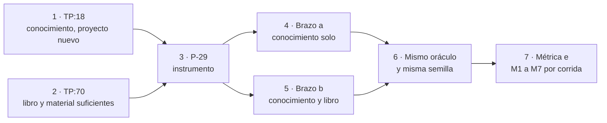

| Campo | Valor |
| --- | --- |
| Tipo | informe |
| Fecha | 2026-11-01 |
| Autor | Comisión de ensayos, ciclo 2. Trabajó a ciegas: no leyó informes de otros comisionados del ciclo 2 |
| Corrige | — |

| Cabecera de comisión | Valor |
| --- | --- |
| Rol | Comisión de ensayos: diseño experimental y evaluación de conocimiento para agentes (validez, oráculos, contaminación de insumos) |
| Pregunta única | P-29: «¿con qué instrumento se prueba que el libro y el conocimiento alcanzan para un proyecto nuevo?» (`F099:141`) |
| Clase de objeto | Diseño de una norma o decisión (`MEP` §2.2): se responde la pregunta sin «depende» |
| No-competencia | La redacción del libro y del conocimiento; la elección final entre alternativas (es del análisis de decisiones y del jurado). Esta comisión recomienda por su criterio y puntúa |
| Norma | `{servicio-privado}` · `Mesa-De-Expertos-A-Pedido` 3.1 |
| Secciones de Mesa-De-Expertos-A-Pedido 3.1 leídas | Cabecera y §0 (mapa de carga, fila «Sos una comisión»); §2.2; §3.2; §3.3; §4; §5.2 |
| Otros documentos cargados | `Cadena-De-Consecuencias` 2.0 §2 (antes de recomendar); `Rule-Escalas-De-Juicio` 1.2 §3.3 (clase de ancla) |
| Insumos leídos | `TP` líneas 14-24, 66-80; `F099` §2, §4 (fila R-02), §5.1, §5.4 (tabla de forma), §5.5; `F085` R-02 y R-02a; `F095` §5, §6 y votos de P-25 a P-28; `F010:86-110`; `F018:71`, `:243`; `F016` §4.2; `N3` §4.2, §5.3-§5.6; cuerpo `SDEI/` en `00171bd` (`00-Marco.md` §2.5; `TEM-06:49`, `:143-147`; `99-Anexos/Criterios-De-Calidad.md:34`, `:83`; `Examples/MovilidadUrbana-Mini-Demo/`) |
| Medios propios | Lectura con `sed`, `grep` y `git` en sólo lectura; una consulta web (§8). No corrí ensayos: el instrumento se corre después de sellar (`F099` §5.5) |
| Tope | 6 hallazgos |

## Índice

1. [Definiciones](#1-definiciones)
2. [Qué tiene que medir el instrumento](#2-qué-tiene-que-medir-el-instrumento)
3. [Hallazgos](#3-hallazgos)
4. [Alternativas evaluadas](#4-alternativas-evaluadas)
   1. [H — C3 de la presidencia: ficha sellada, sin repositorio](#41-h--c3-de-la-presidencia-ficha-sellada-sin-repositorio)
   2. [A1 — Proyecto nuevo real mínimo: repositorio semilla](#42-a1--proyecto-nuevo-real-mínimo-repositorio-semilla)
   3. [A2 — C3 con el primer commit de un proyecto público reciente](#43-a2--c3-con-el-primer-commit-de-un-proyecto-público-reciente)
   4. [A3 — Repositorio semilla en dos brazos: sin libro y con libro](#44-a3--repositorio-semilla-en-dos-brazos-sin-libro-y-con-libro)
   5. [D — Default: declaración de lo no probado](#45-d--default-declaración-de-lo-no-probado)
5. [Tablero y recomendación](#5-tablero-y-recomendación)
6. [Protocolo de la alternativa recomendada](#6-protocolo-de-la-alternativa-recomendada)
7. [Cadena de consecuencias](#7-cadena-de-consecuencias)
8. [Fuentes externas](#8-fuentes-externas)
9. [Lo que revisé y está bien](#9-lo-que-revisé-y-está-bien)
10. [Lo no verificado e incidencias](#10-lo-no-verificado-e-incidencias)
11. [Barrido de lo privado de este folio](#11-barrido-de-lo-privado-de-este-folio)

---

## 1. Definiciones

| Término | Definición en este folio |
| --- | --- |
| Proyecto nuevo | Repositorio sin documentación, con sólo un enunciado del producto. Es la definición de `F010:86` («repositorio sin documentación, sólo un enunciado») |
| Ficha de producto | Enunciado del producto escrito antes de correr y sellado con `sha256sum`. Describe hechos del producto (usuarios, roles, plataformas, distribución, equipo), nunca decisiones documentales |
| Repositorio semilla | Repositorio `git` creado por un guion determinista en el directorio de ensayo: la ficha como `README.md` y un esqueleto de código genérico, sin carpeta de documentación. Su SHA es la huella |
| Brazo | Variante de un mismo caso que cambia **una sola** lista de insumos y comparte oráculo, ficha y semilla |
| Fila discriminante | Decisión del oráculo cuyo valor esperado en un proyecto nuevo difiere del de uno existente (por ejemplo, bloquear desde el inicio porque la línea de base es 0) |
| Contaminación | Todo canal por el que el aplicador o el autor del oráculo reciben la respuesta esperada sin derivarla de sus insumos: vocabulario del cuerpo en la ficha, ejemplos copiables, memoria de preentrenamiento, oráculo derivado del mismo conocimiento que se mide |
| Métrica e | M1 a M7 de `F099:406-416`, sin cambios salvo lo que §6 declara |

## 2. Qué tiene que medir el instrumento

El pedido tiene tres frases que P-29 junta:

- `TP:18`: el conocimiento de especificación es para que agentes o personas «en otro contexto diferente pudieran
  aplicarlos en **nuevos o ya existentes** proyectos».
- `TP:20`: «probar la efectividad del conocimiento generado y realizar las correcciones que sean necesarias».
- `TP:70`: con el libro, «sus proyectos ejemplos y proyecto demo, e implementaciones en proyectos de producción nos
  queda el **material suficiente** para que un grupo de desarrolladores […] trabaje en una aplicación».

Los casos aprobados C0, C1 y C2 son los tres proyectos existentes, y su lista de insumos no incluye el libro
(`F099:401-403`). Por eso hoy ningún aplicador recibe el libro y ningún caso parte de cero. P-29 pide cubrir esas dos
ausencias.

*Figura 1. Cada frase del pedido queda medida por un brazo; los dos comparten oráculo para que la diferencia entre
ellos sea sólo el libro.*

## 3. Hallazgos

| Id | Nivel | Ancla | Hallazgo | Impacto si no se corrige | Dirección de la corrección |
| --- | --- | --- | --- | --- | --- |
| H1 | P1 | E2: `F099:174` («P-29 […] corre en paralelo con el paso 6 y cierra antes del paso 8»); figura 2 de `F099` §5.1 (unión del libro en el paso 11, intervenciones en el 12, ensayos en el 8) | En el paso 8 el libro no existe como documento: hay lotes `parte-N.md` sueltos. Un C3 que reciba «el libro» no puede correr junto con C0, C1 y C2 | Si se corre en el paso 8, el insumo «libro» es un borrador parcial y el resultado no habla del libro que se publica; si se corre después, la tabla de PR de `F099` §5.6 no le da lugar | Separar el sellado (antes del paso 8, junto con los otros oráculos) de la corrida del brazo con libro (entre los pasos 12 y 13); declarar dónde va su evidencia y sus correcciones (§6.6) |
| H2 | P1 | E2: `F099:404` (C3 sin insumos, sin oráculo y sin lugar) frente a `F099:413` (M4: «cada ruta:línea citada existe en el SHA del insumo») y `:415` (M6: compuerta sobre A-02…A-07) | Con sólo una ficha, M4 no tiene un SHA de proyecto contra el cual comprobar rutas, y M6 no tiene un repositorio donde correr la compuerta. «Misma métrica e» exige un repositorio | La métrica e se adapta a mano para C3 y deja de ser comparable con C1 | Dar al caso un repositorio semilla con SHA (A1 o A3): M4 y M6 corren sin cambios |
| H3 | P1 | E2: `F099:366` (el conocimiento tendrá «3.4 Proyecto nuevo frente a existente»); `TEM-06:145` en `00171bd` («bloquea sólo en un cuerpo nuevo»); `N3:339` (D-08: «lo heredado avisa y lo nuevo bloquea») y `:341` (D-10, default «avisa hasta línea de base 0») | Hay decisiones cuyo valor correcto cambia entre nuevo y existente, y una sección del conocimiento que sólo un caso nuevo ejercita. Ninguno de C0 a C2 la prueba | §3.4 del conocimiento se publica sin haber sido usada por un aplicador | Sellar en el oráculo de C3 al menos dos filas discriminantes (D-08 y D-10) y contarlas aparte como diagnóstico |
| H4 | P1 | E2: `F099:418` (O3 se escribe «desde el repo del caso en su SHA»); E3 (contraejemplo construido): en un proyecto nuevo el repositorio no trae hechos que fijen D-05, D-09 o D-11; el valor esperado sale de la ficha y del cuerpo | El oráculo de un proyecto nuevo no tiene la verdad externa que tienen C1 y C2: depende de cómo se escribió la ficha. Si la escribe quien conoce el cuerpo, puede filtrar la respuesta («la ayuda va en un repo hermano») | La ficha le dicta al aplicador la decisión, y C3 pasa por la ficha, no por el conocimiento | Tres autores distintos (ficha, oráculo, aplicador), ninguno autor del conocimiento; plantilla de ficha sólo con hechos; control de vocabulario sobre la ficha con comando (§6.2) |
| H5 | P2 | E2: `N3:442` («No mide si el diseño es *bueno* […] mide si es *reproducible*»); `TP:70` («trabaje en una aplicación») | La métrica e mide si se diseña e instala el sistema documentador, no si un equipo trabaja después con él | El folio de resultado podría afirmar «material suficiente para trabajar» con una prueba que sólo mide diseño | El folio de resultado declara ese límite con su texto (§6.7). Una corrida de «primera intervención» queda como agregado no recomendado (§4.4) |
| H6 | P2 | E2: `TP:70` nombra «proyectos ejemplos y proyecto demo, e implementaciones en proyectos de producción»; `F099:401-403` | El material de `TP:70` no es sólo el libro. Un brazo que reciba el archivo del libro solo mide menos que lo que el pedido afirma | El brazo con libro subestima o sobreestima la suficiencia según qué ejemplos queden fuera | En el brazo b, `LD` entero en el SHA del libro (libro, ejemplos y mini demo) y `LG`/`LGD` en los SHA de C1; lo privado queda fuera por regla y se declara |

## 4. Alternativas evaluadas

Para cada una: validez, qué se sella antes, insumos con huella, oráculo, costo, riesgos de contaminación y qué
declara el folio si la mesa no la adopta.

### 4.1 H — C3 de la presidencia: ficha sellada, sin repositorio

| Aspecto | Valor |
| --- | --- |
| Validez | De constructo, buena: mide justo «libro y conocimiento, proyecto nuevo». Interna, débil: si falla no se sabe si falló el conocimiento o el libro (los dos entran juntos). Instrumental, rota: M4 y M6 no tienen SHA ni repositorio (H2) |
| Qué se sella antes | Ficha (`sha256sum`), oráculo con *n*, umbral ⌊0,15·n⌋ y lista de clase H, carta del aplicador, lista de insumos |
| Insumos con huella | Conocimiento, libro (archivo del libro en un SHA), A-01 vacía, ficha |
| Oráculo | O3 escrito desde la ficha y el cuerpo; sin repositorio, sólo la ficha es «verdad del caso» (H4) |
| Costo | 4 despachos (ficha, oráculo, dos corridas) más el refutador para M4 |
| Contaminación | Filtración de vocabulario del cuerpo en la ficha; ejemplos del libro copiables |
| Si no se adopta | Ver D (§4.5) |

### 4.2 A1 — Proyecto nuevo real mínimo: repositorio semilla

| Aspecto | Valor |
| --- | --- |
| Validez | De constructo, la más alta: es la definición de proyecto nuevo de `F010:86` y el aplicador deja los artefactos en un repositorio real. Instrumental: M1 a M7 corren sin cambios (M4 contra el SHA de la semilla; M6 con `docs-guard` en la semilla, con su par rojo y verde). Interna: igual de débil que H (libro y conocimiento juntos) |
| Qué se sella antes | Lo de H más el guion que crea la semilla (huella) y el SHA del commit inicial de la semilla |
| Insumos con huella | Conocimiento, libro, A-01 vacía, semilla en su SHA (la ficha va dentro como `README.md`) |
| Oráculo | O3 desde la semilla en su SHA y el cuerpo `SDEI/` en `00171bd`; nunca desde el conocimiento (sería circular, como la columna del Marco en P-26) |
| Costo | 4 despachos más un guion de creación de la semilla (decenas de líneas, determinista) |
| Contaminación | La de H, con el mismo control; el esqueleto de código no puede traer documentación (control: `find` de `*.md` fuera de `README.md` = 0) |
| Si no se adopta | Ver D |

### 4.3 A2 — C3 con el primer commit de un proyecto público reciente

| Aspecto | Valor |
| --- | --- |
| Validez | Autor del enunciado independiente de la mesa: la ficha no puede filtrar el cuerpo. Pero un `README.md` de un primer commit rara vez trae equipo, organización, runner ni delegación: D-09 y D-11 quedan «sin oráculo», *n* baja y M2 pasa a exigir 0 si *n* < 7 (`F099:411`). Sesgo de selección: quien elige el proyecto ya mira qué decisiones fija |
| Qué se sella antes | Criterio de selección (creado después del corte de conocimiento del modelo aplicador, licencia que permita leerlo, primer commit sin documentación), URL y SHA con fecha de consulta, oráculo, umbral |
| Insumos con huella | Conocimiento, libro, A-01 vacía, el repositorio en su SHA (copia local con huella del árbol) |
| Oráculo | O3 desde ese SHA; puede contrastarse después con la evolución real del proyecto, pero esa evolución no aplica este cuerpo y no sirve de verdad |
| Costo | 5 despachos (búsqueda y selección, oráculo, dos corridas, revisión de licencia) |
| Contaminación | Preentrenamiento: si el proyecto es anterior al corte del modelo, el aplicador puede conocer su futuro. Elegir proyectos posteriores al corte es la práctica de LiveCodeBench (§8), pero no lo verifico para un repositorio dado. Nombrar a un tercero en un expediente público agrega una consulta de licencia |
| Si no se adopta | Ver D |

### 4.4 A3 — Repositorio semilla en dos brazos: sin libro y con libro

| Aspecto | Valor |
| --- | --- |
| Validez | Todo lo de A1 y además atribución: el brazo a (conocimiento solo) mide `TP:18` en su mitad «nuevos» con los mismos insumos que C0 a C2; el brazo b (conocimiento y material del libro) mide `TP:70`. Con el mismo oráculo, lo que el brazo b gana o pierde sobre el a es efecto del libro. El brazo a corre en el paso 8 con los demás casos y sus defectos llegan al conocimiento antes del PR 7 |
| Qué se sella antes | Ficha, guion y SHA de la semilla, oráculo (con *n*, conjuntos admitidos, filas discriminantes, lista de clase H, hechos omitidos a propósito), umbral, cartas de los dos brazos, regla que fija el SHA del libro del brazo b (§6.6) |
| Insumos con huella | Brazo a: conocimiento, A-01 vacía, semilla. Brazo b: lo anterior más `LD` en el SHA de la rama del libro tras la intervención 6, y `LG` en `4b114d7` y `LGD` en `b47d22b` |
| Oráculo | Uno solo para los dos brazos, O3 desde la semilla y el cuerpo en `00171bd` |
| Costo | 6 despachos (ficha, oráculo, cuatro corridas) más el guion de la semilla |
| Contaminación | La de A1. El brazo a no ve ejemplos copiables; el b sí, y es legítimo porque `TP:70` los nombra como material |
| Agregado no recomendado | Una quinta corrida de «primera intervención»: otro aplicador recibe la semilla ya documentada y agrega una funcionalidad de la ficha con su pieza; pasa si la compuerta queda verde. Mide «trabaje» de `TP:70` mejor que la métrica e, pero no tiene oráculo sellable con lo que existe hoy: queda fuera |
| Si no se adopta | Ver D |

### 4.5 D — Default: declaración de lo no probado

Es lo que `F099:141` fija si P-29 no responde. Cuesta 0 despachos y deja `TP:70` como afirmación sin instrumento,
que es lo que `F085` R-02 llamó P1. El folio de cierre de ensayos declara, con este texto:

> La mitad «nuevos» de `TP:18` y la finalidad de `TP:70` no se probaron en esta edición. Los casos C0, C1 y C2 son
> proyectos existentes, y ningún aplicador recibió el libro (`F099` §5.5). La sección «Proyecto nuevo frente a
> existente» del conocimiento no la ejercitó ningún aplicador. Motivo: P-29 no cerró antes del sellado de los
> oráculos. Evento de cierre: un caso C3 con oráculo sellado y su folio de resultado en el expediente que lo corra.

## 5. Tablero y recomendación

Escala de 1 a 5 por criterio, pesos iguales, 5 es lo mejor. **[criterio propio]**: un solo evaluador; los puntos
son lectura de esta comisión sobre las anclas de §3 y §4.

| Criterio | H | A1 | A2 | A3 | D |
| --- | --- | --- | --- | --- | --- |
| K1 Validez de constructo (mide `TP:18` «nuevos» y `TP:70`) | 4 | 5 | 4 | 5 | 1 |
| K2 Atribución: si falla, se sabe si fue el conocimiento o el libro | 2 | 2 | 2 | 5 | 1 |
| K3 Control de contaminación e independencia del oráculo | 4 | 4 | 3 | 4 | 5 |
| K4 Métrica e sin adaptar (M4 y M6 por comando) | 2 | 5 | 4 | 5 | 1 |
| K5 Costo (despachos; 5 es más barato) | 4 | 4 | 3 | 3 | 5 |
| K6 Encaje en el orden de `F099` §5.1 | 3 | 3 | 3 | 4 | 5 |
| K7 Reversibilidad y riesgo sobre repositorios ajenos | 5 | 5 | 4 | 5 | 5 |
| **Total** | **24** | **28** | **23** | **31** | **23** |

**Recomendación: A3.** Ventaja sobre la segunda (A1): 3 puntos de celda. Por la letra de R-06 (`F099:98`) es
FIRME, en el límite. Igual dejo una condición de revisión comprobable: **si el guion de la semilla o el sellado del
brazo b no están empujados en `dac/0003-ensayos` antes de correr C0, se cae a A1** (un brazo, con libro, entre los
pasos 12 y 13). A3 es la hipótesis de la presidencia con dos agregados: un repositorio semilla (para que la métrica e
sea la misma, H2) y un brazo sin libro (para atribuir, K2).

## 6. Protocolo de la alternativa recomendada

### 6.1 Roles

Cuatro roles, cuatro agentes distintos. Ninguno escribió el conocimiento, y ninguno es autor de oráculo de C0, C1 o C2.

| Rol | Lee | No lee |
| --- | --- | --- |
| Autor de la ficha | La plantilla de §6.2 y nada más | `SDEI/`, el conocimiento, el libro, los oráculos |
| Autor del oráculo | La semilla en su SHA y `SDEI/` en `00171bd` | El conocimiento, el libro, los oráculos de C0 a C2 |
| Aplicador del brazo a (×2) | Conocimiento, A-01 vacía, semilla | `LD`, `LDD`, `LG`, `LGD`, red |
| Aplicador del brazo b (×2) | Lo del brazo a, más `LD` en el SHA del libro y `LG`/`LGD` en los SHA de C1 | `LDD`, oráculos, red |

### 6.2 Ficha de producto

**Plantilla** **[criterio propio]**, con un campo por cada entrada de la columna «Criterio» de `N3:332-348`, escrita
como hecho del producto y no como decisión: dominio y propósito; usuarios y audiencias; roles y qué puede hacer cada
uno; plataformas (web, móvil, API); si publica paquetes para terceros y cuántas líneas de versión; si tendrá sitio
público; idiomas; datos confidenciales y dónde se resuelven; equipo (personas y agentes) y quién aprueba los
cambios; plataforma de integración continua disponible; cadencia de entregas.

**Reglas:**

1. Dominio ausente del corpus: no geometría, no movilidad urbana, no notificaciones. Control: `grep -ril` de los
   sustantivos del dominio sobre `LD` en `00171bd` = 0.
2. Escenario «panel con roles», el mismo de C1, para que entre C1 y C3 cambie lo existente frente a lo nuevo y el
   dominio, y no además el escenario.
3. Control de filtración: `grep -ci` sobre la ficha de una lista sellada de términos del cuerpo (por ejemplo,
   frontmatter, prefijo, compuerta, `docs-guard`, `AGENTS.md`, ia-db, `source.lock`, `corpus_id`, `llms.txt`,
   Diátaxis, `CL-`, `D-0`) = 0.
4. Dos hechos omitidos a propósito, con su lista sellada (por ejemplo, la plataforma de integración y quién aprueba
   los cambios). Se espera «pendiente» con motivo; si el aplicador los completa, cuenta en M5.
5. Ninguna organización, persona ni marca real.

### 6.3 Semilla

Un guion sellado crea, en `{dir-de-trabajo}/ensayos/C3/semilla/`, un repositorio `git` con la ficha como
`README.md` y un esqueleto de código de una plantilla genérica, sin documentación. Control: `find` de archivos
`*.md` distintos de `README.md` = 0. El SHA del commit inicial es la huella del caso. Nada se empuja a un remoto.

### 6.4 Oráculo

- D-01 a D-17 con valor esperado y su fundamento en la semilla (`README.md:línea`) o en `SDEI/` (`ruta:línea` en
  `00171bd`).
- **Conjunto admitido** donde el cuerpo acepta más de una salida con el mismo criterio. Se sella antes y no se amplía
  después; ampliarlo es oráculo 2 con huella nueva (O-4 de `F016` §4.3).
- «Sin oráculo» donde la ficha no determina, contado antes: fija *n*.
- **Filas discriminantes** selladas: D-08 y D-10 como mínimo (H3), informadas aparte como diagnóstico, sin umbral
  propio.
- Lista de clase H del caso (D-03, D-09, D-11, D-12, y D-01 si corresponde) y los dos hechos omitidos.

### 6.5 Métrica

M1 a M7 tal como en `F099:406-416`. M4 corre contra el SHA de la semilla y, en el brazo b, también contra el SHA de
`LD` del libro. M6 corre `docs-guard` dentro de una copia de la semilla, con el par rojo y verde. Cada corrida pasa
sola. Además, como diagnóstico sin umbral: diferencia entre brazos, decisión por decisión, y resultado de las filas
discriminantes.

### 6.6 Calendario y lugar

| Momento | Qué | Dónde |
| --- | --- | --- |
| Antes del paso 8 | Ficha, guion, SHA de la semilla, oráculo, umbral, cartas de los dos brazos y la **regla** del insumo del brazo b («`LD` en el commit de `dac/0003-libro` que cierra la intervención 6») en el folio previo | Rama `dac/0003-ensayos`, empujado antes de correr C0 |
| Paso 8 | Brazo a, dos corridas, junto con C0, C1 y C2; sus defectos corrigen el conocimiento antes del PR 7 | `EXP3/evidencia/C3/a/` en el PR 6 |
| Entre los pasos 12 y 13 | Addendum al folio previo con el SHA del libro y la huella del conocimiento vigente, empujado antes de correr; brazo b, dos corridas | `EXP3/evidencia/C3/b/` en el PR 9 |
| Después del brazo b | Defectos del libro: en el PR 8, como co-cambio. Defectos del conocimiento: en el PR 8, con subida de Y | Folio de resultado de C3 en el PR 9 |

Toda la evidencia de C3 puede ir al expediente público: la ficha es inventada y no nombra nada privado. Corre en
`{host-de-pruebas}`, con la guarda de turnos si es pesada.

Esto modifica las filas 6, 8 y 9 de la tabla de `F099` §5.6. Es un **agregado** y lo decide la presidencia.

### 6.7 Qué afirma el folio de resultado

- Si los dos brazos pasan: «con esta versión del conocimiento y del libro, dos aplicadores sin contexto diseñaron e
  instalaron el sistema documentador de un proyecto nuevo dentro del criterio sellado». No afirma una tasa (un caso,
  dos corridas: `F016` §4.2, «prueba de aceptación, no estimación»), ni que el equipo pueda después trabajar en la
  aplicación (H5).
- Si pasa sólo el b: el libro cubre algo que el conocimiento solo no cubre; se sube al conocimiento lo que faltaba.
- Si pasa sólo el a: el libro introduce ruido (por ejemplo, un ejemplo copiado que no corresponde); se corrige el
  libro.

## 7. Cadena de consecuencias

1. **¿Dónde cae?** A3 cae en la presidencia, que despacha seis agentes más un guion, y en la tabla de PR, que suma
   evidencia al PR 9 y correcciones al PR 8. D cae en el PO, que recibe un pedido cuya finalidad (`TP:70`) queda
   sin medir.
2. **¿Cuánto pesa?** A3: 6 despachos frente a 4 de H y A1 (§4); un guion de semilla; dos filas de calendario. D: 0
   despachos y una declaración (§4.5).
3. **¿Qué pierde la alternativa?** A1 pierde la atribución: si falla, no se sabe si corregir el conocimiento o el
   libro, y el brazo sin libro es el único que prueba `TP:18` «nuevos» con los insumos de los demás casos. H pierde
   la métrica e por comando. A2 gana independencia de autor y pierde *n* y control del preentrenamiento. D pierde
   la prueba entera.
4. **¿Es reversible?** Todas son reversibles: ninguna escribe fuera de `{dir-de-trabajo}` y de `EXP3/evidencia/`.
   La condición de revisión de A3 es un hecho comprobable: lo sellado está empujado o no antes de correr C0 (§5).

## 8. Fuentes externas

| # | Fuente | Para qué | Consulta |
| --- | --- | --- | --- |
| 1 | Jain, N., Han, K., Gu, A., *et al.* (2024). *LiveCodeBench: Holistic and Contamination Free Evaluation of Large Language Models for Code*. <https://arxiv.org/abs/2403.07974> | Práctica de evaluar con problemas recolectados de forma continua, posteriores a lo que el modelo pudo ver, para evitar contaminación (sostiene el criterio de selección de A2 y el riesgo de preentrenamiento) | 2026-11-01 |

Las demás referencias metodológicas (ISO/IEC/IEEE 29119-1 sobre el oráculo, prerregistro, Clopper y Pearson) se
toman como ya citadas por `F016` y `F095` y no las reabrí: valen como `C` en este folio.

## 9. Lo que revisé y está bien

1. La métrica e (`F099:406-416`) se aplica sin cambios a un caso nuevo si el caso tiene repositorio: ningún término
   depende de que el proyecto sea existente.
2. La regla de O3 de no usar el conocimiento como fuente del oráculo (`F099:418-421`) sirve igual en C3 y es la que
   evita la circularidad.
3. El lugar de la evidencia (G-c, `F095` P-27) admite C3 sin cambios de criterio: va en `EXP3/evidencia/`.

## 10. Lo no verificado e incidencias

- No comprobé que exista una plantilla de código genérica que no traiga archivos `*.md`; el control de §6.3 lo
  detecta al crear la semilla.
- No verifiqué el corte de conocimiento del modelo aplicador frente a la fecha de publicación de `LD`: si `LD` está
  en su preentrenamiento, la contaminación alcanza a todos los casos por igual, no sólo a C3.
- No leí la versión borrador del conocimiento (no existe aún, paso 7): la referencia a su §3.4 sale de la tabla de
  forma (`F099:366`).
- Mensajes de otras sesiones durante el turno: ninguno.

## 11. Barrido de lo privado de este folio

Comando: `grep -nE` con las rutas de home y del directorio de trabajo, el patrón de IPv4, los nombres de máquina del laboratorio y el nombre del servicio privado (la lista literal queda fuera del repositorio, como en 099 §9).
sobre este archivo, excluida esta línea. Resultado esperado: 0 coincidencias. Lo privado aparece sólo por alias:
`{servicio-privado}`, `{host-de-pruebas}`, `{dir-de-trabajo}`.
