| Campo | Valor |
| --- | --- |
| Tipo | informe |
| Fecha | 2026-11-01 |
| Autor | Comisión producto, a ciegas: no leyó ningún informe de otra comisión del ciclo 2 |
| Corrige | — |

| Cabecera de comisión | Valor |
| --- | --- |
| Rol | Producto: qué tiene un proyecto en el día cero, qué ficha de producto es realista, y con qué instrumento se mide que el libro y el conocimiento alcanzan para arrancarlo |
| Pregunta a cargo | P-29 (única del ciclo 2, `F099` §4, fila R-02) |
| No-competencia | Forma editorial del libro, umbrales de la métrica e (P-25, cerrados), redacción del conocimiento |
| Norma | `{servicio-privado}/Knowledges/Knowledge-Mesa-De-Expertos-A-Pedido.md` 3.1 (`MEP`) |
| Secciones de Mesa-De-Expertos-A-Pedido 3.1 leídas | Mapa de carga (fila «Sos una comisión»); §2.2; §3.2; §3.3; §4; §5.2 |
| Otros documentos cargados | `Cadena-De-Consecuencias` 2.0 §2 (`CDC`); `Escalas-De-Juicio` 1.2 §3.3 (clase de ancla) |
| Insumos leídos | Pedido (`TP`, huella `da388e9d…74b37` verificada hoy), líneas 18, 20 y 70; `F099` §2, §3, §4, §5.1, §5.2.2, §5.4, §5.5, §5.6; `F085` R-02, R-02a, C-1; `F095` §5 y filas J1–J3 de su §8; `F010` H12; `F018` O-4 y H-10; `F016` §4.2 y §4.3; `F013` §2, H06–H08, H11 y P-26; `N3` §5.2 (tabla D-01…D-17 y A-01…A-07) y §5.6; cuerpo `SDEI/` en `00171bd` (worktree de sólo lectura) |
| Medios propios | `grep`, `sed`, `sha256sum`; generación de la plantilla `maui` dos veces en un contenedor descartable con el SDK 10.0.403 y el workload MAUI, en `{dir-de-trabajo}`; dos consultas web (§6) |

**Convención de citas.** `SDEI/` = `Guides/Documentacion-Tecnica/Sistema-De-Documentacion-E-Integracion/` de `LD` en
`00171bd`. `TP:n` = línea del pedido. `F0nn` = folio de esta mesa. `N3` = núcleo de forma del conocimiento. Lo que es
opinión de esta comisión lleva **[criterio propio]**. Lo privado va por alias: `{dir-de-trabajo}`,
`{host-de-pruebas}`, `{etiqueta-runner}`, `{servicio-privado}`.

## Índice

1. [Definiciones](#1-definiciones)
2. [Lo que la pregunta da por fijo](#2-lo-que-la-pregunta-da-por-fijo)
3. [Hallazgos](#3-hallazgos)
4. [Dictamen de P-29](#4-dictamen-de-p-29)
5. [Ensayo corrido: el día cero de un proyecto MAUI](#5-ensayo-corrido-el-día-cero-de-un-proyecto-maui)
6. [Fuentes externas](#6-fuentes-externas)
7. [Lo que revisé y está bien](#7-lo-que-revisé-y-está-bien)
8. [Solicitudes de convocatoria y excepciones](#8-solicitudes-de-convocatoria-y-excepciones)
9. [Lo no verificado](#9-lo-no-verificado)
10. [Inventario de lo creado y lo borrado](#10-inventario-de-lo-creado-y-lo-borrado)
11. [Barrido de lo privado de este folio](#11-barrido-de-lo-privado-de-este-folio)

## 1. Definiciones

| Término | Definición en este informe | Fuente |
| --- | --- | --- |
| **Proyecto nuevo** | Un producto que todavía no tiene documentación ni historia: a lo sumo, el esqueleto que genera la plantilla y un enunciado del producto. Lo opuesto, «existente», es todo caso con código y documentos previos (C0, C1, C2) | `TP:18` («nuevos o ya existentes proyectos»); `F010` H12 |
| **Día cero** | El momento en que se decide el sistema documentador de un proyecto nuevo: antes del primer cambio de producto | [criterio propio] |
| **Ficha de producto** | Un texto corto que dice **hechos del producto** (para qué, quiénes, en qué plataformas, qué es privado, quién decide), escrito por alguien que no conoce el cuerpo, sellado con huella antes de escribir el oráculo. **No** dice ninguna decisión documental | [criterio propio]; forma inspirada en arc42 §1–§3 (§6, F1) |
| **Esqueleto** | El repositorio que deja `dotnet new maui` más un `git init` y un commit local; su ancla es el SHA del árbol de ese commit | §5, E1 |
| **Cuerpo nuevo** | Término ya tomado del cuerpo: una carpeta cuyo `README.md` declara `corpus_id`, donde los defectos bloquean en lugar de avisar | `SDEI/TEM-06-Compuertas-Y-CI.md:49`, `:145` |

**Lectura P0–P3** para esta pregunta: P1 es «la mesa cierra la edición diciendo que el material alcanza para un
proyecto nuevo sin haberlo medido, o midiendo otra cosa»; P2, «el instrumento mide, pero con una fuga o un costo que
debilita la lectura»; P3, forma.

## 2. Lo que la pregunta da por fijo

| Lo dado por fijo | Origen | Lectura |
| --- | --- | --- |
| Que se prueba «el libro **y** el conocimiento» | `F099` §4, fila R-02 (texto de P-29); `TP:70` nombra el libro, los ejemplos y la demo como «material suficiente» | Con origen. Los casos C0–C2 dan al aplicador **sólo** el conocimiento (`F099` §5.5, columna de insumos): C3 sería el único caso con el libro. Eso cambia dos variables a la vez respecto de C1 (proyecto y libro); ver H07 |
| Que la métrica es la misma e (M1–M7) | `F099` §4 (hipótesis de la presidencia); P-25 | Con origen. e mide **reproducción del diseño documental**, no que un equipo «trabaje en una aplicación» (`TP:70`); `N3` §5.6, último párrafo: «No mide si el diseño es *bueno*». Ver H08 |
| Que la ficha de producto existe «escrita antes» | Hipótesis de la presidencia | Sin autor ni forma: nadie dijo quién la escribe ni qué contiene. Es el insumo que más puede filtrar el oráculo (H05) |
| Que P-29 «cierra antes de sellar los oráculos» y C3 corre con los demás | `F099` §5.1, «Paralelos» | Choca con el orden del plan: el libro existe recién en el paso 11 (H03) |

## 3. Hallazgos

Tope: 8. Ancla según `Escalas-De-Juicio` §3.3.

| Id | Nivel | Ancla con cita | Hallazgo | Impacto si no se corrige | Dirección de la corrección |
| --- | --- | --- | --- | --- | --- |
| H01 | P1 | E1: `grep -rniE "proyecto nuevo\|proyectos nuevos\|desde cero\|día cero"` sobre los `.md` de `SDEI/` en `00171bd`, sin la guía obsoleta → 1 coincidencia, `README.md:94` («Quien estudia el tema desde cero»), que no trata proyectos. E2: el único lugar previsto es §3.4 del conocimiento, «Proyecto nuevo frente a existente» (`F099` §5.4, fila 3; `N3:303`) | Hoy el cuerpo no tiene una sola línea sobre arrancar un proyecto; lo que el conocimiento diga en §3.4 no lo prueba ninguno de C0–C2, que son existentes | La mitad «nuevos» de `TP:18` sale publicada sin que nada la haya ejercido | Un caso cuyo insumo sea un proyecto sin documentación (§4) |
| H02 | P1 | E1 (§5, E1): la plantilla `maui` del SDK 10.0.403 genera 37 archivos y **0** `.md`; el `ApplicationId` es `com.companyname.diacero` (`DiaCero.csproj:34`). E2: D-01, D-03, D-11, D-13, D-14 y D-16 se deciden por audiencias, roles, publicación, actores, privacidad e idioma (`N3:332-347`), y nada de eso está en esos 37 archivos | En el día cero el repositorio no contesta las decisiones de producto. Sin otro insumo, el aplicador sólo puede marcar «pendiente» (M1 pasa vacío) o suponer (M5 falla) | Un C3 sólo con esqueleto mide la regla de falla, no el material | La ficha de producto es **necesaria**: la hipótesis de la presidencia tiene razón en ese punto |
| H03 | P1 | E2: `F099` §5.1: los oráculos y las corridas son el paso 8; la unión del libro es el paso 11; `F099` §5.6, fila 6: el PR de ensayos depende de «P-29 cerrada o en default», y la fila 7 (conocimiento) depende de la 6 | Un C3 con el libro no puede correr en el paso 8: el libro no existe. Si corre después del paso 11, sus defectos del conocimiento llegan con el PR 7 ya fusionado | O C3 corre sin libro (y no contesta P-29) o sus correcciones quedan sin PR | Partir el C3 en dos tiempos: **sellar** ficha, esqueleto y oráculo en el paso 8 (van en el folio previo del PR 6); **correr** después del paso 11, sobre la unión con huella y antes del paso 12; las correcciones del conocimiento entran como co-cambio en el PR 8 con subida de Y, o se declaran deuda con evento de cierre. Lo decide la presidencia [criterio propio] |
| H04 | P1 | E4: P-26 fija que el oráculo O3 se escribe «desde el repo del caso en un SHA del remoto» (`F099` §3, fila P-26; `F016` §4.3, O-5 y O-6) | En un proyecto nuevo no hay repo del caso con remoto ni ia-db que indexe una revisión: la condición no se puede cumplir al pie de la letra | Un autor de oráculo sin regla escribe desde el libro (que es insumo del aplicador) y el ensayo mide al libro contra sí mismo | Declarar en el folio previo la **adaptación**, no una excepción: el oráculo de C3 se escribe desde la ficha (huella) y las **fuentes** de `SDEI/` en el SHA de `main` posterior al PR 5, nunca desde el libro, por P-01 («manda la fuente»); el esqueleto, por el SHA de su commit local |
| H05 | P2 | E3 (contraejemplo construido): una ficha que dice «la ayuda va por rol» o «hay `AGENTS.md`» ya contiene D-13 y D-12 (`N3:343-344`); el aplicador las copia y M2 da coincidencia sin que el material haya decidido nada | La ficha es el canal por donde el oráculo se filtra al aplicador | M2 mide la ficha, no el libro ni el conocimiento | Regla de forma de la ficha: sólo hechos del producto; **guarda léxica** antes de sellar: `grep -ciE "\bCL-[0-9]\|\bD-[0-9]\|frontmatter\|docs-guard\|AGENTS\.md\|ia-db\|RRD\|Diátaxis\|ADR\|llms\.txt\|source\.lock"` sobre la ficha = 0, con la salida en el folio previo [criterio propio] |
| H06 | P2 | E2: «cuerpo nuevo» ya significa otra cosa en el cuerpo (`SDEI/TEM-06-Compuertas-Y-CI.md:49`, `:145`, `:306-308`); «proyecto nuevo» es el término de `TP:18` | En un proyecto nuevo, todo lo que se crea es «cuerpo nuevo» y bloquea; quien lee «nuevo» en la regla y «nuevo» en la ficha puede tomarlos por lo mismo, o creer que en un proyecto nuevo nada bloquea | Una decisión D-10 errada que el oráculo cuenta como discrepancia, o peor, que no ve | Una fila en el glosario del libro y una línea en §3.4 del conocimiento que separe los dos términos; en el oráculo de C3, D-10 como fila con ancla en `TEM-06:145` |
| H07 | P2 | E2: `F099` §5.2.2: el libro se estima en ≈ 5 800 líneas y 345–407 KB; el conocimiento, ≤ 500 líneas (§5.4). `F016` §4.2, fila «Costo»: archivos leídos y tiempo, sin umbral | El aplicador de C3 carga unas doce veces más texto que el de C1, y si C3 falla o pasa no se sabe si es por el proyecto nuevo o por el libro (dos variables, `MEP` §3.3, «El peritaje cambia una sola variable») | La lectura del resultado queda confundida | Registrar el costo de cada corrida de C3 (obligatorio, sin umbral) y, como **agregado marcado**, una tercera corrida de C3 con el conocimiento solo: la diferencia con las dos corridas con libro es lo que aporta el libro |
| H08 | P2 | E2: `TP:70` («material suficiente para que un grupo […] trabaje en una aplicación») frente a `N3` §5.6, último párrafo (e mide reproducción, no bondad) | Ningún instrumento de esta edición prueba que un equipo pueda **trabajar** en la app con el material; C3 prueba el día cero del sistema documentador | El folio de cierre puede leerse como «el material alcanza», que es más de lo medido | El folio de resultado de C3 dice «pasa el criterio e en el día cero de un proyecto nuevo, en esta versión» (la forma de `F016` §4.2, «Un ensayo chico es una prueba de aceptación») y declara lo no medido: el ciclo de vida posterior |

## 4. Dictamen de P-29

### 4.1 Alternativas

| Id | Alternativa | Qué recibe el aplicador |
| --- | --- | --- |
| **A** | C3-F, la hipótesis de la presidencia | Conocimiento, libro, ficha sellada; directorio vacío para los artefactos |
| **B** | C3-FE: ficha **más esqueleto** real mínimo | Conocimiento, libro, ficha sellada y el esqueleto `dotnet new maui` en un commit local con huella, en `{dir-de-trabajo}/ensayos/C3/` |
| **C** | C3-P: ficha de un proyecto público reciente | Conocimiento, libro y una ficha escrita desde el README y el primer commit de un repositorio público ajeno |
| **D** | C3-LG0: `LG` en su primer commit, como «nuevo» retrospectivo | Conocimiento, libro y `LG` en su commit inicial |
| **E** | Default de `F099` §4 | Nada: el folio de cierre declara que la mitad «nuevos» no se probó |

### 4.2 Cada alternativa, por los seis aspectos que pide la carta

| Aspecto | A · C3-F | B · C3-FE | C · C3-P | D · C3-LG0 |
| --- | --- | --- | --- | --- |
| **Validez** | Mide «nuevo» por decisiones de producto; M6 corre sobre artefactos sueltos, sin el árbol de una app | Lo de A, más D-05, D-06, D-09 y D-10 con evidencia real: el `.csproj` muestra que iOS sólo entra fuera de Linux (`DiaCero.csproj:5`), que lleva a runner por plataforma (P-11; `F013` H06). M6 corre sobre el árbol donde los artefactos van a vivir | Realismo de producto alto, pero el proyecto real no usó este cuerpo: su documentación no sirve de oráculo y el que se escriba es igual al de A | No es nuevo para el cuerpo: `LG` se documentó con este mismo cuerpo; mide memoria del laboratorio |
| **Qué se sella antes** | Ficha (huella), oráculo (huella, con *n*, lista de clase H y trampas), plantilla A-01, carta | Lo de A, más el SHA del commit del esqueleto, la versión del SDK y de la plantilla, y la huella del árbol | Lo de A, más el SHA del repo ajeno y su licencia | SHA del commit inicial; oráculo |
| **Insumos con huella** | Conocimiento, libro (unión), ficha, A-01 | Lo de A más el esqueleto (SHA del commit; **no** se regenera por corrida: E1 de §5, la plantilla no es determinista) | Lo de A más el repo ajeno | Conocimiento, libro, `LG` |
| **Oráculo** | Autor distinto del de la ficha, del conocimiento y del aplicador, desde la ficha y las fuentes `SDEI/` en `main` tras el PR 5, nunca desde el libro (H04) | Igual que A, más el esqueleto por su SHA. Trampas plantadas como filas (§4.4) | Igual que A: el proyecto ajeno no aporta oráculo | Choca con P-26: los autores de oráculo de C1 ya miraron `LG`; independencia débil |
| **Costo** | Escribir la ficha (≤ 60 líneas [criterio propio]), un oráculo, dos corridas con el libro (H07) | A más 1 s de generación medida (§5, E1) y un commit local; la imagen de contenedor ya existe en `{host-de-pruebas}` | A más buscar y leer un proyecto ajeno, verificar licencia y fecha | Bajo en insumos, alto en coordinación con C1 |
| **Riesgos de contaminación** | Fuga por la ficha (H05); el autor de la ficha conoce el cuerpo | Los de A; el esqueleto es de Microsoft y no trae nada del laboratorio (0 `.md`) | Alto: el aplicador puede conocer el proyecto de su entrenamiento y completar hechos que la ficha no dice (M4 y M5 dejan de distinguir invención de memoria) | Muy alto: mismo proyecto que C1, mismo laboratorio |

**Qué declara el folio si P-29 va a default (E)**, texto propuesto para el folio de cierre de ensayos:

> La mitad «nuevos o ya existentes proyectos» de `TP:18` y la finalidad de `TP:70` no se probaron en esta edición.
> Motivo: [el que corresponda, por ejemplo «el libro se unió después de sellar los oráculos y no hubo ventana para
> correr C3 antes del PR del libro»]. Lo que sí se probó: reproducción del diseño en tres proyectos existentes (C0,
> C1, C2). Lo que no se puede afirmar: que el libro y el conocimiento alcancen para arrancar un proyecto. Evento de
> cierre: el folio de resultado de un caso C3 con ficha sellada, en la edición siguiente.

### 4.3 Puntajes

Escala anclada por criterio, 1 a 5, igual peso **[criterio propio]**. Anclas: 5 = cumple sin condiciones; 3 = cumple
con una condición declarada; 1 = no cumple.

| Criterio | Qué mide | A | **B** | C | D | E |
| --- | --- | --- | --- | --- | --- | --- |
| K1 Validez | Mide la mitad «nuevos» de `TP:18` y lo medible de `TP:70` | 4 | **5** | 4 | 3 | 1 |
| K2 Independencia | Oráculo sin fuga hacia el aplicador ni memoria previa del proyecto | 4 | **4** | 2 | 1 | 5 |
| K3 Reproducibilidad | Insumos cerrados con huella, una sola revisión | 5 | **5** | 4 | 5 | 5 |
| K4 Costo (5 = menor) | Trabajo extra sobre C0–C2 | 4 | **4** | 3 | 4 | 5 |
| K5 Realismo del día cero | Se parece a lo que tiene un equipo MAUI que arranca | 3 | **5** | 4 | 4 | 1 |
| K6 Encaje con el plan | P-25, P-26, P-27 y §5.1 sin reabrir decisiones | 4 | **4** | 3 | 2 | 3 |
| **Total** | | 24 | **27** | 20 | 19 | 20 |

**Recomendación: B (C3-FE).** Ventaja sobre A: 3 puntos (K1 +1, K5 +2). Por R-06 es **FIRME en el límite**: si el
jurado descuenta un punto, pasa a CON REVISIÓN con esta condición: *si la generación del esqueleto falla en
`{host-de-pruebas}` o su commit no se puede sellar antes del paso 8, C3 corre como A sin nueva votación* (A es B sin el
esqueleto: la reversión cuesta un insumo menos).

**Cadena de consecuencias** (`CDC` §2). *Dónde cae:* en la carta del autor de la ficha, en el oráculo de C3 y en el
folio previo del PR 6. *Cuánto pesa:* una ficha de ≤ 60 líneas, 37 archivos de plantilla generados en 1 s, un oráculo
de 17 decisiones más 5 trampas, dos corridas con un libro de ≈ 5 800 líneas. *Qué pierde A:* las decisiones que en un
MAUI dependen del árbol (dónde vive cada pieza, contra qué ancla, qué runner por plataforma, qué bloquea en el cuerpo
nuevo), y M6 sobre el lugar real. *Qué pierde E:* la mitad del objetivo del PO, declarada. *Reversible:* sí; nada
se escribe en ningún repo del producto y el esqueleto vive sólo en `{dir-de-trabajo}`. **Riesgo:** la fuga por la
ficha (H05); mitigación: autor sin contacto con el cuerpo y guarda léxica. **Evidencia que la sostendría:** el folio
de resultado con las dos corridas, la tabla de M1–M7, las cinco trampas y el costo de cada corrida.

### 4.4 Cómo se arma B

```mermaid
flowchart LR
  F["1 · Ficha de producto<br/>autor sin el cuerpo"] --> G["2 · Guarda léxica = 0<br/>y huella"]
  G --> E["3 · Esqueleto MAUI<br/>commit local y huella"]
  E --> O["4 · Oráculo C3<br/>desde ficha y fuentes"]
  O --> P["5 · Folio previo<br/>en el PR de ensayos"]
  P --> U["6 · Unión del libro<br/>con huella"]
  U --> R["7 · Dos corridas ciegas<br/>con libro y conocimiento"]
  R --> M["8 · Métrica e<br/>y costo por corrida"]
  M --> K["9 · Correcciones<br/>co-cambio o deuda"]
```

*Figura 1. Ficha, esqueleto y oráculo se sellan con los demás casos; las corridas esperan la unión del libro (H03).*

**Roles.** Cuatro agentes distintos: autor de la ficha (rol producto, sin acceso a `SDEI/` ni a los folios), autor del
oráculo, aplicador ciego por corrida y el refutador para M4. Ninguno es autor del conocimiento.

**Forma de la ficha** (hechos de producto; cada campo dice qué decisión alimenta sin nombrarla en la ficha):

| Campo | Contenido | Alimenta | Ancla de la forma |
| --- | --- | --- | --- |
| 1 Propósito | Problema y para quién, en tres líneas | D-01 | arc42 §1 (F1) |
| 2 Personas y roles | Quiénes usan la app y qué puede hacer cada uno | D-01, D-13 | arc42 §1, «stakeholder» |
| 3 Plataformas y distribución | Android, iOS, Windows; tienda o distribución interna | D-09, D-13 | MS Learn, proyecto único (F2) |
| 4 Componentes | App, API, paquetes que se publican; si viven juntos o no | D-01, D-05, D-06 | arc42 §3 |
| 5 Equipo | Personas y agentes; quién aprueba un cambio hoy | D-11, D-12 | arc42 §2, «organizational» |
| 6 Público y privado | Visibilidad del repositorio; terceros cuyo nombre no se publica | D-14 | arc42 §2 |
| 7 Idiomas | Idioma de la app y de quien la usa | D-13, D-16 | — |
| 8 Organización de CI | Qué máquinas de compilación hay y si la plataforma impide fusionar en rojo | D-09, D-10 | arc42 §2, «technical» |
| 9 Lo no decidido | Hechos que el dueño del producto todavía no decidió, dichos como tales | M3 (clase H) | [criterio propio] |

**Trampas plantadas** (filas del oráculo, como las de C1; entran sólo si las fuentes en el SHA del oráculo las
sostienen, si no van «sin oráculo»):

| Id | En la ficha o el esqueleto | Lo que se espera | Ancla |
| --- | --- | --- | --- |
| T3-1 | La ficha pide iOS; el `.csproj` agrega iOS sólo fuera de Linux | Runner por plataforma, `{etiqueta-runner}` como parámetro | `DiaCero.csproj:5`; P-11 |
| T3-2 | La ficha dice dos idiomas | Declarar el límite de anclaje de la letra localizada | `F013` H07 (entra como C: lo confirma el autor del oráculo en las fuentes) |
| T3-3 | La ficha nombra un tercero «no publicable» | Alias y barrido, no el nombre | D-14; `SDEI/00-Marco.md:177` |
| T3-4 | La ficha dice «publicar un sitio: no decidido» | D-03 listado para una persona, no decidido | M3; `N3:334` |
| T3-5 | El esqueleto tiene 0 `.md` | Todo lo que se crea es cuerpo nuevo y bloquea (D-10) | `TEM-06:145` (H06) |

**Agregado marcado** (H07): una tercera corrida de C3 con el conocimiento solo, para aislar lo que aporta el libro.
No es condición de B; si la presidencia no lo adopta, el folio de resultado dice que el efecto del libro no se separó.

## 5. Ensayo corrido: el día cero de un proyecto MAUI

| Id | Qué | Comando y salida |
| --- | --- | --- |
| E1 | Plantilla `maui` en un contenedor descartable con el SDK 10.0.403 y el workload MAUI, en `{dir-de-trabajo}` | `dotnet new maui -n DiaCero` → `Restore succeeded`; `find . -type f \| wc -l` → 37; `find . -name '*.md' \| wc -l` → 0; `DiaCero.csproj:4` `net10.0-android`; `:5` agrega `net10.0-ios;net10.0-maccatalyst` sólo si no es Linux; `:6` Windows sólo en Windows; `:17-18` `UseMaui` y `SingleProject`; `:34` `com.companyname.diacero`. Segunda generación con `--no-restore`: 37 archivos, 1 s; `diff -r` entre las dos → una línea, `Platforms/Windows/Package.appxmanifest:11`, `PhoneProductId` con un GUID distinto. **La plantilla no es determinista**: el esqueleto se genera una vez, se fija por commit y no se regenera |

## 6. Fuentes externas

| Id | Fuente | Consulta | Para qué |
| --- | --- | --- | --- |
| F1 | arc42, «arc42 Documentation», <https://docs.arc42.org/home/> | 2026-11-01 | Las secciones 1 (requisitos, stakeholders, metas de calidad), 2 (restricciones técnicas y organizativas) y 3 (contexto y alcance) son lo que un proyecto tiene en el día cero; dan la forma de la ficha |
| F2 | Microsoft Learn, «Target multiple platforms from .NET MAUI single project», <https://learn.microsoft.com/en-us/dotnet/maui/fundamentals/single-project> (página actualizada el 2026-10-13) | 2026-11-01 | Un proyecto MAUI lleva la carpeta `Platforms` con una subcarpeta por plataforma y un manifiesto único con título, ID y versión: el esqueleto ya trae decisiones de plataforma |

## 7. Lo que revisé y está bien

- La hipótesis de la presidencia acierta en lo central: sin ficha, el día cero no contesta las decisiones de producto
  (H02). B la conserva entera.
- La métrica e sirve tal cual para C3: M1–M7 no dependen de que el proyecto exista; sólo cambia el insumo del
  oráculo (H04).
- `F099` §4 deja un default que no calla: la declaración con motivo es honesta si se escribe con evento de cierre
  (§4.2).

## 8. Solicitudes de convocatoria y excepciones

**Solicitudes:** ninguna. **Excepciones a conocimientos:** ninguna; la adaptación de O3 a un proyecto sin remoto
(H04) es una lectura de P-26 que el folio previo declara, no un apartamiento.

## 9. Lo no verificado

- **Que el esqueleto compile.** No se compiló: no hace falta para las decisiones y el workload Android es pesado.
- **El tamaño real de la unión del libro.** Se usa la estimación de `F099` §5.2.2; el libro no existe todavía.
- **Que la guarda léxica de H05 no dé falsos positivos** sobre una ficha real: no hay ficha todavía.
- **Si las fuentes en `main` después del PR 5 sostienen T3-2.** Queda para el autor del oráculo.

## 10. Inventario de lo creado y lo borrado

| Qué | Dónde | Estado al cerrar |
| --- | --- | --- |
| Dos generaciones de la plantilla (`DiaCero`, `DiaCero2`) | `{dir-de-trabajo}/p29/` | Quedan como borrador local; no son insumo de C3 (el esqueleto real lo genera el despacho de C3) |
| Contenedor de la generación | Host | `--rm`: eliminado al terminar |
| Este folio | `mesa/120-informe-p29-producto.md` | Queda |

No se escribió en ningún repositorio ni en el worktree de `LD`; no hubo commits ni PR. No llegó ningún mensaje de otra
sesión a mitad de turno.

## 11. Barrido de lo privado de este folio

| Campo | Valor |
| --- | --- |
| Comando | `grep -nEi` sobre este folio con: rutas absolutas del host, los nombres de máquina del laboratorio, el nombre del servicio privado, el nombre de la imagen de contenedor usada y el patrón de una IPv4 |
| Fecha | 2026-11-01 |
| Resultado | Una sola coincidencia, falso positivo: el segmento `/home/` de la URL pública de F1. Nada privado. Diagramas: `mermaid.sh` sobre este folio → 1 diagrama, ok (0 no compila, 0 mal dibujado) |

Sigue: refutador · análisis de decisiones · presidencia
