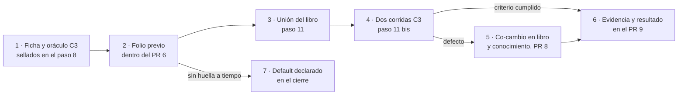

| Campo | Valor |
| --- | --- |
| Tipo | informe |
| Fecha | 2026-11-01 |
| Autor | Comisionado decision (analista de decisiones: costo, plazo, riesgo, default) del ciclo 2. Trabajó a ciegas: no leyó informes del ciclo 2 de otros comisionados |
| Corrige | — |

| Cabecera de comisión | Valor |
| --- | --- |
| Pregunta única | P-29: «¿con qué instrumento se prueba que el libro y el conocimiento alcanzan para un proyecto nuevo?» (`F099:141`) |
| Hipótesis a evaluar | La de la presidencia: un caso C3 en el que el aplicador recibe sólo el conocimiento, el libro y una ficha de producto escrita antes y sellada, con la misma métrica e (M1…M7) (`F099:141`) |
| No-competencia | Redactar el libro o el conocimiento; escribir la ficha o el oráculo; votar. Esta silla propone y puntúa |
| Norma | `MEP` 3.1 |
| Secciones de Mesa-De-Expertos-A-Pedido 3.1 leídas | Cabecera y §0 (l. 1-12; Mapa de carga, l. 79-106, filas «Sos una comisión» y «Hacés el análisis de decisiones»); §2.1 pasos 2, 5, 7 y 10 (l. 139-153); §3.2 (l. 264-279); §3.3, fila «Origen del hecho» (l. 293); §4, filas «Formato de informes» a «Composición» (l. 322-333); §5.2 (l. 375-415). **No cargué** §8 ni `Excepcion-A-Un-Conocimiento`: no propongo apartarme de ninguna convención |
| Otros documentos cargados | `Cadena-De-Consecuencias` 2.0 (`CDC`), §2 y §3-§4 (l. 61-110) |
| Insumos leídos | `TP:16-22`, `TP:68-74`; `F099` §2, §3, §4, §5.1, §5.2.3, §5.5, §5.6; `F085` R-02, R-02a, C-1 (l. 125, 133, 252, 279); `F095` §5, §6 y votos de P-25 y P-26 (l. 168-196, 824-899); `F010` l. 86, 88, 110, 284; `F018` l. 71, 243; `F016` §4.3 (l. 216-253); `F081` §4 y §6.11-§6.12; `N3` §5.3 y §5.6 (l. 325-444). Del cuerpo, en `LD@00171bd`: `SDEI/01-Mapa.md` §2-§3 (l. 51-73), `SDEI/README.md:94`, `SDEI/99-Anexos/Criterios-De-Calidad.md:34` y `:83-84`, listado de `SDEI/Examples/` |
| Medios propios | Lectura con `sed`/`grep`/`git` en sólo lectura; un guion Python 3 sin dependencias (`python3 -I`) en `{dir-de-trabajo}/f130/` (§4.4). Sin red, sin contenedores, nada escrito en repos |

# Informe de la comisión de decisión — P-29

## Índice

1. [Mandato y lo que este folio no hace](#1-mandato-y-lo-que-este-folio-no-hace)
2. [Alias](#2-alias)
3. [Lo medido antes de puntuar](#3-lo-medido-antes-de-puntuar)
4. [Método](#4-método)
5. [Alternativas, una por una](#5-alternativas-una-por-una)
6. [Tablero](#6-tablero)
7. [Cadena de consecuencias](#7-cadena-de-consecuencias)
8. [Recomendación](#8-recomendación)
9. [Lo revisé y está bien](#9-lo-revisé-y-está-bien)
10. [Lo no verificado e incidencias](#10-lo-no-verificado-e-incidencias)
11. [Barrido de lo privado de este folio](#11-barrido-de-lo-privado-de-este-folio)

---

## 1. Mandato y lo que este folio no hace

**Mandato.** Evaluar la hipótesis C3 de la presidencia y al menos una alternativa; para cada una: validez, qué se
sella antes, insumos con huella, oráculo (quién y desde qué), costo, riesgos de contaminación y qué declara el folio
si se va a default; recomendar una con puntaje por criterio.

**Lo que no hace.** No reabre P-25 ni P-26 (`F099:131-132`): la métrica e y el oráculo O3 rigen; lo que este folio
propone para C3 es su **adaptación** a un caso sin repositorio, y la marca como tal. No cambia C0, C1 ni C2.

## 2. Alias

| Alias | Qué es |
| --- | --- |
| `TP` | El pedido del PO (`F099` §2) |
| `F0nn`, `F1nn` | Folios de la mesa del 0003 |
| `LD`, `LDD`, `LG`, `LGD` | Lab-Documentos, Lab-Documentos.Documentacion, Lab-Geometria, Lab-Geometria.Documentacion (públicos) |
| `SDEI/` | `Guides/Documentacion-Tecnica/Sistema-De-Documentacion-E-Integracion/` de `LD` |
| `MEP`, `CDC` | `{servicio-privado}/` Mesa-De-Expertos-A-Pedido 3.1; Cadena-De-Consecuencias 2.0 (R-16) |
| `N3` | Núcleo 3, forma del conocimiento |
| Ficha | Ficha de producto: qué hace la aplicación, para quién, en qué plataformas, con qué equipo; en lenguaje de producto, sin vocabulario del cuerpo |
| `{dir-de-trabajo}`, `{host-de-pruebas}`, `{servicio-privado}` | Alias de lo privado (`F099` §2) |

## 3. Lo medido antes de puntuar

| # | Hecho | Ancla | Qué decide |
| --- | --- | --- | --- |
| H-1 | El pedido pide aplicar el conocimiento «en nuevos o ya existentes proyectos» y declara como finalidad que el material quede «suficiente para que un grupo […] trabaje en una aplicación». El material que nombra es el libro, «sus proyectos ejemplos y proyecto demo, e implementaciones en proyectos de producción» | `TP:18`, `TP:70` | La hipótesis literal («sólo el conocimiento, el libro y la ficha») deja afuera los ejemplos y la demo que `TP:70` cuenta como parte del material |
| H-2 | **El libro no existe cuando corren los ensayos.** La unión L9 depende del «PR ensayos» y del «PR conocimiento»; el PR 6 (ensayos) depende de «P-29 cerrada o en default»; el PR 8 (libro) depende del PR 7 | `F099:259`, `:452`, `:454`; Figura 2 (`F099` §5.1) | C3 con «el libro» como insumo no puede correr en el paso 8 con C0–C2 sin dependencia circular: o usa los lotes borrador (L0–L8, sin 18.6 y con 17.4 en espera, `F099:256-257`), o corre más tarde |
| H-3 | Las rondas editoriales van **después** de los ensayos «porque los ensayos todavía pueden cambiar el texto» | Pie de la Figura 2, `F099` §5.1 | Si C3 corre después del merge del libro, sus defectos ya no entran a las rondas: piden un PR más |
| H-4 | P-26 exige escribir el oráculo «desde el repo del caso en un SHA del remoto»; en un proyecto nuevo **no hay repo** | `F099:132`, `:418` | O3 no aplica literal a C3: hay que decir desde qué se escribe |
| H-5 | En `LD@00171bd`, `grep -rn "proyecto nuevo\|proyectos nuevos"` sobre `SDEI/` da **0**; los cuatro escenarios del Mapa describen trabajo sobre algo existente (`ESC-SDEI-2` empieza por «Fijo el SHA del código en `source.lock`»). El borrador del conocimiento sí prevé la opción «nuevo por expediente» en D-01 | `SDEI/01-Mapa.md:55-58`; `N3:332` | Es probable que la primera corrida de un C3 encuentre defectos de cobertura (M5 > 0) **[criterio propio]**: es lo que el caso tiene que medir, no un motivo para no correrlo |
| H-6 | Muchas decisiones tienen default (D-03 «No», D-05 «Mismo repo», D-06 «Commit», D-08 «Diez campos», D-12 «`AGENTS.md` puntero», D-17 «Semanal, 365 días») | `N3:334-348` | Con una ficha pobre, aplicador y oráculo coinciden por default y M2 pasa sin probar nada (riesgo de validez propio de un caso nuevo) |
| H-7 | El cuerpo ya tiene un instrumento de la misma familia: `CQ-04`, «un lector sin conocimiento del dominio ejecuta la guía sin ayuda», con umbral «cero dudas sin respuesta» | `SDEI/99-Anexos/Criterios-De-Calidad.md:34`, `:83-84` | M5 (0 suposiciones) es su análogo; `F010` CA-12 pide lo mismo para el caso nuevo (`F010:284`) |
| H-8 | Choque de nombres: en `N3` el «C3 opcional» era la app de la mini demo; `F010` propuso llamar «C4» al caso nuevo; `F099` usa C3 para el caso nuevo y no incluye la mini demo | `N3:415`; `F010:110`; `F099:404` | El folio previo tiene que decir «C3 = proyecto nuevo (`F099:404`)» para que nadie lo lea con el sentido de `N3` |

## 4. Método

### 4.1 Criterios

| K | Criterio | Qué mide | Origen |
| --- | --- | --- | --- |
| V | Validez | Si el caso es un proyecto **nuevo** (`TP:18`) y si mide que el material **alcanza para trabajar** (`TP:70`) con el material que `TP:70` nombra | `TP:18`, `TP:70`; `F085` R-02a |
| I | Independencia | Ficha, oráculo y aplicador escritos por agentes distintos; insumos con huella; sin vía de fuga hacia la respuesta | P-26 (O-1, O-5); `F016` §4.3 |
| S | Simplicidad | Piezas y reglas nuevas respecto de `F099` §5.5 | `TP:73` |
| C | Costo (practicidad) | Despachos y corridas que agrega | `TP:73` |
| P | Plazo | Efecto sobre el orden de `F099` §5.1 | `F099:174` |
| R | Verificable y repetible (escalabilidad) | Pasa o no pasa con la métrica e sellada, sin criterio nuevo, y se repite en otra edición con otra ficha | `TP:73`; P-25 |

Un séptimo criterio, alineación con la industria, **queda sin medir**: para esta pregunta no reabrí fuentes externas
(`CDC` §3, «sin medio para medir»). Lo único anclado es interno (H-7) y favorece por igual a A y a B.

### 4.2 Pesos y proyección

Iguales (1/6). **Proyección «criterios del PO»**: sólo S, C y R a 1/3, porque `TP:73` nombra simplicidad,
practicidad y escalabilidad. Fijados con huella **antes** de escribir la primera celda: `pesos.json`, `sha256`
`17b5bb0e7d4ebb4f48ea26ff1f5f25f68181e551e54588ef1a8489101ca96d77`, 2026-11-01T21:25:05Z. Una versión anterior
(`0425bf7f…7d69b`, 21:24:19Z) se reemplazó antes de puntuar porque su proyección contaba practicidad dos veces; queda
guardada como `pesos-v1-reemplazado.json`.

### 4.3 Escala y filtro

Escala 1–5 por celda (5 = el mejor observable de la fila). **Filtro F-N** (`TP:18`): excluye la alternativa cuyo
caso no es un proyecto nuevo. **Firmeza** según R-06 (`F099` §4): FIRME exige ventaja de **tres o más puntos de
celda** y ninguna inversión con ±10 % relativo ni con ±0,10 absoluto en cada peso.

### 4.4 Cálculo

`calc.py` (`sha256` `9d87c7add526d2047809f8398023a2c041038ef4119c067101588cd92fef4ac5`), `celdas.json`
(`da9581efaf8206302edbb37a0e66058b282502d7b0c658d05b624fa5e5df6e19`), salida
(`c77bd46b70020631f928a54a6d487de8a4ef66d3e52d6b04115208b08246dc48`), en `{dir-de-trabajo}/f130/`. Todo lo necesario
para recalcular está en §6.

## 5. Alternativas, una por una

Cinco alternativas: **A** (la hipótesis de la presidencia, con los ajustes que la vuelven corrible), **B** (proyecto
nuevo real mínimo en un directorio de ensayo, con una fase de trabajo), **C** (C3 con la ficha de un proyecto público
reciente), **E** (Geometría sin su repositorio de documentación) y **D** (default). Las cifras de costo cuentan
despachos de perito al modo de «Quién corre» (`F099:430-433`) y son **[criterio propio]**.

### 5.1 A — Ficha sellada (hipótesis de la presidencia, ajustada)

| Aspecto | Contenido |
| --- | --- |
| Validez | Es un proyecto nuevo de verdad: no hay código ni repo que leer. Mide «alcanza» por M1, M4, M5 y M6 (cobertura, 0 invenciones, 0 suposiciones, compuerta verde), que es lo que pide `F010` CA-12 (`F010:284`). M2 mide si el aplicador diseña como lo haría quien conoce el cuerpo (`TP:20`). No mide que un equipo **trabaje** después en la app: eso es B |
| Ajuste 1 (insumo) | El material es el de `TP:70`, no sólo el libro: un worktree de `LD` en el SHA del remoto de la rama del libro, con la unión, `SDEI/` (conocimiento incluido) y `SDEI/Examples/` (mini demo y prueba de ayuda por rol). Las implementaciones de producción entran por el capítulo 18 del libro, no montadas: `LG` no se le da al aplicador para no compartir repo con C1 **[criterio propio]** (H-1) |
| Ajuste 2 (momento) | La ficha, el oráculo, *n* y el umbral se **sellan en el folio previo del PR 6** (paso 8), así P-29 cierra antes de sellar oráculos (`F099:141`). La **corrida** va en un paso 11 bis: después de la unión (paso 11) y antes de las seis intervenciones (paso 12), para que sus defectos lleguen al libro antes de las rondas (H-2, H-3) |
| Qué se sella antes | Ficha (`sha256sum`); oráculo C3 con *n*, lista de clase H y trampas; umbral ⌊0,15·n⌋ (si *n* < 7, 0: `F099:411`); texto de la carta; plantilla A-01 vacía. La huella del material (SHA de la rama del libro) se agrega en el folio de la corrida, porque no existe al sellar: se declara así en el folio previo |
| Insumos con huella (O-5) | Ficha, carta, A-01 vacía, SHA del remoto de la rama del libro; ia-db de `LDD` sólo si indexa ese SHA (O-6), si no, sin ia-db; listado `find` del montaje |
| Ficha: quién y cómo | Un agente que **no** lee el cuerpo ni el conocimiento («analista de producto»), con una plantilla de dimensiones de producto: audiencias, roles con permisos distintos, paquetes que se publican, idiomas, si habrá sitio, quién fusiona, si trabajan agentes. **Carga mínima**: el oráculo marca qué decisiones la ficha saca de su default; si son menos de la mitad de *n*, se pide ficha 2 con nueva huella antes de correr (H-6) **[criterio propio]** |
| Oráculo: quién y desde qué | Adaptación de O3 (H-4): un agente distinto del autor del conocimiento, del aplicador y del autor de la ficha, que escribe la respuesta a D-01…D-17 **desde la ficha y el cuerpo `SDEI/` en `LD@<SHA de main>`, sin leer el conocimiento** (si lo lee, el ensayo mide el conocimiento contra sí mismo). Trampas propias de un caso nuevo, selladas aparte: (t1) no hay código, así que el ancla (D-06) va «pendiente: <qué falta>», no un SHA inventado; (t2) una decisión de clase H que la ficha deja abierta, por ejemplo publicar un sitio (D-03), se lista para una persona y no se decide **[criterio propio]** |
| Dónde corre | `{dir-de-trabajo}/ensayos/C3/` en `{host-de-pruebas}`, con un `git init` local para M6 (como el worktree descartable de C1); 0 escrituras fuera de ese lugar |
| Dónde queda | Folio previo y huellas en el PR 6; evidencia `EXP3/evidencia/C3/` y folio de resultado en el PR 9 (cierre). Defectos: al libro y, como co-cambio, al conocimiento dentro del PR 8 (P-01, co-cambio en el mismo PR) |
| Costo | 4 despachos nuevos (autor de ficha, autor de oráculo, dos aplicadores) más una tarea M4 del refutador; una sesión de corridas en serie |
| Riesgos de contaminación | (a) Ficha que dicta la respuesta: se mitiga con un autor que no lee el cuerpo y un barrido de IDs del cuerpo en la ficha (`grep -cE` de `CL-`, `ESC-SDEI`, `D-nn` y `docs-guard` = 0); (b) oráculo circular: prohibido leer el conocimiento; (c) aplicador con memoria del laboratorio: subagente nuevo, como en C1 (`F099:430-432`); (d) defaults coincidentes: carga mínima |
| Default (si no corre) | El folio de cierre de ensayos declara: «La mitad "nuevos" de `TP:18` y la finalidad de `TP:70` no se probaron en esta edición. Motivo: <hecho fechado>. Lo probado: reproducción en tres proyectos existentes (C0–C2) con la métrica e. Consecuencia: el libro no afirma que el material alcance para un proyecto nuevo. Reapertura: el folio previo sellado de un C3 en la edición siguiente». Control: la afirmación de suficiencia para proyectos nuevos no aparece en el libro sin la marca «sin probar» (anexo J) |

### 5.2 B — Proyecto nuevo real mínimo, con fase de trabajo

| Aspecto | Contenido |
| --- | --- |
| Validez | La más alta: además de A, un segundo agente («desarrollador») implementa una historia de la ficha en el repo nuevo **usando sólo lo que dejó el diseño y el libro**, y la compuerta queda verde con la traza resuelta. Es la lectura literal de «un grupo […] trabaje en una aplicación» (`TP:70`) y permite ejercitar `ESC-SDEI-2` (`source.lock` contra un SHA real, H-5) |
| Qué se sella antes | Todo lo de A, más la historia a implementar y el criterio de la fase 2 |
| Insumos con huella | Los de A, más el SHA del repo nuevo tras la fase 1 (es el insumo de la fase 2) |
| Oráculo | Fase 1: el de A. Fase 2: **no hay oráculo en la métrica e**: «el equipo pudo trabajar» necesita un criterio nuevo (por ejemplo, compuerta verde, 0 preguntas fuera del material, traza a la versión de la ficha) que P-25 no votó. Agregarlo pide una ronda de jurado o entra como diagnóstico sin umbral |
| Costo | 6 despachos (A + dos desarrolladores) y un criterio nuevo que votar |
| Plazo | Dos fases en serie entre los pasos 11 y 12, o después del libro; la más lenta |
| Riesgos de contaminación | Los de A, más que el desarrollador lea el oráculo o la ficha 2 si quedan en el mismo montaje: montaje separado por fase |
| Default | El mismo texto que A; si corre sólo la fase 1, B se reduce a A y la fase 2 queda declarada «no corrida» con el mismo evento de reapertura |

### 5.3 C — C3 con la ficha de un proyecto público reciente

| Aspecto | Contenido |
| --- | --- |
| Validez | Media-baja. El proyecto **ya existe**: para el aplicador es nuevo sólo si no lo conoce ni lo encuentra. Su documentación real no es oráculo de **este** sistema (no usa el cuerpo) |
| Ganancia | La ficha no la escribe la mesa: baja el riesgo de una ficha hecha a la medida del conocimiento |
| Qué se sella antes | La ficha extraída de su README en un SHA, con fecha; el oráculo como en A |
| Oráculo | Como en A (desde la ficha y el cuerpo); el proyecto real no lo reemplaza |
| Costo | Como A, más elegir el proyecto y comprobar que es posterior a lo que el modelo del aplicador pueda conocer: **sin medir**, no hay comando que lo pruebe desde acá |
| Riesgos de contaminación | Altos: memoria del modelo y búsqueda web del aplicador. La carta puede prohibir la red, pero el cumplimiento no se verifica con lo que hay |
| Default | El de A |

### 5.4 E — Geometría sin su repositorio de documentación

Aplicador con `LG@4b114d7` sin `LGD`; oráculo reutilizado de C1. Es la más barata (2 corridas, 0 oráculos nuevos),
pero el caso es un proyecto **existente** sin documentación, no un proyecto nuevo, y comparte repo y oráculo con C1.
**Cae por F-N** (`TP:18`). Se puntúa sólo para mostrar qué excluye el filtro.

### 5.5 D — Default

No se corre C3. El folio de cierre declara el texto de §5.1, fila «Default». Costo 0 y reversible, pero deja sin
medir lo que `F085` R-02a reclasificó como **criterio de aceptación** del pedido (`F085:125`) y obliga al libro a no
afirmar suficiencia para proyectos nuevos.

## 6. Tablero

| Alt. | V | I | S | C | P | R | Iguales | Proyección PO (S, C, R) |
| --- | --- | --- | --- | --- | --- | --- | --- | --- |
| **A** | 4 | 5 | 3 | 3 | 3 | 4 | **3,67** | 3,33 |
| B | 5 | 5 | 2 | 2 | 2 | 3 | 3,17 | 2,33 |
| C | 2 | 2 | 3 | 3 | 3 | 3 | 2,67 | 3,00 |
| D | 1 | 3 | 5 | 5 | 5 | 1 | 3,33 | **3,67** |
| E (filtrada F-N) | 1 | 2 | 5 | 5 | 5 | 5 | 3,83 | 5,00 |

**Observables de las celdas.** V: A no mide el trabajo posterior (4), B sí (5), C y E no son nuevos (2 y 1), D no
mide (1). I: A y B con tres autores separados y barridos (5); C y E con memoria o repo compartidos (2); D neutro (3).
S: piezas nuevas sobre §5.5: A = ficha y adaptación del oráculo (3), B = A + fase 2 y su criterio (2). C: despachos de
§5.1–§5.4. P: A agrega un paso en serie (3); B, dos fases (2). R: A usa la e sin cambios y la ficha es repetible (4);
B necesita un criterio sin votar (3); D no tiene nada que verificar (1).

**Resultado** (salida del guion, 2026-11-01T21:25:12Z):

```text
iguales       [(3.833,'E'), (3.667,'A'), (3.333,'D'), (3.167,'B'), (2.667,'C')]
proyeccion_po [(5.0,'E'), (3.667,'D'), (3.333,'A'), (3.0,'C'), (2.333,'B')]
ganador A margen 0.333
inversiones {'rel10': 0, 'abs10': 0}
```

**Dominante con pesos iguales: A**, margen 0,33 sobre D (**ventaja 2 puntos de celda**), sin inversiones con ±10 %
relativo ni con ±0,10 absoluto. **En la proyección del PO gana D.** Por R-06 (ventaja < 3) y por la proyección:
**A, CON REVISIÓN**. No es FIRME.

## 7. Cadena de consecuencias

| Paso | A (dominante) | D (la que gana en la proyección) | B |
| --- | --- | --- | --- |
| 1. Dónde cae | En la presidencia (4 despachos) y en el plazo: un paso 11 bis antes de las rondas | En el libro, que no puede afirmar suficiencia para proyectos nuevos, y en el PO, que recibe su finalidad sin medir | En el jurado (criterio nuevo) y en el plazo |
| 2. Cuánto pesa | 4 despachos + 1 tarea M4; una sesión de corridas; 0 PR nuevos (evidencia en el PR 9, co-cambios en el PR 8) | 0 despachos; una declaración y un control en el anexo J | 6 despachos, una votación, dos fases |
| 3. Qué pierde la otra | A no prueba que un equipo trabaje después (lo que B agrega) | D pierde la única medida de `TP:70`; R-02a la tiene por criterio de aceptación (`F085:125`) | B pierde plazo y la métrica única de P-25 |
| 4. Reversible | Sí: si no se sella a tiempo, cae a D sin más deliberación | Sí: se reabre en la edición siguiente | Sí |

Las tres son reversibles, así que el paso 4 no desempata (`CDC` §2, paso 4). Lo que inclina hacia A es el paso 3: D
es más barata en lo que pesa el PO por `TP:73`, pero deja sin instrumento la finalidad que el mismo PO declaró en
`TP:70`, y el jurado pidió por unanimidad que el dictamen no calle (`F095:173`). A se puede abandonar sin costo
hundido mayor que dos despachos (ficha y oráculo) si no llega a tiempo.

## 8. Recomendación

**A, CON REVISIÓN**: C3 con ficha de producto sellada y la métrica e sin cambios, con los cuatro ajustes de §5.1:

1. **Material de `TP:70`**: el aplicador recibe el conocimiento, la unión del libro y `SDEI/Examples/` en un SHA del
   remoto de la rama del libro, no sólo el libro.
2. **Oráculo adaptado de O3**: desde la ficha y el cuerpo en `LD@<SHA de main>`, sin leer el conocimiento; autor
   distinto del de la ficha, del conocimiento y del aplicador; trampas t1 y t2 selladas aparte.
3. **Ficha sin vocabulario del cuerpo** y con carga mínima (la mitad de *n* fuera de su default), o ficha 2.
4. **Sellar en el paso 8, correr en el paso 11 bis**: folio previo de C3 dentro del PR 6; evidencia y resultado en
   el PR 9; defectos al libro y al conocimiento por co-cambio dentro del PR 8.

**Fila propuesta para `F099:404`:**

| Caso | Escenario | Insumos del aplicador | Oráculo | Dónde vive | Corridas |
| --- | --- | --- | --- | --- | --- |
| C3 | Proyecto nuevo | Ficha sellada, A-01 vacía, `LD` en SHA del remoto de la rama del libro (unión, `SDEI/`, `Examples/`) | O3 adaptado: desde la ficha y `SDEI/` en `LD@main`, sin el conocimiento; trampas t1 y t2 | `{dir-de-trabajo}/ensayos/C3/` para correr; `EXP3/evidencia/C3/` | 2 |

**Condiciones de revisión (comprobables):**

- **Caída a default**: si al empujar el folio previo del PR 6 la ficha o el oráculo de C3 no tienen huella, rige D
  con el texto de §5.1 y el motivo «sin sellar a tiempo»; no se reabre la mesa.
- **Paso a B**: si C3 pasa la métrica e en las dos corridas, la edición siguiente evalúa la fase 2 de B como
  agregado; si falla, primero se corrige el material.
- **Ficha 2**: si la carga mínima no se alcanza, ficha 2 con nueva huella antes de correr; el umbral no se mueve
  (como P-25 con C0).



*Figura 1. C3 se sella con los demás oráculos y corre sobre la unión, antes de las rondas editoriales.*

## 9. Lo revisé y está bien

| # | Qué | Por qué |
| --- | --- | --- |
| 1 | La métrica e sirve tal cual para un caso nuevo | M1, M4, M5 y M6 son las cuatro mediciones que `F010` CA-12 pide para el caso nuevo (`F010:284`); M5 es el análogo de `CQ-04` (`Criterios-De-Calidad.md:83-84`) |
| 2 | La regla «si *n* < 7, 0» cubre una ficha con pocas decisiones con oráculo | `F099:411` |
| 3 | La hipótesis de la presidencia es la correcta en su núcleo | Sin repo, la ficha sellada es el único insumo que fija «lo que el proyecto quiere» antes de correr; las alternativas que la evitan (C, E) pierden validez |

## 10. Lo no verificado e incidencias

- **Sin medir**: costo real en tiempo de una corrida (no hay corrida de C0–C2 todavía); si un modelo aplicador
  conoce un proyecto público dado (alternativa C); la alineación con la industria (§4.1).
- **Supuesto declarado**: que la rama del libro se empuja con la unión antes del paso 12, para que exista un SHA del
  remoto que sellar en el folio de la corrida.
- **Incidencia de método**: los pesos se resellaron una vez antes de puntuar (§4.2); ambas huellas quedan.
- Sin mensajes de otras sesiones durante el trabajo.

## 11. Barrido de lo privado de este folio

Comprobado sobre el texto antes de entregarlo: sin rutas absolutas del equipo (se usa `{dir-de-trabajo}`), sin IPs,
sin nombres de máquina (`{host-de-pruebas}`), sin el nombre de `{servicio-privado}` ni de su organización, sin
etiqueta de runner literal. La base de conocimientos va como `{servicio-privado}/` (R-16).
