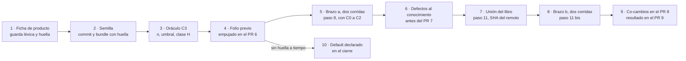

| Campo | Valor |
| --- | --- |
| Tipo | resolucion |
| Fecha | 2026-11-01 |
| Autor | Jurado del ciclo 2. Leyó los tres informes del ciclo y la resolución 099; no escribió ninguno de ellos |
| Corrige | Completa la fila C3 de `F099:404` («Lo decide P-29») |

**Convención de citas.** `F0nn`/`F1nn` = folios de esta mesa por número de línea; `TP:n` = línea del pedido;
`N3:n` = núcleo de forma del conocimiento; `SDEI/` = `Guides/Documentacion-Tecnica/Sistema-De-Documentacion-E-Integracion/`
de `LD` en `00171bd`; `EXP3/` como en `F099` §2. Lo privado va por alias: `{dir-de-trabajo}`, `{host-de-pruebas}`,
`{servicio-privado}`, `{etiqueta-runner}`. Rige la delegación del PO: lo que esta mesa decide queda aprobado.

## Índice

1. [Decisión](#1-decisión)
2. [Lo que traen los tres informes](#2-lo-que-traen-los-tres-informes)
3. [Refutación de la mejor propuesta](#3-refutación-de-la-mejor-propuesta)
4. [Votación y firmeza](#4-votación-y-firmeza)
5. [Diseño del caso C3](#5-diseño-del-caso-c3)
6. [Condiciones de revisión](#6-condiciones-de-revisión)
7. [Qué se declara si C3 queda en default](#7-qué-se-declara-si-c3-queda-en-default)
8. [Lo no verificado e incidencias](#8-lo-no-verificado-e-incidencias)
9. [Barrido de lo privado de este folio](#9-barrido-de-lo-privado-de-este-folio)

## 1. Decisión

**Se adopta C3 «proyecto nuevo» con repositorio semilla y dos brazos**: la base es la alternativa A3 de `F110`
(§4.4), con el esqueleto real de `F120` (B) y el calendario de `F130` (paso 11 bis). El brazo a (conocimiento solo)
corre en el paso 8 con C0, C1 y C2; el brazo b (conocimiento, libro y ejemplos) corre sobre la unión, después del
paso 11 y antes de la primera intervención editorial. La diferencia entre brazos **es diagnóstico, no atribución**
(§3). Estado: **CON REVISIÓN**, con las condiciones de §6. Fila que reemplaza `F099:404`:

| Caso | Escenario | Insumos del aplicador (lista cerrada con huella) | Oráculo | Dónde vive | Corridas |
| --- | --- | --- | --- | --- | --- |
| C3 | Proyecto nuevo, panel con roles | Brazo a: conocimiento, A-01 vacía, semilla en su SHA. Brazo b: lo mismo más `LD` en el SHA del remoto de `dac/0003-libro` con la unión (libro, `SDEI/`, `SDEI/Examples/`) | O3 adaptado: desde la semilla en su SHA y `SDEI/` en `00171bd`, sin el conocimiento ni el libro | Corre en `{dir-de-trabajo}/ensayos/C3/`; evidencia en `EXP3/evidencia/C3/a/` y `C3/b/` | 2 + 2 |

## 2. Lo que traen los tres informes

Los tres trabajaron a ciegas entre sí (`F110`, `F120`, `F130`, cabeceras) y coinciden en más de lo que difieren.

| Punto | `F110` | `F120` | `F130` | Lectura del jurado |
| --- | --- | --- | --- | --- |
| Recomendación | A3, semilla y dos brazos (31 frente a 28 de A1) | B, ficha y esqueleto MAUI (27 frente a 24 de A) | A, ficha ajustada (3,67 frente a 3,33 de D; en la proyección del PO gana D) | Tres de tres eligen correr C3 y no el default |
| El libro no existe en el paso 8 | H1 | H03 | H-2 | Unánime: se sella en el paso 8 y el brazo con libro corre después (`F099:174`, figura 2 de `F099` §5.1) |
| O3 no aplica literal: no hay repo del caso con remoto | H2, H4 | H04 | H-4 | Unánime: adaptación declarada, desde la semilla y las fuentes, nunca desde el conocimiento ni el libro |
| La ficha filtra el oráculo | H4, guarda léxica | H05, guarda léxica | Riesgo (a), barrido de IDs | Unánime: autor que no lee el cuerpo y guarda léxica = 0 antes de sellar |
| Repositorio para M4 y M6 | Semilla obligatoria (H2) | Esqueleto `dotnet new maui` en un commit (E1) | `git init` local para M6 | Tres de tres ponen un repositorio; dos le ponen código |
| Brazo sin libro | Núcleo (K2) | Agregado marcado (H07) | No | Se adopta (§3) |
| Momento del brazo con libro | Entre los pasos 12 y 13 | Después del 11, antes del 12 | Paso 11 bis, antes del 12 | Dos contra uno: antes del 12, porque las rondas van después de los ensayos (pie de la figura 2 de `F099` §5.1) |
| Material de `TP:70` | `LD` entero más `LG`/`LGD` | La unión del libro | `LD` entero, sin `LG` | `LD` entero, sin `LG` (§5.1) |
| Límite de lo medido | H5: la e no mide «trabajar» | H08 | §5.2, fase de trabajo sin oráculo | Unánime: el folio de resultado lo declara (§5.7) |

`F120` midió lo que los otros dos supusieron: la plantilla `maui` del SDK 10.0.403 deja 37 archivos y 0 `.md`, y
**no es determinista** (dos generaciones difieren en un GUID de `Platforms/Windows/Package.appxmanifest:11`;
`F120` §5, E1). Eso corrige el «guion determinista» de `F110` §6.3: la semilla se genera una vez y se fija por commit.

## 3. Refutación de la mejor propuesta

La mejor por puntaje es A3 de `F110` (31 puntos, FIRME «en el límite», `F110` §5). El ataque más fuerte va contra su
criterio K2, «atribución: si falla, se sabe si fue el conocimiento o el libro», puntuado 5.

**Ataque.** Según el calendario de `F110` §6.6, el brazo a corre en el paso 8 con el conocimiento borrador, y sus
defectos «corrigen el conocimiento antes del PR 7». El brazo b corre después con «la huella del conocimiento
vigente» (`F110` §6.6, tercera fila), es decir, con un conocimiento ya corregido, entre otras cosas por los defectos
del brazo a. Entre los brazos cambian **dos** variables: el libro y la versión del conocimiento. Es la misma
confusión que `F120` H07 le reprocha a un C3 sin brazo a (`MEP` §3.3, «el peritaje cambia una sola variable»). Además,
con dos corridas por brazo, M7 trata cada diferencia entre corridas como defecto (`F099:416`): la variación entre
corridas de un mismo brazo puede ser del tamaño de la diferencia entre brazos, y no hay *n* que las separe.

**Lo que sobrevive.** El brazo a no necesita la atribución para valer: es el único que prueba la mitad «nuevos» de
`TP:18` con los mismos insumos que C0 a C2 y el único que ejercita la §3.4 del conocimiento («Proyecto nuevo frente a
existente», `F099:366`) **antes** del PR 7. El ataque baja K2, no la alternativa.

**Corrección del tablero de `F110`** **[criterio propio]**: K2 de A3 pasa de 5 a 3 («diagnóstico con dos variables
declaradas»). A3 queda en 29 frente a 28 de A1: ventaja de 1 punto. Ataque secundario, ya resuelto por mayoría: el
brazo b entre los pasos 12 y 13 encuentra defectos del libro cuando las seis intervenciones ya pasaron; el pie de la
figura 2 de `F099` §5.1 pone las rondas después de los ensayos «porque los ensayos todavía pueden cambiar el texto».
Se corre en el paso 11 bis (`F130` §5.1, ajuste 2).

Se intentó también refutar el núcleo común (correr C3 en vez del default) con la proyección del PO de `F130` §6, donde
gana D. No prospera: `F085:125` (R-02a) leyó `TP:70` como criterio de aceptación del pedido, y el jurado del ciclo 1
pidió por unanimidad que el dictamen no calle (`F099:141`). El default queda como caída comprobable (§6), no como
elección.

## 4. Votación y firmeza

| Componente | `F110` | `F120` | `F130` | Jurado | Resultado |
| --- | --- | --- | --- | --- | --- |
| Correr C3 (no default) | Sí | Sí | Sí | Sí | 4–0 |
| Repositorio semilla con código | Sí | Sí | No (sólo `git init`) | Sí | 3–1 |
| Esqueleto `dotnet new maui` | Genérico | Sí | — | Sí | 2–1, una abstención |
| Brazo a, conocimiento solo, en el paso 8 | Sí | Agregado | No | Sí | 3–1 |
| Brazo b antes del paso 12 | No (12–13) | Sí | Sí | Sí | 3–1 |
| `LD` entero en el brazo b | Sí | No (la unión) | Sí | Sí | 3–1 |
| `LG`/`LGD` en el brazo b | Sí | No | No | No | 3–1 |

**Firmeza por R-06** (`F099:143`: ventaja de tres o más puntos de celda; los tableros no se suman). `F110`, corregido
en §3: ventaja 1. `F120`: ventaja 3, B sobre A, que su propio informe llama «en el límite». `F130`: ventaja 2, A
sobre D. Una decisión compuesta toma el estado de su componente menos firme **[criterio propio]**: **CON REVISIÓN**.
La condición de cada componente está en §6.

## 5. Diseño del caso C3

*Figura 1. C3 se sella con los demás oráculos, corre su brazo sin libro con los demás casos y su brazo con libro
sobre la unión, antes de las rondas editoriales.*

### 5.1 Insumos con huella

| Insumo | Huella | Brazo |
| --- | --- | --- |
| Ficha de producto | `sha256sum` del texto; es el `README.md` de la semilla | a y b |
| Semilla | SHA del commit inicial y `sha256sum` de un `git bundle` de ese commit; versión del SDK y de la plantilla | a y b |
| Conocimiento | `sha256sum` de la versión que corre cada brazo (pueden diferir: §3) | a y b |
| Plantilla A-01 vacía, carta del aplicador | `sha256sum` | a y b (una carta por brazo) |
| `LD` | SHA del remoto de `dac/0003-libro` con la unión; listado `find` del montaje | sólo b |

La semilla: un repositorio `git` con la ficha como `README.md` y el esqueleto de `dotnet new maui` generado **una
sola vez** en un contenedor descartable de `{host-de-pruebas}` (`F120` §5, E1), con control `find` de `*.md` distintos
de `README.md` = 0 (`F110` §6.3). No se empuja a ningún remoto. Su `git bundle` va a la evidencia para que un tercero
compruebe el SHA contra el que corren M4 y M6 **[criterio propio]**. `LG` y `LGD` no entran: las implementaciones de
producción llegan por el capítulo 18 del libro, y montarlas suma una variable y el riesgo de copiar las decisiones de
C1 **[criterio propio]** (`F130` §5.1, ajuste 1).

### 5.2 Ficha: quién y cómo

- **Quién:** un agente con rol de analista de producto que lee sólo la plantilla de ficha; no lee `SDEI/`, el
  conocimiento, el libro ni ningún oráculo (`F110` §6.1; `F120` §4.4, «Roles»; `F130` §5.1).
- **Forma:** los nueve campos de `F120` §4.4 (propósito; personas y roles; plataformas y distribución; componentes;
  equipo y quién aprueba; público y privado; idiomas; organización de CI; lo no decidido), escritos como hechos del
  producto, nunca como decisiones documentales.
- **Reglas** (`F110` §6.2): dominio ausente del corpus, comprobado con `grep -ril` de sus sustantivos sobre `LD` en
  `00171bd` = 0; escenario panel con roles, como C1; ninguna organización, persona ni marca real; dos hechos omitidos
  a propósito, con su lista sellada.
- **Guarda léxica** antes de sellar, con su salida en el folio previo: `grep -ciE` sobre la ficha de la lista de
  `F120` H05 unida a la de `F110` §6.2, regla 3 = 0.
- **Carga mínima** (`F130` §5.1): el autor del oráculo cuenta cuántas decisiones con oráculo la ficha saca de su
  default de `N3:332-348`; si son menos de la mitad de *n*, se pide ficha 2 con nueva huella **antes** de sellar.

### 5.3 Oráculo: quién y desde qué

Un agente distinto del autor de la ficha, de los aplicadores, del autor del conocimiento y de los autores de oráculo
de C0 a C2. Escribe D-01 a D-17 **desde la semilla en su SHA (`README.md:línea`) y `SDEI/` en `00171bd`**, que es
`main` después del PR de coherencia; no lee el conocimiento ni el libro (adaptación de O3, `F099:418`; `F120` H04;
`F130` H-4). Sella, además de cada valor esperado con su ancla:

- conjuntos admitidos donde el cuerpo acepta más de una salida (ampliarlos después es oráculo 2, O-4 de `F016` §4.3);
- las filas «sin oráculo», contadas antes;
- las **filas discriminantes** D-08 y D-10 (`N3:339`, `:341`; `SDEI/TEM-06-Compuertas-Y-CI.md:145`), informadas aparte
  como diagnóstico (`F110` H3);
- las **trampas** T3-1 a T3-5 de `F120` §4.4, cada una sólo si las fuentes la sostienen en `00171bd`, si no, «sin
  oráculo»; y la t1 de `F130` (ancla «pendiente», no un SHA inventado) si la ficha no fija el ancla;
- la lista de clase H (D-03, D-09, D-11, D-12 y D-01 si corresponde) y los dos hechos omitidos, que se esperan como
  «pendiente» con motivo.

### 5.4 *n* y umbral

*n* = filas con oráculo (decisiones más trampas) menos las «sin oráculo», contado por el autor del oráculo y fijado en
el folio previo. Umbral de M2 = ⌊0,15·n⌋; si *n* < 7, 0 (`F099:411`). Es el mismo para los dos brazos y no se mueve
después de sellar. Las filas discriminantes cuentan dentro de *n* y además se informan aparte, sin umbral propio.

### 5.5 Métrica y roles de corrida

M1 a M7 sin cambios (`F099:406-416`). M4 corre contra el SHA de la semilla y, en el brazo b, también contra el SHA de
`LD`; lo verifica el refutador. M6 corre `docs-guard` sobre A-02 a A-07 dentro de una copia de la semilla, con su par
rojo y verde. Cada corrida pasa sola. Diagnósticos sin umbral: diferencia entre brazos decisión por decisión, filas
discriminantes y costo de cada corrida (archivos leídos y tiempo, `F120` H07). Cuatro aplicadores ciegos, uno por
corrida, subagentes nuevos sin red; el brazo a no ve `LD`, `LDD`, `LG` ni `LGD`; el brazo b no ve `LDD` ni oráculos.

### 5.6 Calendario y dónde vive la evidencia

| Momento | Qué | Dónde |
| --- | --- | --- |
| Antes de correr C0 | Ficha, salida de la guarda, semilla (SHA y bundle), oráculo, *n*, umbral, cartas de los dos brazos y la **regla** del insumo b | Folio previo, commit empujado a `dac/0003-ensayos` (PR 6) |
| Paso 8 | Brazo a, dos corridas; sus defectos al conocimiento antes del PR 7 | `EXP3/evidencia/C3/a/`, en el PR 6 |
| Paso 11 bis | Addendum con el SHA de la unión y la huella del conocimiento vigente, empujado antes de correr; brazo b, dos corridas | Addendum y `EXP3/evidencia/C3/b/` en `dac/0003-cierre` (PR 9) |
| Después del brazo b | Defectos del libro y co-cambios al conocimiento, con subida de Y | PR 8 |
| Cierre | Folio de resultado de C3 | PR 9 |

Todo es público: la ficha es inventada y no nombra nada privado. Bundle, ficha, oráculo, salidas de las corridas y de
la métrica van a `EXP3/evidencia/C3/`. La fila C3 modifica las filas 6, 8 y 9 de `F099` §5.6 (`F099:452-455`) sólo en
lo que agregan; ninguna cambia de dependencia. El folio previo dice «C3 = proyecto nuevo (`F099:404`)» para que no se
lea con el sentido de `N3:415` (`F130` H-8).

### 5.7 Qué afirma el folio de resultado

- Pasan los dos brazos: «con esta versión del conocimiento y del libro, cuatro aplicadores sin contexto diseñaron e
  instalaron el sistema documentador de un proyecto nuevo dentro del criterio sellado». No afirma una tasa (un caso,
  `F016` §4.2) ni que un equipo pueda después trabajar en la aplicación (`F110` H5; `F120` H08).
- Pasa sólo el b: el libro cubre algo que el conocimiento solo no cubre; se sube al conocimiento.
- Pasa sólo el a: se revisa el libro en busca del ruido; la causa se afirma sólo si la evidencia la muestra, porque
  la versión del conocimiento también cambió (§3).

Recomendación a la presidencia, no condición: una fila del anexo A del libro y una línea en §3.4 del conocimiento que
separen «proyecto nuevo» de «cuerpo nuevo» (`SDEI/TEM-06-Compuertas-Y-CI.md:49`; `F120` H06).

## 6. Condiciones de revisión

Cada una es un hecho comprobable y se aplica sin nueva votación.

| # | Si | Entonces |
| --- | --- | --- |
| R1 | Al empujar el folio previo, la ficha, la semilla o el oráculo de C3 no tienen huella | C3 entero va a default con el texto de §7 y el motivo «sin sellar a tiempo» |
| R2 | La generación del esqueleto falla en `{host-de-pruebas}` antes de sellar | Semilla con la ficha y un `git init` sin esqueleto (A de `F120`); el folio previo lo dice; T3-1 pasa a «sin oráculo» |
| R3 | La guarda léxica da más de 0, o la carga mínima no se alcanza | Ficha 2 con nueva huella antes de sellar; el umbral no se mueve |
| R4 | No hay SHA del remoto de la unión antes de la primera intervención | El brazo b corre entre los pasos 12 y 13 (`F110` §6.6) y el folio de resultado dice que sus defectos llegaron después de las rondas |
| R5 | El brazo b no corre antes de abrir el PR 9 | Default parcial de §7: `TP:70` sin probar; la mitad «nuevos» queda con la evidencia del brazo a |

## 7. Qué se declara si C3 queda en default

**Default total** (R1), en el folio de cierre de ensayos:

> La mitad «nuevos» de `TP:18` y la finalidad de `TP:70` no se probaron en esta edición. Los casos C0, C1 y C2 son
> proyectos existentes y ningún aplicador recibió el libro. La sección «Proyecto nuevo frente a existente» del
> conocimiento no la ejercitó ningún aplicador. Motivo: <hecho fechado>. Consecuencia: el libro no afirma que el
> material alcance para un proyecto nuevo. Evento de cierre: el folio previo sellado de un C3 en la edición siguiente.

Control: la afirmación de suficiencia para proyectos nuevos no aparece en el libro sin la marca «sin probar» del
anexo J (`F130` §5.1, fila «Default»).

**Default parcial** (R5): el mismo texto, sin la mitad «nuevos» de `TP:18` y sin la oración sobre la sección del
conocimiento, que el brazo a sí ejercitó; el resto rige igual.

## 8. Lo no verificado e incidencias

- No corrí ningún ensayo: C3 corre después de sellar (`F099` §5.5).
- No verifiqué que la imagen con el SDK y el workload MAUI siga disponible en `{host-de-pruebas}`; R2 cubre el caso.
- La corrección de K2 de `F110` es lectura de este jurado sobre el calendario de ese mismo informe, no una medición.
- Mensajes de otras sesiones a mitad de turno: ninguno.

## 9. Barrido de lo privado de este folio

Comando: `grep -nE` sobre este archivo con rutas absolutas del equipo, los nombres de máquina del laboratorio, el
nombre del servicio privado y el patrón de una IPv4. Resultado esperado y obtenido: 0 coincidencias. Diagramas:
`mermaid.sh` sobre este folio, 0 NO COMPILA y 0 MAL DIBUJADO.

Sigue: presidencia (despacho de autor de ficha y autor de oráculo de C3) · folio previo del PR 6
