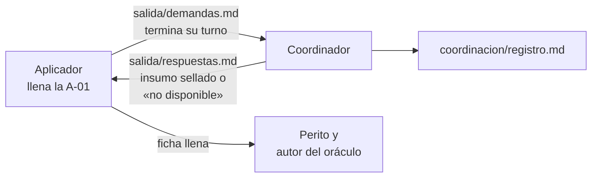

| Campo | Valor |
| --- | --- |
| Tipo | providencia |
| Fecha | 2026-11-01 |
| Autor | Presidencia. No escribió ningún oráculo ni el conocimiento, y no corre ni coordina ninguna corrida |
| Asienta | Decisión del PO del 2026-11-01: «aplicar un mecanismo de coordinación y nombrar un coordinador que gestione el flujo de demandas de las partes» |
| Modifica | `F099` §5.5, «Quién corre» (`F099:430-434`), y el párrafo «Aplicadores» de `F200` §7 |
| No modifica | La métrica e (`F099:406-416`), los oráculos, *n*, umbrales y clase H sellados en `F200` y `F201` |
| Rama | `dac/0003-ensayos` |

**Convención de citas.** La misma de `F200`. Lo privado va por alias: `{dir-de-trabajo}`, `{host-de-pruebas}`,
`{servicio-privado}`. Toda huella es `sha256sum`.

## Índice

1. [Motivo](#1-motivo)
2. [Partes](#2-partes)
3. [Canal único de demandas](#3-canal-único-de-demandas)
4. [Registro de demandas](#4-registro-de-demandas)
5. [Auditoría del registro de herramientas](#5-auditoría-del-registro-de-herramientas)
6. [Ronda 1 y ronda 2](#6-ronda-1-y-ronda-2)
7. [Cartas y huellas](#7-cartas-y-huellas)
8. [Lo no verificado](#8-lo-no-verificado)
9. [Barrido de lo privado](#9-barrido-de-lo-privado)

## 1. Motivo

`F099:430-431` pide un aplicador ciego por corrida, «subagente nuevo, sin memoria ni carta con contexto del
laboratorio». La carta lo cumple, pero el subagente no nace vacío: **hereda instrucciones del entorno** en el que se
lo despacha. La ceguera no se puede garantizar sólo por la carta. Hacen falta dos cosas que `F099` no tenía: un canal
por el que lo que le falta al aplicador pase y quede registrado, y una auditoría que muestre, corrida por corrida, si
algo de afuera entró en la ficha.

El PO decidió el 2026-11-01 «aplicar un mecanismo de coordinación y nombrar un coordinador que gestione el flujo de
demandas de las partes». Esta providencia lo asienta y fija el protocolo.

## 2. Partes

| Parte | Qué hace | Qué no ve |
| --- | --- | --- |
| Aplicador | Llena la A-01 de una corrida con la carta 2 y su montaje. Su única vía hacia afuera es el coordinador | Oráculo, folios, libro, otras corridas |
| **Coordinador** | Contesta las demandas del aplicador, lleva el registro y audita el registro de herramientas de cada corrida (§3 a §5) | Oráculo, cuerpo `SDEI/` fuera del montaje, libro |
| Autor del oráculo | Escribe el oráculo del caso; mide M2 y M3 (`F200` §7) | La corrida antes de medirla |
| Perito | Mide M1, M4 (script), M5, M6 y M7 (`F200` §7) | — |
| Refutador | Verifica M4 (`F099:430-431`) y, desde esta providencia, audita el registro de herramientas del coordinador **[criterio propio]** | — |
| Presidencia | Nombra al coordinador, despacha las partes, resuelve las clasificaciones dudosas y asienta | — |

**Nombramiento.** El coordinador es un subagente nuevo por caso, distinto del aplicador, del autor del oráculo y del
perito de ese caso **[criterio propio]**. Recibe sólo su carta (§7), la ruta de la corrida y las huellas de sus
insumos.

**«Quién corre» de `F099` §5.5 queda así:** peritos despachados por la presidencia: un autor de oráculo por caso, un
aplicador ciego por corrida (subagente nuevo, con la carta 2), **un coordinador por caso como único canal del
aplicador** y el refutador para M4 y para auditar al coordinador. El resto del párrafo (`{host-de-pruebas}`, guarda de
turnos, nada se escribe en `LGD` ni en el repo de `{servicio-privado}`) sigue igual.

## 3. Canal único de demandas

*Figura 1. El coordinador es la única salida del aplicador. Máximo tres rondas.*

1. El aplicador escribe sus demandas en `salida/demandas.md`, una por fila: **id** (Q-1, Q-2, …), **qué necesita** y
   **para qué fila** de la ficha. Guarda lo hecho en `salida/` y termina su turno.
2. El coordinador contesta en `salida/respuestas.md`, por id, **sólo con material de los insumos sellados de esa
   corrida** (`ruta:línea` dentro del montaje, o una aclaración de la carta), o con la frase literal «no disponible:
   tratalo como dato faltante». Nunca entrega el oráculo, el cuerpo `SDEI/` ni el libro; tampoco interpretaciones,
   valores sugeridos ni juicios sobre una fila.
3. El aplicador retoma: lee `salida/respuestas.md` y sigue desde lo guardado. Lo «no disponible» queda «pendiente» con
   motivo. Una respuesta no reemplaza la evidencia: el valor sigue llevando su `ruta:línea` o su comando.
4. **Máximo 3 rondas** por corrida. Después, lo que falte queda «pendiente».

## 4. Registro de demandas

El coordinador lleva `coordinacion/registro.md` en el directorio de la corrida, fuera de `salida/`. Cada demanda va
con su respuesta: ronda, id, demanda literal, fila, respuesta, fuente y si el conocimiento debió cubrirla (sí, no o
dudoso, con motivo).

**Una demanda que el conocimiento debió cubrir se cuenta como defecto del conocimiento.** Entra como diagnóstico a M7
y, si la fila terminó en una suposición, también a M5. No cambia M2 ni ningún umbral: el canal mide al conocimiento,
no corrige la corrida. Las «dudoso» las resuelve la presidencia. El registro se copia a `EXP3/evidencia/{caso}/` con
el folio de resultado; el de C2, sólo en cifras.

## 5. Auditoría del registro de herramientas

Al cerrar cada corrida, el coordinador revisa entrada por entrada el registro de herramientas del aplicador (lecturas,
búsquedas, comandos y escrituras) y escribe `coordinacion/auditoria.md` con una clasificación:

| Clasificación | Criterio | Consecuencia |
| --- | --- | --- |
| **VÁLIDA** | Todo dentro del directorio de la corrida; escrituras sólo en `salida/`; sin red; ningún valor sale de material ajeno al montaje o a `salida/respuestas.md` | Se mide |
| **VÁLIDA CON OBSERVACIÓN** | Hubo un acceso o un contexto fuera del límite que no pudo influir en ningún valor (listado del padre sin abrir archivos, comando fallido sin salida útil, instrucciones heredadas del entorno que ningún valor usa). Cada observación cita su entrada | Se mide; las observaciones se informan con el resultado |
| **ANULADA** | Leyó oráculo, `SDEI/` fuera del montaje, libro, folios, otra corrida o memoria del laboratorio; usó red; escribió fuera de `salida/` o modificó `repo/`; o un valor sale de material externo, incluidas instrucciones heredadas | No se mide; se conserva como constancia y **se re-corre** con un aplicador nuevo, los mismos insumos y las mismas huellas |

Ante la duda entre las dos últimas, el coordinador anota ambas lecturas y decide la presidencia **[criterio propio]**.
Ninguna re-corrida mueve un umbral ni un oráculo (`F199` §5.4).

## 6. Ronda 1 y ronda 2

**Ronda 1.** Las corridas hechas antes de esta providencia corrieron con la carta 1, sin coordinador ni canal. Se
auditan **a posteriori** con el criterio de §5, sobre su registro de herramientas. No tienen demandas que registrar:
lo que les faltó figura como «pendiente» en su ficha. El resultado de la auditoría, corrida por corrida, y las
re-corridas de las ANULADAS se asientan en el **folio 203**. Las ANULADAS se re-corren con el protocolo de la ronda 2.

**Ronda 2.** Desde esta providencia rige el protocolo completo: carta 2, coordinador nombrado, canal, registro y
auditoría en todas las corridas, incluidas las de C3 (brazos a y b) y las re-corridas.

## 7. Cartas y huellas

| Carta | Archivo | Huella | Rige |
| --- | --- | --- | --- |
| Carta del aplicador 1 | `carta-aplicador.md` | `7d1575673a2839e8014924a54b99a11eea4afbff95fb4e0582f017469d7a1e11` | Ronda 1 (`F200` §2); queda como constancia |
| **Carta del aplicador 2** | `carta-aplicador-2.md` | **`ca263a7735fcb370c23999da4bade0ac364f70e899a2ceec13bf61aed46ec19a`** | Ronda 2 en adelante |
| **Carta del coordinador** | `carta-coordinador.md` | **`77c19d57533b1906040fbe4835eaf93f9ea44ca1539058167a2a57d5c3f4e4dc`** | Ronda 2 y auditoría de la ronda 1 |

**Carta 2.** Es la carta 1 con el canal de demandas sumado y nada quitado: un paso 4 en «Qué hacer» (usar el canal y
retomar desde `salida/respuestas.md`), una sección «Canal de demandas» (único canal, formato id / qué necesito / para
qué fila, terminar el turno, respuesta por id, «no disponible», máximo 3 rondas, la respuesta no reemplaza la
evidencia) y una línea en «Al terminar» para el turno que cierra con demandas. Sigue sin contexto del laboratorio,
sin nombres de casos, oráculos ni métricas.

**Carta del coordinador.** Fija qué puede entregar (material de los insumos sellados de esa corrida, `ruta:línea`,
aclaraciones de la carta), qué no (oráculo, `SDEI/`, libro, folios, otras corridas, interpretaciones), cómo registra
(§4) y cómo audita (§5), y sus propios límites.

Las dos huellas se agregaron a la constancia de huellas de los insumos en `{dir-de-trabajo}`, sin borrar líneas.
Ambas cartas se copian a `EXP3/evidencia/` con el folio de resultado.

## 8. Lo no verificado

- No corrí ninguna corrida ni despaché al coordinador. Las huellas de §7 las calculé sobre los archivos escritos hoy.
- No comprobé que el entorno de despacho permita al aplicador «terminar su turno» y retomar el mismo subagente; la
  carta 2 cubre también el caso de un aplicador nuevo que retoma desde `salida/`.
- La auditoría depende de que el registro de herramientas de cada corrida se conserve. Para la ronda 1 no verifiqué
  que exista completo: lo dirá el folio 203.
- Mensajes de otras sesiones a mitad de turno: ninguno.

## 9. Barrido de lo privado

Comando: `grep -nE` sobre este archivo con las rutas absolutas del equipo, los nombres de máquina del laboratorio, el
nombre del servicio privado y su organización, y el patrón de una IPv4. Resultado esperado y obtenido: 0
coincidencias.

Sigue: auditoría a posteriori de la ronda 1 (folio 203) · nombramiento del coordinador para la ronda 2
