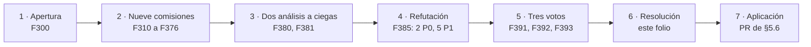
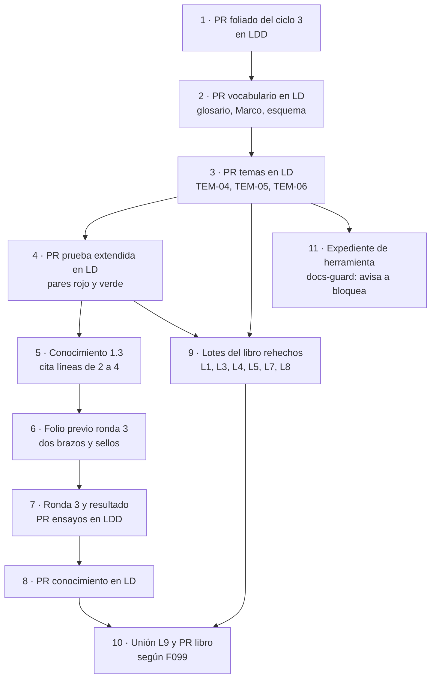

| Campo | Valor |
| --- | --- |
| Tipo | resolucion |
| Fecha | 2026-11-02 (ciclo abierto el 2026-11-01; corte de energía en el medio) |
| Autor | Presidencia de la reedición DocsAsCode. Consolida y no vota |
| Corrige | Enmienda `F099` §5.2 (Parte III y lote L3), §5.5 y §5.6 en lo que se dice en §5 de este folio; enmienda `F204` §9.2 (ronda 3). No anula ningún folio |

**Convención de citas.** Como `F300`: `SDEI/` = la guía del sistema de documentación e integración de `LD` en
`00171bd`; `K` = el conocimiento en curso `knowledge-DocsAsCode-Designing-Specification.md` (versión 1.2, en
`{dir-de-trabajo}/conocimiento/`); `EXP3/`, `LD`, `LDD`, `LG`, `LGD` como en `F099` §2; `MEP` =
`Knowledge-Mesa-De-Expertos-A-Pedido`, `MCT` = `Knowledge-Mesa-Consulta-A-Un-Tercero` (`KB-privada/`, R-16 de
`F099` §4). Las comisiones son CA-1 (`F310`), CA-2 (`F320`), CA-3 (`F330`), CA-4 (`F340`), CA-5 (`F350`), CA-6
(`F360`), CA-7 (`F370`), CA-8 (`F374`) y CA-9 (`F376`). Lo privado va por alias: `{servicio-privado}`,
`{dir-de-trabajo}`. Rige la delegación del PO: lo que esta mesa decide queda aprobado.

## Índice

1. [Qué resuelve este folio](#1-qué-resuelve-este-folio)
2. [Definiciones](#2-definiciones)
3. [Dictamen pregunta por pregunta](#3-dictamen-pregunta-por-pregunta)
   1. [Regla de firmeza del ciclo](#31-regla-de-firmeza-del-ciclo)
   2. [Eje A — audiencias](#32-eje-a--audiencias)
   3. [Eje B — paneles, portales y formularios](#33-eje-b--paneles-portales-y-formularios)
   4. [Respuesta al PO: qué mecanismos hay y qué se usa](#34-respuesta-al-po-qué-mecanismos-hay-y-qué-se-usa)
4. [Ataques del refutador, resueltos](#4-ataques-del-refutador-resueltos)
5. [Plan de ejecución](#5-plan-de-ejecución)
   1. [Orden general](#51-orden-general)
   2. [(a) Cuerpo SDEI](#52-a-cuerpo-sdei)
   3. [(b) Conocimiento 1.3](#53-b-conocimiento-13)
   4. [(c) Libro](#54-c-libro)
   5. [(d) Ensayos](#55-d-ensayos)
   6. [(e) Pull requests y su orden](#56-e-pull-requests-y-su-orden)
   7. [(f) Lo que va al PO](#57-f-lo-que-va-al-po)
6. [Excepciones a conocimientos](#6-excepciones-a-conocimientos)
7. [Reintegra](#7-reintegra)
8. [Lo no verificado, incidencias y mensajes](#8-lo-no-verificado-incidencias-y-mensajes)
9. [Cierre del ciclo y barrido de lo privado](#9-cierre-del-ciclo-y-barrido-de-lo-privado)

---

## 1. Qué resuelve este folio

El PO pidió el 2026-11-01, en dos tramos (`F300` §2), tratar el concepto de **audiencia** y la **llegada de la
documentación al punto de uso**: paneles de control, portales y formularios de ingreso de datos («guiar o asistir a
los usuarios con pequeña información, que mecanismos hay al respeto y que se esta usando»). Autorizó rehacer lo que
hiciera falta (`F300` E-07). La mesa abrió el ciclo (`F300`), despachó nueve comisiones a ciegas (`F310`–`F376`),
dos análisis de decisiones a ciegas (`F380`, `F381`), el refutador con 16 fuentes reabiertas (`F385`) y tres votos de
jurado por separado (`F391`, `F392`, `F393`). Este folio consolida el resultado y lo vuelve un plan aplicable sin
volver a preguntar.

**Lo que no se rediscute:** las decisiones cerradas de `F001` §8 y lo dictaminado en `F099` y `F199`, salvo las
enmiendas que este folio declara en su campo «Corrige».

**Resultado en una frase.** Audiencia orienta la escritura y **no es un permiso**; quién recibe cada pieza lo decide
una **regla de entrega** que se hace cumplir en tres puntos (repositorio, build, servidor). La ayuda de un campo de
formulario es un **canal** de la ayuda al usuario final (`CL-06`), no una clase nueva, y su texto traza a la misma
regla que lo valida. No se agrega un tema nuevo al cuerpo: se reescriben `TEM-04` y `TEM-05`.

*Figura 1. Recorrido del ciclo 3 de la mesa del expediente 0003.*

## 2. Definiciones

Los términos nuevos entran al glosario del cuerpo (`SDEI/99-Anexos/Glosario.md`) en el primer PR de §5.6 y al
anexo A del libro.

| Término | Definición aprobada | Origen |
| --- | --- | --- |
| **Audiencia** | Conjunto de lectores a los que se dirige una pieza, definido por sus necesidades y sus tareas. Orienta qué se escribe y cómo; **no da ni quita acceso**. No confundir con *lector* (persona o agente), *rol* (perfil del producto), *persona* (arquetipo de UX) ni *actor* (`ACT-SDEI-n`, quien interviene en el sistema documentador). «Audiencia primaria o secundaria» va como nota, no como campo | A-01; ISO/IEC/IEEE 26514:2022 §3.1.7 adaptada, **sin verificar** contra la edición publicada (`F380` §10, `F385` §7) |
| **Regla de entrega** | Qué audiencia recibe una pieza, por qué canal, con qué nivel de acceso y en qué punto se hace cumplir. Es la que protege | A-01 (los tres votos) |
| **Dimensiones de entrega** | Cuatro, ortogonales: **rol**, **tipo de alcance** (`generico` o `por-aplicacion`; los valores viven en el producto), **superficie** (panel, portal, app móvil, servicio, SDK) y **nivel de acceso** | A-02 |
| **Nivel de acceso** | Vocabulario cerrado: `publico`, `producto` (con sesión en el producto), `restringido` (por invitación o credencial), `interno` | A-06 |
| **Punto de aplicación** | Lugar donde se hace cumplir el nivel: **repositorio** (visibilidad de la fuente), **build** (qué se empaqueta) y **servidor** (qué se entrega a cada token) | A-06; R3-01 |
| **Jerarquía** | Derivada del rol: se declara una vez con `incluye:` en el registro y el build la expande. Un enlace de un nivel bajo a uno alto es un cruce | A-05 |
| **Lector** | Persona o agente. Es dimensión de **canal**, no de acceso: el agente hereda la audiencia y el alcance de su usuario y nunca tiene acceso propio | A-04, A-10 |
| **Registro de audiencias** | Pieza versionada (prefijo `AUD-`, `doc_type: registro-audiencias`) con una fila por audiencia y sus dimensiones; es la fuente. La matriz audiencia × página es **derivada** | A-12 |
| **Punto de uso** | Canal de `CL-06` que lleva la ayuda a la pantalla o al campo donde se la necesita | B-04 |
| **Microtexto** y **capa** | Texto corto de un campo, en capas de vocabulario cerrado: `etiqueta · pista · info · ejemplo · validacion` | B-01 |
| **Identificador de contexto** | `contexto: <app>/<id>` en el frontmatter de la página de ayuda; el mapa pantalla → página se deriva | B-07; R3-11 |
| **Doble audiencia** | Nombre anterior del tema de humano y agente como lectores (`TEM-04`); queda en el glosario como remisión | A-04 |

**Perfil mínimo** (R3-12, aceptado por los tres jurados): roles planos con jerarquía declarada, nivel de acceso y la
regla `nivel-vs-repo`. Alcance, superficie, `canal_agente`, `cumple`, localizador por audiencia e identificador de
contexto son **extensiones** que se activan sólo si el inventario de D-01 los registra. Para un caso con la forma de
`{servicio-privado}` (panel con administrador raíz y administradores por aplicación, app móvil, SDK/API para
integradores) alcanza: tres roles, alcance `por-aplicacion`, dos superficies y nivel.

## 3. Dictamen pregunta por pregunta

### 3.1 Regla de firmeza del ciclo

Los tres jurados adoptaron R3-08 sobre R-06 de `F099` §4: **FIRME** sólo si AD-A y AD-B eligen la misma ganadora,
los dos con ventaja de tres o más celdas, y ningún ataque P0 o P1 la alcanza; si no, **CON REVISIÓN** con condición
comprobable. Es endurecimiento de R-06, no reemplazo (ver §6, XC3-1). Cuando los jurados difieren en la firmeza,
manda la mayoría; si los tres difieren, manda CON REVISIÓN.

### 3.2 Eje A — audiencias

| P | Decisión aprobada | Votos | Estado | Condición |
| --- | --- | --- | --- | --- |
| A-01 | Término «audiencia» con la definición de §2 + término hermano «regla de entrega». Audiencia no es permiso | 3–0 | FIRME | La cita ISO queda «sin verificar» hasta leer la edición publicada |
| A-02 | Cuatro dimensiones ortogonales (rol, tipo de alcance, superficie, nivel); jerarquía derivada; lector como canal; idioma no amplía el acceso; pericia opcional. Obligatoriedad: nivel siempre que haya producto; rol en `ESC-SDEI-3`; alcance y superficie sólo si D-01 los inventaría | 3–0 | FIRME | Perfil mínimo de §2 |
| A-03 | Decisión nueva en `K` (D-18). `00-Marco.md` §2.5: la fila «Audiencias» pasa a «Audiencias típicas» y pierde «agente» | 3–0 | FIRME | — |
| A-04 | Lector como dimensión; `TEM-04` sigue como tema y se renombra «Lectura por agentes» | 3–0 | FIRME | En el mismo PR, `agente` sale del campo `audience` de `00-Marco.md:11` y `TEM-04-Doble-Audiencia.md:11` (R3-04 c) |
| A-05 | Jerarquía con `incluye:` en el registro, expandida en el build; enlace abajo → arriba = rojo | 3–0 | FIRME | Cambiar la jerarquía es clase H |
| A-06 | Cuatro niveles, cada uno con su punto de aplicación, medido en **tres** puntos; regla `nivel-vs-repo`; prueba negativa **pareada**: autorizado 200 con contenido, no autorizado ≠ 200 y sin contenido (403 o 404, elegido y declarado) | 3–0 | CON REVISIÓN | Firme cuando el par corra verde y rojo en la prueba de §5.2.3 |
| A-07 | Documento OpenAPI **por exposición**; la interfaz interactiva sólo en desarrollo; exponer es H y **cada ensanchamiento es H por cambio**; control `contrato-por-exposicion` | 3–0 | CON REVISIÓN | Si la prueba no puede emitir la marca por propiedad con `AddOpenApi`, se queda en operación y la propiedad avisa |
| A-08 | Tipo de alcance en el repositorio; valores en el producto; cruce de alcance = prueba del producto + barrido de literales de inquilino en el repo | 3–0 | FIRME | — |
| A-09 | Una fuente, salidas por superficie; el paquete instalable lleva **sólo `publico`**, texto **y** recursos compilados | 3–0 en la decisión; 2–1 en la firmeza (J2: FIRME) | CON REVISIÓN | Firme cuando el control de paquete dé rojo con una clave restringida en el APK o en `wwwroot/_framework` y verde sin ella |
| A-10 | Filtro único para todos los canales (página, `.md`, `llms.txt`, MCP). `canal_agente: ninguno` por defecto en lo no público, **como propuesta de la mesa** sin puntuar por comisión | 3–0 | CON REVISIÓN | Vuelve a CA-7 para puntuarse; puede entrar a `K` 1.4 si la prueba muestra el filtro verde con dos sesiones |
| A-11 | Familias de controles con nombre unificado (§5.2.2), en dos escalones: todos **avisan** hasta tener par rojo/verde corrido | 3–0 | CON REVISIÓN | Ningún control bloquea sin su par (R3-09) |
| A-12 | D-18 «Audiencias y entrega»: registro como fuente, matriz derivada, columna `cumple` opcional hasta que su prueba negativa dé rojo; campo de página nuevo **`delivery:`**, cerrado al registro; `audience` queda de orientación; sin migración (lo heredado avisa) | 3–0 | CON REVISIÓN | Control que rechaza `audiencias:`, `audiences:` y variantes cercanas |
| A-13 | **Sin capítulos nuevos en este ciclo**: el cap. 7 pasa a «Audiencias y lectura por agentes» y el cap. 8 suma la sección «Ayuda en el punto de uso» | **2–1** (J3: Parte III en tres capítulos, con apéndice previo de renumeración) | CON REVISIÓN | Presupuesto de L3 en §5.4; si se pasa, apéndice a `F099` §5.2 **antes** de redactar (la vía de J3 queda como salida prevista) |
| A-14 | Re-sello sólo de los oráculos de casos con roles, API o formulario, como versión nueva por decisión nueva; ronda 3 con **dos brazos** declarados en el folio previo; criterio de caso sin cambio; sin ronda adicional | 3–0 | CON REVISIÓN | *n* y umbrales por brazo fijados en el folio previo (§5.5) |
| A-15 | Extender `Examples/Prueba-Ayuda-Por-Rol/` con tres roles en jerarquía, dos alcances, dos superficies, una API restringida y un formulario | 3–0 | FIRME | Contenido **ficticio**, dicho en su README; incluye los pares de `nivel-vs-repo` y de recursos en paquete |

### 3.3 Eje B — paneles, portales y formularios

| P | Decisión aprobada | Votos | Estado | Condición |
| --- | --- | --- | --- | --- |
| B-01 | Escalera de capas con vocabulario cerrado `etiqueta · pista · info · ejemplo · validacion`. La pista es una oración para la mayoría y sin enlaces; nada esencial en el marcador (*placeholder*) ni en un *tooltip*; lo largo se ofrece por identificador de contexto | 3–0 | FIRME | — |
| B-02 | Los **números** se interpolan desde la regla (constante o atributo); la **letra** la escribe una persona («derivar no es generar», `TEM-05:44`) | 3–0 | FIRME | — |
| B-03 | Traza **desde la ficha** de la regla con anclas `muestra` (clave del recurso), `valida` (atributo) y `contiene`; el catálogo de microtexto con traza queda como opción de D-13 | 3–0 | FIRME | La frase de D-13 «el texto localizado en archivos de recursos no se ancla» se quita recién cuando exista el resolvedor `.resx`/JSON Schema |
| B-04 | Canal «punto de uso» de `CL-06`, **no** clase nueva | 3–0 | FIRME | — |
| B-04b | Sección nueva de `TEM-05` «Ayuda en el punto de uso», **no** tema nuevo | 3–0 | CON REVISIÓN | Si la sección supera un tercio de `TEM-05` reescrito, se abre un tema propio en otro ciclo |
| B-05 | Anclas con `contiene` + límite interpolado (el desfase numérico desaparece por construcción); campo con regla y sin ayuda = aviso; la comparación texto ↔ atributo, como prueba unitaria del producto donde la regla no está en atributos | 3–0 | CON REVISIÓN | Bloquea sólo con par |
| B-06 | Etiqueta y error **iguales** para todas las audiencias; variante sólo en pista o ayuda ampliada, con motivo; resuelta en el servidor, nunca todas las variantes al cliente; traducción atrasada avisa | 3–0 | FIRME | Sujeta a B-11 |
| B-07 | `contexto: <app>/<id>` en el frontmatter; mapa derivado; resolvedor en el servidor con la audiencia; el portal es superficie y renderizador, no fuente; el enlace panel → portal **no transfiere permiso** | 3–0 | CON REVISIÓN | Pasa a archivo aparte si una pantalla debe resolver a páginas distintas por audiencia sin duplicar |
| B-08 | Plataformas de guía en producto sólo como canal derivado que **dirige** (sin números ni reglas, nunca con nivel no público, declaradas fuera del repo) | 3–0 | CON REVISIÓN | Se activa sólo si el PO pide recorridos; si no, el cuerpo dice «no se usa» |
| B-09 | Asociación con `aria-describedby` probada en las pruebas de interfaz; `docs-guard` sólo exige etiqueta y error por campo con regla. Es agregado: WCAG 2.2 3.3.2 no exige asociación programática (la piden 1.3.1 y 4.1.2) | 3–0 | FIRME | Soporte en `ValidationMessage` de Blazor: se mide en la prueba (sin verificar) |
| B-10 | Nada obligatorio. **Si** hay asistente: la misma pieza, recuperada con el token del usuario, cita `ID@versión`, **sugiere y no envía** | 3–0 | CON REVISIÓN | Propuesta de la mesa (R3-03); vuelve a CA-7/CA-8 si `{servicio-privado}` incorpora un asistente |
| B-11 | `[Display(Name, Prompt, Description)]` + anotaciones + `.resx` sólo para el nivel ≤ `producto`; localizador por audiencia **sólo en el servidor**; las variantes de nivel superior por API con el token del usuario; `AddOpenApi` por documento | 3–0 | CON REVISIÓN | Firme con el par rojo/verde sobre APK y `_framework`. Empaquetado de satélites en MAUI Android: sin verificar, se mide |
| B-12 | El formulario vive en la prueba extendida de A-15; se suma la mini demo sólo si su rojo sale sin tocar el código fijado por SHA | 3–0 | CON REVISIÓN | — |

**Recuento:** 28 preguntas (A-01…A-15, B-01…B-12 y B-04b): 14 FIRME y 14 CON REVISIÓN; 27 por 3–0 en la decisión
y una por 2–1 (A-13).

**Pronunciamientos sobre la propuesta preliminar** (`F300` §6): (1) «D-18 Matriz de audiencias y acceso» → aprobada
como **D-18 «Audiencias y entrega»**, con el registro como fuente y la matriz derivada; (2) el artefacto entra como
registro, no como matriz; (3) el «cruce de alcance» en `docs-guard` se reduce a barrido de literales: el cruce real lo
prueba el producto (A-08); (4) exposición de API como H, aprobada y extendida a cada ensanchamiento; (5) ayuda de campo
como canal de `CL-06`, aprobada, pero con la traza desde la ficha y no en el comentario del `.resx` (B-03).

### 3.4 Respuesta al PO: qué mecanismos hay y qué se usa

Contesta `F300` E-08 a E-10. Cada fila trae su fuente; la fecha es la de la última apertura.

| Mecanismo | Qué hace hoy la industria | Fuente |
| --- | --- | --- |
| Texto de pista bajo la etiqueta | Pista para lo que sirve a la mayoría, sin enlaces; no usar marcador en lugar de etiqueta ni para pistas | GOV.UK Design System, *Text input*, https://design-system.service.gov.uk/components/text-input/ (reabierta 2026-11-02 por `F385` y `F391`) |
| Etiquetas visibles fuera del campo | Los marcadores dañan la usabilidad; etiquetas visibles afuera | Sherwin, K. (2014, rev. 2018). *Placeholders in Form Fields Are Harmful*. Nielsen Norman Group. https://www.nngroup.com/articles/form-design-placeholders/ (reabierta 2026-11-02 por `F385`) |
| Instrucciones obligatorias | WCAG 2.2, 3.3.2 nivel A: etiquetas o instrucciones cuando se pide un dato | W3C, https://www.w3.org/WAI/WCAG22/Understanding/labels-or-instructions.html (reabierta 2026-11-02 por `F385`) |
| Texto de ayuda desde el modelo de datos (.NET) | `DisplayAttribute.Description` «is typically used as a tooltip or description UI element» | Microsoft Learn, https://learn.microsoft.com/en-us/dotnet/api/system.componentmodel.dataannotations.displayattribute.description (abierta hoy, 2026-11-02; actualizada 2026-05-27) |
| Validación de formularios en Blazor | Anotaciones de datos, mensaje por campo y resumen | Microsoft Learn, *ASP.NET Core Blazor forms validation*, https://learn.microsoft.com/en-us/aspnet/core/blazor/forms/validation (consultada por `F300` el 2026-11-01) |
| Texto de ayuda desde el esquema | JSON Schema: `title` corto y `description` como «a more lengthy explanation about the purpose of the data»; en formularios generados, `ui:help` | https://json-schema.org/understanding-json-schema/reference/annotations (abierta hoy, 2026-11-02); react-jsonschema-form, https://rjsf-team.github.io/react-jsonschema-form/docs/api-reference/uiSchema/ (consultada por `F300` el 2026-11-01) |
| Ayuda contextual por identificador | Cada tema lleva un ID; el desarrollo enlaza el elemento de la interfaz con ese ID mediante un archivo de cabecera y uno de alias | MadCap Flare 2026, *Context-sensitive help*, https://help.madcapsoftware.com/flare2026/Content/Flare/Step2-Authoring/CSH/CSH.htm (abierta hoy, 2026-11-02); DITA 1.3 `<resourceid>` con `@appname` + `@appid`, https://docs.oasis-open.org/dita/dita/v1.3/os/part1-base/langRef/base/resourceid.html (reabierta 2026-11-02 por `F385`) |
| Centro de ayuda embebido en el panel | El *widget* sugiere artículos por búsqueda, URL o etiquetas para mejorar la ayuda contextual | Zendesk, *Help Center API* del Web Widget, https://developer.zendesk.com/api-reference/widget/help-center-api/ (abierta hoy, 2026-11-02) |
| Guía en producto segmentada | Recorridos, *tooltips* y centro de recursos dirigidos por segmentos de usuario; el contenido vive en el editor de la plataforma, no en el repo | Pendo, https://support.pendo.io/hc/en-us/articles/20826000368411-Take-a-tour-of-Pendo (consultada por `F300` el 2026-11-01); Appcues, *targeting by user property*, https://docs.appcues.com/targeting-by-user-property (reabierta 2026-11-02 por `F385`) |
| Portal de desarrollador restringido | Grupos que gobiernan la visibilidad de productos en el portal; páginas con permisos (403 con sesión sin el equipo, redirección al login sin sesión); 404 sin el grupo | Azure API Management, https://learn.microsoft.com/en-us/azure/api-management/api-management-howto-create-groups (`F300`, 2026-11-01); Redocly, https://redocly.com/docs/realm/access/page-permissions (reabierta 2026-11-02 por `F385`, `F391`, `F393`); Mintlify, https://www.mintlify.com/docs/deploy/authentication-setup (reabierta 2026-11-02 por `F385`) |
| Documento OpenAPI por audiencia | ASP.NET Core genera documentos por audiencia («public and internal APIs»); sin grupo, el endpoint va a todos; el endpoint no exige autorización por defecto | Microsoft Learn, https://learn.microsoft.com/en-us/aspnet/core/fundamentals/openapi/aspnetcore-openapi (reabierta 2026-11-02 por `F385`) |
| Ayuda de campo en plataformas de negocio | Salesforce ofrece un componente de ícono de ayuda | **Sin verificar**: la página oficial devolvió 403 el 2026-11-02 (igual que en `F300` §11) |

**Qué agrega docs as code a esos mecanismos** (lo que el ciclo decide, no lo que la industria trae): el texto del
campo tiene **fuente versionada**, se revisa por PR, **traza a la regla que valida el campo** con `ID@versión`, los
números salen de la regla y no se copian (B-02), y un control da rojo cuando ayuda y regla se separan (B-05). Las
plataformas de guía en producto ganan en segmentación y analítica pero pierden traza, revisión y versión: por eso
entran sólo como canal que dirige (B-08).

## 4. Ataques del refutador, resueltos

| Ataque | Sev. | Resolución | Votos |
| --- | --- | --- | --- |
| R3-01 Fuente restringida en repositorio público | P0 | **Aceptado.** Regla en D-18: el nivel de una fuente no supera la visibilidad del repo que la contiene (`restringido` e `interno` exigen repo o submódulo privado); control `nivel-vs-repo`; el ejemplo público usa contenido ficticio rotulado; el acceso se mide en tres puntos | 3–0 |
| R3-02 Variantes por audiencia en `.resx` compilado | P0 | **Aceptado.** Variantes de nivel > `producto` nunca en recursos de ensamblados distribuidos (MAUI, Blazor WebAssembly); se sirven por API con el token del usuario; control sobre el paquete construido; B-11 baja a CON REVISIÓN. Respaldo: en WebAssembly los satélites se cargan en el cliente (Microsoft Learn, *Blazor globalization and localization*, https://learn.microsoft.com/en-us/aspnet/core/blazor/globalization-localization, reabierta 2026-11-02 por `F393`) | 3–0 |
| R3-03 Ganadoras que sintetizó el analista (A-10 i3, B-10 v3) | P1 | **Aceptado.** No entran a `K` como FIRME; quedan como propuesta de la mesa, condicional y rotulada; vuelven a CA-7/CA-8 | 3–0 (J3 «en parte») |
| R3-04 `audiencias:` junto a `audience:` | P1 | **Aceptado.** Clave `delivery:`; control `delivery-clave-cercana`; limpieza de `agente` en `audience` en el mismo PR que A-04 | 3–0 |
| R3-05 El 404 no es convergencia de industria | P1 | **Aceptado.** «No entrega del contenido», 403 o 404 a elección declarada, con prueba pareada | 3–0 |
| R3-06 La ronda 3 con más carga confunde la causa | P1 | **Aceptado con la variante de dos brazos.** Se rechaza la otra variante (sacar D-18 de la ronda 3) porque posterga sin dar información (`F391` §3) | 3–0 |
| R3-07 Capítulos nuevos contra el plan del libro | P1 | **Aceptado** (J3 en parte). Sin capítulos nuevos; presupuesto de L3 revisado en §5.4; capítulos sólo con apéndice previo a `F099` §5.2 | 2–1 |
| R3-08 Firmeza de una sola mano | P2 | **Aceptado** (§3.1) | 3–0 |
| R3-09 Controles bloqueantes sin par | P2 | **Aceptado.** Todo control nuevo avisa hasta su par corrido | 3–0 |
| R3-10 Costo de migración inflado (283 contra 30) | P2 | **Aceptado.** Se corrige el número; no cambia la ganadora porque no se migra | 3–0 |
| R3-11 ID de contexto sin espacio de nombres | P2 | **Aceptado.** `contexto: <app>/<id>` | 3–0 |
| R3-12 Complejidad para un PO con un servicio | P3 | **Aceptado.** Perfil mínimo obligatorio y el resto como extensión (§2) | 3–0 |

## 5. Plan de ejecución

### 5.1 Orden general

El orden sigue la mayoría de los votos (`F392` §4.7 y `F393` §4.7: la prueba extendida va antes de `K` 1.3, porque
cinco condiciones de §3 se resuelven en ella; `F391` §1.7 la ponía después). Lo que la presidencia agrega va
marcado.

*Figura 2. Orden de aplicación del ciclo 3; el brazo A de la ronda 3 puede correr antes (§5.5).*

**Paralelos.** Los pasos 9 (libro) y 11 (herramienta) corren junto con 4–8. El brazo A de la ronda 3 no espera a
1.3 (§5.5). Un solo PR abierto a la vez por repositorio, merges serializados y anunciados a FRAMEWORK MAUI (`F001`
§8).

### 5.2 (a) Cuerpo SDEI

#### 5.2.1 Archivos y secciones

Sin tema nuevo: el eje B **no** pide un `TEM-08` en este ciclo (B-04b, 3–0). Se abre en otro ciclo sólo si la
sección «Ayuda en el punto de uso» supera un tercio de `TEM-05` reescrito.

| # | Archivo | Cambio | Pregunta |
| --- | --- | --- | --- |
| C-01 | `99-Anexos/Glosario.md` | Altas de §2 (audiencia, regla de entrega, dimensiones, nivel de acceso, punto de aplicación, jerarquía, lector, registro de audiencias, punto de uso, microtexto, capa, identificador de contexto); «Rol» remite a audiencia; «Doble audiencia» como nombre anterior | A-01, B-01 |
| C-02 | `00-Marco.md` §2.5 (l. 104-116) | «Audiencias» → «Audiencias típicas», sin «agente»; filas nuevas «Superficies» y «Canales de ayuda»; la confidencialidad de `ESC-SDEI-2` dice que el paquete lleva sólo `publico`, texto y recursos compilados | A-03, A-09 |
| C-03 | `00-Marco.md` §4 | Exponer o ensanchar documentación de API es H por cambio; cambiar la jerarquía es H; desarrollo decide clave y ubicación del microtexto, no su letra | A-05, A-07, B-04 |
| C-04 | `00-Marco.md:11`, `TEM-04-Doble-Audiencia.md:11` y `:263` | Sacar `agente` del campo `audience` | A-04 (R3-04 c) |
| C-05 | `99-Anexos/Esquema-Frontmatter-Y-Prefijos.md` | Campo `delivery:` (cerrado al registro), `contexto: <app>/<id>`; prefijo `AUD-`; `doc_type: registro-audiencias`; sin migración: lo heredado avisa | A-12, B-07 |
| C-06 | `TEM-04-Doble-Audiencia.md` | Renombrado «Lectura por agentes» (el archivo conserva su nombre hasta el PR del libro, para no romper enlaces **[criterio de la presidencia]**). Agente como lector que hereda la audiencia de su usuario; filtro único para página, `.md`, `llms.txt` y MCP con el token del usuario; `canal_agente` como propuesta rotulada; la trifecta como riesgo | A-04, A-10, B-10 |
| C-07 | `TEM-05-Ayuda-Al-Usuario-Final.md` | `roles` → regla de entrega con jerarquía; tipo de alcance; superficies; cuatro niveles con punto de aplicación y prueba pareada; API por exposición. **Sección nueva «Ayuda en el punto de uso»**: capas, interpolación, anclas desde la ficha, identificador de contexto, paneles y portales, plataformas de guía, accesibilidad, asistente condicional. `:48` y `:88` se reescriben con P-15 (`F099`) intacto | A-05…A-09, B-01…B-12 |
| C-08 | `TEM-06-Compuertas-Y-CI.md` | Tabla de familias de §5.2.2, todas en «avisa» hasta su par | A-11, B-05 |
| C-09 | `99-Anexos/Referencias.md` | Fuentes de §3.4 y de los informes reabiertos por `F385`, con fecha de consulta; la cita ISO 26514 rotulada «sin verificar» | — |
| C-10 | `01-Mapa.md` | La fila de `TEM-04` con el nombre nuevo; «necesito… → ayuda de campo» | A-13 |
| C-11 | `README.md` del cuerpo | Tabla de contenido con el nombre nuevo de `TEM-04`; versión `2.0.0-borrador.2` | — |

#### 5.2.2 Controles (nombres unificados, de `F380` §5 A-11, con los dos que suma `F385`)

Todos nacen en «avisa» (I-15 de `K`); pasan a bloquear por el expediente de herramienta, cada uno con su par.

| Control | Qué detecta | Dónde corre |
| --- | --- | --- |
| `audiencia-vocabulario` | `delivery:` fuera del registro | `docs-guard` |
| `delivery-clave-cercana` | `audiencias:`, `audiences:` y variantes | `docs-guard` |
| `nivel-vs-repo` | Nivel > `producto` en un repo declarado público | `docs-guard` |
| `cruce-de-audiencia` | Enlace que sube en la jerarquía expandida | `docs-guard` |
| `indice-sin-fuga` | Página no pública en un índice público o en `llms.txt` | `docs-guard` sobre la salida del build |
| `paquete-sin-fuga` | Clave o página no pública en el paquete (APK, `_framework`), recursos compilados incluidos | Build del producto |
| `ampliacion-de-acceso` | Cambio que ensancha un nivel o una exposición | Guarda de merge, reserva H |
| `contrato-por-exposicion` | Endpoint sin grupo que cae en todos los documentos OpenAPI | Producto |
| `contexto-resuelve` | `contexto:` sin página o página huérfana | `docs-guard` |
| `anclas` extendidas | Traza `muestra`/`valida`/`contiene` del microtexto a la ficha | `docs-guard` y producto |
| `traduccion-atrasada` | Traducción con versión menor que la fuente | `docs-guard` (avisa siempre) |
| `anti-inyeccion-en-recursos` | AI-1…AI-5 sobre recursos de microtexto | `docs-guard` |
| Pruebas de entrega pareadas | 200 con contenido al autorizado; ≠ 200 sin contenido al que no lo está | CI del producto |

#### 5.2.3 Ejemplo: prueba de ayuda por rol extendida

`Examples/Prueba-Ayuda-Por-Rol/` (hoy dos roles, alumno y administrador, con 404 por rol, `llms.txt` filtrado y dos
idiomas, según su README) se extiende así, con contenido **ficticio** declarado en el README (R3-01):

| # | Agregado | Prueba que sale de él |
| --- | --- | --- |
| E-1 | Registro de audiencias `AUD-` con tres roles en jerarquía (administrador raíz ⊃ administrador por aplicación ⊃ usuario) y el integrador | `cruce-de-audiencia` rojo con un enlace plantado de abajo hacia arriba |
| E-2 | Dos alcances (`app-a`, `app-b`) resueltos en el servidor | Prueba del producto: el administrador de `app-a` no recibe lo de `app-b` |
| E-3 | Dos superficies: el panel Blazor y una salida «paquete» que simula la app instalada | `paquete-sin-fuga` rojo con una clave `restringido` plantada en el paquete y verde sin ella |
| E-4 | Documentación de API restringida: dos documentos OpenAPI (público e integradores) con `AddOpenApi`, el segundo detrás de autorización | `contrato-por-exposicion` rojo con un endpoint sin grupo; prueba pareada 200/≠ 200 |
| E-5 | Un formulario con `[Display]`, una regla con límite, pista y mensaje de error interpolados, traza desde la ficha | Rojo cuando cambia el límite de la regla y el texto no; `aria-describedby` medido |
| E-6 | Declaración de repo público y una página `interno` plantada | `nivel-vs-repo` rojo; verde al sacarla |

**Co-cambios del ejemplo:** README (qué probar, tabla de defectos plantados), `_requisitos.md` (filas RRD nuevas en el
rango propio de P-15), `Consola/salida.txt` regenerada, capturas nuevas; `TEM-05` §3.3 cita la prueba nueva.

### 5.3 (b) Conocimiento 1.3

Parte de `K` 1.2 (`**Versión:** 1.2`, 2026-11-01). La 1.3 se escribe **después** del PR del ejemplo (§5.1, paso 5) y
cita líneas del cuerpo ya fusionado. La escribe quien escribió la 1.2, no esta presidencia (`F204` §9.1).

| Pieza de `K` | Cambio |
| --- | --- |
| §0 y cabecera | `**Tema:**` suma «audiencias y regla de entrega; ayuda en el punto de uso»; `**Versión:** 1.3` y `version: 1.3` |
| §2.2 invariantes nuevos | **I-21** audiencia no es permiso: la entrega la decide la regla de entrega y se hace cumplir en repo, build y servidor. **I-22** el nivel de una fuente no supera la visibilidad del repo que la contiene. **I-23** lo que viaja en un paquete instalable es `publico`, texto y recursos compilados. **I-24** un agente lee con la audiencia y el alcance de su usuario, por el mismo filtro que la página. **I-25** el texto de un campo traza a la regla que lo valida y sus números salen de ella |
| §2.3 | La fila «Audiencias» pasa a «Audiencias típicas», sin «agente», y remite a D-18 |
| §3.2 **D-18 nueva** «Audiencias y entrega» | Opciones: perfil mínimo (roles con `incluye:`, nivel, `nivel-vs-repo`) · más extensiones (alcance, superficie, identificador de contexto, `cumple`). Criterio: inventario de D-01. Default: perfil mínimo si D-01 da roles; «sin audiencias declaradas» si no. Clase: P; exponer API y ensanchar, H por cambio; cambiar la jerarquía, H. Regla de paquete (I-23) y prueba pareada |
| D-01 | Inventaría audiencias, superficies, alcances y documentos OpenAPI, además de roles |
| D-12 | Remite al filtro único (I-24) |
| D-13 | Suma la opción «en el punto de uso» (ninguno · recursos con anclas desde la ficha · catálogo con traza) y las capas; la frase «no se ancla» sigue hasta que exista el resolvedor |
| §5.1 (A-01) | Sección «Audiencias y entrega» en la ficha |
| §5.2 (A-03) | `delivery` cerrado al registro; `audience` de orientación |
| §6 artefactos nuevos | **A-12** registro de audiencias (`AUD-`); **A-13** tabla de controles de §5.2.2 con estado avisa/bloquea; la matriz audiencia × página es salida derivada, no artefacto |
| §6 criterios nuevos | **DE-28** si D-01 da roles, A-12 existe con perfil mínimo; **DE-29** ninguna fuente de nivel > `producto` en repo público; **DE-30** los controles nuevos de A-13 avisan hasta su par |
| §7 anti-patrones | «Usar la audiencia como permiso»; «Variantes no públicas en recursos compilados»; «404 sin el par autorizado» |
| §10 | Fila 1.3 con este folio como fuente; exceso sobre la meta de líneas declarado, como en 1.1 y 1.2 |

**Lo que no entra a 1.3:** `canal_agente` y la regla del asistente (A-10, B-10) como obligatorios; quedan en el texto
como propuesta rotulada. Antes de sellar 1.3: revisión adversarial, `ci-local.sh todo` en un clon de `LD`, chequeo
de citas y barrido (`F204` §9.1).

### 5.4 (c) Libro

Enmienda `F099` §5.2.1 en las filas que siguen; la numeración de partes y capítulos no cambia (A-13, 2–1). Los lotes
ya redactados están en `{dir-de-trabajo}/libro/` (`parte-3.md` tiene 604 líneas, sobre un presupuesto de 500).

| Lote | Capítulo | Qué se rehace |
| --- | --- | --- |
| **L3 (se rehace entero)** | 7 «Audiencias y lectura por agentes» | 7.1 Audiencia y regla de entrega · 7.2 Dimensiones y perfil mínimo · 7.3 Niveles y puntos de aplicación · 7.4 Documentación de API por exposición · 7.5 Lectura por agentes · 7.6 Por escenario · 7.7 Ejemplos · 7.8–7.10 (→ G.4) |
| L3 | 8 «Ayuda al usuario final» | 8.1–8.3 sin cambio de fondo; **8.4 «Ayuda en el punto de uso: pantallas, campos, paneles y portales»** (capas, interpolación, traza desde la ficha, contexto, plataformas, accesibilidad, asistente condicional); 8.5–8.7 (→ G.5) |
| L1 | 1.5 y 3.2 | 1.5 «Dos audiencias» → «Audiencias, entrega y canales»; 3.2 con la fila «Audiencias típicas» y las filas nuevas del Marco |
| L4 | 9 | Tabla de familias de §5.2.2 con su estado |
| L5 | 14 | 14.1–14.2 con la prueba extendida (E-1…E-6) |
| L7 | 18 | 18.3 suma portales con permisos y OpenAPI por audiencia; 18.4 suma ISO 26514 y DITA `@audience` y `<resourceid>`; 18.5 suma guía en producto y centros de ayuda segmentados (§3.4); 18.6 con C2 de la ronda 3 |
| L8 | Anexos B, C, G | B: referencias nuevas; C: `delivery`, `contexto`, `AUD-`; G: plantilla del registro de audiencias |
| L9 | Anexos A y J | A: los términos de §2; J: marcas de lo no verificado de §8 |
| L6 | 17.4 | Sólo la versión del conocimiento (1.3) |

**Presupuesto de L3** **[criterio de la presidencia, pedido por los tres votos]**: 800 líneas, y 8.4 a lo sumo un
tercio del cap. 8. Si el borrador lo pasa, se escribe un apéndice a `F099` §5.2 con la numeración de `F393` §4.5
(Parte III en tres capítulos) **antes** de seguir redactando. La meta de 350 KB de la unión (`F099` §5.2.2) no cambia.
Los lotes se rehacen después del PR de temas (§5.1, paso 3) y del ejemplo (paso 4); las reglas R-L1…R-L13 de `F099`
§5.2.3 rigen igual.

### 5.5 (d) Ensayos

Enmienda `F204` §9.2. La preparación hecha (aislamiento de red, correcciones PR2-1 a PR2-5, re-corridas de C0 de
`F204` §9.3) **se conserva**: la ronda 3 no se descarta, se ajusta.

| Punto | Decisión |
| --- | --- |
| Brazos | **Brazo A** (sin roles, API ni formulario): C0. Corre con `K` 1.2 y su oráculo vigente; **no espera a 1.3** (`F391`, `F392`). **Brazo B** (con roles, API o formulario): C1 (panel con roles), C2 (servicio con paquetes) y C3a (la ficha 2 trae roles y panel). Corre con `K` 1.3 |
| Atribución dentro del brazo B **[criterio de la presidencia]** | La métrica e se informa por separado sobre las filas heredadas del oráculo y sobre las filas de audiencia nuevas: así se ve si falla la corrección de la ronda 2 o falla D-18 (R3-06) |
| Oráculos que se re-sellan | C1, C2 y C3a, con filas de D-18 (perfil mínimo, nivel, `nivel-vs-repo`) y de D-13 «punto de uso» donde el caso tenga formulario; versión nueva por decisión nueva, con huella nueva, escritos por un agente distinto del autor de `K` y del aplicador (P-26 de `F099`) |
| Fichas | Ficha de C3: se re-sella **sólo si** la ficha 2 tiene que citar D-18 para que el aplicador pueda decidir; si basta con su tabla de roles, la ficha 2 sigue con su huella. Lo decide el autor del oráculo y lo asienta el folio previo |
| *n* y umbral | *n* por brazo y por grupo de filas, fijado en el folio previo; umbral ⌊0,15·n⌋ sin cambio; criterio de caso de `F204` §8 sin cambio |
| Folios nuevos | `F205` folio previo de la ronda 3 (dos brazos, *n*, sellos); `F206` resultado de la ronda 3 |
| No hay | Ronda adicional ni cambio de criterio |

### 5.6 (e) Pull requests y su orden

| # | PR | Repo | Contenido | Depende de |
| --- | --- | --- | --- | --- |
| 1 | Foliado del ciclo 3 | `LDD` | `F300`–`F399` a `EXP3/actuaciones/` (las cartas a `evidencia/`); barrido R-16 | este folio |
| 2 | Vocabulario | `LD` | C-01…C-05, C-09 | 1 |
| 3 | Temas | `LD` | C-06…C-08, C-10, C-11 | 2 |
| 4 | Ejemplo | `LD` | E-1…E-6 y co-cambios; salida de `mermaid.sh` si toca diagramas | 3 |
| 5 | Ronda 3 | `LDD` | `F205`, sellos, corridas, `F206` | 4 y `K` 1.3 (brazo A: sólo 1) |
| 6 | Conocimiento 1.3 | `LD` | Según `F099` §5.6 (PR conocimiento), con lo de §5.3 | 5 |
| 7 | Libro y archivado de la guía obsoleta | `LD` | Según `F099` §5.6, con los lotes de §5.4 | 3, 4, 6 |
| 8 | Expediente de herramienta | `LD` | Controles de §5.2.2 con fixtures rojo/verde; resolvedor `.resx`/JSON Schema; pasaje de avisa a bloquea | 3 |

Cada PR lleva la salida de `tools/medios/mermaid.sh` si toca diagramas (P-20) y el barrido de lo privado.

### 5.7 (f) Lo que va al PO

La delegación rige: todo lo de §3 queda aprobado. **Ninguna decisión de este ciclo es de clase H para el PO**:
exponer la documentación de API de `{servicio-privado}` es H, pero es del PO en ese proyecto y no en este expediente.
Va un lote informativo de dos líneas:

| # | Qué | SI NO RESPONDÉS |
| --- | --- | --- |
| PO-1 | ¿Querés recorridos guiados o anuncios en producto (B-08)? | El cuerpo dice «no se usa» y rige la prohibición en la práctica |
| PO-2 | ¿`{servicio-privado}` va a sumar un asistente dentro del producto (B-10)? | La regla del asistente queda como propuesta rotulada, sin pregunta abierta |

## 6. Excepciones a conocimientos

| Id | Conocimiento | Apartamiento | Motivo |
| --- | --- | --- | --- |
| XC3-1 | `F099` R-06 (regla de firmeza) | Endurecida por R3-08 (dos analistas coinciden y sin P0/P1) | Una sola silla ponía los puntos; los tres jurados la adoptaron |
| XC3-2 | `MEP` §2.1 pasos 4 y 5 | No hay acta de composición (`F304`) ni acta de veredicto única (`F395`): el veredicto son tres votos por separado, que este folio cuenta | Así se despachó el ciclo, con el corte de energía en el medio; los votos son a ciegas entre sí y el recuento está en §3 |
| XC3-3 | `MEP` §5.3 numeración | Los informes de CA-8 y CA-9 son `F374` y `F376`, no `F317` y `F318` como preveía `F300` §9 | Numeración del despacho; no cambia el contenido |

## 7. Reintegra

Vuelve al cuerpo SDEI (§5.2), al conocimiento (§5.3), al libro (§5.4) y al diseño de los ensayos (§5.5). No vuelve
nada a `LG`, `LGD` ni a `{servicio-privado}`.

## 8. Lo no verificado, incidencias y mensajes

- ISO/IEC/IEEE 26514:2022 §3.1.7 (definición de audiencia): **sin verificar** contra la edición publicada.
- Empaquetado de satélites `.resx` en MAUI Android: **sin verificar**; se mide en E-3.
- Soporte de `aria-describedby` en `ValidationMessage` de Blazor: **sin verificar**; se mide en E-5.
- Ayuda de campo de Salesforce: **sin verificar** (403 el 2026-11-02).
- Fuentes de §3.4 abiertas hoy por esta presidencia (2026-11-02): Microsoft Learn `DisplayAttribute.Description`,
  JSON Schema *annotations*, MadCap Flare 2026 CSH, Zendesk Help Center API. Las demás, con la fecha y el folio que
  las abrió.
- Incidencia: corte de energía el 2026-11-01; este folio se redactó el 2026-11-02.
- Mensajes de otras sesiones durante la redacción: ninguno.

## 9. Cierre del ciclo y barrido de lo privado

**Folios contados:** apertura (1) + comisiones (9) + análisis (2) + refutación (1) + votos de jurado (3) +
resolución (1) = 17. Falta el jurado de composición (XC3-2). Las preguntas que sobreviven (A-10 `canal_agente`, B-10
asistente) vuelven a CA-7/CA-8 cuando su condición se cumpla.

**Barrido:** el servicio va como `{servicio-privado}` y el directorio de trabajo como `{dir-de-trabajo}`; el folio no
tiene nombres de máquina ni rutas absolutas del sistema de archivos. Resultado del barrido: 0 coincidencias.
