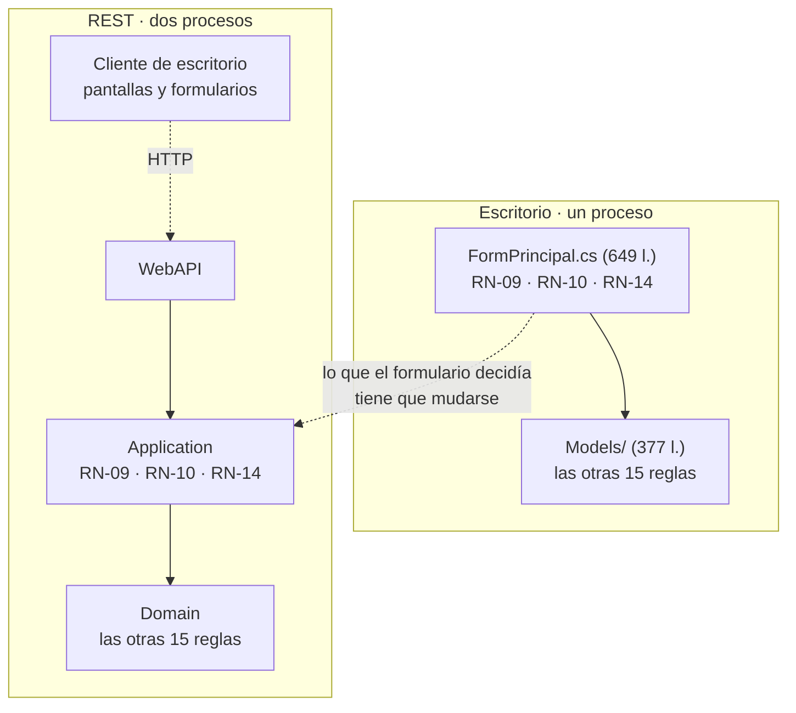

# Bitácora de editores 07 — Diseño didáctico de la actividad interactiva «La Estancia La Ana»

**Fecha:** 2026-09-24
**Autor:** comisión de didáctica (no vota en la mesa; propone)
**Prompt de origen:** `PROMPTs/Guides/06-Crear-Dot-NET-Arquitectura-Guide/03-Actividad-Interactiva.md`
**Profile:** `Study-Guide-Documentation` (RuleSet-Study-Guide: `Rule-Evidences`, `Rule-Narrative-Voice`, `Rule-Dual-Audience`)

**Fuentes de este documento**, todas leídas el 2026-09-24:

| Fuente | Qué aporta | Cómo se verificó |
| --- | --- | --- |
| `OUTPUTs/Bitacora-Editores/09-Fuente-Actividad-La-Estancia.md` | El enunciado literal, los 15 casos de uso, las 18 reglas `RN-01`…`RN-18` y las fórmulas por tipo | Transcripción del `.docx` del autor, ya versionada por el coordinador |
| `Guides/Dot-NET-Arquitectura-Guide/Dot-NET-Arquitectura-Guide.md` | El apunte: 2817 líneas, §0–§9 + Anexos A–E | `wc -l`, `grep -n '^#\{1,4\} '` |
| `PROG2/2026/dev/tup_prog_2_2026_actividad3.3/Actividad3.3/` | **La versión de escritorio ya existente** (línea de base) | Lectura completa de `Models/` (11 archivos) y `Vistas/` (13 formularios); `git remote -v` → `fernandofilipuzzi-dev/tup_prog_2_2026_actividad3.3`, `HEAD` = `80c003b` |
| `Guides/Dot-NET-Arquitectura-Guide/Interactive-Activities/` | El esqueleto de la versión REST: `LaEstancia.slnx`, `global.json` (SDK 10.0.400), `src/Backend/LaEstancia.WebAPI/` (net10.0, `Microsoft.AspNetCore.OpenApi` 10.0.11, `Scalar.AspNetCore` 2.17.9, `Program.cs` sin endpoints) | Lectura de los archivos |

> **Este documento no edita el apunte ni el código: sólo propone.** Sobre `PROG2/` rige lectura solamente.
> Toda afirmación sobre el código de escritorio se cita con **archivo y línea**; lo que no pude verificar está rotulado **«a verificar»**.

---

## Índice

- [1. Encuadre: el dominio está dado, y hay dos ejes que se cruzan](#1-encuadre-el-dominio-está-dado-y-hay-dos-ejes-que-se-cruzan)
- [2. Análisis del dominio dado](#2-análisis-del-dominio-dado)
  - [2.1 Los conceptos del enunciado y qué capítulo tensiona cada uno](#21-los-conceptos-del-enunciado-y-qué-capítulo-tensiona-cada-uno)
  - [2.2 Dónde el modelo dado resiste](#22-dónde-el-modelo-dado-resiste)
  - [2.3 Dónde cruje](#23-dónde-cruje)
- [3. La línea de base medida: dónde vive hoy cada regla](#3-la-línea-de-base-medida-dónde-vive-hoy-cada-regla)
  - [3.1 Qué es la versión de escritorio, en datos](#31-qué-es-la-versión-de-escritorio-en-datos)
  - [3.2 Las 18 reglas y su domicilio real](#32-las-18-reglas-y-su-domicilio-real)
  - [3.3 Los tres desvíos, con el código a la vista](#33-los-tres-desvíos-con-el-código-a-la-vista)
- [4. La tesis del cruce](#4-la-tesis-del-cruce)
- [5. El banco de pruebas: la Tarea 2 del enunciado](#5-el-banco-de-pruebas-la-tarea-2-del-enunciado)
- [6. La secuencia de hitos](#6-la-secuencia-de-hitos)
  - [6.1 Mapa](#61-mapa)
  - [6.2 Tabla de hitos](#62-tabla-de-hitos)
  - [6.3 Cada hito en detalle](#63-cada-hito-en-detalle)
- [7. Decisiones abiertas](#7-decisiones-abiertas)
- [8. Puntos de fricción entre la actividad y el apunte](#8-puntos-de-fricción-entre-la-actividad-y-el-apunte)
- [9. Qué hace falta para empezar](#9-qué-hace-falta-para-empezar)

---

## 1. Encuadre: el dominio está dado, y hay dos ejes que se cruzan

El dominio **no se elige ni se recorta**: viene de la Actividad Integradora 3.3 de la cátedra, con su enunciado, sus 15 casos de uso, sus 18 reglas y sus fórmulas de producción y rendimiento por tipo. Y **ya tiene una solución**: una aplicación de escritorio en Windows Forms, escrita por el mismo autor, que este documento trata como **línea de base medible**, no como borrador a corregir.

Lo que se cruza son dos ejes didácticos:

| Eje | De dónde viene | Qué enseña |
| --- | --- | --- |
| **Jerarquía de clases**: interfaces, clases abstractas, polimorfismo | La actividad original de Programación II | Cómo un modelo captura las variantes de un concepto sin repetir código ni preguntar por el tipo |
| **Regla de dependencia**: capas, inversión, clientes | El apunte de arquitectura | Quién puede conocer a quién, y qué hace cumplir esa regla |

El material didáctico no está en ninguno de los dos por separado: está en el cruce, y la tesis que lo sostiene es ésta, formulada para que se pueda refutar:

> **Tesis.** Un modelo rico en herencia y polimorfismo es el caso donde poner una API REST adelante revela si el comportamiento estaba en el dominio o estaba en el formulario. Donde el polimorfismo funciona, la API no cuesta nada: pide el mismo cálculo y lo publica. Donde el formulario pregunta por el tipo, la API no puede hacer nada, porque del otro lado del HTTP no hay formulario: ese es exactamente el lugar donde el comportamiento se había filtrado, y el HTTP lo hace visible.

La tesis no es un eslogan porque **se mide**. El [§3](#3-la-línea-de-base-medida-dónde-vive-hoy-cada-regla) muestra que en la versión de escritorio hay tres reglas que viven en el formulario y quince que no, y el [§4](#4-la-tesis-del-cruce) muestra por qué esas tres y no otras. El [§5](#5-el-banco-de-pruebas-la-tarea-2-del-enunciado) cuenta los puntos de toque de un cambio concreto —la Tarea 2 del enunciado— en los dos mundos.

Y hay una precisión que conviene hacer antes que ninguna otra, porque el reflejo del gremio empuja para el otro lado: **el modelo de escritorio no es anémico**. Asignar lote, cerrar, calcular superficie, rendimiento y producción son métodos de las clases de `Models/`, no de los formularios (`Actividad.cs` l. 21–58 y l. 68–88; `Agricola.cs` l. 14–26; `Cria.cs` l. 14–25; `ReCria.cs` l. 14–25; `Ivernada.cs` l. 15–26; `Estancia.cs` l. 151–181). En el vocabulario del apunte (§9.6 paso 4), es un *Domain Model* y no un *Anemic Domain Model*, y eso es un **punto fuerte del original que hay que decir en voz alta**: la crítica fácil no aplica. Lo que se filtró al formulario es otra cosa, y es mucho más interesante.

---

## 2. Análisis del dominio dado

### 2.1 Los conceptos del enunciado y qué capítulo tensiona cada uno

Los conceptos son los del enunciado; la columna que agrega esta comisión es la última.

| Concepto | Qué es en el enunciado | Qué capítulo del apunte tensiona | Por qué |
| --- | --- | --- | --- |
| **Estancia** | Nombre, al menos un campo, un casco, varios puestos; calcula producción total y productividad general | §3.1 (*Entity* con identidad), §4.10–§4.11 (*Aggregate root*), §9.6 paso 7 | Es la única que ve a todos: los totales (RN-17, RN-18) y «la parcela ya está asignada» (RN-10) sólo se pueden responder desde acá. Es el candidato natural a raíz de agregado, y también el candidato a volverse un objeto-Dios |
| **Campo** | Identificador único en la estancia, superficie, se parcela | §3.2 (*Business Rule*), §3.6 (*integrity constraint* sobre varias instancias), §5.5 | RN-06 y RN-07 son reglas que un `Campo` **sí** puede verificar solo, porque el campo contiene sus parcelas. Es el contraejemplo útil de RN-10, que no se puede verificar desde ningún objeto solo |
| **Parcela** | Identificador único dentro del campo, superficie | §3.1 (*Entity* vs. *Value Object*), §7.1 | Tiene identidad —dos parcelas de 30 ha no son la misma—, pero en el código esa identidad es **posicional**: se la alcanza por `VerParcela(idx)` (`Campo.cs` l. 39–46). Es el mejor caso de la actividad para el capítulo de identidad, porque el índice sobrevive dentro de un proceso y **no sobrevive a una petición HTTP** |
| **Lote** | «Una parcela de alguno de los campos» asignada a una actividad. **No es una clase** | §7 (cada objeto responde una pregunta), §7.3 | El enunciado define un **rol**, no un tipo. El código lo respeta: `Actividad` guarda `List<Parcela> lotesAsignados` por agregación, con el comentario que lo dice (`Actividad.cs` l. 17–19). Es un ejemplo limpio de que no todo sustantivo del enunciado es una clase |
| **Actividad Productiva** (abstracta) | Descripción, período, lotes; superficie ocupada, rendimiento, producción; se cierra con datos propios del tipo | §3 completo, §7.1, §9.6 pasos 4 y 7 | Es el corazón: dos métodos abstractos (`CalcularRendimiento`, `CalcularProduccion`, `Actividad.cs` l. 85 y 88) y cuatro implementaciones. Es también donde el apunte **no tiene nada que decir** (§8, F-A) |
| **Agrícola / Ganadera / Cría / Recría / Invernada** | Los subtipos, con sus datos y sus dos fórmulas | §3.3, §5.4 (materializadores), §7.2 d | Cada subtipo tiene atributos propios: eso es lo que hace que el contrato de la API no pueda ser uno solo y plano, y donde aparece el problema del **polimorfismo en el JSON** |
| **Casco / Puesto** | Instalaciones y viviendas; su administración queda para un análisis futuro | §9.3 (cuándo no subir un escalón) | Es el mejor ejemplo del enunciado de **alcance declarado**: el propio enunciado dice qué no se hace. El código los deja como dos clases de una propiedad (`Casco.cs` 8 líneas, `Puesto.cs` 8 líneas) y no las hace derivar de nada |

### 2.2 Dónde el modelo dado resiste

Cinco cosas del modelo original aguantan el traslado a capas sin tocarse, y conviene que la actividad las declare antes de proponer un solo cambio:

1. **El polimorfismo de las fórmulas.** `Estancia.CalcularProduccionTotal` suma sin preguntar el tipo: `total += actividad.CalcularProduccion();` (`Estancia.cs` l. 157), con el comentario del autor al lado. Lo mismo `FormPrincipal.InformeProductividad`, que arma la línea del informe pidiéndole a cada actividad lo suyo (`FormPrincipal.cs` l. 446–448). **El informe —el caso de uso 15, el más «de aplicación» de todos— no tiene una sola pregunta por el tipo.** Eso es el ejercicio funcionando.
2. **Lote como rol y no como clase** (`Actividad.cs` l. 17–19), fiel al enunciado.
3. **Las reglas de la parcela en el campo.** RN-06, RN-07 y RN-08 están las tres en `Campo.CrearParcela` (`Campo.cs` l. 23) y en `Campo.ModificarParcela` (l. 55–56), que descuenta la parcela que está modificando antes de comparar. Es una regla bien puesta: el objeto que la verifica tiene el dato.
4. **RN-11 en el objeto que la conoce.** «Una actividad cerrada no admite más lotes» está en `Actividad.AsignarLote` (`Actividad.cs` l. 25), no en el formulario.
5. **`Cerrada` con setter privado** (`Actividad.cs` l. 64): el estado sólo cambia por `Cerrar()`. Es la segunda de las tres piezas que §3.6 del apunte pide para sostener una *Invariant*, y está.

### 2.3 Dónde cruje

Seis lugares. Ninguno es un error de la actividad original —que enseña jerarquía, no arquitectura—; todos son material.

| # | Dónde | Evidencia | Qué capítulo lo ilumina |
| --- | --- | --- | --- |
| **C-1** | **La identidad es posicional.** Parcelas, campos y actividades se alcanzan por índice (`Campo.VerParcela(idx)`, `Estancia.VerCampo(idx)`, `Estancia.VerActividad(idx)`), y `Campo.BuscarParcela` **reordena la lista** antes de buscar (`Campo.cs` l. 91: `parcelas.Sort()`). El propio formulario documenta la consecuencia: «vuelvo a cargar el listado siempre, porque el campo reordena las parcelas al buscar y el índice del listbox tiene que coincidir con el del campo» (`FormPrincipal.cs` l. 182–183) | Comentario del autor en el código | §3.1, §7.1: una *Entity* se identifica por identidad, no por posición. Un índice no sobrevive a una petición HTTP |
| **C-2** | **`Ganadera.CantidadCabezas` no tiene constructor que lo exija.** El parámetro está **comentado** (`Ganadera.cs` l. 9 y 12) y el valor se asigna desde el formulario con un cast: `((Ganadera)nueva).CantidadCabezas = cantidadCabezas;` (`FormPrincipal.cs` l. 270–272). Consecuencia medible: `ReCria.CalcularRendimiento` e `Ivernada.CalcularRendimiento` se defienden con `if (CantidadCabezas > 0) … return 0;` (`ReCria.cs` l. 22–24, `Ivernada.cs` l. 23–25), de modo que **un rendimiento 0 puede significar «cero» o «no sé»** | Lectura del código | §3.3, §3.6: la fábrica es la pieza que **establece** la *Invariant*; si no la establece, cada método tiene que desconfiar |
| **C-3** | **El tipo de actividad es un entero mágico compartido por la vista y el dominio.** `Estancia.AgregarActividad(int tipo)` hace `switch` sobre `1..4` (`Estancia.cs` l. 51–74); el valor sale de `cmbTipoActividad.SelectedIndex + 1` (`FormPrincipal.cs` l. 246); y el texto del combo lleva el número impreso: `"Agricola   (1)", "Ganadera - Cria (2)", "Ganadera - Ivernada (3)", "Ganadera - ReCria (4)"` (`FormActividadDatos.Designer.cs` l. 143). **El orden de los ítems del combo es parte del contrato del dominio** | Tres archivos que hay que leer juntos | §2.1 (regla de dependencia), §7.4: acá la dependencia va de adentro hacia afuera y nadie la declara |
| **C-4** | **El primer campo de la estancia no pasa por la regla.** `Estancia.AgregarCampo` verifica RN-03 y RN-04 (`Estancia.cs` l. 113), pero el constructor `Estancia(string, Campo)` agrega el campo sin verificar nada (`Estancia.cs` l. 13–21). El formulario lo sabe y compensa: «el primer campo de la estancia no pasa por `AgregarCampo`, así que verifico acá lo mínimo» (`FormPrincipal.cs` l. 469–471) | Comentario del autor en el código | §3.3, §3.6: hay dos caminos de creación y sólo uno verifica |
| **C-5** | **El dinero es `double`.** `PrecioTonelada`, `PrecioTernero`, `PrecioKilo` y todos los resultados de `CalcularProduccion` son `double` (`Agricola.cs` l. 7, `Cria.cs` l. 7, `ReCria.cs` l. 7, `Ivernada.cs` l. 8). El apunte usa `decimal` en todo el laboratorio (44 apariciones de `decimal` contra 1 de `double`, `grep -c -i`) | Conteo sobre los dos corpus | §3.3 (`Dinero` como *Value Object*), §7.5. Es un cambio acotado y **medible**: la suma de precios con decimales da distinto |
| **C-6** | **El código diverge del modelo del enunciado en las instalaciones.** La transcripción modela `Instalacion` como base de `Casco` y `Puesto`; el código tiene dos clases sueltas, sin base común ni interfaz (`Casco.cs`, `Puesto.cs`, 8 líneas cada una) | Comparación fuente ↔ código | §9.3: es **sobreingeniería evitada**, porque el enunciado declara que la administración del casco y los puestos queda fuera de alcance. Conviene decirlo así y no como omisión |

---

## 3. La línea de base medida: dónde vive hoy cada regla

### 3.1 Qué es la versión de escritorio, en datos

| Dato | Valor | Evidencia |
| --- | --- | --- |
| Tecnología | **Windows Forms** | `Ejercicio1.csproj`: `<OutputType>WinExe</OutputType>`, `<UseWindowsForms>true</UseWindowsForms>` |
| Plataforma de destino | **net9.0-windows7.0** | `Ejercicio1.csproj` |
| Formato de solución | `.sln` clásico, «Format Version 12.00», VS 17 | `Actividad3.3.sln` l. 1–3 |
| Proyectos | **Uno solo** | `Actividad3.3.sln`: un único `Project(...)` |
| Repositorio | `fernandofilipuzzi-dev/tup_prog_2_2026_actividad3.3`, con `upstream` en la organización de la cátedra | `git remote -v` |
| Modelo | 11 clases en `Models/`, 377 líneas | `wc -l Models/*.cs` |
| Vistas | 13 formularios, de los cuales 12 son diálogos sin lógica; **toda la orquestación está en `FormPrincipal.cs`, 649 líneas** | `wc -l Vistas/**/*.cs` |
| Persistencia | **Ninguna**: el estado vive en memoria mientras corre | No hay `DbContext`, cadena de conexión ni archivo; coincide con lo que la fuente declara en su §6 |

En el vocabulario del apunte, esto es **el escenario E-A en el escalón 1 de la escalera del §9.2**, con un matiz importante a favor del original: el escalón 1 del apunte es «página → servicio → EF Core», es decir, *Transaction Script*; acá no hay *Transaction Script*, hay un modelo de objetos con comportamiento. Es, más bien, **el escalón 2 del §9.2 —el término medio— sin persistencia**.

*A verificar*: que el proyecto compile en el laboratorio. `net9.0-windows7.0` con `UseWindowsForms` requiere el paquete de destino de Windows Desktop, que no está disponible en Linux; en este equipo no hay SDK de .NET fuera del contenedor (`dotnet --list-sdks` no existe en el host). **Ninguna afirmación de esta comisión depende de compilarlo**: todo lo que sigue se verifica por lectura y se cita con archivo y línea.

### 3.2 Las 18 reglas y su domicilio real

Esta tabla es el insumo principal de toda la actividad. La columna «Domicilio» usa el vocabulario del apunte.

| Id | Regla (resumen) | Dónde está implementada | Domicilio |
| --- | --- | --- | --- |
| RN-01 | La estancia se conforma con al menos un campo | El constructor **recibe** un campo, pero no lo valida (`Estancia.cs` l. 13–21) | Domain, por la firma |
| RN-02 | Casco y puestos se crean en el mismo acto | `Estancia` l. 18–20: crea el casco y un puesto «No designado» | **Domain** ✅ |
| RN-03 | Identificador de campo único y no nulo | `Estancia.AgregarCampo` l. 113 **y** `FormPrincipal.SolicitarDatosCampo` l. 471 | **Duplicada**: Domain + Vista |
| RN-04 | Superficie del campo ≠ 0 | ídem RN-03 | **Duplicada** |
| RN-05 | Sólo alta de campos; la baja queda fuera | No hay método de baja | Alcance declarado ✅ |
| RN-06 | Identificador de parcela único en el campo | `Campo.CrearParcela` l. 23 (`BuscarParcela(identificador) < 0`) | **Domain** ✅ |
| RN-07 | Superficie de parcela ≠ 0 y ≤ superficie sin parcelar | `Campo.CrearParcela` l. 23 y `Campo.ModificarParcela` l. 55–56 | **Domain** ✅ |
| RN-08 | La suma de parcelas es coherente con el total del campo | Consecuencia de RN-07, verificada en los dos métodos | **Domain** ✅ |
| RN-09 | Una parcela asignada como lote no se modifica ni elimina | **Sólo en `FormPrincipal.ModificarParcela` l. 553**. `Campo.ModificarParcela` (l. 49–63) y `Campo.EliminarParcela` (l. 65–74) **no la verifican** | **Vista** ❌ |
| RN-10 | Una parcela ya asignada a una actividad no va a otra | **Sólo en `FormPrincipal` l. 337** (`estancia.EstaAsignada(lote)`). `Actividad.AsignarLote` l. 25 sólo verifica que no esté repetida **en la misma** actividad | **Vista** ❌ |
| RN-11 | Una actividad cerrada no admite más lotes | `Actividad.AsignarLote` l. 25 (`!Cerrada`) | **Domain** ✅ |
| RN-12 | Una actividad sin lotes no se cierra | `Actividad.Cerrar` l. 70 **y** `FormPrincipal.CerrarActividad` l. 378 | **Duplicada** (benigna: el formulario adelanta el mensaje) |
| RN-13 | Toda actividad tiene al menos un lote asignado | **No implementada en ningún lado** | Ninguno — ver [D-01](#7-decisiones-abiertas) |
| RN-14 | Los datos de cierre son los propios del tipo | **Sólo en `FormPrincipal.CerrarActividad` l. 396–419**: cadena de `is` + casts | **Vista** ❌ |
| RN-15 | Producción = unidad × precio, por tipo | `CalcularProduccion` en cada subtipo | **Domain** ✅ polimórfico |
| RN-16 | Rendimiento en la unidad propia de cada tipo | `CalcularRendimiento` en cada subtipo | **Domain** ✅ polimórfico |
| RN-17 | Producción total = suma de las actividades | `Estancia.CalcularProduccionTotal` l. 151–160 | **Domain** ✅ |
| RN-18 | Productividad = superficie ocupada / superficie total | `Estancia.CalcularProductividadGeneral` l. 164–181 | **Domain** ✅ |

**Recuento: 11 reglas en el dominio, 3 duplicadas entre dominio y vista, 3 sólo en la vista, 1 sin implementar.**

### 3.3 Los tres desvíos, con el código a la vista

**RN-14, el más importante.** El cierre es el caso de uso 14 y es donde el enunciado dice que se ingresan los datos productivos propios del tipo. Así se resuelve hoy:

```csharp
// FormPrincipal.cs, l. 387–392: qué grupo de campos se habilita
fCierre.gbAgricola.Enabled = actividad is Agricola;
fCierre.gbCria.Enabled     = actividad is Cria;
fCierre.gbIvernada.Enabled = actividad is Ivernada;
fCierre.gbReCria.Enabled   = actividad is ReCria;

// FormPrincipal.cs, l. 396–419: qué datos se cargan
if (actividad is Agricola)
{
    ((Agricola)actividad).CantidadToneladasCosechadas = Convert.ToInt32(fCierre.tbToneladas.Text);
    ((Agricola)actividad).PrecioTonelada = Convert.ToDouble(fCierre.tbPrecioTonelada.Text);
}
else if (actividad is Cria) { /* tres asignaciones */ }
else if (actividad is Ivernada) { /* tres asignaciones */ }
else if (actividad is ReCria) { /* dos asignaciones */ }

if (!actividad.Cerrar()) { MessageBox.Show("No se pudo cerrar la actividad."); }
```

Tres cosas para leer acá, y las tres son material de la actividad:

1. **`Cerrar()` no recibe los datos del cierre** (`Actividad.cs` l. 68–76): sólo verifica RN-12 y da vuelta la bandera. Los datos entraron antes, por propiedades públicas, desde afuera. El comentario del autor lo dice: «los datos productivos los carga cada tipo por sus propiedades, acá sólo verifico la regla» (`Actividad.cs` l. 66–67).
2. **Hay dos cadenas de `is` en el mismo método**, con el mismo orden y la misma lista de cuatro tipos. Dos listas que tienen que cambiar juntas y que el compilador no ata.
3. **En un ejercicio cuyo eje es el polimorfismo, el único lugar que pregunta por el tipo es el formulario.** No es una contradicción del autor: es la consecuencia de que el formulario sea lo único que hay entre el usuario y el modelo. Cuando el que pide el cierre es un `POST` y no un `Form`, esta cadena no tiene dónde vivir, y ahí aparece la capa que falta.

**RN-09 y RN-10** son la misma historia con otra forma. Las dos preguntan por algo que una parcela no sabe y un campo tampoco: *«¿esta parcela está tomada por alguna actividad de la estancia?»*. La respuesta la tiene `Estancia.EstaAsignada` (`Estancia.cs` l. 82–90), que sí es del dominio. Lo que quedó en la vista **no es el conocimiento sino la decisión de consultarlo**:

```csharp
// FormPrincipal.cs, l. 552–557 — RN-09
if (estancia.EstaAsignada(seleccionada))
{
    MessageBox.Show("La parcela está asignada como lote a una actividad y no se puede modificar ni eliminar.");
    return;
}
// …y recién después llama a campo.ModificarParcela / campo.EliminarParcela,
// que no verifican nada de esto (Campo.cs l. 49–74)
```

Consecuencia verificable sin compilar: **cualquier segundo consumidor que llame a `Campo.EliminarParcela` sin pasar por `FormPrincipal` borra una parcela asignada a una actividad en curso.** Hoy ese segundo consumidor no existe. En A1 existe, y se llama `DELETE /api/campos/{id}/parcelas/{id}`.

---

## 4. La tesis del cruce

Con la tabla de §3.2 en la mano, la pregunta didáctica se puede hacer con precisión: **¿por qué se filtraron esas tres reglas y no las otras quince?**

No por descuido, y no porque el modelo sea anémico. Se filtraron las tres que comparten una propiedad:

| Regla filtrada | Qué necesita para decidirse |
| --- | --- |
| RN-09 | Mirar **todas** las actividades de la estancia desde el contexto de un campo |
| RN-10 | Mirar **todas** las actividades de la estancia desde el contexto de una actividad |
| RN-14 | Saber **de qué tipo** es la actividad para pedir unos datos u otros |

Las tres necesitan algo que **ningún objeto del modelo tiene a mano en el momento en que hay que decidir**. Y en una aplicación de escritorio hay exactamente un lugar que tiene todo a mano: el formulario principal, que es dueño de la `Estancia` (`FormPrincipal.cs` l. 12) y conductor de cada caso de uso (`AdministrarCampos`, `AdministrarUnCampo`, `AdministrarActividades`, `AdministrarUnaActividad`, `CerrarActividad`, `InformeProductividad`). **`FormPrincipal` ya es una capa de aplicación**: orquesta, coordina y decide el orden de los pasos. Lo que no es, es una capa **separable**: está atada a `ShowDialog()`, a `DialogResult` y a `MessageBox`.

De ahí sale la formulación formadora de criterio, que es la que la actividad tiene que dejar instalada:

> **La capa `Application` no aparece porque el modelo sea anémico. Aparece porque hay reglas que no caben en ningún objeto del dominio y hoy viven en el único lugar que los ve a todos: el formulario. Y el día que hay un segundo cliente, esas reglas no viajan.**

Es la misma lección que el apunte enseña en §3.6 y en §9.6 con «DNI no repetido» —una regla que mira a las demás instancias no puede vivir en la *Entity*—, pero acá con una diferencia que la vuelve mucho más potente: en el apunte, la regla que no cabe en la *Entity* **ya estaba** en un handler. Acá hay que ir a buscarla al formulario, y el lector la ve mudarse.

Y sobre el polimorfismo, el remate: el informe (CU-15) cruza el HTTP **sin costo**, porque `total += actividad.CalcularProduccion()` no pregunta nada (`Estancia.cs` l. 157). El cierre (CU-14) **no cruza**, porque la decisión de qué datos pedir está escrita con `is` en la vista. Dos casos de uso del mismo modelo, uno que viaja y otro que no: esa es la tesis, medida.



*Diagrama 4.1. Lo que la actividad hace visible: las quince reglas de `Models/` cambian de proyecto y no de forma; las tres de `FormPrincipal` cambian de forma, porque del otro lado del HTTP no hay formulario.*

---

## 5. El banco de pruebas: la Tarea 2 del enunciado

La Tarea 2 pide **agregar una actividad económica nueva** —forestal, turismo rural, apicultura o avícola—. Es el corazón didáctico del original: medir cuánto cuesta agregar un subtipo. Y es el mejor instrumento que tiene esta actividad, porque es el **mismo cambio** en los dos mundos.

**Puntos de toque en la versión de escritorio**, contados por lectura (tomando «Forestal» como ejemplo):

| # | Archivo | Qué hay que hacer | ¿Lo exige el compilador? |
| --- | --- | --- | --- |
| 1 | `Models/Forestal.cs` (nuevo) | Heredar de `Actividad` e implementar los dos métodos abstractos | **Sí**: si falta un `override`, no compila |
| 2 | `Models/Estancia.cs` l. 54–68 | `case 5: nueva = new Forestal(...)` | **No**: sin el `case`, `AgregarActividad` devuelve `null` en silencio (l. 53, l. 70) |
| 3 | `Vistas/Datos/FormActividadDatos.Designer.cs` l. 143 | Agregar `"Forestal (5)"` al combo, **en la posición que corresponde al `case`** | **No**: el acople es por el orden del `Items.AddRange` |
| 4 | `Vistas/Datos/FormActividadCierreDatos.Designer.cs` | Un `GroupBox` nuevo con sus `TextBox` y etiquetas. Los cuatro actuales ocupan las l. 35–58 de declaraciones y el archivo tiene 396 líneas | **No** |
| 5 | `Vistas/FormPrincipal.cs` l. 387–392 | Una línea más en la cadena de habilitación | **No** |
| 6 | `Vistas/FormPrincipal.cs` l. 396–419 | Una rama más en la cadena de `is` + casts | **No**: sin ella, la actividad forestal se cierra con los datos en cero y produce 0 |

**Seis puntos de toque; el compilador garantiza uno solo.** Los cinco restantes fallan en silencio o se descubren probando a mano.

Y hay un **defecto latente medible**, que es el mejor hallazgo de esta revisión para la Tarea 2:

```csharp
// FormActividadDatos.cs, l. 83–86
private void cmbTipoActividad_SelectedIndexChanged(object sender, EventArgs e)
{
    tbCantidadCabezas.Enabled = cmbTipoActividad.SelectedIndex > 0;
}
```

La habilitación del campo «cantidad de cabezas» no pregunta si la actividad es **ganadera**: pregunta si el índice del combo es mayor que cero. Funciona hoy porque el único no-ganadero es el ítem 0 (`"Agricola   (1)"`). **Al agregar cualquier actividad no ganadera al final de la lista —forestal, turismo rural, apicultura—, el formulario va a habilitar «cantidad de cabezas» para ella.** El conocimiento «qué actividades tienen cabezas» —que en el modelo está expresado por la jerarquía, con `CantidadCabezas` en `Ganadera` (`Ganadera.cs` l. 7)— está reexpresado en la vista como una comparación de enteros.

Ese es el punto exacto donde la Tarea 2 y el apunte se tocan, y por eso el hito A9 de la actividad es ejecutar la Tarea 2 en las dos versiones y **contar**. La predicción de esta comisión, que hay que poder refutar con el conteo: en la versión por capas los puntos de toque bajan y, sobre todo, **sube la proporción de los que el compilador exige**. Si el conteo no da eso, la tesis se cae y hay que decirlo.

---

## 6. La secuencia de hitos

Criterio de diseño, el mismo de siempre en este expediente: **cada hito existe porque hay una decisión que se puede tomar mal, y hay un comando que revela que se tomó mal.** Un hito sin señal observable es una opinión y no entra (compuerta E1, `00-Contrato-De-Entrada.md`).

### 6.1 Mapa

```mermaid
flowchart LR
    A0["A0 · medir<br/>la línea de base"] --> A1["A1 · el modelo dado<br/>tal cual, detrás de HTTP"]
    A1 -->|"el índice no sobrevive"| A2["A2 · identidad"]
    A2 -->|"tres reglas sin dueño"| A3["A3 · Application"]
    A3 -->|"que lo exija el compilador"| A4["A4 · Domain aparte"]
    A4 -->|"el cierre pregunta por el tipo"| A5["A5 · cierre polimórfico<br/>y contrato con subtipos"]
    A5 --> A6["A6 · el dinero<br/>double → Value Object"]
    A6 --> A7["A7 · persistir<br/>una jerarquía"]
    A7 --> A8["A8 · Contracts<br/>+ cliente de escritorio"]
    A8 --> A9["A9 · Tarea 2<br/>en los dos mundos"]
```



*Diagrama 6.1. Cada flecha es una señal observable, en el sentido de §9.3. A0 y A9 son mediciones y enmarcan a las demás: la actividad empieza contando y termina contando.*

### 6.2 Tabla de hitos

| Hito | Qué se hace | § que pone a prueba | Error típico que debe aparecer | Verificación |
| --- | --- | --- | --- | --- |
| **A0** | Inventario de la línea de base: reproducir la tabla de §3.2 uno mismo, con `grep`, y contar los puntos de toque de la Tarea 2 | §3.2, §3.6, §9.1 | Leer `Models/` y concluir «está todo bien puesto» sin abrir `FormPrincipal.cs` | `grep -rn 'is Agricola\|is Cria\|is Ivernada\|is ReCria' Vistas/` → las dos cadenas; `grep -n 'EstaAsignada' Models/ Vistas/` → dónde se decide y dónde se sabe |
| **A1** | Copiar `Models/` **sin tocar una línea** a `LaEstancia.WebAPI` y exponer CU-3, CU-6, CU-10 y CU-15 | §1.1, §9.2 escalón 1–2, §8.2 | Empezar «mejorando» el modelo antes de medir | `dotnet build`; `curl -s .../api/informe` devuelve los mismos números que el informe de escritorio |
| **A2** | Del índice al identificador: las rutas dejan de ser posicionales | §3.1, §7.1 | Exponer `GET /api/campos/{idx}/parcelas/{idx}` y que ande en la demo | Dos peticiones intercaladas con un alta en el medio: con índices, la segunda devuelve otra parcela (C-1: `Campo.cs` l. 91 reordena) |
| **A3** | Reponer RN-09, RN-10 y RN-14 fuera de la vista: nace `LaEstancia.Application` con sus *Use Cases* y `IEstanciaRepository` | §3.6, §4.1–§4.6, §9.6 pasos 5 y 7 | Reponerlas en el controller o el endpoint: se repite el error con otro traje | `dotnet test`: «no se elimina una parcela asignada» pasa **sin HTTP y sin base**; y `curl -X DELETE` sobre una parcela asignada → rechazo |
| **A4** | `LaEstancia.Domain` como proyecto aparte | §1.4, §2.3, §2.7, §8.3 | El `using` sin la referencia | `dotnet build` con el `using` y sin la referencia → **`CS0234`/`CS0246`**; `dotnet list src/Backend/LaEstancia.Domain reference` → sin referencias |
| **A5** | El cierre sin preguntar por el tipo, y el contrato que transporta subtipos | §3.7, §3.8, §4.10, §7.2 d; **y el hueco del apunte** (F-A) | Reproducir la cadena de `is` en el handler o en el serializador | Prueba: cerrar cada uno de los cuatro tipos por el mismo *Use Case*; `grep -rn ' is Agricola' src/` → **vacío** |
| **A6** | `double` → un *Value Object* de dinero, y `Cerrada`/`CantidadCabezas` con sus *Invariants* establecidas por la fábrica (C-2, C-4) | §3.3, §3.6, §7.5 | Cambiar el tipo y no la fábrica: sigue habiendo dos caminos de creación | Prueba de suma con decimales: el total de `double` y el del *Value Object* **difieren**; y `new Estancia(...)` con un campo de superficie 0 deja de ser posible |
| **A7** | Persistir la jerarquía: `LaEstancia.Infrastructure` con EF Core + SQLite | §5.1, §5.3, §5.5 | Agregar EF Core a `Domain` para poner atributos | `sha256sum .../LaEstancia.Domain.dll` antes y después: **idéntico** (L16 del apunte); `grep -rn 'Infrastructure' src/Backend/LaEstancia.WebAPI --include=*.cs` → sólo `Program.cs` |
| **A8** | `LaEstancia.Contracts` y el cliente de escritorio contra la API | §6.1–§6.3, §7.1, §8.1, §8.3, §8.5 | Referenciar `Domain` desde el cliente «para reusar `Actividad`» | `dotnet list <cliente> reference` → **sólo `Contracts`**; `grep -rn 'LaEstancia.Domain' <cliente>` → vacío |
| **A9** | **La Tarea 2 en los dos mundos**: agregar la actividad económica nueva y contar | §9.3, §9.6, §9.8; la Tarea 2 del enunciado | Declarar la mejora sin contar, o contar sólo archivos y no «lo que el compilador exige» | `git diff --stat` de las dos ramas y la tabla de §5 rehecha; y la prueba del defecto latente: en la versión nueva, «cantidad de cabezas» **no** se habilita para la actividad no ganadera |

### 6.3 Cada hito en detalle

Formato: qué se hace, la **pregunta guía**, la **respuesta formadora de criterio** —la que permite decidir, no la que define— y la trampa.

---

#### A0 — Medir antes de tocar

**Se hace.** Nada de código. El lector reconstruye la tabla de §3.2 por su cuenta, con `grep` y lectura, y anota los puntos de toque de la Tarea 2.

**Pregunta guía.** *De las 18 reglas del enunciado, ¿cuántas están en `Models/` y cuántas en `Vistas/`, y cómo lo averiguo sin abrir el depurador?*

**Respuesta.** **Buscando el lugar donde se decide, no el lugar donde se sabe.** `Estancia.EstaAsignada` (`Estancia.cs` l. 82–90) es conocimiento del dominio y está bien donde está; lo que define el domicilio de RN-09 es quién llama a ese método y qué hace con la respuesta, y eso está en `FormPrincipal.cs` l. 553. El criterio, que sirve para cualquier base heredada: **el dueño de una regla es quien puede ignorarla.** Si un camino alternativo la saltea —`Campo.EliminarParcela` la saltea—, la regla no está donde parece.

**La trampa.** Leer `Models/`, ver que hay métodos con comportamiento, concluir «el modelo está bien» y pasar al código nuevo. Está bien, y aun así tres reglas están afuera. Las dos cosas son ciertas a la vez, y sostenerlas juntas es el aprendizaje del hito.

---

#### A1 — El modelo dado, tal cual, detrás de HTTP

**Se hace.** Copiar `Models/` **literalmente** —`double` incluido, índices incluidos, `ArrayList` incluido (`Estancia.cs` l. 107)— dentro de `LaEstancia.WebAPI` y publicar los casos de uso de sólo lectura: listar campos (CU-3), listar parcelas (CU-6), listar actividades (CU-10) e informe (CU-15).

**Pregunta guía.** *¿Por qué copiar el modelo sin corregirlo, si ya sé que tiene problemas?*

**Respuesta.** **Porque sin la línea de base no hay medición, y sin medición la mejora es una opinión.** Es el mismo criterio que el apunte aplica cuando muestra L06 —todo junto, compilando sin advertencias— antes de L07. Además hay un resultado que conviene cobrar temprano: **el informe funciona a la primera.** `CalcularProduccionTotal` y `CalcularProductividadGeneral` cruzan el HTTP sin una sola modificación, porque no preguntan por el tipo. Ese éxito es la mitad de la tesis y hay que hacerlo visible antes que los problemas.

**La trampa.** Empezar por «paso todo a `decimal` y le pongo identificadores». La actividad no es una refactorización: es una demostración de por qué cada cambio se justifica.

**Verificación.** Con los mismos datos cargados en las dos versiones, `curl -s .../api/informe` devuelve los mismos números que `FormInformeDatos` (`FormPrincipal.cs` l. 437–449).

---

#### A2 — Identidad: el índice no sobrevive a una petición

**Se hace.** Darles identificador estable a campos, parcelas y actividades, y reemplazar las rutas por índice.

**Pregunta guía.** *`VerParcela(idx)` anduvo diez años en el escritorio. ¿Qué cambia con HTTP?*

**Respuesta.** **Que entre una petición y la siguiente puede pasar cualquier cosa, y el índice no es un nombre: es una posición.** En el escritorio el formulario controla el intervalo entre mostrar la lista y actuar sobre un elemento, y aun así el propio código dejó constancia de que tenía que recargar el listado porque el campo reordena (`FormPrincipal.cs` l. 182–183, `Campo.cs` l. 91). Con HTTP no hay intervalo controlado: entre el `GET` y el `DELETE` hay otro usuario. El criterio: **una *Entity* se identifica por identidad, y el momento en que eso deja de ser filosofía es cuando aparece el segundo consumidor.**

**La trampa.** Conservar el índice «porque es más simple» y probar con un solo cliente, donde efectivamente anda.

**Verificación.** Guion de tres pasos: `GET` de la lista, alta de una parcela con identificador menor (que por `Sort()` se ubica antes), `DELETE` del índice que se había leído. Con índices se borra la parcela equivocada; con identificadores, no. **Es el hito que más conviene predecir por escrito antes de ejecutar** (⚠, §0.5 del apunte).

---

#### A3 — Las tres reglas que se habían quedado en el formulario

**Se hace.** Nace `LaEstancia.Application` con `ModificarParcela`, `EliminarParcela`, `AsignarLote` y `CerrarActividad` como *Use Cases*, y `IEstanciaRepository` declarado en `Domain`. RN-09, RN-10 y RN-14 se mudan ahí.

**Pregunta guía.** *¿Por qué estas tres van a `Application` y no a `Domain`, si son reglas del negocio y pasan la prueba del papel?*

**Respuesta.** **Porque el lugar de una regla no lo decide de quién es, sino quién tiene el dato en el momento de decidir.** RN-09 y RN-10 pasan la prueba del papel —el capataz tampoco le asigna a dos actividades el mismo potrero— y sin embargo ningún objeto del modelo puede verificarlas solo: hay que recorrer todas las actividades de la estancia. Es la tercera categoría de §3.6 del apunte, la *integrity constraint* sobre varias instancias, y su domicilio es el *Use Case*, que pregunta al *Repository*. El criterio, en una línea: **si para verificar la regla hay que ir a buscar algo, la regla es del `Use Case`; si el objeto ya tiene todo, es del objeto.**

Y la segunda mitad de la respuesta, que es la que forma criterio de verdad: **esto ya estaba resuelto así en el escritorio.** `FormPrincipal` consultaba a `Estancia.EstaAsignada` y decidía. Lo que cambia no es el diseño de la regla, es **dónde puede vivir el que decide**: un formulario no viaja, un handler sí.

**La trampa.** Ponerlas en el endpoint. Compila, anda, y la regla vuelve a valer sólo para los que entran por HTTP —igual que antes valía sólo para los que entraban por el formulario—. El síntoma es el mismo: aparece un segundo camino (un proceso por lotes, una prueba, un comando de administración) y la regla no está.

**Verificación.** `dotnet test`: «no se elimina una parcela asignada a una actividad» corre con un doble de `IEstanciaRepository`, sin base y sin HTTP (§4.6). Y la de regresión, al estilo L12: sacar la validación y comprobar que la prueba **falla**.

---

#### A4 — Que lo exija el compilador

**Se hace.** `LaEstancia.Domain` y `LaEstancia.Application` como proyectos separados, con el grafo de referencias del §2.7.

**Pregunta guía.** *Ya tenía las clases en la carpeta `Models/` y las reglas en `Application`. ¿Qué gano partiendo en proyectos?*

**Respuesta.** **Que el error deje de ser una intención y pase a ser un error de compilación** (§2.3). El original tenía `Models/` y `Vistas/` como carpetas, y eso no impidió que tres reglas se mudaran a `Vistas/`: **nadie las detuvo porque una carpeta no detiene nada** (§8.2). El criterio para decidirlo en un caso real: se parte en proyectos cuando el costo de que alguien viole la regla sin darse cuenta supera el costo de un proyecto más. Y acá hay evidencia de que ese costo existió: la tabla de §3.2 es, exactamente, la lista de lo que la carpeta no impidió.

**Verificación.** El `using` sin la referencia → `CS0234`/`CS0246` (L03, L07). Y `dotnet list src/Backend/LaEstancia.Domain reference` → `There are no Project to Project references`.

---

#### A5 — El cierre sin preguntar por el tipo

**Se hace.** El caso de uso de cierre deja de tener cadenas de `is`, y el contrato aprende a transportar los subtipos.

**Pregunta guía.** *El cierre necesita datos distintos según el tipo. ¿Dónde vive esa diferencia si no en un `if`?*

**Respuesta.** **En la jerarquía, que para eso existe — pero con una condición que el escritorio no necesitaba: los datos tienen que llegar como un objeto, no como cuatro `TextBox`.** En el escritorio la diferencia se resolvió con `is` porque el que traía los datos era un formulario con grupos habilitados (`FormPrincipal.cs` l. 387–392). Por HTTP llega un JSON, y la decisión se corre a dos lugares nuevos: el **serializador**, que tiene que saber qué subtipo construir, y el método **abstracto** `Cerrar(datos)`, que cada subtipo implementa. La diferencia no desaparece: **cambia de lugar, y el lugar nuevo es uno solo en vez de tres.**

El criterio que se lleva el lector: **una cadena de `is` sobre una jerarquía propia es casi siempre un método que falta en la clase base.** «Casi siempre» y no «siempre»: cuando la decisión no es del objeto sino del que lo consume —qué pantalla dibujar, qué plantilla de correo usar— el `switch` en el borde es legítimo, porque esa responsabilidad no es del dominio. La pregunta que separa los dos casos: *¿el objeto sabría responder solo?* Para «qué datos necesito para cerrarme», sí. Para «qué color tiene mi tarjeta en la pantalla», no.

**La trampa.** Mudar la cadena de `is` del formulario al handler y declarar el trabajo hecho. El `grep` del hito existe para eso.

**Verificación.** Una prueba por subtipo, los cuatro por el mismo *Use Case*, comparando producción y rendimiento contra las fórmulas de la fuente (§5 de `09-Fuente-…`). Y `grep -rn ' is Agricola\| is Cria\| is Ivernada\| is ReCria' src/` → vacío.

**Hueco del apunte declarado.** El apunte **no trata la herencia**: `grep -c -i` sobre sus 2817 líneas da `herencia: 0`, `polimorf: 0`, `jerarqu: 0`. No hay guía sobre jerarquías en el dominio, ni sobre cómo se publica una jerarquía en un contrato JSON. Ver [F-A](#8-puntos-de-fricción-entre-la-actividad-y-el-apunte). *A verificar* antes de escribir una línea del hito: el mecanismo de `System.Text.Json` para tipos derivados en .NET 10, con su documentación y una corrida.

---

#### A6 — El dinero y las Invariants que faltaban

**Se hace.** Un *Value Object* de dinero en lugar de `double` (C-5), y las dos *Invariants* que hoy no establece ninguna fábrica: `CantidadCabezas` de una ganadera (C-2) y el campo inicial de la estancia (C-4).

**Pregunta guía.** *El enunciado no dice nada de moneda ni de redondeo. ¿Con qué autoridad cambio `double` por otra cosa?*

**Respuesta.** **Con la de una decisión declarada, no con la de una verdad revelada.** Que la fuente no lo diga (§6 de `09-Fuente-…`) significa que es una decisión de quien implementa, y una decisión se toma con un criterio y se escribe. El criterio acá es medible y no retórico: `double` es binario y no representa exactamente los decimales de base 10, así que sumar precios acumula error. La demostración cabe en una prueba de tres líneas y **hay que correrla**, no citarla.

Sobre `CantidadCabezas`: hoy es un divisor que puede ser cero y por eso `ReCria` e `Ivernada` devuelven `0` cuando no pueden calcular (`ReCria.cs` l. 22–24). **Un `0` que significa «no sé» es peor que una excepción**, porque se suma al informe sin avisar. El criterio general: **cuando una *Invariant* no la establece la fábrica, cada método que la necesita tiene que desconfiar, y la desconfianza se paga en resultados falsos.** Es la tabla de tres piezas de §3.6 del apunte —la fábrica establece, el setter privado impide romper, el método reverifica— con la primera pieza faltando y las consecuencias a la vista.

**Verificación.** Prueba de suma con decimales (`double` contra el *Value Object*: difieren); y que `new Estancia(nombre, campoConSuperficieCero)` deje de compilar o de ser posible, cerrando el camino de C-4.

---

#### A7 — Persistir una jerarquía sin tocar el dominio

**Se hace.** `LaEstancia.Infrastructure` con EF Core + SQLite, el mapeo de la jerarquía y los índices únicos que respaldan RN-03 y RN-06.

**Pregunta guía.** *Agregué EF Core. ¿Cómo compruebo —no «cómo creo»— que `Domain` no se enteró?*

**Respuesta.** **Comparando la huella del binario: si `LaEstancia.Domain.dll` es byte a byte el mismo antes y después, no se enteró** (§5.3, L16). Es el hábito que la actividad quiere dejar: cada vez que alguien afirme que una capa no depende de otra, hay un comando que lo confirma o lo desmiente.

**La trampa.** Poner atributos de EF Core en las clases de `Models/` para mapear la jerarquía. El apunte es explícito: el mapeo se declara afuera, con la Fluent API, y la *Entity* no se entera (§5.4, §7.4).

**Hueco del apunte.** El apunte no mapea ninguna jerarquía: no hay una sola mención de las estrategias de herencia de EF Core. *A verificar*: cómo mapea EF Core 10 una jerarquía y qué columna discriminadora genera, con su documentación y una corrida. Ver [F-B](#8-puntos-de-fricción-entre-la-actividad-y-el-apunte).

---

#### A8 — El contrato y el cliente de escritorio

**Se hace.** `LaEstancia.Contracts` con los DTO —**movidos**, no copiados— y el cliente de escritorio contra la API, con los primeros ViewModel y form model de todo el expediente.

**Pregunta guía.** *¿Qué es lo único que el escritorio tiene derecho a conocer del backend, y por qué `Actividad` no está en esa lista?*

**Respuesta.** **El contrato, y nada más** (§8.3). `Actividad` no está porque **cambia por otro motivo**: cambia cuando cambia el negocio, y el contrato cambia cuando se renegocia con los clientes, que es una operación cara y coordinada. Y hay una razón material además de la de diseño: la jerarquía lleva comportamiento —`CalcularProduccion`, `Cerrar`— y el comportamiento **no debe viajar al cliente**, porque entonces hay dos lugares donde vive la regla y ninguno manda.

Acá aparece la contracara de A1, y conviene decirla porque es incómoda: en A1 el modelo cruzó gratis; en A8 hay que traducir. **Ese es el precio que §2.6 del apunte anuncia** («objetos que se parecen y se copian entre capas»), y la actividad lo paga a la vista del lector en lugar de justificarlo de antemano.

**La segunda pregunta del hito.** *¿El cliente necesita un ViewModel si ya tiene el DTO?* Depende de si la pantalla muestra algo distinto de lo que recibe. El informe de escritorio arma la línea concatenando y formateando (`FormPrincipal.cs` l. 446–448): eso es trabajo de presentación y es el ViewModel escrito a mano dentro del formulario. Si el contrato ya trae la línea armada, el ViewModel sobra — y el contrato se volvió dependiente de una pantalla, que es peor. El criterio: **el contrato promete datos; la pantalla decide cómo se leen.**

**Verificación.** `dotnet list <cliente> reference` → sólo `Contracts`; `grep -rn 'LaEstancia.Domain\|LaEstancia.Application' <cliente>` → vacío; y el cliente dando de alta y listando contra la API.

---

#### A9 — La Tarea 2, en los dos mundos, contando

**Se hace.** Agregar la actividad económica nueva del enunciado (forestal, turismo rural, apicultura o avícola) **en la versión por capas**, y rehacer la tabla de §5.

**Pregunta guía.** *¿En cuál de las dos versiones cuesta menos agregar un subtipo, y con qué unidad se mide «menos»?*

**Respuesta.** **No se mide en archivos tocados sino en cuántos de esos toques el compilador exige.** Un cambio de seis archivos donde el compilador obliga a cinco es más barato que uno de tres donde no obliga a ninguno, porque en el primero el que se olvida no llega a la entrega y en el segundo llega hasta la demostración. En la línea de base, de seis puntos de toque el compilador exige **uno** (§5). El criterio que se lleva el lector, y que vale para cualquier cambio: **preguntar siempre qué pasa si me olvido de este paso.** Si la respuesta es «no compila», el paso está protegido. Si es «anda mal en silencio», hay un diseño que lo permite.

**La trampa.** Declarar la mejora sin contar, o contar sólo lo que conviene. El conteo tiene que incluir el costo nuevo: la versión por capas agrega un contrato y una traducción que la de escritorio no tenía.

**Verificación.** `git diff --stat` de las dos ramas, la tabla de §5 rehecha punto por punto, y la prueba del defecto latente de §5: en la versión nueva, el dato «cantidad de cabezas» **no** se habilita para una actividad no ganadera. Si en la versión por capas el conteo no mejora, **se registra que no mejoró**: la tesis del §4 es refutable, y una actividad que no puede perder no enseña nada.

---

## 7. Decisiones abiertas

Formuladas como preguntas, con recomendación. Ninguna está tomada.

| # | Pregunta | Recomendación | Fundamento |
| --- | --- | --- | --- |
| **D-01** | **RN-13 contra CU-11.** «Toda actividad tiene al menos un lote asignado» choca con el caso de uso que la da de alta antes de asignarle lotes. ¿Cuál manda? | **Leer RN-13 como descripción del estado productivo, no como *Invariant*, y dejar RN-12 como la regla que se hace cumplir.** Tres razones: (a) el enunciado ordena los pasos él mismo —«cada actividad productiva se agrega indicando su período y descripción. **Luego** se le asignan los lotes»—, y esa secuencia es incompatible con una *Invariant* de creación; (b) el código no implementa RN-13 en ninguna parte y sí RN-12 (`Actividad.cs` l. 70), es decir, el autor ya resolvió de hecho en este sentido; (c) con el filtro de §3.7 del apunte, una regla que no puede valer en el instante de creación no es *Invariant*: es *Precondition* de un acto, y el acto es cerrar. **Si la mesa decide lo contrario**, la consecuencia es concreta y hay que asumirla: CU-11 debe pedir el primer lote en el alta, y el formulario de alta cambia | §3.7 del apunte; enunciado §2 párrafo 4; `Actividad.cs` l. 68–76 |
| **D-02** | ¿Con qué tecnología se hace el cliente de escritorio de la versión REST? | **Reutilizar los mismos Windows Forms, cambiando sólo de dónde salen los datos**, porque es lo que hace honesta la comparación de A9. Pero declarar el medio: `net9.0-windows7.0` con `UseWindowsForms` (`Ejercicio1.csproj`) **no compila en un contenedor Linux**, así que la evidencia capturada del laboratorio tiene que salir de un cliente de consola —como L22 del apunte— y el cliente visual queda declarado con la marca que corresponda. *A verificar* en el contenedor antes de fijarlo | `Ejercicio1.csproj`; §0.1 y §6.5 del apunte ya usaron ese criterio con MAUI |
| **D-03** | ¿Se corrige `Ivernada` → `Invernada` y `ReCria` → `Recria`? | **Sí, y se declara la equivalencia una sola vez.** §8.4 del apunte manda nombrar el dominio en el idioma del negocio, y un término del negocio mal escrito es un defecto de dominio, no de estilo. El costo es que los nombres dejan de coincidir literalmente con la línea de base; se paga con una línea de tabla | `Ivernada.cs`, `ReCria.cs`; §8.4 |
| **D-04** | ¿Se introduce `Instalacion` como base de `Casco` y `Puesto`, como sugiere el modelo de la fuente? | **No.** El enunciado declara que la administración del casco y los puestos queda para un análisis futuro, y §9.3 del apunte es explícito: una capa o una clase se agrega cuando aparece la señal. Registrar la divergencia entre el diagrama y el código como **sobreingeniería evitada**, no como omisión | §9.3; fuente §2 párrafo 1 |
| **D-05** | ¿Minimal APIs o controllers? El `Program.cs` de la actividad está armado para minimal APIs (`// app.MapProductosEndpoints();`); el apunte usó `--use-controllers` | **Minimal APIs, con los endpoints agrupados en clases de extensión por concepto**, y una nota que diga que esas clases ocupan el mismo círculo que los controllers del apunte (*Interface Adapters*, §2.1). *A verificar*: si el 400 automático por JSON mal armado ocurre igual sin `[ApiController]` — el apunte lo midió con controllers (L19) y no se puede dar por repetido | El código ya está armado así; §2.1 |
| **D-06** | ¿Scalar se queda? Entró como dependencia antes de pasar por §9.4 | **Se queda, pagando la entrada**: las cinco preguntas de §9.4 aplicadas a `Scalar.AspNetCore` 2.17.9 y una fila en el Anexo C. *A verificar* con el comando de L24 | §9.4; la actividad no puede exigir un criterio que ella misma no aplicó |
| **D-07** | ¿`UseHttpsRedirection` se queda? | **Se saca en desarrollo**, o los `curl` de A1, A2 y A9 devuelven 307 | L13–L15 del apunte corren sobre `http://127.0.0.1:5180` |
| **D-08** | ¿Persistencia: SQLite en archivo o `InMemory`? | **SQLite en archivo.** `InMemory` no aplica índices únicos, y A7 los necesita como respaldo de RN-03 y RN-06 | §5.3 |
| **D-09** | ¿La actividad numera `A1…A9`? | **Sí**, para no colisionar con `Lnn` (laboratorio) ni `Vnn` (variantes) del apunte | Anexo A del apunte ya tiene dos series |
| **D-10** | ¿Dónde vive el documento de la actividad? El prompt nombra `Dot-NET-Arquiectura-Interactive-Guide.md` (con el error de tipeo) | **Documento aparte, con el nombre corregido**, que referencia al apunte por sección y no lo duplica | El apunte debe seguir autocontenido; la actividad es otro género |
| **D-11** | ¿El rechazo se lanza o se devuelve? §3.8 midió las dos formas | **Lanzar, como el apunte y como la línea de base** (`Cerrar()` devuelve `bool` y el formulario muestra el mensaje) hasta A8. En A8, cuando el formulario tenga que mostrar varios motivos a la vez, aparece la señal de §9.3 y se discute el resultado tipado **con el caso adelante** | §3.8, §9.3 |
| **D-12** | ¿Qué actividad nueva se usa en A9: forestal, turismo rural, apicultura o avícola? | **Turismo rural**, si se quiere tensionar de verdad: es la única de las cuatro cuya producción **no** es «unidades × precio por unidad de producto» y cuyo rendimiento no se mide por cabeza ni por hectárea. Si el objetivo es medir el costo del cambio y nada más, **forestal** es la más barata y la más comparable. Recomendación: **forestal para el conteo de A9, y turismo rural como ejercicio de transferencia**, porque pone a prueba si la jerarquía aguanta un subtipo que no encaja en el molde | Fuente, Tarea 2; §9.7 del apunte usa el mismo recurso de ejercicio diferido |

---

## 8. Puntos de fricción entre la actividad y el apunte

Lugares donde llevar el apunte a esta práctica va a mostrar un hueco. No son errores del apunte: son los bordes de lo que el apunte midió.

| # | Fricción | Dónde | Gravedad | Propuesta |
| --- | --- | --- | --- | --- |
| **F-A** | **El apunte no trata la herencia.** En sus 2817 líneas: `herencia` 0 apariciones, `polimorf` 0, `jerarqu` 0 (`grep -c -i`). No hay una sola *Entity* con subtipos, ni criterio para decidir cuándo una jerarquía es del dominio, ni cómo conviven herencia y *Value Objects*. **El eje didáctico entero de la actividad original no tiene capítulo** | §3, §7 | **Muy alta**: es el eje del cruce | Es el hallazgo principal de esta comisión. A5 y A7 van a producir la primera evidencia compilada de jerarquías del corpus; la mesa debería decidir si el apunte gana una sección de §3 sobre jerarquías en el dominio o si la actividad se queda con el tema |
| **F-B** | **Nada sobre mapear una jerarquía con EF Core.** §5.4 explica el *Data Mapper* con una sola clase; no hay mención de estrategias de herencia ni de columna discriminadora | §5.4, §7.2 g | **Alta**: A7 la necesita | Corolario de F-A. *A verificar* con la documentación de EF Core 10 y una corrida antes de escribir una línea |
| **F-C** | **Nada sobre publicar una jerarquía en un contrato JSON.** §7.2 d define el Response DTO como «los campos prometidos y ninguno más», suponiendo un solo tipo. Con cuatro subtipos que traen datos distintos, el contrato tiene que decidir: un DTO por subtipo, uno plano con campos opcionales, o serialización con discriminador | §6.3, §7.2 d | **Alta**: A5 y A8 | Es una decisión de diseño que el apunte hoy no ayuda a tomar, y es de las más frecuentes en un backend real |
| **F-D** | **La escalera de §9.2 no tiene escalón para una aplicación de escritorio.** Su escalón 1 es «página → EF Core», que supone la página corriendo en el servidor. La línea de base **no encaja**: es un modelo de objetos con comportamiento y sin persistencia, algo más cercano al escalón 2 sin base de datos | §9.1, §9.2, §6.4 | **Alta**: condiciona cómo se presenta A1 | Proponer al apunte una fila en §9.1 para «la aplicación corre en la máquina del usuario»; y revisar si el escalón 1 debe ser «un proyecto» en vez de «*Transaction Script*», porque la línea de base demuestra que se puede tener un proyecto y un *Domain Model* a la vez |
| **F-E** | **El apunte no tiene un caso donde la regla haya que ir a buscarla a la vista.** §9.6 muestra cómo una regla **sube** de un servicio a la *Entity*; acá hay que hacerla **bajar** de un formulario a un *Use Case*. Es el recorrido inverso y es el más común en una base heredada | §9.6, §3.6 | **Media** | La actividad lo va a hacer en A3; candidato natural a ejemplo nuevo del apunte |
| **F-F** | **Del `ProblemDetails` a la pantalla no hay nada.** §5.6 llega al 400 y §6.2 llega al servicio del cliente; falta quién lee el `ProblemDetails` y cómo se vuelve un mensaje junto al campo. La línea de base resuelve todo con `MessageBox.Show` (ocho llamadas en `FormPrincipal.cs`), que es precisamente lo que hay que reemplazar | §5.6, §6.2, §3.8 | **Media**: aparece en A8 | Es donde §3.8 se vuelve una decisión con consecuencias visibles |
| **F-G** | **ViewModel y form model sin código compilado.** §7.1 los declara fuera del laboratorio. A8 los va a necesitar, y la línea de base ya los tiene escritos a mano dentro de los formularios (`FormPrincipal.cs` l. 446–448 arma la línea del informe) | §7.1, §7.2 e y f, §6.5 | **Media** | Si A8 los compila, el apunte gana su primera evidencia de esos dos objetos |
| **F-H** | **La identidad no tiene sección propia.** §3.1 define *Entity* y §7.1 dice que tiene identidad, pero no hay un tratamiento de qué pasa cuando la identidad es posicional ni de por qué eso se rompe al cruzar un proceso. C-1 es el caso perfecto y no tiene dónde remitir | §3.1, §7.1 | **Media** | Candidato a pregunta nueva en §3 |
| **F-I** | **El composition root del cliente.** §2.1 lo define como «`Program.cs` de la WebAPI». Un cliente de escritorio tiene el suyo, y §8.3 no dice qué puede registrar ni de dónde saca la URL | §2.1, §8.3 | **Media** | A8 lo va a resolver de hecho; conviene que lo resuelva explícitamente |
| **F-J** | **Minimal APIs.** El apunte las nombra una sola vez, de paso (l. 491), y no dice en qué círculo caen ni cómo se traduce el 400 automático de `[ApiController]` | §2.1, §5.1, §5.6 | **Media**: afecta a A1 y a A5 | D-05 |
| **F-K** | **Scalar no existe en el apunte**: no está en §5.2, ni en el Anexo C, ni en el Anexo E, y el código ya depende de él | §5.2, §9.4, Anexo C | **Media** | D-06 |
| **F-L** | **`UseHttpsRedirection` contra los `curl`.** El apunte usó `--no-https`; la plantilla de la actividad redirige | §5.2 | **Baja**, pero muerde en el primer hito | D-07 |
| **F-M** | **`double` contra `decimal`.** El apunte usa `decimal` en todo el laboratorio (44 contra 1) pero **no explica por qué**: no hay una sección sobre la representación del dinero, sólo el *Value Object* `Dinero` dando por sentada la elección del tipo | §3.3, §7.5 | **Baja** | A6 produce la medición que hoy falta |

---

## 9. Qué hace falta para empezar

Tres cosas, en este orden:

1. **Que la mesa se expida sobre D-01 (RN-13 contra CU-11)**, porque cambia el caso de uso de alta y, con él, el primer formulario y el primer endpoint.
2. **Que la mesa se expida sobre F-A, F-B y F-C**, que son el mismo hueco visto tres veces —el apunte no trata jerarquías— y que condicionan A5 y A7. La pregunta concreta: ¿el apunte gana una sección de §3 sobre jerarquías en el dominio, o la actividad se queda con el tema y el apunte sólo remite?
3. **Que el PO resuelva D-02, D-05 y D-07**, que condicionan el primer hito y su comando de verificación.

Y una cosa que conviene hacer antes que el código: **ejecutar A0**. El inventario de §3.2 lo hizo esta comisión por lectura; que lo rehaga quien va a escribir la actividad, con sus propios `grep`, es la mejor garantía de que la tesis del §4 no es una figura retórica. Si el inventario da distinto, se corrige acá y se sigue.

Lo que **no** hace falta resolver para empezar: D-03, D-04, D-06, D-08 a D-12. Se pueden decidir sobre la marcha, con el caso adelante, que es la forma en que la actividad quiere enseñar a decidir.

---

*Registro abierto el 2026-09-24. Toda afirmación sobre `PROG2/2026/dev/tup_prog_2_2026_actividad3.3/` está citada con archivo y línea sobre `HEAD` = `80c003b`; lo no verificado está rotulado «a verificar».*
