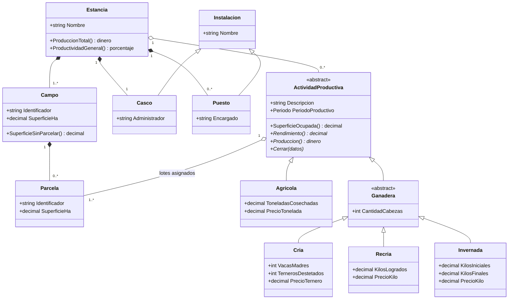

# 09 — Fuente de la actividad: «La Estancia La Ana»

> **Qué es este documento**: la transcripción de la fuente primaria sobre la que se monta la actividad
> interactiva. No es material de la guía: es evidencia, para que ningún ciclo posterior tenga que
> inventar el dominio ni volver a pedir el documento original.
>
> **Origen**: `actividad3.3_iterfaces_clases_abstractas.docx`, Google Drive `1A80sKyEk1XlnOwxRyiZPeMgw3y6nYZrd`,
> propiedad de <correo>, creado 2026-07-30, última modificación 2026-09-15.
> Leído el 2026-09-24 por el conector de Drive.
>
> **Autor**: Filipuzzi, Fernando — UTN FRP, TUP, Programación II, 2026.
> **Título**: Actividad Integradora 3.3 — Jerarquía en programación orientada a objetos. Modelado. La Estancia «La Ana».
>
> **Repositorios declarados en el enunciado**:
> - fork del curso: `https://github.com/UTN-FRP-TUP-Programacion-2-2026/tup_prog_2_2026_actividad3.3`
> - solución del autor: `https://github.com/fernandofilipuzzi-dev/tup_prog_2_2026_actividad3.3`

---

## Índice

1. [Por qué importa esta fuente](#1-por-qué-importa-esta-fuente)
2. [Enunciado (transcripción)](#2-enunciado-transcripción)
3. [Modelo de dominio que se desprende del enunciado](#3-modelo-de-dominio-que-se-desprende-del-enunciado)
4. [Los quince casos de uso](#4-los-quince-casos-de-uso)
5. [Reglas de negocio explícitas en el enunciado](#5-reglas-de-negocio-explícitas-en-el-enunciado)
6. [Lo que el enunciado NO dice](#6-lo-que-el-enunciado-no-dice)

---

## 1. Por qué importa esta fuente

La actividad interactiva de la guía de arquitectura **no parte de un dominio inventado**. Parte de una
actividad de cátedra ya escrita, ya modelada y ya resuelta en una aplicación de escritorio, cuyo eje
didáctico original es **la jerarquía de clases: interfaces y clases abstractas**.

Eso fija el encuadre de toda la actividad y hay que decirlo antes de diseñar nada:

- El dominio **está dado**, no se negocia. Estancia, Campo, Parcela, Lote, Actividad Productiva y sus
  subtipos vienen del enunciado.
- El problema **ya tiene una solución de escritorio**. La versión REST API no reemplaza a la original:
  la pone a prueba.
- El eje conceptual original (jerarquía, polimorfismo, abstracción) **se cruza** con el eje de la guía
  de arquitectura (regla de dependencia, capas, clientes). Ese cruce es el material didáctico: un
  modelo rico en herencia es exactamente el caso donde «poner una API adelante» revela si el modelo
  estaba en el dominio o estaba en el formulario.

---

## 2. Enunciado (transcripción)

> Una estancia agropecuaria tiene un nombre y está compuesta por al menos un campo en su momento de
> conformación. En el mismo acto se establece un casco central a cargo de un Administrador y varios
> puestos rurales, de los cuales cada uno se puede conocer el nombre del encargado. Tanto el casco
> como el puesto son instalaciones y viviendas donde se aloja el dueño y personal de la estancia. La
> administración del casco y de los puestos se contempla en un futuro análisis del sistema.
>
> Cada campo se caracteriza por tener una superficie determinada (hectáreas) y un identificador que
> debe ser único dentro del contexto administrativo de la estancia. La administración de los campos
> consiste solo en el alta de los mismos, y por otro lado, lo que es la baja de estos se contempla en
> un futuro análisis del sistema.
>
> La administración de un campo individual implica crear las parcelas o eliminar las parcelas del
> mismo. Cada parcela debe tener un identificador único dentro del contexto administrativo del propio
> campo y una superficie asignada (hectáreas). La suma de hectáreas de todas las parcelas en un campo
> debe ser coherente con la superficie total del campo.
>
> Cada actividad consta de una descripción, un periodo productivo y luego se le tiene que asignar una
> parcela (una parcela de alguno de los campos de la estancia). Cada actividad productiva se agrega a
> la estancia indicando su periodo de vigencia y descripción. En el cierre de toda actividad se
> ingresan los datos productivos propios del tipo de actividad que sea.
> En general, desde la administración de la estancia, lo que importa es poder saber de todas las
> actividades la producción total (dinero) y la productividad general (porcentaje).
>
> Una de las actividades que se suelen desarrollar es la actividad Agrícola. Esta requiere una serie
> de parcelas durante todo su ciclo productivo, lleva la cuenta de las toneladas cosechadas y el
> precio de la tonelada al cierre del ciclo productivo.
>
> En cambio, en la actividad Ganadera se debe conocer la cantidad de cabezas total y se subdivide en
> diferentes tipos como:
>
> **Cría**: se centra en el número de vacas madres, la cantidad de terneros destetados y el precio de
> venta de cada ternero.
>
> **Recría**: consiste en la recría de animales destetados hasta alcanzar un determinado peso, lo que
> se mide en kilos de carne logrados.
>
> **Invernada**: toma animales recriados y los engorda hasta peso de faena, registrando kilos
> iniciales, kilos finales y el precio por kilo.
>
> A cada actividad se le asocia una descripción y debe permitir calcular la superficie ocupada, el
> rendimiento productivo y la producción generada (ya sea en kilos de carne o toneladas de grano).
>
> Para este ejercicio la producción de cada actividad se valoriza en dinero, multiplicando lo
> producido por su precio. En la actividad Agrícola son las toneladas cosechadas por el precio de la
> tonelada. En Cría, los terneros destetados por el precio de venta de cada ternero. En Recría, los
> kilos de carne logrados por el precio del kilo. En Invernada, los kilos ganados (kilos finales menos
> kilos iniciales, contados sobre el total de los animales) por el precio del kilo. El rendimiento
> productivo se expresa en la unidad propia de cada tipo: toneladas por hectárea ocupada en la
> Agrícola, terneros destetados por cada cien vacas madres en Cría, kilos de carne logrados por cabeza
> en Recría y kilos ganados por cabeza en Invernada.
>
> La producción total de la estancia es la suma de la producción de todas sus actividades. Para este
> ejercicio se toma como productividad general (porcentaje) la parte de la superficie total de los
> campos que está ocupada por lotes asignados a alguna actividad.

### Aclaración del autor sobre RN-08, 2026-09-25

La letra del enunciado dice que la suma de las parcelas «debe ser **coherente** con la superficie
total del campo». «Coherente» no es verificable, y al detectarlo se cometió un error de método: en vez
de recuperar la intención, se **propuso otra regla** («no supera»), que es más débil. El autor aclaró
la intención: **la suma debe ser igual a la superficie total declarada del campo.**

Queda abierto, y es materia de la relectura de intención (documento 10): `=` no puede ser *Invariant*,
porque un campo se incorpora sin parcelas y en ese instante la suma es cero. El enunciado hace cumplir
`≤` dos veces —CU-7 b.2 («supera la superficie sin parcelar») y CU-8 b.1 («sumada a la de las demás,
supera la superficie total»)— y no hace cumplir `=` en ningún momento. Lo más probable es que convivan
dos reglas de especie distinta: `≤` como *Invariant* del campo, y `=` como **condición de
completitud** del parcelado, que hoy nadie verifica y que podría estar pidiendo un caso de uso que el
enunciado no tiene.

### Corrección del autor, 2026-09-24

El cuarto párrafo reemplaza al original, que decía: *«Cada actividad consta de una descripción, un
periodo productivo y **al menos tiene asignado un lote** (una parcela de alguno de los campos de la
estancia). … **Luego se le asignan los lotes** en los que se va a desarrollar.»*

La redacción vieja afirmaba un invariante que el propio flujo de casos de uso no sostenía: la
actividad se da de alta sin lotes (CU-11). El autor además precisó que a una actividad se le asigna
**una o más parcelas**, y que «estancia» se usa en el sentido rioplatense de establecimiento
agropecuario.

---

## 3. Modelo de dominio que se desprende del enunciado

El enunciado remite a tres figuras (2.1 modelo de dominio, 2.2 modelo de actividad Agrícola, 2.3
modelo de actividad productiva) que son imágenes y no se transcribieron. El modelo que sigue es el que
**el texto sostiene literalmente**; todo lo que las figuras agreguen debe contrastarse antes de darlo
por cierto.

**Nota sobre «lote»**: el enunciado define lote como *«una parcela de alguno de los campos de la
estancia»* asignada a una actividad. No es una clase aparte con atributos propios: es el rol que juega
una parcela cuando una actividad la toma. Si en la implementación aparece una clase `Lote`, eso es una
decisión de diseño que hay que justificar, no algo que el enunciado pida.

---

## 4. Los quince casos de uso

| # | Caso de uso | Entrada | Qué decide |
| --- | --- | --- | --- |
| 1 | Alta de la estancia | nombre + primer campo | la estancia nace con al menos un campo, un casco y puestos, **«sin designar los nombres de los encargados de ambas entidades»** |
| 2 | Administración de los campos | — | menú: actualizar, agregar, administrar |
| 3 | Ver listado actualizado de campos | — | listado |
| 4 | Agregar campo | identificador, superficie | identificador único en la estancia; superficie ≠ 0 |
| 5 | Administrar un campo | campo seleccionado | muestra superficie total y **sin parcelar** |
| 6 | Ver listado de parcelas | campo | identificador, área asignada |
| 7 | Agregar parcela | identificador, superficie | único dentro del campo; ≠ 0 y ≤ superficie sin parcelar |
| 8 | Modificar parcela | nueva superficie, o eliminar | bloqueada si está asignada como lote |
| 9 | Administrar actividades productivas | — | menú de actividades |
| 10 | Ver listado de actividades | — | período, descripción |
| 11 | Agregar actividad productiva | tipo, período, descripción, cabezas si es ganadera | **el tipo se elige al crear** |
| 12 | Administrar una actividad | actividad seleccionada | tipo, período, descripción, superficie ocupada, estado |
| 13 | Asignar lote a una actividad | campo + parcela | la parcela no puede estar tomada; la actividad no puede estar cerrada |
| 14 | Cerrar una actividad | datos productivos **según el tipo** | no se cierra sin lotes asignados |
| 15 | Informe de productividad | — | producción y rendimiento por actividad; totales de la estancia |

> **Corrección de esta transcripción, 2026-09-26.** La fila del CU-1 condensaba el resumen del caso y
> perdía una cláusula que resultó decisiva: el original dice que el casco y el puesto se crean **«sin
> designar los nombres de los encargados de ambas entidades»**. Se repuso al detectarse que esa
> cláusula, cruzada con el párrafo I y con el CU declarado fuera de alcance, deja sin momento de
> asignación al dato «nombre del encargado». **La transcripción es fuente secundaria: ante la duda se
> vuelve al documento original.**

### Tarea práctica que el enunciado pide al alumno

1. **Tarea 1**: desarrollar los casos de uso y modelos dados.
2. **Tarea 2**: extender el modelo con una actividad económica específica nueva —forestal, turismo
   rural, apicultura, avícola— agregando los formularios administrativos y adaptando el código base.
3. **Tarea 3**: presentación y defensa en grupo de dos o tres, explicando el modelo de negocio
   incorporado desde la vista del usuario, luego la implementación, y los fundamentos académicos
   aplicados.

> La Tarea 2 es el corazón didáctico del original: **medir cuánto cuesta agregar un subtipo**. Es
> también el mejor banco de pruebas para la guía de arquitectura, porque el mismo cambio se puede
> cronometrar en la versión de escritorio y en la versión con API.

---

## 5. Reglas de negocio explícitas en el enunciado

Se numeran para poder referenciarlas desde la actividad. Todas salen del texto citado en §2 y §4; no
hay ninguna agregada.

| Id | Regla | Dónde la dice el enunciado |
| --- | --- | --- |
| RN-01 | La estancia se conforma con al menos un campo | §2, párrafo 1 |
| RN-02 | El casco y los puestos se crean en el mismo acto de conformación | §2, párrafo 1 |
| RN-03 | El identificador del campo es único dentro de la estancia y no puede ser nulo | §2 párrafo 2, CU-4 b.1 |
| RN-04 | La superficie de un campo no puede ser cero | CU-4 b.2 |
| RN-05 | Los campos sólo se dan de alta; la baja queda fuera de alcance | §2, párrafo 2 |
| RN-06 | El identificador de la parcela es único dentro de su campo y no puede ser nulo | CU-7 b.1 |
| RN-07 | La superficie de una parcela no puede ser cero ni superar la superficie sin parcelar del campo | CU-7 b.2, CU-8 b.1 |
| RN-08 | La suma de las superficies de las parcelas debe ser **igual** a la superficie total declarada del campo | §2 párrafo 3 («coherente»), intención aclarada por el autor el 2026-09-25 |
| RN-09 | Una parcela asignada como lote no se puede modificar ni eliminar | CU-8 a.1 |
| RN-10 | Una parcela ya asignada a una actividad no puede asignarse a otra | CU-13 b.1 |
| RN-11 | Una actividad cerrada no admite más lotes | CU-13 b.2 |
| RN-12 | Una actividad sin lotes asignados no se puede cerrar | CU-14 b.1 |
| RN-13 | A una actividad se le asignan una o más parcelas, **después** del alta | §2 párrafo 4 (redacción corregida 2026-09-24) |
| RN-14 | Los datos de cierre son los propios del tipo de actividad | §2 párrafo 4, CU-14 b |
| RN-15 | Producción = unidad producida × su precio, con fórmula por tipo | §2, párrafo de valorización |
| RN-16 | Rendimiento se expresa en la unidad propia de cada tipo | §2, párrafo de valorización |
| RN-17 | Producción total de la estancia = suma de la producción de sus actividades | §2, último párrafo |
| RN-18 | Productividad general = superficie ocupada por lotes / superficie total de los campos | §2, último párrafo |

### Fórmulas de cierre, por tipo

| Tipo | Producción (dinero) | Rendimiento |
| --- | --- | --- |
| Agrícola | toneladas cosechadas × precio de la tonelada | toneladas por hectárea ocupada |
| Cría | terneros destetados × precio del ternero | terneros destetados por cada cien vacas madres |
| Recría | kilos de carne logrados × precio del kilo | kilos logrados por cabeza |
| Invernada | (kilos finales − kilos iniciales) × precio del kilo | kilos ganados por cabeza |

> **Tensión CERRADA el 2026-09-24, por corrección de la fuente.** RN-13 decía «toda actividad tiene al
> menos un lote asignado» y chocaba con el CU-11, donde la actividad se da de alta antes de asignarle
> lotes. El autor corrigió el enunciado: la asignación es **posterior** al alta, y son **una o más**
> parcelas. Consecuencia para el diseño: RN-13 **no es un *Invariant* del alta**; la regla que se hace
> cumplir es RN-12 (una actividad sin parcelas asignadas no se puede cerrar). El CU-11 queda como está.
>
> Vale la pena dejar dicho cómo se cerró: no la resolvimos por interpretación, la resolvió el autor
> corrigiendo la fuente. Eso es el método funcionando.

---

## 6. Lo que el enunciado NO dice

Enumerarlo importa tanto como lo anterior: es la frontera de lo que se puede afirmar sin inventar.

- **No dice qué tecnología de escritorio** usa la versión original. Hay que mirar el repositorio del
  autor antes de afirmar nada sobre WinForms, WPF o consola.
- **No define persistencia**. No hay base de datos, archivo ni repositorio en el enunciado: en la
  versión de escritorio el estado vive en memoria mientras corre la aplicación. **Decisión del autor
  para la actividad interactiva (2026-09-24): se usa SQLite.**
- **No define autenticación ni usuarios**. El «Administrador» del casco y el «encargado» del puesto son
  datos, no actores del sistema.
- **No define moneda ni redondeo** para la producción en dinero.
- **No define el tipo del período productivo** (fechas, año, campaña).
- **No dice si la estancia es única** en el sistema o si pueden coexistir varias. El CU-1 («Alta de la
  estancia») sugiere una sola instancia por corrida.
- **Las tres figuras del modelo no se transcribieron** porque son imágenes. Cualquier afirmación sobre
  lo que muestran queda pendiente de verificación contra el documento o el repositorio.

---

*Registro abierto el 2026-09-24. Documento de evidencia: se corrige sólo si se corrige la fuente.*
