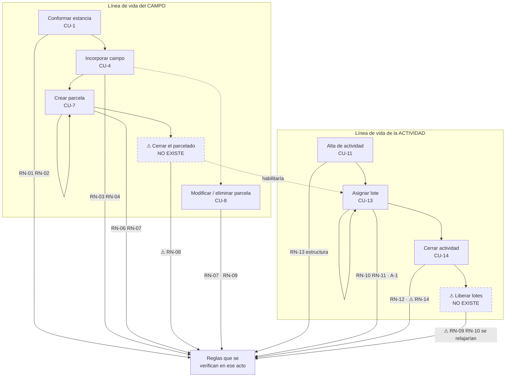

# 10 — Relectura de intención: las 18 reglas de «La Estancia La Ana»

**Fecha:** 2026-09-25
**Rol:** análisis de requerimientos (recuperación de intención). No edita la fuente ni el código.
**Encargo:** releer `RN-01`…`RN-18` separando **letra**, **intención** y **propuesta**, y encontrar lo que el enunciado exige sin decirlo.

> **Por qué existe este documento.** En un ciclo anterior se detectó que «la suma de hectáreas … debe ser
> **coherente** con la superficie total del campo» (RN-08) no es verificable, y en vez de recuperar la
> intención se **propuso otra regla** —«no supera»—, más débil y distinta de la del autor, que quiso decir
> **igual**. Sustituir la letra por una propuesta propia, sin pasar por la intención, es reescribir la
> fuente. Todo este documento está organizado para que eso no pueda volver a pasar: las tres cosas van en
> columnas distintas y rotuladas, y la propuesta siempre va last.

---

## Índice

- [0. Método](#0-método)
- [1. Fuentes y cómo se verificó cada afirmación](#1-fuentes-y-cómo-se-verificó-cada-afirmación)
- [2. Vocabulario: los términos antes que las reglas (punto C)](#2-vocabulario-los-términos-antes-que-las-reglas-punto-c)
  - [2.1 Los once términos, uno por uno](#21-los-once-términos-uno-por-uno)
  - [2.2 Dos palabras para lo mismo](#22-dos-palabras-para-lo-mismo)
  - [2.3 Una palabra para dos cosas](#23-una-palabra-para-dos-cosas)
- [3. Tablero de las 18](#3-tablero-de-las-18)
- [4. Las 18 fichas](#4-las-18-fichas)
- [5. Las reglas que el enunciado no enuncia (punto A)](#5-las-reglas-que-el-enunciado-no-enuncia-punto-a)
- [6. Los huecos de proceso (punto B)](#6-los-huecos-de-proceso-punto-b)
- [7. Mapa de momentos de verificación](#7-mapa-de-momentos-de-verificación)
- [8. Recuento](#8-recuento)

---

## 0. Método

Tres cosas distintas, que nunca se colapsan:

| Rótulo | Qué es | Cómo se reconoce en este documento |
| --- | --- | --- |
| **Letra** | Lo que el enunciado dice, textual, entre comillas, con el lugar exacto | Siempre entre comillas y con la referencia a §2/§4 de `09-Fuente-Actividad-La-Estancia.md` |
| **Intención** | Qué tuvo que haber querido decir, **con el razonamiento a la vista** | Se respalda con otra parte del enunciado, con el código de escritorio (archivo y línea) o con un caso de uso. Si no hay respaldo, dice **conjetura** |
| **Propuesta** | Lo que propondría yo | Va rotulada, y siempre al final de la ficha o en el §6 |

Si letra e intención coinciden, se dice. Si divergen, se muestran las dos.

**Especie** (vocabulario del §3.6 de la guía, que sigue al Business Rules Group):

- **restricción** — prohíbe un estado o un acto (*Action Assertion*: *integrity constraint*, *condition*, *precondition*).
- **derivación** — define un cálculo (*Derivation*). **Una derivación nunca se «viola»**: se calcula bien o mal. Si un documento dice «se violó RN-15», el que está mal es el documento.
- **alcance** — dice qué queda afuera del sistema. No se hace cumplir: se hace cumplir su ausencia.

A esas tres se agrega, donde hace falta, **estructura** (*Structural Assertion*: afirma que algo existe o se relaciona, y en objetos es clase, atributo y multiplicidad).

**Momento** (§3.7 de la guía):

- ***Invariant*** — vale toda la vida del objeto, se verifica al crear y en cada método que cambia el dato.
- ***Precondition* de un acto** — vale sólo antes de ese acto; va en el método del acto.
- **condición de completitud** — describe un estado alcanzado («el parcelado está completo», «la actividad tiene lotes»). No es *Invariant* porque hay un tramo legítimo de la vida del objeto en que no se cumple. **Obliga a decir quién la verifica y cuándo, o a declarar que nadie lo hace.** Las reglas de esta especie son las que producen los huecos del §6.

**Dueño**: el objeto que tiene a mano lo que la regla necesita para decidirse (la *Responsibility* de Wirfs-Brock, citada en §3.6 de la guía). Si ningún objeto del enunciado lo tiene, se dice: **ésas son las que terminan fuera del dominio**.

Decisiones ya tomadas que este documento toma como contexto y no rediscute: la actividad se da de alta con descripción y período y **luego** se le asignan una o más parcelas; un campo se incorpora **sin parcelas** (0..*) y el parcelado le corresponde a la estancia; `Estancia` es la raíz del agregado y `Campo` y `Parcela` viven dentro de su borde; la intención de RN-08 es **igualdad**.

---

## 1. Fuentes y cómo se verificó cada afirmación

| Fuente | Qué aporta | Verificación |
| --- | --- | --- |
| `OUTPUTs/Bitacora-Editores/09-Fuente-Actividad-La-Estancia.md` | El enunciado literal, los 15 casos de uso, `RN-01`…`RN-18`, las fórmulas por tipo y «lo que el enunciado NO dice» | Leído completo |
| `PROG2/…/Actividad3.3/Ejercicio1/` | La solución de escritorio **del mismo autor**: la mejor evidencia de su intención | `Models/` 11 clases y `Vistas/` 14 archivos de formulario leídos completos. `git log` → `HEAD` = `80c003b` |
| `OUTPUTs/Bitacora-Editores/07-Actividad-Didactica.md` §3.2 | Dónde vive hoy cada una de las 18 | Leído; este documento **no repite** su tabla de domicilios: agrega la columna que le faltaba, que es el **momento** |
| `Guides/Dot-NET-Arquitectura-Guide.md` §3.2, §3.6, §3.7, §4.10 | El vocabulario: prueba del papel, los tres tipos del BRG, *Invariant* contra *Precondition*, *Aggregate* | Leído |

Sobre `PROG2/` rige **lectura solamente**. Toda afirmación sobre ese código se cita con archivo y línea. Lo que no se puede respaldar ni con el texto ni con el código va rotulado **conjetura**.

> **Advertencia de lectura.** La tabla del `07` §3.2 responde *«¿dónde está implementada?»*. Este documento
> responde *«¿qué quiso decir, y en qué momento habría que verificarlo?»*. Las dos preguntas dan respuestas
> distintas para la misma regla, y eso no es contradicción: RN-08 está marcada «Domain ✅» en el `07`
> porque el código verifica **algo** —el «no supera»— en `Campo.CrearParcela`; acá se muestra que eso que
> verifica **no es RN-08**, sino RN-07.

---

## 2. Vocabulario: los términos antes que las reglas (punto C)

Antes de discutir una regla hay que saber de qué habla. Este apartado es el que más trabajo ahorra después:
seis de las trece divergencias del §4 son, en el fondo, un término que el enunciado usa en dos sentidos.

### 2.1 Los once términos, uno por uno

**Estancia**
*Letra:* «Una estancia agropecuaria tiene un nombre y está compuesta por al menos un campo en su momento de conformación» (§2 p.1).
*Intención:* establecimiento agropecuario, en el sentido rioplatense (el autor lo precisó el 2026-09-24). Es el **todo administrativo**: el contexto dentro del cual los identificadores de campo son únicos (§2 p.2, «el contexto administrativo de la estancia»). En vocabulario de la guía, ese «contexto administrativo» es exactamente el **borde del *Aggregate*** (§4.10): el conjunto dentro del cual alguien puede hacer cumplir una regla que ningún objeto suelto alcanza a verificar.
*Código:* `Estancia` tiene `Nombre`, los campos, el casco, los puestos y las actividades (`Estancia.cs` l. 8, 27, 49, 107).

**Campo**
*Letra:* «Cada campo se caracteriza por tener una superficie determinada (hectáreas) y un identificador que debe ser único dentro del contexto administrativo de la estancia» (§2 p.2).
*Intención:* unidad de tierra con superficie declarada e identidad propia dentro de la estancia. Se incorpora **sin parcelas** y el parcelado viene después.
*Código:* `Campo(string identificador, double superficieTotal)` (`Campo.cs` l. 9–13), con la lista de parcelas vacía (l. 17).

**Parcela**
*Letra:* «Cada parcela debe tener un identificador único dentro del contexto administrativo del propio campo y una superficie asignada (hectáreas)» (§2 p.3).
*Intención:* subdivisión de **un** campo. El cambio de «contexto administrativo de la estancia» a «del propio campo» entre el párrafo 2 y el 3 es deliberado: el autor está diciendo que la parcela **no** es única en la estancia. De ahí se sigue A-6 del §5.
*Código:* `Parcela(string identificador, double superficie)` (`Parcela.cs` l. 9–13); la unicidad la verifica el campo, no la parcela (`Campo.cs` l. 23).

**Lote**
*Letra:* «luego se le tiene que asignar una parcela (una parcela de alguno de los campos de la estancia)» (§2 p.4, redacción corregida); «la parte de la superficie total de los campos que está ocupada por **lotes** asignados a alguna actividad» (§2, último párrafo).
*Intención:* **rol**, no clase. Una parcela se llama lote mientras una actividad la tiene tomada. El enunciado nunca le da atributos propios.
*Código:* lo confirma y lo dice con todas las letras: «los lotes son parcelas que ya existen en algún campo de la estancia, acá solo guardo la referencia (agregación)» (`Actividad.cs` l. 17–18), y la colección es `List<Parcela>` (l. 19). No hay clase `Lote` en `Models/`. Sí hay un `FormLoteDatos` (`Vistas/Datos/FormLoteDatos.cs`), que es una pantalla, no un concepto.

**Actividad**
*Letra:* «Cada actividad consta de una descripción, un periodo productivo y luego se le tiene que asignar una parcela» (§2 p.4).
*Intención:* el registro de un emprendimiento productivo con un período, una descripción, un tipo fijado al nacer y un conjunto de lotes. En vocabulario de la guía: una *Entity* con identidad y ciclo de vida (abierta → cerrada), no un verbo.
*Código:* `abstract class Actividad` con `Periodo`, `Descripcion`, `lotesAsignados`, `Cerrada` (`Actividad.cs` l. 4–19, 64).

**Período**
*Letra:* «un periodo productivo» (§2 p.4), «su periodo de vigencia» (§2 p.4), «todo su ciclo productivo» (§2, párrafo agrícola), «al cierre del ciclo productivo» (ídem). CU-10 y CU-12 lo listan como «período».
*Intención:* **una sola cosa** nombrada de cuatro maneras: la campaña durante la cual la actividad se desarrolla. El enunciado **no define su tipo** (así lo declara la fuente en su §6).
*Código:* el autor lo resolvió como `int Periodo` (`Actividad.cs` l. 6) y el formulario lo pide como texto convertido a entero (`FormPrincipal.cs` l. 244). Es decir: **año calendario**. Esto es evidencia de intención, no una decisión del enunciado.

**Cierre**
*Letra:* «En el cierre de toda actividad se ingresan los datos productivos propios del tipo de actividad que sea» (§2 p.4); «el precio de la tonelada al cierre del ciclo productivo» (§2, párrafo agrícola). CU-14: «Cerrar una actividad».
*Intención:* el acto administrativo por el cual una actividad deja de estar en curso y queda con sus números cargados. Es **un solo acto** que hace dos cosas: recibir los datos productivos y cambiar el estado.
*Código:* el autor lo partió en dos: los datos entran por propiedades públicas desde el formulario y después se llama a `Cerrar()`, que sólo verifica RN-12 y da vuelta la bandera (`FormPrincipal.cs` l. 396–425; `Actividad.cs` l. 68–76, con el comentario del autor en l. 66–67). Esa partición es el origen de la divergencia de RN-14.

**Superficie sin parcelar**
*Letra:* no aparece en el enunciado. Aparece en **CU-5**: «muestra superficie total y **sin parcelar**».
*Intención:* el saldo `superficie total del campo − suma de las superficies de sus parcelas`. Es una **derivación**, y el nombre que el autor le dio delata cómo la piensa: no es «superficie libre» ni «remanente», es lo que **todavía no se parceló**, es decir, una deuda pendiente, no un estado legítimo de reposo. Ese matiz es una de las piezas que sostienen la lectura de RN-08 como igualdad.
*Código:* la calcula el formulario, no el dominio: `double libre = campoSeleccionado.SuperficieTotal - campoSeleccionado.SuperficieOcupada()` (`FormPrincipal.cs` l. 137–138, repetido en l. 189–190). En `Campo` existe `SuperficieOcupada()` (`Campo.cs` l. 79–87) pero **no** existe `SuperficieSinParcelar()`. El modelo del doc 09 la propone; el código no la tiene.

**Producción**
*Letra:* dos veces, y con dos sentidos distintos. (a) «debe permitir calcular la superficie ocupada, el rendimiento productivo y la **producción generada (ya sea en kilos de carne o toneladas de grano)**» (§2, párrafo de la descripción); (b) «Para este ejercicio la **producción** de cada actividad se valoriza en dinero, multiplicando lo producido por su precio» (§2, párrafo de valorización); (c) «lo que importa es poder saber de todas las actividades la **producción total (dinero)**» (§2 p.4).
*Intención:* el enunciado usa «producción» para la **magnitud física** en (a) y para la **magnitud valorizada** en (b) y (c). La frase «para este ejercicio» es la que decide: cuando el modelo dice `Produccion()`, es dinero.
*Código:* `CalcularProduccion()` devuelve `double` en pesos en los cuatro subtipos (`Agricola.cs` l. 14–17, `Cria.cs` l. 22–25, `ReCria.cs` l. 14–17, `Ivernada.cs` l. 15–18), y el informe lo rotula `$` (`FormPrincipal.cs` l. 448). La magnitud física no tiene método propio: queda como atributo del subtipo (`CantidadToneladasCosechadas`, `CantidadKilosCarneFinal`…).

**Rendimiento**
*Letra:* «el rendimiento productivo … El rendimiento productivo se expresa en la unidad propia de cada tipo» (§2, párrafos de la descripción y de la valorización).
*Intención:* magnitud **por unidad de recurso**, y el recurso cambia con el tipo: por hectárea en Agrícola, por cada cien vacas madres en Cría, por cabeza en Recría e Invernada. No es comparable entre tipos, y ésa es exactamente la razón por la que el enunciado no pide un «rendimiento total de la estancia» y sí pide una producción total (que sí es comparable, porque está en dinero).
*Código:* `CalcularRendimiento()` abstracto (`Actividad.cs` l. 85) con cuatro implementaciones.

**Productividad**
*Letra:* «la productividad general (porcentaje)» (§2 p.4); «Para este ejercicio se toma como productividad general (porcentaje) la parte de la superficie total de los campos que está ocupada por lotes asignados a alguna actividad» (§2, último párrafo).
*Intención:* **no** es un promedio de rendimientos ni tiene que ver con producir: es un **indicador de uso de la tierra**. El propio autor lo marca con «para este ejercicio se toma como», que es la manera de decir «este nombre está prestado».
*Código:* `CalcularProductividadGeneral()` = superficie de lotes ÷ superficie total de los campos × 100 (`Estancia.cs` l. 164–181).

### 2.2 Dos palabras para lo mismo

| Un concepto | Las palabras que el enunciado o el código usan | Dónde | Cuál conviene |
| --- | --- | --- | --- |
| La campaña de la actividad | «periodo productivo», «periodo de vigencia», «ciclo productivo», «período» | §2 p.4; §2 párrafo agrícola; CU-10, CU-12 | **período** |
| Crear una parcela | «crear las parcelas», «partición» | §2 p.3; `FormPrincipal.cs` l. 164 («No se pudo realizar la partición») | **parcelar** / **crear parcela**; «partición» sólo aparece en un mensaje de error |
| La actividad | «actividad», «actividad productiva», «actividad económica específica» | §2 p.4; CU-9, CU-11; Tarea 2 | **actividad productiva** |
| El casco y el puesto | «instalaciones», «viviendas» | §2 p.1 | el enunciado ya las unifica: son **instalaciones** |
| La estancia | «estancia», «establecimiento» | §2; `FormPrincipal.cs` l. 21 («pide los datos del establecimiento»), l. 58 | **estancia** |

### 2.3 Una palabra para dos cosas

Éstas son las que producen errores de diseño, no sólo de prosa.

| La palabra | Sentido 1 | Sentido 2 | Evidencia de que son dos |
| --- | --- | --- | --- |
| **superficie ocupada** | la del **campo**: suma de las superficies de sus parcelas (o sea, «parcelada») | la de la **actividad**: suma de las superficies de sus lotes | `Campo.SuperficieOcupada()` (`Campo.cs` l. 79–87) contra `Actividad.CalcularSuperficieOcupada()` (`Actividad.cs` l. 50–58). El mismo nombre, dos cálculos sobre dos colecciones distintas. RN-18 usa el **sentido 2** y RN-07/RN-08 el **sentido 1**. Es la ambigüedad más peligrosa del vocabulario |
| **producción** | magnitud física (toneladas, kilos) | magnitud valorizada en dinero | §2 párrafo de la descripción contra §2 párrafo de valorización y §2 p.4 |
| **productividad** | el indicador de uso de la tierra (RN-18) | el título del informe, que abarca producción **y** rendimiento | §2 último párrafo contra CU-15 «Informe de productividad» |
| **administración** | el acto de gestionar (CU-2, CU-5, CU-9, CU-12) | la persona: el «Administrador» del casco | §2 p.1 contra §2 p.2 |
| **campo** | unidad de tierra identificada | (riesgo latente) el establecimiento entero, en el habla corriente | El enunciado usa siempre el sentido 1; se anota porque quien lea la API sin el enunciado leerá el 2 |
| **identificador** | único en la **estancia** (campo) | único en el **campo** (parcela) | §2 p.2 contra §2 p.3. Misma palabra, dos ámbitos de unicidad |
| **cierre** | el hecho del negocio: terminó el ciclo productivo | el estado del registro: `Cerrada = true` | §2 párrafo agrícola contra CU-14 y `Actividad.cs` l. 64 |
| **cabezas** | el total del rodeo de una ganadera | ¿incluye las vacas madres de Cría? ¿los terneros? | `Ganadera.cs` l. 7 contra `Cria.cs` l. 5–6. El enunciado no lo resuelve; ver A-13 |

---

## 3. Tablero de las 18

Resumen de las fichas del §4. «Divergen» distingue **de fondo** (cambia lo que hay que construir) de **leve** (precisión de redacción).

| Id | Especie | Momento | Dueño | ¿Divergen? |
| --- | --- | --- | --- | --- |
| RN-01 | restricción | *Precondition* de conformar | Estancia | leve |
| RN-02 | restricción + alcance | *Invariant* del agregado (casco) / ninguno (puestos) | Estancia | **de fondo** |
| RN-03 | restricción | *Invariant* del agregado | Estancia | leve |
| RN-04 | restricción | *Invariant* de Campo | Campo | leve |
| RN-05 | **alcance** | ninguno (se cumple por ausencia) | nadie | no |
| RN-06 | restricción | *Invariant* del agregado Campo | Campo | leve |
| RN-07 | restricción | *Invariant* del agregado Campo | Campo | leve |
| RN-08 | restricción | **condición de completitud — hoy nadie la verifica** | Campo | **de fondo** |
| RN-09 | restricción (*condition*) | *Precondition* de modificar y de eliminar parcela | **Estancia** (raíz) | **de fondo** |
| RN-10 | restricción | *Precondition* de asignar lote | **Estancia** (raíz) | **de fondo** |
| RN-11 | restricción (*condition*) | *Precondition* de asignar lote | Actividad | no |
| RN-12 | restricción | *Precondition* de cerrar | Actividad | no |
| RN-13 | estructura + completitud | condición de completitud, verificada por RN-12 al cerrar | Actividad | leve |
| RN-14 | restricción + estructura | *Precondition* de cerrar — **hoy nadie la verifica** | cada subtipo | **de fondo** |
| RN-15 | **derivación** | ninguno (a demanda) | cada subtipo | leve |
| RN-16 | **derivación** | ninguno (a demanda) | cada subtipo | no |
| RN-17 | **derivación** | ninguno (a demanda) | Estancia | leve |
| RN-18 | **derivación** | ninguno (a demanda) | Estancia | no |

**13 de 18 divergen**: 5 de fondo (RN-02, RN-08, RN-09, RN-10, RN-14) y 8 leves. **4 de las 18 son derivaciones** y por lo tanto no se «violan». **2 no tienen momento de verificación** (RN-08 y RN-14) y son los dos huecos mayores del §6.

---

## 4. Las 18 fichas

### RN-01 — La estancia se conforma con al menos un campo

| Campo | Contenido |
| --- | --- |
| **Letra** | «Una estancia agropecuaria tiene un nombre y está compuesta por al menos un campo **en su momento de conformación**» — §2, párrafo 1 |
| **Intención** | Es un requisito del **acto de conformar**, no una promesa perpetua: «en su momento de conformación» lo dice explícitamente. Que además se conserve toda la vida de la estancia no es una segunda regla, es una **consecuencia de RN-05**: como no hay baja de campos, nadie puede llevar la cuenta a cero. Respaldo en el código: el constructor **exige** un campo por firma —`Estancia(string nombre, Campo campo)` (`Estancia.cs` l. 13–21)— y no existe ningún método que quite un campo. Caso de uso: CU-1, cuya entrada es «nombre + primer campo» |
| **¿Divergen?** | **Sí, leve.** La letra permite leerse como invariante perpetuo; la intención es precondición del alta, sostenida después por la ausencia de baja. La diferencia importa el día que se agregue la baja de campos (§6, B-4) |
| **Especie** | restricción |
| **Momento** | *Precondition* del acto de conformar la estancia. De hecho *Invariant*, pero **por accidente**: la sostiene RN-05, no un método |
| **Dueño** | `Estancia`, que es la raíz del agregado y la única que cuenta sus campos |
| **Prueba** | «No se puede conformar una estancia sin ningún campo» |

> **Hallazgo sobre el código.** El constructor no valida que el campo recibido no sea `null` (`Estancia.cs`
> l. 13–21): lo hace cumplir la firma en tiempo de compilación, no una guarda. Con una API adelante, ese
> `null` llega como un cuerpo JSON sin campo y nadie lo ataja en el dominio.

### RN-02 — El casco y los puestos se crean en el mismo acto

| Campo | Contenido |
| --- | --- |
| **Letra** | «En el mismo acto se establece un casco central a cargo de un Administrador y **varios** puestos rurales, de los cuales cada uno se puede conocer el nombre del encargado. … La administración del casco y de los puestos se contempla en un futuro análisis del sistema» — §2, párrafo 1 |
| **Intención** | Dos cosas distintas dichas juntas. (1) **El casco**: la estancia tiene exactamente uno, desde el acto de conformación. Eso sí es una regla. (2) **Los puestos**: «varios» es **descripción del establecimiento típico**, no cardinalidad exigible, y el propio párrafo lo confirma cuando manda su administración a un futuro análisis: no se puede exigir una cantidad de algo que el sistema declara no administrar. Respaldo en el código: el constructor crea el casco con `Administrador = "No designado"` y **un** puesto, también «No designado» (`Estancia.cs` l. 18–20); los manejadores de menú de casco y puestos están vacíos (`FormPrincipal.cs` l. 40–48) |
| **¿Divergen?** | **Sí, de fondo.** La letra dice «varios puestos»; la intención es «un casco, y los puestos que haya, cero o más». El código hace una tercera cosa: crea exactamente uno, de relleno, para que la estructura no quede vacía |
| **Especie** | restricción (el casco) + **alcance** (los puestos) |
| **Momento** | Para el casco, *Invariant* del agregado: la estancia siempre tiene exactamente uno. Para los puestos, **ninguno**: no hay acto que los administre ni condición que verificar |
| **Dueño** | `Estancia` |
| **Prueba** | «Una estancia recién conformada tiene exactamente un casco» — y **no** «tiene varios puestos», que no es verificable |

### RN-03 — El identificador del campo es único dentro de la estancia y no puede ser nulo

| Campo | Contenido |
| --- | --- |
| **Letra** | «un identificador que debe ser único dentro del contexto administrativo de la estancia» — §2, párrafo 2. CU-4 b.1: «identificador único en la estancia» |
| **Intención** | «Contexto administrativo de la estancia» = el conjunto de campos de **esa** estancia, no un registro global: es el borde del agregado. El «no puede ser nulo» **no está en el enunciado**: lo agregó la tabla de RN de la fuente. Se infiere, y la inferencia se sostiene: la unicidad de un identificador ausente no significa nada, y además CU-4 declara al identificador como entrada del caso de uso. Respaldo en el código, en dos lugares distintos: `Estancia.AgregarCampo` rechaza el duplicado (`Estancia.cs` l. 113) y `FormPrincipal.SolicitarDatosCampo` rechaza el vacío (`FormPrincipal.cs` l. 471–475) |
| **¿Divergen?** | **Sí, leve.** La letra dice unicidad; el «no nulo» es inferencia de la fuente, no texto del autor |
| **Especie** | restricción |
| **Momento** | *Invariant* del agregado `Estancia`: se verifica al incorporar **cada** campo, **incluido el fundacional** |
| **Dueño** | `Estancia`. Un campo no conoce a sus hermanos (§3.6 de la guía: «no hay dos con el mismo nombre» no puede ser de la *Entity*). Dentro de un agregado, sin embargo, **sí hay dueño**: la raíz, que los tiene a todos |
| **Prueba** | «Dos campos con el mismo identificador no conviven en una estancia, ni siquiera si uno de ellos es el campo fundacional» |

> **Hallazgo sobre el código.** El campo fundacional entra por el constructor y **no pasa por
> `AgregarCampo`** (`Estancia.cs` l. 17 contra l. 109–118). Hoy es inocuo porque con un solo campo no hay
> duplicado posible, y porque el «no nulo» lo ataja el formulario. Con dos caminos de entrada y una sola
> guarda, la regla vale en uno y no en el otro. Ver §6, B-8.

### RN-04 — La superficie de un campo no puede ser cero

| Campo | Contenido |
| --- | --- |
| **Letra** | CU-4 b.2: «superficie ≠ 0». §2 párrafo 2 sólo dice «una superficie determinada (hectáreas)» |
| **Intención** | **Superficie estrictamente positiva.** El «≠ 0» es la forma en que se escribe la regla desde un formulario, donde el valor negativo parece imposible de tipear; en el negocio, un campo de −50 ha es tan imposible como uno de 0 ha. Respaldo en el código, que escribe la intención y no la letra: `campo.SuperficieTotal <= 0` (`Estancia.cs` l. 113) y `superficieCampo1 <= 0` (`FormPrincipal.cs` l. 471) |
| **¿Divergen?** | **Sí, leve.** Letra: «≠ 0». Intención y código: «> 0» |
| **Especie** | restricción |
| **Momento** | *Invariant* de `Campo`: vale toda su vida, no sólo al alta |
| **Dueño** | `Campo` (se decide mirando el campo solo) |
| **Prueba** | «Un campo con superficie cero o negativa no se crea, y tampoco se puede llevar a cero después» |

> **Hallazgo sobre el código.** Hoy **no** es *Invariant*: `public double SuperficieTotal { get; set; }`
> (`Campo.cs` l. 7) es un setter público. La regla se verifica al incorporar y nadie la vuelve a verificar,
> que es justo la tercera pieza que el §3.6 de la guía pide para sostener una *Invariant*. Ver §6, B-5.

### RN-05 — Los campos sólo se dan de alta; la baja queda fuera de alcance

| Campo | Contenido |
| --- | --- |
| **Letra** | «La administración de los campos consiste solo en el alta de los mismos, y por otro lado, lo que es la baja de estos se contempla en un futuro análisis del sistema» — §2, párrafo 2 |
| **Intención** | **Coincide con la letra**, y es la única de las 18 que lo hace sin matices. Es importante leer lo que **no** dice: no dice que un campo no se pueda dar de baja en el negocio real —una estancia vende campos—, dice que **este sistema no lo hace todavía**. Es una frontera del software, no una regla de la estancia. Respaldo en el código: no existe ningún método de baja en `Estancia` ni en `Campo`; CU-2 ofrece «actualizar, agregar, administrar» y nada más |
| **¿Divergen?** | **No** |
| **Especie** | **alcance** |
| **Momento** | Ninguno. Una regla de alcance no se verifica: se cumple porque la operación **no existe** |
| **Dueño** | **Ninguno.** No es una regla del dominio y no tiene dónde vivir dentro de él. Ésta es una de las que «terminan fuera»: vive en la superficie pública del agregado, es decir, en lo que el diseño **decide no ofrecer** |
| **Prueba** | «La superficie pública de la estancia no ofrece ninguna operación de baja de campo» — una prueba de arquitectura, no de negocio; en el vocabulario del §3.2 de la guía, no pasa la prueba del papel como restricción |

### RN-06 — El identificador de la parcela es único dentro de su campo y no puede ser nulo

| Campo | Contenido |
| --- | --- |
| **Letra** | «Cada parcela debe tener un identificador único dentro del contexto administrativo del propio campo» — §2, párrafo 3. CU-7 b.1 |
| **Intención** | El ámbito de unicidad es **el campo**, no la estancia, y el cambio respecto de RN-03 es deliberado: el autor escribió «de la estancia» en el párrafo 2 y «del propio campo» en el 3. Consecuencia que el enunciado no enuncia y hay que asumir: **dos campos pueden tener cada uno una parcela «P-1»** (ver A-6). El «no nulo» es, otra vez, inferencia de la fuente. Respaldo en el código: `BuscarParcela(identificador) < 0` dentro de `CrearParcela` (`Campo.cs` l. 23, 89–94) |
| **¿Divergen?** | **Sí, leve**, por el «no nulo» inferido |
| **Especie** | restricción |
| **Momento** | *Invariant* del agregado `Campo` |
| **Dueño** | `Campo` |
| **Prueba** | «Dos parcelas con el mismo identificador no conviven en un campo, pero dos campos distintos sí pueden tener cada uno la parcela P-1» |

> **Hallazgo sobre el código.** `BuscarParcela` **ordena la lista** antes de buscar
> (`parcelas.Sort()`, `Campo.cs` l. 91). Es un efecto colateral dentro de una consulta: cada verificación
> de unicidad reordena la colección y invalida los índices que el llamador tenía. El autor lo sabe y lo
> compensa desde la vista, recargando el listado entero después de cada operación, con el comentario a la
> vista: «vuelvo a cargar el listado siempre, porque el campo reordena las parcelas al buscar»
> (`FormPrincipal.cs` l. 182–184). Y `Parcela.CompareTo` llama a `Identificador.CompareTo` sin protección
> (`Parcela.cs` l. 19): con un identificador nulo, la verificación de unicidad no rechaza, **explota**.

### RN-07 — La superficie de una parcela no puede ser cero ni superar la superficie sin parcelar del campo

| Campo | Contenido |
| --- | --- |
| **Letra** | CU-7 b.2: «≠ 0 y ≤ superficie sin parcelar». CU-8 b.1, para la modificación |
| **Intención** | Dos reglas en una: (1) superficie estrictamente positiva, igual que RN-04; (2) **el parcelado no puede exceder el campo**, ni creando ni modificando. La segunda es la cara operativa, verificable a cada paso, de lo que RN-08 dice como meta. **No es RN-08**: ésta prohíbe pasarse; aquélla exige llegar. Respaldo en el código, donde el autor escribe la segunda con cuidado: al crear, `superficie + SuperficieOcupada() <= SuperficieTotal` (`Campo.cs` l. 23); al modificar, descuenta primero la parcela que se está modificando —`double ocupada = SuperficieOcupada() - parcela.Superficie`— y recién ahí compara (`Campo.cs` l. 55–56). Ese descuento es evidencia fuerte de que la regla que el autor tiene en la cabeza es sobre **la suma**, no sobre cada parcela |
| **¿Divergen?** | **Sí, leve**: «≠ 0» contra «> 0», igual que RN-04 |
| **Especie** | restricción |
| **Momento** | *Invariant* del agregado `Campo`: la suma de las parcelas nunca supera la superficie total, en ningún momento de la vida del campo |
| **Dueño** | `Campo`, que conoce su superficie y todas sus parcelas. **Éste es el caso de manual del §4.10 de la guía**: la regla no la puede verificar `Parcela` —no conoce a sus hermanas ni el total— y sí la puede verificar el campo, porque las parcelas están dentro de su borde |
| **Prueba** | «La suma de las superficies de las parcelas de un campo nunca supera su superficie total: ni al crear una parcela, ni al modificarla, ni al cambiar la superficie del campo» |

> **Hallazgo sobre el código.** La tercera de las tres situaciones de la prueba no está cubierta: con
> `SuperficieTotal` (`Campo.cs` l. 7) y `Parcela.Superficie` (`Parcela.cs` l. 7) de setter público,
> cualquiera baja el total del campo por debajo de lo parcelado, o agranda una parcela, sin pasar por
> ningún método. La *Invariant* tiene la primera pieza (la verifica al crear) y le faltan las otras dos
> (setter cerrado, y cada método que toca el dato). §6, B-5.

### RN-08 — La suma de las parcelas debe ser **igual** a la superficie total del campo

**Ésta es la regla que originó este documento. Va en detalle.**

| Campo | Contenido |
| --- | --- |
| **Letra** | «La suma de hectáreas de todas las parcelas en un campo debe ser **coherente** con la superficie total del campo» — §2, párrafo 3 |
| **Intención** | **Igualdad**: la suma de las parcelas debe ser **igual** a la superficie total declarada del campo. Cinco respaldos, en orden de peso: **(a)** el autor lo aclaró explícitamente al revisarse esta regla. **(b)** Leer «coherente» como «no supera» vuelve la regla **redundante**: el «no supera» ya está escrito, y con más precisión, en CU-7 b.2 y CU-8 b.1 (RN-07). Un autor no dedica una oración del enunciado a repetir con una palabra vaga lo que ya dijo con una fórmula exacta dos casos de uso más adelante; si RN-08 dice algo, dice algo **más** que RN-07. **(c)** El nombre que el autor le puso al saldo es «superficie **sin parcelar**» (CU-5), no «superficie libre» ni «remanente»: nombra una tarea pendiente, no un estado de reposo legítimo. **(d)** RN-18 define la productividad general sobre «la superficie **total de los campos**»; si una parte del campo pudiera quedar sin parcelar para siempre, el denominador incluiría tierra que por construcción **nunca** puede aparecer en el numerador —sólo las parcelas se asignan como lotes—, y el indicador dejaría de ser comparable entre campos bien y mal parcelados. Con RN-08 como igualdad, «superficie total de los campos» y «superficie parcelada» son la misma cantidad y el indicador mide lo que promete. **(e)** §2 párrafo 3 encuadra el parcelado como «La administración de un campo individual **implica** crear las parcelas»: el parcelado es lo que se hace con un campo, no una opción |
| **¿Divergen?** | **Sí, y es la divergencia madre.** «Coherente» no es verificable: no dice ni igual, ni menor, ni con qué tolerancia. La intención es **igual**. Y el código no implementa ninguna de las dos cosas: implementa RN-07 |
| **Especie** | **restricción** — prohíbe un estado: un campo con parcelado incompleto. No es derivación (no define ningún cálculo) ni alcance |
| **Momento** | **Condición de completitud, y hoy nadie la verifica.** No puede ser *Invariant*: por la decisión de contexto, un campo se incorpora **sin parcelas** (0..*), de modo que todo campo nace violándola y sigue violándola durante todo el parcelado. Una regla que el objeto incumple desde que nace no es una *Invariant* —§3.7 de la guía: la *Invariant* «vale toda la vida del objeto»— y ponerla en la creación «bloquea casos legítimos», que es exactamente lo que pasaría acá. Tampoco es *Precondition* de ningún acto existente: ninguno de los 15 casos de uso la mira. **Quién la verifica hoy: nadie.** CU-5 se limita a **mostrar** la superficie sin parcelar (`FormPrincipal.cs` l. 137–138) |
| **Dueño** | **`Campo`**, sin ninguna duda: conoce su superficie total y todas sus parcelas, y no necesita mirar nada más. Lo que falta no es el dueño ni el dato: **falta el momento** |
| **Prueba** | «Un campo cuyo parcelado está cerrado tiene la suma de las superficies de sus parcelas exactamente igual a su superficie total» — y esa prueba **no se puede escribir hoy**, porque «parcelado cerrado» no existe en el vocabulario del enunciado |

**Propuesta** (rotulada como tal; ver §6, B-1): incorporar un caso de uso «**Cerrar el parcelado del campo**», cuya *Precondition* sea `superficie sin parcelar == 0` y cuya *Postcondition* sea que el campo queda con el parcelado cerrado. Con él, RN-08 pasa de meta descriptiva a regla con guardián, y aparece como consecuencia una regla que hoy no existe: sólo se asignan como lotes las parcelas de campos con el parcelado cerrado. **No es lo que el enunciado dice, y no debe presentarse como tal**: es la forma de darle un momento a la intención del autor.

> **Lo que no hay que hacer, escrito para que quede registrado.** Reemplazar «coherente» por «no supera»
> es debilitar la regla hasta volverla otra, y además una que ya existía con otro número. Ése fue el error
> que originó este documento.

### RN-09 — Una parcela asignada como lote no se puede modificar ni eliminar

| Campo | Contenido |
| --- | --- |
| **Letra** | CU-8 a.1: «bloqueada si está asignada como lote» |
| **Intención** | Protege los números de la actividad que la tiene tomada: la superficie ocupada, y con ella el rendimiento, se calculan **a demanda** sobre las parcelas (`Actividad.cs` l. 50–58; `Agricola.cs` l. 22), así que achicar o borrar una parcela cambiaría retroactivamente el rendimiento de una actividad ajena. Respaldo en el código: `FormPrincipal.ModificarParcela` l. 552–557, que consulta `estancia.EstaAsignada(seleccionada)` y corta antes de llamar al campo. Nótese que el mensaje al usuario nombra la razón del negocio, no una restricción técnica: «La parcela está asignada como lote a una actividad y no se puede modificar ni eliminar» (l. 555–556) — pasa la prueba del papel y la pregunta 4 del §3.2 de la guía |
| **¿Divergen?** | **Sí, de fondo**, en el alcance temporal. La letra dice «asignada», sin límite. Lo razonable en el negocio sería «asignada a una actividad **en curso**»: terminada la campaña, la tierra vuelve a estar disponible. Pero con el cálculo derivado tal como está, **la lectura amplia es la que sostiene los números**, porque el rendimiento de una actividad ya cerrada se sigue recalculando cada vez que se pide el informe. Las dos lecturas son coherentes consigo mismas; el enunciado no elige, y el código elige la amplia **sin decirlo**: `EstaAsignada` recorre todas las actividades sin mirar `Cerrada` (`Estancia.cs` l. 82–90). *Se declara como inferencia con alternativa abierta, no como certeza* |
| **Especie** | restricción, en la forma *condition* del §3.6: «si la parcela está asignada, entonces se aplica esta prohibición» |
| **Momento** | *Precondition* de dos actos: «modificar parcela» y «eliminar parcela» |
| **Dueño** | **`Estancia`**, la raíz. Ni la parcela ni el campo saben qué actividades tomaron qué: el campo conoce sus parcelas, la actividad conoce sus lotes, y **sólo la estancia tiene las dos colecciones**. Ésta es la razón técnica por la que hoy la regla vive en el formulario: el formulario era el único que tenía las dos cosas a mano. El conocimiento ya está en el dominio (`Estancia.EstaAsignada`); lo que quedó afuera es **la decisión de consultarlo** |
| **Prueba** | «Una parcela asignada como lote no se puede modificar ni eliminar, y el rechazo nombra la actividad que la tiene tomada» |

### RN-10 — Una parcela ya asignada a una actividad no puede asignarse a otra

| Campo | Contenido |
| --- | --- |
| **Letra** | CU-13 b.1: «la parcela no puede estar tomada» |
| **Intención** | La misma tierra no se trabaja dos veces a la vez. Además, sin esta regla RN-18 contaría la misma superficie dos veces y podría dar más de 100 %: `CalcularProductividadGeneral` suma la superficie ocupada de todas las actividades sin deduplicar (`Estancia.cs` l. 167–170). **RN-10 es lo que hace que RN-18 tenga sentido**, y ése es el mejor respaldo de que el autor la quiso. Respaldo en el código: `FormPrincipal.cs` l. 337–341 |
| **¿Divergen?** | **Sí, de fondo.** La letra dice «tomada», sin horizonte temporal, y el código la implementa como exclusividad **absoluta y perpetua**: `EstaAsignada` no mira `Cerrada` ni compara `Periodo` (`Estancia.cs` l. 82–90) y no existe ninguna operación que libere un lote. Consecuencia verificable: una parcela usada por la actividad agrícola del período 2024 **no puede volver a usarse nunca**, ni en 2025. Eso contradice el sentido agropecuario —la rotación es la práctica normal— y deja sin función a `Periodo` (`Actividad.cs` l. 6), que sería un dato que el modelo guarda y ninguna regla usa. **Inferencia:** la intención del autor es exclusividad **entre actividades simultáneas**, y la perpetuidad es un efecto colateral de que falte el acto de liberar (§6, B-2). *Conjetura en la parte que dice «el autor quiso»: nada en el texto limita la regla al período. Lo que no es conjetura es que la regla, tal como está implementada, inutiliza `Periodo`* |
| **Especie** | restricción |
| **Momento** | *Precondition* del acto «asignar lote» |
| **Dueño** | **`Estancia`**, la raíz, por la misma razón que RN-09 |
| **Prueba** | «Una parcela ya tomada como lote por una actividad no se asigna a una segunda actividad» — y, si se adopta la lectura por período: «…y sí se asigna a una actividad de otro período» |

### RN-11 — Una actividad cerrada no admite más lotes

| Campo | Contenido |
| --- | --- |
| **Letra** | CU-13 b.2: «la actividad no puede estar cerrada» |
| **Intención** | **Coincide con la letra.** Cerrar es congelar: si después del cierre entrara un lote nuevo, la superficie ocupada cambiaría y el rendimiento ya informado dejaría de ser cierto. Respaldo en el código, y además en el lugar correcto: `if (lote != null && !Cerrada && !lotesAsignados.Contains(lote))` (`Actividad.cs` l. 25) |
| **¿Divergen?** | **No** |
| **Especie** | restricción, en la forma *condition* («si está cerrada, entonces…») |
| **Momento** | *Precondition* del acto «asignar lote» |
| **Dueño** | `Actividad`: conoce su propio estado y su propia lista. No necesita mirar nada más, y por eso es la única de las reglas de asignación que el código pone donde va |
| **Prueba** | «A una actividad cerrada no se le puede asignar un lote nuevo» |

### RN-12 — Una actividad sin lotes asignados no se puede cerrar

| Campo | Contenido |
| --- | --- |
| **Letra** | CU-14 b.1: «no se cierra sin lotes asignados» |
| **Intención** | **Coincide con la letra**, y cumple una función que la letra no declara: **es el guardián de RN-13**. Como la asignación es posterior al alta, no hay manera de exigir «una o más lotes» al crear; lo único que se puede hacer es exigirlo en el momento en que la actividad pretende quedar terminada. Respaldo en el código, en dos niveles: la regla real está en `Actividad.Cerrar` (`Actividad.cs` l. 68–76) y el formulario la **adelanta** con un mensaje antes de abrir el diálogo de cierre (`FormPrincipal.cs` l. 378–383). Esa duplicación es benigna: el formulario mejora el aviso, no decide |
| **¿Divergen?** | **No** |
| **Especie** | restricción |
| **Momento** | *Precondition* del acto «cerrar» |
| **Dueño** | `Actividad` |
| **Prueba** | «Una actividad sin ningún lote asignado no se cierra» |

### RN-13 — A una actividad se le asignan una o más parcelas, después del alta

| Campo | Contenido |
| --- | --- |
| **Letra** | «Cada actividad consta de una descripción, un periodo productivo y luego se le tiene que asignar **una** parcela (una parcela de alguno de los campos de la estancia)» — §2, párrafo 4, redacción corregida el 2026-09-24. El párrafo agrícola dice, en cambio: «Esta requiere **una serie de parcelas** durante todo su ciclo productivo» |
| **Intención** | **Una o más**, explicitado por el autor al corregir, y ya respaldado por el propio enunciado en el párrafo agrícola («una serie de parcelas»). Lo decisivo de la corrección es el **«luego»**: la asignación es un acto posterior y separado del alta. Respaldo en el código: `AgregarActividad(periodo, descripcion, tipo)` no recibe ni pide lotes (`Estancia.cs` l. 51–74), y `AsignarLote` se llama después, de a uno (`Actividad.cs` l. 21–31). Casos de uso: CU-11 crea, CU-13 asigna |
| **¿Divergen?** | **Sí, leve.** La letra del párrafo corregido quedó en singular («una parcela»); la intención del autor y el resto del enunciado dicen una o más. Es un residuo de redacción, no una regla distinta |
| **Especie** | **estructura** (la actividad tiene lotes: 0..* mientras está en curso, 1..* al cerrar) + condición de completitud |
| **Momento** | **Condición de completitud.** Quién la verifica y cuándo: **`Actividad.Cerrar`, por RN-12**. No se verifica en el alta, y eso es correcto: exigirla ahí es el error que la fuente ya cerró el 2026-09-24 |
| **Dueño** | `Actividad` |
| **Prueba** | «Una actividad recién dada de alta no tiene ningún lote y eso es un estado válido; no se la puede cerrar hasta que tenga al menos uno» |

> **Diferencia con RN-08, que conviene tener a la vista.** Las dos son condiciones de completitud. RN-13
> tiene guardián (RN-12, en el cierre) y RN-08 no tiene ninguno. Ésa es toda la diferencia entre una regla
> que se hace cumplir y una meta escrita en el enunciado.

### RN-14 — Los datos de cierre son los propios del tipo de actividad

| Campo | Contenido |
| --- | --- |
| **Letra** | «En el cierre de toda actividad **se ingresan** los datos productivos propios del tipo de actividad que sea» — §2, párrafo 4. CU-14: «datos productivos **según el tipo**» |
| **Intención** | El cierre es **un acto que recibe los datos**: no se cierra y después se cargan, ni se cargan y después se cierra. La forma verbal lo dice —«en el cierre se ingresan»— y CU-14 lo confirma poniendo los datos productivos como **entrada** del caso de uso. Respaldo, esta vez **en contra** del código, que es la evidencia más útil que hay en este documento: `Cerrar()` **no recibe nada** (`Actividad.cs` l. 68); los datos entran antes, por propiedades públicas, desde el formulario, con una cadena de `is` y casts (`FormPrincipal.cs` l. 396–419); y hay **dos** cadenas de `is` sobre los mismos cuatro tipos en el mismo método, una para habilitar los grupos de campos (l. 387–392) y otra para asignarlos (l. 396–419). El propio autor lo comenta: «los datos productivos los carga cada tipo por sus propiedades, acá solo verifico la regla» (`Actividad.cs` l. 66–67) |
| **¿Divergen?** | **Sí, de fondo.** Letra e intención: un acto único, «cerrar con estos datos». Implementación: dos actos separados, y entre uno y otro la actividad puede quedar cerrada con los datos en su valor por defecto sin que nada lo impida. Además, nadie verifica que los valores sean válidos: no hay ninguna regla que diga que las toneladas no pueden ser negativas ni que el precio tiene que ser mayor a cero |
| **Especie** | restricción (qué se exige para cerrar) + **estructura** (qué datos existen, por tipo) |
| **Momento** | ***Precondition* del acto «cerrar»: los datos productivos propios del tipo tienen que estar completos. Hoy no la verifica nadie** — `Cerrar()` sólo verifica RN-12. Es el segundo de los dos huecos mayores (§6, B-3) |
| **Dueño** | **Cada subtipo de `Actividad`**, que es lo único que sabe cuáles son sus datos. La cadena de `is` en el formulario es la señal exacta de que el dueño existe y no se lo está usando: en un ejercicio cuyo eje declarado es el polimorfismo, el único lugar que pregunta por el tipo es la pantalla |
| **Prueba** | «No se cierra una actividad agrícola sin toneladas cosechadas y precio de la tonelada; el mismo intento sobre una de cría exige vacas madres, terneros destetados y precio del ternero» |

**Propuesta** (rotulada; §6, B-3): que el cierre reciba los datos —un `Cerrar(datos)` polimórfico, como lo dibuja el modelo del doc 09— de modo que la *Precondition* quede en el único objeto que puede verificarla. **El enunciado no lo dice así**: dice qué tiene que pasar, no cómo. Lo que sí está en el enunciado es que los datos se ingresan **en** el cierre.

### RN-15 — Producción = unidad producida × su precio, con fórmula por tipo

| Campo | Contenido |
| --- | --- |
| **Letra** | «Para este ejercicio la producción de cada actividad se valoriza en dinero, multiplicando lo producido por su precio. En la actividad Agrícola son las toneladas cosechadas por el precio de la tonelada. En Cría, los terneros destetados por el precio de venta de cada ternero. En Recría, los kilos de carne logrados por el precio del kilo. En Invernada, los kilos ganados (kilos finales menos kilos iniciales, **contados sobre el total de los animales**) por el precio del kilo» — §2, párrafo de valorización |
| **Intención** | Coincide, con una precisión que el enunciado agrega entre paréntesis y que es crucial: **los kilos son totales del rodeo, no por cabeza**. Si fueran por cabeza habría que multiplicar por `CantidadCabezas` y el resultado sería otro. Respaldo en el código, que es inequívoco: `(CantidadKilosCarneFinal - CantidadKilosCarneInicial) * PrecioKilo`, sin multiplicar por cabezas (`Ivernada.cs` l. 15–18), y lo mismo en Recría (`ReCria.cs` l. 14–17), donde el autor además lo comenta: «kilos de carne logrados en la etapa, **contados sobre el total de los animales**» (`ReCria.cs` l. 5). Las otras dos: `Agricola.cs` l. 14–17 y `Cria.cs` l. 22–25 |
| **¿Divergen?** | **Sí, leve.** La letra sólo aclara «sobre el total de los animales» para Invernada; para Recría hay que inferirlo, y el código lo confirma |
| **Especie** | **derivación.** Una derivación **no se viola**: se calcula bien o mal, y por eso no tiene sentido hablar de «hacerla cumplir». Se prueba con ejemplos, no con rechazos |
| **Momento** | **Ninguno.** Se evalúa cada vez que se pide (`Estancia.cs` l. 157; `FormPrincipal.cs` l. 449). No se guarda: si se guardara sería un segundo dato capaz de contradecir al primero (§3.6 de la guía, el ✅ de `Pedido.Total`) |
| **Dueño** | Cada subtipo de `Actividad`, y por eso los cuatro métodos son `override` de un `abstract` (`Actividad.cs` l. 88) |
| **Prueba** | «Una actividad agrícola con 120 toneladas cosechadas a $300 la tonelada produce $36.000» (y sus tres hermanas, una por tipo) |

> **Consecuencia que el enunciado no menciona.** Antes del cierre, los datos productivos valen cero y la
> producción de la actividad da cero. No es un error: es lo que se sigue de que la derivación esté siempre
> disponible y los datos entren recién al cierre. Ver A-11 y B-7.

### RN-16 — El rendimiento se expresa en la unidad propia de cada tipo

| Campo | Contenido |
| --- | --- |
| **Letra** | «El rendimiento productivo se expresa en la unidad propia de cada tipo: toneladas por hectárea ocupada en la Agrícola, terneros destetados por cada cien vacas madres en Cría, kilos de carne logrados por cabeza en Recría y kilos ganados por cabeza en Invernada» — §2, párrafo de valorización |
| **Intención** | Coincide, con tres precisiones que se leen del código: **(1)** en Agrícola el divisor es la superficie ocupada **por los lotes de esa actividad**, no la del campo ni la de la estancia (`Agricola.cs` l. 22, que llama a `CalcularSuperficieOcupada()` heredado de `Actividad.cs` l. 50–58) — es el sentido 2 de «superficie ocupada» del §2.3; **(2)** en Cría, «por cada cien vacas madres» da un porcentaje de destete, y el código lo escribe así: `CantidadTerneroDestete * 100.0 / CantidadVacasMadres` (`Cria.cs` l. 17); **(3)** en Recría e Invernada el divisor es `CantidadCabezas` (`ReCria.cs` l. 23, `Ivernada.cs` l. 24), que es dato del alta y no del cierre (ver A-3) |
| **¿Divergen?** | **No** |
| **Especie** | **derivación** |
| **Momento** | Ninguno; a demanda |
| **Dueño** | Cada subtipo |
| **Prueba** | «Una actividad de cría con 100 vacas madres y 85 terneros destetados rinde 85; una agrícola con 240 toneladas sobre 120 hectáreas de lotes rinde 2» |

> **Hallazgo sobre el código, no sobre el enunciado.** Los cuatro rendimientos devuelven `0` cuando el
> divisor es cero (`Agricola.cs` l. 23–25, `Cria.cs` l. 16–18, `ReCria.cs` l. 22–24, `Ivernada.cs`
> l. 23–25). El enunciado **no dice** qué hacer cuando una actividad no tiene superficie ocupada o una
> cría no tiene vacas madres. «Rendimiento 0» y «rendimiento no definido» son cosas distintas para quien
> lee el informe. Ver A-12.

### RN-17 — Producción total de la estancia = suma de la producción de sus actividades

| Campo | Contenido |
| --- | --- |
| **Letra** | «La producción total de la estancia es la suma de la producción de todas sus actividades» — §2, último párrafo. Y antes: «desde la administración de la estancia, lo que importa es poder saber de todas las actividades la producción total (dinero)» (§2, párrafo 4) |
| **Intención** | Coincide. El paréntesis «(dinero)» del párrafo 4 resuelve la ambigüedad de «producción» del §2.3: la suma es posible **porque** están todas en pesos; las magnitudes físicas —toneladas y kilos— no se podrían sumar entre sí. Respaldo en el código: `CalcularProduccionTotal` recorre todas las actividades y suma `actividad.CalcularProduccion()`, con el comentario del autor sobre el polimorfismo (`Estancia.cs` l. 151–160) |
| **¿Divergen?** | **Sí, leve**, por una ambigüedad de «todas»: no dice si incluye las actividades **abiertas**. El código las incluye y aportan cero. **Inferencia:** «todas» es literal y el aporte nulo es consecuencia de RN-15, no una decisión aparte. Pero el informe de CU-15 no distingue una actividad cerrada con producción cero de una abierta que todavía no tiene datos |
| **Especie** | **derivación** |
| **Momento** | Ninguno; a demanda |
| **Dueño** | `Estancia` |
| **Prueba** | «La producción total de la estancia es la suma de la producción de cada una de sus actividades; una actividad sin cerrar aporta cero» |

### RN-18 — Productividad general = superficie ocupada por lotes ÷ superficie total de los campos

| Campo | Contenido |
| --- | --- |
| **Letra** | «Para este ejercicio se toma como productividad general (porcentaje) la parte de la superficie total de los campos que está ocupada por lotes asignados a alguna actividad» — §2, último párrafo |
| **Intención** | Coincide, y el «para este ejercicio se toma como» es el autor avisando que el nombre está prestado: **no mide producir, mide usar la tierra**. Numerador: la suma de las superficies de todos los lotes asignados a cualquier actividad. Denominador: la suma de las **superficies totales de los campos**, no de las parcelas. Respaldo en el código, que escribe las dos cosas por separado (`Estancia.cs` l. 164–181) y multiplica por 100 (l. 179) |
| **¿Divergen?** | **No** |
| **Especie** | **derivación** |
| **Momento** | Ninguno; a demanda |
| **Dueño** | `Estancia`: es la única que ve todos los campos y todas las actividades a la vez |
| **Prueba** | «Con 1.000 ha de campos y 250 ha asignadas como lotes, la productividad general es 25» |

> **Tres observaciones, porque esta derivación depende de tres reglas ajenas.**
> **(1)** Depende de **RN-10**: si una parcela pudiera estar en dos actividades, la superficie se contaría
> dos veces y el indicador podría pasar de 100. El código no deduplica (`Estancia.cs` l. 167–170): confía
> en RN-10, que vive en el formulario.
> **(2)** Depende de **RN-08**: con la igualdad vigente, el denominador «superficie total de los campos»
> coincide con la superficie parcelada y el indicador es interpretable. Sin ella, arrastra tierra que por
> construcción nunca puede aparecer en el numerador.
> **(3)** Depende de **RN-10 en su lectura perpetua**: como los lotes nunca se liberan, la productividad
> general **sólo puede subir**, acumulando la tierra de todas las campañas históricas. Es la consecuencia
> más visible del hueco B-2.

---

## 5. Las reglas que el enunciado no enuncia (punto A)

Todas son **inferencias**: se descubren mirando el código o los casos de uso y notando que algo se hace cumplir, o hay que decidirlo, sin que ningún párrafo lo diga. Cada una con su evidencia y con su grado.

| Id | Regla inferida | Evidencia | Grado |
| --- | --- | --- | --- |
| **A-1** | **Una misma parcela no se asigna dos veces a la misma actividad.** RN-10 prohíbe el cruce **entre** actividades; nada en el enunciado prohíbe la repetición **dentro** de una | `Actividad.AsignarLote`: `!lotesAsignados.Contains(lote)` (`Actividad.cs` l. 25), y el comentario del autor en l. 23: «un lote no se puede asignar dos veces a la misma actividad» | **Implementada**, no enunciada. Sin ella, `CalcularSuperficieOcupada` contaría la misma tierra dos veces |
| **A-2** | **El tipo de actividad se elige al crear y no cambia nunca.** Una agrícola no se convierte en ganadera | `Estancia.AgregarActividad` instancia la clase según un entero y no hay ninguna operación de cambio de tipo (`Estancia.cs` l. 51–74). CU-11 lo dice como nota —«el tipo se elige al crear»— pero no como regla | **Implementada** por construcción (es la identidad de clase), enunciada sólo de pasada |
| **A-3** | **La cantidad de cabezas es dato del alta de una ganadera, no del cierre.** El enunciado dice «se debe conocer la cantidad de cabezas total» sin decir cuándo | `FormActividadDatos.cs` l. 18 habilita el campo sólo si el tipo elegido es ganadero; `FormPrincipal.cs` l. 248–252 y l. 270–274 lo leen y lo asignan en el alta, con un cast a `Ganadera`. El diálogo de cierre **no** lo pide (l. 396–419) | **Implementada**, no enunciada. Importa porque `CantidadCabezas` es el divisor del rendimiento de Recría e Invernada (RN-16) |
| **A-4** | **Una actividad cerrada no se reabre** | `public bool Cerrada { get; private set; } = false` y el único camino que la cambia es `Cerrar()` (`Actividad.cs` l. 64, 68–76): no hay `Reabrir` | **Implementada**, no enunciada. RN-11 dice qué no se puede hacer con una cerrada, pero nada dice que el estado sea irreversible |
| **A-5** | **Un lote nunca se libera: la parcela queda tomada para siempre, incluso después de cerrada la actividad** | No hay ninguna operación de desasignar, ni en `Actividad` ni en `Estancia`; y `EstaAsignada` recorre todas las actividades sin mirar `Cerrada` (`Estancia.cs` l. 82–90) | **Implementada**, no enunciada, y **probablemente no querida**: inutiliza `Periodo` e impide la rotación. Que no fue querida es **conjetura**; que está implementada así, no |
| **A-6** | **La identidad de una parcela es el par (campo, identificador).** «Parcela P-1» no identifica nada sin decir de qué campo | Se **deduce** de RN-06 («único dentro del propio campo») contra RN-03 («único dentro de la estancia»). El código lo esquiva trabajando con referencias de objeto: los lotes son `List<Parcela>` (`Actividad.cs` l. 19) y el formulario elige campo y después parcela, las dos como objetos (`FormLoteDatos.cs` l. 19–31) | **Deducible del enunciado**, nunca escrita. Es la que más cuesta el día que haya una API, donde no hay referencias y hay que nombrar |
| **A-7** | **Al modificar una parcela se cambia la superficie, no el identificador** | `ModificarParcela(int idx, double superficie)` y el comentario del autor: «solo se modifica la superficie asignada, el identificador queda» (`Campo.cs` l. 48–49). CU-8 lo insinúa: «nueva superficie, o eliminar» | **Implementada**, no enunciada |
| **A-8** | **Una actividad puede tomar lotes de campos distintos** | El enunciado dice «una parcela de **alguno** de los campos de la estancia» (§2 p.4) y no lo prohíbe; el código lo permite activamente: el combo se arma con **todos** los campos en **cada** asignación (`FormPrincipal.cs` l. 601–615, `FormLoteDatos.cs` l. 19–31) | **Permitida**, no enunciada. Hay que declararla porque lo contrario —«todos los lotes de un mismo campo»— es una lectura posible de «una serie de parcelas» del párrafo agrícola |
| **A-9** | **Antes de poder asignar lotes tiene que existir al menos una parcela en algún campo: el parcelado precede a la actividad productiva** | `SolicitarLote` cuenta las parcelas de todos los campos y corta con un mensaje si no hay ninguna (`FormPrincipal.cs` l. 588–599), y el mensaje manda al usuario al caso de uso correcto: «Primero parcele un campo (Administración - Campos)» | **Implementada**, no enunciada. Es una precondición de secuencia entre casos de uso, del tipo que ningún párrafo del enunciado expresa |
| **A-10** | **La superficie total de un campo no puede bajar por debajo de lo ya parcelado, y la superficie de una parcela no se agranda por fuera del campo** | **No está implementada y no está enunciada.** `Campo.SuperficieTotal` (`Campo.cs` l. 7) y `Parcela.Superficie` (`Parcela.cs` l. 7) son setters públicos: rompen RN-07 sin pasar por ningún método. `Campo.EliminarParcela` (l. 65–74) tampoco verifica nada | **Inferida por consistencia con RN-07.** Hoy nadie la hace cumplir |
| **A-11** | **El informe muestra todas las actividades, cerradas o no, y las no cerradas aparecen con producción y rendimiento en cero** | `FormPrincipal.cs` l. 441–451 recorre todas sin filtrar por `Cerrada` | **Implementada**, no enunciada. CU-15 no dice si el informe es de todas o sólo de las cerradas |
| **A-12** | **Con divisor cero, el rendimiento se informa como 0** | Los cuatro subtipos (`Agricola.cs` l. 23–25, `Cria.cs` l. 16–18, `ReCria.cs` l. 22–24, `Ivernada.cs` l. 23–25) | **Implementada**, no enunciada. Confunde «rindió cero» con «no se puede calcular» |
| **A-13** | **Qué cuenta como «cabeza» en una actividad de Cría** | El enunciado dice que la ganadera conoce «la cantidad de cabezas total» y que Cría «se centra en el número de vacas madres, la cantidad de terneros destetados…». El código guarda las tres por separado (`Ganadera.cs` l. 7, `Cria.cs` l. 5–7) y **no las relaciona**: nada impide 50 cabezas con 200 vacas madres | **Ni implementada ni enunciada.** Es una regla de coherencia que el negocio seguramente tiene y el enunciado no dice. **Conjetura** sobre cuál sería |
| **A-14** | **Una actividad no se da de baja** | No hay operación de baja de actividad (`Estancia.cs` l. 47–104); CU-12 administra una actividad y ofrece asignar y cerrar, nada más | **Implementada por ausencia**, y a diferencia de la baja de campos (RN-05) **el enunciado no la declara fuera de alcance**. Ver B-9 |

**Catorce reglas que el problema exige y el enunciado no enuncia.** Nueve están implementadas y no escritas; dos (A-6, A-10) se deducen del enunciado y no están implementadas; tres (A-12, A-13, A-14) son decisiones que alguien tomó o tendrá que tomar y nadie escribió.

---

## 6. Los huecos de proceso (punto B)

**Forma del hueco:** una intención declarada **sin momento de verificación**. El caso testigo es RN-08: la intención es igualdad, y ningún caso de uso la mira en ningún momento, así que o es una meta descriptiva o **falta un caso de uso**.

Los casos de uso propuestos van rotulados como **propuesta**. **No están en el enunciado y no deben presentarse como si lo estuvieran.**

### B-1 · RN-08: igualdad sin momento de verificación

**El hueco.** La intención es que la suma de las parcelas **iguale** la superficie del campo. Ninguno de los 15 casos de uso la verifica: CU-5 sólo **muestra** la superficie sin parcelar (`FormPrincipal.cs` l. 137–138), CU-7 verifica que no se pase (RN-07) y CU-13 asigna lotes sin mirar si el campo terminó de parcelarse. **Quién la verifica hoy: nadie.** Tampoco puede ser *Invariant*, porque un campo nace sin parcelas.

**Las dos salidas, y son excluyentes.** O RN-08 es una **meta descriptiva** —una aspiración del administrador, no una regla del sistema, y entonces hay que decirlo en el enunciado y sacarla de la lista de reglas— o es una **regla**, y entonces le falta el acto donde se verifica.

**Propuesta.** Un caso de uso «**Cerrar el parcelado del campo**»:

```text
Use Case: Cerrar el parcelado de un campo
Primary Actor: Administrador de la estancia
Precondition: la suma de las superficies de las parcelas del campo es igual a su superficie total.
Success Guarantee: el campo queda con el parcelado cerrado y sus parcelas quedan disponibles como lotes.

Extensions:
  1a. Queda superficie sin parcelar: se rechaza, indicando cuántas hectáreas faltan.  (RN-08)
```

Y, como consecuencia, una regla nueva que hoy no existe: sólo se asignan como lotes las parcelas de campos con el parcelado cerrado. **Es propuesta, no enunciado.**

### B-2 · RN-09 y RN-10: exclusividad sin acto de liberación

**El hueco.** Una parcela se toma y **nunca se suelta**. No hay operación de desasignar lote, y `EstaAsignada` no mira si la actividad está cerrada (`Estancia.cs` l. 82–90). Consecuencias encadenadas y verificables: la parcela queda bloqueada para modificar y eliminar **para siempre** (RN-09); no se puede reutilizar en otra campaña (RN-10), lo que deja sin función a `Periodo`; y la productividad general sólo puede subir, acumulando lotes históricos (RN-18).

**Propuesta**, una de dos, y hay que elegir: **(a)** un caso de uso «Liberar lote de una actividad», con la *Precondition* de que la actividad no esté cerrada; o **(b)** que el cierre libere los lotes, y que RN-10 se lea como exclusividad **entre actividades en curso**. La (b) es más coherente con el párrafo agrícola —«requiere una serie de parcelas **durante todo su ciclo productivo**», donde el «durante» acota— pero obliga a congelar la superficie ocupada al cerrar, porque hoy se recalcula a demanda (`Actividad.cs` l. 50–58). **Es propuesta: el enunciado no elige.**

### B-3 · RN-14: datos de cierre sin precondición

**El hueco.** El enunciado dice que **en el cierre se ingresan** los datos productivos. `Cerrar()` no los recibe (`Actividad.cs` l. 68) y sólo verifica RN-12. Los datos entran antes, por propiedades públicas, y nadie verifica ni que estén ni que sean válidos: una actividad agrícola se cierra con 0 toneladas a $0 sin que nada lo impida, y después aparece en el informe con producción $0 sin que se distinga de una cosecha perdida. Tampoco hay regla alguna que exija precios mayores a cero o cantidades no negativas: **el enunciado no las dice y el código no las verifica**.

**Propuesta.** Que el cierre reciba los datos y verifique la completitud en el subtipo, que es el único que sabe cuáles son (§4, RN-14). Y **una pregunta para el autor**, que no se puede resolver por inferencia: ¿un precio de cero o una cantidad negativa son estados que el negocio acepta?

### B-4 · RN-01: «al menos un campo» sin guardián propio

**El hueco.** Hoy la sostiene la ausencia de baja (RN-05), no un método. Es un hueco **latente**: el día que la baja entre en alcance —el enunciado la anuncia como «futuro análisis»— no hay ningún lugar donde la regla se verifique, y nadie se va a acordar de que existía. **Se registra, no se propone nada**: mientras RN-05 esté vigente, no hay nada que hacer.

### B-5 · RN-04 y RN-07: invariantes con una sola de las tres piezas

**El hueco.** El §3.6 de la guía pide tres piezas para sostener una *Invariant*: el *Factory Method* que la establece, el setter privado que impide romperla desde afuera y cada método que toca el dato volviéndola a verificar. RN-04 y RN-07 tienen la primera y les faltan las otras dos: `Campo.SuperficieTotal` (`Campo.cs` l. 7) y `Parcela.Superficie` (`Parcela.cs` l. 7) son públicos. No hay caso de uso que modifique la superficie de un campo, así que hoy nadie ejerce el agujero; con una API adelante, el agujero es un endpoint.

**Es un hueco de encapsulamiento más que de proceso**, y se registra acá porque la regla que falta (A-10) sólo se nota mirando el momento.

### B-6 · RN-02: «varios puestos» sin acto ni momento

**El hueco.** El enunciado exige «varios puestos» y en el mismo párrafo manda su administración a un futuro análisis. No hay caso de uso que los cree, los cuente ni los modifique; los manejadores de menú están vacíos (`FormPrincipal.cs` l. 40–48). **Es un hueco declarado por la propia fuente**, no un defecto: se registra para que nadie lo tome como regla pendiente de implementar.

### B-7 · RN-17 y RN-18: el informe no dice de qué actividades habla

**El hueco.** «La suma de la producción de todas sus actividades» no dice si «todas» incluye las abiertas. El código las incluye (`Estancia.cs` l. 151–160; `FormPrincipal.cs` l. 441–451) y aportan cero, de modo que el informe mezcla tres situaciones que se ven igual: la actividad abierta sin datos, la cerrada que no produjo nada y la que produjo cero pesos. Tampoco hay corte por período, aunque el período es un dato de la actividad.

**Propuesta.** Que el informe declare su alcance —todas, o sólo cerradas, y de qué período— y que muestre el estado junto a cada línea. **No es lo que el enunciado pide**; lo que el enunciado pide es el total.

### B-8 · RN-03 y RN-06: el «no nulo» y el campo fundacional

**El hueco.** Dos cosas juntas. (1) El «no puede ser nulo» de RN-03 y RN-06 es una inferencia de la fuente, no texto del autor, y en el código sólo lo ataja la **vista** (`FormPrincipal.cs` l. 471–475); el dominio no lo verifica y, peor, con identificador nulo la verificación de unicidad lanza `NullReferenceException` en vez de rechazar (`Parcela.cs` l. 19). (2) El campo fundacional entra por el constructor sin pasar por `AgregarCampo` (`Estancia.cs` l. 17): **hay dos caminos de entrada y una sola guarda**.

**Propuesta.** Un solo camino de incorporación de campos, usado también por la conformación. **Es propuesta de diseño**; lo del enunciado es sólo que el identificador sea único.

### B-9 · Baja de actividad: alcance no declarado

**El hueco.** El enunciado declara explícitamente fuera de alcance la baja de campos (RN-05) y la administración de casco y puestos (RN-02), pero **no dice nada sobre la baja de actividades**. El código no la tiene. Es un silencio, no una decisión: un lector no puede saber si falta o si se resolvió no hacerla.

**No se propone implementarla**: se señala que el enunciado debería decir si está dentro o fuera, como hace con las otras dos.

---

## 7. Mapa de momentos de verificación

Dónde queda cada regla a lo largo de las dos líneas de vida del problema. En rojo conceptual —marcado con ⚠— los dos momentos que **no existen**.



Las derivaciones —RN-15, RN-16, RN-17, RN-18— **no aparecen en el mapa**, y eso es exactamente lo que se quiere mostrar: no tienen momento porque se calculan cada vez que se piden. Un documento que las ponga en la misma lista que las restricciones ya está confundiendo dos especies.

---

## 8. Recuento

| Medida | Valor |
| --- | --- |
| Reglas releídas | 18 |
| Divergen letra / intención | **13** (5 de fondo, 8 leves) |
| Coinciden | 5 — RN-05, RN-11, RN-12, RN-16, RN-18 |
| Restricciones | 12 · **Derivaciones** 4 (RN-15, RN-16, RN-17, RN-18) · **Alcance** 1 (RN-05) · mixtas 1 (RN-02) |
| *Invariants* | 6 — RN-02 (casco), RN-03, RN-04, RN-06, RN-07, y RN-01 sólo por accidente |
| *Preconditions* | 6 — RN-01, RN-09, RN-10, RN-11, RN-12, RN-14 |
| Condiciones de completitud | 2 — RN-08 (**sin guardián**), RN-13 (guardián: RN-12) |
| Sin momento de verificación | **2** — RN-08 y RN-14 |
| Sin dueño en el dominio | 1 — RN-05 (es alcance: vive en lo que el diseño decide no ofrecer) |
| Reglas cuyo dueño es la **raíz** `Estancia` y no el objeto obvio | 3 — RN-03, RN-09, RN-10 |
| Reglas nuevas descubiertas (punto A) | **14** |
| Huecos de proceso (punto B) | **9** |
| Términos ambiguos (punto C) | 8 con dos sentidos, 5 con dos nombres |

**Las tres divergencias más importantes**, en orden:

1. **RN-08**, «coherente» contra **igual**. La palabra del enunciado no es verificable; leerla como «no supera» la vuelve una copia débil de RN-07; la intención del autor es igualdad, y no hay ningún acto donde verificarla.
2. **RN-14**, «en el cierre **se ingresan** los datos» contra dos actos separados. El enunciado describe un acto único que recibe los datos; la implementación escribe propiedades públicas y después da vuelta una bandera, y en el medio nadie verifica nada. Es la divergencia que explica por qué el único lugar que pregunta por el tipo, en un ejercicio sobre polimorfismo, es un formulario.
3. **RN-10**, exclusividad **absoluta** contra exclusividad **entre actividades simultáneas**. La regla implementada bloquea la tierra para siempre, deja sin función al `Periodo` que el modelo guarda y hace que la productividad general de RN-18 sólo pueda subir.

**Los términos que resultaron ambiguos**: **superficie ocupada** (campo contra actividad — la más peligrosa), **producción** (física contra valorizada), **productividad** (el indicador contra el título del informe), **identificador** (único en la estancia contra único en el campo), **cierre** (hecho del negocio contra estado del registro), **administración** (el acto contra la persona), **cabezas** (qué cuenta como cabeza en Cría), **campo** (unidad de tierra contra establecimiento, riesgo latente). Y cinco conceptos con más de un nombre: **período** (cuatro nombres), **parcelar/partición**, **actividad/actividad productiva/actividad económica**, **estancia/establecimiento**, **casco y puesto/instalaciones/viviendas**.

---

*Registro abierto el 2026-09-25. Este documento no corrige la fuente: señala, infiere y propone, en columnas distintas. Si el autor corrige el enunciado, se corrige acá lo que la corrección alcance, y se deja constancia de qué cambió.*
