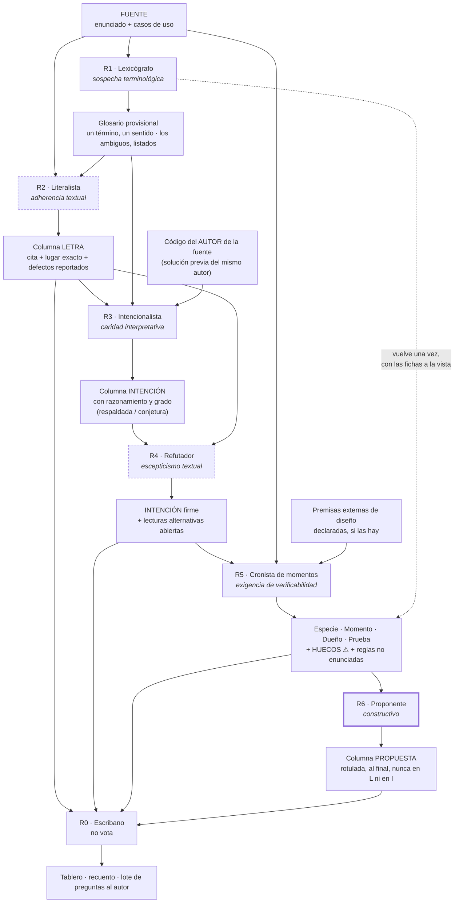

# Dictamen de diseño de roles — qué forma tiene que tener el conjunto de subagentes que deduce reglas de negocio de un enunciado ajeno

**Alias:** Dictamen-Diseno-De-Roles
**Naturaleza:** dictamen de diseño (insumo para consolidar un conocimiento; **no es el conocimiento final**)
**Tema:** Cuántos roles hacen falta para leer un enunciado de negocio y deducir de él sus reglas, qué sesgo lleva cada uno, en qué orden trabajan, qué no debe ver cada uno, cuándo se replica un rol, qué mecanismo impide que el conjunto sea proactivo y cómo se verifica desde afuera que la deducción salió bien
**Rol del autor:** especialista en diseño de agentes de IA. No edita la fuente, no edita la guía, no escribe el conocimiento final
**Caso del que sale:** «La Estancia La Ana» — primera pasada (18 reglas) y relectura de intención (13 de 18 divergen)
**Fecha:** 2026-09-25
**Estado:** Propuesta para consolidación

---

## Índice

- [0. Qué resuelve este dictamen y qué no](#0-qué-resuelve-este-dictamen-y-qué-no)
- [1. La evidencia del caso, y qué enseña cada pieza](#1-la-evidencia-del-caso-y-qué-enseña-cada-pieza)
- [2. El diagnóstico traducido a problema de diseño](#2-el-diagnóstico-traducido-a-problema-de-diseño)
- [3. Cuántos roles, y por qué esos](#3-cuántos-roles-y-por-qué-esos)
  - [3.1 Los dos criterios de separación](#31-los-dos-criterios-de-separación)
  - [3.2 El panel propuesto: seis roles y un escribano](#32-el-panel-propuesto-seis-roles-y-un-escribano)
  - [3.3 Los roles que se descartaron, con su motivo](#33-los-roles-que-se-descartaron-con-su-motivo)
- [4. La personalidad de cada rol: sesgo, punto ciego y quién lo cubre](#4-la-personalidad-de-cada-rol-sesgo-punto-ciego-y-quién-lo-cubre)
- [5. Orden, acoplamiento y barreras de información](#5-orden-acoplamiento-y-barreras-de-información)
  - [5.1 El circuito](#51-el-circuito)
  - [5.2 Entrada, salida y prohibición de cada rol](#52-entrada-salida-y-prohibición-de-cada-rol)
  - [5.3 ¿El que recupera la intención debe leer el código?](#53-el-que-recupera-la-intención-debe-leer-el-código)
  - [5.4 ¿El vocabulario va antes que las reglas?](#54-el-vocabulario-va-antes-que-las-reglas)
- [6. Cuándo replicar un rol, y cómo se reconcilian dos lecturas](#6-cuándo-replicar-un-rol-y-cómo-se-reconcilian-dos-lecturas)
- [7. Cómo se impide que el conjunto sea proactivo](#7-cómo-se-impide-que-el-conjunto-sea-proactivo)
- [8. Criterios de aceptación del trabajo del conjunto](#8-criterios-de-aceptación-del-trabajo-del-conjunto)
- [9. Modos de falla conocidos, con antídoto](#9-modos-de-falla-conocidos-con-antídoto)
- [10. Sobre las fuentes citadas](#10-sobre-las-fuentes-citadas)
- [11. Lo que queda abierto para quien consolide](#11-lo-que-queda-abierto-para-quien-consolide)

---

## 0. Qué resuelve este dictamen y qué no

**Resuelve una sola pregunta:** cuando hay que leer un enunciado de negocio escrito por otro y sacar
de ahí sus reglas, ¿qué forma tiene que tener el conjunto de agentes que lo hace para que la
deducción salga bien?

**No resuelve**, y lo declara para que nadie lo busque acá: cómo se redacta cada regla, con qué
taxonomía se clasifican (eso lo fija el §3.6/§3.7 de la guía de arquitectura y la reclasificación
`RN`/`DR`/`AL` propuesta en su D-4, todavía pendiente del visto del autor), ni cómo se implementan.
Este documento dice **quién hace qué, en qué orden, con qué sesgo y con qué prohibición**.

**Fundamento:** todo lo que se afirma acá sobre el caso se rastrea a
`OUTPUTs/Bitacora-Editores/09-Fuente-Actividad-La-Estancia.md`,
`OUTPUTs/Bitacora-Editores/10-Relectura-De-Intencion.md` y
`Guides/Dot-NET-Arquitectura-Guide/Dot-NET-Arquiectura-Interactive-Guide.md` §6 (D-4, D-5, D-6). Lo
que no se rastrea a esos documentos va rotulado **criterio propio**.

---

## 1. La evidencia del caso, y qué enseña cada pieza

| # | Hecho medido | Dónde está | Qué enseña sobre el diseño de roles |
| --- | --- | --- | --- |
| 1 | El enunciado dice que la suma de las parcelas debe ser «**coherente**» con la superficie del campo. Se detectó que no es verificable y se **propuso otra regla** («no supera»). La intención del autor era **igual** | Guía §6 D-6; doc 09 «Aclaración del autor sobre RN-08» | Un solo sesgo —el literalista— convierte un defecto de redacción en una regla nueva, más débil, sin pasar por la intención |
| 2 | Los tres subagentes de la primera pasada llevaban **la misma directiva primaria**: «no inventar información, toda afirmación con evidencia verificable» | Guía §6 D-6 | El problema no fue la directiva: fue que **todos llevaban la misma**. Un panel monosesgado no tiene quién lo corrija |
| 3 | **13 de 18** reglas divergen entre letra e intención: 5 de fondo, 8 leves. Sólo 5 coinciden | Doc 10 §3 y §8 | La divergencia es el caso normal, no la excepción. Un método que no tiene una columna para la intención pierde el 72 % del contenido |
| 4 | **14 reglas** que el problema exige y el enunciado no enuncia; **9 huecos de proceso**; **8 términos** con dos sentidos y **5 conceptos** con más de un nombre | Doc 10 §5, §6, §8 | Lo que falta no aparece leyendo mejor el texto: aparece contrastándolo con el código y con los casos de uso |
| 5 | «Seis de las trece divergencias son, en el fondo, un término que el enunciado usa en dos sentidos» | Doc 10 §2, encabezado | El vocabulario es causa, no consecuencia. Fijarlo tarde es pagar seis veces |
| 6 | El anclaje de cada regla al lugar exacto de la fuente permitió contrastar RN-13 contra el CU-11 y descubrir que **la fuente se contradecía** | Guía §6 D-4 | El literalismo, como **procedimiento de anclaje**, es lo que más rindió. No hay que eliminarlo: hay que sacarle la facultad de proponer |
| 7 | Dos reglas —RN-08 y RN-14— **no tienen momento de verificación**: ninguno de los 15 casos de uso las mira | Doc 10 §3, §6 B-1 y B-3, §7 | La pregunta «¿quién la verifica y cuándo?» es un rol, no una columna que se llena de memoria |
| 8 | `=` y `≤` **no son la misma regla y hacen falta las dos** | Guía §6 D-6, tabla final | El hallazgo mayor del caso salió de **tomarse en serio la objeción del literalista** después de haberle quitado la facultad de decidir |
| 9 | La contradicción de RN-13 no se resolvió por interpretación: **la resolvió el autor corrigiendo la fuente** | Doc 09, nota «Tensión CERRADA el 2026-09-24» | El desempate no es del panel. Es del autor. El panel produce la pregunta |
| 10 | El «no puede ser nulo» de RN-03 y RN-06 **no está en el enunciado**: lo agregó la tabla de reglas, que declaraba «no hay ninguna agregada» | Doc 09 §5 encabezado contra doc 10, fichas RN-03 y RN-06 | Una inferencia que se cuela en la columna de la letra se vuelve invisible en el documento siguiente. El rótulo no es prolijidad: es trazabilidad |
| 11 | El código de escritorio **del mismo autor** dio la intención donde el texto no llegaba: `>0` en vez de `≠0` (RN-04), el descuento de la parcela al modificar (RN-07), «sobre el total de los animales» (RN-15), «lote es rol, no clase» | Doc 10, fichas RN-04, RN-07, RN-15 y §2.1 «Lote» | El código del autor de la fuente es **evidencia de intención de primera mano** |
| 12 | El código elige la lectura amplia de RN-09 y RN-10 **sin decirlo**, y esa elección deja sin función a `Periodo` | Doc 10, fichas RN-09 y RN-10 | El mismo código que da intención también **impone** decisiones que el autor no tomó conscientemente. Hay que poder distinguir las dos cosas |
| 13 | Doc 10 toma como contexto no rediscutido decisiones de diseño posteriores al enunciado —`Estancia` raíz, campo con `0..*` parcelas (D-2)—, y de ahí se sigue que RN-08 no puede ser *Invariant* | Doc 10 §0, último párrafo; ficha RN-08; guía §6 D-2 | La conclusión más fina del documento **depende de una premisa que no está en la fuente**. Está declarada, y por eso es auditable. Si no se declarara, sería contaminación invisible |
| 14 | D-5: las reglas se **extraen** antes de codear; se **clasifican** intentando el código. «Quien pretenda clasificar sin intentar, clasifica de memoria» | Guía §6 D-5 | El rol que extrae y el rol que clasifica no pueden tener el mismo insumo: uno trabaja antes del código, el otro necesita haberlo intentado |

---

## 2. El diagnóstico traducido a problema de diseño

El fracaso medido no fue de capacidad: fue **de composición**. Tres agentes con la misma directiva
primaria son, a los efectos del error, **un solo agente corrido tres veces**. La redundancia no
agrega control cuando el sesgo es compartido: agrega confirmación.

De ahí salen las tres afirmaciones que estructuran todo lo que sigue.

1. **«No inventar» no es una personalidad: es una restricción.** Aplicada como único criterio, tiene
   un óptimo local degenerado —pegarse al texto— que es exactamente el modo de falla observado. Una
   restricción necesita un **objetivo** que la tensione. Acá el objetivo es: *recuperar qué quiso
   decir el autor*.
2. **El literalismo no se corrige: se contiene y se pone a trabajar.** El anclaje literal es lo que
   más rindió en el caso (hecho 6) y lo que produjo el hallazgo mayor (hecho 8). Lo que hay que
   quitarle al literalista no es la lectura: es **la facultad de proponer**.
3. **Las tres lecturas ya están separadas en el producto** —letra, intención, propuesta, la regla que
   este dictamen toma como dada—. Falta separarlas en **el productor**. Un solo agente que escribe
   las tres columnas termina escribiendo la tercera en la primera, porque la tercera es la que sabe
   redactar bien. El hecho 10 es la prueba: el «no puede ser nulo» entró a la columna de la letra en
   un documento que declaraba no tener nada agregado.

---

## 3. Cuántos roles, y por qué esos

### 3.1 Los dos criterios de separación

Se usan los dos que fija el encargo, y se declaran porque después hay que poder auditar cada
separación contra ellos:

| Criterio | Enunciado | Qué justifica |
| --- | --- | --- |
| **C1 · Sesgos opuestos** | Dos roles se separan cuando llevan sesgos que se controlan mutuamente | Intencionalista contra Refutador; Intencionalista contra Cronista de momentos |
| **C2 · Barrera de información** | Dos roles se separan cuando uno necesita **no haber visto** lo que el otro vio | Lexicógrafo antes de la lista de reglas; Refutador sin el código; Intencionalista sin el diseño en curso |
| **C0 · Prueba de fusión** | Si dos roles harían lo mismo con distinto nombre, son uno | Se aplicó a cinco candidatos; tres se fusionaron o se descartaron (§3.3) |

### 3.2 El panel propuesto: seis roles y un escribano

| # | Rol | Sesgo deliberado | Una línea |
| --- | --- | --- | --- |
| **R1** | **Lexicógrafo del dominio** | Sospecha terminológica | Asume que toda palabra repetida puede nombrar dos cosas y toda cosa puede tener dos nombres |
| **R2** | **Literalista** | Adherencia textual y anclaje | Transcribe lo que el texto dice, con la cita y el lugar exacto, y no dice nada más |
| **R3** | **Intencionalista** (analista de requerimientos) | Caridad interpretativa | Asume que el autor quiso decir algo coherente, y lo reconstruye con el razonamiento a la vista |
| **R4** | **Refutador de intención** | Escepticismo textual | Por cada inferencia busca la otra lectura que la misma evidencia sostiene |
| **R5** | **Cronista de momentos** | Exigencia de verificabilidad | Pregunta, por cada regla, quién la verifica y cuándo; si nadie, lo dice |
| **R6** | **Proponente** | Constructivo | Entra último y sólo escribe bajo el rótulo *Propuesta* |
| **R0** | **Escribano** (no vota) | **Ninguno**, y es su característica | Arma el tablero, hace cumplir los rótulos, cuenta y eleva las preguntas en lote |

Seis roles sustantivos, uno formal. La justificación de cada separación, una por una:

| Separación | Criterio | Fundamento en el caso |
| --- | --- | --- |
| R1 aparte de R2 | **C2** | El lexicógrafo no debe ver la lista de reglas: si la ve, ratifica su vocabulario. En el caso, la lista usaba «superficie ocupada» en dos sentidos —el del campo en RN-07/RN-08 y el de la actividad en RN-18— y nadie lo notó hasta que alguien miró los términos por separado (doc 10 §2.3, que la llama «la ambigüedad más peligrosa del vocabulario») |
| R2 aparte de R3 | **C1** | Son los dos sesgos del hecho 1: pegarse al texto contra reconstruir la intención. El caso midió qué pasa cuando sólo está el primero |
| R3 aparte de R4 | **C1 + C2** | R4 no ve el código. Cuando una inferencia sólo se sostiene con el código, R4 la hace caer y queda rotulada «sostenida por el código, no por el texto». Es exactamente el estado real de RN-09 y RN-10: «el código elige la amplia **sin decirlo**» (hecho 12) |
| R3 aparte de R5 | **C1** | Sesgos opuestos y medidos: R3 quiere la lectura más rica, R5 quiere una regla que alguien pueda hacer cumplir, y **debilita para lograrlo**. «No supera» fue eso. Contenido, el mismo sesgo produce el mejor hallazgo del caso: RN-08 y RN-14 sin momento de verificación (hechos 7 y 8) |
| R5 aparte de R2/R3 | **C2 inverso** | R5 es el único que necesita **haber intentado el código**: «quien pretenda clasificar sin intentar, clasifica de memoria» (hecho 14, D-5) |
| R6 aparte de todos | **C1** | El modo de falla es que la propuesta se disfrace de letra. Si el que propone es el mismo que transcribe o el que infiere, no hay barrera que lo impida; si es otro, su salida entra por un canal rotulado y tarde |
| R0 aparte de todos | formal | Alguien tiene que verificar mecánicamente los rótulos y los recuentos sin emitir juicio. En cuanto opina, es un séptimo sesgo sin control |

### 3.3 Los roles que se descartaron, con su motivo

Se registran porque un descarte fundamentado vale tanto como una inclusión.

| Candidato | Veredicto | Motivo |
| --- | --- | --- |
| **Verificador de evidencia** (comprueba que cada cita exista y diga lo que se afirma) | **Fusionado en R0** | Es una comprobación mecánica, no un juicio. Separarlo sería decorativo: no tiene sesgo propio que controlar a nadie (C0) |
| **Experto del dominio real** (un agrónomo, en este caso) | **Fuera del circuito de deducción; entra como consultado** | Su conocimiento del negocio entra como si fuera intención del autor, que es la definición de sobreinterpretación. En el caso hay una instancia: «contradice el sentido agropecuario —la rotación es la práctica normal—» apareció en RN-10, y está bien rotulada **conjetura** precisamente porque nada del texto la sostiene. Su producto legítimo son **preguntas para el autor**, no inferencias |
| **Arquitecto / diseñador de la solución** | **Descartado del circuito** | Es la mitad de D-5 que va **después**. Dejarlo entrar es el modo de falla de contaminación por el diseño en curso (§9, F-3), del que el caso tiene una instancia declarada (hecho 13) |
| **Segundo literalista permanente** | **Descartado como rol fijo; admitido como replicación condicionada** | Dos literalistas sobre el mismo texto producen la misma salida y **duplican el sesgo compartido**, que es el hecho 2. Sólo se replica bajo la condición del §6 |
| **Redactor de pruebas** | **Fusionado en R5** | La frase de prueba —«un campo con superficie cero o negativa no se crea»— es la forma en que R5 demuestra que encontró el momento y el dueño. Separarla produce dos agentes que escriben la misma oración |

---

## 4. La personalidad de cada rol: sesgo, punto ciego y quién lo cubre

Cada rol se define por **el sesgo que se le pide llevar**, no por el que hay que evitarle. Un rol sin
sesgo declarado deriva al promedio, y el promedio de este trabajo es el literalismo.

| Rol | Sesgo que se le pide | Punto ciego de ese sesgo | Quién lo cubre | Cómo lo cubre |
| --- | --- | --- | --- | --- |
| **R1 Lexicógrafo** | Sospecha terminológica: ninguna palabra es inocente hasta que se prueba que tiene un solo sentido | Proliferación: puede desmenuzar términos que no tienen ninguna consecuencia | **R5** y **R0** | R5 sólo consume los términos que aparecen en alguna regla; R0 rechaza del glosario todo término que no cite la regla o el hallazgo que lo vuelve necesario |
| **R2 Literalista** | Adherencia textual: cita exacta, lugar exacto, nada agregado | **Literalismo** (el medido): ante un texto mal escrito, reporta el defecto en vez de reconstruir la intención | **R3** | R3 recibe el defecto reportado como **entrada obligatoria de trabajo**, no como conclusión. Un «no verificable» de R2 abre una ficha de intención; no la cierra |
| **R3 Intencionalista** | Caridad interpretativa: el autor quiso decir algo coherente y hay que reconstruirlo con el razonamiento a la vista | **Sobreinterpretación**: atribuirle al autor intenciones que no tuvo, y hacerlo con prosa convincente | **R4** y el rótulo `conjetura` | R4 exhibe la lectura alternativa que la misma evidencia sostiene; el rótulo obligatorio degrada a conjetura toda inferencia sin respaldo textual, de código del autor o de caso de uso |
| **R4 Refutador** | Escepticismo textual: la evidencia rara vez determina una sola lectura | Nihilismo interpretativo: si todo es refutable, no queda ninguna intención en pie y el producto es una lista de dudas | **R3** y **R0** | R3 conserva la inferencia si tiene al menos un respaldo que R4 no derribó; R0 exige que toda refutación nombre **la lectura alternativa concreta**, no una objeción genérica. «Podría ser otra cosa» no es refutación |
| **R5 Cronista de momentos** | Exigencia de verificabilidad: toda restricción tiene dueño y momento, o es un hueco | **Debilitamiento**: reescribir la regla hasta que sea verificable. Es el sesgo que produjo «no supera» | **R3**, con veto | R5 **no puede modificar la redacción de la intención**. Su única salida cuando una regla no tiene momento es declarar el hueco y pasarlo a R6. El caso muestra el resultado: los dos ⚠ de RN-08 y RN-14 |
| **R6 Proponente** | Constructivo: todo hueco admite una salida, y hay que escribirla | **Proactividad**: resolver por su cuenta y presentar la solución como si fuera el enunciado | mecanismo, no rol (§7) | Entra último, escribe sólo bajo rótulo, y cada propuesta lleva obligatoriamente la frase que dice que no es lo que el enunciado dice |
| **R0 Escribano** | Ninguno, deliberadamente | Convertirse en un séptimo opinante | prohibición explícita | No vota, no infiere, no propone. Su salida es el tablero, el recuento y el lote de preguntas |

> **Lectura del cuadro.** Ningún sesgo se elimina. Cada uno queda **emparejado**. El único sesgo sin
> pareja —el de R6— no se controla con otro rol sino con formato, porque es el único cuya falla es
> visible en el producto y no en el razonamiento.

---

## 5. Orden, acoplamiento y barreras de información

### 5.1 El circuito

Las líneas punteadas marcan los dos roles que **no ven el código** (R2 y R4). El trazo grueso marca el
único rol que puede escribir una oración que no esté en la fuente.

### 5.2 Entrada, salida y prohibición de cada rol

| Rol | Recibe | Produce | **No debe ver** | Prohibición explícita |
| --- | --- | --- | --- | --- |
| **R1** | La fuente, cruda | Glosario: cada término con su letra, su sentido único o sus dos sentidos, y los conceptos con más de un nombre | **Cualquier lista de reglas previa**; el código | No puede unificar dos sentidos por su cuenta: si un término tiene dos, los lista los dos y dice cuál conviene, sin borrar el otro |
| **R2** | La fuente + el glosario | Columna **Letra**: cita textual y lugar exacto por regla, y el reporte de lo que no es verificable | El código; cualquier intención ya escrita | **No propone, no infiere, no corrige.** Ni siquiera un «no puede ser nulo» evidente (hecho 10) |
| **R3** | Letra + glosario + **código del autor de la fuente** | Columna **Intención**, con el razonamiento a la vista y el grado (respaldada / conjetura) | El código de destino; las decisiones de diseño en curso; las propuestas | No puede escribir en la columna de la letra. Si su inferencia no tiene respaldo, la rotula `conjetura`; no la calla ni la asciende |
| **R4** | Letra + Intención + glosario | Por cada inferencia: la lectura alternativa concreta, o el aval | **El código, entero** | No puede proponer una tercera lectura propia: sólo exhibir las que la evidencia ya sostiene |
| **R5** | Intención firme + casos de uso + intento de código + premisas externas declaradas | Especie, momento, dueño, prueba, huecos, y las reglas que el enunciado no enuncia | Las propuestas de R6 | **No modifica ninguna redacción.** Ante una regla sin momento: declara el hueco. Toda conclusión que dependa de una premisa externa la marca como tal |
| **R6** | Todo el tablero | Columna **Propuesta** y preguntas para el autor | — | Escribe **únicamente** bajo rótulo. No toca letra, intención ni clasificación |
| **R0** | Todo | Tablero, recuento, lote de preguntas | — | No vota, no infiere, no propone. Rechaza el entregable si un rótulo falta, no lo completa |

### 5.3 ¿El que recupera la intención debe leer el código?

**Sí, pero no cualquier código.** Hay que separar dos cosas que en el caso se llamaron igual:

| Qué código | Veredicto | Fundamento |
| --- | --- | --- |
| **El código del autor de la fuente** (la solución previa que él mismo escribió) | **Debe leerlo.** Es evidencia de intención de primera mano | Doc 10 §1 lo llama «la mejor evidencia de su intención», y rindió donde el texto no llegaba: `>0` en lugar de `≠0` (RN-04), el descuento de la parcela al modificar —«evidencia fuerte de que la regla que el autor tiene en la cabeza es sobre la suma»— (RN-07), «contados sobre el total de los animales» (RN-15), y «lote es rol, no clase», que el propio autor comenta en `Actividad.cs` |
| **El código de destino y las decisiones de diseño en curso** | **No debe verlo.** Contamina | Hecho 13: doc 10 toma D-2 como contexto no rediscutido, y de esa premisa —ajena a la fuente— se sigue su clasificación de RN-08. La conclusión puede ser correcta; lo que no puede es que su premisa quede invisible |

**Dos salvaguardas que van juntas con el permiso de leer el código del autor:**

1. **El código dice qué hizo, no qué quiso.** Cuando la lectura se sostiene sólo en el código, se
   rotula así y se distingue del aval textual. La instancia del caso es exacta: «el código elige la
   amplia **sin decirlo**» (RN-09), y de ahí que R4, que no vio el código, sea el que la haga caer a
   inferencia con alternativa abierta.
2. **Premisas externas declaradas.** Si el trabajo necesita una decisión de diseño ya tomada para
   avanzar, entra por R5 como premisa rotulada, y toda conclusión que dependa de ella queda marcada.
   Nunca entra por R3.

### 5.4 ¿El vocabulario va antes que las reglas?

**Sí, y el caso mide lo que cuesta salteárselo.** Doc 10 §2 lo dice con número: «seis de las trece
divergencias del §4 son, en el fondo, un término que el enunciado usa en dos sentidos». La guía lo
registra como omisión de método en D-4: el vocabulario va antes que las reglas, «paso que acá se
salteó».

**Con una corrección, que es la única concesión a la replicación (§6):** el glosario sale **primero
pero provisional**, y R1 vuelve a correr **una sola vez** con las fichas a la vista. Motivo: tres de
las ambigüedades más caras no son visibles leyendo el enunciado solo —sólo aparecen cuando dos reglas
usan la misma palabra para cosas distintas. El ejemplo de manual es «superficie ocupada», que en el
código del autor son dos métodos distintos sobre dos colecciones distintas (`Campo` contra
`Actividad`), y RN-18 usa uno mientras RN-07 y RN-08 usan el otro. Eso no se ve en el párrafo: se ve
en la tabla.

---

## 6. Cuándo replicar un rol, y cómo se reconcilian dos lecturas

**Principio.** Replicar **no** agrega control cuando el sesgo es compartido: el hecho 2 es la prueba
de que tres agentes con la misma directiva fallan juntos. Replicar sólo sirve cuando las dos corridas
tienen **algo distinto**: distinta información o distinta hipótesis de partida.

### Las tres condiciones que justifican replicar

| # | Condición | Cómo se replica | Cómo se reconcilia |
| --- | --- | --- | --- |
| **P1** | **Lectura subdeterminada**: el texto admite dos lecturas coherentes consigo mismas y no elige | **R3 dos veces, con priores opuestos**: una instancia parte de la lectura estricta, la otra de la amplia. Nunca dos instancias con la misma instrucción | Lo que ambas producen **igual** queda como intención firme. Donde difieren, **no se vota ni se promedia**: la divergencia se eleva como **pregunta al autor**. Fundamento: la única tensión que se cerró de verdad en el caso la cerró el autor corrigiendo la fuente, no el panel interpretando (hecho 9) |
| **P2** | **Vocabulario**: el glosario provisional no puede cerrarse sin las fichas | **R1 dos veces**: una antes de las reglas, otra al final | La segunda corrida sólo puede **agregar** sentidos y nombres, nunca borrar los de la primera. Si la segunda contradice a la primera, se listan los dos y se anota la fecha |
| **P3** | **Fuente extensa o de alto costo de omisión**: cuando perder una regla es caro y el texto es largo | **R2 dos veces, en particiones distintas del texto** (no sobre el texto entero), y el cruce de anclas | Regla anclada por una sola corrida = candidata a revisión, no a descarte. R0 la marca y la eleva. Esta condición es **criterio propio**: en el caso no hubo instancia, el enunciado son siete párrafos |

### Cuándo replicar es desperdicio

| Situación | Por qué | Magnitud en el caso |
| --- | --- | --- |
| **Letra e intención coinciden y la regla ya tiene momento y dueño** | No hay nada que contrastar; una segunda lectura produce la misma frase con otras palabras | **5 de 18**: RN-05, RN-11, RN-12, RN-16, RN-18 (doc 10 §8) |
| **Derivaciones** | Una derivación no se viola: se calcula bien o mal. Se prueba con ejemplos numéricos, no con lecturas. Una segunda interpretación de una fórmula no agrega nada | **4 de 18**: RN-15, RN-16, RN-17, RN-18 |
| **Reglas de alcance** | Describen lo que el sistema no hace. No hay intención que recuperar: se verifican por ausencia | **1**: RN-05 |
| **Replicar el mismo rol con la misma instrucción** | Es el hecho 2: tres agentes monosesgados son uno corrido tres veces. Confirma, no controla | El caso entero |

**Consecuencia práctica:** replicar tiene sentido sobre **13 de las 18** fichas como mucho, y en
rigor sobre **las 5 de fondo**. Un plan que replica sobre las 18 gasta el doble para mejorar el 28 %
que ya estaba bien.

---

## 7. Cómo se impide que el conjunto sea proactivo

El requisito es explícito: el resultado **comenta las inconsistencias y propone cómo resolverlas**;
no las resuelve por su cuenta ni corrige la fuente. Lo que sigue son mecanismos, no exhortaciones. Una
exhortación a portarse bien es exactamente la directiva que ya falló (hecho 2).

### M-1 · Ficha de columnas fijas, con la propuesta física al final

Toda regla se entrega en una ficha con **el mismo orden siempre**: `Letra` → `Intención` →
`¿Divergen?` → `Especie` → `Momento` → `Dueño` → `Prueba` → `Propuesta`. La propuesta es la **única**
celda donde puede aparecer una oración que no esté en la fuente, y es la última. El formato ya se
probó en el caso y funcionó: doc 10 §0 lo declara y doc 10 §4 lo sostiene en las 18 fichas.

### M-2 · Lista cerrada de rótulos

Sólo existen estos, y **toda oración del entregable vive dentro de uno**:

| Rótulo | Qué admite | Quién lo escribe |
| --- | --- | --- |
| `Letra` | Cita textual con lugar exacto | R2 |
| `Intención` | Reconstrucción con razonamiento y respaldo nombrado | R3 |
| `Conjetura` | Inferencia sin respaldo textual, de código del autor ni de caso de uso | R3 |
| `Hallazgo sobre el código` | Lo que el código hace y el enunciado no dice | R3 o R5 |
| `Hueco` | Una intención sin momento de verificación | R5 |
| `Propuesta` | Lo que el conjunto propondría | **sólo R6** |
| `Pregunta para el autor` | Lo que no se puede resolver por inferencia | R6, elevada por R0 |

Una oración sin rótulo es **un defecto del entregable**, no una opinión. R0 la rechaza; no la
completa.

### M-3 · Frase de residuo obligatoria en cada propuesta

Toda propuesta lleva, en su propio texto, la declaración de que no es lo que el enunciado dice. No es
una fórmula de cortesía: es lo que impide que el documento siguiente la lea como fuente. El caso ya la
escribió tres veces —«Es propuesta, no enunciado» (B-1), «El enunciado no lo dice así» (RN-14), «No es
lo que el enunciado pide» (B-7)—, y es verificable por grep.

### M-4 · Compuerta de precedencia

**Ninguna propuesta puede emitirse sobre una regla cuya ficha no tenga ya `Letra` e `Intención`
completas y ancladas.** Es la traducción mecánica del diagnóstico: el error fue saltar de la letra a
la propuesta sin pasar por la intención. R0 lo verifica ficha por ficha antes de dejar entrar a R6.

### M-5 · Sin permiso de escritura sobre la fuente

El conjunto **no edita la fuente, ni la tabla de reglas previa, ni el código**. Su único producto es
su propio informe. Doc 10 lo declara en su encabezado —«No edita la fuente ni el código»— y en su
cierre. La corrección de RN-13 la hizo el autor, no el panel (hecho 9). Verificación externa: el
diff sobre la fuente después de la corrida tiene que ser vacío.

### M-6 · Las preguntas salen en lote, no como decisiones

Cuando la inferencia no alcanza, el producto es **una pregunta**, agrupada con las demás al cierre, no
una resolución silenciosa. Instancia del caso: B-3 pregunta si un precio de cero o una cantidad
negativa son estados que el negocio acepta, en vez de inventar la validación.

### M-7 · Prohibición de reescribir por verificabilidad

Ningún rol puede cambiar la redacción de una regla **para volverla verificable**. Si una regla no es
verificable, se dice que no lo es, se recupera la intención y, si esa intención no tiene momento, se
declara el hueco. Esta es la prohibición que, de haber existido, habría evitado el caso entero.

---

## 8. Criterios de aceptación del trabajo del conjunto

Se verifican **desde afuera** y sin discutir el contenido. Cada uno dice cómo se comprueba.

| # | Criterio | Cómo se verifica | Por qué está |
| --- | --- | --- | --- |
| **A-1** | **Anclaje total**: el 100 % de las reglas tiene cita textual y lugar exacto (párrafo, caso de uso, o archivo y línea) | Recuento: reglas con ancla / reglas totales = 1 | Es lo que más rindió: gracias al anclaje se contrastó RN-13 contra el CU-11 y se descubrió que la fuente se contradecía (hecho 6) |
| **A-2** | **Anclaje a la fuente primaria**: ninguna regla se ancla a una tabla intermedia sin decirlo | Buscar anclas que apunten a documentos derivados; cada una debe estar rotulada | El «no puede ser nulo» entró desde una tabla que se declaraba sin agregados (hecho 10) |
| **A-3** | **Contraste regla ↔ caso de uso**: por cada regla, o el acto que la hace cumplir, o la frase «ningún caso de uso la mira» | Ninguna ficha sin esa celda | Produjo los dos huecos mayores: RN-08 y RN-14 sin momento (hecho 7) |
| **A-4** | **Especie declarada** para toda regla: restricción / derivación / alcance (+ estructura) | Ninguna ficha sin especie; ninguna derivación con una prueba redactada como rechazo | Defecto 1 de D-4: la primera lista mezcló restricciones con derivaciones en una sola numeración |
| **A-5** | **Momento y dueño declarados, o hueco declarado** | Toda restricción dice *Invariant* / *Precondition* / condición de completitud y su dueño, o dice «hoy nadie la verifica» | Es la columna que a la primera lista le faltaba, según D-4 |
| **A-6** | **Prueba escribible**: cada regla lleva una frase de prueba que se puede escribir hoy, o la explicación de por qué no | Leer las frases de prueba; ninguna puede contener una palabra no verificable | El caso tiene el ejemplo modelo: la prueba de RN-08 «no se puede escribir hoy, porque “parcelado cerrado” no existe en el vocabulario» |
| **A-7** | **Cero fuga de propuesta**: ninguna oración de propuesta aparece en las columnas de letra o intención | Recorrido de rótulos por R0 y verificación externa por muestreo | Es el error original, traducido a control (hecho 1) |
| **A-8** | **Glosario cerrado y usado**: todo término que aparece en una regla existe en el glosario con un sentido, o figura entre los ambiguos | Referencia cruzada glosario ↔ fichas | Seis de trece divergencias eran vocabulario (hecho 5) |
| **A-9** | **Inferencias graduadas**: cada regla no enunciada dice si está implementada y no escrita, deducible y no implementada, o ninguna de las dos | Contar por grado; ninguna sin grado | Doc 10 §5 lo hizo con 14 reglas, y el grado es lo que permite decidir qué hacer con cada una |
| **A-10** | **Recuento reproducible**: los números del cierre se pueden rederivar de las fichas | Recontar y comparar | El caso cierra con 18 / 13 (5 de fondo, 8 leves) / 14 / 9, y cada número se verifica contra las fichas |
| **A-11** | **Fuente intacta** | `git diff` sobre el enunciado y el código: vacío | El conjunto comenta y propone; no corrige (M-5) |
| **A-12** | **Preguntas en lote**: existe un bloque final con las preguntas que la inferencia no puede resolver | Que el bloque exista y que ninguna de sus preguntas esté además resuelta en alguna ficha | Si una pregunta ya está resuelta adentro, el conjunto decidió y después preguntó |
| **A-13** | **No-redundancia**: ninguna lectura propuesta vuelve a una regla equivalente a otra ya existente | Comparar cada intención contra el resto del tablero | Es el argumento (b) de RN-08: leer «coherente» como «no supera» vuelve la regla una copia débil de RN-07. **Una relectura que duplica otra regla está mal por construcción** |

---

## 9. Modos de falla conocidos, con antídoto

Los dos primeros están medidos en el caso. Los demás son oficio, y se rotula cuáles tienen instancia
verificable en la evidencia y cuáles son criterio propio.

| # | Modo de falla | Qué se ve | Antídoto | Instancia |
| --- | --- | --- | --- | --- |
| **F-1** | **Literalismo** | Ante un texto mal escrito, se reporta el defecto y se propone otra regla en vez de recuperar la intención | R3 separado de R2; el «no verificable» de R2 **abre** una ficha, no la cierra; M-7 | **Medida**: «coherente» → «no supera» (guía §6 D-6) |
| **F-2** | **Sobreinterpretación** | Se le atribuye al autor una intención que no tuvo, redactada con seguridad | R4 sin acceso al código; rótulo `conjetura` obligatorio; empates al autor (§6 P1) | **Medida en su forma contenida**: RN-10, donde la lectura «por período» quedó rotulada conjetura y no se ascendió |
| **F-3** | **Contaminación por el diseño en curso** | La intención se acomoda a lo que ya se construyó | R3 no ve el código de destino; premisas externas declaradas y conclusiones dependientes marcadas | **Verificable**: doc 10 §0 declara D-2 como contexto y de ahí sale la especie de RN-08 (hecho 13) |
| **F-4** | **Confusión de especies** | Restricciones y derivaciones en una sola lista; se habla de «violar» un cálculo | Columna especie obligatoria (A-4); la frase «una derivación nunca se viola» en el método | **Medida**: defecto 1 de D-4 |
| **F-5** | **Alcance disfrazado de regla** | Una afirmación sobre lo que el sistema no hace entra a la lista como si prohibiera un estado | Tercera especie explícita, y la nota de que se cumple por ausencia | **Medida**: defecto 3 de D-4, sobre RN-05 |
| **F-6** | **Debilitamiento por verificabilidad** | La regla se reescribe hasta que alguien pueda hacerla cumplir, y queda más floja | M-7 + criterio A-13 de no-redundancia | **Medida**: es el caso testigo, y además el resultado duplicaba RN-07 |
| **F-7** | **Proactividad** | El informe corrige la fuente o resuelve la inconsistencia por su cuenta | §7 completo, sobre todo M-3, M-4 y M-5 | **Medida por contraste**: la tensión de RN-13 la cerró el autor, no el panel (hecho 9) |
| **F-8** | **Inferencia colada en la letra** | Una afirmación razonable aparece citada como si el texto la dijera | R2 sin facultad de inferir; A-2 | **Medida**: «no puede ser nulo» en RN-03 y RN-06 (hecho 10) |
| **F-9** | **Silencio sobre el silencio** | El informe no distingue «se decidió no hacerlo» de «nadie lo dijo» | Sección obligatoria «lo que la fuente no dice», y la distinción explícita entre alcance declarado y silencio | **Medida**: B-9, la baja de actividad — «es un silencio, no una decisión», contra RN-05 que sí está declarada fuera de alcance |
| **F-10** | **Colapso negocio / software** | Una frontera del sistema se lee como una regla del negocio | El rol R5 separa «el negocio lo prohíbe» de «este sistema no lo ofrece» | **Medida**: RN-05 — «no dice que un campo no se pueda dar de baja en el negocio real: dice que este sistema no lo hace todavía» |
| **F-11** | **Proliferación terminológica** | El glosario crece con términos que no cambian ninguna regla | Todo término del glosario cita la regla o el hallazgo que lo vuelve necesario; R0 rechaza los que no | **Criterio propio**. En el caso no ocurrió: los once términos tenían consecuencia |
| **F-12** | **Convergencia prematura del panel** | Los roles posteriores adoptan el marco del primero porque lo leyeron entero | Barreras de §5.2: R4 sin código, R1 sin lista previa, R5 sin propuestas | **Criterio propio**, pero es la forma general del hecho 2 |
| **F-13** | **Complacencia con el autor** | Cuando el autor aclara una intención, el panel deja de examinar sus consecuencias | La aclaración del autor cierra **la letra**, no la clasificación: R5 sigue obligado a preguntar quién la verifica | **Medida**: el autor aclaró que RN-08 es igualdad, y recién después apareció que `=` no puede ser *Invariant* y que hacen falta las dos reglas (hecho 8) |
| **F-14** | **Refutación genérica** | R4 objeta «podría ser otra cosa» sin exhibir cuál | R0 exige que toda refutación nombre la lectura alternativa concreta y la evidencia que la sostiene | **Criterio propio** |

> **El hallazgo de diseño que el caso deja, y que conviene no perder al consolidar.** F-1 y F-6 son el
> mismo sesgo, y ese sesgo —contenido, sin facultad de decidir— produjo el mejor resultado de todo el
> trabajo: la distinción entre `≤` como *Invariant* y `=` como condición de completitud, y la pregunta
> que vale más que la discusión original —si un campo tiene que terminar totalmente parcelado, ¿en qué
> momento alguien lo verifica?—. **No se diseña contra un sesgo: se le da un rol y se le quita el
> voto.**

---

## 10. Sobre las fuentes citadas

Se declara el grado de verificación de cada referencia, según la regla de trabajo del encargo.

| Fuente | Uso | Grado |
| --- | --- | --- |
| `09-Fuente-Actividad-La-Estancia.md`, `10-Relectura-De-Intencion.md`, guía interactiva §6 (D-1 a D-6) | Todos los hechos del §1 y todas las instancias del §9 | **Verificadas**: leídas completas en esta corrida |
| Evans, citado en D-1 de la guía: «Provide repositories only for aggregate roots that actually need direct access» | No se usa en este dictamen; se menciona para ubicar de dónde viene el criterio de agregado que aparece en las fichas | **Verificada la cita dentro del repositorio**, no contra el original |
| *Business Rules Manifesto* (Business Rules Group, 2003): las reglas se construyen sobre hechos y los hechos sobre términos; las reglas se enuncian de forma declarativa | Sostiene el §5.4 (vocabulario antes que reglas) y la distinción de especies del §8 A-4 | **No verificada contra el original en esta corrida.** La guía misma la marca como pendiente de cotejo en D-4. Se usa como **criterio propio respaldado por el caso**, que lo midió: seis de trece divergencias eran vocabulario |
| Wirfs-Brock, *Responsibility*, citada en el §3.6 de la guía y usada por doc 10 para elegir el dueño de cada regla | Sostiene la columna «dueño» del §8 A-5 | **No verificada contra el original.** Se cita como está en la guía |
| «Principio de caridad interpretativa» como nombre del sesgo de R3 | Nombre del sesgo | **Criterio propio.** La idea tiene tradición en filosofía del lenguaje, pero **no verifiqué autor ni obra en esta corrida** y no la atribuyo |
| Todo lo demás del §3 al §9 sin cita | Diseño del panel, barreras, replicación, criterios de aceptación | **Criterio propio**, fundado en los hechos del §1 |

---

## 11. Lo que queda abierto para quien consolide

| # | Pregunta | Por qué importa |
| --- | --- | --- |
| **Q-1** | ¿El panel de seis es el piso o el techo? Para un enunciado de dos párrafos, ¿se fusionan R1+R2 y R4 entra sólo si hay lectura subdeterminada? | Un panel de seis sobre una fuente chica puede costar más que lo que encuentra. Falta una regla de escala, y este dictamen no la tiene medida |
| **Q-2** | ¿R5 puede correr **antes** de que exista código, o su sesgo requiere el intento? | D-5 afirma que clasificar sin intentar es clasificar de memoria, pero no midió el caso contrario: clasificar con el código a la vista es también el riesgo F-3 |
| **Q-3** | ¿Quién produce el «lo que la fuente no dice»? En el caso salió de R3 y R5 mezclados | Es la sección que produjo 14 reglas. Si no tiene dueño, se pierde |
| **Q-4** | ¿Las preguntas al autor se elevan durante la corrida o todas al cierre? | Elevarlas durante acelera; elevarlas al cierre evita que una respuesta temprana condicione al resto del panel — que es F-13 |
| **Q-5** | ¿Cómo se registra el resultado: bitácora, expediente, o conocimiento del framework? | Este dictamen no lo decide: es material del que consolide |

---

*Dictamen abierto el 2026-09-25. No edita la fuente, ni la guía, ni el código. Su producto es este
documento y nada más.*
