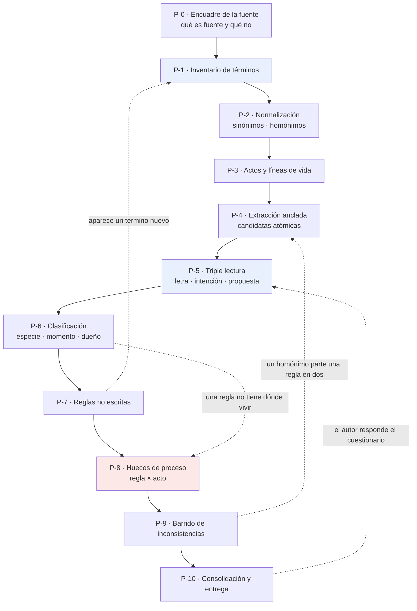
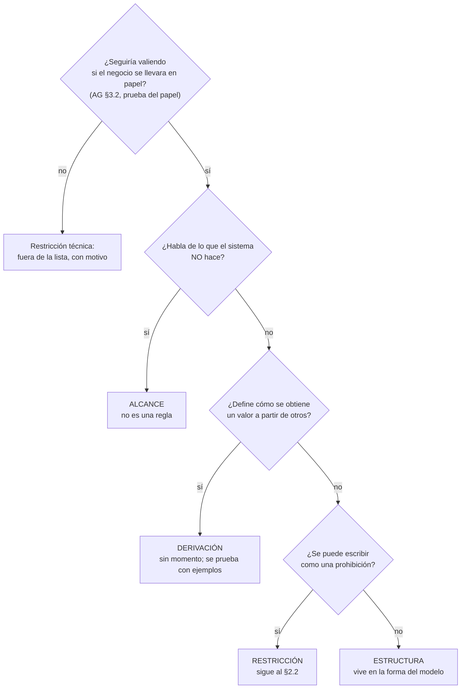

# 01 — Cuerpo metodológico: cómo se deducen las reglas de negocio de un enunciado

**Fecha:** 2026-09-25
**Rol:** análisis de requisitos / metodología.
**Qué es:** el **cuerpo metodológico** —procedimiento, taxonomías, catálogo de inconsistencias, ficha y
criterios de aceptación— con el que un agente lee un enunciado de negocio ajeno y deduce de él sus
reglas de forma correcta y repetible.
**Qué no es:** no es el conocimiento final ni una guía publicable. Es el insumo que otro va a
consolidar. Tampoco es un documento sobre «La Estancia La Ana»: **ese caso es la evidencia, no el
alcance**. Todo ejemplo se cita para mostrar que el paso tiene respaldo empírico, no para restringir
el método a ese dominio.

**Insumos de los que se destila** (todo lo que se afirma acá sobre el caso es rastreable a estos
documentos):

| Sigla | Documento | Qué aporta |
| --- | --- | --- |
| `09` | `OUTPUTs/Bitacora-Editores/09-Fuente-Actividad-La-Estancia.md` | El enunciado fuente, los 15 casos de uso y `RN-01…RN-18` de la **primera pasada**, con sus defectos |
| `10` | `OUTPUTs/Bitacora-Editores/10-Relectura-De-Intencion.md` | La **segunda pasada**: triple lectura, vocabulario, 14 reglas no escritas, 9 huecos, 13 términos problemáticos. Es el método aplicado; acá se lo enuncia |
| `IG` | `Guides/Dot-NET-Arquitectura-Guide/Dot-NET-Arquiectura-Interactive-Guide.md` §6, D-4/D-5/D-6 | La crítica al método de la primera pasada, el orden extraer/clasificar y el literalismo como modo de falla |
| `AG` | `Guides/Dot-NET-Arquitectura-Guide/Dot-NET-Arquitectura-Guide.md` §3.2, §3.6, §3.7, §3.9 | El **vocabulario ya existente**: prueba del papel, los tres tipos del BRG, *Invariant* contra *Precondition*, las tres piezas de una *Invariant*, jerarquías |

**Marcas de procedencia** (se adoptan las de `AG` §0.5, para que el consolidador no tenga que traducirlas):

| Marca | Significado |
| --- | --- |
| **Evidencia del caso** | Afirmación rastreable a `09`, `10` o `IG`, con la referencia a la vista |
| [Autor, año] | Respaldo bibliográfico **cotejado**: el texto está citado literalmente en `AG` y su ficha está en el Anexo E de esa guía |
| ⏳ | Referencia **nombrada y no cotejada**: se menciona como pista de lectura y **ninguna afirmación del método se apoya en ella** |
| **Criterio propio** | Recomendación de este documento, no una norma ni un dato externo |

---

## Índice

- [0. Los siete principios](#0-los-siete-principios)
- [1. El procedimiento](#1-el-procedimiento)
  - [1.1 Mapa](#11-mapa)
  - [P-0 · Encuadre de la fuente](#p-0--encuadre-de-la-fuente)
  - [P-1 · Inventario de términos](#p-1--inventario-de-términos)
  - [P-2 · Normalización del vocabulario](#p-2--normalización-del-vocabulario)
  - [P-3 · Inventario de actos y líneas de vida](#p-3--inventario-de-actos-y-líneas-de-vida)
  - [P-4 · Extracción anclada de candidatas](#p-4--extracción-anclada-de-candidatas)
  - [P-5 · Triple lectura](#p-5--triple-lectura)
  - [P-6 · Clasificación: especie, momento, dueño](#p-6--clasificación-especie-momento-dueño)
  - [P-7 · Reglas no escritas](#p-7--reglas-no-escritas)
  - [P-8 · Huecos de proceso](#p-8--huecos-de-proceso)
  - [P-9 · Barrido del catálogo de inconsistencias](#p-9--barrido-del-catálogo-de-inconsistencias)
  - [P-10 · Consolidación y entrega](#p-10--consolidación-y-entrega)
- [2. Las tres taxonomías](#2-las-tres-taxonomías)
  - [2.1 Especie](#21-especie)
  - [2.2 Momento](#22-momento)
  - [2.3 Dueño](#23-dueño)
  - [2.4 ¿Prefijos distintos por especie?](#24-prefijos-distintos-por-especie)
- [3. Catálogo de inconsistencias](#3-catálogo-de-inconsistencias)
- [4. La ficha por regla](#4-la-ficha-por-regla)
- [5. Criterios de aceptación](#5-criterios-de-aceptación)
- [6. Anti-patrones](#6-anti-patrones)
- [7. Instrumento de recuento](#7-instrumento-de-recuento)
- [8. Bibliografía: lo cotejado, lo nombrado y lo propio](#8-bibliografía-lo-cotejado-lo-nombrado-y-lo-propio)

---

## 0. Los siete principios

El procedimiento del §1 es la ejecución de estos siete. Si un paso se discute, se discute contra el
principio que lo justifica.

**PR-1 · El vocabulario va antes que las reglas.** Una regla es una afirmación sobre hechos, y un
hecho es una afirmación sobre términos. Si los términos no están fijados, las reglas heredan la
ambigüedad sin que se note, porque quedan escritas en prosa correcta.
*Evidencia del caso*: la primera pasada (`09` §5) saltó este paso y produjo 18 reglas; la segunda
(`10` §2) encontró **8 términos con dos sentidos y 5 conceptos con más de un nombre**, y dejó
registrado que *«seis de las trece divergencias del §4 son, en el fondo, un término que el enunciado
usa en dos sentidos»* (`10` §2). El peor: **«superficie ocupada»**, que en el campo significa «suma de
sus parcelas» y en la actividad «suma de sus lotes» — dos cálculos sobre dos colecciones distintas con
el mismo nombre, y dos reglas (RN-18 contra RN-07/RN-08) apoyadas cada una en un sentido.
*Nota bibliográfica*: la formulación «las reglas se construyen sobre hechos y los hechos sobre
términos» se atribuye en `IG` D-4 al *Business Rules Manifesto*, y el propio `IG` D-4 la marca como
**⏳ no cotejada**. Acá el principio se sostiene con la evidencia del caso y se rotula **criterio
propio**; la referencia queda como pista para quien consolide.

**PR-2 · Toda afirmación va anclada al lugar exacto de la fuente.** El ancla no es una cortesía
bibliográfica: es el instrumento que permite **contrastar la fuente consigo misma**.
*Evidencia del caso*: `IG` D-4 lo dice sin adornos — *«El anclaje fue lo que más rindió: gracias a él
se pudo contrastar RN-13 contra el CU-11 y descubrir que la fuente se contradecía»*. Esa contradicción
llevó al autor a corregir el enunciado (`09`, «Corrección del autor, 2026-09-24»).

**PR-3 · Nunca se colapsan letra, intención y propuesta.** Son tres cosas distintas, se enuncian las
tres, rotuladas, y la propuesta va siempre al final.
*Evidencia del caso*: es la regla de método incorporada en `IG` D-6 después del error de RN-08, donde
se sustituyó «coherente» por una propuesta propia («no supera») sin pasar por la intención («igual»).

**PR-4 · El literalismo es el modo de falla de «no inventar».** Pegarse al texto es el camino seguro
cuando lo único que se premia es no inventar; si el texto está mal escrito, el literalista reporta el
defecto en vez de reconstruir la intención. `IG` D-6: *«El error no fue la conclusión, fue el salto»*,
y *«el reglamento respaldaba el error»*. **Consecuencia operativa**: la directiva «no inventar» se
cumple **rotulando**, no callando. Una inferencia rotulada como inferencia no es una invención; una
propuesta presentada como letra, sí.

**PR-5 · El momento es parte de la regla.** Una regla sin momento de verificación no está
especificada: no se sabe si se verifica al crear, antes de un acto, o nunca. El caso muestra que «nunca»
es una respuesta posible y que hay que escribirla (`10` §3: **2 de 18 sin momento**).

**PR-6 · Lo que el enunciado no dice es parte del resultado.** Un relevamiento que sólo lista lo
escrito entrega la mitad del trabajo. En el caso, las reglas **no escritas** (14) superaron en número a
las divergencias de fondo (5) y contenían dos de los riesgos mayores (`10` §5: A-5, el lote que nunca
se libera; A-6, la identidad compuesta de la parcela).

**PR-7 · No proactividad: se señala y se propone, no se corrige.** El método produce un documento que
*comenta* inconsistencias y *ofrece* cómo resolverlas. **No edita la fuente, no decide por el autor y
no adopta su propia propuesta.** Cada propuesta va rotulada y acompañada de la pregunta que sólo el
autor puede contestar.
*Evidencia del caso*: es así como se cerró la mejor corrección del caso — *«no la resolvimos por
interpretación, la resolvió el autor corrigiendo la fuente. Eso es el método funcionando»* (`09` §5).

---

## 1. El procedimiento

### 1.1 Mapa



Las flechas punteadas son los **reingresos legítimos**: el procedimiento es ordenado, no lineal. Un
término descubierto en P-7 vuelve a P-1, y una respuesta del autor reabre P-5 para las reglas que
alcance. Lo que **no** es legítimo es saltear P-1/P-2 para llegar antes a las reglas: ese salto es
exactamente el que produjo los defectos de la primera pasada (PR-1).

---

### P-0 · Encuadre de la fuente

| | |
| --- | --- |
| **Entra** | Todo lo que se ofrece como material: el enunciado, casos de uso, figuras, código existente, correcciones posteriores del autor, decisiones ya tomadas en otros documentos |
| **Se hace** | Clasificar cada pieza en la **jerarquía de fuentes** (abajo). Declarar qué material es **de sólo lectura**. Declarar qué se toma como contexto decidido y no se rediscute. Declarar lo que la fuente no aporta (figuras no transcriptas, anexos ausentes) |
| **Sale** | Una tabla «Fuente · Qué aporta · Cómo se verificó», y una lista de **decisiones de contexto** |
| **Termina cuando** | Ninguna pieza del material queda sin clasificar, y está escrito qué **no** se pudo leer |

**Jerarquía de fuentes. Criterio propio**, destilado del caso:

| Peso | Fuente | Por qué ese peso | Evidencia del caso |
| --- | --- | --- | --- |
| 1 | **Aclaración explícita del autor** sobre un punto puesto en duda | Es intención declarada, no inferida | La intención de RN-08 es «igual», aclarada el 2026-09-25 (`09`) |
| 2 | **Letra del enunciado** | Es el compromiso escrito | §2 de `09` |
| 3 | **Casos de uso** | Dicen qué se hace cumplir y cuándo; más precisos que la prosa | CU-7 b.2 escribe con fórmula lo que el párrafo 3 dice con «coherente» |
| 4 | **Código del mismo autor** | *La mejor evidencia disponible de su intención* cuando el texto es ambiguo (`10` §1) | `Campo.cs` l. 55–56 descuenta la parcela que se modifica antes de comparar: prueba de que la regla que el autor piensa es sobre la suma |
| 5 | **Comentarios del autor en el código** | Dicen la intención en palabras, pero pueden contradecir a su propio código | `Actividad.cs` l. 17–18 confirma que el lote es rol y no clase |
| 6 | **Inferencia por consistencia** con otras reglas | Es razonamiento, no testimonio: se rotula | A-6, A-10 (`10` §5) |
| 7 | **Conjetura** | Sin respaldo textual ni de código: se rotula como tal y no se usa para decidir | «el autor quiso exclusividad por período» (`10`, RN-10) |

Regla de conflicto: **una fuente de mayor peso no borra a la menor, la desplaza y obliga a declarar el
desplazamiento.** Cuando el código (4) contradice a la letra (2), el resultado no es «el código manda»
sino una **divergencia de fondo** que se reporta (caso RN-14).

---

### P-1 · Inventario de términos

| | |
| --- | --- |
| **Entra** | El enunciado y los casos de uso, ya encuadrados |
| **Se hace** | Barrer el texto y listar **todo sustantivo del negocio** que aparezca en más de un lugar o que nombre un concepto, un estado, un acto o una magnitud. Para cada uno: **letra** (dónde lo dice, textual), **intención** (qué designa, con razonamiento), **respaldo** (código o caso de uso, con archivo y línea si existe) |
| **Sale** | El glosario del relevamiento, un término por bloque, con las tres columnas |
| **Termina cuando** | (a) Todo término usado por alguna candidata a regla está en el glosario; (b) ningún término del glosario quedó definido usando otro término que no esté en el glosario; (c) las magnitudes tienen **unidad** declarada (hectáreas, dinero, porcentaje, cabezas) |

**Fuentes del inventario, en orden**: los sustantivos del enunciado; los nombres de los casos de uso y
de sus entradas; los nombres de clases, métodos y propiedades del código existente; los rótulos de la
interfaz. *Evidencia*: «superficie sin parcelar» **no está en el enunciado** — aparece sólo en CU-5, y
resultó una de las cinco piezas que sostienen la lectura de RN-08 (`10` §2.1).

**Criterio propio — el nombre es evidencia de intención.** Cómo el autor llama a una cosa dice cómo la
piensa. «Superficie **sin parcelar**» nombra una tarea pendiente; «superficie libre» o «remanente»
habrían nombrado un estado de reposo legítimo. Esa diferencia fue respaldo (c) de la intención de
RN-08 (`10`, ficha RN-08). Al inventariar un término conviene anotar **qué otros nombres no se usaron**
cuando la elección parece deliberada.

---

### P-2 · Normalización del vocabulario

| | |
| --- | --- |
| **Entra** | El glosario de P-1 |
| **Se hace** | Dos barridos cruzados: **(a) un concepto con varios nombres** — agrupar y proponer el nombre preferente; **(b) un nombre con varios conceptos** — separar los sentidos, decir cuál usa cada parte del texto y marcar cuál es el peligroso |
| **Sale** | Dos tablas: «Dos palabras para lo mismo» y «Una palabra para dos cosas», ésta última con la columna **evidencia de que son dos** |
| **Termina cuando** | Cada término del glosario tiene o bien un sentido único, o bien sus sentidos numerados; y **cada regla que use un homónimo indica con qué sentido lo usa** |

**Cómo se prueba que un nombre esconde dos conceptos. Criterio propio**, con tres pruebas, en orden de
fuerza:

1. **Dos cálculos distintos con el mismo nombre.** `Campo.SuperficieOcupada()` contra
   `Actividad.CalcularSuperficieOcupada()`: dos métodos, dos colecciones, un nombre (`10` §2.3).
2. **Dos ámbitos distintos para la misma palabra.** «Identificador único dentro del contexto
   administrativo **de la estancia**» (párrafo 2) contra «**del propio campo**» (párrafo 3). El cambio
   de ámbito entre dos párrafos consecutivos es deliberado y **genera una regla no escrita**: la
   identidad de la parcela es el par (campo, identificador) — A-6.
3. **El autor avisa que el nombre está prestado.** «Para este ejercicio **se toma como** productividad
   general…» es la forma de decir «este nombre no significa acá lo que significa afuera» (`10` §2.1).

**Salida obligatoria de este paso**: el resultado **no renombra nada en la fuente** (PR-7). Propone el
nombre preferente y deja constancia de que es propuesta.

---

### P-3 · Inventario de actos y líneas de vida

| | |
| --- | --- |
| **Entra** | Casos de uso, menús, operaciones del código, vocabulario normalizado |
| **Se hace** | Listar cada **acto** del sistema (alta, modificación, asignación, cierre, consulta) con su entrada y lo que decide. Ordenar los actos en las **líneas de vida** de los conceptos principales (nace → cambia → termina). Marcar los actos que el enunciado declara **fuera de alcance** |
| **Sale** | La tabla de actos y un diagrama de líneas de vida, una por concepto con ciclo propio |
| **Termina cuando** | Todo concepto del glosario que tenga estados tiene su línea de vida dibujada, y cada acto está ubicado en alguna |

**Por qué antes de las reglas.** Sin los actos no hay dónde poner el **momento** (PR-5) ni cómo
detectar los huecos de P-8: un hueco es, por definición, una intención que **no cae sobre ningún acto**.
*Evidencia*: el mapa de `10` §7 tiene dos líneas de vida (campo y actividad) y sus dos ⚠ son actos que
**no existen** — «Cerrar el parcelado» y «Liberar lotes».

**Criterio propio**: registrar también las **precondiciones de secuencia entre actos** (qué acto tiene
que haber ocurrido antes de que otro sea posible). Son reglas que ningún párrafo expresa y que el
código hace cumplir: A-9, *«antes de poder asignar lotes tiene que existir al menos una parcela»*.

---

### P-4 · Extracción anclada de candidatas

| | |
| --- | --- |
| **Entra** | Enunciado, casos de uso, vocabulario normalizado, actos |
| **Se hace** | Recorrer la fuente y extraer **una afirmación atómica por candidata**, en vocabulario del negocio, **numerada de forma estable**, cada una con su **ancla** (párrafo, caso de uso y paso, o archivo y línea). Aplicar la **prueba del papel** (`AG` §3.2, pregunta 1) para separar lo que es del negocio de lo que impone la tecnología |
| **Sale** | La lista numerada de candidatas con ancla, más una lista aparte de **restricciones técnicas descartadas** con el motivo |
| **Termina cuando** | (a) Ninguna candidata contiene dos afirmaciones («A y B»), (b) ninguna candidata carece de ancla, (c) ninguna usa un término ausente del glosario, (d) cada párrafo de la fuente fue recorrido y se sabe qué candidatas salieron de él **o que no salió ninguna** |

**Atomicidad**: si una candidata necesita la palabra «y» para unir dos condiciones sobre cosas
distintas, son dos. *Evidencia*: RN-07 quedó escrita como *«no puede ser cero **ni** superar la
superficie sin parcelar»*, y la ficha de `10` tiene que empezar aclarando *«dos reglas en una»*. Cada
mitad tiene distinto dueño potencial y distinta prueba.

**Numeración estable. Criterio propio**: el identificador se asigna una vez y **no se reusa ni se
recicla**; si una candidata se parte en dos, la segunda toma número nuevo al final, y la primera
conserva el suyo. Los identificadores son referencias cruzadas entre documentos: renumerar invalida
citas ya escritas en otros (`09` §5, `IG` §2.3 y `10` §3 referencian las mismas 18).

**Lo inferido no entra acá**: va a P-7, en lista separada. Ésa fue una de las cosas bien hechas en la
primera pasada (`IG` D-4: *«lo inferido fuera de la lista»*).

---

### P-5 · Triple lectura

| | |
| --- | --- |
| **Entra** | Cada candidata de P-4 |
| **Se hace** | Escribir para cada una, **en campos separados y rotulados**: **Letra** (textual, entre comillas, con el ancla); **Intención** (qué tuvo que haber querido decir, **con el razonamiento a la vista** y su respaldo, o el rótulo *conjetura*); **¿Divergen?** (no · leve · **de fondo**); y, si corresponde, **Propuesta**, siempre al final |
| **Sale** | La ficha parcial de cada regla (campos Letra, Intención, Divergen, Propuesta) |
| **Termina cuando** | Toda candidata tiene los tres primeros campos escritos; ninguna intención sin respaldo quedó sin el rótulo *conjetura*; ninguna propuesta aparece fuera de su campo |

**Cómo se reconstruye una intención. Criterio propio**, con las cinco maniobras que el caso ejercitó
(`10`, ficha RN-08, que las usa las cinco):

| # | Maniobra | Pregunta que se hace | Ejemplo del caso |
| --- | --- | --- | --- |
| 1 | **Testimonio** | ¿El autor lo aclaró? | El autor aclaró «igual» |
| 2 | **Anti-redundancia** | Si leo la regla así, ¿queda diciendo lo que ya dice otra? Un autor no dedica una oración a repetir con una palabra vaga lo que ya escribió con una fórmula exacta | Leer «coherente» como «no supera» vuelve a RN-08 copia débil de RN-07 |
| 3 | **El nombre elegido** | ¿Cómo llamó a la cosa, y qué nombre no usó? | «superficie **sin parcelar**» |
| 4 | **Coherencia con otra regla** | ¿Con qué lectura las otras reglas siguen teniendo sentido? | Con RN-08 como igualdad, el denominador de RN-18 mide lo que promete |
| 5 | **El verbo del encuadre** | ¿Qué verbo usó para encuadrar el acto? | «La administración de un campo **implica** crear las parcelas»: implica, no permite |

**Cuándo una divergencia es «de fondo» y no «leve». Criterio propio**: es **de fondo** si cambia lo
que hay que construir —un objeto distinto, un acto distinto, una verificación que aparece o
desaparece—. Es **leve** si sólo afecta la redacción o precisa un borde sin mover nada. *Evidencia*:
«≠ 0» contra «> 0» es leve (RN-04); «coherente» contra «igual» es de fondo, porque hace falta un acto
que hoy no existe (RN-08).

**Prohibición explícita**: **ninguna propuesta puede ocupar el campo Letra ni el campo Intención**. Es
la regla que nació del error de RN-08 (`IG` D-6).

---

### P-6 · Clasificación: especie, momento, dueño

| | |
| --- | --- |
| **Entra** | La ficha parcial de P-5, los actos de P-3 |
| **Se hace** | Aplicar las tres taxonomías del §2, en ese orden, y escribir la **prueba** (la oración verificable que la regla afirma) |
| **Sale** | La ficha completa y el **tablero**: una fila por regla con Especie · Momento · Dueño · ¿Divergen? |
| **Termina cuando** | Ninguna celda del tablero está vacía. **«Ninguno» y «nadie» son respuestas válidas y obligatorias de escribir**; lo que no se admite es el silencio |

**Criterio propio — clasificar exige intentar ubicar.** `IG` D-5 lo dejó medido: las reglas se
**extraen** antes de codear, pero se **clasifican** intentando el código, porque *«la decisión de que
Estancia es la raíz … vino de intentar ubicar una regla y descubrir que no tenía dónde vivir»*. En un
relevamiento sin código, el equivalente es el **experimento mental del dueño**: nombrar el objeto,
listar qué datos tiene a mano, y ver si le alcanzan. Si no alcanzan, no se fuerza: se declara
(§2.3).

**Señal de que la regla no era atómica**: si una regla necesita dos especies o dos momentos, P-4 la
partió mal. Volver y partirla. *Evidencia*: RN-02 quedó clasificada «restricción + alcance» con
momento *«Invariant* del agregado (casco) / ninguno (puestos)», que es la firma de dos reglas
conviviendo en un número.

---

### P-7 · Reglas no escritas

| | |
| --- | --- |
| **Entra** | Casos de uso, código, el tablero de P-6 |
| **Se hace** | Buscar lo que **se hace cumplir, o hay que decidir, sin que ningún párrafo lo diga**. Cada hallazgo con su evidencia y su **grado** |
| **Sale** | Una lista numerada **aparte** de la de reglas del enunciado (en el caso: `A-1…A-14`), con columnas Regla inferida · Evidencia · Grado |
| **Termina cuando** | Se recorrieron las seis canteras de abajo, y cada hallazgo tiene grado asignado |

**Las seis canteras. Criterio propio**, destiladas de los 14 hallazgos de `10` §5:

| Cantera | Qué se busca | Ejemplo del caso |
| --- | --- | --- |
| **Guardas del código sin párrafo** | Un `if` que rechaza algo que ningún texto prohíbe | A-1: `!lotesAsignados.Contains(lote)` — una parcela no se asigna dos veces a la misma actividad |
| **Ausencias con efecto** | Operaciones que no existen y cuya inexistencia **es** una regla | A-4 (la actividad no se reabre), A-5 (el lote nunca se libera), A-14 (no hay baja de actividad) |
| **Identidad y ámbito** | Qué identifica a cada cosa, y dentro de qué contexto | A-6: la parcela se identifica por (campo, identificador). Aparece sólo al normalizar el vocabulario (P-2) |
| **Momento de los datos** | Qué dato se pide en qué acto, cuando el texto dice que existe pero no cuándo | A-3: la cantidad de cabezas es dato del alta, no del cierre — y es el divisor de dos rendimientos |
| **Consistencia entre reglas escritas** | La regla que hace falta para que otra siga siendo cierta | A-10: si la superficie del campo puede bajar por debajo de lo parcelado, RN-07 se rompe sin pasar por ningún método |
| **Bordes numéricos y casos degenerados** | División por cero, valores negativos, vacíos, el cero como resultado legítimo | A-12: con divisor cero el rendimiento se informa 0, y «rindió cero» no es «no se puede calcular» |

**Los tres grados. Criterio propio**, con su tratamiento:

| Grado | Qué significa | Qué se hace |
| --- | --- | --- |
| **Implementada, no enunciada** | El código o el flujo la hace cumplir; el texto no la dice | Se propone incorporarla al enunciado, citando dónde se la hace cumplir |
| **Deducible, no implementada** | Se sigue de otra regla escrita; nadie la hace cumplir | Se reporta como hueco y se deriva a P-8 |
| **Ni una ni otra: hay que decidir** | Nadie la escribió ni la implementó, y el negocio la va a necesitar | **Va al cuestionario al autor**, nunca se resuelve por inferencia |

Dos verificaciones de cierre: **(1)** una regla inferida que ya está en la lista del enunciado es una
duplicación, no un hallazgo; **(2)** toda regla inferida que introduzca un término nuevo reabre P-1.

---

### P-8 · Huecos de proceso

| | |
| --- | --- |
| **Entra** | El tablero de P-6, los actos de P-3, las inferidas de P-7 |
| **Se hace** | Cruzar **regla × acto**. Para cada regla, buscar el acto donde se verifica. Si no hay ninguno, es un **hueco**: se describe, se dicen las salidas posibles y **se propone**, rotulando |
| **Sale** | La lista de huecos (en el caso `B-1…B-9`), y el **mapa de momentos de verificación**, con los actos inexistentes marcados |
| **Termina cuando** | Cada regla del tablero aparece bajo algún acto del mapa, o figura en la lista de huecos. Ninguna queda sin aparecer en ninguno de los dos lados |

**La forma canónica del hueco** (`10` §6): *una intención declarada sin momento de verificación*. El
caso testigo es RN-08 — la intención es una igualdad, y **ninguno de los 15 casos de uso la comprueba
nunca**; probablemente esté pidiendo un caso de uso que el enunciado no tiene.

**Las dos salidas, y son excluyentes. Criterio propio**, tomado de la forma en que `10` B-1 plantea la
disyuntiva. Ante un hueco, se ofrecen exactamente dos lecturas y se deja la elección al autor:

- **Es una meta descriptiva**: una aspiración, no una regla del sistema. Entonces hay que decirlo en el
  enunciado y **sacarla de la lista de reglas**.
- **Es una regla**: entonces **le falta el acto** donde se verifica, y la propuesta es ese acto, escrito
  con su *Precondition* y su *Success Guarantee*.

**Cinco familias de huecos. Criterio propio**, destiladas de los nueve de `10` §6:

| Familia | Síntoma | Ejemplo |
| --- | --- | --- |
| **Falta el acto** | Intención sin ningún acto que la mire | B-1 (cerrar el parcelado), B-3 (el cierre no recibe los datos) |
| **Falta el acto inverso** | Algo se toma y nunca se suelta; un estado se alcanza y no se revierte | B-2: el lote nunca se libera; deja sin función al `Periodo` y hace que el indicador sólo pueda subir |
| **Hueco latente** | La regla hoy se sostiene por la **ausencia** de otra operación; el día que esa operación entre, nadie la verifica | B-4: «al menos un campo» lo sostiene que no exista la baja de campos |
| **Invariante con piezas faltantes** | La regla se verifica al crear y ningún método la vuelve a verificar; el setter está abierto | B-5, contra las tres piezas de `AG` §3.6 |
| **Silencio de alcance** | El enunciado declara fuera de alcance unas cosas y calla sobre otras equivalentes | B-9: declara fuera la baja de campos y no dice nada de la baja de actividades |

**Cómo se escribe una propuesta de acto. Criterio propio**: en el mismo formato que los casos de uso de
la fuente, encabezada por el rótulo **propuesta**, con su *Precondition*, su *Success Guarantee*, sus
extensiones, **y la lista de las reglas nuevas que su adopción arrastraría**. En el caso: adoptar
«cerrar el parcelado» trae como consecuencia una regla que hoy no existe —sólo se asignan como lotes
las parcelas de campos con el parcelado cerrado—, y eso hay que decirlo **antes** de que el autor
elija.

---

### P-9 · Barrido del catálogo de inconsistencias

| | |
| --- | --- |
| **Entra** | Todo lo producido hasta acá |
| **Se hace** | Recorrer el catálogo del §3 entero, **inconsistencia por inconsistencia**, buscando su síntoma en el material. No es un paso de revisión al voleo: es una lista cerrada que se recorre |
| **Sale** | Los hallazgos ubicados en la ficha de la regla que tocan, o en una sección propia si son transversales |
| **Termina cuando** | Las doce entradas del catálogo fueron buscadas y cada una tiene veredicto: hallazgos encontrados, o **«buscada, sin hallazgos»** |

**Por qué al final y no al principio.** Casi todas las inconsistencias sólo se ven cuando ya hay
vocabulario, tablero y mapa: «regla que es copia débil de otra» necesita las dos fichas escritas;
«intención sin momento de verificación» necesita el mapa. La única que conviene adelantar es la de
homónimos, y por eso vive en P-2.

---

### P-10 · Consolidación y entrega

| | |
| --- | --- |
| **Entra** | Fichas, tablero, inferidas, huecos, hallazgos |
| **Se hace** | Armar el documento de salida; producir el **recuento** (§7); redactar el **cuestionario al autor** con las preguntas que no se pueden resolver por inferencia; declarar qué quedó sin verificar |
| **Sale** | El informe, **que no modifica la fuente** |
| **Termina cuando** | Se cumplen todos los criterios de aceptación del §5 |

**El cuestionario al autor. Criterio propio** — es una sección obligatoria, no un apéndice. Lleva sólo
preguntas que **no tienen respuesta dentro del material**, cada una con: qué se decide con ella, y qué
pasa con cada respuesta posible. *Evidencia del caso*: `10` B-3 deja una — *«¿un precio de cero o una
cantidad negativa son estados que el negocio acepta?»*— y `10` B-2 deja una elección entre dos salidas
excluyentes. Ése es el formato.

**Cláusula de no proactividad, textual en el documento de salida.** El caso la escribe así y conviene
conservarla: *«Este documento no corrige la fuente: señala, infiere y propone, en columnas distintas.
Si el autor corrige el enunciado, se corrige acá lo que la corrección alcance, y se deja constancia de
qué cambió»* (`10`, cierre).

---

## 2. Las tres taxonomías

Se aplican **en este orden**: especie → momento → dueño. La especie decide si la pregunta por el
momento tiene sentido (una derivación no tiene momento), y el momento orienta la pregunta por el dueño
(el dueño es quien tiene los datos **en ese momento**).

### 2.1 Especie

Vocabulario de `AG` §3.6, que sigue al Business Rules Group: *«A business rule is a statement that
defines or constrains some aspect of the business»*, con tres tipos — *Structural Assertion*, *Action
Assertion*, *Derivation* ([Business Rules Group, 2000]).

| Especie | Definición operativa | Cómo se reconoce | Qué pasa si se clasifica mal |
| --- | --- | --- | --- |
| **restricción** (*Action Assertion*) | **Prohíbe un estado o un acto** | Se puede escribir como «no se puede…» y existe un caso en que el sistema **rechaza** | Se le busca un momento a algo que no lo tiene |
| **derivación** (*Derivation*) | **Define un cálculo o una inferencia.** No se viola: se calcula bien o mal | Se puede escribir como «X **es** …» y el resultado no se guarda | Aparecen frases como «se violó la regla del cálculo», que no significan nada |
| **alcance** | **Dice qué queda afuera del sistema. No es una regla**: no se hace cumplir, se cumple porque la operación no existe | Habla del software, no del negocio: «se contempla en un futuro análisis» | Queda en la lista de reglas una entrada que nadie puede implementar ni probar |
| **estructura** (*Structural Assertion*) | Afirma que algo existe o se relaciona; en objetos es clase, atributo y multiplicidad | «todo X tiene un Y», «un X tiene uno o más Y» | Se la busca como guarda, cuando está en la forma del modelo |

**El defecto que esta taxonomía corrige** (`IG` D-4, defectos 1 y 3): la primera pasada **mezcló las
tres en una sola numeración**.

**Ejemplos del caso, uno por especie:**

| Especie | Ejemplo | Por qué |
| --- | --- | --- |
| restricción | **RN-12** — «una actividad sin lotes asignados no se puede cerrar» | Prohíbe un acto; hay un rechazo observable |
| derivación | **RN-15** — «producción = unidad producida × su precio» | *«RN-15 no prohíbe ningún estado: define cómo se calcula la producción. Nunca se va a violar»* (`IG` D-4) |
| alcance | **RN-05** — «los campos sólo se dan de alta; la baja queda fuera» | *«no prohíbe un estado: describe funcionalidad no pedida»* (`IG` D-4). Su prueba es de arquitectura, no de negocio |
| estructura | **RN-13** — «a una actividad se le asignan una o más parcelas» | Es multiplicidad (0..* en curso, 1..* al cerrar), más una condición de completitud |

**Árbol de decisión:**



**Criterio propio — la prueba del rechazo.** Para separar restricción de derivación, preguntarse: *¿qué
usuario ve qué mensaje cuando esto no se cumple?* Si hay un mensaje de rechazo posible, es restricción.
Si la respuesta es «ninguno, simplemente da otro número», es derivación. El caso lo valida al revés:
las cuatro derivaciones (RN-15 a RN-18) **no aparecen en el mapa de momentos**, y `10` §7 subraya que
*«un documento que las ponga en la misma lista que las restricciones ya está confundiendo dos
especies»*.

---

### 2.2 Momento

Vocabulario de `AG` §3.7, más una categoría que el caso obligó a agregar.

| Momento | Definición | Dónde se verifica | Ejemplo del caso |
| --- | --- | --- | --- |
| ***Invariant*** | Vale **toda la vida** del objeto y se decide mirando ese objeto solo | Al crear, **y en cada método que cambia el dato**, con el setter cerrado (las tres piezas de `AG` §3.6) | **RN-07** — la suma de las parcelas nunca supera la superficie del campo |
| ***Precondition* de un acto** | Vale **sólo antes de ese acto** | En el método del acto | **RN-12** — no se cierra sin lotes; **RN-11** — no se asignan lotes a una actividad cerrada |
| **condición de completitud** | Describe un **estado alcanzado**; hay un tramo legítimo de la vida del objeto en que **no** se cumple | **Hay que decir quién y cuándo la verifica, o declarar que nadie** | **RN-13** — guardián: RN-12, al cerrar. **RN-08** — **sin guardián** |
| **ninguno (a demanda)** | La regla no se verifica: se evalúa cada vez que se pide | En ningún acto | Las cuatro derivaciones |

**Por qué hizo falta la tercera categoría. Evidencia del caso**: RN-08 no puede ser *Invariant* —un
campo se incorpora sin parcelas, de modo que *«todo campo nace violándola y sigue violándola durante
todo el parcelado»*— y tampoco es *Precondition*, porque ninguno de los 15 casos de uso la mira. Sin
esta categoría, la regla se fuerza a *Invariant* y bloquea un caso legítimo, que es exactamente el
error contra el que advierte `AG` §3.7.

**La diferencia que hay que tener a la vista** (`10`, nota bajo RN-13): RN-08 y RN-13 son las dos
condiciones de completitud del caso; RN-13 tiene guardián y RN-08 no. *«Ésa es toda la diferencia entre
una regla que se hace cumplir y una meta escrita en el enunciado.»*

**Criterio propio — dos reglas de especie distinta pueden convivir sobre el mismo dato.** El hallazgo
técnico de `IG` D-6: `≤` y `=` **no son la misma regla y hacen falta las dos** — `≤` como *Invariant*
(nunca se parcela de más, verificada en CU-7 b.2 y CU-8 b.1) y `=` como condición de completitud (el
parcelado terminó, verificada en ninguno de los quince). Cuando una regla parece demasiado fuerte para
ser invariante y demasiado precisa para ser una meta, conviene probar si son dos.

**Regla de escritura obligatoria**: toda condición de completitud lleva explícito el campo **Quién la
verifica hoy**, y «nadie» es una respuesta que se escribe.

---

### 2.3 Dueño

**Definición operativa**: el dueño de una regla es el objeto que **tiene a mano** todo lo que la regla
necesita para decidirse. Es la *Responsibility* de Wirfs-Brock —*«an obligation to perform a task or
know information»*, pensada como «knowing», «doing» y «deciding»— citada en `AG` §3.6
([Wirfs-Brock, 2006]).

**Procedimiento para asignar dueño:**

1. Listar los datos que la regla necesita para decidirse.
2. Buscar un objeto del modelo que los tenga **todos**.
3. Si lo hay, ése es el dueño.
4. Si no lo hay, subir al **contenedor** que tenga las colecciones involucradas (la raíz del agregado).
5. Si tampoco, **declarar que la regla no tiene dueño en el dominio**, y decir dónde termina.

**Ejemplos del caso, uno por resultado del procedimiento:**

| Resultado | Ejemplo | Razonamiento |
| --- | --- | --- |
| El objeto obvio | **RN-04** (superficie del campo > 0) → `Campo` | Se decide mirando el campo solo |
| El contenedor, no el objeto obvio | **RN-07** → `Campo`, no `Parcela` | *«la regla no la puede verificar `Parcela` —no conoce a sus hermanas ni el total— y sí la puede verificar el campo»* |
| La raíz, porque la regla cruza dos colecciones | **RN-09** y **RN-10** → `Estancia` | *«el campo conoce sus parcelas, la actividad conoce sus lotes, y sólo la estancia tiene las dos colecciones»* |
| Cada subtipo | **RN-14**, **RN-15**, **RN-16** → el subtipo de actividad | Es lo único que sabe cuáles son sus datos y su fórmula |
| **Nadie** | **RN-05** (alcance) | *«No es una regla del dominio y no tiene dónde vivir dentro de él … vive en lo que el diseño decide no ofrecer»* |

**Criterio propio — las reglas sin dueño son un resultado, no un fracaso.** Cuando ningún objeto tiene
los datos, hay que **decirlo**, porque eso predice exactamente dónde va a terminar la regla: fuera del
modelo. El caso lo midió: las tres reglas que en la versión de escritorio *«se fueron al formulario no
se fueron por descuido, se fueron porque no había dónde ponerlas»* (`IG` D-5), y en las fichas de
`10` se ve la razón técnica — el formulario era el único que tenía las dos colecciones a mano.

**Señal diagnóstica asociada**: si el único lugar del sistema que **pregunta por el tipo** es una
pantalla, el dueño existe y no se lo está usando. *Evidencia*: RN-14 y las dos cadenas de `is` sobre
los mismos cuatro tipos en el mismo método (`10`, ficha RN-14). Es la refutación de la jerarquía de la
que habla `AG` §3.9: *«si hay un solo lugar donde el código que usa el tipo base tiene que preguntar de
qué subtipo se trata para hacer bien su trabajo, ese lugar es la refutación de la jerarquía»*.

**Corrección registrada, para no repetirla**: «no hay objeto que conozca a los hermanos» no implica «no
hay dueño». Dentro de un agregado **sí lo hay: la raíz**. `IG` D-3 registra ese error y su corrección —
*«la regla vive donde vive la colección»*.

---

### 2.4 ¿Prefijos distintos por especie?

`IG` D-4 propuso reclasificar con tres prefijos (`RN-nn` restricción, `DR-nn` derivación, `AL-nn`
alcance) y lo dejó **pendiente del visto del autor** (`IG` §6.2, pregunta abierta A-2). El encargo pide
justificar si la ganancia compensa la complejidad. **Criterio propio**, con la cuenta hecha:

**La ganancia es real y tiene dos partes.** (1) El lector ve la especie **sin consultar la tabla**, y
frases como «se violó DR-15» se delatan solas. (2) El prefijo dice **qué clase de prueba** corresponde:
la restricción se prueba con un rechazo, la derivación con ejemplos, y el alcance no se prueba con una
prueba de negocio sino de superficie pública.

**El costo tiene tres partes, y una es dura.**

1. **Renumerar rompe las referencias ya escritas.** En el caso, las mismas 18 están citadas por número
   en `09` §5, `IG` §2.3 y `10` §3, §7 y §8. El costo es proporcional a cuántos documentos ya citan.
2. **Las reglas mixtas no tienen prefijo.** Tres de las dieciocho llevan dos especies en el tablero de
   `10` §3: RN-02 (restricción + alcance), RN-13 (estructura + completitud), RN-14 (restricción +
   estructura). Son el **17 %**: no es un caso de borde.
3. **Falta un cuarto prefijo** para la estructura, que la propuesta de `IG` D-4 no contempla.

**Recomendación, en tres partes:**

- **La columna `Especie` es obligatoria siempre.** Toda la ganancia real de la propuesta —saber de qué
  clase es cada regla y qué prueba le toca— la da la columna. El prefijo sólo la hace más visible.
- **En un catálogo que ya está numerado y citado, no renumerar.** La ganancia es de legibilidad y el
  costo es de integridad referencial; la integridad pesa más.
- **En un catálogo nuevo, prefijar es razonable**, con una condición que además mejora el método: **una
  regla mixta no se prefija, se parte**. Necesitar dos prefijos es la señal de que P-4 no la dejó
  atómica. Con esa condición, el prefijo deja de ser cosmética y se vuelve un **verificador de
  atomicidad**; sin ella, genera híbridos del tipo `RN/AL-02` que son peores que la columna.

---

## 3. Catálogo de inconsistencias

Lista **cerrada** que se recorre entera en P-9. Cada entrada: síntoma, cómo se la busca, evidencia del
caso, y qué se hace al encontrarla. **En ningún caso el «qué se hace» incluye corregir la fuente**
(PR-7).

| Id | Inconsistencia | Síntoma / cómo se la busca | Evidencia del caso | Qué se hace |
| --- | --- | --- | --- | --- |
| **I-01** | **Término con dos sentidos** | El mismo nombre aparece sobre dos colecciones, dos ámbitos o dos magnitudes. Se busca listando cada uso del término y comparando qué designa | **«superficie ocupada»**: la del campo (suma de parcelas) contra la de la actividad (suma de lotes) — `10` §2.3 la marca como *«la ambigüedad más peligrosa del vocabulario»*. También **producción** (física / valorizada), **identificador** (ámbito estancia / ámbito campo), **cierre** (hecho / estado), **administración** (acto / persona), **cabezas**, **productividad**, **campo** | Se numeran los sentidos, se indica cuál usa cada regla, se propone un nombre distinto para uno de los dos. **No se renombra en la fuente** |
| **I-02** | **Concepto con varios nombres** | Varias palabras que se sustituyen sin cambiar el significado. Se busca agrupando sinónimos del glosario | **período** con cuatro nombres («periodo productivo», «periodo de vigencia», «ciclo productivo», «período»); además parcelar/partición, actividad/actividad productiva/actividad económica, estancia/establecimiento, casco y puesto/instalaciones/viviendas — `10` §2.2 | Se propone el nombre preferente y se deja la tabla de equivalencias para que el lector siga reconociendo los otros |
| **I-03** | **Regla que contradice un caso de uso** | La regla afirma algo que el flujo no permite, o prohíbe algo que el flujo hace. Se busca cruzando cada regla contra los actos de P-3 | **RN-13** afirmaba «toda actividad tiene al menos un lote» y el CU-11 da de alta sin lotes | Se reporta con las dos anclas enfrentadas y **se deriva al autor**. En el caso *«no la resolvimos por interpretación, la resolvió el autor corrigiendo la fuente»* (`09` §5) |
| **I-04** | **Comentario del autor que contradice su propio código** | El comentario declara una intención que el código adyacente no sostiene. Se busca leyendo cada comentario del dominio contra lo que hace el método | **RN-14**: el comentario dice *«los datos productivos los carga cada tipo por sus propiedades, acá solo verifico la regla»* (`Actividad.cs` l. 66–67) mientras el enunciado dice que **en el cierre se ingresan** | Se reporta como divergencia **de fondo**, citando comentario y código. El comentario es fuente de peso 5 y el código de peso 4 (P-0): el conflicto se declara, no se arbitra |
| **I-05** | **Invariante declarado que el flujo no sostiene** | Un «siempre» que el ciclo de vida desmiente: hay un tramo legítimo en que no vale. Se busca preguntando por cada invariante *¿vale en el instante en que el objeto nace?* | **RN-08** como igualdad: *«un campo nace sin parcelas y en ese instante la suma es cero»*. **RN-01**: «al menos un campo» es *Invariant* **por accidente**, la sostiene la ausencia de baja (RN-05), no un método | Se reclasifica como **condición de completitud** o como *Precondition*, y se busca su guardián (P-8). Si es «invariante por accidente», se registra como **hueco latente** |
| **I-06** | **Palabra no verificable** | «coherente», «adecuado», «razonable», «suficiente», «apropiado», «óptimo». Se busca con una lista de palabras y una pasada de búsqueda sobre el texto | **RN-08**: *«"coherente" no es verificable: no dice ni igual, ni menor, ni con qué tolerancia»* | **Se recupera la intención (P-5), no se propone un reemplazo.** Es el error fundacional documentado en `IG` D-6. Si la intención no se puede recuperar, va al cuestionario al autor |
| **I-07** | **Regla que es copia débil de otra** | Dos reglas dicen casi lo mismo y una es más vaga. Se busca comparando la prueba de cada regla con la de sus vecinas: si la prueba de A pasa siempre que pasa la de B, sospechar | Leer RN-08 como «no supera» la vuelve *«una copia débil de RN-07»*, que ya lo dice con fórmula exacta dos casos de uso más adelante | Se usa como **argumento de intención** (maniobra 2 de P-5): si la regla dice algo, dice algo **más** que la otra. Nunca se resuelve borrando la vaga |
| **I-08** | **Intención sin momento de verificación** | La regla no cae sobre ningún acto. Se busca con el cruce regla × acto de P-8 | **RN-08** (nadie la verifica) y **RN-14** (`Cerrar()` sólo verifica RN-12): los dos huecos mayores | Se ofrecen las dos salidas excluyentes de P-8 —meta descriptiva o acto faltante— y se escribe la propuesta de acto, rotulada |
| **I-09** | **Regla implementada que nadie enunció** | Una guarda sin párrafo, o una ausencia con efecto. Se busca con las seis canteras de P-7 | 9 de las 14 inferidas de `10` §5 están implementadas y no escritas; A-5 (el lote nunca se libera) *«probablemente no querida»* | Se lista aparte, con grado, y se propone incorporarla al enunciado citando dónde se la hace cumplir |
| **I-10** | **Regla implementada de forma más fuerte que su intención** | La implementación no tiene el horizonte temporal o el alcance que el negocio supone. Síntoma barato: **un dato que el modelo guarda y ninguna regla usa** | **RN-10**: exclusividad *«absoluta y perpetua»*; una parcela usada en 2024 no se puede volver a usar nunca, lo que *«deja sin función a `Periodo`»* y hace que el indicador de RN-18 sólo pueda subir | Se reportan las dos lecturas con sus consecuencias medidas, se rotula qué parte es conjetura, y **se deriva la elección al autor** |
| **I-11** | **Silencio de alcance** | El enunciado declara fuera de alcance unas cosas y calla sobre otras equivalentes. Se busca listando lo declarado fuera y preguntando qué operación análoga quedó sin mención | **B-9**: declara fuera la baja de campos y la administración de casco y puestos, y **no dice nada** sobre la baja de actividades. *«Es un silencio, no una decisión»* | Se señala que el enunciado **debería decir** si está dentro o fuera, como hace con las otras dos. **No se propone implementarla** |
| **I-12** | **Derivación que depende de una regla que vive fuera del dominio** | Un cálculo que sólo es correcto si otra regla se cumple, y esa otra no se verifica donde el cálculo la necesita | **RN-18** depende de RN-10 (si no, cuenta dos veces la misma superficie y puede pasar de 100 %), de RN-08 (si no, el denominador arrastra tierra que nunca puede aparecer en el numerador) y de la lectura perpetua de RN-10 | Se documenta la dependencia **en la ficha de la derivación**, con la consecuencia numérica concreta. Es el aviso que convierte un hueco abstracto en un error observable |

**Criterio propio — orden del barrido**: I-01 e I-02 se adelantan a P-2 porque pueden partir una regla
en dos; las demás requieren el tablero completo. I-12 se hace última, porque necesita todas las fichas.

---

## 4. La ficha por regla

Se parte de la ficha usada en la segunda pasada (`10` §4: Letra · Intención · ¿Divergen? · Especie ·
Momento · Dueño · Prueba) y se le agregan cinco campos que el caso necesitó y que en `10` aparecen
dispersos en notas al pie o en el tablero. **Criterio propio.**

| Campo | Qué va | Obligatorio | Por qué se agrega |
| --- | --- | --- | --- |
| **Id** | Identificador estable, nunca reusado | Sí | P-4. En `10` vive en el título; conviene que sea campo, para que la ficha se pueda mover sin perderlo |
| **Enunciado atómico** | La regla en una oración, en vocabulario del negocio, con los términos del glosario | Sí | Es lo que se cita desde afuera; hoy hay que reconstruirlo leyendo Letra e Intención |
| **Ancla** | Párrafo, caso de uso y paso, o archivo y línea | Sí | PR-2. En `10` está adentro de Letra; separarlo permite verificar el anclaje sin leer prosa |
| **Letra** | Textual, entre comillas | Sí, salvo en las inferidas | — |
| **Intención** | Qué tuvo que haber querido decir, **con el razonamiento a la vista** y sus respaldos numerados; o el rótulo **conjetura** | Sí | — |
| **¿Divergen?** | no · leve · **de fondo**, con una línea de motivo | Sí | — |
| **Especie** | restricción · derivación · alcance · estructura (§2.1) | Sí | — |
| **Momento** | *Invariant* · *Precondition* de ‹acto› · condición de completitud · ninguno (a demanda) | Sí | — |
| **Quién la verifica hoy** | El acto concreto, o **«nadie»** | Sí, si es restricción o completitud | Hoy está en la prosa del campo Momento; separarlo hace que el hueco sea **contable** y no se pueda omitir |
| **Dueño** | El objeto que tiene los datos; o «ninguno en el dominio», con dónde termina | Sí | — |
| **Depende de** | Otras reglas cuya vigencia esta regla supone | Sólo si las hay | Es lo que `10` puso en la nota de tres observaciones bajo RN-18. Como campo, hace visible I-12 |
| **Prueba** | La oración verificable, redactada como se la escribiría en una prueba automatizada | Sí | — |
| **Grado de certeza** | testimonio · letra · caso de uso · código · inferencia · conjetura (los pesos de P-0) | Sí | Hoy se infiere del texto. Como campo, se puede auditar cuántas reglas descansan en conjetura |
| **Hallazgos** | Lo que el barrido de P-9 encontró sobre esta regla | Sólo si los hay | En `10` son las citas en bloque «Hallazgo sobre el código»; conviene conservar ese formato visualmente distinto |
| **Propuesta** | Rotulada, **siempre al final**, con lo que su adopción arrastraría | Sólo si la hay | PR-3 |
| **Pregunta al autor** | La que no se puede resolver por inferencia | Sólo si la hay | Alimenta el cuestionario de P-10 |

**Plantilla:**

```markdown
### ‹Id› — ‹enunciado atómico›

| Campo | Contenido |
| --- | --- |
| **Ancla** | ‹§ del enunciado / CU-n paso / archivo:línea› |
| **Letra** | «‹textual›» |
| **Intención** | ‹razonamiento›. Respaldos: (a) … (b) … · o **conjetura** |
| **¿Divergen?** | no / leve / **de fondo** — ‹motivo en una línea› |
| **Especie** | restricción / derivación / alcance / estructura |
| **Momento** | *Invariant* / *Precondition* de ‹acto› / condición de completitud / ninguno |
| **Quién la verifica hoy** | ‹acto› · o **nadie** |
| **Dueño** | ‹objeto› · o ninguno en el dominio (termina en ‹dónde›) |
| **Depende de** | ‹ids› |
| **Prueba** | «‹oración verificable›» |
| **Grado de certeza** | testimonio / letra / caso de uso / código / inferencia / conjetura |

> **Hallazgo.** ‹lo que el barrido encontró, con su ancla›

**Propuesta** (rotulada): ‹…›. Arrastra: ‹reglas nuevas que aparecerían›. **No es lo que el enunciado dice.**

**Pregunta al autor**: ‹…›
```

**Ficha de una regla inferida** (las de P-7): los campos Letra y Ancla se reemplazan por **Evidencia**
(dónde se la hace cumplir, o por qué se deduce) y **Grado** (implementada no enunciada · deducible no
implementada · hay que decidir).

---

## 5. Criterios de aceptación

Verificables: cada uno se puede responder sí/no contando sobre el documento producido.

**Del vocabulario**

- **CA-01** Existe el glosario **y está antes** de la lista de reglas en el documento.
- **CA-02** Todo término usado en el enunciado atómico de alguna regla está en el glosario.
- **CA-03** Todo homónimo tiene sus sentidos numerados, y cada regla que lo usa dice cuál usa.
- **CA-04** Toda magnitud tiene unidad declarada.

**Del anclaje y la triple lectura**

- **CA-05** Ninguna regla tiene el campo **Ancla** vacío.
- **CA-06** Ninguna regla tiene menos de tres campos escritos entre Letra, Intención y ¿Divergen?
- **CA-07** Ninguna propuesta aparece fuera del campo **Propuesta**; ninguna propuesta se presenta como
  lo que el enunciado dice.
- **CA-08** Toda intención sin respaldo textual, de caso de uso o de código está rotulada **conjetura**.

**De la clasificación**

- **CA-09** Toda regla tiene Especie, Momento y Dueño. **No hay celdas vacías**; «ninguno» y «nadie»
  están escritos donde corresponde.
- **CA-10** Ninguna regla lleva dos especies (si las lleva, se partió mal: vuelve a P-4).
- **CA-11** Ninguna derivación tiene momento distinto de «ninguno (a demanda)».
- **CA-12** Toda condición de completitud tiene escrito **Quién la verifica hoy**.

**De la cobertura**

- **CA-13** Cada párrafo de la fuente está citado por al menos una regla, **o** figura en una lista de
  párrafos de los que no salió ninguna, con el motivo.
- **CA-14** Cada regla aparece en el mapa de momentos bajo algún acto, **o** en la lista de huecos.
- **CA-15** Las seis canteras de P-7 fueron recorridas, con veredicto explícito cada una.
- **CA-16** Las doce entradas del catálogo del §3 tienen veredicto: hallazgos, o «buscada, sin
  hallazgos».

**De la no proactividad**

- **CA-17** La fuente **no fue modificada** por este trabajo (se verifica comparando).
- **CA-18** Toda inconsistencia reportada tiene «qué se hace», y ese «qué se hace» no decide por el
  autor.
- **CA-19** Existe el **cuestionario al autor**, y cada pregunta dice qué se decide con ella y qué pasa
  con cada respuesta.
- **CA-20** El documento lleva la cláusula de no proactividad en su cierre.

**De la trazabilidad**

- **CA-21** Toda afirmación sobre el código cita archivo y línea.
- **CA-22** El recuento del §7 está presente y sus números coinciden con las fichas (se verifica
  contando).

---

## 6. Anti-patrones

| # | Anti-patrón | Por qué está mal | Señal de que está pasando |
| --- | --- | --- | --- |
| **AP-01** | **Literalismo**: reportar que la palabra no es verificable y pasar a otra cosa | Es el modo de falla de «no inventar» (PR-4): cuando lo único que se premia es no inventar, el camino seguro es pegarse al texto | El documento tiene muchos «el enunciado no dice» y ninguna intención reconstruida |
| **AP-02** | **Sustituir la letra por una propuesta propia** sin pasar por la intención | Es reescribir la fuente. `IG` D-6: *«El error no fue la conclusión, fue el salto»* | Una regla cuyo enunciado no está en ningún lado de la fuente y no lleva rótulo de propuesta |
| **AP-03** | **Debilitar una regla vaga hasta volverla otra que ya existía** | El resultado es una copia débil con número propio (I-07) | Dos reglas cuya prueba es la misma, o cuya prueba de una implica la de la otra |
| **AP-04** | **Mezclar especies en una numeración** | Produce frases sin sentido («se violó la regla del cálculo») y entradas imposibles de probar (`IG` D-4, defectos 1 y 3) | En la lista conviven «no se puede…» y «X es la suma de…» sin columna que las distinga |
| **AP-05** | **Reglas sin momento** | Una regla que no se sabe cuándo se verifica no está especificada (PR-5) | El tablero no tiene columna Momento, o la tiene con celdas vacías |
| **AP-06** | **Forzar una condición de completitud a *Invariant*** | Bloquea casos legítimos: el objeto nace incumpliéndola (`AG` §3.7) | La regla, aplicada al constructor, impide crear el objeto en su estado inicial normal |
| **AP-07** | **Dar por implementada una regla porque el código verifica *algo*** | `10` §1 lo documenta: RN-08 figuraba «Domain ✅» porque el código verifica el «no supera», que **es RN-07** | La columna «¿dónde está implementada?» dice sí y la columna «¿qué verifica?» está vacía |
| **AP-08** | **Empezar por las reglas y saltear el vocabulario** | Las reglas heredan la ambigüedad de los términos sin que se note (PR-1) | Dos reglas que usan la misma palabra con dos sentidos y nadie lo notó |
| **AP-09** | **Relevar sólo lo escrito** | Deja afuera la mitad del resultado (PR-6): en el caso, 14 reglas no escritas y 9 huecos | No hay sección de reglas inferidas ni de huecos |
| **AP-10** | **Corregir la fuente** | Rompe la separación de roles: el relevamiento señala, el autor decide (PR-7) | El enunciado cambió y no hay registro de que el autor lo haya pedido |
| **AP-11** | **Proponer sin decir qué arrastra** | Una propuesta que no declara sus consecuencias esconde el costo de la decisión que le pide al autor | Un caso de uso propuesto sin su lista de reglas nuevas |
| **AP-12** | **Conjetura presentada como inferencia** | La conjetura no tiene respaldo; usarla para decidir contamina todo lo que descansa en ella | Un «el autor quiso» sin ninguna cita detrás y sin rótulo |
| **AP-13** | **Renumerar un catálogo ya citado** para mejorar su prolijidad | Invalida las referencias de los documentos que ya lo citan (§2.4) | Una tabla de equivalencias «id viejo → id nuevo» necesaria para leer documentos anteriores |
| **AP-14** | **Declarar «sin dueño» sin haber probado con la raíz** | Dentro de un agregado la raíz suele ser dueña; `IG` D-3 registra ese error y su corrección | Una regla marcada «no vive en el dominio» que habla de dos colecciones del mismo contenedor |

---

## 7. Instrumento de recuento

El documento de salida cierra con esta tabla. **No es decorativa**: sus números son verificables contra
las fichas (CA-22), y su forma obliga a que las categorías vacías se hagan visibles. La columna de la
derecha muestra qué dio en el caso, como orden de magnitud de referencia.

| Medida | Cómo se cuenta | El caso |
| --- | --- | --- |
| Reglas relevadas | Fichas del enunciado | 18 |
| Divergen letra / intención | de fondo + leves | **13** (5 de fondo, 8 leves) |
| Coinciden | — | 5 |
| Por especie | restricción / derivación / alcance / estructura / mixtas | 12 / 4 / 1 / — / 1 |
| Por momento | *Invariant* / *Precondition* / completitud / ninguno | 6 / 6 / 2 / 4 |
| **Sin momento de verificación** | condición de completitud o restricción sin guardián | **2** (RN-08, RN-14) |
| Sin dueño en el dominio | — | 1 |
| Dueño = la raíz y no el objeto obvio | — | 3 |
| Reglas no escritas | Lista de P-7, por grado | **14** (9 implementadas no enunciadas, 2 deducibles no implementadas, 3 a decidir) |
| Huecos de proceso | Lista de P-8, por familia | **9** |
| Términos con dos sentidos | P-2 tabla (b) | 8 |
| Conceptos con varios nombres | P-2 tabla (a) | 5 |
| Reglas que descansan en conjetura | Grado de certeza = conjetura | — |
| Preguntas al autor | Cuestionario de P-10 | — |

**Criterio propio — el cierre en prosa.** Después de la tabla van **las tres divergencias más
importantes**, en orden, cada una en un párrafo que diga qué cambia si se resuelve de una u otra
manera. Es lo que hace `10` §8, y es lo que un autor lee primero.

---

## 8. Bibliografía: lo cotejado, lo nombrado y lo propio

**Cotejado** — citado literalmente en `AG`, con ficha en su Anexo E. Este documento se apoya en estas:

| Fuente | Qué aporta a este método | Dónde está citada |
| --- | --- | --- |
| **Business Rules Group (2000)**, *Defining Business Rules ~ What Are They Really?* (Final Report, rev. 1.3) | Los tres tipos —*Structural Assertion*, *Action Assertion* (con sus formas *integrity constraint*, *condition*, *authorization*) y *Derivation*— sobre los que se monta la taxonomía de **especie** (§2.1) | `AG` §3.6, con dos citas textuales |
| **Meyer (1988)** / Eiffel Software (s. f.) | *Design by Contract*: *Precondition*, *Postcondition* y *Class Invariant*, sobre los que se monta la taxonomía de **momento** (§2.2) | `AG` §3.1, §3.6 |
| **Wirfs-Brock (2006)** | *Responsibility* como «knowing / doing / deciding»: el criterio del **dueño** (§2.3) | `AG` §3.6 |
| **Martin (2017, 2012)** | La **prueba del papel** del §3.2 de `AG`, usada en P-4; y la distinción entre reglas de empresa y reglas de aplicación | `AG` §3.2 |
| **Fowler (2005b)** | Validación **contextual**: *«rather than have methods like isValid have methods like isValidForCheckIn»*. Es el respaldo de que el **momento** es parte de la regla (PR-5) | `AG` §3.7 |
| **Fowler (2003)** | *Anemic Domain Model*: el diagnóstico que acompaña a «la regla no tiene dueño» (§2.3) | `AG` §3.6, §3.9 |
| **Liskov (1987)** | Sustitución: por qué un `switch` por tipo en la pantalla refuta la jerarquía (señal diagnóstica del §2.3) | `AG` §3.9 |
| **Evans (2015)** | *Aggregate* y su borde: por qué la raíz puede ser dueña de una regla que ningún objeto suelto verifica | `AG` §3.6, §4.10; `IG` D-1, D-2 |

**⏳ Nombrado y no cotejado** — se enumeran como pistas de lectura para quien consolide. **Ninguna
afirmación de este documento se apoya en ellas**, y donde la idea correspondiente aparece, está
sostenida con evidencia del caso y rotulada como criterio propio:

| Fuente | Qué aportaría | Estado |
| --- | --- | --- |
| *Business Rules Manifesto* (Business Rules Group, 2003) | «Las reglas se construyen sobre hechos y los hechos sobre términos» (PR-1) y el carácter **declarativo, no procedimental** del enunciado de una regla | Nombrada en `IG` D-4, que ya la marca ⏳. **No verificada acá**: no se cita texto |
| SBVR (OMG) | Un vocabulario formal de reglas de negocio y la separación vocabulario/reglas | **Sólo nombrada.** No se cotejó ninguna versión ni se cita ninguna cláusula |
| **Ronald Ross**, reglas **definicionales** contra reglas de **comportamiento** | Es la distinción que explica el defecto 1 de `IG` D-4 —mezclar derivaciones con restricciones— y es **paralela** a la que este documento usa entre derivación y restricción | **Sólo nombrada.** La taxonomía del §2.1 se apoya en el BRG (cotejado), no en esta |
| Elicitación: **Robertson**, **Wiegers**, **Gause y Weinberg** | Técnicas de descubrimiento de requisitos no escritos y de ambigüedad en el enunciado, que son el territorio de P-7 y de I-01/I-06 | **Sólo nombradas.** Las seis canteras de P-7 y el catálogo del §3 se destilaron del caso, no de estas fuentes |

**Criterio propio** — todo lo que en este documento lleva ese rótulo: la jerarquía de fuentes (P-0), la
prueba del nombre como evidencia de intención (P-1), las tres pruebas de homonimia (P-2), las cinco
maniobras de reconstrucción de intención (P-5), el corte entre divergencia leve y de fondo (P-5), la
prueba del rechazo (§2.1), la categoría **condición de completitud** (§2.2), el procedimiento de
asignación de dueño y la lectura de «sin dueño» como resultado (§2.3), la recomendación sobre prefijos
(§2.4), las seis canteras (P-7), las cinco familias de huecos (P-8), el catálogo entero del §3, la
ficha del §4, los criterios de aceptación del §5 y los anti-patrones del §6.

**Nota para el consolidador.** Si alguna de las fuentes ⏳ entra al material publicable, corresponde
cotejarla antes con el criterio de `AG` §0.5 —texto de la fuente, qué implica para quien diseña, y
dónde se materializa— y **reemplazar el rótulo de criterio propio sólo en los puntos que la fuente
efectivamente sostenga**. Lo que el caso probó no deja de ser evidencia porque aparezca un libro que
diga lo mismo, y lo que el caso no probó no queda probado porque el libro lo diga.

---

*Registro abierto el 2026-09-25. Documento de trabajo: destila método a partir de un caso, no corrige
la fuente ni decide por el autor. Si el caso se corrige, se revisan acá los ejemplos que la corrección
alcance y se deja constancia de qué cambió.*
